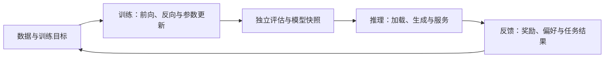

# 第 1 章　系统全景

认识模型从训练、评估、发布到服务与反馈的生命周期，区分三类系统各自的目标和完成条件。

## 1. 模型生命周期中的三类工作

AI Infra（AI Infrastructure，人工智能基础设施）负责把模型计算组织成可以持续运行的系统，涵盖计算设备、执行软件、数据、存储、通信与调度。模型能力来自学习过程；服务把已有能力提供给使用者；反馈又可能产生新的训练数据。这三个过程共享设备与模型，却有不同的输入、状态和完成条件。



训练的产物是达到质量要求的模型及其可恢复状态；推理的产物是在约束内完成的预测或生成；在线 RL（Reinforcement Learning，强化学习）则在生成和更新之间建立反馈闭环，通过动作得到的奖励改善后续策略。不是每个服务请求都会用于训练，也不是每种后训练方法都需要在线生成。

本书先讲三者共用的模型与设备基础，再分别展开训练、推理和后训练。阅读过程中始终追踪五个问题：**算什么，存什么，谁负责，何时完成，怎样判断结果正确且有效？**

## 2. 一次训练更新怎样成为长期训练作业

模型训练从数据与目标出发。对于语言模型，一个常见目标是根据前文预测后续 token；token 是分词后参与计算的基本单位。模型给出预测，损失衡量预测与目标的差异，反向传播求出参数对损失的影响，优化器据此更新参数。

```text
数据读取与采样 → 构造输入、标签与有效位置
                         ↓
                    前向 → 损失
                         ↓
                    反向 → 梯度汇合 → 优化器更新
                                           ↓
                              下一次更新／评估／保存
```

这条链同时包含数学与系统责任。数据管线必须持续提供正确样本；设备执行前向与反向；多卡参与者必须按同一个目标汇合梯度；优化器需要相容的参数、梯度和历史状态。为了适应显存，可以把一次逻辑更新拆成多个小批次。例如一次更新要使用 64 条样本，而显存只能容纳 16 条，就在同一份参数上依次处理四批，累积它们对本次目标的梯度，最后更新一次。若每处理 16 条就更新参数，后面三批使用的参数已经改变，得到的是四次小批更新，学习过程也随之改变。第 5 章会推导这些梯度应怎样加权。

训练过程中保存的数值并不都具有相同用途。参数决定当前模型怎样计算，跨更新保留；激活是本次前向产生的中间结果，反向可能需要读取；梯度说明本次损失对参数的影响，更新结束后通常可以清理；优化器历史则记录过去梯度的信息，用来决定下一次怎样更新。

因此“保存模型”需要先说明用途。若只为推理发布，一份权重加上模型配置可能已覆盖主要需求；若要中断后继续训练，还需保存优化器历史和数据进度等状态。例如参数已经学过前 100 批数据，恢复时却把数据游标退到第 80 批，程序仍能运行，但会再次训练已经使用过的 20 批。第 18 章会把这类状态如何一起保存展开为恢复协议。

完成一个 step 只说明完成了一次更新。完成训练还要达到约定的质量，并计入数据等待、评估、保存、失败与恢复。每秒处理更多 token，并不保证更早达到相同质量；改变 batch 或精度之后，所需更新次数也可能改变。

## 3. 一次模型生成怎样成为在线服务

推理使用已有参数计算输出。自回归语言模型先处理已知输入，称为 Prefill；随后逐步生成新 token，称为 Decode。为了避免每一步重复计算全部历史，系统保存后续注意力所需的历史表示，即 KV 状态。

```text
请求输入 → 接纳与路由 → 实例队列 → Prefill
                                      ↓
                            Decode → 采样 → 输出
                               ↑        │
                               └─ 未结束 ┘
```

实例是一组可以完成模型调用的执行资源，可以占用一张或多张卡。多个独立实例形成副本。服务入口负责请求身份和配额，路由选择实例，实例内调度决定哪些请求进入同一批计算，运行时负责组织 CPU 与 GPU 的工作。

与训练相比，在线服务通常面对不可完全预知的到达时间与生成长度。它必须同时管理排队、动态批次、KV 容量和流式连接。权重常驻并不意味着每次执行不再读取权重；历史缓存可复用也不意味着所有请求都命中缓存。

完成一次模型前向、返回一个 token、结束一个请求，是三个不同的事件。服务的结果需要同时满足质量与时限；只看设备吞吐，会遗漏请求在队列中等待的时间以及被拒绝的工作。

## 4. RL 怎样连接生成、反馈与更新

在线 RL 使用当前或某个历史策略版本生成轨迹，通过奖励等反馈构造学习信号，再更新参数。策略是用于选择输出或动作的模型及其概率规则。轨迹可以是一段回答，也可以是包含多轮工具交互的任务过程。

```text
策略快照 → 生成／环境交互 → 奖励与样本整理
    ↑                              ↓
权重发布 ← 参数更新 ← 训练目标与有效样本
```

例如让模型为同一道题生成三条回答，分别得到奖励 0、1、2。训练器可以依据同组比较构造学习信号，再用这些回答更新参数。生成端若仍保留旧权重，下次回答就不会自动体现这次更新，还需要把新权重发布过去。

这个循环中，回答的文字、生成时的概率、奖励和模型版本必须始终能够对应起来。假设训练器已经更新到版本 12，队列中却还有版本 10 生成的回答，就不能把它们记录成版本 12 的产物。允许生成与训练同时推进可以减少空闲，但也会使这种版本差和积压出现；后续 RL 章节会解释哪些数据可用，以及怎样控制等待。

Agent（智能体）是围绕目标进行观察、选择动作并与环境交互的系统；本书中的语言模型 Agent 还需要工具环境，例如文件系统、浏览器或代码执行器。CPU 是执行通用程序与调度的中央处理器，GPU 是这里承担大量并行模型计算的图形处理器／加速器。环境可能在模型等待期间继续占用 CPU、内存和存储；工具调用完成不等于任务成功，任务成功也不等于它已经成为有效训练样本。奖励计算与独立评估承担不同职责，不能仅凭训练奖励上升判断模型能力改善。

## 5. 三类系统共用什么，又各自维护什么

| 维度 | 训练 | 推理服务 | 在线 RL |
|---|---|---|---|
| 工作单位 | 有效样本与逻辑更新 | 请求与生成 token | 轨迹、样本组与策略更新 |
| 主要执行 | 前向、反向、梯度处理、更新 | Prefill、Decode、采样 | 生成、反馈、训练与发布 |
| 长期状态 | 参数、优化器、数据进度 | 权重、服务配置、可复用缓存 | 训练状态、策略版本、样本身份 |
| 动态状态 | 激活、梯度、通信缓冲 | 请求队列、KV、输出连接 | 在途轨迹、环境、权重交接缓冲 |
| 主要目标 | 达到质量所需的时间与资源 | 质量和时限约束下的有效服务量 | 有效反馈带来的质量进展 |
| 故障后的关键问题 | 能否从相容状态继续更新 | 能否正确结束、重试并回收请求 | 是否重复消费样本或混用策略版本 |

三者都会使用模型算子、编译器、设备、内存和通信。系统差异来自这些资源被怎样组织，以及何种状态必须保持一致。训练并行可以帮助推理拆分模型，但不能直接决定服务调度；推理引擎可以承担 RL 生成，但不能独自定义训练样本的语义。

### 从算法实验到可负责的系统

假设算法实验已经在一张卡上验证：针对同一个问题生成几个回答，打分，再提高高分回答的概率。把这个循环放到多台机器后，新问题出现了：奖励服务超时的回答该不该记零分？训练已经更新参数，迟到的回答还能不能使用？进程重启后，怎样知道哪些回答已经参与过更新？这些问题会改变学习过程，需要与算法目标一起设计。

本书以一条回答的经历连接算法与系统。它先具有任务身份，再获得生成时的策略身份；生成后保留实际 token、条件上下文和相应概率；反馈赋予它奖励与结束原因；整理过程决定哪些位置参与损失；一次提交成功的更新消费这份数据，随后发布新的策略。回答的文字只是这条链中的一个结果。

| 交接处 | 接收方需要能回答的问题 | 丢失信息后的典型后果 |
|---|---|---|
| 任务到生成 | 这次到底要求模型完成什么？ | 模板或截断改变任务，却仍与旧实验比较 |
| 生成到训练 | 哪个策略在什么上下文下选择了这些动作？ | 概率与动作错位，程序仍能运行 |
| 反馈到样本 | 低分来自任务失败，还是反馈系统故障？ | 模型开始学习基础设施的偶然故障 |
| 更新到恢复 | 哪份模型状态与哪段消费进度对应？ | 重复训练或静默跳过数据 |

RL Infra 工程师需要能沿这条链定位问题：先判断学习目标是否保持，再判断状态与执行是否正确，最后解释资源花在哪里。后文的张量、梯度、并行和队列将依次成为分析这些交接处的工具。

## 6. 从全景进入后续章节

第二章先建立共同设计语言。第二篇用张量、前向和梯度解释模型计算；第三篇把这些工作放到设备与多卡互联上。第四篇完整讨论训练作业，第五篇讨论推理服务，第六篇讨论后训练和 RL。第七篇将三类系统分别落实为可以核对的综合案例。

源码细节、特殊模型和论文推导作为附录资料查询。正文会先解释继续阅读所需的概念；遇到实现链接时，可以继续顺序阅读，无须先把链接中的资料读完。

## 本章回顾

训练以质量进展和可恢复更新为中心，推理以请求质量和时限为中心，RL 在二者之间增加反馈、轨迹与版本。三类系统共享资源，但必须分别定义状态与完成条件。

**检查理解：** 为什么同一份权重不能代表完整训练状态，也不能代表整个在线服务？

下一章讨论系统设计的共同语言。把需求写成工作、容量、时间、质量与成本约束，用同样的方法比较训练和推理候选。

<!-- book-nav -->

[前言与全书目录](<../README.md>) · [全书目录](<../README.md>) · [下一章：系统设计的共同语言](<02_系统设计的共同语言.md>)

<!-- /book-nav -->
