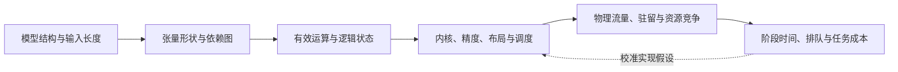

# 第 6 章　模型结构与执行成本

把模型的形状与依赖转换成运算量、状态容量和访问量，比较结构变化对训练与推理的不同影响。

本章内容：

- [1. 从模型结构到执行成本：形状、工作量、状态与时间](#s1)
- [2. Attention 的设计空间与问题演进](#s2)
- [3. 从模型变化同时检查训练与推理](#s3)
- [4. 为 RL 的多次模型调用分别记账](#s4)

## 1. 从模型结构到执行成本：形状、工作量、状态与时间

模型参数量能约束权重容量，却不能独自决定一次请求的成本。还要知道本次计算哪些位置、读取哪些历史、怎样形成 batch，以及张量经过什么实现和布局。本节连接模型定义与系统设计：先算语义上需要完成的工作，再算实现产生的流量和状态，最后推导资源下界与执行时间。

### 1. 先声明计算口径

先考虑各层结构相同的稠密 decoder：因果全注意力、GQA、门控 FFN，不计 bias。一次乘加计两个 FLOPs；以下矩阵计算按有效位置计数，不把被 mask 的位置算成必要工作。

| 符号 | 含义 |
|---|---|
| $L,h,f$ | 层数、隐藏维度、门控 FFN 的中间维度 |
| $n_q,n_{kv},d$ | Query 头数、KV 头数、每头维度；本节假设 $h=n_qd$，记 $h_{kv}=n_{kv}d$ |
| $p_i,s_i$ | 请求 $i$ 本次新增的计算位置数、调用前已存在且可复用的历史长度 |
| $m=\sum_i p_i$ | 本次进入投影和 FFN 的总位置数；decode 每条被调度请求通常贡献一个位置 |
| $b_w,b_{kv}$ | 权重、KV 每元素的存储字节数；量化 scale、对齐和元数据另算 |
| $V,m_{out}$ | 词表大小、本次实际计算词表 logits 的位置数 |

已经命中的历史不再进入这次投影和 FFN，但仍可能被新 Query 读取。训练中通常没有可复用的跨 step KV；packed sequence 的边界、mask 和 padding 也必须按实际语义处理，不能把多个独立序列当作一条互相可见的长序列。

### 2. 用矩阵形状得到每层工作量

#### 投影与门控 FFN

对一个 $[m,a]\times[a,b]$ 矩阵乘，有效工作量为 $2mab$。将每层矩阵列出来：

| 运算 | 权重形状 | 参数数 | 前向 FLOPs |
|---|---|---:|---:|
| Q 投影 | $[h,h]$ | $h^2$ | $2mh^2$ |
| K、V 投影 | 各 $[h,h_{kv}]$ | $2hh_{kv}$ | $4mhh_{kv}$ |
| O 投影 | $[h,h]$ | $h^2$ | $2mh^2$ |
| 门控 FFN 的两个上投影与下投影 | 两个 $[h,f]$，一个 $[f,h]$ | $3hf$ | $6mhf$ |

因此每层线性部分为

$$
N_{linear}=2h^2+2hh_{kv}+3hf,
\qquad F_{linear}=2mN_{linear}.
$$

激活函数、门控逐元素乘法、Norm、RoPE 和量化转换还需单列。它们不适合全部除以矩阵单元峰值：运算种类、归约依赖和中间数据访问不同。

#### Attention 按可见位置对计数

请求 $i$ 的第 $j$ 个新增位置能看到 $s_i+j$ 个位置，包括自身。整次调用的有效 Query–Key 位置对数为

$$
C=\sum_i\left[p_i s_i+\frac{p_i(p_i+1)}2\right].
$$

对每个位置对，每个 Query 头的 QK 点积约需 $2d$ FLOPs，PV 累加约需 $2d$ FLOPs；因此每层

$$
F_{attention}=4n_qdC=4hC.
$$

这是 QK 与 PV 的有效矩阵工作量，不含 Softmax；内核的分块、因果边缘块和 padding 可能增加实际执行工作。GQA 减少 KV 头数和对应投影、状态，但多个 Query 头仍分别计算注意力，不能把上述 $n_q$ 一并替换为 $n_{kv}$。[GQA 论文](https://arxiv.org/abs/2305.13245)给出了这种共享关系。

相同 $m$ 可以对应不同的 $C$：已有历史长度不同，或新增位置分属不同序列，都会改变 Attention 工作量。这也是统一 token budget 只能作为调度近似的原因。

#### Embedding 和输出头另算

输入 embedding 通常是按 token 查表，不应按完整词表矩阵乘计数。输出头若执行 $[m_{out},h]\times[h,V]$，则增加 $2m_{out}hV$ FLOPs。推理 prefill 通常只需要末位置 logits；训练可能计算所有位置后再用 loss mask，也可能使用能够跳过部分位置的实现。有效监督位置数不自动等于实际算 logits 的位置数。

输入 embedding 与输出头若共享权重，容量只计一份 $hV$，但执行工作仍分别发生。词表并行、融合交叉熵和采样还会改变临时张量、通信与归约，不能把完整 $m_{out}V$ logits 张量视为所有实现都必须驻留的状态。

### 3. 容量、逻辑访问和物理流量分别建账

标准全历史 GQA 在本次调用后、无前缀共享时，每层的有效 KV 字节数为

$$
M_{KV,layer}=2b_{kv}h_{kv}\sum_i(s_i+p_i),
\qquad \Delta M_{KV,layer}=2b_{kv}h_{kv}m.
$$

前一项是有效状态，后一项是新增状态。物理分配还包含页尾空位、预留、元数据和分片策略；前缀共享后应数唯一物理对象，不能继续把每请求逻辑长度直接相加。细节由[推理内存系统](<../05_Inference/20_KV容量分页与复用.md#s1>)维护。

这两个容量式都不等于本次 HBM 流量。多个 Query 可复用同一 K/V tile；同一 tile 也可能因为片上容量、线程块划分或 Query 分组重复加载。权重是否每轮从 HBM 读取一次，也取决于缓存、分块和跨请求复用。应区分四层：

| 层次 | 计数对象 | 能回答的问题 |
|---|---|---|
| 逻辑状态 | 模型语义要求保留的元素 | 需要什么历史与权重？ |
| 物理驻留 | 当前各资源上唯一分配的对象 | 能否容纳目标活跃集合？ |
| 某接口流量 | 实际越过 HBM、PCIe、NIC 等边界的字节 | 哪一条数据路径受限？ |
| 访问次数与顺序 | 读取、写回、重取的时序 | 能否复用、预取或隐藏搬移？ |

[FlashAttention](https://arxiv.org/abs/2205.14135)通过分块与融合减少对外部内存的中间结果读写，不要求物化完整注意力分数矩阵；它没有因此消除精确全历史 decode 所需的历史状态。HBM 流量、片上流量和网线流量也不能相加后除以一个带宽。

### 4. 从一次调用累加到完整生成

考虑没有旧会话历史的一次请求：输入长度 $P\ge1$，生成长度 $G\ge1$，逐 token 自回归，不使用推测解码。Prefill 处理 $P$ 个位置后产生第一个输出；其余 $G-1$ 个输出各需一次 decode。因而投影与 FFN 累计处理

$$
m_{request}=P+G-1
$$

个位置。第 $j$ 次后续 decode（$1\le j\le G-1$）包含一个新 Query，可见 Key 长度为 $P+j$。完整请求的有效位置对数为

$$
C_{request}=\frac{P(P+1)}2+(G-1)P+\frac{G(G-1)}2.
$$

将 $m_{request}$ 与 $C_{request}$ 代入每层公式，乘以同构层数，再加入输出头和其他操作，即得这一路径的工作量。最后采样的 token 尚未进入下一次 forward，停止时实际写入 KV 的位置通常是 $P+G-1$；为下一步或输出上限预留的容量则是另一项。多轮追加、复用历史和推测验证需要按各次真实调用重新累加。

工作量可以相加，延迟不能按每请求独占一份权重读取来简单相加：并发请求可能共享 batch 的权重访问，也会在同一设备上排队。完整请求的状态驻留量还取决于每轮等待多久。二者由[动态调度](<../05_Inference/21_批处理调度与排队.md#s1>)与[负载账本](<../appendices/design/负载状态与资源需求.md>)连接。

### 5. 训练反向与峰值不能靠统一倍数替代

对 $Y=XW$，若 $X\in\mathbb R^{m\times a}$、$W\in\mathbb R^{a\times b}$，前向、输入梯度 $dX=dYW^T$、权重梯度 $dW=X^TdY$ 各约为 $2mab$ FLOPs。只有三项都执行时，才得到这一线性层约 $6mab$ 的训练工作量。

常见的 $6ND$ 估算据此把 $N$ 视为每 token 参与计算的线性参数规模，$D$ 为训练 token 数；它省略了 Attention 的长度项、重算、补齐、优化器更新与通信，不能把 MoE 总参数直接代入。冻结参数通常省去该参数的梯度和更新，但反向仍可能需要穿过冻结层以训练其他参数；LoRA 也会引入自己的前向与梯度路径。应以需要计算的图为准。

训练显存由同时存活的对象决定。令 $\mathcal O_r(t)$ 为资源 $r$ 在时刻 $t$ 持有的唯一物理分配集合，则

$$
M_{peak,r}=\max_t\sum_{o\in\mathcal O_r(t)}\operatorname{bytes}(o).
$$

集合中包括权重、梯度、优化器、保存激活、工作区、通信暂存与分配器保留，alias 不重复计数。把各项在不同时刻的最大值直接相加只是保守预算，未必是真实峰值；把活跃张量相加又可能遗漏 allocator 仍占用的块。重算改变保存集合和运算图，分片改变 owner 和聚合时刻，流水改变同时存活的 microbatch 数。继续看[训练显存优化](<../04_Training/13_精度激活与训练状态.md#s3>)。

### 6. 特殊结构应修改哪一项

| 结构变化 | 需要替换的成本项 |
|---|---|
| 不同层宽度或不同 Attention 类型 | 逐层使用实际形状求和，不能把“平均层”乘以 $L$ |
| MLA | 按实际保留的压缩 latent、位置分量和执行路径计算；恢复式与吸收式实现的运算、权重及读取不同 |
| 稀疏 Attention | 有效位置对改为所选集合，并加入索引生成、gather、补齐与元数据；选择开销也在关键路径上 |
| 线性/递归 Attention | decode 状态可能不随历史长度增长；训练的扫描、中间保存与反向成本仍需独立推导 |
| MoE | 逐 token 选择决定有效计算，批内专家并集决定本轮涉及的权重，补齐和最忙 rank 决定物理执行 |
| 多模态与扩散 | 加入编码器、跨模态连接、生成阶段及重复迭代；状态生命周期不沿用纯文本 KV 假设 |

具体定义见[模型架构](<../appendices/models/README.md>)；MoE 的分派、容量与迁移边界见[收益与系统成本](<../appendices/models/moe/收益边界与系统成本.md>)。这些模型改变的是计算图和状态，不只是公式中的一个压缩系数。

### 7. 把资源需求映射到时间

先固定实现、设备布局和调度。对资源 $r$，令 $D_r$ 为要在该资源上完成的工作量，$R_r$ 为相应处理率；单位可以是 FLOPs 与 FLOP/s、bytes 与 bytes/s，或一次串行服务与次/s。资源容量给出必要下界

$$
T\ge\max_r\frac{D_r}{R_r}.
$$

矩阵、向量、内存和链路应分别列项。峰值能力得到乐观下界；由目标形状与竞争条件校准的有效能力可用于近似预测，但不能无条件跨负载复用。共享同一接口的流量要合并，拥有独立接口的资源也只有在依赖允许时才能并行。

执行图还给出另一条约束：沿任意依赖路径，阶段时间必须累加。QK、Softmax、PV 依次消费结果时，把全模型的 FLOPs 和字节分别相加后取一个最大值，会遗漏这种串行性。可靠模型需要同时满足资源负载下界和依赖关键路径，再加入启动、同步、调度与资源争用。[Roofline](https://www2.eecs.berkeley.edu/Pubs/TechRpts/2008/EECS-2008-134.html)适合定位单个计算区域的吞吐上界，不能单独预测整个在线服务。

通信的 $D_r$ 来自并行布局、collective 算法和物理路由，不能由参数量直接推出；继续看[通信模型](<../03_Execution/11_互联通信与成本.md#s2>)和[自动并行代价模型](<../appendices/parallelism/自动并行与代价模型.md>)。服务时间之外还有排队，排队又延长 KV 和环境状态驻留，因此调度改变后必须重新检查容量。

最后把时间与能耗放回任务合同：相同输出 token 数未必对应相同质量，较快的一次训练 step 也未必更早达到目标。用[质量约束下的成本与预算](<../appendices/design/质量约束下的成本与预算.md>)比较有效产出，并明确每个输入属于结构推导、实现分析还是测量校准。

### 推导适用范围

本节借鉴[《深入理解 AI Infra》模型架构章](https://bojieli.github.io/ai-infra-book/manuscripts/02-%E6%A8%A1%E5%9E%8B%E6%9E%B6%E6%9E%84.html)从模型形状连接资源成本的组织方式。公式按本文的因果 GQA 与门控 FFN 假设展开，不代表所有 checkpoint 的结构或所有内核的实际指令数。已有设计案例中的教学阶段时间仍是独立输入，不能把本节的工作量下界当作那些时间已经得到设备验证。

## 2. Attention 的设计空间与问题演进

### 五个相互独立的设计轴

| 设计轴 | 问题 | 代表方向 | 后续约束 |
|---|---|---|---|
| 数学与数据搬运 | 中间注意力矩阵读写昂贵 | FlashAttention 等 IO-aware 实现 | 分块、在线归约、硬件映射 |
| 状态宽度 | 每个历史 token 的 KV 太大 | MQA、GQA、MLA | 表达能力、投影和内核支持 |
| 访问集合 | 历史太长，不想读取全部位置 | 局部、块稀疏、动态检索 | 选择质量、索引与不规则访问 |
| 历史表示 | 不想保存随长度增长的 token 状态 | 递推与线性状态 | 固定状态容量、精确检索、训练并行 |
| 物理管理 | 动态请求导致分配浪费 | 分页、共享与分层 KV | 映射、引用、淘汰和传输 |

这五个轴可以组合。分页属于运行时存储组织，GQA 属于模型参数化；FlashAttention 的核心目标是高效实现注意力计算，不能据此推导它消除了所有序列长度相关计算。

### 从完整计算到 IO 优化

直接构造分数矩阵容易理解，却会产生大中间结果。分块和在线 Softmax 允许在不保存完整矩阵的情况下累积结果。新的问题是保持数值稳定、处理反向、安排片上资源和并行任务。

详细推导和论文沿革维护在[FlashAttention 论文](<../appendices/papers/01_FlashAttention论文详解.md>)，Kernel 视角见[算子案例](<../03_Execution/09_矩阵乘与Attention算子.md#s2>)。

### 从多头缓存到压缩表示

减少 KV heads 降低缓存宽度，GQA 在共享程度与表示能力之间提供设计空间。MLA 使用潜变量表示并结合执行变换，其容量收益需要与额外计算、位置处理和特定 backend 一起评估。见[MLA 推导](<../appendices/models/mla/README.md>)。

这条路线仍需处理历史长度。压缩每个 token 的状态不等于不再读取长历史。

### 从扫描历史到选择历史

局部窗口直接限制可见范围，块稀疏改善规则性，动态选择适应输入。选择过程可能包含打分、Top-K、索引表和 gather；被省掉的 attention 工作必须大于新增成本，还要保持所需任务质量。见[稀疏专题](<../appendices/models/sparse_attention/README.md>)。

### 从 token 列表到递推状态

递推结构将历史汇总到状态，并按 token 更新。它改变记忆与读取方式，不应仅凭线性复杂度推断速度或质量。顺序更新如何并行训练、状态如何分片、推测失败后如何回滚，都成为系统问题。见[线性注意力](<../appendices/models/linear_attention/README.md>)。

### 方法比较的共同条件

固定模型规模、任务质量、输入输出长度分布、batch、精度、硬件与实现成熟度。分别记录 prefill、decode、显存和端到端指标。某个方法在长上下文训练中有优势，不能自动外推到小 batch 的低延迟服务。

参考：[FlashAttention](https://arxiv.org/abs/2205.14135)、[GQA](https://arxiv.org/abs/2305.13245)、[PagedAttention](https://arxiv.org/abs/2309.06180)。

---

## 3. 从模型变化同时检查训练与推理

前面推导了形状和成本。将这些结果用于结构选择时，需要同时检查前向、反向、状态寿命和任务质量。

| 结构变化 | 对训练的主要影响 | 对推理的主要影响 |
|---|---|---|
| GQA 或低秩 KV 表示 | 投影形状、共享梯度与算子实现改变 | 历史状态宽度与访问量改变 |
| 稀疏 Attention | 可见位置、反向索引和不规则计算改变 | 历史访问与索引开销改变 |
| 递推或线性状态 | 跨位置的训练并行与反向保存方式改变 | 历史可压缩为递推状态，能力边界需验证 |
| MoE 条件计算 | 专家负载、参数状态、路由梯度与跨卡交换改变 | 活跃计算量、专家放置和小批次效率改变 |
| 残差与归一化 | 梯度传播、稳定性和激活保存改变 | 额外算子、读写和融合机会改变 |
| 多模态与扩散 | 数据表示、目标、对齐和训练工作量改变 | 编码、生成或迭代阶段及交接状态改变 |

MoE（Mixture of Experts，混合专家）把部分子网络组织成多个专家，并由路由器为 token 选择专家。每次只激活部分专家，可以让总参数量与单次活跃计算量不同；全部专家的参数和训练状态仍需要放置，负载不均也会影响完成时间。第 15 章再解释专家跨设备后的数据路径。

残差连接把输入与某个子层输出相加，归一化调整中间表示的数值尺度。它们已经出现在 Transformer 前向中；从系统角度，还要检查新增状态是否保留到反向，以及实现是否能与相邻算子融合。

特殊结构的完整数学推导收录在[模型附录](../appendices/models/README.md)。这里建立的是比较方法：固定任务质量，分别计算前向、反向、容量和访问，不用某一项复杂度的改善替代整个系统的结论。

## 4. 为 RL 的多次模型调用分别记账

同一条回答可能先逐步生成，再被训练模型、参考模型或价值模型读取。若只用“回答有 1000 token”估算成本，会把几条执行路径混在一起。后面的 RL 篇定义各角色；这里先用已经学过的前向与反向区分成本。

设问题长 $P$，回答长 $G$。对至少生成一个 token 的请求，无跨请求前缀缓存复用、无推测执行时，生成需一次 prefill 和 $G-1$ 次 decode；对已知回答打分则可以一次处理问题与回答，按因果前向取得目标位置的概率。后一过程没有未知 token 的生成依赖，但仍要计算上下文表示和注意力。只保留回答位置的 loss 不代表可以省去问题位置的全部前向。

| 本轮调用 | 参数是否更新 | 主要状态 |
|---|---|---|
| 生成回答 | 否 | 权重、KV、采样状态 |
| 固定模型为已知回答打分 | 否 | 权重、前向工作区、所需分数 |
| 当前模型学习这条回答 | 是 | 参数、梯度、优化器、反向所需激活 |

冻结模型打分通常可关闭梯度记录，降低保存激活的成本；需要更新的模型必须保留或重算反向输入。若同一轮对回答训练多个 epoch，计算会重复，样本年龄也会增加。因此整体预算应对实际调用逐项求和，并按同时驻留关系计算峰值，不能简单用一个“RL 倍数”乘参数量。

## 本章回顾

结构决定运算和逻辑状态，实现决定实际访问与调度。KV 压缩、稀疏访问、条件计算和递推状态影响的成本不同，训练与推理必须分别核算。

**检查理解：** 缩小 KV、减少激活专家和重计算分别改变哪一项成本，哪些成本仍然存在？

下一章讨论硬件与存储层次。从数据复用认识主存、显存与片上存储，再建立 GPU 的执行层次和计算、访存的性能下界。

<!-- book-nav -->

[上一章：损失自动微分与优化器](<05_损失自动微分与优化器.md>) · [全书目录](<../README.md>) · [下一章：硬件与存储层次](<../03_Execution/07_硬件与存储层次.md>)

<!-- /book-nav -->
