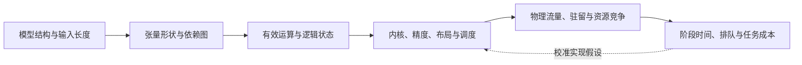

# 第 6 章　模型结构与执行成本

把模型的形状与依赖转换成运算量、状态容量和访问量，比较结构变化对训练与推理的不同影响。

本章内容：

- [1. 从模型结构到执行成本：形状、工作量、状态与时间](#s1)
- [2. Attention 的设计空间与问题演进](#s2)
- [3. 从模型变化同时检查训练与推理](#s3)
- [4. 为 RL 的多次模型调用分别记账](#s4)

<a id="s1"></a>

<a id="s1-从模型结构到执行成本形状工作量状态与时间"></a>

## 1. 从模型结构到执行成本：形状、工作量、状态与时间


模型参数量能约束权重容量，却不能独自决定一次请求的成本。还要知道本次计算哪些位置、读取哪些历史、怎样形成 batch，以及张量经过什么实现和布局。本节连接模型定义与系统设计：先算语义上需要完成的工作，再算实现产生的流量和状态，最后推导资源下界与执行时间。

可以先用同一个模型的三组对照理解：输入 10 个 token 与输入 1000 个 token，投影和 FFN 的工作量不同；都 decode 一个 token，但已有历史分别为 100 和 10000 个位置时，Attention 的工作量和历史访问需求不同；单独执行一条请求与把多条请求合成一个 batch，权重访问的复用程度也可能不同。因此，参数量描述“模型有多少权重”，还需要结合本次输入才能描述“这次要做多少工作”。



<a id="s1-1-先声明计算口径"></a>

### 1. 先声明计算口径

先考虑各层结构相同的稠密 decoder：因果全注意力、GQA、门控 FFN，不计 bias。一次乘加计两个 FLOPs；以下矩阵计算按有效位置计数，不把被 mask 的位置算成必要工作。

| 符号 | 含义 |
|---|---|
| $L,h,f$ | 层数、隐藏维度、门控 FFN 的中间维度 |
| $n_q,n_{kv},d$ | Query 头数、KV 头数、每头维度；本节假设 $h=n_qd$，记 $h_{kv}=n_{kv}d$ |
| $p_i,s_i$ | 请求 $i$ 本次新增的计算位置数、调用前已存在且可复用的历史长度 |
| $m=\sum_i p_i$ | 本次进入投影和 FFN 的总位置数；decode 每条被调度请求通常贡献一个位置 |
| $b_w,b_{kv}$ | 权重、KV 每元素的存储字节数；量化 scale、对齐和元数据另算 |
| $V,m_{out}$ | 词表大小、本次实际计算词表 logits 的位置数 |

已经命中的历史不再进入这次投影和 FFN，但仍可能被新 Query 读取。训练中通常没有可复用的跨 step KV；packed sequence 的边界、mask 和 padding 也必须按实际语义处理，不能把多个独立序列当作一条互相可见的长序列。

**贯穿本节的小模型。** 为了逐步核对公式，使用以下教学配置，所有层结构相同；它不对应真实 checkpoint 或性能测量：

| 配置 | 数值 | 直观含义 |
|---|---:|---|
| $L$ | 2 | 两个 Transformer 层 |
| $h$ | 8 | 每个位置的隐藏向量有 8 个元素 |
| $n_q$ | 4 | 4 个 Query 头 |
| $n_{kv}$ | 2 | 2 个 KV 头，使用 GQA |
| $d$ | 2 | 每个头有 2 个元素 |
| $f$ | 16 | 门控 FFN 的中间维度 |
| $V$ | 20 | 词表有 20 个 token |
| $b_{kv}$ | 2 字节 | 每个 KV 元素的存储大小 |

由此 h=n_qd=8、h_kv=n_kvd=4。h_kv 是一个位置的所有 K 头拼接后的总宽度，V 也有同样宽度；它不是词表大小 V。

再固定一次调用的两个请求。纯文本中，一个计算位置通常对应一个 token：

| 请求 | 本次执行 | 新增计算位置 $p_i$ | 已有历史 $s_i$ |
|---|---|---:|---:|
| A | 对 3 个 prompt token 做 prefill | 3 | 0 |
| B | 复用 5 个位置的 KV，再 decode 一个位置 | 1 | 5 |

本次 m=3+1=4，输入各层投影和 FFN 的张量可按 [4,8] 理解。B 的 5 个历史位置不重新经过这些线性层，但它们的 KV 仍可被新 Query 读取。新增位置数 m 与可见历史长度因此需要分别计数；下面用位置对数 C 描述后一种需求。

<a id="s1-2-用矩阵形状得到每层工作量"></a>

### 2. 用矩阵形状得到每层工作量

<a id="s1-投影与门控-ffn"></a>

#### 投影与门控 FFN

对一个 $[m,a]\times[a,b]$ 矩阵乘，输出形状为 [m,b]，有 mb 个输出元素。每个输出元素是长度为 a 的点积；按每项乘加计两个 FLOPs 的口径，有效工作量为 $2mab$。权重只有 ab 个参数，但同一份权重用于本次全部 m 个位置。例如 [4,8]×[8,8] 的权重有 64 个参数，本次矩阵乘约需 2×4×8×8=512 FLOPs。将每层矩阵列出来：

| 运算 | 权重形状 | 参数数 | 前向 FLOPs |
|---|---|---:|---:|
| Q 投影 | $[h,h]$ | $h^2$ | $2mh^2$ |
| K、V 投影 | 各 $[h,h_{kv}]$ | $2hh_{kv}$ | $4mhh_{kv}$ |
| O 投影 | $[h,h]$ | $h^2$ | $2mh^2$ |
| 门控 FFN 的两个上投影与下投影 | 两个 $[h,f]$，一个 $[f,h]$ | $3hf$ | $6mhf$ |

Q 投影将每个隐藏向量映射到全部 Query 头的总宽度 n_qd=h；K、V 投影各映射到较窄的 n_kvd=h_kv；Attention 的各 Query 头输出拼接后宽度仍为 h，再经过 O 投影。因此 GQA 的 KV 共享并不缩小 Q 与 O 的矩阵形状。

门控 FFN 的典型形式为：

$$\operatorname{FFN}(X)=\left(\operatorname{act}(XW_1)\odot XW_2\right)W_3.$$

这里 W₁、W₂ 都把 h 映射到 f，先逐元素相乘，再由 W₃ 把 f 映射回 h；$\odot$ 表示逐元素乘法。三个矩阵各有 hf 个参数，矩阵乘部分合计 6mhf FLOPs。逐元素激活与乘法另算。

因此每层线性部分为

$$
N_{linear}=2h^2+2hh_{kv}+3hf,
\qquad F_{linear}=2mN_{linear}.
$$

代入小模型，每层 N_linear=2×8²+2×8×4+3×8×16=576。一次调用 m=4，所以每层线性工作量为 2×4×576=4608 FLOPs，两层合计 9216 FLOPs。这是投影和 FFN 的矩阵乘工作量，尚未计入 Attention 的 QK/PV 和输出头。

激活函数、门控逐元素乘法、Norm、RoPE 和量化转换还需单列。它们不适合全部除以矩阵单元峰值：运算种类、归约依赖和中间数据访问不同。

<a id="s1-attention-按可见位置对计数"></a>

#### Attention 按可见位置对计数

请求 $i$ 的第 $j$ 个新增位置能看到 $s_i+j$ 个位置，包括自身。整次调用的有效 Query–Key 位置对数为

$$
C=\sum_i\left[p_i s_i+\frac{p_i(p_i+1)}2\right].
$$

这个式子来自逐个 Query 求和：第一个新增位置看到 sᵢ+1 个 Key，第二个看到 sᵢ+2 个，直到第 pᵢ 个看到 sᵢ+pᵢ 个，均包含自身。因此单请求的位置对数为：

$$\sum_{j=1}^{p_i}(s_i+j)=p_i s_i+\frac{p_i(p_i+1)}2.$$

小模型调用中，A 的三个 Query 分别看到 1、2、3 个 Key，共 6 对；B 的新 Query 看到 5 个历史位置及自身，共 6 对。两请求合计 C=12。两条请求互相不可见，不能把它们拼成一条没有边界的序列来计算位置对。

对每个位置对，每个 Query 头的 QK 点积约需 $2d$ FLOPs，PV 累加约需 $2d$ FLOPs；因此每层

$$
F_{attention}=4n_qdC=4hC.
$$

QK 的 2d 来自长度为 d 的点积；PV 的 2d 来自用该位置对的权重乘 d 个 V 分量，并累加到输出。小模型每层的 QK/PV 工作量为 4×8×12=384 FLOPs。这里 C 只计位置对，尚未乘头数；多个 Query 头共享 K/V，并不意味着它们的匹配分数和输出也相同。

这是 QK 与 PV 的有效矩阵工作量，不含 Softmax；内核的分块、因果边缘块和 padding 可能增加实际执行工作。GQA 减少 KV 头数和对应投影、状态，但多个 Query 头仍分别计算注意力，不能把上述 $n_q$ 一并替换为 $n_{kv}$。[GQA 论文](https://arxiv.org/abs/2305.13245)给出了这种共享关系。

相同 $m$ 可以对应不同的 $C$：已有历史长度不同，或新增位置分属不同序列，都会改变 Attention 工作量。这也是统一 token budget 只能作为调度近似的原因。

<a id="s1-embedding-和输出头另算"></a>

#### Embedding 和输出头另算

输入 embedding 通常是按 token 查表，不应按完整词表矩阵乘计数。输出头若执行 $[m_{out},h]\times[h,V]$，则增加 $2m_{out}hV$ FLOPs。推理 prefill 通常只需要末位置 logits；训练可能计算所有位置后再用 loss mask，也可能使用能够跳过部分位置的实现。有效监督位置数不自动等于实际算 logits 的位置数。

输入 embedding 与输出头若共享权重，容量只计一份 $hV$，但执行工作仍分别发生。词表并行、融合交叉熵和采样还会改变临时张量、通信与归约，不能把完整 $m_{out}V$ logits 张量视为所有实现都必须驻留的状态。

在小模型调用中，假设 A 只为 prefill 的末位置计算 logits，B 为本次 decode 位置计算 logits，则 m_out=2，而进入各层的 m=4。输出头执行 [2,8]×[8,20]，工作量为 2×2×8×20=640 FLOPs。由此得到本次调用的三个矩阵工作量项：

| 项目 | 两层加输出头的有效 FLOPs |
|---|---:|
| 各层投影和 FFN | 2×4608=9216 |
| 各层 Attention 的 QK/PV | 2×384=768 |
| 输出头 | 640 |
| 上述三项合计 | 10624 |

这是固定计算口径的工作量，不是实测指令数或延迟。训练中的 loss mask 只决定哪些位置参与目标；除非实现明确跳过对应输出头计算，否则不能据此减少 m_out。第 5 章的 token loss 归约与这里的实际执行位置数是不同账目。

<a id="s1-3-容量逻辑访问和物理流量分别建账"></a>

### 3. 容量、逻辑访问和物理流量分别建账

标准全历史 GQA 在本次调用后、无前缀共享时，每层的有效 KV 字节数为

$$
M_{KV,layer}=2b_{kv}h_{kv}\sum_i(s_i+p_i),
\qquad \Delta M_{KV,layer}=2b_{kv}h_{kv}m.
$$

公式中的 2 分别对应 K 和 V，每项各有 h_kv 个元素，每元素占 b_kv 字节。小模型每层、每个位置的 KV 占 2×2×4=16 字节。调用后 A 有 3 个位置、B 有 6 个位置，故每层有效 KV 为 16×9=144 字节，两层共 288 字节；本次新增 m=4 个位置，每层新增 64 字节，两层新增 128 字节。

前一项是有效状态，后一项是新增状态。物理分配还包含页尾空位、预留、元数据和分片策略；前缀共享后应数唯一物理对象，不能继续把每请求逻辑长度直接相加。细节由[推理内存系统](<../05_Inference/20_KV容量分页与复用.md#s1>)维护。

这两个容量式都不等于本次 HBM 流量。多个 Query 可复用同一 K/V tile；同一 tile 也可能因为片上容量、线程块划分或 Query 分组重复加载。权重是否每轮从 HBM 读取一次，也取决于缓存、分块和跨请求复用。应区分四层：

容量回答“同时存了多少”，流量回答“这次搬了多少”。例如每层有 144 字节的有效 KV，不能据此断言本次恰好从 HBM 读取 144 字节；每个 Query 的访问集合、tile 的复用和重复加载都要另分析。

| 层次 | 计数对象 | 能回答的问题 |
|---|---|---|
| 逻辑状态 | 模型语义要求保留的元素 | 需要什么历史与权重？ |
| 物理驻留 | 当前各资源上唯一分配的对象 | 能否容纳目标活跃集合？ |
| 某接口流量 | 实际越过 HBM、PCIe、NIC 等边界的字节 | 哪一条数据路径受限？ |
| 访问次数与顺序 | 读取、写回、重取的时序 | 能否复用、预取或隐藏搬移？ |

[FlashAttention](https://arxiv.org/abs/2205.14135)通过分块与融合减少对外部内存的中间结果读写，不要求物化完整注意力分数矩阵；它没有因此消除精确全历史 decode 所需的历史状态。HBM 流量、片上流量和网线流量也不能相加后除以一个带宽。

<a id="s1-4-从一次调用累加到完整生成"></a>

### 4. 从一次调用累加到完整生成

考虑没有旧会话历史的一次请求：输入长度 $P\ge1$，生成长度 $G\ge1$，逐 token 自回归，不使用推测解码。Prefill 处理 $P$ 个位置后产生第一个输出；其余 $G-1$ 个输出各需一次 decode。因而投影与 FFN 累计处理

$$
m_{request}=P+G-1
$$

个位置。第 $j$ 次后续 decode（$1\le j\le G-1$）包含一个新 Query，可见 Key 长度为 $P+j$。完整请求的有效位置对数为

$$
C_{request}=\frac{P(P+1)}2+(G-1)P+\frac{G(G-1)}2.
$$

**手算 P=3、G=3 的完整请求。** 这里另取一个没有旧历史的单请求，仍使用前面的小模型：

```text
prompt：x₁ x₂ x₃
prefill(x₁,x₂,x₃) → 选出 a
decode(a)         → 选出 b
decode(b)         → 选出 c，然后停止
```

真正进入 forward 的位置是 x₁、x₂、x₃、a、b，共 5 个，等于 P+G−1。c 已被选出但尚未进入下一次 forward，通常还没有它的 KV。位置对数为 prefill 的 1+2+3=6，加两次 decode 的 4 和 5，合计 15。

一般情况下，后续 decode 的位置对数是：

$$\sum_{j=1}^{G-1}(P+j)=(G-1)P+\frac{G(G-1)}2.$$

再加 prefill 的 P(P+1)/2，就得到完整请求的位置对数。这样得到的是跨全部调用的工作量；每次调用的张量形状和复用机会仍可能不同。

将 $m_{request}$ 与 $C_{request}$ 代入每层公式，乘以同构层数，再加入输出头和其他操作，即得这一路径的工作量。最后采样的 token 尚未进入下一次 forward，停止时实际写入 KV 的位置通常是 $P+G-1$；为下一步或输出上限预留的容量则是另一项。多轮追加、复用历史和推测验证需要按各次真实调用重新累加。

工作量可以相加，延迟不能按每请求独占一份权重读取来简单相加：并发请求可能共享 batch 的权重访问，也会在同一设备上排队。完整请求的状态驻留量还取决于每轮等待多久。二者由[动态调度](<../05_Inference/21_批处理调度与排队.md#s1>)与[负载账本](<../appendices/design/负载状态与资源需求.md>)连接。

<a id="s1-5-训练反向与峰值不能靠统一倍数替代"></a>

### 5. 训练反向与峰值不能靠统一倍数替代

对 $Y=XW$，若 $X\in\mathbb R^{m\times a}$、$W\in\mathbb R^{a\times b}$，前向、输入梯度 $dX=dYW^T$、权重梯度 $dW=X^TdY$ 各约为 $2mab$ FLOPs。只有三项都执行时，才得到这一线性层约 $6mab$ 的训练工作量。

这三个矩阵乘分别为 [m,a]×[a,b]、[m,b]×[b,a]、[a,m]×[m,b]，虽然输出形状不同，工作量都约为 2mab。前向计算当前输出，dX 把梯度传回前面的层，dW 计算本层权重梯度；如果某条求导路径不需要执行，就不能机械地乘以 3。

LoRA（Low-Rank Adaptation，低秩适配）冻结原权重 W，用较小的矩阵乘积 BA 表示可训练增量，使有效权重为 W+BA。减少的是可训练参数及其梯度、优化器状态，原权重仍需参与前向。

常见的 $6ND$ 估算据此把 $N$ 视为每 token 参与计算的线性参数规模，$D$ 为训练 token 数；它省略了 Attention 的长度项、重算、补齐、优化器更新与通信，不能把 MoE 总参数直接代入。冻结参数通常省去该参数的梯度和更新，但反向仍可能需要穿过冻结层以训练其他参数；LoRA 也会引入自己的前向与梯度路径。应以需要计算的图为准。

例如，一个冻结层的输入来自更早的可训练模块时，可以不计算这个冻结层的 dW，却仍需要 dX，把梯度传回前面的模块。减少可训练参数直接减少了对应梯度和优化器状态，并不意味着前向和全部反向都按同样比例缩小。

训练显存由同时存活的对象决定。令 $\mathcal O_r(t)$ 为资源 $r$ 在时刻 $t$ 持有的唯一物理分配集合，则

$$
M_{peak,r}=\max_t\sum_{o\in\mathcal O_r(t)}\operatorname{bytes}(o).
$$

集合中包括权重、梯度、优化器、保存激活、工作区、通信暂存与分配器保留，alias 不重复计数。把各项在不同时刻的最大值直接相加只是保守预算，未必是真实峰值；把活跃张量相加又可能遗漏 allocator 仍占用的块。重算改变保存集合和运算图，分片改变 owner 和聚合时刻，流水改变同时存活的 microbatch 数。继续看[训练显存优化](<../04_Training/13_精度激活与训练状态.md#s3>)。

可以把峰值理解为对整个训练过程逐时刻拍照：每张照片里，把同时驻留的唯一存储相加，再取最大的那张。某个工作区在前向结束后已经释放，另一个通信暂存在反向后期才出现，两者各自的最大值就未必同时发生。第 5 章的 `detach`/`clone` 说明了为什么张量对象数也不能直接作为唯一存储数。

<a id="s1-6-特殊结构应修改哪一项"></a>

### 6. 特殊结构应修改哪一项

| 结构变化 | 需要替换的成本项 |
|---|---|
| 不同层宽度或不同 Attention 类型 | 逐层使用实际形状求和，不能把“平均层”乘以 $L$ |
| MLA | 按实际保留的压缩 latent、位置分量和执行路径计算；恢复式与吸收式实现的运算、权重及读取不同 |
| 稀疏 Attention | 有效位置对改为所选集合，并加入索引生成、gather、补齐与元数据；选择开销也在关键路径上 |
| 线性/递归 Attention | decode 状态可能不随历史长度增长；训练的扫描、中间保存与反向成本仍需独立推导 |
| MoE | 逐 token 选择决定有效计算，批内专家并集决定本轮涉及的权重，补齐和最忙 rank 决定物理执行 |
| 多模态与扩散 | 加入编码器、跨模态连接、生成阶段及重复迭代；状态生命周期不沿用纯文本 KV 假设 |

具体定义见[模型架构](<../appendices/models/README.md>)；MoE 的分派、容量与迁移边界见[收益与系统成本](<../appendices/models/moe/收益边界与系统成本.md>)。这些模型改变的是计算图和状态，不只是公式中的一个压缩系数。

<a id="s1-7-把资源需求映射到时间"></a>

### 7. 把资源需求映射到时间

先固定实现、设备布局和调度。对资源 $r$，令 $D_r$ 为要在该资源上完成的工作量，$R_r$ 为相应处理率；单位可以是 FLOPs 与 FLOP/s、bytes 与 bytes/s，或一次串行服务与次/s。资源容量给出必要下界

$$
T\ge\max_r\frac{D_r}{R_r}.
$$

先只考虑一个计算区域的计算与 HBM 搬运。设矩阵工作量为 F，匹配精度的计算速率为 P，HBM 流量为 Q、带宽为 BW，则：

$$T\ge\max\left(\frac{F}{P},\frac{Q}{BW}\right).$$

纯教学假设 F/P=2 ms、Q/BW=5 ms，则该区域至少需要 5 ms。这个最大值是必要下界：即使计算与搬运理想重叠，也无法比最忙的资源更早完成；实际若不能完全重叠，或有启动、同步和争用，时间还会增加。这里 Q 是实际跨过 HBM 接口的字节，不能拿 KV 容量直接替代。

矩阵、向量、内存和链路应分别列项。峰值能力得到乐观下界；由目标形状与竞争条件校准的有效能力可用于近似预测，但不能无条件跨负载复用。共享同一接口的流量要合并，拥有独立接口的资源也只有在依赖允许时才能并行。

Roofline 用算术强度 I=F/Q 连接计算与数据搬运：可达到的计算速率上界为 min(P_peak, BW×I)。F 是 FLOPs，Q 是选定存储层级的传输字节数，BW 是该层带宽，峰值要匹配计算精度。

I 的单位是 FLOPs/byte，表示每搬运一字节能完成多少运算。I 很低时，少量计算就需要搬运许多数据，更容易受带宽限制；提高数据复用可以增加 I，让计算单元有机会承担更多工作。BW×I 的单位正好是 FLOP/s，表示带宽按这种运算/字节比例能支撑的计算速率；它与计算峰值取较小者，才得到这个区域的吞吐上界。

执行图还给出另一条约束：沿任意依赖路径，阶段时间必须累加。QK、Softmax、PV 依次消费结果时，把全模型的 FLOPs 和字节分别相加后取一个最大值，会遗漏这种串行性。可靠模型需要同时满足资源负载下界和依赖关键路径，再加入启动、同步、调度与资源争用。[Roofline](https://www2.eecs.berkeley.edu/Pubs/TechRpts/2008/EECS-2008-134.html)适合定位单个计算区域的吞吐上界，不能单独预测整个在线服务。

例如执行图中三个阶段完全串行，耗时分别为 2、3、1 ms，则该路径至少需要 6 ms，而不是只取最慢阶段的 3 ms。分块融合可能让不同 tile 的部分工作重叠，但必须按真实依赖和执行方式分析，不能仅凭总 FLOPs 与总字节推断已经重叠。

通信的 $D_r$ 来自并行布局、collective 算法和物理路由，不能由参数量直接推出；继续看[通信模型](<../03_Execution/11_互联通信与成本.md#s2>)和[自动并行代价模型](<../appendices/parallelism/自动并行与代价模型.md>)。服务时间之外还有排队，排队又延长 KV 和环境状态驻留，因此调度改变后必须重新检查容量。

最后把时间与能耗放回任务合同：相同输出 token 数未必对应相同质量，较快的一次训练 step 也未必更早达到目标。用[质量约束下的成本与预算](<../appendices/design/质量约束下的成本与预算.md>)比较有效产出，并明确每个输入属于结构推导、实现分析还是测量校准。

<a id="s1-推导适用范围"></a>

### 推导适用范围

本节借鉴[《深入理解 AI Infra》模型架构章](https://bojieli.github.io/ai-infra-book/manuscripts/02-%E6%A8%A1%E5%9E%8B%E6%9E%B6%E6%9E%84.html)从模型形状连接资源成本的组织方式。公式按本文的因果 GQA 与门控 FFN 假设展开，不代表所有 checkpoint 的结构或所有内核的实际指令数。已有设计案例中的教学阶段时间仍是独立输入，不能把本节的工作量下界当作那些时间已经得到设备验证。


<a id="s2"></a>

<a id="s2-attention-的设计空间与问题演进"></a>

## 2. Attention 的设计空间与问题演进


<a id="s2-五个相互独立的设计轴"></a>

### 五个相互独立的设计轴

| 设计轴 | 问题 | 代表方向 | 后续约束 |
|---|---|---|---|
| 数学与数据搬运 | 中间注意力矩阵读写昂贵 | FlashAttention 等 IO-aware 实现 | 分块、在线归约、硬件映射 |
| 状态宽度 | 每个历史 token 的 KV 太大 | MQA、GQA、MLA | 表达能力、投影和内核支持 |
| 访问集合 | 历史太长，不想读取全部位置 | 局部、块稀疏、动态检索 | 选择质量、索引与不规则访问 |
| 历史表示 | 不想保存随长度增长的 token 状态 | 递推与线性状态 | 固定状态容量、精确检索、训练并行 |
| 物理管理 | 动态请求导致分配浪费 | 分页、共享与分层 KV | 映射、引用、淘汰和传输 |

这五个轴可以组合。分页属于运行时存储组织，GQA 属于模型参数化；FlashAttention 的核心目标是高效实现注意力计算，不能据此推导它消除了所有序列长度相关计算。

读这一节时，可以把每种方法映射回前面的账目：FlashAttention 主要改变中间结果的物理读写与复用；GQA 改变 h_kv 和相应投影、KV 容量；稀疏 Attention 改变位置对集合 C，同时增加选择与索引工作；递推结构改变历史状态的表示；分页与共享改变物理分配及对象复用。MLA 则需要按它的表示和执行路径重新列形状，不能只把 h_kv 乘一个统一压缩系数。

<a id="s2-从完整计算到-io-优化"></a>

### 从完整计算到 IO 优化

直接构造分数矩阵时，每个查询与每个键的匹配分数都先保存下来，再做 Softmax 和加权求和。一条 4096 位置的序列，单个头就有 4096×4096 个分数；即便每项只占 2 字节，也约为 32 MiB，后续还要读回这些中间结果。

分块计算则一次只处理一部分键，计算其分数后就将它们合并到输出的累计量中，再处理下一块。困难在于 Softmax 的分母属于整行：看到后续块之后，先前块使用的归一化尺度可能需要调整。因此需要在线 Softmax 同时维护当前最大值、指数和与加权输出，而不能把各块独立归一化后直接相加。这样可以省去完整分数矩阵的外部存储，但仍需遍历数学上要求的查询与键。第 9 章会手算这个合并过程。

这与前面“容量不等于流量”的区分一致：避免保存完整分数矩阵，减少的是中间状态及其读写；精确全注意力仍要处理要求可见的位置对，全历史 decode 也仍需要可访问的历史 K/V。

详细推导和论文沿革维护在[FlashAttention 论文](<../appendices/papers/01_FlashAttention论文详解.md>)，Kernel 视角见[算子案例](<../03_Execution/09_矩阵乘与Attention算子.md#s2>)。

<a id="s2-从多头缓存到压缩表示"></a>

### 从多头缓存到压缩表示

减少 KV heads 降低缓存宽度，GQA 在共享程度与表示能力之间提供设计空间。MLA 使用潜变量表示并结合执行变换，其容量收益需要与额外计算、位置处理和特定 backend 一起评估。见[MLA 推导](<../appendices/models/mla/README.md>)。

这条路线仍需处理历史长度。压缩每个 token 的状态不等于不再读取长历史。

例如将 n_kv 减半，标准 GQA 的 h_kv 随之减半，K/V 投影参数及有效 KV 容量也减半。但在 n_q 和可见集合不变的条件下，QK/PV 的有效工作量 4n_qdC 不会因此减半。减少存储宽度与减少 Query–Key 位置对，是不同的变化。

<a id="s2-从扫描历史到选择历史"></a>

### 从扫描历史到选择历史

局部窗口直接限制可见范围，块稀疏改善规则性，动态选择适应输入。选择过程可能包含打分、Top-K、索引表和 gather；被省掉的 attention 工作必须大于新增成本，还要保持所需任务质量。见[稀疏专题](<../appendices/models/sparse_attention/README.md>)。

<a id="s2-从-token-列表到递推状态"></a>

### 从 token 列表到递推状态

递推结构用一个持续更新的状态概括历史。最简单的示意是 $s_t=\alpha s_{t-1}+x_t$：新输入到来时，只需要旧状态和当前输入，不必重新保存并扫描全部 $x_1,\ldots,x_t$。这个式子用于说明状态组织，不是完整的线性注意力模型。

它的代价也容易从例子看出：若 α=1，历史 `[1,2]` 和 `[2,1]` 都得到状态 3，仅凭这个状态无法恢复原始顺序。实际模型可以设计更丰富的状态，但仍需验证它保留的信息是否足以完成任务。逐 token 更新看似便宜，训练时如何并行处理许多位置、反向要保存什么，以及推测生成失败后怎样恢复旧状态，则需要进一步设计。见[线性注意力](<../appendices/models/linear_attention/README.md>)。

<a id="s2-方法比较的共同条件"></a>

### 方法比较的共同条件

固定模型规模、任务质量、输入输出长度分布、batch、精度、硬件与实现成熟度。分别记录 prefill、decode、显存和端到端指标。某个方法在长上下文训练中有优势，不能自动外推到小 batch 的低延迟服务。

参考：[FlashAttention](https://arxiv.org/abs/2205.14135)、[GQA](https://arxiv.org/abs/2305.13245)、[PagedAttention](https://arxiv.org/abs/2309.06180)。

---

<a id="s3"></a>

## 3. 从模型变化同时检查训练与推理

前面推导了形状和成本。将这些结果用于结构选择时，需要同时检查前向、反向、状态寿命和任务质量。

| 结构变化 | 对训练的主要影响 | 对推理的主要影响 |
|---|---|---|
| GQA 或低秩 KV 表示 | 投影形状、共享梯度与算子实现改变 | 历史状态宽度与访问量改变 |
| 稀疏 Attention | 可见位置、反向索引和不规则计算改变 | 历史访问与索引开销改变 |
| 递推或线性状态 | 跨位置的训练并行与反向保存方式改变 | 历史可压缩为递推状态，能力边界需验证 |
| MoE 条件计算 | 专家负载、参数状态、路由梯度与跨卡交换改变 | 活跃计算量、专家放置和小批次效率改变 |
| 残差与归一化 | 梯度传播、稳定性和激活保存改变 | 额外算子、读写和融合机会改变 |
| 多模态与扩散 | 数据表示、目标、对齐和训练工作量改变 | 编码、生成或迭代阶段及交接状态改变 |

MoE（Mixture of Experts，混合专家）把部分子网络组织成多个专家，并由路由器为 token 选择专家。每次只激活部分专家，可以让总参数量与单次活跃计算量不同；全部专家的参数和训练状态仍需要放置，负载不均也会影响完成时间。第 15 章再解释专家跨设备后的数据路径。

残差连接把输入与某个子层输出相加，归一化调整中间表示的数值尺度。它们已经出现在 Transformer 前向中；从系统角度，还要检查新增状态是否保留到反向，以及实现是否能与相邻算子融合。

特殊结构的完整数学推导收录在[模型附录](../appendices/models/README.md)。这里建立的是比较方法：固定任务质量，分别计算前向、反向、容量和访问，不用某一项复杂度的改善替代整个系统的结论。

例如，MoE 要分别问“一个 token 激活多少专家”“一个 batch 共涉及哪些专家”和“全部专家权重放在哪里”：三者对应活跃计算、当轮权重访问和总体容量。递推结构则要分别问“decode 维护多大状态”和“训练如何并行、反向保存什么”。每个结构的收益都应落到具体账目，再检查任务质量是否仍满足要求。

<a id="s4"></a>

## 4. 为 RL 的多次模型调用分别记账

同一条回答可能先逐步生成，再被训练模型、参考模型或价值模型读取。若只用“回答有 1000 token”估算成本，会把几条执行路径混在一起。后面的 RL 篇定义各角色；这里先用已经学过的前向与反向区分成本。

设问题长 $P$，回答长 $G$。对至少生成一个 token 的请求，无跨请求前缀缓存复用、无推测执行时，生成需一次 prefill 和 $G-1$ 次 decode；对已知回答打分则可以一次处理问题与回答，按因果前向取得目标位置的概率。后一过程没有未知 token 的生成依赖，但仍要计算上下文表示和注意力。只保留回答位置的 loss 不代表可以省去问题位置的全部前向。

继续看前面 P=3、G=3 的例子。生成时，a 尚未选出前不能把它输入模型计算 b，b 尚未选出前也不能计算 c，所以有 `prefill → decode(a) → decode(b)` 的依赖。给已知回答 [a,b,c] 打分时，这些 token 已经全部给定，可以在一次因果前向中取得预测 a、b、c 所需的位置分数；各位置仍只能看自己的因果前缀，但不再等待采样结果。常见 next-token 对齐中，预测 c 只需处理到 b，也可由实现统一处理完整序列后选择分数，成本要按实际执行位置计。

| 本轮调用 | 参数是否更新 | 主要状态 |
|---|---|---|
| 生成回答 | 否 | 权重、KV、采样状态 |
| 固定模型为已知回答打分 | 否 | 权重、前向工作区、所需分数 |
| 当前模型学习这条回答 | 是 | 参数、梯度、优化器、反向所需激活 |

冻结模型打分通常可关闭梯度记录，降低保存激活的成本；需要更新的模型必须保留或重算反向输入。若同一轮对回答训练多个 epoch，计算会重复，样本年龄也会增加。因此整体预算应对实际调用逐项求和，并按同时驻留关系计算峰值，不能简单用一个“RL 倍数”乘参数量。

## 本章回顾

结构决定运算和逻辑状态，实现决定实际访问与调度。KV 压缩、稀疏访问、条件计算和递推状态影响的成本不同，训练与推理必须分别核算。

可以用四个量串起本章：m 决定本次线性层处理多少位置，C 决定 Attention 交互多少位置对，M 描述保留状态的容量，Q 描述选定接口上的实际搬运量。先从结构和输入推导 m、C 与逻辑 M，再结合实现分析物理驻留和 Q，最后把资源速率、依赖与排队映射到时间。不要用其中一项直接代替其他几项。

**检查理解：** 缩小 KV、减少激活专家和重计算分别改变哪一项成本，哪些成本仍然存在？

下一章讨论硬件与存储层次。从数据复用认识主存、显存与片上存储，再建立 GPU 的执行层次和计算、访存的性能下界。

<!-- book-nav -->

[上一章：损失自动微分与优化器](<05_损失自动微分与优化器.md>) · [全书目录](<../README.md>) · [下一章：硬件与存储层次](<../03_Execution/07_硬件与存储层次.md>)

<!-- /book-nav -->
