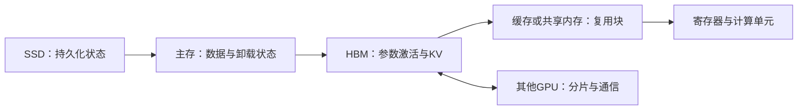
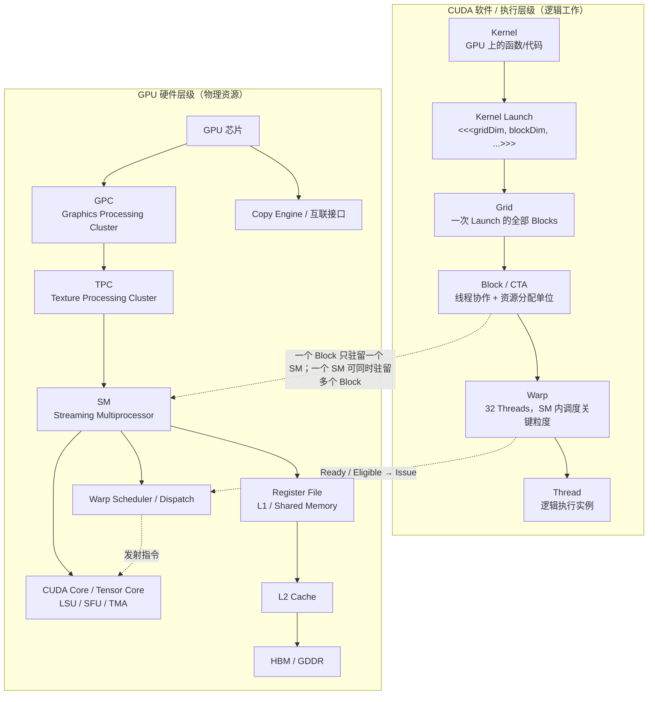

# 第 7 章　硬件与存储层次

从数据复用认识主存、显存与片上存储，再建立 GPU 的执行层次和计算、访存的性能下界。

本章内容：

- [1. 计算、存储与通信的交汇：局部性、复用和数据移动](#s1)
- [2. GPU 执行与内存基础](#s2)
- [3. GPU 之外的资源为什么也会限制训练](#s3)

<a id="s1"></a>

<a id="s1-计算存储与通信的交汇局部性复用和数据移动"></a>

## 1. 计算、存储与通信的交汇：局部性、复用和数据移动


<a id="s1-为一次运算画数据路径"></a>

### 为一次运算画数据路径

计算必须消费输入并产生输出。用三个问题描述任何优化：状态放在哪里，谁执行计算，依赖满足前需要搬哪些数据。逻辑张量相同，不意味着物理存储或传输路径相同。



这是一张常见数据路径示意，不规定所有硬件都必须逐级经过每一层。DMA、设备直连和缓存策略会改变实际路径。

<a id="s1-gemm-的复用如何产生"></a>

### GEMM 的复用如何产生

对方阵 $C=AB$，边长为 $N$，计算量约为 $2N^3$ FLOP。理想情况下，每个输入从被考察的存储层读取一次，输出写一次；若每元素 $b$ 字节，流量下界示意为 $3bN^2$，算术强度约 $2N/(3b)$。

这个下界要求足够的近端复用，并忽略旧 C 的读取等条件。实际 Kernel 的分块、缓存、边界和临时状态会增加流量。不能用此式直接代替 profiler 的 HBM 字节数。

一个 $m\times n$ 输出 tile 沿 K 累积，每轮读取 A 和 B 的块。多个输出共享输入，从而减少远端重复读取；但输出累加器会占用寄存器。tile 越大，复用可能越好，同时驻留资源需求也更大。

<a id="s1-算术强度依赖存储层级"></a>

### 算术强度依赖存储层级

$$I=\frac{FLOP}{bytes},\qquad P\leq\min(P_{peak},B_{level}I_{level}).$$

同一 Kernel 可在 HBM 层有较高强度，却在共享内存或寄存器数据通路上受限。Roofline 的峰值还必须匹配 dtype、指令类型及稀疏条件。小任务可能先受到启动、依赖或并行度限制，而不是落在两个理想上界之一。

示意：$10^9$ FLOP、$10^8$ 字节，强度为 10 FLOP/B；假设可用带宽为 $10^{12}$ B/s，带宽上界为 $10^{13}$ FLOP/s。这个上界不等于预测吞吐。

<a id="s1-四种常见交换"></a>

### 四种常见交换

| 方法 | 减少什么 | 增加什么 | 需要验证 |
|---|---|---|---|
| 缓存 | 重复计算或远端读取 | 驻留状态、淘汰管理 | 命中与一致性 |
| 重计算 | 长期保存的激活 | 额外 FLOP 与读取 | 总时间、随机状态 |
| 分片 | 每设备状态或工作 | 通信与同步 | 布局、所有权、峰值 |
| 压缩与低精度 | 存储和传输字节 | 编解码、元数据或误差 | 质量、解码成本 |

Offload 则把容量压力转移到另一层，同时引入传输和调度。它是否有效取决于传输能否在消费前完成，以及预取窗口能否容纳在途状态。

<a id="s1-从数据局部性到调度局部性"></a>

### 从数据局部性到调度局部性

将共享前缀请求送到同一 worker 可以复用 KV，却可能使该 worker 排队；把任务均匀分散可以降低排队，却降低缓存命中。局部性和负载均衡需要共同优化。

MoE 的专家放置也类似：权重靠近使用者有助于减少传输，但动态路由可能使热专家拥堵。端到端完成时间通常受关键路径和最慢参与者影响。

<a id="s1-方法演进的分支"></a>

### 方法演进的分支

当远端流量成为瓶颈，可以增加复用、压缩状态、移动计算或减少访问集合；当计算成为瓶颈，可以改变算子、精度、并行映射或算法。优化一种资源后，应重新测量，而不是假设原瓶颈仍在。

下一层：[Kernel 数据搬运](<../appendices/kernels/GPU内存编程与数据搬运.md>)、[训练显存优化](<../04_Training/13_精度激活与训练状态.md#s3>)、[KV 管理](<../05_Inference/20_KV容量分页与复用.md#s1>)、[通信重叠](<../appendices/communication/通信计算重叠.md>)。

参考：[Roofline 作者技术报告](https://www2.eecs.berkeley.edu/Pubs/TechRpts/2008/EECS-2008-134.html)；[CUDA Best Practices Guide](https://docs.nvidia.com/cuda/cuda-c-best-practices-guide/index.html)。

---

<a id="s2"></a>

<a id="s2-gpu-执行与内存基础"></a>

## 2. GPU 执行与内存基础


前面三篇回答了“算什么、怎样求梯度”，本节回答“这些计算交给谁执行、数据放在哪里”。CPU（中央处理器）负责运行主程序、准备和提交工作；GPU（图形处理器）擅长并行处理大量相似计算。LLM 是 Large Language Model，即大语言模型；AI Infra 指支撑模型训练和服务的计算、存储、通信与软件系统。

本节采用 NVIDIA CUDA 的术语。CUDA 是其 GPU 编程平台；**Kernel** 是一次提交到 GPU 执行的函数，**Thread** 是执行该函数的逻辑线程，**SM** 是容纳一组线程并提供计算与存储资源的硬件单元。先有这三个印象，再读下面的层级图。图中的 Cache 是自动保留近期数据的缓存，DRAM 是主存；PCIe、NVLink-C2C 是连接处理器的互联，第一次阅读不必记住具体规格。

<details>
<summary>文章导航</summary>

- [先建立一张总地图：LLM 最终是在一台什么机器上跑？](<#s2-先建立一张总地图llm-最终是在一台什么机器上跑>)
- [CPU 和 GPU 为什么不一样？](<#s2-cpu-和-gpu-为什么不一样>)
- [什么是 HBM？为什么论文天天讨论 HBM？](<#s2-什么是-hbm为什么论文天天讨论-hbm>)
- [GPU Memory Hierarchy：显存并不是只有一层](<#s2-gpu-memory-hierarchy显存并不是只有一层>)
- [“带宽”和“延迟”到底是什么？](<#s2-带宽和延迟到底是什么>)
- [Thread、Warp、Block/CTA、SM：CUDA 的执行层次](<#s2-threadwarpblockctasmcuda-的执行层次>)
- [Tensor Core 是什么？为什么矩阵乘法特别快？](<#s2-tensor-core-是什么为什么矩阵乘法特别快>)
- [Kernel 是什么？](<#s2-kernel-是什么>)
- [Kernel Fusion 为什么有效？](<#s2-kernel-fusion-为什么有效>)
- [什么是 Tiling？](<#s2-什么是-tiling>)
- [Arithmetic Intensity / Operational Intensity](<#s2-arithmetic-intensity--operational-intensity>)
- [Compute-bound 与 Memory-bound](<#s2-compute-bound-与-memory-bound>)
- [Roofline Model 的直觉](<#s2-roofline-model-的直觉>)
- [Occupancy 是什么？](<#s2-occupancy-是什么>)
- [概念辨析](<#s2-概念辨析>)
- [主要参考资料](<#s2-主要参考资料>)

</details>


<a id="s2-先建立一张总地图llm-最终是在一台什么机器上跑"></a>

### 先建立一张总地图：LLM 最终是在一台什么机器上跑？


一台典型的 AI 服务器，可以先粗略理解成：

```text
CPU
├── CPU cores
├── CPU cache
└── CPU DRAM
      │
      │ PCIe / NVLink-C2C 等连接
      ▼
GPU
├── 很多 SM（Streaming Multiprocessor）
│   ├── CUDA Cores
│   ├── Tensor Cores
│   ├── Registers
│   └── Shared Memory / L1
├── L2 Cache
└── HBM（GPU 显存）
```

学习模型系统时，最重要的不是某一代 GPU 有多少个核心，而是理解三个层次：

1. **计算单元**：Tensor Core、CUDA Core；
2. **执行组织**：thread、warp、thread block/CTA、SM；
3. **存储层次**：register → shared memory/L1 → L2 → HBM → CPU DRAM。

系统优化的本质经常是：

> **让数据尽可能待在更靠近计算单元的地方，并尽量少在慢层级之间搬来搬去。**

后面读到的 Attention 优化也遵循这条原则：尽量在片上完成计算，减少往返显存。

---


<a id="s2-cpu-和-gpu-为什么不一样"></a>

### CPU 和 GPU 为什么不一样？


CPU 的设计目标通常是：

> 用少量非常强的核心，把复杂、分支很多、延迟敏感的任务快速完成。

GPU 的设计目标更接近：

> 用大量相对简单的执行单元，同时处理海量相似计算。

例如矩阵乘法：

$$
C = AB
$$

其中每个输出元素：

$$
C_{ij}=\sum_k A_{ik}B_{kj}
$$

不同的 $i,j$ 可以高度并行，因此特别适合 GPU。

所以 Transformer 中的大量 GEMM（General Matrix-Matrix Multiplication，通用矩阵-矩阵乘法）非常适合 GPU。

但是：

> **GPU 算得快，不代表整个程序一定快。**

如果 GPU 每做一点计算，都要等大量数据从 HBM 搬进来，那么计算单元会处于“等数据”的状态。

这就是为什么 AI Infra 必须同时关心：

- FLOPs；
- 显存容量；
- 显存带宽；
- Cache / Shared Memory；
- 数据布局；
- kernel 调度。

---


<a id="s2-什么是-hbm为什么论文天天讨论-hbm"></a>

### 什么是 HBM？为什么论文天天讨论 HBM？


HBM = **High Bandwidth Memory（高带宽内存）**。许多 AI 加速卡用它作大容量显存；也有 GPU 使用 GDDR，因此“显存”不等于“HBM”。下文以 HBM 型 GPU 为例。activation 是第 5 章解释的激活，KV Cache 是保存历史 token 的 Key/Value 的缓存。

你可以把它近似理解为：

> GPU 自己的大容量主内存，也就是平时 `nvidia-smi` 看到的那几十 GB / 上百 GB“显存”的主体。

例如模型参数、activation、KV Cache 等大量数据，主要都放在 HBM 中。

HBM 的“High Bandwidth”已经比普通 CPU DRAM 快很多，但 GPU 的计算能力增长得更快，因此在很多 workload 里：

> **HBM 仍然相对太慢。**

一个很重要的观念是：

```text
数据在 HBM 里
    ↓ 读取
送到 SM 附近
    ↓
GPU 做计算
    ↓
结果写回 HBM
```

如果一个算法不停：

```text
HBM → compute → HBM → compute → HBM
```

那么即使 FLOPs 并不多，也可能很慢。

FlashAttention 就是从这里开始重新审视 Attention。

---


<a id="s2-gpu-memory-hierarchy显存并不是只有一层"></a>

### GPU Memory Hierarchy：显存并不是只有一层


可以先记住下面这张简化图：

```text
              更快、更小
                  ↑
             Register
                  │
      Shared Memory / L1
                  │
                L2
                  │
                HBM
                  │
             CPU DRAM
                  ↓
              更慢、更大
```


<a id="s2-1-register"></a>

##### 1 Register

Register 是线程直接使用的极小、极快存储。

例如一个线程正在累加：

```text
sum += a * b
```

`sum` 很可能就在 register 中。

特点：

- 极快；
- 每个线程可用数量有限；
- register 用得太多，会影响 GPU 同时容纳多少线程。

这会与后面讲的 **occupancy** 联系起来。


<a id="s2-2-shared-memory--sram"></a>

##### 2 Shared Memory / SRAM

SRAM 是一种存储电路类型；Shared Memory 是程序可显式管理的片上共享存储空间，两者不是同义词。L1 Cache 也在片上，但数据缓存主要由硬件管理。

Shared Memory 是一个 thread block 内线程可以共享的片上存储。

可以理解成：

> 一个 SM 上非常快的小工作台。

典型优化方式：

```text
HBM 中的一块数据
      ↓
一次搬进 Shared Memory
      ↓
很多线程反复使用
```

而不是：

```text
线程 1 从 HBM 读
线程 2 又从 HBM 读
线程 3 又从 HBM 读
...
```

**Tiling（分块）** 的核心意义之一就是制造这种数据复用。

FlashAttention 论文经常把这类片上快速内存统称为 SRAM。


<a id="s2-3-l2-cache"></a>

##### 3 L2 Cache

L2 是 GPU 上更大、但比 shared memory 更远的一层缓存。

它对多个 SM 可见。

通常你不需要像 shared memory 那样显式地控制所有 L2 行为，但数据是否能命中 L2，会影响实际显存流量。


<a id="s2-4-hbm"></a>

##### 4 HBM

容量大，带宽高，但相对于片上内存仍然远得多。

模型参数和 KV Cache 主要驻留于此。

---


<a id="s2-带宽和延迟到底是什么"></a>

### “带宽”和“延迟”到底是什么？


这两个词不要混淆。

<a id="s2-带宽-bandwidth"></a>

##### 带宽 Bandwidth

表示单位时间最多能搬多少数据，例如：

```text
TB/s
GB/s
```

类比高速公路：

> 一秒钟能通过多少辆车。

<a id="s2-延迟-latency"></a>

##### 延迟 Latency

表示一次访问从发出请求到拿到数据需要多久。

类比：

> 一辆车从北京开到上海要多久。

AI kernel 经常通过：

- 并发；
- cache；
- prefetch；
- pipeline；

隐藏单次访问延迟，而最终受到总带宽限制。

所以 LLM decode 中经常说：

> **memory bandwidth bound**。

意思不是“显存很慢”，而是：

> 每生成一个 token 需要搬的数据太多，相对于计算量而言，HBM 总吞吐成为上限。

---


<a id="s2-threadwarpblockctasmcuda-的执行层次"></a>

### Thread、Warp、Block/CTA、SM：CUDA 的执行层次


这是以后读 FlashAttention-2 / FlashInfer 必须认识的一组词。

可以从大到小理解：

```text
GPU
└── 很多 SM
    └── 执行很多 Thread Block / CTA
        └── 一个 block 包含很多 threads
            └── threads 以 warp 为基本执行群组
```


<a id="s2-1-thread"></a>

##### 1 Thread

CUDA 中最小的编程线程。

每个 thread 通常处理矩阵中的某几个元素。


<a id="s2-2-warp"></a>

##### 2 Warp

NVIDIA GPU 中线程不是完全各自独立执行，而是以 **warp** 为重要执行单位。

经典 NVIDIA 架构中，一个 warp 包含 32 个线程。

可以粗略理解成：

```text
32 个线程
   ↓
一起执行一条指令
```

所以如果同一个 warp 中：

```text
16 个线程走 if 分支 A
16 个线程走 if 分支 B
```

硬件通常不能真正同时执行两条不同路径，而要分开执行，导致效率下降。

这就是 **warp divergence** 的直觉。


<a id="s2-3-thread-block--cta"></a>

##### 3 Thread Block / CTA

一组 threads 构成一个 block。

CTA（Cooperative Thread Array）在很多 NVIDIA 文档/论文中基本可以视作 thread block 这一层概念。

一个 block 的线程可以：

- 使用同一块 shared memory；
- 做 block 内同步。


<a id="s2-4-sm"></a>

##### 4 SM

SM = Streaming Multiprocessor。

可以把 GPU 想成有很多“计算车间”：

```text
SM0
SM1
SM2
...
```

CUDA 运行时负责提交工作，GPU 的硬件调度机制把可执行的 thread blocks 分配到资源足够的 SM 上。

如果一些 block 工作很快结束，而另一些特别慢，就会出现：

```text
SM0: idle
SM1: idle
SM2: █████████████ still working
SM3: idle
```

这就是 **load imbalance**。

FlashInfer 的动态 scheduler 就是在处理这种问题。

---


<a id="s2-tensor-core-是什么为什么矩阵乘法特别快"></a>

### Tensor Core 是什么？为什么矩阵乘法特别快？


现代 NVIDIA GPU 不仅有普通 CUDA Core，还拥有专门加速矩阵运算的 **Tensor Core**。

它非常擅长类似：

$$
D=A\times B+C
$$

这样的矩阵乘加。

因此：

> 在 AI GPU 上，一个 FLOP 并不总是“成本一样”。

矩阵乘法 FLOP 可以被 Tensor Core 极高效执行，而：

- exp；
- max；
- divide；
- index manipulation；

这类非矩阵运算可能相对昂贵。

FlashAttention-2 的一个重要改进就是：

> 尽量减少 non-matmul FLOPs，把更多时间留给 Tensor Core 擅长的矩阵计算。

---


<a id="s2-kernel-是什么"></a>

### Kernel 是什么？


Kernel 可以理解为：

> CPU 发给 GPU 的一个“并行计算任务程序”。

例如标准 Attention 可能被拆成：

```text
Kernel 1: QK^T
Kernel 2: mask
Kernel 3: softmax
Kernel 4: dropout
Kernel 5: P @ V
```

每个 kernel 往往需要：

```text
从 HBM 读输入
→ 计算
→ 把结果写回 HBM
```

因此多个 kernel 之间的大中间 tensor 会反复进出 HBM。

---


<a id="s2-kernel-fusion-为什么有效"></a>

### Kernel Fusion 为什么有效？


假设有：

```text
A → operation1 → B → operation2 → C
```

分两个 kernel：

```text
Kernel 1:
read A
compute B
write B to HBM

Kernel 2:
read B from HBM
compute C
write C
```

融合以后：

```text
Kernel:
read A
compute B
B 留在片上
compute C
write C
```

省掉：

```text
write B
read B
```

因此 kernel fusion 往往不是为了减少数学计算，而是为了：

> **减少 HBM traffic（显存读写流量）和 kernel launch overhead（提交、启动计算的开销）。**

FlashAttention 把多个 Attention 操作融合进一个 kernel，就是经典案例。

---


<a id="s2-什么是-tiling"></a>

### 什么是 Tiling？


假设你需要做一个巨大矩阵运算，但 shared memory 装不下整个矩阵。

最自然的方法是切块：

```text
完整矩阵
┌──────────────┐
│ □ □ □ □ □  │
│ □ □ □ □ □  │
│ □ □ □ □ □  │
└──────────────┘
```

每次只处理：

```text
┌─────┐
│ tile│
└─────┘
```

流程：

```text
HBM
 ↓
加载 tile 到 shared memory/register
 ↓
尽量多做计算
 ↓
必要结果写回 HBM
```

Tiling 的关键不是“把矩阵切小”本身，而是：

> **让同一批从 HBM 搬来的数据，在片上被重复使用很多次。**

FlashAttention 的整个核心算法就是围绕 Attention 设计一个正确的 tiling 方式。

---


<a id="s2-arithmetic-intensity--operational-intensity"></a>

### Arithmetic Intensity / Operational Intensity


这是读系统论文非常重要的指标。

可以粗略定义：

$$
AI=\frac{\text{做了多少计算}}{\text{从内存搬了多少 Byte}}
$$

例如：

<a id="s2-程序-a"></a>

###### 程序 A

```text
读 1 GB 数据
只做少量加法
```

Arithmetic Intensity 很低。

<a id="s2-程序-b"></a>

###### 程序 B

```text
读 1 GB 数据
做大量矩阵乘法
```

Arithmetic Intensity 很高。

由此产生两个经典瓶颈。

---


<a id="s2-compute-bound-与-memory-bound"></a>

### Compute-bound 与 Memory-bound


<a id="s2-compute-bound"></a>

##### Compute-bound

程序速度主要受 GPU 计算能力限制。

也就是：

```text
数据已经喂得足够快
Tensor Core 一直满负荷计算
```

此时优化方向通常是：

- 更高 Tensor Core 利用率；
- 更好的 work partition；
- 更少无效 FLOPs。

<a id="s2-memory-bound"></a>

##### Memory-bound

程序速度主要受数据搬运速度限制。

此时可能出现：

```text
Tensor Core：我算完了，数据呢？
HBM：还在搬。
```

优化方向通常是：

- 少读 HBM；
- 少写 HBM；
- reuse；
- fusion；
- quantization；
- 更紧凑的数据结构。

FlashAttention 和 LLM decode 都非常强调 memory traffic。

---


<a id="s2-roofline-model-的直觉"></a>

### Roofline Model 的直觉


Roofline Model 可以帮助判断一个 workload 应该优化什么。

横轴可以想象成 Arithmetic Intensity，纵轴是实际计算吞吐。

```text
性能
 ↑
 |              __________ 计算上限
 |            /
 |          /
 |        /
 |      /
 |_____/______________________→ Arithmetic Intensity
      内存带宽限制
```

左边：

> memory-bound。

右边：

> compute-bound。

重要 insight：

> **减少 FLOPs 不一定会更快。**

如果程序本来就在左边受内存带宽限制，FLOPs 再少一点可能没有意义；反而减少 HBM IO 更有价值。

这正是 FlashAttention 论文批评很多早期 approximate/sparse attention 工作的出发点之一。

---


<a id="s2-用数字判断瓶颈"></a>

#### 用数字判断瓶颈

假设某设备的有效计算上限为 20 TFLOP/s（每秒 $20×10^{12}$ 次浮点运算），显存带宽为 1 TB/s（每秒 $10^{12}$ 字节）。一次工作需 100 GFLOP、搬运 10 GB，则计算至少需 5 ms，搬运至少需 10 ms。理想重叠下，总时间下界是两者的较大值 10 ms；实际还可能受依赖、启动和访存效率影响。

此时计算量减半，搬运仍需 10 ms；把搬运量减半，理想下界才可能降到 5 ms。算术强度为 $100/10=10$ FLOP/byte，设备转折点为 $20/1=20$ FLOP/byte，因而该例位于带宽受限一侧。这里全部是教学假设，不能当作某张 GPU 的实测。

<a id="s2-occupancy-是什么"></a>

### Occupancy 是什么？


GPU 要隐藏内存延迟，需要同时准备很多可以执行的 warp。

如果一个 warp 在等数据：

```text
warp A: 等 HBM
```

SM 可以切换去执行：

```text
warp B
warp C
warp D
```

所以通常希望 SM 上同时有足够多 active warps。

**Occupancy（驻留率）**是一个 SM 上驻留的 warp 数与其支持的最大驻留 warp 数之比。例如上限 64 个、当前驻留 32 个，就是 50%。驻留 warp 可能还在等待数据，因此 100% occupancy 不等于计算单元利用率 100%；提高它也不保证提速。

但 occupancy 受到：

- register 数量；
- shared memory 使用量；
- block 大小；

限制。

因此 tile 越大并不总越好：

```text
大 tile
→ reuse 可能更好
→ 但 shared memory/register 用量变大
→ 同时驻留 block 变少
→ occupancy 可能下降
```

这就是 kernel tuning 中典型的 trade-off。

---


<a id="s2-概念辨析"></a>

### 概念辨析

<a id="s2-为什么一百多个-sm却能有上万个-cuda-core"></a>

#### 为什么“一百多个 SM”却能有上万个 CUDA Core？

因为 CUDA Core 是 SM 内部的执行资源，不是 SM 本身。每个 SM 中包含多个标量执行单元以及 Tensor Core 等资源，因此整卡的 CUDA Core 数量可以远大于 SM 数量。真正做 CUDA 性能分析时，比“总 CUDA Core 数”更重要的是：有多少 SM、有多少 Warp 能持续处于可发射状态、执行管线是否被喂饱。

<a id="s2-gpu-hierarchy"></a>

<a id="s2-硬件层级与软件层级不要画成同一棵父子树"></a>

#### 硬件层级与软件层级不要画成同一棵“父子树”

以下是选读细节。LSU 是读写数据的执行单元，SFU 是特殊函数单元，TMA 是部分架构提供的 Tensor Memory Accelerator（张量内存搬运加速器）；不需要先掌握这些缩写才能继续主线。

GPU → GPC（Graphics Processing Cluster）→ TPC（Texture Processing Cluster）→ SM 是一种物理组织视角，精确层次取决于芯片；程序不能直接指定某个 block 必须进入哪个 GPC/TPC。SM 内包含 warp scheduler、寄存器、shared/L1、Load/Store Unit、SFU、CUDA Core 和 Tensor Core 等资源，Hopper 还引入 TMA。Warp Group 与 producer/consumer 是协作粒度或程序角色，不是与这些执行单元同级的独立硬件。

例如 `vector_add<<<4096,256>>>` 定义 4096 个 block、每个 256 个逻辑线程，共 1,048,576 个线程；每 block 形成 8 个 warp。这没有指定 thread 到 CUDA Core 的永久绑定。block 的共享存储和同步状态随其 SM 驻留，Grid 则没有操作系统进程的独立地址空间、PID 或文件描述符语义。



图 1｜硬件是“资源”，Grid/Block/Warp/Thread 是“工作与调度组织”；关键映射是 Block → SM、Warp → Warp Scheduler。

> **最重要的纠正：**不要记成“Thread → CUDA Core 一一绑定”。Thread 是逻辑执行实例；32 个 Thread 组成 Warp，Warp 的指令由调度器发射到合适的执行管线。

---


<a id="s2-主要参考资料"></a>

### 主要参考资料

- [CUDA Best Practices：Occupancy](https://docs.nvidia.com/cuda/cuda-c-best-practices-guide/index.html#occupancy)

- Dao et al., *FlashAttention: Fast and Memory-Efficient Exact Attention with IO-Awareness*, NeurIPS 2022, arXiv:2205.14135.
- Dao, *FlashAttention-2: Faster Attention with Better Parallelism and Work Partitioning*, 2023/ICLR 2024, arXiv:2307.08691.
- Kwon et al., *Efficient Memory Management for Large Language Model Serving with PagedAttention*, SOSP 2023, arXiv:2309.06180.
- Zheng et al., *SGLang: Efficient Execution of Structured Language Model Programs*, arXiv:2312.07104 / NeurIPS 2024.


---

<a id="s3"></a>

## 3. GPU 之外的资源为什么也会限制训练

假设模型和 batch 都没有改变，换一组机器后 GPU 时间线却出现周期性空白。此时只比较 GPU 型号不够：数据解码、调度、通信推进和设备传输都要由主机侧供给。

多路 CPU 服务器常采用 NUMA（非统一内存访问）：线程访问本地 CPU 所连内存与跨互联访问另一组内存，路径和竞争不同。GPU、网卡也通过具体 PCIe 路径连接。若数据 worker 在一组 CPU 上运行、缓冲位于另一组内存、GPU 又连接第三条路径，主机到设备的实际性能可能远低于仅看 PCIe 规格得到的估计。

先画出“worker → 主存缓冲 → GPU”以及“GPU → 网卡”的路径，再核对进程实际获得的资源。容器看到几十个逻辑 CPU，并不代表 cgroup 允许持续使用几十个核；增加 worker 还可能与 tokenizer、通信线程抢同一配额。Pinned memory 也不是无限资源，过度预取会同时挤压主存和系统可用页。

| 观察到的现象 | 要进一步区分的原因 | 有用的对照 |
|---|---|---|
| 数据队列见底，GPU 等待 | 读取慢、CPU 被限额、解码慢 | 固定已构造输入，观察空白是否消失 |
| 单机多卡正常，跨机很慢 | GPU 到 NIC 路径、网络配置、拓扑竞争 | 分别测设备互访与目标大小的跨机通信 |
| 开更多 worker 后反而慢 | CPU 竞争、内存带宽、进程副本 | 固定输入，逐级增加并发并记录吞吐与主存 |

这些对照用于缩小原因范围，不直接证明硬件损坏。拓扑与容器限制的具体诊断入口见 [NCCL 故障排查](https://docs.nvidia.com/deeplearning/nccl/user-guide/docs/troubleshooting.html)；Linux 工具与运行环境放在[硬件附录](<../appendices/hardware/Linux与运行环境.md>)。

## 本章回顾

数据复用依赖存储层次和可用容量。算术强度提供计算与带宽的初步下界，但启动、依赖、资源驻留和共享竞争决定能否接近它。

**检查理解：** 总显存足够时为什么仍可能运行缓慢？分块怎样减少搬运而不减少乘加？

下一章讨论GPU执行与异步依赖。区分进程、运行时和设备的职责，用依赖与生命周期解释异步提交、并发和正确释放。

<!-- book-nav -->

[上一章：模型结构与执行成本](<../02_Model_Computation/06_模型结构与执行成本.md>) · [全书目录](<../README.md>) · [下一章：GPU执行与异步依赖](<08_GPU执行与异步依赖.md>)

<!-- /book-nav -->
