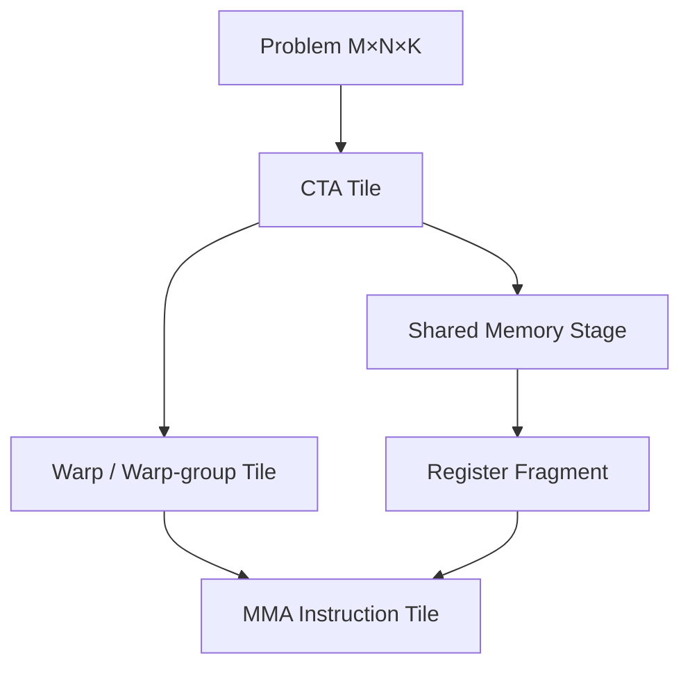
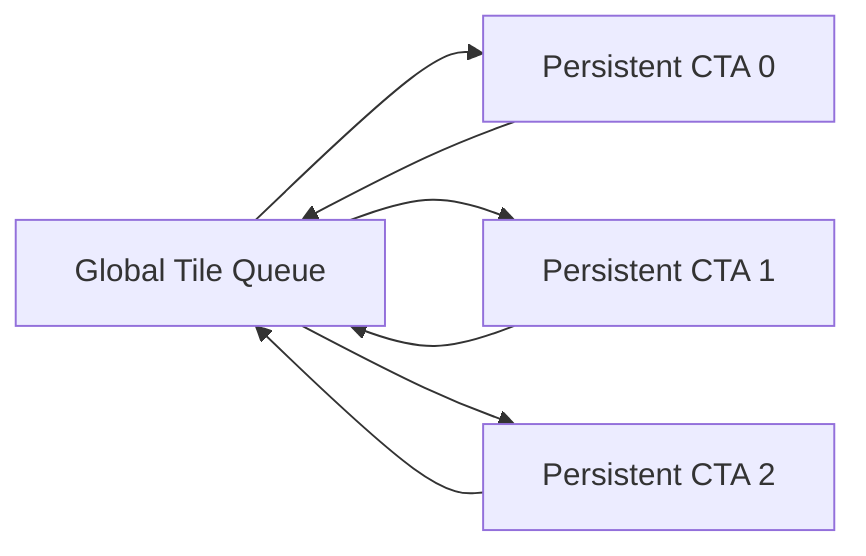
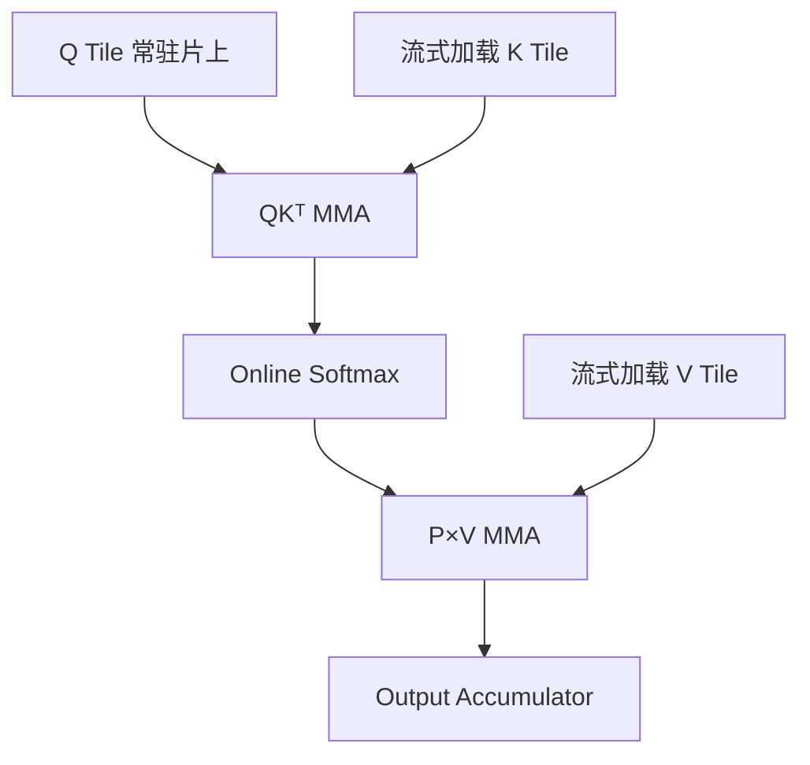
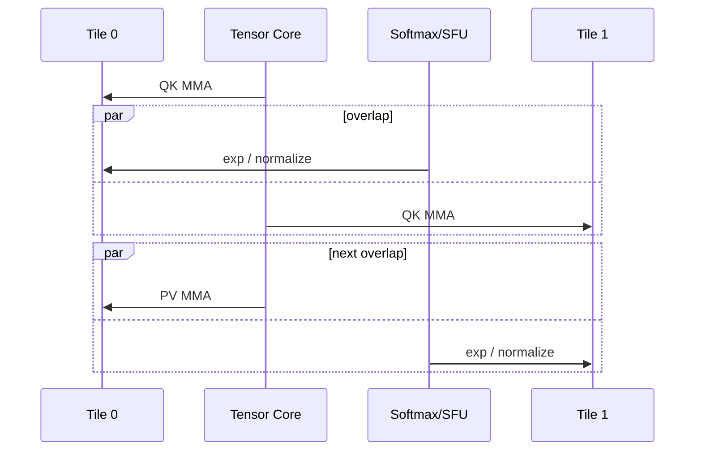
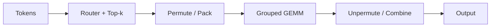

# 第 9 章　矩阵乘与Attention算子

将复用和依赖落实为矩阵乘分块、Attention 在线归约及专家算子调度，解释优化收益与边界。

本章内容：

- [1. GEMM、Tensor Core 与高性能 Kernel 设计模式](#s1)
- [2. 案例：FlashAttention 与 MoE Grouped GEMM](#s2)
- [3. 从 Attention 的在线归约到词表概率](#s3)

<a id="s1"></a>

<a id="s1-gemmtensor-core-与高性能-kernel-设计模式"></a>

## 1. GEMM、Tensor Core 与高性能 Kernel 设计模式


上一章解决多个工作怎样按依赖执行；本节进入单个矩阵乘内部。首次阅读先掌握“输出分块 → 输入复用 → 沿 K 累加 → 尾处理”，后半篇的持久化、Stream-K 和 Warp 专职化是可回看的进阶模式。

<a id="s1-gemm-为什么是-ai-infra-的发动机"></a>

### GEMM 为什么是 AI Infra 的“发动机”？

GEMM = **General Matrix-Matrix Multiplication（通用矩阵-矩阵乘法）**：

$$
C_{M\times N}=A_{M\times K}B_{K\times N}
$$

每个输出元素为：

$$
C_{ij}=\sum_{k=0}^{K-1}A_{ik}B_{kj}
$$

Transformer 中的 Q/K/V Projection、Attention 输出投影、MLP（Multi-Layer Perceptron，多层感知机）和 MoE（Mixture of Experts，混合专家）专家层，本质上大量是 GEMM。

但“数学上是矩阵乘”不等于“硬件上自动很快”。高性能实现必须同时解决：

occupancy（驻留率）是一个 SM 上驻留 warp 数与硬件支持的最大驻留 warp 数之比。寄存器、共享内存和线程配置都会限制它；驻留线程可能在等待，所以它不等于有效计算利用率。

- 把输出空间切给 CTA、Warp、Thread；
- 让 A/B Tile 在 Shared Memory 和 Register 中复用；
- 选择 Tensor Core 支持的数据类型与 Layout；
- 隐藏 HBM → Shared Memory 的延迟；
- 平衡 Tile 大小、Occupancy 与并行度；
- 处理尾块（维度不能整除分块时的边缘）、动态 Shape（运行时才确定的形状）和 Epilogue（结果写回前的尾处理）。


<a id="s1-将模型形状写成-gemm"></a>

#### 将模型形状写成 GEMM

通用接口常写为 `C = α·A@B + β·C`。其中 α、β 为标量系数，右侧 C 是原有输出，取 α=1、β=0 即普通乘法。把 B 个序列各 S 个位置合并成 M=B×S 行后，每行是 H 维向量。例如 `X[4096,4096] @ W[4096,14336]` 对应 `M=4096、K=4096、N=14336`；映射到硬件时需要同时安排 tile、HBM 到片上存储的搬运和 MMA（矩阵乘累加）流水。下面从这些约束展开。

<a id="s1-从朴素实现到分层-tiling"></a>

### 从朴素实现到分层 Tiling

朴素实现中，一个 Thread 计算一个 $C_{ij}$，每轮从 Global Memory 读取 $A_{ik}$ 和 $B_{kj}$。这会重复读取大量相同元素。

先手算 `A[4,4] @ B[4,4]`。若每个输出独立计算，16 个输出各需读 4 个 A 元素和 4 个 B 元素，共 128 次输入元素读取。若一次合作计算一个 2×2 输出块，每个 k 只需读 A 的 2 个元素和 B 的 2 个元素，并在块内复用：每块读 4×4=16 个元素，4 个块共读 64 个。两种方法都按 $2MNK$ 计 128 FLOP，输出同样是 16 个元素。

这是忽略硬件缓存的逻辑读取计数，不是 HBM 实测流量；它说明分块怎样让一次读取服务于多个输出。若 K 方向每轮取 2 个元素，则一轮需暂存 A、B 各一个 2×2 块，共 8 个 FP32 元素、32 字节；另有 4 个累加结果需要存储。块变大会增加复用，也增加片上存储需求。

高性能 GEMM 通常有多层 Tile：



CTA Tile 决定一个 Block 负责的输出区域；Warp Tile 决定 Warp 或 Warp Group 的分工；MMA Tile 对应硬件矩阵乘累加指令的最小形状。


<a id="s1-tensor-core-与-mma"></a>

### Tensor Core 与 MMA

MMA = **Matrix Multiply-Accumulate（矩阵乘累加）**。Tensor Core 并不是替代整个 SM 的“独立 GPU”，而是 SM 内擅长固定形状矩阵乘累加的执行单元。

进阶选读：下面的架构名表示 GPU 代际，Warp Group 表示多个 Warp 协作，TMEM 是 Tensor Memory（专用张量存储），TCGen05 是一代 Tensor Core 指令接口。具体适用条件要查对应架构文档，首次阅读不必记忆。不同架构的高性能协作粒度不断扩大：

```text
Volta/Ampere：Warp-level MMA
Hopper：Warp-group MMA，典型由 4 个 Warp 协作
Blackwell：TCGen05、TMEM、2-CTA 等更大协作与专用状态存储
```

这条演化线的本质是：Tensor Core 吞吐上升后，单个 Thread 或单个 Warp 很难独立准备足够数据，需要更大的协作域与更专门的数据通路。


<a id="s1-mainloop-与-epilogue"></a>

### Mainloop 与 Epilogue

一个 GEMM Kernel 可粗分为两段：

1. Mainloop（主循环）：沿 K 维加载 A/B Tile 并不断 MMA。
2. Epilogue（尾处理）：把 Accumulator（累加结果）转换为输出，常融合 Bias（加偏置）、Activation（非线性激活）、Scale（缩放）、Quantize（量化）或 Reduction（归约）等操作。

例如：

$$
Y=\operatorname{GELU}(XW+b)
$$

如果 GEMM 把结果先写回 HBM，再启动 Bias Kernel 和 GELU Kernel，会多次搬运 $Y$。把 Bias 和 GELU 融入 Epilogue，可以让 Accumulator 在片上完成处理后只写回一次。

GELU = **Gaussian Error Linear Unit（高斯误差线性单元）**。


<a id="s1-batched-gemmgrouped-gemm-与普通-gemm"></a>

### Batched GEMM、Grouped GEMM 与普通 GEMM

| 类型 | Problem Shape | 指针/Stride | 典型场景 |
|---|---|---|---|
| GEMM | 一个 $(M,N,K)$ | 单组矩阵 | 大 Linear Layer |
| Strided Batched GEMM | 多个相同 Shape | 规则固定 Stride | Attention Head、小批矩阵 |
| Grouped GEMM | 多个 Shape 可不同 | 每组独立描述 | MoE 不同专家 Token 数 |

MoE 中专家 $e$ 收到 $T_e$ 个 Token，对应：

$$
Y_e=X_eW_e,\quad X_e\in \mathbb{R}^{T_e\times H}
$$

设共有 E 个专家，每个权重 $W_e$ 形状为 $[H,I]$，I 是输出宽度。不同专家的 $T_e$ 不同，于是按 $(M,N,K)$ 顺序写出的一批 Shape 为：

$$
(T_0,I,H),(T_1,I,H),\ldots,(T_{E-1},I,H)
$$

这不是规则 Batched GEMM，而是 Grouped GEMM。

---


<a id="s1-形状是否统一决定接口含义"></a>

#### 形状是否统一决定接口含义

普通 GEMM 描述一组 `A[M,K] @ B[K,N]`；Batched GEMM 描述多组相同形状；Grouped GEMM 允许第 i 组分别使用 `M_i、K_i、N_i`。MoE 的专家 token 数不同，正是第三种工作负载。三者的定义与前表一致，不预先限定必须用几个 kernel 实现。

<a id="s1-三种执行-grouped-gemm-的方式"></a>

### 三种执行 Grouped GEMM 的方式


<a id="s1-1-sequential-gemm"></a>

#### 1 Sequential GEMM

Host 循环逐专家调用 GEMM。优点是每个大专家可直接使用成熟库；缺点是小专家导致大量 Launch，GPU 并行度不足。


<a id="s1-2-multi-stream-gemm"></a>

#### 2 Multi-stream GEMM

把多个专家 GEMM 放入不同 Stream，允许小 GEMM 并发。它可能比一个通用 Grouped Kernel 更快，因为每个 GEMM 都能使用高度优化的库实现；但会增加 Stream 管理、并发资源竞争和调度不确定性。


<a id="s1-3-single-grouped-gemm-kernel"></a>

#### 3 Single Grouped GEMM Kernel

一次 Launch 内动态把 Tile 分配给不同专家。优点是减少 Launch 并统一调度；难点是元数据访问、Shape 不规则、专家负载不均以及 Tail Tile 浪费。

因此，“Grouped Kernel”不是天然快于“Multi-stream Library GEMM”。真正的判断条件包括专家数、每个专家 Token 数、Shape 分布、数据类型、目标 GPU 和 Kernel 实现质量。


<a id="s1-persistent-kernel"></a>

### Persistent Kernel

普通 Kernel 常把一个或少数 Tile 静态分配给 CTA。Persistent Kernel（持久化 Kernel）则让较少、长期驻留的 CTA 循环领取多个 Tile：



它让同一个 CTA 持续处理多个工作块，调度可以是静态的，也可以通过动态领取缓解不规则负载。普通 GEMM 和持久化 GEMM 都可以只有一次 Launch，因此“持久化”本身不保证减少启动次数。动态实现中的 Queue（工作队列）、Atomic（原子更新）或调度策略也可能引入开销。Blackwell 的 Cluster Launch Control 与 CUTLASS 动态持久化调度，都是这一方向的硬件/软件协同。


<a id="s1-stream-k"></a>

### Stream-K

这里的 Stream-K 是 GEMM 工作划分方法，不是上一章的 CUDA Stream。传统 GEMM 沿 M/N 划 Tile。当 M/N 很小或 Tile 数不能均匀覆盖 SM 时，部分 SM 会空闲。Stream-K 允许进一步切 K 维，把一个输出 Tile 的 K 工作分给多个 CTA，再归并部分和。

收益是更好的负载均衡；代价是额外归并、同步或 Workspace（暂存部分结果的工作空间）。它体现了常见取舍：用额外通信/同步换更高并行度。


<a id="s1-warp-specialization"></a>

### Warp Specialization

Warp Specialization（Warp 专职化）让不同 Warp 承担不同角色：

- Producer（生产者）：通过 TMA（张量内存搬运加速器）等机制加载数据，准备下一个 Tile；
- Consumer（消费者）：执行 MMA；
- Epilogue Warp：处理归一化、Scale 或 Store。

Hopper/Blackwell 上硬件管线复杂，显式或编译器自动生成的 Warp Specialization 能提高延迟隐藏和专用单元利用率。Triton 2026 年公开的 AutoWS 设计，会做数据分区、软件流水调度和 Warp Partition。


<a id="s1-kernel-fusionpersistentwarp-specialization-的关系"></a>

### Kernel Fusion、Persistent、Warp Specialization 的关系

三者解决的不是同一个问题：

| 技术 | 核心目标 | 主要风险 |
|---|---|---|
| Fusion | 减少中间存储与 Launch 边界 | Register/SMEM 压力、代码复杂 |
| Persistent Kernel | CTA 持续处理多个 Tile，可动态分配工作 | 调度与同步开销 |
| Warp Specialization | 让搬运、计算、尾处理重叠 | 角色负载不均、编译复杂 |

它们可以组合。例如 FlashAttention-4 可以既融合 Attention 流程，又使用 Warp/CTA 级流水，还根据架构选择专用实现。


<a id="s1-选-kernel-时真正该看什么"></a>

### 选 Kernel 时真正该看什么？

TFLOPS 是每秒万亿次浮点运算。不要只看峰值 TFLOPS；以下指标分别回答速度、数据流量和资源约束问题。Accumulation Precision 是累加精度，L2 Hit 是二级缓存命中情况，Tensor Core Active 是相关工具定义的矩阵计算单元活跃指标，Padding 是为对齐而补入的无效元素。至少记录：

- $(M,N,K)$ 和 Batch/Group 分布；
- Dtype（数据类型）与 Accumulation Precision；
- Alignment（对齐）和 Layout；
- HBM Bytes、L2 Hit、Arithmetic Intensity；
- Kernel Launch 数；
- Register、Shared Memory、Occupancy；
- Tensor Core Active；
- Tail Tile 与 Padding 浪费；
- 端到端是否还有重排、量化、通信开销。


<a id="s1-资料"></a>

### 资料

- [CUTLASS Efficient GEMM](https://docs.nvidia.com/cutlass/latest/media/docs/cpp/efficient_gemm.html)
- [CUTLASS Overview](https://docs.nvidia.com/cutlass/latest/overview.html)
- [CUTLASS Changelog](https://docs.nvidia.com/cutlass/latest/CHANGELOG.html)
- [Triton Warp Specialization](https://pytorch.org/blog/warp-specialization-in-triton-design-and-roadmap/)
- [PyTorch FlexAttention and FlashAttention-4](https://pytorch.org/blog/flexattention-flashattention-4-fast-and-flexible/)

<a id="s2"></a>

<a id="s2-案例flashattention-与-moe-grouped-gemm"></a>

## 2. 案例：FlashAttention 与 MoE Grouped GEMM

<details>
<summary>文章导航</summary>

- [Part A｜FlashAttention](<#s2-part-aflashattention>)
- [Part B｜MoE Grouped GEMM](<#s2-part-bmoe-grouped-gemm>)
- [从不均衡专家负载进入三种执行方案](<#s2-从不均衡专家负载进入三种执行方案>)
- [不用 Grouped GEMM：最朴素是 Sequential GEMM](<#s2-不用-grouped-gemm最朴素是-sequential-gemm>)
- [第二条路线：Multi-stream GEMM](<#s2-第二条路线multi-stream-gemm>)
- [第三条路线：真正的单个 Grouped GEMM Kernel](<#s2-第三条路线真正的单个-grouped-gemm-kernel>)
- [为什么“一个 Grouped GEMM Kernel”反而可能输给 Multi-stream cuBLAS？](<#s2-为什么一个-grouped-gemm-kernel反而可能输给-multi-stream-cublas>)
- [PyTorch `grouped_mm` vs Transformer Engine `grouped_gemm`：旧结论为什么不能机械延续到 2026？](<#s2-pytorch-grouped_mm-vs-transformer-engine-grouped_gemm旧结论为什么不能机械延续到-2026>)
- [资料](<#s2-资料>)

</details>

这两个案例分别代表规则但数据移动昂贵的 Dense Attention，以及 Shape 不规则、负载动态的 MoE。它们能把本专题的大部分概念串起来。


<a id="s2-part-aflashattention"></a>

### Part A｜FlashAttention


<a id="s2-标准-attention-的问题不只是-os2-计算"></a>

#### 标准 Attention 的问题不只是 $O(S^2)$ 计算

Scaled Dot-Product Attention（缩放点积注意力）为：

$$
O=\operatorname{softmax}\left(\frac{QK^T}{\sqrt d}\right)V
$$

若按多个独立 Kernel 执行，会物化 $S\times S$ 的 Score/Probability 矩阵，并在 HBM 间反复读写。即使 FLOPs 没变，HBM Traffic 也会成为瓶颈。

FlashAttention 的核心不是“近似 Attention”，而是通过 Tiling 和 Online Softmax，在片上逐块计算并避免保存完整 Score Matrix。


<a id="s2-online-softmax-为什么允许分块"></a>

#### Online Softmax 为什么允许分块？

对一行 Score $x$，稳定 Softmax 使用最大值：

$$
m=\max_j x_j,\qquad l=\sum_j e^{x_j-m}
$$

$$
\operatorname{softmax}(x_j)=\frac{e^{x_j-m}}{l}
$$

先把一行分成 A、B 两块。A 块保存最大值 $m_A$、指数和 $l_A=\sum_{j\in A}e^{x_j-m_A}$，以及尚未除以分母的加权值 $u_A=\sum_{j\in A}e^{x_j-m_A}V_j$；B 块同样得到 $m_B,l_B,u_B$。两块各用自己的最大值作为尺度，不能直接把两个 l 或 u 相加。

合并时选取共同最大值 $m=\max(m_A,m_B)$。A 的旧指数都要乘 $e^{m_A-m}$，B 的旧指数都要乘 $e^{m_B-m}$，因此

$$l=e^{m_A-m}l_A+e^{m_B-m}l_B,$$
$$u=e^{m_A-m}u_A+e^{m_B-m}u_B,\qquad O=u/l.$$

手算一行只有两个位置的情况：分数为 `[0,ln(2)]`，对应的标量 Value 为 `[2,4]`。把每个位置单独作为一块，得到 A 的状态 `(m,l,u)=(0,1,2)`，B 的状态 `(ln(2),1,4)`。共同最大值为 ln(2)，A 的旧状态需乘 1/2，B 不变。合并后 l=1/2+1=1.5，u=1+4=5，输出为 5/1.5=10/3；直接对整行计算权重 `[1/3,2/3]` 也得到同一结果。

后面再来一块时，仍可对已有的 m、l、u 使用同样规则。过去的全部分数不再需要逐项保留，只需保留这些累计量和当前块。实际向量 Value 的 u 是一个向量，各分量执行相同的重缩放。


<a id="s2-数据路径"></a>

#### 数据路径



关键收益来自：

- 不物化完整 $S\times S$ Matrix；
- 融合 QK、Mask、Softmax、PV；
- 在 Register/Shared Memory/TMEM 中复用；
- 让数据搬运、MMA、Softmax 重叠。


<a id="s2-为什么-flashattention-4-需要新的实现思路"></a>

#### 为什么 FlashAttention-4 需要新的实现思路？

Blackwell Tensor Core 更快，并引入 TMEM 与更完整异步能力。问题是 SFU（Special Function Unit，特殊函数单元）执行 `exp` 等操作的速度没有按同样比例提升，于是 Softmax 相对成本变大。

FlashAttention-4 的设计需要深层异步流水和 Warp Specialization：一组 Warp 编排 Load/MMA，另一组执行寄存器中的 Softmax；通过两组 Tile Ping-pong，让一组做矩阵乘时另一组做指数运算。



PyTorch 2026 年的 FlexAttention 集成说明了另一个趋势：研究者在高层写 `score_mod`/`mask_mod`，系统把修改函数编译为 CuTe DSL，并 JIT 实例化 FlashAttention-4 Kernel。官方报告在 Compute-bound Workload 上相对旧 Triton Backend 有 1.2–3.2 倍提升，但也明确标注仍是活跃开发代码，需要核对 Nightly 与 FlashAttention 版本兼容。


<a id="s2-这个案例告诉我们什么"></a>

#### 这个案例告诉我们什么？

- 算法复杂度相同，不代表 I/O 复杂度相同。
- 硬件一个单元变快后，瓶颈会转移到另一单元。
- 通用 DSL 的表达能力和专用 Kernel 的峰值性能之间存在现实张力。
- 高层可编程性可以通过“生成修改函数 + 实例化专用 Skeleton”与低层 Kernel 结合，而不一定由编译器从零生成所有代码。


<a id="s2-part-bmoe-grouped-gemm"></a>

### Part B｜MoE Grouped GEMM


<a id="s2-moe-的计算为何不规则"></a>

#### MoE 的计算为何不规则？

MoE = **Mixture of Experts（混合专家）**。Router（路由器）为每个 Token 选择少数专家。若 Batch 中共有 $T$ 个 Token、$E$ 个专家，专家负载为：

$$
T_0,T_1,\ldots,T_{E-1},\qquad \sum_e T_e=kT
$$

$k$ 是每个 Token 激活的专家数。即使平均负载为 $kT/E$，实际 $T_e$ 也可能严重不均。

每个专家执行：

$$
Y_e=X_eW_e
$$

其中 $X_e$ 的第一维就是动态的 $T_e$。


<a id="s2-完整-moe-本地计算链"></a>

#### 完整 MoE 本地计算链



多 GPU Expert Parallelism 中，还会在 Pack 与 GEMM 周围出现 AllToAll 通信。因此只测 Grouped GEMM 可能掩盖 Permute、元数据构建、通信和负载不均。


<a id="s2-为什么大-gemm-的最佳策略不能直接用于-moe"></a>

#### 为什么大 GEMM 的最佳策略不能直接用于 MoE？

规则大 GEMM 通常有足够多 M/N Tile 覆盖所有 SM。MoE 的某些专家只有少量 Token：

- $M=T_e$ 很小；
- 不同专家 Shape 不同；
- Tail Tile 浪费明显；
- 静态 CTA 分配可能导致部分 SM 提前空闲；
- 多个小 GEMM 的 Launch 成本占比上升。

因此需要 Grouped Scheduling、Persistent CTA、Stream-K 或 Multi-stream 等策略。


<a id="s2-一个具体负载例子"></a>

#### 一个具体负载例子

假设 8 个专家收到 Token 数：

```text
[512, 480, 33, 29, 18, 9, 5, 2]
```

若 CTA Tile 的 M 是 128，则前两个专家有较多完整 Tile，后六个专家大量 Tail。若静态按专家平均分 SM，处理前两个专家的 SM 会成为 Straggler（拖尾者）。Persistent Kernel 可以让 CTA 完成一个 Tile 后继续从全局队列领取下一个 Tile，从而缓解静态不均。

但如果每次领任务都要 Atomic，且每个 Tile 很小，调度开销也可能明显。更好的实现可能分层处理：大专家使用高效专用 GEMM，小专家合并或放入 Grouped/Persistent 路径。


<a id="s2-pytorch-grouped_mm-与-transformer-engine-grouped_gemm"></a>

#### PyTorch `grouped_mm` 与 Transformer Engine `grouped_gemm`

接口名相似不代表永远使用同一 Backend 或性能固定。到 2026 年，PyTorch/torchao 已经在探索 MXFP8 Grouped MM 训练，Inductor 也能调优更多 CuTe DSL/NVGEMM 候选。Transformer Engine 则持续提供 NVIDIA 架构和低精度训练优化。

正确对比方法是固定：

- PyTorch、CUDA、Transformer Engine/CUTLASS 版本；
- GPU 型号和功耗/频率；
- 完整 $T_e$ 分布而非只给平均值；
- Dtype、Scale Granularity、Padding；
- 是否包含 Pack/Unpack；
- Warmup 和同步方式；
- 前向、反向、权重梯度分别测量。


<a id="s2-两个案例的统一结论"></a>

#### 两个案例的统一结论

| 维度 | FlashAttention | MoE Grouped GEMM |
|---|---|---|
| 主要不规则性 | 序列长度、Mask、Softmax | 专家 Token 数、动态路由 |
| 核心瓶颈 | HBM I/O、MMA 与 Softmax 流水 | 小/不规则 GEMM、调度、通信 |
| 核心手段 | Tiling、Online Softmax、Fusion | Grouped/Persistent Scheduling、Load Balance |
| 新硬件影响 | TMEM、异步 MMA、SFU 相对变慢 | FP4/FP8、TMEM、Dynamic Persistent Scheduler |
| 端到端陷阱 | 只测 Kernel 忽略布局/Mask | 只测 GEMM 忽略 Permute/AllToAll |


按专家连续打包还需要边界元数据。例如四个专家的 token 数为 `[900,100,700,348]`，packed 输入共有 2048 行，累计结束偏移为 `[900,1000,1700,2048]`。这些偏移把同一个输入 buffer 划分成四段，与各专家权重对应；K、N 可以相同，而各段高度 M 不同。类似 `grouped_mm(mat_a, mat_b, offs=offsets)` 的接口使用该元数据定位专家输入，具体布局约束以对应版本 API 为准。

<a id="s2-从不均衡专家负载进入三种执行方案"></a>

### 从不均衡专家负载进入三种执行方案

前面的 token 分布已经说明：专家计算的区别主要在矩阵高度 $m_e$，而 expert 权重和输出布局仍有各自约束。逐专家循环、多 stream 与单个 grouped kernel 消费的是同一组数学任务；下面比较它们怎样分配 launch、SM 和临时状态，而不重复定义 MoE 路由。

<a id="s2-不用-grouped-gemm最朴素是-sequential-gemm"></a>

### 不用 Grouped GEMM：最朴素是 Sequential GEMM


最简单实现：

```python
for expert in experts:
    out_e = x_e @ w_e
```

GPU 侧近似看到：

```text
launch GEMM E0
      ↓
launch GEMM E1
      ↓
launch GEMM E2
      ↓
...
```

它的问题是：

1. Expert 多时会有较多 Kernel launch / dispatch 开销；
2. 某些 Expert token 很少，单个 GEMM 太小，无法有效填满整块 GPU；
3. Expert load 往往不平衡，出现大量 irregular shape。

但是它也有一个非常强的优点：**每个 GEMM 可以单独交给成熟的 cuBLAS/cuBLASLt heuristic，为当前 shape 选择非常强的实现。**

---


<a id="s2-第二条路线multi-stream-gemm"></a>

### 第二条路线：Multi-stream GEMM


既然每个 Expert 的独立 cuBLAS GEMM 可能很强，可以把多个 Expert 分到不同 CUDA Stream：

```text
Stream 0 → Expert 0 GEMM
Stream 1 → Expert 1 GEMM
Stream 2 → Expert 2 GEMM
Stream 3 → Expert 3 GEMM
```

如果单个 GEMM 没有占满 GPU，GPU 就可能让这些 kernel concurrent execution：

```text
时间 ─────────────────────────→
E0: ███████████████████
E1:    █████
E2:       █████████████
E3:          ███████
```

这时前一章的 CUDA Stream 知识就与 Grouped GEMM 直接连接起来了：

> **Multi-stream Grouped workload 并没有强迫多个 Expert 进入同一个 Kernel；它只是利用 Stream 表达“这些 GEMM 可以并发”，然后让每个 GEMM 继续享受 cuBLAS/cuBLASLt 的独立 kernel selection。**

---


<a id="s2-第三条路线真正的单个-grouped-gemm-kernel"></a>

### 第三条路线：真正的单个 Grouped GEMM Kernel


另一种思路是：不要 launch 很多个 GEMM，而是 launch 一个可以处理整组 GEMM 的 Kernel。

```text
                Grouped GEMM Kernel
                        │
      ┌─────────────────┼─────────────────┐
      ▼                 ▼                 ▼
 Expert 0 tiles    Expert 1 tiles    Expert 2 tiles ...
```

真正高性能的实现通常不是“一个 SM 固定对应一个 Expert”，而是进一步把每个 GEMM 切成 tile：

```text
Expert 0:
████████
████████
████████

Expert 1:
██

Expert 2:
██████
██████
```

Scheduler 面对的是跨 Expert 的 tile work queue：

```text
E0 tile0
E0 tile1
E0 tile2
E1 tile0
E2 tile0
E2 tile1
...
```

不同 CTA / SM 不断领取可执行 tile，这样可以把多个不规则 GEMM 统一调度起来。

这也把 Grouped GEMM 与前面的 GPU 层级连接起来：

```text
Expert-level GEMM problem
        ↓
拆成 matrix tiles
        ↓
形成 CTA / work tile
        ↓
Block/CTA → SM
        ↓
Warp / Warp Group
        ↓
Tensor Core MMA/WGMMA
```

---


<a id="s2-为什么一个-grouped-gemm-kernel反而可能输给-multi-stream-cublas"></a>

### 为什么“一个 Grouped GEMM Kernel”反而可能输给 Multi-stream cuBLAS？


这是最反直觉、也最值得记住的点之一。

假设 Expert token 极不均匀：

```text
E0: M=5000
E1: M=100
E2: M=2000
E3: M=50
```

一个统一 Grouped Kernel 往往需要共享某些：

- tile shape；
- pipeline strategy；
- scheduler heuristic；
- resource allocation；
- kernel specialization。

适合 `M=5000` 的策略未必适合 `M=50`。

而 multi-stream cuBLAS/cuBLASLt 可以更接近：

```text
E0 shape → heuristic → Kernel A
E1 shape → heuristic → Kernel B
E2 shape → heuristic → Kernel C
E3 shape → heuristic → Kernel D
```

因此核心 trade-off 是：

```text
Grouped Kernel
优势：减少 launch + 跨 problem 统一 tile 调度
代价：可能需要在不同 shape 之间做 compromise

            VS

Multi-stream cuBLAS/Lt
优势：每个 GEMM 可以单独高度优化
代价：更多独立 kernel / stream scheduling 开销
```

所以：

> **“Grouped” 是 workload 的抽象，不等于实现上一定只能有一个 Grouped Kernel。**

这是理解 PyTorch、Transformer Engine 性能差异的关键。

---


<a id="s2-pytorch-grouped_mm-vs-transformer-engine-grouped_gemm旧结论为什么不能机械延续到-2026"></a>

### PyTorch `grouped_mm` vs Transformer Engine `grouped_gemm`：旧结论为什么不能机械延续到 2026？


<a id="s2-2025-年的历史证据"></a>

##### 2025 年的历史证据

PyTorch issue `#163425`（2025-09-20）在 **H200 + BF16 + PyTorch 2.8 + CUDA 12.8** 上测试了 realistic DeepSeek-V3-like workload。当时观察到：

- PyTorch `_grouped_mm` 的 CUTLASS-based grouped kernel 在部分大 batch shape 上甚至会慢于 sequential matmul；
- benchmark 中 Transformer Engine 的 grouped matmul 表现更好；
- 当时 TE 很多情况会 fallback 到 device-level **multi-stream cuBLAS**，只有满足特定条件时才走 Hopper CUTLASS Grouped GEMM fast path。

因此当时可以形成一个近似印象：

```text
PyTorch _grouped_mm
        ↓
CUTLASS Grouped GEMM

      VS

Transformer Engine
        ↓
multi-stream cuBLAS
+ selective CUTLASS fast path
```

**但这只是特定时间、软件版本、GPU、dtype 与 shape 下的历史性能证据。**

当时一个最有代表性的 `B=131072, 32 experts, BF16` 结果是：

| Shape（D） | Sequential Fwd | PyTorch Grouped Fwd | Sequential Bwd | PyTorch Grouped Bwd |
|---|---:|---:|---:|---:|
| `(6144, 2048)` | 5.03 | 5.31 | 10.37 | 10.83 |
| `(2048, 6144)` | 5.14 | 5.48 | 10.33 | 10.79 |

单位沿用原 issue benchmark 输出。它说明在这些大 batch shape 上，**当时的 PyTorch grouped implementation 甚至可能输给逐个 GEMM**，所以“一个 grouped kernel 天生就比 sequential/multi-stream 快”这个直觉是不成立的。

该 issue 引用的 TE commit 中，device-level cuBLAS fallback 使用了 **4 条 cuBLAS Stream**；CUTLASS Grouped GEMM fast path 则要求类似：

- Hopper / SM90；
- FP16/BF16；
- 不使用对应 fused bias / pre-GELU epilogue；
- group 间 K 一致；
- `K % 128 == 0`。

这些条件应当被理解为**当时所引用 TE commit 的历史实现细节**，不是 2026 年所有 TE 版本永久不变的 API 契约。

<a id="s2-到-2026-年pytorch-路线已经不再只有单一-cutlass-path"></a>

##### 到 2026 年，PyTorch 路线已经不再只有单一 CUTLASS path

当前 PyTorch 文档已经有正式的：

```python
torch.nn.functional.grouped_mm(...)
```

同时存在 backend preference：

```python
torch.backends.cuda.matmul.prefer_cublaslt_grouped_gemm
```

用于让受支持的 Grouped GEMM 优先选择 cuBLASLt backend。

因此现在不能再简单写：

```text
PyTorch grouped_mm == CUTLASS grouped kernel
```

PyTorch / TorchInductor 也在持续引入更多 backend 与 autotuning 路线，包括 cuBLASLt、CUTLASS、Triton、CuTe DSL 等。

<a id="s2-cuda-131cublaslt-自己开始原生支持-grouped-gemm"></a>

##### CUDA 13.1：cuBLASLt 自己开始原生支持 Grouped GEMM

CUDA 13.1 的 cuBLASLt 引入了实验性的 Grouped GEMM 能力：一组 GEMM 可以拥有各自 shape，并允许 shape metadata 以 device arrays 的方式传入。初始能力重点面向 Blackwell compute capability 10.x/11.0，并支持 BF16/FP16/FP8 等类型。

这意味着技术路线从过去的：

```text
CUTLASS grouped kernel
       VS
N × cuBLAS + multi-stream
```

逐渐增加了第三条重要主路径：

```text
cuBLASLt native Grouped GEMM
```

也就是说，NVIDIA 自己的成熟 GEMM library 开始直接吸收“Grouped”这一 workload abstraction。

<a id="s2-transformer-engine-218-也已经变化"></a>

##### Transformer Engine 2.18 也已经变化

截至 TE 2.18：

- `NVTE_USE_CUTLASS_GROUPED_GEMM` 默认仍为 `0`；设置为 `1` 才会强制使用 CUTLASS grouped implementation，官方说明某些 Hopper workload 可能因此更快；
- TE 已经改进 `GroupedLinear` 的 cuBLASLt grouped GEMM algorithm selection；
- 新的 `nvte_grouped_gemm` API 面向 Blackwell，要求 cuBLAS 13.2+ / CUDA 13.1+；
- TE 同时继续围绕 FP8 current scaling、grouped quantization、CUDA Graph 等 MoE 端到端路径做系统级优化。

因此 2026-08 更合理的抽象是：

```text
                         Grouped GEMM workload
                                  │
                  ┌───────────────┼───────────────┐
                  ▼               ▼               ▼
              cuBLASLt         CUTLASS        DSL/compiler
           native grouped      grouped        Triton/CuTe...
                  │               │               │
                  └───────────────┼───────────────┘
                                  │
                         framework dispatch
                         / heuristic / autotune
                         ┌────────┴────────┐
                         ▼                 ▼
                      PyTorch              TE
```

<a id="s2-当前应该怎么比较性能"></a>

##### 当前应该怎么比较性能？

不能再直接说“TE 一定比 Torch 快”。应把 benchmark 条件写完整：

```text
GPU: H100 / H200 / B200 / ...
CUDA version
PyTorch version
Transformer Engine version
BF16 / FP8 / NVFP4 ...
num_experts
Top-K
每个 expert 的 M_i 分布
K / N
是否 torch.compile
是否 CUDA Graph
是否包含 permutation / quantization / communication
```

尤其到了 Blackwell，如果两边最终都 dispatch 到相近的 cuBLASLt Grouped GEMM，那么差异会越来越多来自：

- metadata preparation；
- routing / permutation；
- quantization / scaling；
- workspace；
- algorithm heuristic；
- kernel fusion；
- CUDA Graph；
- memory layout；
- communication overlap。

而不只是“谁的 GEMM kernel 更强”。

> **截至 2026-08 的推荐结论：2025 issue 仍然是理解历史性能问题的好材料，但不能拿它直接推导今天 `torch.grouped_mm < TE grouped_gemm`。Hopper 上应按当前版本重新 benchmark；FP8/NVFP4 等系统级低精度 MoE 路径上，TE 仍然拥有很强的集成优势。**

---


<a id="s2-资料"></a>

### 资料

- [FlashAttention paper](https://arxiv.org/abs/2205.14135)
- [FlashAttention-2 paper](https://arxiv.org/abs/2307.08691)
- [FlashAttention-3 paper](https://arxiv.org/abs/2407.08608)
- [FlexAttention + FlashAttention-4](https://pytorch.org/blog/flexattention-flashattention-4-fast-and-flexible/)
- [CUTLASS Grouped GEMM examples and changelog](https://docs.nvidia.com/cutlass/latest/CHANGELOG.html)
- [PyTorch torchao quantized training](https://docs.pytorch.org/ao/stable/workflows/training.html)

<a id="s3"></a>

## 3. 从 Attention 的在线归约到词表概率

RL 训练经常只需要“已选中 token 的 logprob”，而模型输出的词表可能很大。若为每个位置保存完整概率向量，中间结果会占据大量显存。假设 8192 个位置、词表 128000、每值 4 字节，仅一份完整矩阵就约 3.91 GiB；还未计梯度和其他工作区。

设某位置 logits 为 $z_1,\ldots,z_V$，已选动作编号为 $a$，则

LSE（log-sum-exp）是 log(∑exp(xᵢ))，可写成 m+log(∑exp(xᵢ−m))，其中 m=max(xᵢ)。它把指数归一化的分母放到对数域计算，减最大值可避免大正数的指数溢出。

$$\log p(a)=z_a-\operatorname{LSE}(z),\qquad
\operatorname{LSE}(z)=m+\log\sum_j e^{z_j-m},\quad m=\max_j z_j.$$

输出只需一个数，但归一化仍依赖整个词表。只取 $z_a$ 不能得到概率。可将词表分块，对各块维护最大值 $m_b$ 与指数和 $s_b$；合并两块时，取 $m=\max(m_1,m_2)$，再计算 $s=e^{m_1-m}s_1+e^{m_2-m}s_2$。这与本章在线 Softmax 使用的是同一种归约思想。

融合投影与损失的实现可以逐块计算 logits，只保留所需结果和反向状态，从而避免完整中间矩阵长期驻留；但反向可能需要重算，支持的损失也有边界。交叉熵对第 $j$ 个 logit 的梯度为 $p_j-\mathbf 1[j=a]$，因此“只输出一个 logprob”并不意味着只有一个词表参数需要梯度。

还要区分需要的统计量。所选动作的 logprob 足以参与某些策略目标，却不能独自恢复整个分布的精确熵或 KL。选择融合算子之前，先列出训练目标需要哪些归约、是否保留梯度，再核对峰值与执行时间。第 15 章会将同一归一化过程扩展到词表分片，第 25 章解释这些概率怎样进入 RL 目标。

词表分块归约与交叉熵梯度可用[标准库复算程序](<../examples/rl_infra_contracts.py>)检查，验证范围限于上述教学模型。

## 本章回顾

分块、融合和在线归约通过减少数据移动改善执行，但会改变寄存器、共享内存与调度需求。不规则专家负载还要求按真实形状比较算子方案。

**检查理解：** FlashAttention 改变了哪些中间结果的保存方式？不均衡专家负载为什么影响 Grouped GEMM？

下一章讨论编译器与运行时。连接计算图、融合、反向图与生成内核，区分编译优化和运行时提交，理解动态形状的影响。

<!-- book-nav -->

[上一章：GPU执行与异步依赖](<08_GPU执行与异步依赖.md>) · [全书目录](<../README.md>) · [下一章：编译器与运行时](<10_编译器与运行时.md>)

<!-- /book-nav -->
