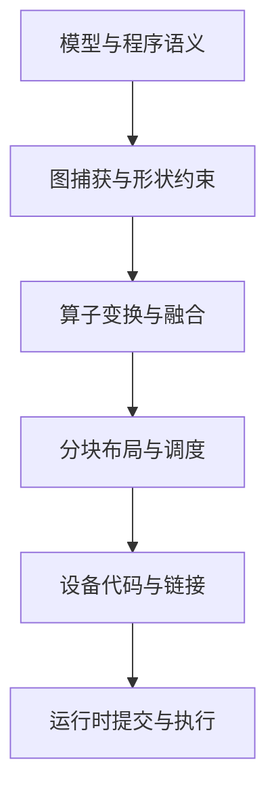
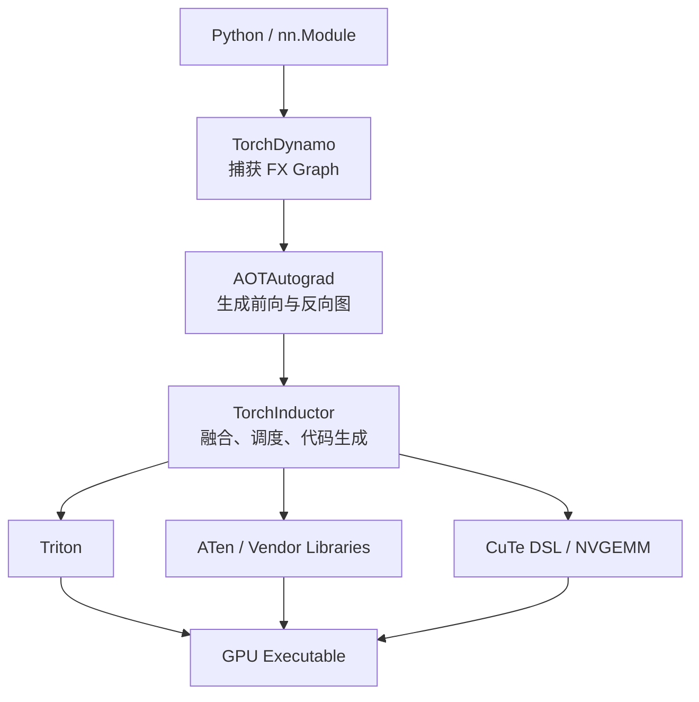

# 第 10 章　编译器与运行时

连接计算图、融合、反向图与生成内核，区分编译优化和运行时提交，理解动态形状的影响。

本章内容：

- [1. 编译器分层：从模型表达式到设备执行](#s1)
- [2. 从计算图到融合 Kernel：一个表达式的执行与字节账本](#s2)
- [3. PyTorch 编译栈：从 Python 模型到高性能 Kernel](#s3)
- [4. 编译优化需要多少次复用才能回本](#s4)

<a id="s1"></a>

<a id="s1-编译器分层从模型表达式到设备执行"></a>

## 1. 编译器分层：从模型表达式到设备执行


<a id="s1-每一层保留不同信息"></a>

### 每一层保留不同信息

高层图表达算子、形状、依赖和部分语义；较低层表示循环、数据布局和内存访问；指令层面决定具体硬件操作与寄存器使用。IR 是用于分析和变换的中间表示，不是一种固定格式，也不等于某个唯一编译器。



真实路径可能调用已有库，也可能生成新 Kernel，并不要求所有算子经过同一后端。

<a id="s1-fusion-改变边界"></a>

### Fusion 改变边界

若程序先算 $u=x+y$ 再算 $z=\operatorname{relu}(u)$，融合可以避免中间 u 的独立写回和再次读取，也减少提交。代价可能是更复杂的 Kernel、更多寄存器或失去某个高度优化的库实现。

融合必须保持需要的语义。别名、副作用、随机数、跨设备依赖和数值舍入都可能影响合法变换。数学上可合并不等于每个后端都有高性能实现。

<a id="s1-动态性为何带来重编译"></a>

### 动态性为何带来重编译

编译器可以对某些形状和条件生成专门代码，并建立 guard。条件不满足时可能重编译、回退或报错，具体取决于系统。更多 specialization 有利于局部性能，但带来编译时间、缓存和维护成本。

评估应区分首次捕获/编译、预热和稳态执行。如果服务请求形状变化频繁，编译缓存命中率本身就是工作负载属性。

<a id="s1-图编译与-cuda-graph-的区别"></a>

### 图编译与 CUDA Graph 的区别

算子编译改变如何计算；CUDA Graph 等提交机制记录或表达设备操作依赖，以降低重复提交的控制开销。两者可以组合，但减少 launch overhead 不等于减少模型 FLOP 或 HBM 流量。

图捕获对地址、控制路径和形状有实现约束。动态 batch 常通过分桶、padding 或不同图实例处理，收益与额外计算/存储之间存在取舍。

<a id="s1-演进与选型"></a>

### 演进与选型

Eager 执行便于动态程序和调试；图优化暴露跨算子机会；Kernel DSL 提供布局和分块控制；硬件专用表达进一步暴露异步搬运与矩阵单元。抽象层越接近硬件，通常越需要管理具体目标的资源与可移植性。

比较后端时先固定数学语义、shape、stride、dtype、硬件和计时范围，再考虑开发与编译成本。

相关：[PyTorch 编译栈](<#s3>)、[IR/PTX/SASS](<../appendices/compilers/IR_PTX_SASS与编译模式.md>)、[Kernel DSL](<../appendices/compilers/Triton_TileLang_CUDA-Tile与Helion.md>)。

参考：[PyTorch Compiler](https://docs.pytorch.org/docs/stable/torch.compiler.html)、[CUDA Graphs](https://docs.nvidia.com/cuda/cuda-programming-guide/04-special-topics/cuda-graphs.html)。

---

<a id="s2"></a>

<a id="s2-从计算图到融合-kernel一个表达式的执行与字节账本"></a>

## 2. 从计算图到融合 Kernel：一个表达式的执行与字节账本


<a id="s2-三个算子怎样变成一次循环"></a>

### 三个算子怎样变成一次循环

取长度 N 的 FP32 连续数组 X、A、B，三者无别名，计算 Y=max(X×A+B,0)。三个输入均为数组，不能按标量广播的带宽计算。

未融合的示意图为 multiply→add→relu，前两步各写一个长度 N 的临时张量。若每步都从 HBM 读写、没有缓存复用：

| 阶段 | 读取 | 写入 | 元素访问数 |
|---|---|---|---:|
| T₁=X×A | X、A | T₁ | 3N |
| T₂=T₁+B | T₁、B | T₂ | 3N |
| Y=max(T₂,0) | T₂ | Y | 2N |
| 融合 | X、A、B | Y | 4N |

FP32 字节流量从理想 32N 降到 16N，kernel 提交次数从示意的三次降到一次。缓存命中可能让实际 HBM 差距更小；小 N 可能主要节省 launch，大 N 可能主要节省搬运。这些都是待测假设，不是保证加速两倍。

融合循环的伪代码如下；临时值留在线程局部寄存器中，而不是写成完整数组：

```text
i = program_id * BLOCK + lane
if i < N:
    x, a, b = load(X[i]), load(A[i]), load(B[i])
    y = max(x * a + b, 0)
    store(Y[i], y)
```

地址与尾块 mask 由布局决定。寄存器是否 spill、乘加是否合成 FMA，要查看生成代码与资源报告。FMA 可能改变舍入次数，见[数值反例](<../02_Model_Computation/03_张量形状与数值表示.md#s2>)。

<a id="s2-编译链条各自做了哪件事"></a>

### 编译链条各自做了哪件事

Python 捕图把执行中的张量操作表达为图，并为相关 shape、dtype、stride 或 Python 状态建立适用条件。图级优化可消去多余节点、决定融合区域；降低到循环／tile 后安排索引、向量化与内存访问；后端再完成设备指令选择、寄存器分配和机器代码生成。PyTorch 各层的实际分工见[编译栈](<#s3>)与 [torch.compiler 文档](https://docs.pytorch.org/tutorials/intermediate/torch_compile_tutorial)。

对于本例，只需要每个位置自己的三个输入。换成矩阵乘、归约或 Attention，就增加跨元素协作，tile、同步和共享内存成为新的调度选择。公式能写成一行不代表适合一个 kernel。

<a id="s2-反向图还需要保存什么"></a>

### 反向图还需要保存什么

若 U=X×A+B，输出梯度为 G，并约定 ReLU 在零点导数取零，则 H=G·1[U>0]，dX=H×A、dA=H×X、dB=H。X/A 是原输入，U 的符号可以保存 mask 或重算；取舍包括保存字节数、重算 FLOPs 和输入生命周期。

前向中间张量被消去，不代表整个训练图不需要状态。图编译也不能随意删除为反向所需的信息。若 B 实际是标量或广播向量，dB 还需要归约；本节按逐元素 B 定义，不能把这个梯度直接用于广播版本。

<a id="s2-哪些变化会阻止同一执行方案复用"></a>

### 哪些变化会阻止同一执行方案复用

| 改动 | 新问题 |
|---|---|
| 输入变成非连续 view | 地址公式与合并访问改变；可能需要另一种调度 |
| Python 分支依赖 tensor 的值 | 需要支持的图内控制流，或产生图边界 |
| T₁ 被其他消费者使用 | 消掉 T₁ 可能增加重复计算，需比较两种代价 |
| 输入与输出存在别名或原地写入 | 必须维护读写顺序和可观察副作用 |
| 融合区域不断扩大 | 寄存器、代码体积和并行度可能恶化 |
| N 改变 | 动态形状支持、guard 和特化决定是否重编译 |

Graph break、重新编译和 kernel 不融合是三件事。CUDA Graph 则重放设备工作提交，不能自动完成上述代数和存储变换。

<a id="s2-在真实编译器上如何取证"></a>

### 在真实编译器上如何取证

下面是需要 PyTorch 的独立实验，本次 macOS 标准库环境未执行：

```python
import torch

device = 'cuda' if torch.cuda.is_available() else 'cpu'
torch.manual_seed(0)
def fn(x, a, b):
    return torch.relu(x * a + b)

inputs = [torch.randn(1 << 20, device=device) for _ in range(3)]
compiled = torch.compile(fn, fullgraph=True)
torch.testing.assert_close(compiled(*inputs), fn(*inputs), atol=1e-5, rtol=1e-5)
```

先保存软件版本、输入布局和生成代码，再确认临时张量、kernel 数及资源占用。将首次编译时间单独计时；稳态预热后分别测端到端和设备执行。用 profiler 验证实际 kernel，使用多组 N 和 stride 检查原假设是否成立。正确性对照需要同时覆盖反向、尾块与别名边界；上面的片段只检查当前前向输入。

不要把上面选用的容差当作所有表达式的通用阈值。接近 ReLU 零点时很小的数值差异也可能改变分支，因此前向误差和梯度误差应分别报告。


<a id="s3"></a>

<a id="s3-pytorch-编译栈从-python-模型到高性能-kernel"></a>

## 3. PyTorch 编译栈：从 Python 模型到高性能 Kernel


<a id="s3-torchcompile-编译的不是整个-python-程序"></a>

### `torch.compile` 编译的不是“整个 Python 程序”

`torch.compile(model)` 的核心目标，是从动态 Python 执行中捕获可编译的 Tensor 计算区域，构造 Graph（计算图），对前向和反向做变换，再交给 Backend 生成或选择高性能实现。



FX 是 PyTorch 用于表示 Python 可追踪计算的图结构；AOT = **Ahead-Of-Time（提前）**。这里的 AOTAutograd 指在执行生成代码前，先把 Autograd（自动微分）需要的前向/反向图捕获出来。


<a id="s3-torchdynamo从动态-python-中抓图"></a>

### TorchDynamo：从动态 Python 中抓图

TorchDynamo 利用 CPython Frame Evaluation 机制观察 Python Bytecode，在不要求用户重写模型的情况下，把连续的 Tensor 操作提取为 FX Graph。

它必须同时维护 Guard（守卫条件），例如：

- Tensor 的 Dtype；
- Device；
- Rank 与 Shape 条件；
- 某些 Python 全局/局部值；
- 控制流相关条件。

下次运行 Guard 成立，可以复用已编译代码；Guard 失效，则可能重新编译。


<a id="s3-graph-break-为什么发生"></a>

### Graph Break 为什么发生？

Graph Break（图中断）表示 Dynamo 无法或不应继续把后续 Python 放入同一张图，于是先结束当前 Graph，执行一段 Eager Python，再从后面重新捕获。

常见原因：

- Tensor 数据驱动的 Python 控制流；
- 不支持的 Python/C 扩展操作；
- `.item()` 把 Tensor 值取回 Python；
- 难以追踪的副作用；
- 显式禁用编译的函数。

Graph Break 不一定导致错误，但会减少 Fusion、增加 Launch、引入同步，并可能造成 Recompile。

<a id="s3-例子"></a>

#### 例子

```python
def f(x):
    if x.sum().item() > 0:
        return x.sin()
    return x.cos()
```

`.item()` 需要把设备上的结果变成 Python Scalar，通常会形成同步与捕获边界。更适合图编译的表达可能是 `torch.cond` 或 Tensor 化选择，但应根据语义和版本支持判断。


<a id="s3-aotautograd为什么反向图也要捕获"></a>

### AOTAutograd：为什么反向图也要捕获？

Eager Autograd 在运行前向时动态记录操作，再逐个执行反向。AOTAutograd 先把前向和反向表示为可编译 Graph，使编译器可以：

- 跨多个反向算子 Fusion；
- 重新决定保存或重算哪些中间值；
- 对前向/反向分别生成 Kernel；
- 将 Custom Backend 用于训练。

这不意味着所有 Activation 自动消失。编译器仍需在保存、重算、显存和计算之间取舍。


<a id="s3-torchinductor-做什么"></a>

### TorchInductor 做什么？

TorchInductor 是默认编译后端，负责：

- Loop/Tensor IR 变换；
- Fusion；
- Layout 与 Buffer 规划；
- 选择 External Kernel 或生成 Kernel；
- Autotune 多个候选；
- 生成 CPU 或 Accelerator 代码。

在 NVIDIA/AMD GPU 上，Triton 长期是重要生成后端，但不能把 Inductor 简化为“Triton 包装器”。Inductor 也会调用 ATen、cuBLAS/cuDNN、Custom Kernel；PyTorch 2.14 又加入 NVGEMM/CuTe DSL 候选。

ATen 是 PyTorch 底层 Tensor Operator Library；cuDNN = **CUDA Deep Neural Network library（CUDA 深度神经网络库）**。


<a id="s3-fusion-是怎样发生的"></a>

### Fusion 是怎样发生的？

假设 Eager 图为：

```text
Linear → Bias → GELU → Dropout
```

编译器可能：

- 把 Bias/GELU 融合进 GEMM Epilogue；
- 把 Pointwise 操作融合成 Triton Kernel；
- 直接选择已经支持 Fusion 的外部库；
- 因为动态性或资源压力而只做部分 Fusion。

所以“用了 `torch.compile`”并不保证形成一个 Kernel。要查看生成代码、Profiler Timeline 和最终 Launch 数。


<a id="s3-dynamic-shape-与-recompile"></a>

### Dynamic Shape 与 Recompile

如果每次输入 Sequence Length 不同，编译器可能：

1. 每个 Shape 特化一份代码，性能好但编译多；
2. 生成带符号 Shape 的通用代码，减少编译但优化空间可能下降；
3. 对 Shape 建立范围或可整除 Guard。

PyTorch 2.14 引入更声明式的 Dynamic Shape 规范，并在 `torch.compile`、`torch.export` 和 `make_fx` 之间共享方向。生产中仍需要统计真实 Shape 分布，而不是简单把 `dynamic=True` 当作万能开关。


<a id="s3-jit-与-aotinductor"></a>

### JIT 与 AOTInductor

JIT = **Just-In-Time（即时编译）**：运行时遇到 Graph/Shape 后编译，适合动态研究环境，但首次请求有编译开销。

AOTInductor 则以 `torch.export` 捕获的 Graph 为输入，提前生成部署 Artifact，减少生产环境运行时对 Python 和即时编译的依赖。

两者选择与场景有关：

- 训练/研究：JIT 更灵活；
- 固定模型部署：AOT 更利于启动、封装与版本控制；
- 高动态 Agent/Serving：可能需要 Shape Bucketing、Cache 和部分动态编译的组合。


<a id="s3-pytorch-214-的重要变化"></a>

### PyTorch 2.14 的重要变化

截至 2026-09-02 的 PyTorch 2.14 Release：

- NVGEMM 把 CuTe DSL 生成的 CUTLASS Kernel 加入 Inductor；
- 候选可与 Triton、ATen 一起 Autotune；
- Inductor 增加 Rubin `sm_107` 目标；
- `torch.while_loop` 可被 CUDA Graph 捕获；
- Dynamic Shape 表达继续统一。

这说明 Compiler Stack 正从“Fusion + Triton Codegen”走向“多 Kernel Provider 的选择与组合系统”。


<a id="s3-调试顺序"></a>

### 调试顺序

遇到 `torch.compile` 性能或正确性问题，按层排查：

1. Dynamo：是否 Graph Break 或频繁 Recompile？
2. AOTAutograd：前后向捕获是否成功？保存了哪些 Tensor？
3. Inductor：Fusion、Layout、Kernel Choice 是否合理？
4. Backend：Triton/Library/CuTe Kernel 本身是否快？
5. Runtime：Compile Cache、Launch、CUDA Graph、同步是否成为瓶颈？

不要一上来只分析最终 PTX；很多问题在 Graph Break 或错误 Kernel Choice 时已经决定。


<a id="s3-资料"></a>

### 资料

- [PyTorch torch.compiler documentation](https://docs.pytorch.org/docs/stable/user_guide/torch_compiler/torch.compiler.html)
- [PyTorch Compiler Troubleshooting](https://docs.pytorch.org/docs/stable/user_guide/torch_compiler/torch.compiler_troubleshooting.html)
- [AOTInductor](https://docs.pytorch.org/docs/stable/user_guide/torch_compiler/torch.compiler_aot_inductor.html)
- [PyTorch 2.14 Release](https://pytorch.org/blog/pytorch-2-14-release-blog/)

---

<a id="s4"></a>

## 4. 编译优化需要多少次复用才能回本

如果一次编译花 30 秒，每次调用从 12 ms 降到 9 ms，在忽略其他变化的教学条件下，需要约 $30/0.003=10000$ 次复用才能收回编译时间。若短作业只运行 2000 次，稳态更快仍可能使作业更晚完成。

对实际负载，设形状类别 $i$ 被调用 $n_i$ 次，编译前后耗时为 $t_i$、$t'_i$，新增编译及预热总成本为 $C$，所有耗时换算到同一单位。编译在这段运行中节省墙钟时间的必要比较是

$$\sum_i n_i(t_i-t'_i)>C.$$

这是串行调用的简化账本；编译与执行重叠、共享资源竞争都需另算。编译缓存命中后的调用次数才是这里有用的 $n_i$，总请求数不能代替每种形状的复用次数。

RL 中回答长度和专家负载还可能随策略改变，初始预热未必覆盖后期分布。分桶可以增加复用，但 padding 会增加计算，CUDA Graph 与工作区也占容量。较稳妥的实验是分别报告首次运行、缓存命中和新形状到达的耗时，并在短回答、长回答与分布变化后重新核对收益。

若权重在固定地址原地更新，某些执行图可以继续使用；若更新改变地址、布局或量化状态，则必须按运行时契约重新检查。缓存的是执行方案还是模型结果，两者也不能混淆。第 27 章将把这里的地址与状态约束接入权重发布。

## 本章回顾

编译器利用计算图和布局生成执行代码，运行时安排提交与状态生命周期。动态形状、控制流和可复用边界决定融合、重编译和执行图缓存的收益。

**检查理解：** 图融合、CUDA Graph 和异步提交各自减少什么成本，又受什么约束？

下一章讨论互联通信与成本。先定义跨卡操作应该交付什么结果，再讨论算法、拓扑和完成语义如何约束耗时与消费。

<!-- book-nav -->

[上一章：矩阵乘与Attention算子](<09_矩阵乘与Attention算子.md>) · [全书目录](<../README.md>) · [下一章：互联通信与成本](<11_互联通信与成本.md>)

<!-- /book-nav -->
