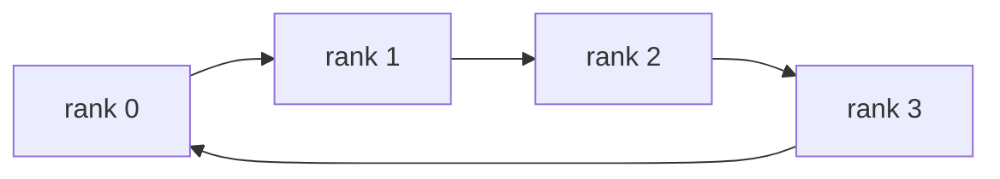
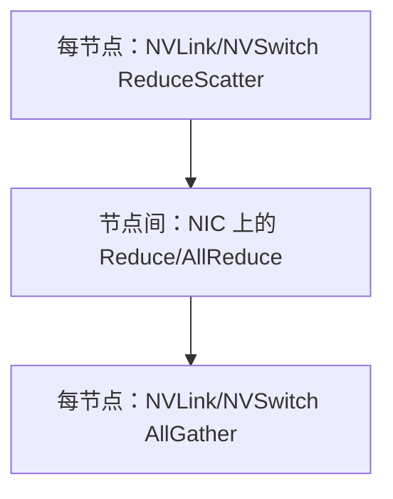

# 第 11 章　互联通信与成本

先定义跨卡操作应该交付什么结果，再讨论算法、拓扑和完成语义如何约束耗时与消费。

本章内容：

- [1. 通信原语与 Collective](#s1)
- [2. 通信性能模型：从 $\alpha$–$\beta$ 到有效带宽](#s2)
- [3. Collective 通信算法](#s3)
- [4. DMA、RDMA 与通信完成语义](#s4)
- [5. 从一次超时还原参与者的执行顺序](#s5)

## 1. 通信原语与 Collective

单卡显存不足或希望多卡共同工作时，进程之间必须交换数据。**Rank** 是参与进程在一组通信中的编号；**communicator（通信器）**描述这组参与者及通信上下文，组大小常称为 world size。一个 rank 常管理一张 GPU，但 rank 不是 GPU 的物理编号。

**Shard** 是一份数据切分后的一片；**root** 是某次操作指定的汇集或广播起点。NCCL（NVIDIA Collective Communications Library）是实现 GPU 通信的库；Collective Communication（集合通信）是 communicator 中一组 rank 共同参与的数据变换。理解它们最有效的方法不是背名字，而是画出**输入分布 → 输出分布**。

### 先用两个向量分清“求和”和“拼接”

假设 rank 0 有 `[1,2]`，rank 1 有 `[10,20]`，归约运算选择逐元素求和：

| 操作 | rank 0 的结果 | rank 1 的结果 |
|---|---|---|
| AllReduce | `[11,22]` | `[11,22]` |
| Reduce 到 root 0 | `[11,22]` | 不要求保存结果 |
| AllGather | `[1,2,10,20]` | `[1,2,10,20]` |
| ReduceScatter，均分两片 | `[11]` | `[22]` |
| Broadcast，从 root 0 广播 | `[1,2]` | `[1,2]` |

归约（reduction）用指定规则合并对应位置，例如求和、最大值；拼接（gather）保留各段数据。**AllReduce 的求和不自动等于平均**，需要调用方或框架定义除数。对上例的 ReduceScatter 结果再做 AllGather，才得到与 AllReduce 相同的 `[11,22]`。

### 核心原语

假设有 $p=4$ 个 rank，每个 rank 上 `Xi` 大小均为 $N$ bytes。下表的用途是后续并行章节的预览：DP/DDP 分数据，TP 分张量计算，FSDP/ZeRO 分模型状态，CP/SP 分序列相关数据，MoE 将 token 分给不同专家。第一次阅读重点看输出语义：

| 原语 | 输出语义 | 大模型中的典型用途 |
|---|---|---|
| Broadcast | root 的 X 复制到所有 rank | 参数/配置发布 |
| Reduce | 所有 X 规约到 root | 聚合统计量 |
| AllReduce | 所有 X 规约，结果给所有 rank | DP 梯度同步、TP partial sum |
| AllGather | 每 rank 的 shard 拼接到所有 rank | FSDP 参数展开、sequence shard 恢复 |
| ReduceScatter | 规约后按 shard 分发 | ZeRO/FSDP 梯度分片、TP |
| All-to-All | 每 rank 给每个 rank 一个不同 shard | MoE token dispatch、某些 CP/SP 转置 |
| Gather/Scatter | 多对一拼接 / 一对多拆分 | 控制面、小规模汇集 |
| Send/Recv | point-to-point（P2P，点对点） | pipeline activation、邻居交换 |

NCCL 的 communicator 需要所有相关 rank 以匹配的顺序调用 collective；某个 rank 漏调或 tensor count 不一致，常表现为 hang，而非立即抛出易懂异常。

### AllReduce = ReduceScatter + AllGather

逻辑上可把 AllReduce 分解为：

这个分解非常重要：如果后续计算只需要自己那一片，就不应马上 AllGather。ZeRO/FSDP 正是通过延迟或按 layer 执行 gather，把“永久复制”变成“按需暂存”。

### All-to-All 不是 AllGather

设 rank 0 的输入被切为 `[x00,x01,x02,x03]`，其中第二个下标表示目标 rank。All-to-All 后 rank 1 获得 `[x01,x11,x21,x31]`。每个数据只送到其目标，而不是复制给所有人。

MoE 中目标由 router 动态决定，所以发送量可能不均匀。即使总字节相同，热点 rank、变长 split、pack/unpack、排序、跨节点比例都会使 All-to-All 比规则 AllGather 更难优化。

### In-place、异步与完成语义

- in-place 只描述输入输出 buffer 复用，不等于零拷贝或零 workspace。
- `async_op=True` 或把 NCCL 操作 enqueue 到 CUDA stream，只说明 host 不阻塞；消费者仍必须通过 stream dependency/event 等待数据完成。
- collective 的“完成”可分为 host 已提交、device 已完成、远端可见、所有 rank 都安全复用 buffer。不同 API 的契约必须查文档。

### one-sided 与 two-sided

以下数值过程核对通信结果；本章第 2 节再讨论这些操作需要多少时间。

传统 send/recv 和 collective 通常是 two-sided：发送与接收双方都参与匹配。Remote Memory Access（RMA，远程内存访问）允许一方对已注册远端窗口执行 put/get，并用 signal/wait 同步。one-sided 能简化不规则通信，但内存注册、可见性、ordering 和生命周期责任更显式。

PyTorch 2.14 的实验性 `nccl2` backend 引入 one-sided window 能力；这属于快速演进接口，不能把 release blog 当稳定 API 文档。

### 选择原语的三个问题

1. 结果究竟要复制到所有 rank，还是只保留 shard？
2. 发送模式是规则等长，还是 token-driven 变长？
3. 下一算子能否直接消费分片布局，从而消除一次通信？

第三问通常收益最大。优化通信的最高境界往往不是把 collective 加速 10%，而是通过布局和算子融合删掉它。

### 概念辨析

本节中的缩写可先按功能理解：OS 是操作系统，IPC 是进程间通信，MPI 是消息传递接口标准，HPC 是高性能计算；DMA 是直接内存访问，RDMA 是远程直接内存访问；NIC/HCA 是网络适配器，InfiniBand 与 RoCE 是常见的 RDMA 网络技术。Socket 是通信端点，handle 是可传递的资源句柄，descriptor 是描述搬运任务的结构。这些机制细节可以在需要排查通信路径时再读。

#### 从操作系统 IPC 到 GPU 通信原语：今天 NCCL / RDMA 的思想是怎么演化出来的？

问题：GPU 通信看起来有 Send/Recv、AllReduce、共享显存、P2P、RDMA、GPUDirect 等很多概念。它们与传统操作系统进程间通信是什么关系？为什么会一步步演化成今天的大模型训练通信体系？

##### 核心主线

> OS 进程隔离\
> ↓\
> IPC：Pipe / Socket / Shared Memory\
> ↓\
> Message Passing + Shared Memory 两类范式\
> ↓\
> 跨机器网络通信\
> ↓\
> MPI：Send/Recv + Collective\
> ↓\
> DMA / RDMA：减少 CPU 和内存拷贝\
> ↓\
> GPU 独立显存出现\
> ↓\
> CUDA Copy / P2P / CUDA IPC\
> ↓\
> GPUDirect RDMA\
> ↓\
> NCCL：GPU Collective / P2P\
> ↓\
> DDP / TP / PP / EP / FSDP

##### 第一阶段｜OS 为什么需要 IPC？

进程的核心特征之一是虚拟地址空间隔离：Process A 中的地址 0x1000 和 Process B 中的 0x1000 不代表同一块物理数据。默认情况下，一个进程不能直接解引用另一个进程的普通指针。因此操作系统需要提供 IPC。

##### 第二阶段｜CPU 世界形成两类基本通信范式

| **范式**        | **典型机制**                            | **核心思想**                         | **后来映射到 GPU 世界**                   |
|-----------------|-----------------------------------------|--------------------------------------|-------------------------------------------|
| Message Passing | pipe / socket / send / recv             | 把数据作为“消息”从发送方交给接收方   | MPI_Send/Recv、ncclSend/Recv              |
| Shared Memory   | shm / mmap + mutex / semaphore / atomic | 让多个进程看到同一块内存，再解决同步 | CUDA IPC、共享 GPU buffer、NVSHMEM 等思想 |

这里出现了以后所有通信系统都绕不开的两个基本问题：

**Communication = Data Movement + Synchronization**

##### 第三阶段｜从单机 IPC 到跨机器 Message Passing

进程跨服务器后不再共享物理内存，通信必须经过网络。socket 将单机 send/recv 的抽象自然推广到网络：用户缓冲区 → kernel/network stack → NIC → 网络 → 对端 NIC → 对端进程。

##### 第四阶段｜HPC 把通信抽象成 MPI

当进程规模达到几百、几千甚至更多时，手写成百上千个 Send/Recv 会非常复杂。MPI 因此把常见通信模式标准化为两类：

- Point-to-Point：Send / Recv。

- Collective：Broadcast、Reduce、AllReduce、Gather、AllGather、Scatter、ReduceScatter、AllToAll 等。

非常重要：AllReduce 并不是 GPU 或深度学习发明的。它早已是 HPC/MPI 的经典 collective；分布式训练只是发现“梯度同步”天然就是一个 AllReduce 问题。

##### 第五阶段｜DMA / RDMA：从“CPU 搬数据”到“设备自己搬”

普通数据搬运如果处处依赖 CPU copy，会浪费 CPU 周期并增加内存带宽压力。DMA 让设备在 CPU 配置好 descriptor 后自行读写内存；RDMA 再把这种思想扩展到远端机器，使网络通信越来越像对远端内存执行 read/write。

> 传统思路：CPU 参与多次 copy / protocol processing\
>
> DMA： Device ↔ Host Memory，CPU 主要负责下发与管理\
>
> RDMA： NIC A ═════ fabric ═════ NIC B → Remote Memory

##### 第六阶段｜GPU 出现：系统里多了一块独立 device memory

GPU 最初更像 CPU 的加速外设，数据需要通过 cudaMemcpy 在 Host RAM 与 GPU VRAM/HBM 之间搬运。多 GPU 出现后，又产生 GPU0→GPU1 的 device-to-device 通信需求。

> 最早： GPU0 → Host RAM → GPU1\
> 改进： GPU0 ── P2P / Peer Access ──→ GPU1

CUDA P2P 解决“同机 GPU 之间怎样直接搬数据”，底层实际路径可以是 PCIe，也可以是 NVLink/NVSwitch。注意：NVLink 是物理互联，cudaMemcpyPeer / Send / AllReduce 才是更上层的通信操作。

##### 第七阶段｜不同进程各自管理 GPU：CUDA IPC 再次出现

如果 Process A 管 GPU0、Process B 管 GPU1，A 中的 GPU pointer 对 B 并不天然有效。这和 CPU 进程地址空间隔离是同一个问题。CUDA IPC 的做法是：A 导出 GPU memory/event 的可传递 handle，经标准 OS IPC 把 handle 交给 B，B 再把它映射成自己可用的 device-side 资源。

> Process A / GPU0\
> cudaIpcGetMemHandle()\
> │\
> ├── OS IPC 只传 handle / metadata ──→ Process B\
> │ cudaIpcOpenMemHandle()\
> └────────────────────────────────────→ 映射/访问 GPU memory

因此 GPU IPC 并没有取代 OS IPC，而是在 OS IPC 上再加了一层 GPU memory/resource 语义。

##### 第八阶段｜跨机器 GPU 通信：GPUDirect RDMA

跨节点时，最笨的路径是 GPU HBM → CPU DRAM → NIC → 网络 → NIC → CPU DRAM → GPU HBM。GPUDirect RDMA 的关键目标是让支持的 HCA/NIC 直接 DMA GPU memory，避免不必要的 host-memory staging。

> GPU HBM → PCIe → HCA ═════ InfiniBand/RoCE ═════ HCA → PCIe → GPU HBM\
> ↑ 直接 DMA GPU memory，避免 CPU DRAM 中转 ↑

##### 第九阶段｜NCCL：把“GPU 通信怎么做”封装成高性能原语

当程序需要自己处理 P2P、PCIe/NVLink 拓扑、NIC/HCA、RDMA、ring/tree、chunk/channel 等细节时，工程复杂度会极高。NCCL 把这些细节封装起来，对上提供熟悉的 communication primitives。

| **类型**           | **典型 NCCL/MPI 原语**    | **大模型训练中的典型用途**                      |
|--------------------|---------------------------|-------------------------------------------------|
| Point-to-Point     | Send / Recv               | Pipeline Parallel 的 activation / gradient 传递 |
| Reduction          | Reduce / AllReduce        | DDP 梯度同步、部分 TP 聚合                      |
| Partition + Gather | ReduceScatter / AllGather | FSDP/ZeRO、TP/SP                                |
| Permutation        | AllToAll                  | MoE Expert Parallel token dispatch              |

##### 把通信分成五层来理解

| **层次**     | **例子**                                  | **回答的问题**           |
|--------------|-------------------------------------------|--------------------------|
| L5 并行策略  | DDP / TP / PP / EP / FSDP                 | 模型为什么需要通信？     |
| L4 通信原语  | AllReduce / AllGather / RS / Send/Recv    | 要交换什么数据？         |
| L3 通信库    | NCCL / MPI / NVSHMEM                      | 由谁实现这些原语？       |
| L2 Transport | CUDA P2P / SHM / RDMA / IB Verbs          | 数据具体怎样被搬运？     |
| L1 Hardware  | PCIe / NVLink / NVSwitch / InfiniBand HCA | 数据最终走哪条物理路径？ |

##### 最重要的 Insight

今天 GPU 通信并不是一套凭空出现的新理论，而是 OS IPC 的隔离/共享思想、MPI 的 message-passing 与 collective 抽象、DMA/RDMA 的设备搬运机制，再叠加 CUDA 的 device memory/stream 模型后形成的。理解这条演化线后，NCCL、NVLink、InfiniBand、GPUDirect RDMA 就会自然落在不同层次上。

---

### 资料

- [NCCL Collective Operations](https://docs.nvidia.com/deeplearning/nccl/user-guide/docs/usage/collectives.html)
- [PyTorch Distributed collectives](https://docs.pytorch.org/docs/stable/distributed.html)
- [PyTorch 2.14 Release Blog](https://pytorch.org/blog/pytorch-2-14-release-blog/)

## 2. 通信性能模型：从 $\alpha$–$\beta$ 到有效带宽

本章第 1 节定义“通信之后各 rank 得到什么”，本节估算“为此等多久”。先掌握单消息公式和一个数值例子，再读 Ring 的推导；底部的多层次网络细节可用于后续调优。

### Hockney 模型

最基础的消息传输模型是：

$$
T(n)=\alpha+n\beta
$$

- $\alpha$：固定延迟，包含 launch、software、synchronization 等近似固定成本；
- $n$：消息字节数；
- $\beta$：每字节传输时间，理想情况下约为 $1/BW$。

它解释了为什么小消息看 latency、大消息看 bandwidth。交叉点约为 $n^*=\alpha/\beta$；但真实系统还会切块传输（chunk）、流水重叠（pipeline）、使用多条网络路径（multiple rails），并受排队和资源竞争影响，因此该式适合量级分析，不是精确仿真器。

#### 先把单位代入一次

假设固定延迟 α=5 μs（1 μs=$10^{-6}$ 秒），有效带宽为 20 GB/s（十进制）。传 1 KB=1000 字节，数据部分只需 0.05 μs，总计约 5.05 μs；传 1 MB=$10^6$ 字节，数据部分需 50 μs，总计约 55 μs。两项相等的消息大小为 $α×BW=100,000$ 字节，即 100 KB。

这解释了为什么把很多小消息合成一个 bucket（通信桶）可能省下启动成本，也解释了为什么等桶填满又会延迟发送。两种代价会在 DDP 章节汇合。

### Ring AllReduce 的近似

Ring（环）让 rank 按环形邻接关系传递数据；Tree（树）沿分支汇集、分发。以下假设各链路均衡，使用同一有效带宽，忽略计算与拥塞。对 $p$ 个 rank，每 rank tensor 大小 $n$：

$$
T_{ring}\approx2(p-1)\alpha+2\frac{p-1}{p}n\beta
$$

平衡 Tree 的启动轮数可为 $O(\log p)$。对经过分块流水、带宽项接近两倍消息量的树实现，可用下面的趋势近似：

$$
T_{tree}\approx2\log_2(p)\alpha+2n\beta
$$

带宽高效的树实现可参考 [NCCL 双二叉树介绍](https://developer.nvidia.com/blog/massively-scale-deep-learning-training-nccl-2-4/)。朴素树若每轮都传完整消息，带宽项也会随树深增长，不能套用上面的 $2n\beta$。常数取决于实现；这些式子用于解释趋势，不该拿来宣称某个 NCCL 版本必然选某算法。

### Algorithm bandwidth 与 Bus bandwidth

`nccl-tests` 是 NCCL 的通信测试程序；payload 是用户要通信的有效数据。它常报告：

- Algorithm Bandwidth（algbw，算法带宽）：消息 payload 大小除以操作时间；
- Bus Bandwidth（busbw，总线等效带宽）：按 collective 的理论通信因子归一化，便于与链路能力比较。

以 Ring AllReduce 为例，常用换算因子是 $2(p-1)/p$：

$$
busbw=algbw\times2\frac{p-1}{p}
$$

AllGather/ReduceScatter 常用 $(p-1)/p$。不同 benchmark/collective 的定义必须查对应实现，不能把 busbw 当作某根线缆实测，也不能跨工具直接比较。

### Link、Injection、Bisection 三种带宽

| 指标 | 问题 |
|---|---|
| link bandwidth | 一条物理 link 的上限是多少？ |
| injection bandwidth | 单个 GPU/NIC 能向 fabric 注入多少？ |
| bisection bandwidth | 把网络一分为二，跨切面的总容量是多少？ |

Fabric 指互联网络，oversubscription（超售）表示多端口同时需求可能超过共享上行容量。All-to-All 往往更暴露网络切面容量或超售问题；单 pair 测试主要反映一条路径，不能代表集群 collective。

#### 从统一带宽走向逐资源模型

在非均匀拓扑上，每 rank 的逻辑发送量需要映射到实际路径。设算法阶段 $r$ 在资源 $e$ 上形成 $V_{r,e}$ bytes 的读写或传输，资源服务带宽为 $B_e$，则 $\max_e(V_{r,e}/B_e)$ 给出该阶段的带宽下界。资源可以是有向链路，也可以是多条链路共用的 NIC、PCIe 接口或内存端口。上下行若独立服务，应分开计数。

这解释了为什么同一种 collective、同样的 rank 数和总逻辑字节，仍可能因 rank 顺序、域内归约、NIC 绑定或超售而耗时不同。瓶颈是最忙的共享资源，不是各端口速率的总和；数据依赖、启动与有限并发还会让完成时间高于带宽下界。

带宽模型回答“工作占用资源至少多久”，关键路径回答“这些工作何时才能开始、哪些等待无法重叠”。具体的阶段求和、切面约束、流量稳定性和拥塞反馈见[拓扑、拥塞与通信进度](<../appendices/communication/拓扑拥塞与通信进度.md>)。

### 一个数值例子

假设 8 GPU Ring AllReduce 传 1 GiB，测得 20 ms：

$$
algbw=1\text{ GiB}/0.02\text{ s}=50\text{ GiB/s}
$$

$$
busbw=50\times2\times7/8=87.5\text{ GiB/s}
$$

87.5 GiB/s 是按 Ring 流量校正的等效值，不表示任意单条 NVLink 正以此速率运行。若硬件公布 GB/s 而工具用 GiB/s，还要处理十进制与二进制单位。

### Scale-up 与 Scale-out

- Scale-up：同一高带宽 domain 内扩展，如 NVSwitch domain；
- Scale-out：通过 NIC/switch 跨节点扩展。

强扩展时总问题大小固定，例如同一批数据从 4 卡改为 8 卡计算，每 rank 计算减少，通信固定延迟与边界数据交换的相对占比可能上升；弱扩展时每 rank 工作量固定，更关注 fabric 总容量与负载均衡。Scaling efficiency 必须标明是哪一种。

### 成本模型与真实通信的差异

1. 用单 GPU kernel 时间确定无通信基线；
2. sweep message size 得到 latency plateau 与 bandwidth saturation；
3. 做 pair、单节点、跨节点、全规模四级实验；
4. 比较默认算法与受控 Ring/Tree/PAT，但不长期保留强制配置；
5. 把 microbenchmark（单项小测试）的带宽代回训练张量形状，最后以端到端训练步耗时验证。

这里 sweep 是改变消息大小做一组测量；plateau 是小消息延迟平台，saturation 是大消息达到带宽上限；PAT 是一种通信算法，首次阅读不需要记住它。

### 概念辨析

#### α-β（Hockney）通信模型：T = S(p)·α + F(p)·n·β 到底在描述什么？

问题：为了对 AllReduce / AllGather / ReduceScatter 等 collective 做数学建模，常用 α-β（Hockney）模型：T = S(p)·α + F(p)·n·β。这个公式中每一项到底代表什么？为什么能用它分析通信算法的 latency 与 bandwidth complexity？

##### 从最简单的两点通信开始

GPU0 向 GPU1 发送 n Byte 数据时，总时间不只是 n / Bandwidth。一次通信通常还包含与消息大小弱相关的固定启动/软件/同步/网络延迟。于是最基础模型是：

**T = α + n·β**

其中 α 是一次通信的固定启动延迟；β 是“传 1 Byte 所需的时间”，因此 β = 1 / B，B 才是真正的有效带宽。

| **符号** | **含义**                             | **单位** | **直觉**                               |
|----------|--------------------------------------|----------|----------------------------------------|
| p        | rank / GPU 数量                      | 无量纲   | world_size                             |
| n        | 基准消息大小                         | Byte     | 一次 collective 涉及的逻辑 tensor 大小 |
| α        | 一次通信 step 的固定延迟             | s        | 通信“起步价”                           |
| β        | 传输 1 Byte 所需时间                 | s/Byte   | 有效带宽 B 的倒数：β=1/B               |
| S(p)     | 关键路径上的通信 step / startup 次数 | 无量纲   | 算法要走多少轮                         |
| F(p)     | 关键路径上的等效数据量倍数           | 无量纲   | 最终等效要搬多少个 n                   |

##### 推广到多 rank collective

多 GPU 算法不是一次 send 就结束，而是要经历多轮通信；同时每轮实际发送的数据可能只是 n 的一部分。因此把通信时间写成：

**T = S(p)·α + F(p)·n·β**

这里两项分别是：

- Latency-related cost：S(p)·α。S(p) 表示关键路径上需要经历多少个通信轮次 / startup。

- Bandwidth-related cost：F(p)·n·β。F(p)·n 表示关键路径上的等效数据传输量；乘以每 Byte 时间 β 后得到传输耗时。

##### 为什么强调“关键路径”？

collective 中很多 rank 会并行发送。例如 rank0→rank1 与 rank2→rank3 可以同时发生。整个 collective 的完成时间不是把所有链路总字节数相加，而是看最长依赖路径上经历了多少轮、搬了多少数据。因此 S(p)、F(p) 应从 critical path 的角度理解。

##### Ring AllReduce 推导

Ring AllReduce 通常拆为 ReduceScatter + AllGather。设 p 个 rank，每个 rank 的逻辑 tensor 大小为 n。

- ReduceScatter：共 p−1 个 step；每 step 发送 n/p Byte。

- AllGather：同样共 p−1 个 step；每 step 发送 n/p Byte。

**T_RS = (p−1)·(α + n/p·β)**

**T_AG = (p−1)·(α + n/p·β)**

**T_Ring-AR = 2(p−1)·α + 2(p−1)/p · n·β**

因此 Ring AllReduce 的两个系数是：

**S(p) = 2(p−1) F(p) = 2(p−1)/p**

##### 这个结果告诉我们什么？

- Latency complexity：S(p)=2(p−1)=O(p)。rank 越多，Ring 需要的通信轮数线性增长。

- Bandwidth complexity：F(p)=2(p−1)/p，当 p 很大时趋近 2。因此每个 rank 在关键路径上的等效传输量趋近 2n，而不是 pn。

- 所以 Ring 的特点是“轮数不算少，但大消息带宽利用率很好”，特别适合大 tensor / 大 gradient。

##### 小消息与大消息：谁主导？

| **场景** | **主导项** | **最该关注什么**            | **典型算法倾向**                            |
|----------|------------|-----------------------------|---------------------------------------------|
| 小消息   | S(p)·α     | startup / latency、通信轮数 | 更偏向低 step 数的 tree / hierarchical 算法 |
| 大消息   | F(p)·n·β   | 有效带宽、等效数据量        | Ring 等 bandwidth-efficient 算法更有优势    |

##### 和后续 21 GiB / microbatch 的 TP 例子串起来

后续[张量并行](<../04_Training/15_模型并行与执行日程.md#s1>)将讨论 TP=8（八路张量并行）。先预览其中的数字：一次 collective 逻辑 tensor 为 64 MiB 的 Ring AllReduce 估算中，每 rank 的链路通信量写成：

**V_AR = 2·(p−1)/p · n = 2·7/8·64 MiB = 112 MiB**

这里正是在使用 Hockney 模型中的 bandwidth 部分：F(p)=2(p−1)/p。把每层 4 次 collective、48 层累加后得到约 21 GiB / microbatch / GPU。Hockney 模型进一步告诉我们，若消息不够大，还不能只看这 21 GiB；还必须把每次 collective 的通信轮数对应的 α 成本考虑进去。

##### 最容易混淆的三点

- F(p)·n 不是“带宽”，而是等效数据量；真正的带宽 B=1/β。

- S(p) 不是“延迟”，而是关键路径上的通信轮数；真正的 latency cost 是 S(p)·α。

- 模型描述的是算法级近似，不包含所有真实系统细节，例如链路竞争、协议开销、GPU/NIC 拓扑不均、chunk pipeline、计算通信 overlap 等；真实性能仍需要 NCCL trace / profiler 验证。

##### 一句话记忆

**通信时间 = “要启动多少轮” × “每轮起步价” + “要搬多少数据” × “每 Byte 时间”**

也就是：先用 S(p) 研究 latency scaling，再用 F(p)·n 研究 bandwidth scaling。以后看到任何 collective，都先问两个问题：要走多少轮？关键路径上每个 rank 总共要搬多少数据？

---

### 资料

- [nccl-tests](https://github.com/NVIDIA/nccl-tests)
- [NCCL Performance](https://docs.nvidia.com/deeplearning/nccl/user-guide/docs/usage/collectives.html)
- [NVIDIA NCCL Tuning](https://docs.nvidia.com/deeplearning/nccl/user-guide/docs/usage/tuning.html)

## 3. Collective 通信算法

### 入门例子：先画两阶段，再记通信算法名称

把每个 rank 的数组分成 P 个块。Ring AllReduce 可理解为先用 P−1 步边传边规约，让各 rank 持有不同的最终块；再用 P−1 步把这些块传给其他 rank。每一步搬的是约 N/P 字节，N 是每 rank 的完整输入字节数。

在无拥塞、理想单链路模型下，时间近似 2(P−1)α + 2(P−1)N/(P·BW)。P 增大时，固定启动步数增加；这解释小消息为何未必喜欢长环。实际 NCCL 可采用多个 channel 和分层路径，模型用于提出假设，不是逐事件预测。

以 P=4、每卡四块为例，ReduceScatter 的三轮传递让每块逐步累积四个 rank 的贡献，最后每 rank 持有一块完整归约值；AllGather 再用三轮让四块结果都可见。逻辑结果相同并不要求使用同一种物理算法，路径、消息大小和拓扑才决定成本。

### 机制与实现

Collective 是语义，Ring、Tree、PAT、NVLS 是实现算法或路径。不能看到 `AllReduce` 就断言“一定走 Ring”。NCCL 会结合拓扑、消息大小、protocol、可用 plugin 与代价模型选择。

### Ring AllReduce

对 $p$ 个 rank、每 rank 输入 $N$ bytes，经典 Ring 分为 ReduceScatter 和 AllGather，每个阶段有 $p-1$ 步，每步传 $N/p$：

$$
V_{per-rank}=2\frac{p-1}{p}N
$$

其优势是大消息时能稳定利用每个环上的链路，传输量接近带宽最优；劣势是步数随 $p$ 增长，小消息容易受每步启动延迟支配。

多 channel 会把 buffer 切片并映射到多个逻辑 ring，因此 profiler 中可能看到多个并发通信 block；“一个 Ring”不是只有一条串行 memcpy。

### Tree AllReduce

Tree 通过上行 reduce、下行 broadcast 完成。平衡树的逻辑深度约为 $O(\log p)$，小消息通常比 $O(p)$ step 的 Ring 更有低延迟潜力；但根附近链路与双向调度、chunk pipeline 会影响大消息带宽。

现实 NCCL tree 可能使用 double binary tree，让不同 chunk 在互补树上流动，不应把课本上的单根二叉树直接等同于实现。

### Recursive doubling 与 PAT

Recursive doubling 每轮与距离为 $2^k$ 的伙伴交换，约 $\log_2 p$ 轮，适合某些小消息和幂次 rank 数。Parallel Aggregated Tree（PAT，并行聚合树）可理解为把多个聚合/分发 wave 并行化，以改善 AllGather/ReduceScatter 的小中消息扩展性。

截至 2026-09，NCCL release notes 已报告分层 PAT kernel：节点内可结合 NVLink SHARP（NVLS，NVLink Switch 上的归约/多播能力），跨节点使用 PAT。是否默认启用和支持哪些拓扑必须按版本检查，不能手工强制后就假设更快。

### 分层算法：先节点内，再节点间

如果每节点 8 GPU、共 16 节点，所有 128 rank 直接组成同质 Ring 会忽略 NVLink 与网络带宽差异。分层 AllReduce 的直觉是：

这样可以聚合节点内流量、减少跨 NIC 的竞争。SHARP（Scalable Hierarchical Aggregation and Reduction Protocol，可扩展分层聚合与归约协议）还可把部分 reduction offload 到网络交换结构；它并不让通信为零，而是改变执行归约的位置与链路占用。

### 算法 × Protocol 是两个维度

NCCL 中 Ring/Tree/NVLS/PAT 是算法维度，Simple/LL/LL128 等是 protocol 维度。Low Latency（LL，低延迟）协议用额外编码或传输粒度换取更低同步延迟；Simple 更适合追求大消息带宽。最终选择同时依赖二者。

### 不要只背“大消息 Ring、小消息 Tree”

这是有用的初始直觉，却不是决策表。下列因素足以反转结论：

- NVSwitch 是否支持 in-network reduction/multicast；
- rank 数、节点数和每节点 GPU 数；
- 多 rail NIC 与 GPU Direct 路径；
- collective 类型——All-to-All 与 AllReduce 完全不同；
- 通信 kernel 是否与计算争抢 SM、HBM bandwidth；
- NCCL 版本的 cost model 与新 algorithm 实现。

正确方法是保留自动选择作为基线，用 `NCCL_DEBUG=INFO`/Inspector 确认实际路径，再对目标 shape 做 sweep。`NCCL_ALGO` 适合诊断和受控实验，不是通用调优秘诀。

### 演进由消息大小与拓扑驱动

Ring 用规则步骤传播数据，适合利用连续传输带宽，但轮数随参与者增加；树形组织缩短某些传播深度，代价是节点负载、实现与拓扑匹配。分层方案利用节点内外不同带宽，但增加阶段边界和局部聚合责任。

比较算法时必须固定 reduction 操作、元素类型、消息大小与 rank 数，并区分每 rank 字节、聚合字节和链路线速。不同规约顺序可能改变浮点末位，不能仅凭数学交换结合律要求逐位一致。

算法收益还受协议和并发计算影响。独立带宽测试最优的路径，在与计算争用 SM、HBM 或网络注入时，未必产生最快 step。见[物理链路](<../appendices/foundations/通信信号与链路.md>)与[通信性能模型](<#s2>)。

---

### 资料

- [NCCL Environment Variables：NCCL_ALGO / NCCL_PROTO](https://docs.nvidia.com/deeplearning/nccl/user-guide/docs/env.html)
- [NCCL Releases](https://github.com/NVIDIA/nccl/releases)
- [NCCL 2.24：Topology、RAS 与 Buffer Registration](https://developer.nvidia.com/blog/networking-reliability-and-observability-at-scale-with-nccl-2-24/)

## 4. DMA、RDMA 与通信完成语义

### CPU 提交与设备搬运

程序逐次参与数据复制会占用 CPU 并增加控制开销。DMA 让设备按描述符等信息执行传输，但 CPU 或其他控制逻辑仍需准备地址、长度、权限与依赖，并处理完成或错误。

DMA 不保证完全零复制。数据可能经过 staging buffer，也可能需要固定内存或额外映射。是否复制、在哪里复制、谁执行复制要分开回答。

### 远端访问增加了什么

RDMA 将某些数据传输操作交给网络设备执行，涉及可访问的内存区域、权限和通信上下文。注册与固定内存可能有成本，因此常复用预先准备的 buffer。

GPUDirect RDMA 提供网络设备与 GPU 内存之间的特定访问路径，但是否可用及其顺序与可见性要求依赖平台和软件栈。它不自动取消拓扑限制、同步要求或应用协议。

### 至少区分四种完成

| 完成点 | 能说明什么 | 仍不能直接说明什么 |
|---|---|---|
| 提交返回 | 接口接受或安排了工作 | 数据已经到达 |
| 本地操作完成 | 按接口允许复用部分本地资源 | 远端应用已经消费 |
| 远端数据可见 | 指定消费者可按规定观察数据 | 整个模型版本已经发布 |
| 应用事务完成 | 协议定义的参与者已完成步骤 | 未覆盖的失败可自动回滚 |

不同 API 的完成保证不同，本表是检查问题，不是某个 RDMA verb 或 CUDA API 的统一承诺。必须查询所用接口的精确定义。

### 生产者—消费者算例

训练端更新权重 buffer，网络设备读取并发送，推理端 GPU 消费。至少需要保证：训练写入完成后允许网络读取；网络传输完成后允许推理读取；消费者结束前不能回收或改写其 buffer。

若还要求所有推理 rank 同时切换版本，需要额外的发布协议。一个网络传输成功并不构成跨 rank 原子换权。

### 演进中的责任转移

CPU 拷贝转为 DMA，减少 CPU 数据搬运却增加设备队列和生命周期管理；远端直接访问减少中间路径，却增加注册、权限和远端状态责任；通信计算融合减少调度边界，却使资源竞争和依赖更紧密。

相关：[通信原语](<#s1>)、[通信计算重叠](<../appendices/communication/通信计算重叠.md>)、[RL 权重与样本一致性](<../06_Post_Training/27_权重发布异步与资源调度.md#s1>)。

参考：[GPUDirect RDMA：Synchronization and Memory Ordering](https://docs.nvidia.com/cuda/gpudirect-rdma/index.html)、[CUDA Asynchronous Execution](https://docs.nvidia.com/cuda/cuda-programming-guide/02-basics/asynchronous-execution.html)。

---

## 5. 从一次超时还原参与者的执行顺序

两个 rank 都在等待 AllReduce，却不一定在等待同一次操作。假设 rank 0 按顺序提交梯度 A、梯度 B，rank 1 因本地条件分支跳过 A、直接提交 B；即使 A、B 的形状相同，也可能把不同语义的张量归约到一起。形状不同或后续次数不一致时，则可能报错或一直等待。网络带宽再高也不能修复这个协议错误。

因此通信日志需要同时带上通信组身份、逻辑序号、操作类型、张量形状和所属训练阶段。先对齐各 rank 的“最后完成”和“下一次提交”，才能判断它们在等待什么。多个通信组交错使用时，还要检查跨组等待是否形成环。

更常见的情况是一个 rank 已在更早的前向中 OOM 或发生设备错误，其余 rank 到梯度同步时才超时。此时超时报错是后果。应先收集所有参与者最早的异常、进程退出与设备状态，再判断传输本身是否异常；不要只看最后退出的 rank。

排查可以依次缩小到相同输入的单卡执行、同机通信、目标节点之间的独立通信以及完整作业。独立通信成功只证明对应环境和消息条件下路径可用，不能排除完整作业的调用顺序、资源争用或生命周期问题。可用诊断与平台前提见 [NCCL 故障排查文档](https://docs.nvidia.com/deeplearning/nccl/user-guide/docs/troubleshooting.html)。

## 本章回顾

通信原语定义参与者最终得到什么；算法与拓扑决定怎样交付。操作返回、传输完成和远端可消费属于不同保证，时间模型必须匹配实际边界。

**检查理解：** AllReduce 与 AllGather 得到的结果有何不同？发送返回为什么不一定代表远端可以使用数据？

下一章讨论数据管线与训练循环。从逻辑更新出发，连接样本、标签、mask、数据供给、梯度累积与参数更新。

<!-- book-nav -->

[上一章：编译器与运行时](<10_编译器与运行时.md>) · [全书目录](<../README.md>) · [下一章：数据管线与训练循环](<../04_Training/12_数据管线与训练循环.md>)

<!-- /book-nav -->
