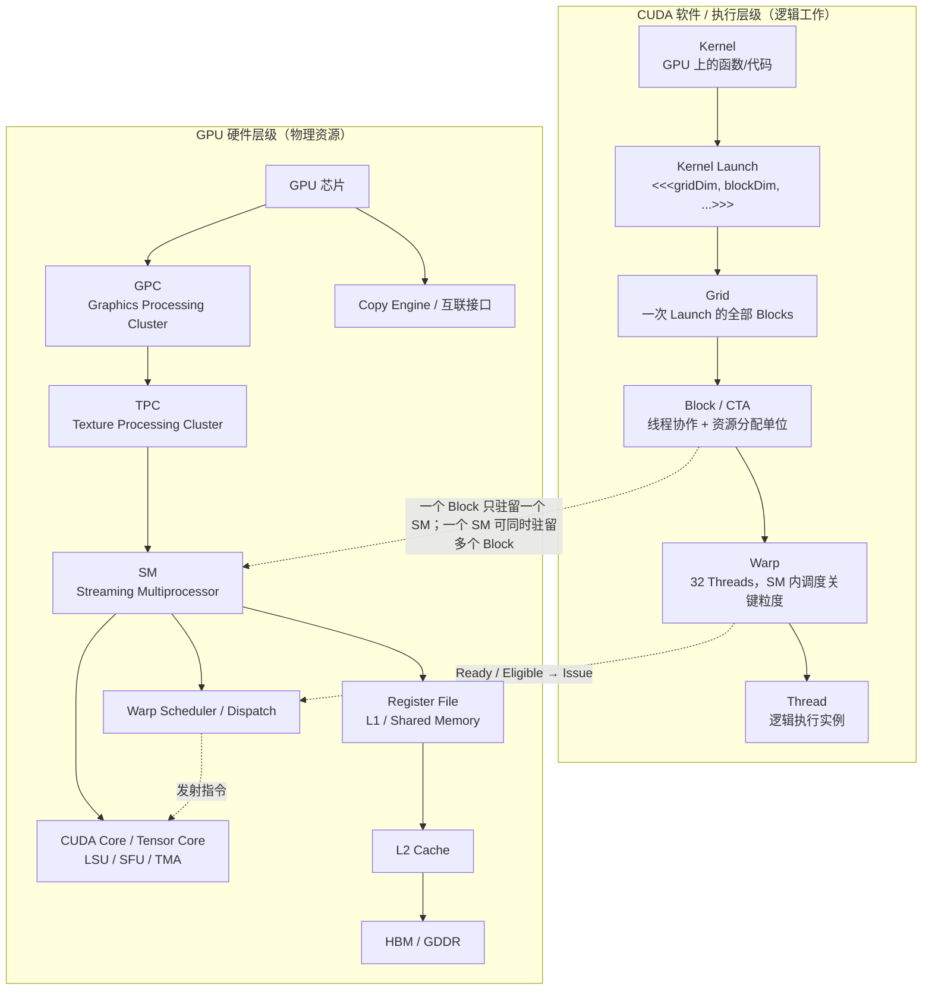

# GPU 执行与内存基础

> 相关基础：[基础概念](../00_Physical_Foundations/局部性与数据移动.md)。关联：[机制与演进](../05_Kernels/算子优化的问题演进.md)。

前面三篇回答了“算什么、怎样求梯度”，本篇回答“这些计算交给谁执行、数据放在哪里”。CPU（中央处理器）负责运行主程序、准备和提交工作；GPU（图形处理器）擅长并行处理大量相似计算。LLM 是 Large Language Model，即大语言模型；AI Infra 指支撑模型训练和服务的计算、存储、通信与软件系统。

本篇采用 NVIDIA CUDA 的术语。CUDA 是其 GPU 编程平台；**Kernel** 是一次提交到 GPU 执行的函数，**Thread** 是执行该函数的逻辑线程，**SM** 是容纳一组线程并提供计算与存储资源的硬件单元。先有这三个印象，再读下面的层级图。图中的 Cache 是自动保留近期数据的缓存，DRAM 是主存；PCIe、NVLink-C2C 是连接处理器的互联，第一次阅读不必记住具体规格。

<details>
<summary>文章导航</summary>

- [先建立一张总地图：LLM 最终是在一台什么机器上跑？](#先建立一张总地图llm-最终是在一台什么机器上跑)
- [CPU 和 GPU 为什么不一样？](#cpu-和-gpu-为什么不一样)
- [什么是 HBM？为什么论文天天讨论 HBM？](#什么是-hbm为什么论文天天讨论-hbm)
- [GPU Memory Hierarchy：显存并不是只有一层](#gpu-memory-hierarchy显存并不是只有一层)
- [“带宽”和“延迟”到底是什么？](#带宽和延迟到底是什么)
- [Thread、Warp、Block/CTA、SM：CUDA 的执行层次](#threadwarpblockctasmcuda-的执行层次)
- [Tensor Core 是什么？为什么矩阵乘法特别快？](#tensor-core-是什么为什么矩阵乘法特别快)
- [Kernel 是什么？](#kernel-是什么)
- [Kernel Fusion 为什么有效？](#kernel-fusion-为什么有效)
- [什么是 Tiling？](#什么是-tiling)
- [Arithmetic Intensity / Operational Intensity](#arithmetic-intensity--operational-intensity)
- [Compute-bound 与 Memory-bound](#compute-bound-与-memory-bound)
- [Roofline Model 的直觉](#roofline-model-的直觉)
- [Occupancy 是什么？](#occupancy-是什么)
- [四篇论文分别在硬件/系统哪一层？](#四篇论文分别在硬件系统哪一层)
- [读论文时遇到这些词，可以直接这样翻译](#读论文时遇到这些词可以直接这样翻译)
- [概念辨析](#概念辨析)
- [主要参考资料](#主要参考资料)

</details>


## 先建立一张总地图：LLM 最终是在一台什么机器上跑？


一台典型的 AI 服务器，可以先粗略理解成：

```text
CPU
├── CPU cores
├── CPU cache
└── CPU DRAM
      │
      │ PCIe / NVLink-C2C 等连接
      ▼
GPU
├── 很多 SM（Streaming Multiprocessor）
│   ├── CUDA Cores
│   ├── Tensor Cores
│   ├── Registers
│   └── Shared Memory / L1
├── L2 Cache
└── HBM（GPU 显存）
```

学习模型系统时，最重要的不是某一代 GPU 有多少个核心，而是理解三个层次：

1. **计算单元**：Tensor Core、CUDA Core；
2. **执行组织**：thread、warp、thread block/CTA、SM；
3. **存储层次**：register → shared memory/L1 → L2 → HBM → CPU DRAM。

系统优化的本质经常是：

> **让数据尽可能待在更靠近计算单元的地方，并尽量少在慢层级之间搬来搬去。**

后面读到的 Attention 优化也遵循这条原则：尽量在片上完成计算，减少往返显存。

---


## CPU 和 GPU 为什么不一样？


CPU 的设计目标通常是：

> 用少量非常强的核心，把复杂、分支很多、延迟敏感的任务快速完成。

GPU 的设计目标更接近：

> 用大量相对简单的执行单元，同时处理海量相似计算。

例如矩阵乘法：

$$
C = AB
$$

其中每个输出元素：

$$
C_{ij}=\sum_k A_{ik}B_{kj}
$$

不同的 $i,j$ 可以高度并行，因此特别适合 GPU。

所以 Transformer 中的大量 GEMM（General Matrix-Matrix Multiplication，通用矩阵-矩阵乘法）非常适合 GPU。

但是：

> **GPU 算得快，不代表整个程序一定快。**

如果 GPU 每做一点计算，都要等大量数据从 HBM 搬进来，那么计算单元会处于“等数据”的状态。

这就是为什么 AI Infra 必须同时关心：

- FLOPs；
- 显存容量；
- 显存带宽；
- Cache / Shared Memory；
- 数据布局；
- kernel 调度。

---


## 什么是 HBM？为什么论文天天讨论 HBM？


HBM = **High Bandwidth Memory（高带宽内存）**。许多 AI 加速卡用它作大容量显存；也有 GPU 使用 GDDR，因此“显存”不等于“HBM”。下文以 HBM 型 GPU 为例。activation 是上一篇的激活，KV Cache 是保存历史 token 的 Key/Value 的缓存。

你可以把它近似理解为：

> GPU 自己的大容量主内存，也就是平时 `nvidia-smi` 看到的那几十 GB / 上百 GB“显存”的主体。

例如模型参数、activation、KV Cache 等大量数据，主要都放在 HBM 中。

HBM 的“High Bandwidth”已经比普通 CPU DRAM 快很多，但 GPU 的计算能力增长得更快，因此在很多 workload 里：

> **HBM 仍然相对太慢。**

一个很重要的观念是：

```text
数据在 HBM 里
    ↓ 读取
送到 SM 附近
    ↓
GPU 做计算
    ↓
结果写回 HBM
```

如果一个算法不停：

```text
HBM → compute → HBM → compute → HBM
```

那么即使 FLOPs 并不多，也可能很慢。

FlashAttention 就是从这里开始重新审视 Attention。

---


## GPU Memory Hierarchy：显存并不是只有一层


可以先记住下面这张简化图：

```text
              更快、更小
                  ↑
             Register
                  │
      Shared Memory / L1
                  │
                L2
                  │
                HBM
                  │
             CPU DRAM
                  ↓
              更慢、更大
```


#### 1 Register

Register 是线程直接使用的极小、极快存储。

例如一个线程正在累加：

```text
sum += a * b
```

`sum` 很可能就在 register 中。

特点：

- 极快；
- 每个线程可用数量有限；
- register 用得太多，会影响 GPU 同时容纳多少线程。

这会与后面讲的 **occupancy** 联系起来。


#### 2 Shared Memory / SRAM

SRAM 是一种存储电路类型；Shared Memory 是程序可显式管理的片上共享存储空间，两者不是同义词。L1 Cache 也在片上，但数据缓存主要由硬件管理。

Shared Memory 是一个 thread block 内线程可以共享的片上存储。

可以理解成：

> 一个 SM 上非常快的小工作台。

典型优化方式：

```text
HBM 中的一块数据
      ↓
一次搬进 Shared Memory
      ↓
很多线程反复使用
```

而不是：

```text
线程 1 从 HBM 读
线程 2 又从 HBM 读
线程 3 又从 HBM 读
...
```

**Tiling（分块）** 的核心意义之一就是制造这种数据复用。

FlashAttention 论文经常把这类片上快速内存统称为 SRAM。


#### 3 L2 Cache

L2 是 GPU 上更大、但比 shared memory 更远的一层缓存。

它对多个 SM 可见。

通常你不需要像 shared memory 那样显式地控制所有 L2 行为，但数据是否能命中 L2，会影响实际显存流量。


#### 4 HBM

容量大，带宽高，但相对于片上内存仍然远得多。

模型参数和 KV Cache 主要驻留于此。

---


## “带宽”和“延迟”到底是什么？


这两个词不要混淆。

#### 带宽 Bandwidth

表示单位时间最多能搬多少数据，例如：

```text
TB/s
GB/s
```

类比高速公路：

> 一秒钟能通过多少辆车。

#### 延迟 Latency

表示一次访问从发出请求到拿到数据需要多久。

类比：

> 一辆车从北京开到上海要多久。

AI kernel 经常通过：

- 并发；
- cache；
- prefetch；
- pipeline；

隐藏单次访问延迟，而最终受到总带宽限制。

所以 LLM decode 中经常说：

> **memory bandwidth bound**。

意思不是“显存很慢”，而是：

> 每生成一个 token 需要搬的数据太多，相对于计算量而言，HBM 总吞吐成为上限。

---


## Thread、Warp、Block/CTA、SM：CUDA 的执行层次


这是以后读 FlashAttention-2 / FlashInfer 必须认识的一组词。

可以从大到小理解：

```text
GPU
└── 很多 SM
    └── 执行很多 Thread Block / CTA
        └── 一个 block 包含很多 threads
            └── threads 以 warp 为基本执行群组
```


#### 1 Thread

CUDA 中最小的编程线程。

每个 thread 通常处理矩阵中的某几个元素。


#### 2 Warp

NVIDIA GPU 中线程不是完全各自独立执行，而是以 **warp** 为重要执行单位。

经典 NVIDIA 架构中，一个 warp 包含 32 个线程。

可以粗略理解成：

```text
32 个线程
   ↓
一起执行一条指令
```

所以如果同一个 warp 中：

```text
16 个线程走 if 分支 A
16 个线程走 if 分支 B
```

硬件通常不能真正同时执行两条不同路径，而要分开执行，导致效率下降。

这就是 **warp divergence** 的直觉。


#### 3 Thread Block / CTA

一组 threads 构成一个 block。

CTA（Cooperative Thread Array）在很多 NVIDIA 文档/论文中基本可以视作 thread block 这一层概念。

一个 block 的线程可以：

- 使用同一块 shared memory；
- 做 block 内同步。


#### 4 SM

SM = Streaming Multiprocessor。

可以把 GPU 想成有很多“计算车间”：

```text
SM0
SM1
SM2
...
```

CUDA 运行时负责提交工作，GPU 的硬件调度机制把可执行的 thread blocks 分配到资源足够的 SM 上。

如果一些 block 工作很快结束，而另一些特别慢，就会出现：

```text
SM0: idle
SM1: idle
SM2: █████████████ still working
SM3: idle
```

这就是 **load imbalance**。

FlashInfer 的动态 scheduler 就是在处理这种问题。

---


## Tensor Core 是什么？为什么矩阵乘法特别快？


现代 NVIDIA GPU 不仅有普通 CUDA Core，还拥有专门加速矩阵运算的 **Tensor Core**。

它非常擅长类似：

$$
D=A\times B+C
$$

这样的矩阵乘加。

因此：

> 在 AI GPU 上，一个 FLOP 并不总是“成本一样”。

矩阵乘法 FLOP 可以被 Tensor Core 极高效执行，而：

- exp；
- max；
- divide；
- index manipulation；

这类非矩阵运算可能相对昂贵。

FlashAttention-2 的一个重要改进就是：

> 尽量减少 non-matmul FLOPs，把更多时间留给 Tensor Core 擅长的矩阵计算。

---


## Kernel 是什么？


Kernel 可以理解为：

> CPU 发给 GPU 的一个“并行计算任务程序”。

例如标准 Attention 可能被拆成：

```text
Kernel 1: QK^T
Kernel 2: mask
Kernel 3: softmax
Kernel 4: dropout
Kernel 5: P @ V
```

每个 kernel 往往需要：

```text
从 HBM 读输入
→ 计算
→ 把结果写回 HBM
```

因此多个 kernel 之间的大中间 tensor 会反复进出 HBM。

---


## Kernel Fusion 为什么有效？


假设有：

```text
A → operation1 → B → operation2 → C
```

分两个 kernel：

```text
Kernel 1:
read A
compute B
write B to HBM

Kernel 2:
read B from HBM
compute C
write C
```

融合以后：

```text
Kernel:
read A
compute B
B 留在片上
compute C
write C
```

省掉：

```text
write B
read B
```

因此 kernel fusion 往往不是为了减少数学计算，而是为了：

> **减少 HBM traffic（显存读写流量）和 kernel launch overhead（提交、启动计算的开销）。**

FlashAttention 把多个 Attention 操作融合进一个 kernel，就是经典案例。

---


## 什么是 Tiling？


假设你需要做一个巨大矩阵运算，但 shared memory 装不下整个矩阵。

最自然的方法是切块：

```text
完整矩阵
┌──────────────┐
│ □ □ □ □ □  │
│ □ □ □ □ □  │
│ □ □ □ □ □  │
└──────────────┘
```

每次只处理：

```text
┌─────┐
│ tile│
└─────┘
```

流程：

```text
HBM
 ↓
加载 tile 到 shared memory/register
 ↓
尽量多做计算
 ↓
必要结果写回 HBM
```

Tiling 的关键不是“把矩阵切小”本身，而是：

> **让同一批从 HBM 搬来的数据，在片上被重复使用很多次。**

FlashAttention 的整个核心算法就是围绕 Attention 设计一个正确的 tiling 方式。

---


## Arithmetic Intensity / Operational Intensity


这是读系统论文非常重要的指标。

可以粗略定义：

$$
AI=\frac{\text{做了多少计算}}{\text{从内存搬了多少 Byte}}
$$

例如：

##### 程序 A

```text
读 1 GB 数据
只做少量加法
```

Arithmetic Intensity 很低。

##### 程序 B

```text
读 1 GB 数据
做大量矩阵乘法
```

Arithmetic Intensity 很高。

由此产生两个经典瓶颈。

---


## Compute-bound 与 Memory-bound


#### Compute-bound

程序速度主要受 GPU 计算能力限制。

也就是：

```text
数据已经喂得足够快
Tensor Core 一直满负荷计算
```

此时优化方向通常是：

- 更高 Tensor Core 利用率；
- 更好的 work partition；
- 更少无效 FLOPs。

#### Memory-bound

程序速度主要受数据搬运速度限制。

此时可能出现：

```text
Tensor Core：我算完了，数据呢？
HBM：还在搬。
```

优化方向通常是：

- 少读 HBM；
- 少写 HBM；
- reuse；
- fusion；
- quantization；
- 更紧凑的数据结构。

FlashAttention 和 LLM decode 都非常强调 memory traffic。

---


## Roofline Model 的直觉


Roofline Model 可以帮助判断一个 workload 应该优化什么。

横轴可以想象成 Arithmetic Intensity，纵轴是实际计算吞吐。

```text
性能
 ↑
 |              __________ 计算上限
 |            /
 |          /
 |        /
 |      /
 |_____/______________________→ Arithmetic Intensity
      内存带宽限制
```

左边：

> memory-bound。

右边：

> compute-bound。

重要 insight：

> **减少 FLOPs 不一定会更快。**

如果程序本来就在左边受内存带宽限制，FLOPs 再少一点可能没有意义；反而减少 HBM IO 更有价值。

这正是 FlashAttention 论文批评很多早期 approximate/sparse attention 工作的出发点之一。

---


### 用数字判断瓶颈

假设某设备的有效计算上限为 20 TFLOP/s（每秒 $20×10^{12}$ 次浮点运算），显存带宽为 1 TB/s（每秒 $10^{12}$ 字节）。一次工作需 100 GFLOP、搬运 10 GB，则计算至少需 5 ms，搬运至少需 10 ms。理想重叠下，总时间下界是两者的较大值 10 ms；实际还可能受依赖、启动和访存效率影响。

此时计算量减半，搬运仍需 10 ms；把搬运量减半，理想下界才可能降到 5 ms。算术强度为 $100/10=10$ FLOP/byte，设备转折点为 $20/1=20$ FLOP/byte，因而该例位于带宽受限一侧。这里全部是教学假设，不能当作某张 GPU 的实测。

## Occupancy 是什么？


GPU 要隐藏内存延迟，需要同时准备很多可以执行的 warp。

如果一个 warp 在等数据：

```text
warp A: 等 HBM
```

SM 可以切换去执行：

```text
warp B
warp C
warp D
```

所以通常希望 SM 上同时有足够多 active warps。

**Occupancy（驻留率）**是一个 SM 上驻留的 warp 数与其支持的最大驻留 warp 数之比。例如上限 64 个、当前驻留 32 个，就是 50%。驻留 warp 可能还在等待数据，因此 100% occupancy 不等于计算单元利用率 100%；提高它也不保证提速。

但 occupancy 受到：

- register 数量；
- shared memory 使用量；
- block 大小；

限制。

因此 tile 越大并不总越好：

```text
大 tile
→ reuse 可能更好
→ 但 shared memory/register 用量变大
→ 同时驻留 block 变少
→ occupancy 可能下降
```

这就是 kernel tuning 中典型的 trade-off。

---


## 四篇论文分别在硬件/系统哪一层？


本节是后续专题的索引，首次阅读可以跳到词表。它们研究不同问题，并不是必须依次安装的一套软件。

| 工作 | 要解决的问题 | 所在层次 |
|---|---|---|
| FlashAttention | 计算 Attention 时少读写大中间张量 | 单次 Kernel 的分块与融合 |
| PagedAttention / vLLM | 长度持续变化的历史 KV 怎样分配显存 | 按固定大小块管理 KV |
| RadixAttention / SGLang | 多个请求有相同输入开头，怎样复用计算 | 跨请求前缀缓存管理 |
| FlashInfer | 不同 KV 布局与 Attention 计算怎样高效执行 | GPU Kernel 库及其调用接口 |

前缀是输入序列相同的开头部分；请求是一次模型生成任务。理解这些工作需要的推理知识会在主线第 16–19 篇补齐，现在只需分清“计算效率”“空间分配”“跨请求复用”是三个问题。

---


## 读论文时遇到这些词，可以直接这样翻译


| 术语 | 先这样理解 |
|---|---|
| HBM | GPU 大容量显存 |
| SRAM / Shared Memory | SM 上很快但很小的片上工作区 |
| Register | 单线程极快临时变量存储 |
| SM | GPU 的一个计算车间 |
| Warp | NVIDIA GPU 中一组协同执行的线程 |
| Thread Block / CTA | 被调度到 SM 上的一组线程 |
| Kernel | CPU 发给 GPU 的并行计算程序 |
| Kernel Fusion | 多个操作合成一个 kernel，减少中间 HBM IO |
| Tiling | 把大问题切块，在片上反复 reuse |
| GEMM | 通用矩阵乘法 |
| Tensor Core | 专门做矩阵乘加的硬件单元 |
| Compute-bound | 算力先到上限 |
| Memory-bound | 内存搬运先到上限 |
| Arithmetic Intensity | 每搬 1 Byte 数据做多少计算 |
| Occupancy | SM 上驻留 warp 数占硬件上限的比例 |
| KV Cache | 自回归推理缓存历史 token 的 K/V |
| Page / Block | 固定粒度的内存分配单位 |
| Block Table | logical block → physical block 的映射 |
| Prefix Cache | 复用已有 prompt prefix 的 KV |
| Radix Tree | 压缩前缀树，用于管理多层 prefix sharing |

---


## 概念辨析

### 为什么“一百多个 SM”却能有上万个 CUDA Core？

因为 CUDA Core 是 SM 内部的执行资源，不是 SM 本身。每个 SM 中包含多个标量执行单元以及 Tensor Core 等资源，因此整卡的 CUDA Core 数量可以远大于 SM 数量。真正做 CUDA 性能分析时，比“总 CUDA Core 数”更重要的是：有多少 SM、有多少 Warp 能持续处于可发射状态、执行管线是否被喂饱。

<a id="gpu-hierarchy"></a>

### 硬件层级与软件层级不要画成同一棵“父子树”

以下是选读细节。LSU 是读写数据的执行单元，SFU 是特殊函数单元，TMA 是部分架构提供的 Tensor Memory Accelerator（张量内存搬运加速器）；不需要先掌握这些缩写才能继续主线。

GPU → GPC（Graphics Processing Cluster）→ TPC（Texture Processing Cluster）→ SM 是一种物理组织视角，精确层次取决于芯片；程序不能直接指定某个 block 必须进入哪个 GPC/TPC。SM 内包含 warp scheduler、寄存器、shared/L1、Load/Store Unit、SFU、CUDA Core 和 Tensor Core 等资源，Hopper 还引入 TMA。Warp Group 与 producer/consumer 是协作粒度或程序角色，不是与这些执行单元同级的独立硬件。

例如 `vector_add<<<4096,256>>>` 定义 4096 个 block、每个 256 个逻辑线程，共 1,048,576 个线程；每 block 形成 8 个 warp。这没有指定 thread 到 CUDA Core 的永久绑定。block 的共享存储和同步状态随其 SM 驻留，Grid 则没有操作系统进程的独立地址空间、PID 或文件描述符语义。



图 1｜硬件是“资源”，Grid/Block/Warp/Thread 是“工作与调度组织”；关键映射是 Block → SM、Warp → Warp Scheduler。

> **最重要的纠正：**不要记成“Thread → CUDA Core 一一绑定”。Thread 是逻辑执行实例；32 个 Thread 组成 Warp，Warp 的指令由调度器发射到合适的执行管线。

---


## 主要参考资料

- [CUDA Best Practices：Occupancy](https://docs.nvidia.com/cuda/cuda-c-best-practices-guide/index.html#occupancy)

- Dao et al., *FlashAttention: Fast and Memory-Efficient Exact Attention with IO-Awareness*, NeurIPS 2022, arXiv:2205.14135.
- Dao, *FlashAttention-2: Faster Attention with Better Parallelism and Work Partitioning*, 2023/ICLR 2024, arXiv:2307.08691.
- Kwon et al., *Efficient Memory Management for Large Language Model Serving with PagedAttention*, SOSP 2023, arXiv:2309.06180.
- Zheng et al., *SGLang: Efficient Execution of Structured Language Model Programs*, arXiv:2312.07104 / NeurIPS 2024.


---

<!-- main-route -->

线程和内存解释了单个 kernel；下一篇解释主机如何提交多个 kernel，以及它们何时能并行。

[上一篇：计算图与自动微分](<../01_Math_Numerics/计算图与自动微分.md>) · [主线 4/26](<../guides/系统阅读路线.md>) · [下一篇：CUDA Stream 与依赖](<CUDA_Stream与依赖.md>)

<!-- /main-route -->
