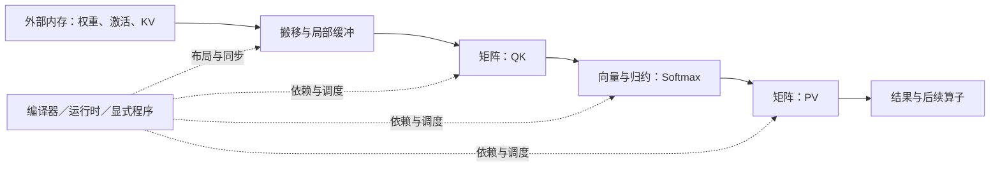

# 异构加速器的设计取舍：同一份工作怎样映射到不同硬件

> 类型：系统设计扩展。前置：[GPU 执行与内存基础](GPU执行与内存基础.md)、[局部性与数据移动](../00_Physical_Foundations/局部性与数据移动.md)。设计入口：[从需求到部署](../design/README.md)。

选择加速器要从同一份工作出发：输入形状、精度、需要保存的状态、期限和重复运行次数。只有这些条件一致，矩阵算力、内存带宽、编译开销和设备数量才可以放进同一本账。某种架构跑得下模型，也不意味着它能以要求的速度服务模型。

本篇比较稳定的架构维度，不按型号做性能排名。**所有算例参数都是人为设定的教学数字，不对应任何 GPU、TPU、昇腾或 Apple 产品的实测性能。**

## 1. 沿一条数据依赖看五种责任

以一段 Attention 为例，矩阵乘产生分数，向量运算完成缩放、归一化和归约，再把结果交给下一次矩阵乘。硬件与软件必须共同解决五件事：矩阵由谁计算，非矩阵运算由谁计算，数据由谁搬，何时允许消费结果，以及谁决定这些操作的顺序。

有些交接留在寄存器或片上缓冲，有些需要写回外部内存。图上的一次箭头可能是寄存器使用、显式拷贝、格式变换或跨芯片通信。把箭头落实到具体路径，才知道融合和专用计算单元能省掉多少时间。

| 架构视角 | 矩阵、向量与控制 | 搬移、存储与同步 | 编译和移植时要重新确认什么 |
|---|---|---|---|
| NVIDIA GPU 的 CUDA 路径 | SM 内的 Tensor Core 与其他执行单元协作，线程组织表达工作 | 缓存承接部分访问；高性能 kernel 显式安排 shared memory、异步搬移和 barrier | tile 形状、warp 协作、寄存器和 shared memory 占用，以及所用指令的硬件支持 |
| Google TPU | MXU 承担矩阵计算，另有向量和标量单元 | HBM、片上资源与芯片互联共同供数；阵列复用减少部分外部访问 | XLA 图变换、布局、分片与形状覆盖，不能仅把 CUDA kernel 换成同名调用 |
| 昇腾 AI Core | Cube、Vector、Scalar 分担矩阵、向量和控制 | MTE 等搬运单元连接 GM、L1、L0、UB 等存储；具体通路随架构而变 | 数据应进入哪个缓冲、矩阵和向量如何交接、对齐与同步如何表达 |
| Apple GPU 与统一内存 | GPU 仍执行并行计算；统一内存描述的是处理器间存储组织 | CPU/GPU 可共享系统内存资源，减少某些显式复制；共享访问仍需完成与同步 | Metal／算子库支持、资源 storage mode、工作集对系统内存的占用及 CPU/GPU 争用 |
| 专用数据流路径，以 Groq 为例 | 将模型计算和通信更明确地映射成预定执行安排 | 编译器对数据位置与时序承担更多规划责任 | 支持的图、动态行为、形状变体、容量与跨芯片分布；执行稳定性不等于服务排队稳定性 |

前三行的执行与存储分工分别可对照 [CUDA Advanced Kernel Programming](https://docs.nvidia.com/cuda/cuda-programming-guide/03-advanced/advanced-kernel-programming.html)、[TPU system architecture](https://docs.cloud.google.com/tpu/docs/system-architecture-tpu-vm)、[CANN 8.1 Ascend C 算子开发指南第 4 章](https://www.hiascend.com/doc_center/source/zh/CANNCommunityEdition/81RC1alpha002/devguide/opdevg/ascendcopdevg/CANN%E7%A4%BE%E5%8C%BA%E7%89%88%208.1.RC1.alpha002%20Ascend%20C%E7%AE%97%E5%AD%90%E5%BC%80%E5%8F%91%E6%8C%87%E5%8D%97%2001.pdf)。TPU 的 TensorCore 是 TPU 的执行单元名称，与 NVIDIA Tensor Core 的层级和接口不同。

Apple 的 [shared storage mode](https://developer.apple.com/documentation/metal/mtlstoragemode/shared) 明确要求协调 CPU/GPU 对共享资源的访问。统一物理内存、统一虚拟地址和缓存一致性是不同属性；不能从“共享地址”推导出任意时刻都可读取。Groq 的[架构介绍](https://groq.com/blog/the-groq-lpu-explained)说明其编译器参与时序规划的方向；这不是不同厂商服务性能可直接相比的证据。

“专用架构”也不是一种固定布局。例如 Cerebras 的[架构说明](https://www.cerebras.ai/blog/cerebras-architecture-deep-dive-first-look-inside-the-hw-sw-co-design-for-deep-learning)讨论分布式片上存储和片上 fabric，也介绍外部权重流入的执行方式。片上存储很多、权重永久留在片上、模型任意大，三者不能互相推出。比较时仍要画出当前部署的实际数据路径。

## 2. 算例：批量变化能让硬件选择翻转

只考察一个 BF16 投影，输入为 $X\in\mathbb R^{M\times8192}$，权重为 $W\in\mathbb R^{8192\times4096}$，输出为 $Y=XW$。一次乘加计两次浮点操作；假设权重和输入各读一次，结果写一次，累加留在片上。则：

$$
F=2M\cdot8192\cdot4096,
\qquad
V=2(M\cdot8192+8192\cdot4096+M\cdot4096).
$$

这里 $V$ 只统计设备外部内存流量，不包含启动时的主机传输、额外中间结果和重复加载。实际 kernel 若无法实现上述复用，流量会增加。

| 工作量 | $M=1$ | $M=512$ |
|---|---:|---:|
| 计算量 | 67.109 MFLOPs | 34.360 GFLOPs |
| 外部内存流量 | 64.023 MiB | 76 MiB |
| 算术强度 $F/V$ | 约 1 FLOP/byte | 约 431.16 FLOPs/byte |

设候选 A 的有效矩阵吞吐为 100 TFLOP/s、有效带宽为 1 TB/s、每次启动固定耗时为 5 μs；候选 B 分别为 200 TFLOP/s、500 GB/s、10 μs。所有带宽用十进制 bytes/s，MiB 用 $2^{20}$ bytes。**这些有效能力是模型输入，不是由规格峰值直接得出的测量。**

在计算与内存访问可充分重叠的教学模型中：

$$
T=t_{launch}+\max(F/C_{eff},V/B_{eff}).
$$

| 工作量 | 候选 A | 候选 B | 在此模型下的选择 |
|---|---:|---:|---|
| $M=1$ | 72.13 μs | 144.27 μs | A：权重读取与启动主导 |
| $M=512$ | 348.60 μs | 181.80 μs | B：矩阵计算能力开始兑现 |

这个翻转来自工作量与资源比例变化。它不证明所有 decode 都受带宽限制，也不证明所有 prefill 都受计算限制；实际还要纳入上下文长度、KV 访问、算子形状、精度和并行布局。

`max` 也不能随意扩展为整模型公式。Softmax 在依赖链上等待 QK，下一次矩阵乘等待 Softmax；串行阶段应相加，同一阶段内能重叠的资源项才有机会取最大值。向量、归约、布局变换和同步需要独立计时，尤其不能都被“有效矩阵吞吐”遮住。

## 3. 能放下，是性能比较之前的约束

假设某个完整实例需要权重 40 GiB、运行时与工作区 4 GiB、目标并发下的 KV 8 GiB，共 52 GiB。可用容量 48 GiB 的候选即使算得更快，也无法按这个配置执行；可用容量 96 GiB 的候选则通过容量筛选。这里的“可用”已经扣除系统保留，不是设备标称总量。

但 96 GiB 不代表每个 token 更快。它可能允许更大模型、更多会话或更少分片；速度取决于这些状态被多频繁地读取，以及读取要经过什么接口。为 48 GiB 候选加 offload 或量化，会生成一个新的候选方案，必须重算质量、搬移与延迟，不能继续沿用原来的性能数字。

统一内存特别适合拿这组问题来分析：CPU 与 GPU 可共享一份大工作集，某些复制与双份驻留得以减少；同时操作系统、CPU 工作和 GPU 工作会使用共同的容量与部分带宽资源。需要量的是完整应用的内存压力与期限，而不是只看模型文件能否载入。

## 4. 移植是否值得，要把一次性工作摊回生命周期

框架图能运行，不等于原有执行策略已经移植。至少要检查：

1. 算子和精度是否完整支持，误差是否满足任务质量要求。
2. 长度、batch、路由和控制流如何变化，是否会触发新编译、padding 或回退。
3. KV、权重、通信 buffer 的布局是否一致；布局变化是否引入额外转换。
4. 热身、编译、权重载入和多设备初始化何时发生，是否进入服务启动期限。
5. 故障后是否能恢复同样的模型和状态，能否观测等待发生在哪一层。

[XLA 架构文档](https://openxla.org/xla/architecture)说明了从模型图到目标机器指令的编译层次。图级可移植性与性能可移植性是两项工作：前者让算子含义保持一致，后者让图映射到目标架构的高效路径。

仍以上面的 $M=512$ 为例，B 每次节省 166.80 μs。若 B 相比 A 多出 900 秒的一次性编译／预热耗时，并且把这些时间放在同一个串行完成时间口径下，则盈亏平衡点为：

$$
N_{break}=\frac{900}{(348.59738368-181.79869184)\times10^{-6}}
\approx5.396\text{ 百万次调用}.
$$

如果编译可缓存、离线完成或多副本复用，应只计实际增加的启动关键路径；如果每次形状变化都重新付费，则应按变体频率计费。工程师移植时间、设备租用价格和运行时间不能直接相加，需要转换到统一的成本单位。此处只展示时间摊销，没有把开发成本伪装成运行耗时。

## 5. 从分析进入验证

先用代表性的形状集合测出矩阵、向量、搬移和同步开销，再按真实依赖组成模型执行；最后回放到达过程和长度分布，检查质量、TTFT、token 间隔、成功完成量和总资源费用。单个大 GEMM 足以解释一项局部能力，无法代替完整服务结论。

选择最容易在四处翻转：小 batch 变大 batch，容量从不足变充足，动态变体使编译与 padding 增多，以及模型运行次数不足以摊销移植投入。把这些边界写在结论旁，比只写“某架构更快”更有复用价值。

复算：[`hardware_pooling.py`](../examples/hardware_pooling.py)，从仓库根目录运行 `python3 docs/ai_infra/examples/hardware_pooling.py`。脚本输出解析模型结果，不执行加速器基准。

组织方法参考《深入理解 AI Infra》的[第 4 章：加速器架构](https://bojieli.github.io/ai-infra-book/manuscripts/04-%E5%8A%A0%E9%80%9F%E5%99%A8%E6%9E%B6%E6%9E%84.html)：从工作和数据路径比较架构。本篇参数及算例为独立教学设定。继续阅读：[超节点与远端内存池](../04_Memory_Storage/超节点与远端内存池.md)、[Attention 与 FFN 分离的边界](../10_Inference_Serving/Attention与FFN分离的边界.md)。
