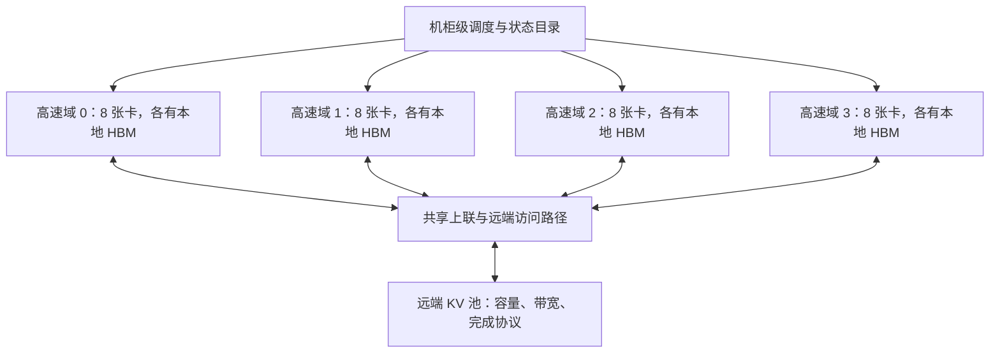

# 超节点与远端内存池：容量相加之后，还要算路径和状态寿命

> 类型：系统设计扩展。前置：[显存核算](GPU内存组成与显存核算.md)、[节点内 GPU 互联](../07_Communication/节点内GPU互联.md)、[跨节点网络](../07_Communication/跨节点网络.md)。设计入口：[从需求到部署](../design/README.md)。

大互联域让更多计算设备能够交换数据，也给状态放置提供更多选择。系统设计要继续回答：哪些容量能被同一个请求使用，经哪条路径访问，多个请求是否争抢同一瓶颈，发生故障时哪份状态仍然可用。把所有显存加起来，只完成了其中一步。

本篇用“超节点”指通过较高速内部互联组织的一组设备；它是讨论边界，不预设固定卡数、机柜数或缓存一致性。**下文容量、时延和带宽全部是教学设定，既不对应某种现售整机，也不是实测结果。**

## 1. 三种池化，不是同一种访问

| 池化方式 | 应用实际获得什么 | 需要确认的边界 |
|---|---|---|
| 调度池 | 调度器可将请求放到更多设备 | 没有自动增加单个进程的可访问内存 |
| 远端内存访问池 | 通过特定 API 读写其他设备或节点持有的数据 | 地址映射、权限、局部性、顺序、完成和生命周期 |
| KV 对象／页缓存池 | 用缓存标识查找状态，再取回本地或交给支持远端访问的执行路径 | 模型与布局身份、可用状态、传输、引用与失效 |

例如 [NVSHMEM](https://docs.nvidia.com/nvshmem/api/latest/using.html)通过位于各 GPU 的对称内存表达分区全局地址空间，访问同时包含对象地址与目标 processing element。全局可达仍然保留数据归属与远近差别，不能等同于一块平坦的本地 HBM。



一个执行实例可以跨多个域，也可以有多个实例共处一域；图中的硬件边界不决定模型副本边界。频繁 TP 通信、EP 动态分发、KV 恢复和 checkpoint 可能共用某条链路，需要合并流量核算。

## 2. 从机柜总容量算到可准入请求数

设机柜有 4 个域，每域 8 张 80 GiB 卡，共 32 张。每卡放置一个完整、独立的教学模型实例，权重 20 GiB、运行时与工作区 8 GiB、增长和碎片余量 8 GiB，因此本地 KV 预算为：

$$
M_{KV}=80-20-8-8=44\ \mathrm{GiB}.
$$

模型采用标准 GQA KV 布局：32 层、8 个 KV head、每 head 128 个元素、每元素 2 bytes，每 token 保存 K 和 V：

$$
m_{token}=2\times32\times8\times128\times2=128\ \mathrm{KiB}.
$$

暂不考虑前缀共享、量化和页尾浪费，已计算 32,768 token 的会话需要 4 GiB KV。每卡容量上界为 $\lfloor44/4\rfloor=11$ 个此类会话；机柜为 352 个。总物理显存为 2.5 TiB，可用于 KV 的预算为 1,408 GiB，两者不能混用。

352 是这个固定长度快照下的容量上界。新增 token 会继续分配状态；算例已留出独立增长余量，但并未证明任意输出长度都安全。调度还需要考虑执行时间、未来容量承诺与请求偏斜。如果某卡已有 11 个会话，其他卡的空闲容量只有通过重新放置、迁移或额外远端访问机制才能帮助它。

假设远端池有 1 TiB 物理容量，留出 128 GiB 元数据与余量，剩余 896 GiB；每份缓存保存两份完整副本，则逻辑可用容量为 448 GiB，可容纳 112 个上述会话。80 个暂停会话需要 320 GiB 逻辑容量、640 GiB 物理副本容量，能放下。副本不是免费容量。

这 80 个会话若原来都占用计算卡的本地 KV，换出最多释放 320 GiB，可重新用于活跃请求；要实现收益，还需要这些空闲块分布在可接收请求的卡上。远端池不会凭空增加矩阵计算能力，也不会让所有暂停会话同时恢复时免于排队。

## 3. 有带宽，还需要足够多的在途请求

设远端访问路径每次传输 $s$ bytes，一次事务从发出到完成并允许复用槽位的平均时间为 $\tau$，最多有 $Q$ 个相互独立的事务在途。由在途字节数得到吞吐上界：

$$
B_{achievable}\leq\min\left(B_{path},\frac{Qs}{\tau}\right).
$$

$B_{path}$ 还受源端读带宽、目的端写带宽、GPU/NIC 路径、共享交换链路等限制。公式里的 $\tau$ 是指定工作点下的完成延迟；拥堵增加后它可能变化。这里不是用裸网络往返时延预测所有内存协议。

设有效路径带宽上限为 25 GB/s，事务大小为 4 KiB，完成延迟为 8 μs。在途事务数 16 时：

$$
\frac{16\times4096}{8\times10^{-6}}=8.192\ \mathrm{GB/s}.
$$

想在这组假设下填满 25 GB/s，至少需要：

$$
Q\geq\left\lceil\frac{25\times10^9\times8\times10^{-6}}{4096}\right\rceil=49.
$$

增加队列深度只有在存在独立访问、接收端有 buffer、协议允许更多在途工作时才有效。一次读取的地址依赖上一次结果时，配置更深的队列并不能创造独立事务。反过来，批量搬回连续 KV 可以用大块传输降低事务管理压力，但恢复时必须预留本地空间。

## 4. 活跃 KV 与暂停 KV 有不同的访问账本

**活跃 KV** 是当前 decode 循环正在使用的上下文。对于读取全部历史 KV 的标准 Attention 路径，每生成一步都要重新读相关状态。**暂停 KV** 在用户思考、工具运行或会话空闲期间不被模型读取；恢复时才重新进入活跃路径。两者可以有相同容量，却有截然不同的访问频率。

设一条会话 KV 为 4 GiB，忽略后续增长：

| 访问策略 | 传输需求 | 教学模型中的时间 |
|---|---|---:|
| 每步都从远端读全量 KV，路径达 25 GB/s | 每生成一步读 4 GiB | 每步至少 171.80 ms 的远端读时间 |
| 暂停时换出、恢复时整份搬回，路径达 25 GB/s | 恢复时读 4 GiB | 恢复纯搬运下界 171.80 ms |
| 恢复以 4 KiB、16 个在途事务读取 | 恢复时读 4 GiB，吞吐上界 8.192 GB/s | 恢复纯搬运至少 524.29 ms |
| KV 已在本地，假设有效 HBM 带宽 1 TB/s | 每步读 4 GiB | 本地读时间下界 4.29 ms |

假设服务要求 token 间隔不超过 50 ms，第一种全量远端读路径单是数据时间就超过期限；而暂停数秒后允许额外 300 ms 恢复等待时，第二种路径可能可行。要比较完整请求，还须计入换出写流量、复制、排队、元数据安装和恢复后的计算。

这里假设全部历史 KV 都需读取且没有远端复用缓存。滑动窗口、压缩状态、稀疏访问或远端执行部分 Attention 会改变读量和依赖，需要建立新的模型，不能把 171.80 ms 当作所有远端 KV 方案的定律。

## 5. 单请求可行，不代表恢复高峰可行

如果 8 条 4 GiB 会话同时恢复并共享同一个 25 GB/s 入口，仅总字节就需要：

$$
T_{drain}\geq\frac{8\times4\times2^{30}}{25\times10^9}
=1.3744\ \mathrm{s}.
$$

这是排空全部工作量的下界；顺序服务和公平共享会产生不同的个体完成时间。公平共享可能让 8 条会话都接近最后一起完成，优先队列则可能先救出一个紧急请求。

按持续到达率计算，恢复 2 条/s 需要约 8.59 GB/s；恢复 8 条/s 需要约 34.36 GB/s，已经超过入口能力。后者即使每次独立恢复只需 171.80 ms，也会形成持续积压。若还共用链路写出两份副本、做训练通信，留给恢复的能力更少。

因此路由需要同时关心队列、缓存位置和路径负载。把请求送到“KV 命中”的地方，可以省重算，也可能让其排在拥堵的恢复队列之后。应比较“等缓存并传回”的完成时间和“去另一个实例重新 prefill”的完成时间。

## 6. 放置域、故障域和发布边界一起决定可用容量

两个副本在不同进程里，只能说明进程故障隔离；如果它们共用一张卡、一台主机、一个交换设备或机柜电源，相应故障仍可能同时破坏两份状态。要求跨机柜恢复时，需要跨机柜放置副本，并把复制流量和恢复带宽算入预算。远端 DRAM/HBM 副本也不自动等同于持久化 checkpoint。

一种教学上的缓存交接过程是：

```text
源端完成 KV 写入
  → 分配远端页并发起搬运
  → 按接口确认数据可见
  → 发布模型／布局／前缀身份与 ready 状态
  → 消费者取得引用并安装本地页表
  → 消费者完成使用后释放引用
  → 满足协议条件时才允许回收或覆盖
```

数据传输完成不能替代 ready 发布，旧的 ready 也不能授权读取已经被复用的页。跨线程、GPU 和网络设备的顺序要遵守具体接口；[NVSHMEM memory model](https://docs.nvidia.com/nvshmem/api/latest/using.html#memory-model)与 [GPUDirect RDMA 的顺序语义](https://docs.nvidia.com/cuda/gpudirect-rdma/index.html)提供了相应边界。概念拆解见 [DMA 与 RDMA 完成语义](../07_Communication/DMA与RDMA完成语义.md)，请求交接细节见 [PD 案例](../10_Inference_Serving/案例_Prefill-Decode分离.md)。

## 7. 哪些条件会使选择翻转

暂停时间长、复用概率高且恢复期限宽松时，缓存池可用少量恢复流量换出昂贵的本地驻留；状态几乎每步都读取时，本地性通常更关键。复用概率很低时，缓存占用与写出成本可能高于未来省下的 prefill；重算便成为候选。

池化是否成立，最终取决于四本账同时通过：可放置的容量、关键路径延迟、共享路径上的持续吞吐、故障后的恢复能力。增加一池内存只改善第一项的一部分。

复算：[`hardware_pooling.py`](../examples/hardware_pooling.py)，从仓库根目录运行 `python3 docs/ai_infra/examples/hardware_pooling.py`。本篇问题组织参考《深入理解 AI Infra》的[第 6 章：超节点](https://bojieli.github.io/ai-infra-book/manuscripts/06-%E8%B6%85%E8%8A%82%E7%82%B9.html)；容量、事务和恢复算例为独立教学设定。
