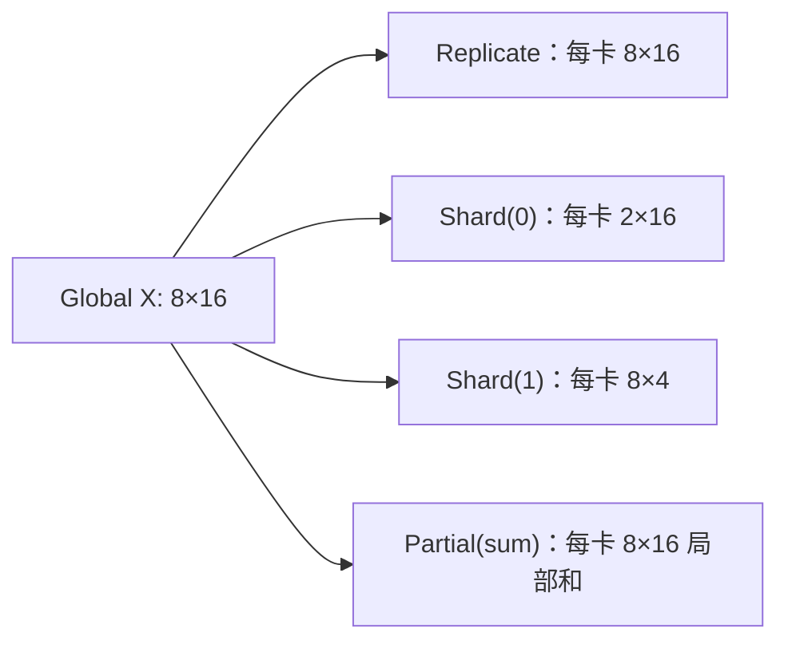
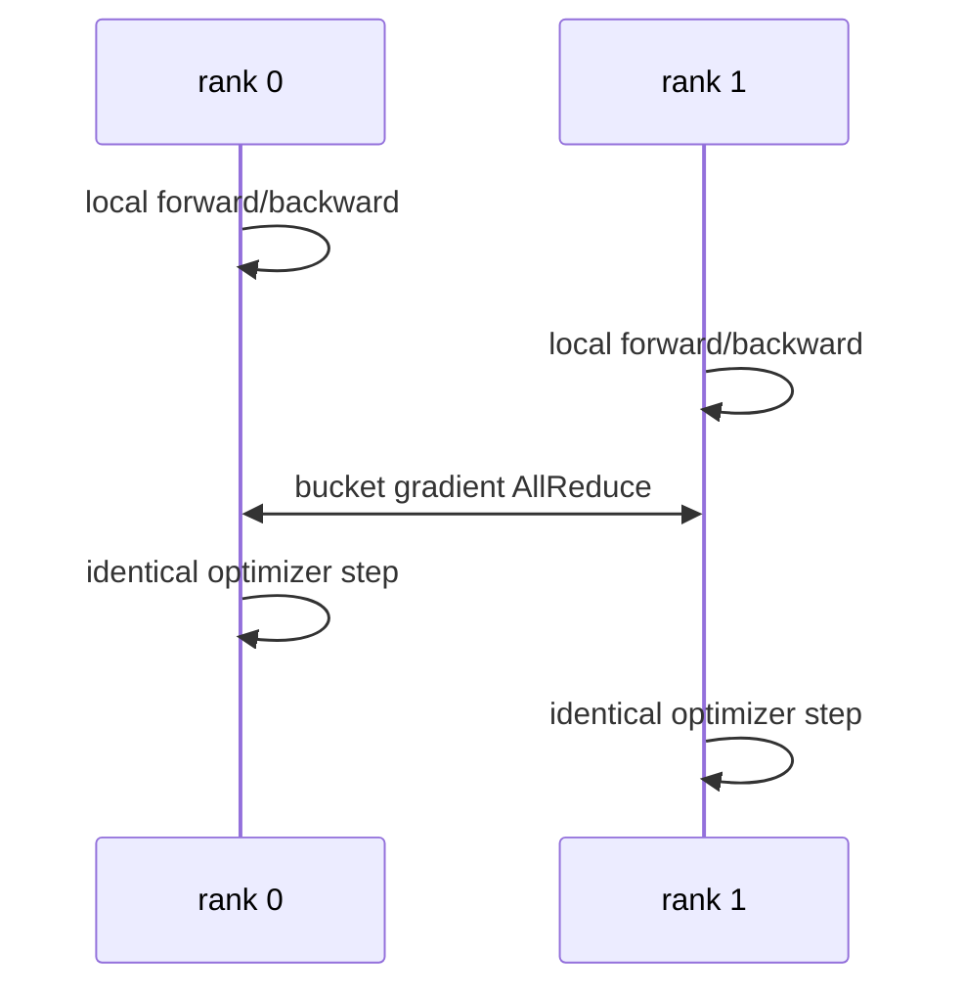
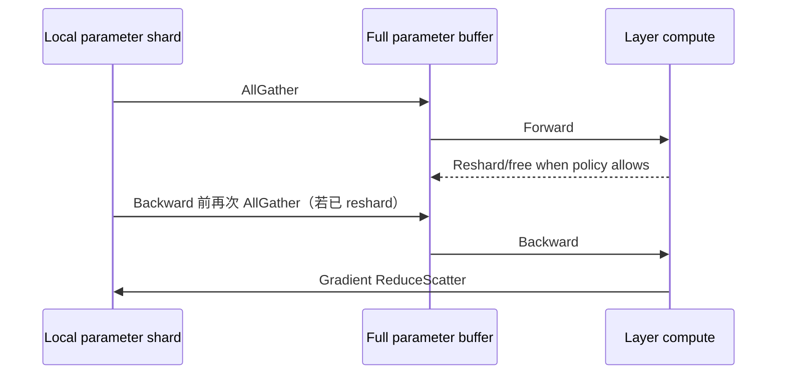

# 第 14 章　数据并行与状态分片

从副本、分片与部分和建立布局语言，再解释数据并行、梯度聚合和状态按需物化。

本章内容：

- [1. 统一切分语言：DeviceMesh、DTensor 与布局变换](#s1)
- [2. Data Parallelism 与 DistributedDataParallel](#s2)
- [3. ZeRO 与 FSDP：分片数据并行的执行语义](#s3)

<a id="s1"></a>

<a id="s1-统一切分语言devicemeshdtensor-与布局变换"></a>

## 1. 统一切分语言：DeviceMesh、DTensor 与布局变换


<a id="s1-入门例子先用两个数区分-shard-与-partial"></a>

### 入门例子：先用两个数区分 shard 与 partial

设最终结果 Y=[10,20]。一种布局是 rank 0 存 [10]、rank 1 存 [20]：这是不同位置的 shard。另一种布局是 rank 0 存 [3,8]、rank 1 存 [7,12]：这是完整形状上的局部贡献，需要求和才得到 Y。

前一种恢复完整结果用 gather，后一种用 reduction。仅比较每卡 tensor 的 shape，无法确定它的数学含义。

在 2×2 设备网格中，用 (dp,tp) 标记坐标：固定 dp、变化 tp 得到一个 TP group；固定 tp、变化 dp 得到同一分片的数据副本组。这个关系先定义所有权，DeviceMesh 等 API 再表达它。

<a id="s1-先把某张卡上的-tensor改成全局-tensor-的一个布局"></a>

### 先把“某张卡上的 tensor”改成“全局 tensor 的一个布局”

讨论并行时最容易迷失在 rank 编号和 collective 名称里。更稳定的语言是：先定义一个 global tensor，再说明它在设备网格上的 placement。

PyTorch Distributed Tensor（DTensor，分布式张量）常用三类 placement：

- `Replicate()`：每个 mesh rank 都有完整副本；
- `Shard(dim)`：沿某个 tensor dimension 切分；
- `Partial(reduce_op)`：每个 rank 保存局部贡献，经过 reduction 才得到完整语义。



<a id="s1-devicemesh-是逻辑坐标不等于物理拓扑"></a>

### DeviceMesh 是逻辑坐标，不等于物理拓扑

DeviceMesh（设备网格）把 rank 组织为命名维度，例如：

```python
mesh = init_device_mesh(
    "cuda",
    mesh_shape=(2, 4, 8),
    mesh_dim_names=("pp", "dp", "tp"),
)
```

总 world size 为 $2\times4\times8=64$。固定 pp/dp 坐标、只在 tp 维变化的一组 rank 构成一个 TP process group。DeviceMesh 帮助正确构造 group，但 mesh 维顺序是否匹配节点/NVLink/NIC topology 仍由用户或 planner 决定。

<a id="s1-redistribute-就是通信"></a>

### Redistribute 就是通信

布局变化对应 collective：

| 源布局 → 目标布局 | 常见实现 |
|---|---|
| Shard → Replicate | AllGather |
| Partial(sum) → Replicate | AllReduce |
| Partial(sum) → Shard | ReduceScatter |
| Shard(dim 0) → Shard(dim 1) | All-to-All 或 gather+slice |
| Replicate → Shard | local chunk，可能无需通信 |

因此并行图可以看成：operator 根据输入布局产生输出布局；当相邻 operator 的布局不兼容时插入 redistribute。优化的核心是让相邻算子布局“接得上”。

<a id="s1-用-linear-解释-partial"></a>

### 用 Linear 解释 Partial

设 $Y=XW$，把 $W$ 沿输入维分为 $W=[W_0;W_1]$，同时 $X=[X_0,X_1]$：

$$
Y=X_0W_0+X_1W_1
$$

每张卡算出的 $Y_i=X_iW_i$ 不是 Y 的 shard，而是 `Partial(sum)`。若下一步需要完整 Y，就 AllReduce；若下一步可继续消费 partial/sharded layout，可推迟或改为 ReduceScatter。这正是理解 row-parallel linear 的关键。

<a id="s1-layoutownership-与-lifetime"></a>

### Layout、Ownership 与 Lifetime

placement 只说明“逻辑如何分布”，还需补充：

- ownership：谁负责 optimizer update、checkpoint 和释放？
- lifetime：full parameter 是常驻还是 layer 前临时 AllGather？
- autograd rule：backward 输出是什么布局，是否自动插 collective？
- uneven shard：dimension 不能整除 mesh size 时 padding 或 ragged 语义是什么？

DTensor 可以传播布局，但不消除这些工程约束。很多自定义算子仍需显式注册 sharding rule。

<a id="s1-一张并行配置的最小表示"></a>

### 一张并行配置的最小表示

```text
mesh: pp=2, dp=4, tp=8
W_qkv: [Replicate(pp), Replicate(dp), Shard(tp, output_dim)]
activation: [stage-local, Shard(dp, batch), Replicate(tp)]
optimizer: [stage-local, Shard(dp), Shard(tp-consistent)]
```

如果一个方案无法写出类似布局，就很难严格判断通信与显存。

<a id="s1-易混淆点"></a>

### 易混淆点

- rank group 是运行时参与者集合；tensor layout 是数据语义。二者相关但不等价。
- “模型并行”不是一种具体算法，TP/PP/EP 都属于 model parallel 的不同切法。
- shard 不是简单 `torch.chunk`：完整语义还包括 collective、autograd 与 checkpoint metadata。
- replica 不代表无通信：DP replica 在 backward 仍需同步 gradient。

<a id="s1-资料"></a>

### 资料

- [PyTorch Distributed Overview：DTensor 与 DeviceMesh](https://docs.pytorch.org/tutorials/beginner/dist_overview.html)
- [Getting Started with DeviceMesh](https://docs.pytorch.org/tutorials/recipes/distributed_device_mesh.html)
- [PyTorch DTensor](https://docs.pytorch.org/docs/stable/distributed.tensor.html)

---

<a id="s2"></a>

<a id="s2-data-parallelism-与-distributeddataparallel"></a>

## 2. Data Parallelism 与 DistributedDataParallel

读完本节的数学与 bucket 原理，再看 [Megatron DDP 执行链](<../appendices/source/megatron/03_state_and_memory/01_data_parallel_optimizer_checkpoint.md>)中的 hook → ready → start/finish → optimizer。各类并行的出发点、收益和代价见[并行切分总览](<14_数据并行与状态分片.md>)。


本文的全局 batch 是一次更新中所有 rank 的有效数据总和；local batch 是某个 rank 的部分；replica 是模型副本。Bucket（桶）把若干参数的梯度合成一条通信消息；hook 是框架在指定执行点调用的回调。先算清目标梯度，再读后半篇的通信重叠。

<a id="s2-入门例子两卡梯度平均的成立条件"></a>

### 入门例子：两卡梯度平均的成立条件

单个参数 w=1，样本目标 a=[0,2,8]，每 token loss 为 (w−a)^2/2。全局 token mean 的梯度是 ((1−0)+(1−2)+(1−8))/3=−7/3。若前两枚给 rank 0、后一枚给 rank 1，平均两个 local mean 梯度会得到 (0−7)/2=−3.5，目标已经改变。

这不是 DDP 通信错误，而是 local loss 的缩放与目标不一致。日志的全局 sum/count 和 backward 的梯度缩放要分别处理。完整推导和 CPU 算例见[RL 数据正确性](<../06_Post_Training/26_Rollout奖励与训练数据.md#s1>)。

验收：分别用等长和不等长 local batch 手算；再加入两个 microbatch，指出累积前后除以了哪个量。下面的 no_sync 片段是执行结构示意，使用时需导入 contextlib.nullcontext 并定义实际 model/loss。

<a id="s2-机制与实现"></a>

### 机制与实现

Data Parallelism（DP，数据并行）复制模型，把 global batch 切给不同 rank。DistributedDataParallel（DDP，分布式数据并行）是 PyTorch 的多进程实现：每个 rank 独立 forward/backward，再同步 gradient。

<a id="s2-为什么梯度平均等价"></a>

### 为什么梯度平均等价

设 global batch $B$ 被均匀切给 $D$ 个 rank，每 rank local batch $B/D$。若 loss 使用 local mean，第 $r$ 个 rank 得到：

$$
g_r=\frac{D}{B}\sum_{x\in\mathcal{B}_r}\nabla\ell(x)
$$

对 rank 梯度再取平均：

$$
\frac{1}{D}\sum_{r=1}^{D}g_r
=\frac{1}{B}\sum_{x\in\mathcal{B}}\nabla\ell(x)
$$

与单卡 global-batch mean 等价。若 local batch 不等长、loss 用 sum、存在 token mask 或 gradient accumulation，缩放必须重新推导；不能盲目除以 world size。

<a id="s2-ddp-一步发生什么"></a>

### DDP 一步发生什么



参数初始一致、梯度同步一致、optimizer deterministic 时，各 replica 保持一致。通常没有必要每 step 广播参数。

<a id="s2-bucket-为什么能重叠"></a>

### Bucket 为什么能重叠

Autograd（自动微分）按反向依赖逐步产生 gradient。DDP 将 parameter gradient 放入 bucket；一个 bucket 全部 ready 后立即发起 AllReduce，与更前层的 backward compute 重叠。

- bucket 太大：启动晚，exposed communication tail 增大；
- bucket 太小：collective latency 与 kernel launch 过多；
- bucket 的组织若与实际 backward 就绪顺序不匹配，可能长期等待其中最后一个 gradient；框架可能按观测到的顺序重建 bucket，需核对实际时间线。

`gradient_as_bucket_view` 可减少 gradient 与 bucket 间复制，但会改变 gradient storage 语义。

<a id="s2-gradient-accumulation-与-no_sync"></a>

### Gradient accumulation 与 `no_sync`

若累积 $A$ 个 micro-batch，只在最后一次同步：

```python
optimizer.zero_grad()
for i, batch in enumerate(micro_batches):
    ctx = model.no_sync() if i < A - 1 else nullcontext()
    with ctx:
        loss(batch).backward()
optimizer.step()
```

这样把每个 bucket 原本每 microbatch 一次的同步，降为每次累积更新一次，但 gradient 在本地累积。loss scaling 要与 global batch 定义一致；automatic mixed precision 的 overflow 也需要跨 rank 一致处理。

<a id="s2-uneven-input-与数据语义"></a>

### Uneven input 与数据语义

某些 rank 提前耗尽数据会导致其他 rank 等待 collective。Join context 是帮助仍活跃的 rank 与已结束 rank 匹配通信的上下文机制，能处理部分不等长输入场景，但语言模型训练更常通过 DistributedSampler（分布式数据采样器）、drop_last（丢弃不足整批的尾部）、packing（打包）或 dummy batch（零贡献占位批）保持 step 对齐。

Token-level loss 下，即使每 rank sequence 数相同，有效 token 数也可能不同。日志中的 global token mean 可先求各 rank 的 loss sum 与 token count，再分别求和，最后相除；不能平均“每 rank 的平均 loss”。这只是统计口径：普通日志规约不自动建立正确的反向图，训练梯度应按下面的 D/N 缩放推导处理。


<a id="s2-数值展开-ddp不等长数据梯度累积与-bucket-时间线"></a>

### 数值展开 DDP：不等长数据、梯度累积与 Bucket 时间线

> 模型：两张卡、普通梯度平均语义、同步更新。数字是教学构造；自定义通信 hook、Join 和其他 reduction 规则需要重新推导。

<a id="s2-输入目标与参考答案"></a>

#### 输入、目标与参考答案

模型 $y=w_1x_1+w_2x_2$，初值 $w=[1,2]$，每个样本 $\ell=(y-a)^2/2$。全局目标是本次更新所有有效样本的 mean，N=4；不包含被 mask 的占位样本。

| rank | microbatch | x | a | y | loss | 未缩放梯度 |
|---|---|---|---|---|---|---|
| 0 | 0 | [1,0] | 0 | 1 | 0.5 | [1,0] |
| 0 | 1 | [0,1] | 0 | 2 | 2 | [0,2] |
| 0 | 1 | [1,1] | 0 | 3 | 4.5 | [3,3] |
| 1 | 0 | [2,0] | 0 | 2 | 2 | [4,0] |
| 1 | 1 | 占位输入，mask=0 | — | — | 0 | [0,0] |

单卡参考：loss sum=9，mean=2.25，gradient sum=[8,5]，mean gradient=[2,1.25]。SGD 学习率 0.1 后，参数应为 [0.8,1.875]。

<a id="s2-把归一化放到正确位置"></a>

#### 把归一化放到正确位置

若默认 DDP 将 D 个 rank 的梯度平均，每个 rank 应反传 $\widetilde L_r=(D/N)\sum_{i\in r}\ell_i$。这里 D=2，N=4，缩放因子为 0.5。

| 时刻 | rank 0 累积梯度 | rank 1 累积梯度 | 是否规约 |
|---|---|---|---|
| 清空梯度 | [0,0] | [0,0] | 否 |
| microbatch 0 后 | [0.5,0] | [2,0] | 否，使用 no_sync |
| microbatch 1 的本地贡献加入后 | [2,2.5] | [2,0] | 最后一次反向触发同步 |
| SUM AllReduce 后 | [4,2.5] | [4,2.5] | 数学中间结果 |
| 除以 D 后 | [2,1.25] | [2,1.25] | 可以执行相同更新 |

具体实现可能把除法放在规约前后，本表拆开只是为了核算。由于已经按整次更新的 N 缩放，不应再除以 microbatch 数 2。

错误做法是先算各 rank 的 local mean，再平均：rank 0 为 [4/3,5/3]，rank 1 为 [4,0]，得到 [8/3,5/6]，已经偏离全局目标。日志可以把 detached loss sum/count 汇总，但这不自动修正 backward 的梯度。

<a id="s2-空-microbatch-为什么还需要参与执行协议"></a>

#### 空 microbatch 为什么还需要参与执行协议

表中的占位步表示执行相容的 forward/backward、产生零贡献，并保持各 rank 的 collective 顺序。实际模型若含数据相关分支或其他跨 rank 操作，仅构造一个无关的零 loss 未必能触发相同通信。不能让 rank 1 直接跳过最后一次反向，而 rank 0 继续等待同步。

`no_sync` 应覆盖对应 forward 和 backward。全局有效数量 N 需要在这次更新的缩放前已知，或采用等价的、经过推导的后缩放；把 count 的额外 collective 混进不同顺序也会导致等待。

<a id="s2-bucket-的独立时间算例"></a>

#### Bucket 的独立时间算例

为解释重叠，下面换成包含两组参数的抽象网络；时间不由上面两个标量参数的计算量推导。假设通信通道串行，bucket 通信均为 2 ms：

| bucket | rank 0 ready | rank 1 ready | 全部就绪 | 通信区间 |
|---|---|---|---|---|
| B0：后层梯度 | 2 ms | 3 ms | 3 ms | [3,5] ms |
| B1：前层梯度 | 6 ms | 7 ms | 7 ms | [7,9] ms |

两卡计算最迟在 7 ms 结束，更新要等到 9 ms。通信总服务时间为 4 ms，暴露在计算之后的尾部为 2 ms。rank 0 若从 2 ms 提交 B0 到 5 ms 完成，中间包含等 rank 1 的时间，不能把 3 ms 全当作传输时间。

若合成一个 bucket，仍假设总服务时间为 4 ms，则要从 7 ms 执行到 11 ms。真实大 bucket 的服务时间还可能因带宽利用率更好而变化，本例只隔离 ready time 的影响。

<a id="s2-从推演定位真实实现"></a>

#### 从推演定位真实实现

检查参数注册/就绪顺序、bucket 大小、梯度是否为 bucket view、no_sync 范围、loss/count 缩放和优化器执行时刻。先与单卡全局 batch 比较一步梯度，再看 trace 中的 ready、提交和完成。

数值复核：[纯 Python 推演脚本](<../examples/parallel_runtime_walkthroughs.py>)。依据：[PyTorch DDP 设计](https://docs.pytorch.org/docs/stable/notes/ddp.html)；具体行为以实际框架版本和 hook 为准。

<a id="s2-贯穿到当前实现"></a>

#### 贯穿到当前实现

[对照Megatron bucket和采集窗口](<../07_Practice/30_训练综合案例.md#s1>)。

<a id="s2-dp-的扩展边界"></a>

### DP 的扩展边界

DP degree 增加时：

- 每卡模型状态不下降，模型必须先能放入单个 replica；
- global batch 若增长，可能改变优化和收敛；
- global batch 固定时 local batch 变小，GEMM 利用率下降；
- gradient bytes 基本不因 local batch 减少，通信/计算比恶化。

因此 DP 主要解决吞吐，ZeRO/FSDP 才解决 replica 状态冗余。

<a id="s2-排查"></a>

### 排查

- loss 随 world size 改变：检查 reduction 与 token count normalization；
- rank 间 parameter drift：检查漏同步、自定义 parameter、conditional branch；
- backward 尾部长：检查 bucket ready order、大小和网络；
- 某 rank hang：检查 uneven data、collective 顺序与 rank failure；
- scaling 差：分别测 local batch kernel efficiency 与 AllReduce exposed time。

<a id="s2-梯度同步为何从整步等待走向分桶"></a>

### 梯度同步为何从整步等待走向分桶

等全部反向结束再同步，容易在计算后留下完整通信尾部。按梯度就绪顺序构造 bucket，可以让较早完成的梯度先通信。新问题是 bucket 大小：太小使固定开销突出，太大则要等待更多参数就绪。

bucket 时间线还受不同 rank 到达顺序影响。一个 rank 的长通信区间可能主要在等另一个 rank，而不是链路传输慢。优化前对齐 backward、bucket ready 和 collective 完成事件。

梯度累积减少某些同步次数，但最后一次同步仍需覆盖正确的全局梯度；不等长输入与 token mask 需要保留目标归一化。详见[计算图与自动微分](<../02_Model_Computation/05_损失自动微分与优化器.md#s1>)。


---


<a id="s2-资料"></a>

### 资料

- [PyTorch DDP Tutorial](https://docs.pytorch.org/tutorials/intermediate/ddp_tutorial.html)
- [PyTorch DDP Notes](https://docs.pytorch.org/docs/stable/notes/ddp.html)
- [DDP Join Context](https://docs.pytorch.org/tutorials/advanced/generic_join.html)

<a id="s3"></a>

<a id="s3-zero-与-fsdp分片数据并行的执行语义"></a>

## 3. ZeRO 与 FSDP：分片数据并行的执行语义

本节建立通用状态分片语义；具体实现沿 [Megatron-FSDP 的 hook 与峰值推演](<../appendices/source/megatron/03_state_and_memory/02_megatron_fsdp.md>)阅读，避免把不同框架的生命周期直接互换。对照实验见[并行验收](<../appendices/source/megatron/05_design_and_failures/03_parallelism_validation.md>)。


先与上一章 TP 对照：TP 中每张卡只算一个矩阵乘的一部分；本节的全分片数据并行在计算某层时可以临时拿到完整参数，仍处理自己的数据批次。**分开保存**不等于**拆开这个算子的计算**。

Materialize/unshard 表示收集分片、形成当前计算可用的完整参数；reshard 表示恢复只持有分片的状态；prefetch 是在真正需要前提前取来参数；offload 是把状态迁到 CPU 等其他存储层。Owner 是负责某片状态更新的 rank。

<a id="s3-入门例子用八个参数画出全分片生命周期"></a>

### 入门例子：用八个参数画出全分片生命周期

两个 rank 各持有四个参数 shard。某层 forward 前，按需 AllGather 得到该层完整参数；算完后可释放临时完整副本。backward 可能再次需要完整参数，梯度规约后仅由 owner 消费对应 shard。

| 方案 | 主要分片对象 | 新引入的责任 |
|---|---|---|
| ZeRO-1 思路 | 优化器状态 | 本地更新与参数一致性 |
| ZeRO-2 思路 | 再分片梯度 | 梯度规约/owner 与存储 |
| ZeRO-3/FSDP 思路 | 再分片参数 | 按层 materialize、释放与预取 |

这些是概念层分法，不能直接推出某框架的完整 grad buffer 已按 DP 缩小。查看真实 buffer 分配与峰值时间。验收：标注“逻辑归属”和“物理 allocation”两列，解释为何节省常驻状态后仍可能在 all-gather 峰值 OOM。

<a id="s3-机制与实现"></a>

### 机制与实现

Zero Redundancy Optimizer（ZeRO，零冗余优化器）和 Fully Sharded Data Parallel（FSDP，全分片数据并行）仍属于数据并行：不同 rank 处理不同 batch shard；变化在于参数、gradient 和 optimizer state 不再永久复制。

显存核算与 offload 见上一专题的[训练显存优化](<13_精度激活与训练状态.md#s3>)。本章只解释并行执行。

<a id="s3-三个状态维度"></a>

### 三个状态维度

| 方案 | 参数 | Gradient | Optimizer state |
|---|---|---|---|
| DDP | replicated | replicated | replicated |
| ZeRO-1 | replicated | replicated | sharded |
| ZeRO-2 | replicated | sharded | sharded |
| ZeRO-3 / full FSDP | sharded | sharded | sharded |

这里是稳态语义；计算某层时 ZeRO-3/FSDP 会临时 materialize full parameter。

<a id="s3-一层的-forwardbackward"></a>

### 一层的 forward/backward



若 forward 后不 reshard，可避免 backward 前第二次 AllGather，却延长 full parameter 生命周期；这是通信—显存交换。Prefetch 下一层能隐藏 AllGather，但同时展开太多层会抬高峰值。

<a id="s3-为什么-reducescatter-比-allreduce-更自然"></a>

### 为什么 ReduceScatter 比 AllReduce 更自然

每个 rank 最终只拥有 gradient shard 和对应 optimizer state shard，因此无需让完整 gradient 出现在每张卡：直接 ReduceScatter 将全局规约结果切给 owner。owner 更新自己的 parameter shard；下一次计算前再 AllGather。

<a id="s3-fsdp-wrapping-unit-很关键"></a>

### FSDP wrapping unit 很关键

Wrapping unit（封装单元）是一组一起展开、释放和管理参数的模块。它决定一次临时出现多大参数，而不只是代码怎样分文件。

若整个模型只包一个 FSDP unit，可能在 forward 前一次性 gather 全模型，失去 layer-wise 峰值优势；若每个很小 module 都独立 unit，collective 过碎。Transformer 通常按 block wrap，再对 root embedding/head 做专门处理。

FSDP2 不再依赖 FSDP1 的 `FlatParameter` 中心设计，而让 sharded parameter 以 DTensor（分布式张量）表达，更容易与 Tensor Parallelism 和 DeviceMesh 组合。FSDP1/FSDP2 API、state dict 与 hook 行为不同，升级必须按框架版本验证。

<a id="s3-hybrid-sharding"></a>

### Hybrid Sharding

以下组合布局是进阶选读；初读可先完成后面的八参数数值例子，再回看二维分组。

Hybrid Sharded Data Parallel（HSDP，混合分片数据并行）只在节点内或一个高速 subgroup 分片，再跨 subgroup 复制并同步。它在以下矛盾间折中：

- 全局 FSDP：最省状态显存，但每层 AllGather/ReduceScatter 走跨节点网络；
- DDP：通信相对规则，但完整状态复制；
- HSDP：高速域内分片，慢速域间 replica。

例如 8 节点×8 GPU，可建 shard group=8（节点内），replicate group=8（同 local rank 跨节点）。具体 collective 与 overlap 取决于实现。

<a id="s3-tp--fsdp-的二维布局"></a>

### TP + FSDP 的二维布局

设权重 $W$ 先沿输出维做 TP shard，再沿 DP/FSDP mesh 对“该 TP shard”分片。每张卡持有约 $1/(TP\times FSDP)$ 的参数，但 forward 时 FSDP 只在同一 TP 坐标的 DP group 内 gather，不应跨错 group。

```text
world_size = tp_size × dp_shard_size × dp_replicate_size × pp_size × ...
```

group 构造错误可能程序仍能运行，却得到重复/缺失 reduction。


<a id="s3-数值展开-fsdp参数展开梯度归属与峰值内存"></a>

### 数值展开 FSDP：参数展开、梯度归属与峰值内存

> 两张卡、一个参数向量、forward 后 reshard、backward 前再次 gather。此处选择一种明确的执行策略，不代表所有 FSDP 配置。参见[ZeRO 与 FSDP](<#s3>)。

<a id="s3-初始状态与所有权"></a>

#### 初始状态与所有权

全局参数 W=[1,2,3,4,5,6,7,8]。rank 0 拥有位置 0–3，rank 1 拥有位置 4–7。两张卡处理不同数据，模型算子需要完整 W。

| 阶段 | rank 0 | rank 1 | 完成后允许什么 |
|---|---|---|---|
| 常驻状态 | [1,2,3,4] | [5,6,7,8] | 不能直接各自当成完整模型 |
| 参数 AllGather | 完整 W | 完整 W | 当前层前向 |
| 前向结束并 reshard | 保留自己的 shard | 保留自己的 shard | 释放临时完整参数；保留必要激活 |
| backward 前 AllGather | 完整 W | 完整 W | 计算局部梯度 |
| 本地完整梯度 | [1,2,3,4,5,6,7,8] | [8,7,6,5,4,3,2,1] | 需要规约而非直接更新 |
| 平均 ReduceScatter | [4.5,4.5,4.5,4.5]，对应0–3 | 同数值，对应4–7 | owner 更新自己的参数 |
| SGD，lr=0.1 | [0.55,1.55,2.55,3.55] | [4.55,5.55,6.55,7.55] | 下一次按需 gather |

两份局部梯度是构造输入，用于演示规约，不宣称来自未定义的 forward loss。目标平均梯度是两份完整梯度相加除以 2。ReduceScatter 的输出值相同不意味着位置归属相同。

<a id="s3-为什么不用让所有卡保存完整更新结果"></a>

#### 为什么不用让所有卡保存完整更新结果

每片优化器状态只由 owner 使用。更新完成后，全局参数由所有 shard 共同表示；下一次计算需要完整层时再聚合。把更新后的 shard 拼接，可得到单卡使用平均梯度更新的同一向量。

如果改为 forward 后不释放完整参数，可以减少一次 backward 前 gather，但完整状态活得更久。梯度累积期间是否 reshard、何时规约，也要按实现配置重新画表。

<a id="s3-一个可审计的内存模型"></a>

#### 一个可审计的内存模型

假设每参数有 BF16 参数2 B、FP32 梯度4 B、FP32主权重4 B、两个FP32矩8 B。每 rank 拥有4个参数，常驻账本为 $4\times18=72$ B。为演示峰值，假定 shard、完整参数缓冲和完整本地梯度缓冲互不别名，并预留梯度 shard：

| 时刻 | 常驻 | 完整参数额外缓冲 | 完整梯度额外缓冲 | 合计 |
|---|---:|---:|---:|---:|
| gather 前 | 72 B | 0 | 0 | 72 B |
| forward | 72 B | 16 B | 0 | 88 B |
| forward reshard 后 | 72 B | 0 | 0 | 72 B |
| backward 某时刻 | 72 B | 16 B | 32 B | 120 B |
| 规约和释放完成 | 72 B | 0 | 0 | 72 B |

真实实现可能复用存储、改变梯度生命周期或精度，也包含激活、allocator 与通信开销。这个表的意义是揭示“分片常驻量”和“瞬时展开量”，不是预测 allocator 字节。

两层同样大小、两层常驻均保留时，基线为144 B。当前层完整参数16 B和梯度32 B共192 B；若同时预取下一层完整参数，再加16 B，为208 B。预取把等待前移，也把内存峰值抬高。

<a id="s3-稳态公式与适用范围"></a>

#### 稳态公式与适用范围

在上述18 B/参数口径下，参数总数 P、DP degree D：DDP 为18P；仅分片主权重和矩状态为6P+12P/D；再分片梯度为2P+16P/D；全部状态分片为18P/D。它们不包含临时展开、激活或通信缓冲，不能直接用于判断是否 OOM。

<a id="s3-一步正确性与性能检查"></a>

#### 一步正确性与性能检查

先拼接更新后的 shards，与单卡参考参数比较；再检查每个 shard 的主权重和优化器状态是否对应同一参数位置。随后记录 gather 完成、算子消费、grad ready、ReduceScatter 和释放事件，判断预取收益是否抵偿峰值。

脚本：[规约与拼接复核](<../examples/parallel_runtime_walkthroughs.py>)。依据：[FSDP2 官方教程](https://docs.pytorch.org/tutorials/intermediate/FSDP_tutorial.html)、[ZeRO](https://arxiv.org/abs/1910.02054)。

<a id="s3-什么时候不值得-full-shard"></a>

### 什么时候不值得 full shard

- 模型轻松放下，网络慢，DDP 吞吐更好；
- module 太小，AllGather latency 无法隐藏；
- gradient accumulation 很大，DDP 可摊薄同步，而 FSDP parameter gather 仍每 micro-batch 发生；
- 频繁动态 control flow 破坏 prefetch；
- CPU offload 把 PCIe 变成主瓶颈。

<a id="s3-从复制状态到按需展开问题与新瓶颈"></a>

### 从复制状态到按需展开：问题与新瓶颈

完整数据并行的每个 rank 都保存参数、梯度和优化器状态。增加设备可以增加数据吞吐，却没有按比例降低每卡状态。状态分片利用“更新某一片参数只需要该片梯度和优化器状态”的结构，减少冗余。

分片越深入，计算时需要的完整状态与常驻状态差异越大。参数按层 gather 后才能被本地算子消费；提前 gather 降低等待，却拉长完整参数的生命周期。性能与显存因此由一条时间线共同决定。

假设某层完整参数为 800 MiB，8 路分片后常驻 shard 为 100 MiB。执行时若需要完整层参数，还会存在实现相关的展开缓冲；不能把该层峰值简单写成 100 MiB。若同时预取下一层，峰值可能进一步增大。

Hybrid sharding 限制高频分片通信的范围，换取更多副本。它不是全局分片的无条件升级，而是拓扑与容量间的折中。复核配置时应画出参数、梯度和优化器状态各自的 owner、展开时刻与释放时刻。

历史来源：[ZeRO 原始论文](https://arxiv.org/abs/1910.02054)。比较方法见[并行演进](<../appendices/parallelism/并行设计空间与演进.md>)。


---


<a id="s3-资料"></a>

### 资料

- [PyTorch FSDP2 Tutorial](https://docs.pytorch.org/tutorials/intermediate/FSDP_tutorial.html)
- [TorchTitan FSDP2 Design](https://github.com/pytorch/torchtitan/blob/main/docs/fsdp.md)
- [DeepSpeed ZeRO](https://www.deepspeed.ai/tutorials/zero/)
- [PyTorch `fully_shard`](https://docs.pytorch.org/docs/stable/distributed.fsdp.fully_shard.html)

## 本章回顾

数据并行通过聚合梯度保持共同更新，状态分片则改变参数、梯度与优化器的持有者。布局变化必须保持全局目标的权重与缩放，同时核对通信和峰值容量。

**检查理解：** DDP 与 FSDP 各自复制、切分什么？两卡有效 token 数不等时怎样保持目标不变？

下一章讨论模型并行与执行日程。依次沿层内矩阵、层间流水、序列和专家划分工作，跟踪每种切分的前反向、通信与调度。

<!-- book-nav -->

[上一章：精度激活与训练状态](<13_精度激活与训练状态.md>) · [全书目录](<../README.md>) · [下一章：模型并行与执行日程](<15_模型并行与执行日程.md>)

<!-- /book-nav -->
