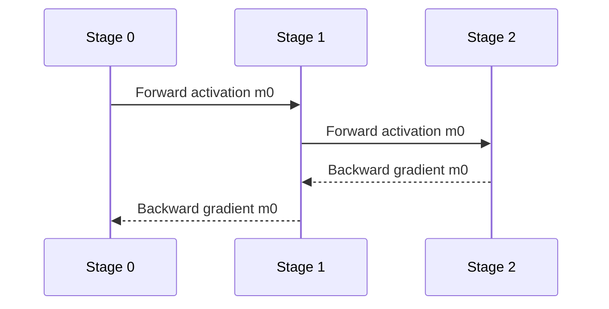
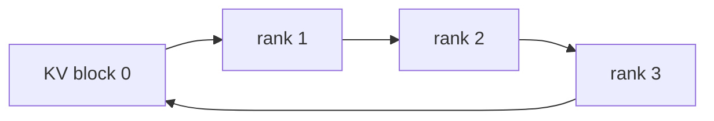
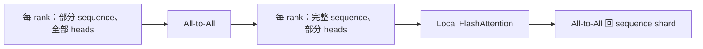
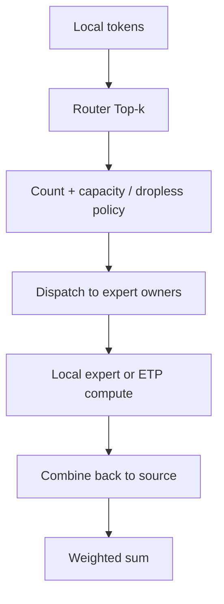

# 第 15 章　模型并行与执行日程

依次沿层内矩阵、层间流水、序列和专家划分工作，跟踪每种切分的前反向、通信与调度。

本章内容：

- [1. Tensor Parallelism：在算子内部切矩阵](#s1)
- [2. Pipeline Parallelism：切 Layer、排 Micro-batch](#s2)
- [3. Sequence Parallelism：两个同名概念必须分开](#s3)
- [4. Context Parallelism：长上下文 Attention 如何跨 GPU](#s4)
- [5. Expert Parallelism：模型稀疏，系统不一定轻松](#s5)
- [6. ETP：把一个专家的矩阵切到多张卡](#s6)
- [7. 词表并行：只求所选 token 的概率，需要交换什么](#s7)

<a id="s1"></a>

<a id="s1-tensor-parallelism在算子内部切矩阵"></a>

## 1. Tensor Parallelism：在算子内部切矩阵

从本节的矩阵推导进入 [Megatron TP 源码](<../appendices/source/megatron/02_parallelism/01_parallel_state_and_tensor_parallel.md>)，并结合 [SP](<../appendices/source/megatron/02_parallelism/03_sequence_parallel_execution.md>)核对布局边界；单专家内部的相同思想单列为 [ETP](<#s6>)。

Tensor Parallelism（TP，张量并行）把一个 layer 的参数和计算分到多张 GPU。它解决“单层太大/单卡算不下”，但每层通常都要通信，因此优先放在 NVLink/NVSwitch 高速域内。

本节始终采用 $X[M,H_{in}]W[H_{in},H_{out}]$：M 为输入向量个数，$H_{in}$、$H_{out}$ 为输入、输出特征宽度，p 为 TP 组大小。Feature shard 是按特征维切出的一片；replicated 是完整复制，partial 是尚未合并的部分贡献。列/行始终指这里定义的 W，不指某个框架的存储方向。

先把本章的几种“切分”放到同一个问题上：一条序列穿过很多层，每层对 token 向量做矩阵乘和 Attention。TP 切一个矩阵的特征，PP 切层，SP 切某些逐 token 区域的激活，CP 分担上下文交互，EP 切不同专家，ETP 再切单专家矩阵。它们共享设备却不一定共享分组规则；后文逐一说明每个切口两侧交换什么。

矩阵乘的逐项定义是 $Y_{mj}=\sum_{k=0}^{H_{in}-1}X_{mk}W_{kj}$。切输出索引 $j$ 时，各卡计算不同答案；切求和索引 $k$ 时，各卡只得到同一个答案的一部分。这一条区别直接决定下面是拼接还是求和，不能单凭局部 shape 判断。

<a id="s1-column-parallel-linear"></a>

### Column Parallel Linear

设 $Y=XW$，$W\in\mathbb{R}^{H_{in}\times H_{out}}$。沿输出维切列：

$$
W=[W_0,W_1,\ldots,W_{p-1}],\qquad Y_i=XW_i
$$

每张卡需要完整 X，得到 Y 的 feature shard。若下一个算子能直接消费这个 shard，无需立即 AllGather。

<a id="s1-row-parallel-linear"></a>

### Row Parallel Linear

沿输入维切行，并把输入按 feature 对应切分：

$$
W=\begin{bmatrix}W_0\\W_1\\\vdots\\W_{p-1}\end{bmatrix},\quad
X=[X_0,X_1,\ldots,X_{p-1}]
$$

每卡计算 partial output $Z_i=X_iW_i$，完整输出为：

$$
Y=\sum_i Z_i
$$

所以 row parallel 的输出是 `Partial(sum)`，通常需要 AllReduce，或用 ReduceScatter 直接产生 sequence shard。

若 $p$ 能整除对应维度，column 切分时 $W_i:[H_{in},H_{out}/p]$、$Y_i:[M,H_{out}/p]$；row 切分时 $X_i:[M,H_{in}/p]$、$W_i:[H_{in}/p,H_{out}]$、$Z_i:[M,H_{out}]$。Row 的参数减少了，partial 输出却仍有完整输出形状。

偏置也要按这套数学处理。对 $Y=\sum_iX_iW_i+b$，偏置 $b:[H_{out}]$ 在归约后加一次即可；若每卡先加完整 $b$ 再 SUM，会得到 $\sum_iX_iW_i+pb$。Column 输出的不同特征则可以各自加对应偏置片段。省略 bias 的教学例不能替代真实模型对这些复制参数的处理。

<a id="s1-mlp-为什么天然一列一行"></a>

### MLP 为什么天然一列一行

Multi-Layer Perceptron（MLP，多层感知机）可写成：

$$
Y=\phi(XW_1)W_2
$$

把扩张层 $W_1$ 做 column parallel，激活后保持 hidden shard；把回投影 $W_2$ 做 row parallel，最后只需一次 reduction。


这里能够省去中间 AllGather，关键在于 φ 是逐元素函数：某张卡拥有哪些中间特征，就可以独立计算这些特征的激活，第二层对应的权重行也在同一卡上。例如中间向量分成 `[a,b]` 与 `[c,d]`，两卡分别计算 φ 后，各自与第二层相应两行权重相乘，再把两个部分输出求和即可。若两层之间换成需要整个中间特征向量统计量的操作，则要重新检查通信需求，不能继续默认这种配对成立。


<a id="s1-数值展开-tp两层-mlp-的前向反向与-attention-布局"></a>

### 数值展开 TP：两层 MLP 的前向、反向与 Attention 布局

> 两张卡，数学权重约定为 [in,out]，省略 bias。PyTorch Linear 的存储方向通常相反，读代码时要转换。

<a id="s1-单卡参考模型"></a>

#### 单卡参考模型

$$X=\begin{bmatrix}1&2\\3&4\end{bmatrix},\quad
W_1=\begin{bmatrix}1&0&1&2\\0&1&1&0\end{bmatrix},\quad
W_2=\begin{bmatrix}1&0\\0&1\\1&1\\2&-1\end{bmatrix}.$$

计算 $A=\operatorname{ReLU}(XW_1)$、$Y=AW_2$，loss 为 Y 的全部元素之和。ReLU 是逐元素取 $\max(0,x)$ 的非线性函数。这里所有激活都大于0，所以 ReLU 的局部导数为1，避免零点约定干扰推演。

<a id="s1-第一层沿输出列切分"></a>

#### 第一层沿输出列切分

rank 0 保存 W1 的前两列，rank 1 保存后两列。X 在两卡逻辑复制：

| rank | W1 shard [2,2] | A shard [2,2] |
|---|---|---|
| 0 | [[1,0],[0,1]] | [[1,2],[3,4]] |
| 1 | [[1,2],[1,0]] | [[3,2],[7,6]] |

完整 A 为 [[1,2,3,2],[3,4,7,6]]，但不必实际 AllGather。因为第二层正好可以消费同样的中间维切片。

<a id="s1-第二层沿输入行切分"></a>

#### 第二层沿输入行切分

rank 0 保存 W2 的前两行，rank 1 保存后两行，各计算完整输出形状的部分和：

| rank | 局部乘积 [2,2] | 语义 |
|---|---|---|
| 0 | [[1,2],[3,4]] | 部分和，不能当完整 Y |
| 1 | [[7,1],[19,1]] | 部分和，不能当完整 Y |
| SUM AllReduce | [[8,3],[22,5]] | 两卡均获得完整 Y |

loss=38。这里是 SUM，不是数据并行的平均；除以2会把模型输出改小一半。

<a id="s1-反向逐步算"></a>

#### 反向逐步算

先推导为何会出现转置。对一般线性层 $Y=AW_2$，由链式法则

$$
\frac{\partial L}{\partial (W_2)_{kj}}=\sum_m\frac{\partial L}{\partial Y_{mj}}A_{mk},\qquad
\frac{\partial L}{\partial A_{mk}}=\sum_j\frac{\partial L}{\partial Y_{mj}}(W_2)_{kj}.
$$

把右边按矩阵乘组织，正是 $dW_2=A^TG$ 和 $dA=GW_2^T$。本例 $X:[2,2]$、$W_1:[2,4]$、$A:[2,4]$、$W_2:[4,2]$、$Y,G:[2,2]$。每卡中间宽度为 2，所以本地 $dA_r:[2,2]$、$dW_{2,r}:[2,2]$；第二层把中间维分给两卡，所有求和位置仍须对应正确的行／列。

一般还要令 $U=XW_1$，先算 $dU=dA\odot\mathbf1[U>0]$，再算 $dW_1=X^TdU$、$dX=dUW_1^T$；$\odot$ 是同形状逐元素乘。本例所有 $U$ 都大于零，才可在表中把 $dU$ 简写成 $dA$。

上游 G=dL/dY 为全1矩阵。第二层每卡计算 $dW_{2,r}=A_r^TG$、$dA_r=GW_{2,r}^T$：

| 对象 | rank 0 | rank 1 |
|---|---|---|
| dW2 shard | [[4,4],[6,6]] | [[10,10],[8,8]] |
| dA shard | 每行[1,1] | 每行[2,1] |
| dW1 shard=$X^TdA_r$ | [[4,4],[6,6]] | [[8,4],[12,6]] |
| dX 局部贡献 | 每行[1,1] | 每行[4,2] |
| SUM 后 dX | 每行[5,3] | 每行[5,3] |

因此前向只需在第二层后合并部分输出，反向只需在第一层输入梯度处合并部分贡献。权重梯度保持对应 TP shard；若还有 DP，则在相同 TP 坐标的 DP group 同步。

这里的梯度语义按逻辑模型推导。实现会用特定 autograd 通信算子表达“前向求和、反向把同一上游梯度提供给分支”等关系，不能把每个物理副本都当作独立 loss 再无条件规约，否则可能重复计数。

<a id="s1-通信负载账本"></a>

#### 通信负载账本

本例每个合并位置有4个元素，假设FP32，逻辑 payload=16 B。它不是所有链路的累计字节。在组大小 p=2、消息大小 n=16 B 的 Ring AllReduce 模型中，每 rank 发送总量为 $2(p-1)n/p=n=16$ B，接收同量；真实小消息主要受固定开销影响。

<a id="s1-attention-如何对应同一种布局"></a>

#### Attention 如何对应同一种布局

设 B=1、S=2、H=4、head数2、head_dim=2、TP=2。各卡拥有一个完整head的Q/K/V，对两个token做该head的Attention；head内部仍需要正确的causal mask。

| 位置 | 每卡形状 | 语义 |
|---|---|---|
| 输入 X | [1,2,4] | replicated |
| Q/K/V | 各[1,2,1,2] | head shard |
| Attention输出 | [1,2,2] | head shard |
| 输出投影权重 | [2,4] | 输入行 shard |
| 输出投影结果 | [1,2,4] | partial，需要SUM |

反向中，输出投影把同一逻辑 dY 传给各 head 分支；每个分支分别经过 attention backward 和 QKV 投影 backward，产生对 X 的局部贡献，最后求和。GQA 的KV head少、MLA缓存表示特殊时，不能机械套用此head整除分法。

验证：[纯 Python 单卡/分片前反向对照](<../examples/parallel_runtime_walkthroughs.py>)。依据：[Megatron-LM](https://arxiv.org/abs/1909.08053)。

<a id="s1-attention-的-tp"></a>

### Attention 的 TP

Multi-Head Attention（MHA，多头注意力）通常沿 attention heads 切分 Query/Key/Value（Q/K/V）投影；每 rank 计算一部分 heads，再由 output projection 的 row parallel reduction 合并。Grouped-Query Attention（GQA，分组查询注意力）会带来限制：KV heads 数必须能被 TP degree 合理切分，或采用复制 KV heads/fine-grained mapping。

Multi-head Latent Attention（MLA，多头潜在注意力）与 DeepSeek Sparse Attention（DSA，DeepSeek 稀疏注意力）等结构改变可切 tensor 与 kernel 支持，不能套用 MHA 的 head-shard 假设。

<a id="s1-forward-与-backward-的通信对偶"></a>

### Forward 与 backward 的通信对偶

Column parallel forward 产生 output shard；其 backward 对 input gradient 通常需 reduction。Row parallel forward 需 reduction；其 backward 对 input naturally sharded。Megatron 通过相邻 column/row layer 配对，让一个 Transformer block 中大 collective 数量受控。

<a id="s1-tp-degree-的边界"></a>

### TP degree 的边界

增大 TP：

- 参数/activation shard 更小；
- collective group 更大且每 layer 同步；
- local GEMM 的 M/N/K 维度变小，Tensor Core 利用率可能下降；
- divisibility、head 数、expert hidden size 和 vocab size 限制增多。

所以“模型能放下后继续加 TP”不一定加速。推理低延迟常用 TP 缩短单请求 compute，但跨节点 TP 往往付出较大同步代价。

<a id="s1-pytorch-的表达"></a>

### PyTorch 的表达

PyTorch `torch.distributed.tensor.parallel` 用 `ColwiseParallel`、`RowwiseParallel`、`SequenceParallel` 等 ParallelStyle 描述 module plan，并基于 DeviceMesh/DTensor 传播 layout。DeviceMesh 表达设备分组网格，DTensor 表达张量在该网格上的分片/复制布局；这些框架接口需按版本核对，复杂自定义 module 要验证 input/output layout。


<a id="s1-概念辨析"></a>

### 概念辨析


<a id="s1-transformer-tp-通信量如何估算为什么是-21-gib--microbatch--gpu"></a>

#### Transformer TP 通信量如何估算：为什么是 21 GiB / microbatch / GPU？

问题：假设一个 48 层 decoder-only Transformer，TP=8，hidden size=8192，sequence length=4096，micro batch size=1，使用 BF16。按“每层训练阶段发生 4 次 Ring All-Reduce”做粗略估算，为什么会得到每个 microbatch 每卡约 21 GiB 的通信量，以及 42～84 GiB/s 的通信带宽需求？

<a id="s1-核心结论"></a>

##### 核心结论

- 一次参与 TP collective 的 activation-sized tensor：1 × 4096 × 8192 × 2 Byte = 64 MiB。

- TP=8 的 Ring All-Reduce 中，每个 rank 实际发送的数据量约为 2 × (8−1)/8 × 64 MiB = 112 MiB。

- 每层按 4 次 collective、共 48 层：112 MiB × 4 × 48 = 21 GiB / microbatch / GPU。

- 如果纯计算只需要 0.25～0.5 s，要让通信处在同一时间尺度，需要约 21/0.5～21/0.25 = 42～84 GiB/s 的有效吞吐。

- 若有效带宽只有 23～29 GB/s，在“通信与计算完全不重叠”的简化假设下，通信约耗时 0.78～0.98 s，通信占总时间约 61%～80%。

<a id="s1-参数表"></a>

##### 参数表

| 参数                | 取值          | 在估算中的作用                               |
|---------------------|---------------|----------------------------------------------|
| Layers              | 48            | collective 次数随层数线性增长                |
| TP size             | 8             | 决定 Ring All-Reduce 的 (N−1)/N 系数         |
| Hidden size H       | 8192          | 决定 activation tensor 的最后一维            |
| Sequence length S   | 4096          | 决定 token 维度                              |
| Micro batch B       | 1             | 决定一次 microbatch 的 activation 规模       |
| dtype               | BF16 = 2 Byte | 决定每个元素的字节数                         |
| Collectives / layer | 4             | 本例的粗略假设：forward 2 次 + backward 2 次 |

<a id="s1-第一步一次-tp-collective-的逻辑-tensor-有多大"></a>

##### 第一步｜一次 TP collective 的逻辑 tensor 有多大？

把一次需要在 TP ranks 间聚合的 activation 简化成形状 $[B,S,H]$。本例中元素数为：

1 × 4096 × 8192 = 33,554,432 elements

BF16 每个元素占 2 Byte，所以：

33,554,432 × 2 Byte = 67,108,864 Byte = 64 MiB

因此，一次 collective 对应的“逻辑 tensor 大小”是 64 MiB。

<a id="s1-为什么这里不是再除以-tp8"></a>

##### 为什么这里不是再除以 TP=8？

TP 的确把矩阵乘法拆到 8 张 GPU 上，但某些 Row Parallel Linear 的局部输出仍然具有完整的 $[B,S,H]$ 形状；每个 rank 只计算最终结果的一部分贡献。可以写成：

Y = X₁W₁ + X₂W₂ + … + X₈W₈

每个 rank 得到一个与最终 Y 同形状的 partial result，最后需要把 8 个 partial result 做求和聚合。因此这里参加 All-Reduce 的逻辑对象仍然可以是完整的 64 MiB，而不是简单地把 64 MiB 除以 8。

注意：这是基于经典 Megatron-style TP 的概念级估算。启用 Sequence Parallel、不同 fused kernel 或不同 collective 实现后，实际通信算子可能变为 ReduceScatter / AllGather 等，不能机械地把“每层 4 次纯 All-Reduce”套到所有现代实现。

<a id="s1-第二步为什么-ring-all-reduce-的每卡传输量是-112-mib"></a>

##### 第二步｜为什么 Ring All-Reduce 的每卡传输量是 112 MiB？

Ring All-Reduce 可以粗略理解成两个阶段：Reduce-Scatter + All-Gather。设参与 GPU 数 N=8，逻辑 tensor 大小 M=64 MiB。

- Reduce-Scatter：每张卡在 ring 中传 N−1=7 轮，每轮发送 M/N=8 MiB，因此每卡发送 7 × 8 = 56 MiB。

- All-Gather：再走 7 轮，每卡又发送 56 MiB。

所以 Ring All-Reduce 的经典每-rank 通信量公式为：

V_AR = 2 × (N−1)/N × M

= 2 × 7/8 × 64 MiB = 112 MiB

这里的系数 2 来自 Reduce-Scatter 和 All-Gather 两个阶段，不是 BF16，也不是 forward/backward。

<a id="s1-第三步从一次-collective-推到-48-层21-gib-是怎么来的"></a>

##### 第三步｜从一次 collective 推到 48 层：21 GiB 是怎么来的？

本例假设每个 Transformer layer 在一次完整训练（forward + backward）过程中合计发生 4 次这样的 TP collective，因此：

每层：112 MiB × 4 = 448 MiB / GPU

48 层：448 MiB × 48 = 21,504 MiB = 21 GiB / GPU

所以“21 GiB”不是模型参数量，也不是单次消息大小，而是一个 microbatch 穿过 48 层 forward + backward 后，按该 Ring All-Reduce 模型累计得到的每卡网络传输量。

<a id="s1-第四步为什么对应-4284-gibs-的通信需求"></a>

##### 第四步｜为什么对应 42～84 GiB/s 的通信需求？

如果一个 microbatch 的纯计算耗时约 0.25～0.5 s，而它同时需要完成约 21 GiB 的 TP 通信，那么为了让通信时间不比计算时间更长，对应的平均有效通信吞吐约为：

21 GiB / 0.5 s = 42 GiB/s

21 GiB / 0.25 s = 84 GiB/s

一个很重要的 Infra 直觉：GPU 算得越快，留给通信的时间窗口越短，因此对互联带宽和通信/计算 overlap 的要求反而越高。

<a id="s1-第五步2329-gbs-为什么会让-6080-的时间花在通信"></a>

##### 第五步｜23～29 GB/s 为什么会让 60%～80% 的时间花在通信？

这里要先区分 GB/s 和 GiB/s：1 GiB ≈ 1.074 GB，所以 23～29 GB/s ≈ 21.4～27.0 GiB/s。

传 21 GiB 所需通信时间约为：

T_comm ≈ 21 / 27.0 ～ 21 / 21.4 ≈ 0.78～0.98 s

若假设通信与计算完全串行，则 T_total = T_compute + T_comm。

- 最好组合：T_compute=0.5 s、T_comm≈0.78 s，通信占比 ≈ 0.78/(0.78+0.5) ≈ 61%。

- 最差组合：T_compute=0.25 s、T_comm≈0.98 s，通信占比 ≈ 0.98/(0.98+0.25) ≈ 80%。

所以这里的“60%～80% 时间花在通信上”来自所给带宽与串行化假设，不是实测占比，也不是包含争用、重试和调度开销的严格上界。Overlap 可以降低暴露通信，但同步依赖与共享资源也可能让结果偏离这一估计。

<a id="s1-一条通用估算式"></a>

##### 一条通用估算式

在上述简化假设下，可以把每卡、每 microbatch 的累计通信量记成：

V ≈ L × C × (B × S × H × bytes) × 2(TP−1)/TP

其中 L=层数，C=每层 collective 次数。这个式子适合做数量级 intuition，而不是替代 NCCL trace / profiler 的真实测量。

<a id="s1-最值得记住的-insight"></a>

##### 最值得记住的 Insight

- TP 是一种高频通信并行：通信发生在 Transformer 层内部，而不是只在一个 training step 的末尾。因此 TP 对 GPU↔GPU 的低延迟、高带宽互联特别敏感。

- 21 GiB 这个例子直接解释了为什么训练系统会尽量把一个 TP group 放在 NVLink / NVSwitch 的 scale-up 域内；一旦跨节点，HCA、InfiniBand/RoCE、GPUDirect RDMA 和 GPU↔NIC 拓扑就会成为关键。

- 分析通信时要同时区分三件事：逻辑 tensor 大小、collective 算法导致的实际链路字节数、以及真正暴露在 critical path 上的通信时间。

若要继续追踪这些字节走哪条物理路径，可选读[通信信号与链路](<../appendices/foundations/通信信号与链路.md>)。下面转向层间切分，讨论流水线日程如何改变激活驻留和设备等待。


---


<a id="s1-资料"></a>

### 资料

- [Megatron-LM 原始 TP 论文](https://arxiv.org/abs/1909.08053)
- [PyTorch Tensor Parallel API](https://docs.pytorch.org/docs/stable/distributed.tensor.parallel.html)
- [PyTorch Large-Scale TP Tutorial](https://docs.pytorch.org/tutorials/intermediate/TP_tutorial.html)
- [Megatron Core Tensor Parallel API](https://docs.nvidia.com/megatron-core/developer-guide/latest/apidocs/core/core.tensor_parallel.html)

<a id="s2"></a>

<a id="s2-pipeline-parallelism切-layer排-micro-batch"></a>

## 2. Pipeline Parallelism：切 Layer、排 Micro-batch

VPP（Virtual Pipeline Parallelism，虚拟流水线并行）让一个物理流水阶段持有多个模型层块，按交错日程执行。它改变调度与通信频率，不增加物理 GPU 数。

本节讲切层与调度原理；具体的 warmup、VPP lookup table、激活队列与 P2P 见 [Megatron PP 走读](<../appendices/source/megatron/02_parallelism/02_pipeline_parallel.md>)。运行与预期结果见[并行验收](<../appendices/source/megatron/05_design_and_failures/03_parallelism_validation.md>)。


Stage 是流水阶段，保存并计算一段模型层；F/B 分别表示前向/反向，bubble（气泡）表示设备因依赖未满足而空闲的时段。Warmup/fill 是把工作填入流水线的启动阶段，drain 是最后一批工作离开的排空阶段，flush 表示本轮全部工作结束后再按同步规则更新。

本节先比较 GPipe 与同步 1F1B 的激活生命周期。虚拟流水段、异步版本和 Zero Bubble 是扩展阅读，理解两阶段手算表后再进入即可。

<a id="s2-入门例子两个-stage四个-microbatch-的生命周期"></a>

### 入门例子：两个 stage、四个 microbatch 的生命周期

PP 将不同层放到不同 stage。microbatch m 在 stage 0 forward 后，activation 发给 stage 1；stage 1 backward 后，把对输入 activation 的梯度发回 stage 0。参数更新需要本次更新包含的梯度都满足同步条件。

先画每个 microbatch 的 F0→F1→B1→B0 依赖，再安排不同 microbatch 的工作穿插。1F1B 的 F 和 B 通常不是同一个 microbatch，不能理解成每个 stage 永远立即反向刚完成的那个前向。

在 stage 等时、忽略额外通信的简化流水模型中，bubble 常随 (P−1)/M 增大，其中 P 为 stage 数、M 为 microbatch 数；实际占比和时序取决于 schedule。验收：画出 warmup、稳态、drain，数出仍需保留的 activation；不要只背 bubble 公式。

<a id="s2-机制与实现"></a>

### 机制与实现

Pipeline Parallelism（PP，流水线并行）把模型的 layer/graph 切成 stage，各 stage 处理不同 micro-batch。它减少每卡常驻 layer 参数，但引入 activation/gradient P2P、pipeline bubble 和 stage imbalance。

<a id="s2-基本数据流"></a>

### 基本数据流



P2P payload 主要与 boundary activation shape 相关，而不是整个模型参数量。切分位置若产生大 activation 或跨越 residual/branch，会增加通信和实现复杂度。

<a id="s2-gpipeall-forward-then-all-backward"></a>

### GPipe：All Forward Then All Backward

GPipe 把 mini-batch 分成 $m$ 个 micro-batch，先完成所有 forward，再完成所有 backward。若有 $p$ 个均衡 stage，忽略通信，bubble fraction 近似：

$$
\text{bubble}_{GPipe}\approx\frac{p-1}{m+p-1}
$$

增大 $m$ 可摊薄 bubble，但要同时保存更多未 backward 的 activation，显存上升。

这个比例可以从时间算出来。令每个 stage 对一个 microbatch 的前向、反向分别耗时 $f,b$ 秒，各 stage 均衡且没有通信成本。GPipe 的前向流水需要 $(m+p-1)f$ 秒：首批穿过 $p$ 个 stage 后，剩余 $m-1$ 批每隔 $f$ 秒完成；反向同理需要 $(m+p-1)b$ 秒。因此

$$
T=(m+p-1)(f+b),\qquad
\text{利用率}=\frac{pm(f+b)}{pT}=\frac{m}{m+p-1},
$$

$$\text{空闲占比}=1-\text{利用率}=\frac{p-1}{m+p-1}.$$

分子 $pm(f+b)$ 是所有设备实际计算的总设备秒，分母 $pT$ 是所有可用设备秒；这是空槽比例。另一个常见写法 $(p-1)/m$ 是额外时间与理想工作时间的比值，两者分母不同。以 $p=2,m=4,f=b=1$ 秒为例，实际 10 秒、理想 8 秒；额外时间比例为 25%，空闲设备时间比例为 20%。

在固定 global batch 下增大 $m$，往往要减小每份 microbatch，$f,b$ 也可能因矩阵变小而变化；不能一边使用固定 $f,b$，一边声称气泡一定变小且总时间一定下降。

<a id="s2-1f1b"></a>

### 1F1B

One Forward One Backward（1F1B，一前向一反向）经过 warmup 后交替执行 forward/backward，更早释放 activation，峰值通常低于 GPipe。同步 flush 版本保持同一 mini-batch 的一致 weight version；异步 PipeDream 类 schedule 可能引入 weight staleness，需要额外语义。

<a id="s2-interleaved-1f1b"></a>

#### Interleaved 1F1B

每个物理 rank 持有多个 Virtual Pipeline（VP，虚拟流水段）chunk，例如 rank 0 持 layer 0–3 与 16–19。细粒度 interleave 可减少 bubble、改善 stage balance，但增加 P2P 次数、调度与 activation 管理复杂度。

<a id="s2-zero-bubble-的关键拆-backward"></a>

### Zero Bubble 的关键：拆 backward

Backward 可分成：

- B：计算对输入 activation 的 gradient，必须尽快发给前一 stage；
- W：计算 parameter gradient，只影响本 stage optimizer，可在关键路径空隙执行。

以线性层 Y=XW 为例，收到上游梯度 G 后，输入梯度是 GWᵀ，权重梯度是 XᵀG。前一个结果需要尽快送给上游 stage，使它开始反向；后一个结果只需在本轮参数更新前完成。Zero Bubble schedule 利用这两个不同期限，先推进输入梯度，再将部分权重梯度计算安排到原本空闲的时段。为稍后计算 XᵀG，X 和 G 还必须保留，因此调度收益也可能增加状态驻留。PyTorch 2.14 `torch.distributed.pipelining` 已公开 ScheduleInterleavedZeroBubble 等 schedule；支持条件与数值语义需按文档核对。

<a id="s2-stage-partition-不能只按-layer-数"></a>

### Stage partition 不能只按 layer 数

MoE、embedding、output head、Multi-Token Prediction（MTP，多 token 预测）和异构 layer 的成本不同。应按实测 forward/backward time、activation bytes 和 memory peak 做 partition。

Megatron Core 的 [Custom Pipeline Layout 文档](https://docs.nvidia.com/megatron-core/developer-guide/latest/user-guide/features/pipeline_parallel_layout.html)允许表达不均匀 layer 分配和空 stage（2026-10-15 核对）。空 stage 仍可能参与转发和同步，不代表删除了这段协议；分层时还要计 embedding、输出头与共享参数的特殊依赖。

<a id="s2-bubble-的四种来源"></a>

### Bubble 的四种来源

1. fill/drain：流水线固有 warmup/cooldown；
2. stage imbalance：最慢 stage 决定节拍；
3. communication exposed：P2P 未被 compute 遮挡；
4. dynamic workload：MoE token imbalance、变长 sequence 或 conditional branch。

只增加 micro-batch 数主要改善第一种，对后三种可能无效。


<a id="s2-数值展开-ppgpipe-与同步-1f1b-的逐时隙调度"></a>

### 数值展开 PP：GPipe 与同步 1F1B 的逐时隙调度

> 两个stage、四个microbatch，所有F/B各耗一个时隙，传输延迟记为0且边界数据在下一时隙可用。每stage同一时隙只执行一个任务。时间表是依赖验证模型，不是性能预测。

<a id="s2-依赖先于调度"></a>

#### 依赖先于调度

公式 $F_{s,i}$ 的两个下标分别是 stage 编号和 microbatch 编号。后面表格已经用列区分 stage，所以表内 F0/F1 表示 microbatch 0/1 的前向，B0/B1 同理。

对microbatch i：$F_{0,i}\to F_{1,i}\to B_{1,i}\to B_{0,i}$。每次F保存一份简化激活，每次同stage的B结束后释放。整个更新使用相同参数版本，累计四份梯度后再更新。

<a id="s2-gpipe先前向后反向"></a>

#### GPipe：先前向，后反向

| 时隙 | stage 0 | stage 1 | 结束时活跃激活份数 S0/S1 |
|---|---|---|---|
| 0 | F0 | — | 1/0 |
| 1 | F1 | F0 | 2/1 |
| 2 | F2 | F1 | 3/2 |
| 3 | F3 | F2 | 4/3 |
| 4 | — | F3 | 4/4 |
| 5 | — | B3 | 4/3 |
| 6 | B3 | B2 | 3/2 |
| 7 | B2 | B1 | 2/1 |
| 8 | B1 | B0 | 1/0 |
| 9 | B0 | — | 0/0 |

每stage做8个任务，整个调度占10时隙；总可用槽位20，实际计算16，空槽比例20%。与 $(P-1)/(M+P-1)=1/5$ 相符。每stage激活峰值4份。

<a id="s2-同步-flush-1f1b"></a>

#### 同步 flush 1F1B

| 时隙 | stage 0 | stage 1 | 结束时活跃激活份数 S0/S1 |
|---|---|---|---|
| 0 | F0 | — | 1/0 |
| 1 | F1 | F0 | 2/1 |
| 2 | — | B0 | 2/0 |
| 3 | B0 | F1 | 1/1 |
| 4 | F2 | B1 | 2/0 |
| 5 | B1 | F2 | 1/1 |
| 6 | F3 | B2 | 2/0 |
| 7 | B2 | F3 | 1/1 |
| 8 | — | B3 | 1/0 |
| 9 | B3 | — | 0/0 |

时间仍为10时隙，空槽仍为20%；激活峰值变成stage 0两份、stage 1一份。这一例子中，1F1B的直接收益是生命周期，而不是更短总时间。若每份激活16 MiB，峰值分别由64/64 MiB降到32/16 MiB，未包含其他状态。

stage 0在F1后执行B0，说明“一前一后”通常属于不同microbatch。表中的空槽来自远端梯度尚未可用，不能无条件填入需要该梯度的工作。

<a id="s2-加回通信与不均衡"></a>

#### 加回通信与不均衡

设边界激活shape=[2,4]、BF16，每次前向payload16 B；若反向边界梯度也BF16，每次返回16 B，四个microbatch总共128 B跨边界传输。参数量没有进入这个payload公式。

如果 stage 1 的每次前向耗时变为2个单位，或P2P与计算竞争资源，就不能继续使用上面的等时槽表。应把任务展开为实际区间，加入“发送完成后才能消费”的依赖。更多microbatch主要摊薄fill/drain，不会消除最慢stage的持续瓶颈。

#### 一次跨 stage 发送何时真的完成

对形状 $[2,4]$ 的边界张量，上游 GPU 先产出激活，发送操作等生产事件后读取它；下游事先准备接收缓冲，等接收完成后才计算。上游的发送源在传输读完前不能覆盖，下游的接收结果若被反向保存，就要保留到对应 backward 结束。发送完成只意味着传输不再读取源，不能证明本地反向也不需要这份激活。

反向使用相反方向：下游计算边界梯度，传回上游，由上游排入对应 microbatch 的反向。消息必须同时匹配 stage、microbatch 和形状；把 m1 的梯度交给 m0，即使 shape 完全相同也会训练错误。实现常用队列存这些在途对象，调度改变时队列长度和可释放时刻也随之改变。

<a id="s2-更新语义与后续方法"></a>

#### 更新语义与后续方法

同步flush要求这一批microbatch使用相容的参数版本。若某stage在其他microbatch仍需旧参数反向时更新，会产生版本问题；异步流水需要额外设计，而不只是删除等待。

拆分输入梯度与权重梯度可以提供更多可调度任务，但只有权重梯度的依赖和最终更新条件满足时才能挪动它。激活保留也可能延长。理解Zero Bubble应先在此表上补入这些独立依赖。

验证：[调度依赖与激活计数脚本](<../examples/parallel_runtime_walkthroughs.py>)。历史依据：[GPipe](https://arxiv.org/abs/1811.06965)、[PipeDream](https://arxiv.org/abs/1806.03377)；本表仅演示同步版本。

<a id="s2-选择建议"></a>

### 选择建议

- 模型深、单层能在一张/一个 TP group 高效运行：PP 很自然；
- micro-batch 必须极小且 global batch 也小：bubble 难以摊薄；
- 推理低延迟：PP 增加 stage 串行 latency，通常不如 TP；吞吐批处理可用 pipeline；
- 长上下文：activation 生命周期可能让 1F1B 也过高，需要 recompute、Seq1F1B 或 sequence slicing。

<a id="s2-调度演进减少一种气泡会引入另一种状态"></a>

### 调度演进：减少一种气泡会引入另一种状态

将层分到不同设备解决深度方向的容量分布，但单个 microbatch 会逐 stage 经过，其他设备可能空闲。GPipe 以多个 microbatch 填充流水；集中前向会增加等待反向的激活。

1F1B 将前向与反向交错，缩短部分激活生命周期，但没有自动消除启动和排空。Interleaving 增加调度颗粒度，也增加切换与通信。拆分 backward 的后续设计利用输入梯度和权重梯度的不同依赖填空隙，同时必须维护更新前的所有梯度条件。

分析时分别画计算依赖、链路占用和激活峰值。“零气泡”是在特定假设下的调度目标，不意味着真实系统没有负载不均、同步或通信等待。历史入口：[GPipe](https://arxiv.org/abs/1811.06965)。


---


<a id="s2-资料"></a>

### 资料

- [GPipe](https://arxiv.org/abs/1811.06965)
- [PipeDream](https://arxiv.org/abs/1806.03377)
- [PyTorch Pipeline Parallelism 2.14](https://docs.pytorch.org/docs/stable/distributed.pipelining.html)
- [Megatron Core Custom Pipeline Layout](https://docs.nvidia.com/megatron-core/developer-guide/latest/user-guide/pipeline_model_parallel_layout.html)

<a id="s3"></a>

<a id="s3-sequence-parallelism两个同名概念必须分开"></a>

## 3. Sequence Parallelism：两个同名概念必须分开


<a id="s3-入门例子从-tp-两侧的激活看-sequence-parallel"></a>

### 入门例子：从 TP 两侧的激活看 Sequence Parallel

设 activation 为 [S=8,H=4]，TP=2。某些逐 token 操作不需要把所有序列位置常驻在两张卡上：每卡可持有 [4,4]，独立做对应 token 的 normalization，再在需要完整序列的边界做布局转换。

这并没有让每枚 token 的 attention 只看半段上下文。Megatron SP 主要关联 TP 区间的 activation 布局，其他论文中的 sequence parallel 可能直接切 attention 的序列计算，必须辨明定义。

LayerNorm 在本地 token 上计算，ColumnLinear 前可能需要 gather，RowLinear 后可用 ReduceScatter 返回 token shard。形状、所有权与后续消费者共同定义 SP，单独的 sp=True 开关不能表达这些边界。

<a id="s3-机制与实现"></a>

### 机制与实现

“Sequence Parallelism（SP，序列并行）”在业界至少指两类不同方法：

1. Megatron SP：与 Tensor Parallelism（TP，张量并行）配合，把 LayerNorm、Dropout、Residual 等非 TP 区域沿 sequence 切分；
2. long-context sequence parallel：把 attention context 切分，代表方法包括 DeepSpeed-Ulysses 和 Ring Attention。Megatron 常把第二类称 Context Parallelism（CP，上下文并行）。

混用两者会直接算错通信和显存。

<a id="s3-megatron-sp-解决什么"></a>

### Megatron SP 解决什么

传统 TP 只切 linear/attention heads；某些 activation 在 TP ranks 上仍复制，例如 residual stream 和 LayerNorm 输入。Megatron SP 让这些区域保持 sequence shard：


这样可把部分 activation memory 约按 TP size 降低，并把原本 AllReduce 改写为 ReduceScatter + 后续 AllGather，使通信更容易与计算组织。

<a id="s3-为什么-layernorm-能局部做"></a>

### 为什么 LayerNorm 能局部做

Layer Normalization（LayerNorm，层归一化）通常沿 hidden dimension 求均值/方差。如果 activation 是沿 sequence 切分，每个 token 的完整 hidden vector 仍在本 rank，因此 LayerNorm 前向统计量不需要跨 rank reduction。但复制的 gamma/beta 在各 rank 上只收到本地 token 的梯度，反向后仍要跨 TP 求和，见 [SP 执行走读](<../appendices/source/megatron/02_parallelism/03_sequence_parallel_execution.md>)。

如果沿 hidden 维切分，统计量才需要 AllReduce。关键永远是“归一化维度是否被切”。

<a id="s3-megatron-sp-不会降低-attention-的-s2"></a>

### Megatron SP 不会降低 attention 的 $S^2$

进入 TP attention 前通常会 AllGather 所需 sequence layout，或 attention 本身按 heads 切分；它没有把完整 context interaction 分散给多个 rank。因此长上下文 attention activation/compute 的核心问题仍需 CP、Ulysses、Ring Attention 或稀疏 attention 解决。

<a id="s3-ulysses-与-ring-attention-简述"></a>

### Ulysses 与 Ring Attention 简述

- DeepSpeed-Ulysses：输入初始按 sequence 切；在 attention 前通过 All-to-All 转为 head shard，使每 rank 有完整 sequence 的部分 heads；attention 后再 All-to-All 还原 sequence shard。
- Ring Attention：每 rank 保留 query chunk，让 Key/Value（KV，键值）block 沿 ring 轮转，逐块累积 online softmax 结果。

两者详细比较见[Context Parallelism](<#s4>)。

<a id="s3-packed-sequence-的额外困难"></a>

### Packed sequence 的额外困难

将多个变长样本 pack 到同一 sequence 可减少 padding，但 SP/CP 必须携带每个样本边界、position、causal mask metadata。简单按 token 等长切分可能：

- 把一个样本切跨 rank，需要跨边界 attention；
- 让不同 rank 的有效 attention FLOPs 不平衡；
- 对 linear attention、state-space model 或稀疏 attention 缺少对应 sharding rule。

例如包含递推状态的层，跨 token 分片还要传递或合并递推状态，不能直接复用密集 Attention 的 KV 协议。架构是否支持 CP 与 packed sequence 应由对应版本的实现和测试确认，不能因为 dense GPT path 可用就推断所有 architecture 可用。

<a id="s3-选择规则"></a>

### 选择规则

- 已使用 Megatron TP 且 activation 高：通常打开 Megatron SP；
- sequence 极长、attention 放不下：需要 CP/Ulysses/Ring，而不只是 Megatron SP；
- 小 hidden、大 sequence：增加 TP 可能使 GEMM 变小，CP 更符合问题维度；
- 变长 post-training：关注 dynamic CP/packing/load balance，而不是固定最大长度配置。

<a id="s3-概念边界决定演进关系"></a>

### 概念边界决定演进关系

某些 TP 子图两侧保存了重复的逐 token 激活，沿序列切分这些区域可以减少冗余，再在需要的地方聚合或规约。这与把完整长上下文 Attention 分布到多卡所面对的问题不同。

“Sequence Parallel” 在不同论文和框架中的范围可能不同。判断应回到算子：谁拥有每个 token，哪个算子需要远端信息，何时从 shard 变为 replica 或 partial。词名相同不能替代布局图。

这种优化减少一部分状态后，Attention 中间量或跨算子布局转换可能成为下一瓶颈。相关：[Context Parallel](<#s4>)、[统一布局](<14_数据并行与状态分片.md#s1>)。

<a id="s3-完整推演与演进资料"></a>

### 完整推演与演进资料

- [手工推演 SP 与 CP：布局转换、在线 Softmax 与远端梯度](<#s4-数值展开-sp-与-cp布局转换在线-softmax-与远端梯度>)：SP布局、CP在线softmax、远端梯度与causal负载。


---


<a id="s3-资料"></a>

### 资料

- [Megatron Core Parallelism Guide](https://docs.nvidia.com/megatron-core/developer-guide/latest/user-guide/parallelism-guide.html)
- [DeepSpeed-Ulysses](https://arxiv.org/abs/2309.14509)
- [Ring Attention](https://arxiv.org/abs/2310.01889)
- [USP：Unified Sequence Parallelism](https://arxiv.org/abs/2405.07719)

<a id="s4"></a>

<a id="s4-context-parallelism长上下文-attention-如何跨-gpu"></a>

## 4. Context Parallelism：长上下文 Attention 如何跨 GPU

原理读完后，沿 [CP 执行走读](<../appendices/source/megatron/02_parallelism/04_context_parallel_execution.md>) 核对 batch 切分、全局 token 坐标、TE adapter 与梯度归属；收益与代价的横向比较见[并行切分总览](<14_数据并行与状态分片.md>)。


<a id="s4-入门例子切分序列后attention-还需要远端历史"></a>

### 入门例子：切分序列后，attention 还需要远端历史

序列有 8 枚 token，CP=2，两卡各保存 4 枚 query。对于 causal attention，后半段 query 仍需要前半段的 key/value；不能简单让每卡独立做长度 4 的 attention，否则模型变了。

环式交换、AllGather 或布局转置是不同的通信组织方式。causal mask 使早期 query 与后期 query 的可见 pair 数不同，等 token 数不必然等计算量。实现还可能采用交错或分块分配来均衡。

对 0–7 的八个 causal query，可见 key 数依次为 1–8；连续两半的工作量为 1+2+3+4=10 与 5+6+7+8=26。重新分配 query 可以改善这种不均衡，交换 KV 解决可见历史的获取，修改 mask 则改变模型语义，三者不能混同。

<a id="s4-机制与实现"></a>

### 机制与实现

Context Parallelism（CP，上下文并行）沿 sequence/context 维切 activation，让每个 rank 只常驻部分 token。困难在于 self-attention：每个 query 必须看到允许范围内的全部 Key/Value（KV，键值）。

<a id="s4-ring-attention"></a>

### Ring Attention

设 CP degree 为 $p$。每 rank 保留本地 query block，KV block 在 ring 上轮转；每轮计算本地 Q 对当前 KV 的局部 attention，再通过 online softmax 合并局部最大值、归一化和 output。



计算与下一块 KV P2P 可以流水重叠。每 rank 最终处理完整 context 的交互，因此总 attention FLOPs 没消失，只被分摊；通信量随 KV block 和轮数增长。

先核算每轮到底带来多大数据。单个 head 维度为 $d_h$，每条序列有 $S$ 个 token，批大小 $B$，KV head 数 $n_{kv}$，CP 度为 $p$，则均匀块的 K 和 V 各为 $[B,S/p,n_{kv},d_h]$。若元素占 $b_e$ 字节，一块 KV 合计

$$n_{block}=2B(S/p)n_{kv}d_hb_e\quad\text{字节}.$$

朴素完整环前向共处理本地块加 $p-1$ 个远端块，每 rank 发送量约 $(p-1)n_{block}$，接收同量。因果跳块、双端分配和后端协议会改变实际流量；反向的 KV 重访与梯度回传另计。保持一个当前块与一个接收块还需约两块暂存，不能只算本地常驻 KV。

通信与计算重叠的前提是：计算当前块时，下一块能在另一缓冲中到达；复用当前块前，其 Attention kernel 和发送操作都已不再读取。若传一块耗时 $t_c$、算一块耗时 $t_a$，理想稳态轮间隔至少为 $\max(t_c,t_a)$；首块等待与最后排空仍要单列。序列变短使 $t_a$ 下降，固定通信延迟可能开始主导，这正是 Dynamic CP 的动机之一。

<a id="s4-causal-mask-的负载不均"></a>

### Causal mask 的负载不均

若按连续 token 块分配，序列前部 query 只能看较少 KV，后部 query 看更多，rank 工作量不同。Megatron 常用双端/zig-zag 重排：把前段与后段 token 配到同一 rank，使 causal triangle 面积更均衡。

<a id="s4-ulyssessequence-shard--head-shard"></a>

### Ulysses：Sequence shard ↔ Head shard

DeepSpeed-Ulysses 在 attention 前执行 All-to-All：



优势是可直接运行完整 sequence 的高效 attention kernel；限制是并行度受 attention head/KV head 数与 All-to-All topology 影响。Grouped-Query Attention（GQA，分组查询注意力）的 KV heads 少时，Ulysses degree 可能受限。

用小形状理解 Ulysses 的 All-to-All：令 $B=1,S=4,n_h=2,d_h=2$，两卡起初各有两枚 token、两个 head，Q 的局部形状为 $[1,2,2,2]$。rank 0 把自己两个 token 的 head 1 发给 rank 1，rank 1 把自己两个 token 的 head 0 发给 rank 0；各保留另一半。交换后每卡得到全部四枚 token 的一个 head，形状为 $[1,4,1,2]$，元素数仍为 8。

K/V 在此 MHA 例中做同样转换，Attention 输出反向交换回原 token owner。All-to-All 重新排列元素，没有像 AllReduce 那样做数值求和；而反向必须对同样映射执行对应逆交换。若是 GQA，Q 与 KV 的 head 数不同，能否这样整除、是否需要复制，应重新核算。

<a id="s4-megatron-cp-的通信类型"></a>

### Megatron CP 的通信类型

Megatron Core 支持多种 CP communication style，包括 P2P、AllGather、All-to-All 以及 hierarchical 组合。它们在 latency、memory、拓扑利用和 kernel integration 上不同。不要把 `context_parallel_size` 当成唯一决策；应结合 `cp_comm_type` 与 attention backend。

<a id="s4-dynamic-context-parallelism"></a>

### Dynamic Context Parallelism

固定 CP degree 按最大 sequence 配置时，短样本也承担多 rank 通信，变长 batch 还会不均衡。Dynamic Context Parallelism（Dynamic CP，动态上下文并行）按 micro-batch 的实际长度选择 CP degree/分组。

[NVIDIA 2026-01-28 的原始报告](https://developer.nvidia.com/blog/speeding-up-variable-length-training-with-dynamic-context-parallelism-and-nvidia-megatron-core/)中，Llama 13B 在 GitHub 数据上相对 only-packing 基线的每 GPU 吞吐由 195.88 提高到 289.32 TFLOP/s，比值约 1.48；CommonCrawl 对应约 1.25。配置为 global batch=2048、PP=8、CP=8、全量重算；运行 10 次迭代，丢弃首轮预热后对其余 9 次求平均。这个短程计时比值不是相同质量门槛下的完整训练达标加速。这是外部特定负载结果，本章未复测。其实现预先建立多种大小的 CP 组，运行时选择，并让序列边界与当前组信息一起传递；不能理解为每个 microbatch 都无成本地重新创建任意通信组。

<a id="s4-cp-与-tpep-的冲突"></a>

### CP 与 TP/EP 的冲突

- TP 和 Ulysses 都可能切 attention heads，组合时 degree 受 head 数乘积约束；
- CP 的 sequence layout 进入 MoE 前，token All-to-All 需要保留 global token metadata；
- Ring P2P 与 EP All-to-All 若共享 NIC，会产生 traffic contention；
- packed sequence 的 causal boundary、position 与 loss mask 必须在重排后保持正确。


<a id="s4-数值展开-sp-与-cp布局转换在线-softmax-与远端梯度"></a>

### 数值展开 SP 与 CP：布局转换、在线 Softmax 与远端梯度

> 两rank。先演示Megatron式SP，再演示切分上下文的Attention；两者切分的算子范围不同。概念：[SP](<#s3>)、[CP](<#s4>)。

<a id="s4-sp每个token的hidden仍然完整"></a>

#### SP：每个token的hidden仍然完整

X形状[S=4,H=2]，四行分别[1,3]、[2,4]、[3,5]、[4,6]。rank 0持前两行，rank 1持后两行。沿hidden做LayerNorm，教学设epsilon=0、gamma=1、beta=0，各行均值为2/3/4/5，方差均为1，输出均为[-1,1]。

每rank可以局部归一化，因为每个token的两个hidden分量都在本地。若切hidden而不是切sequence，这个结论不成立。

<a id="s4-穿过tp子图"></a>

#### 穿过TP子图

设中间宽度4，TP=2：

| 边界 | rank 0 / rank 1 的局部shape | 数据语义 |
|---|---|---|
| LN输入和输出 | [2,2] | sequence shard |
| AllGather后 | [4,2] | 完整token集合 |
| ColumnLinear输出 | [4,2] | 中间hidden shard |
| RowLinear局部输出 | [4,2] | 全序列上的partial |
| SUM ReduceScatter后 | [2,2] | token分片的完整结果 |

最后一步同时做两件事：把两rank对同一输出的贡献相加，再把结果按token分发。只scatter而不reduce会丢失模型贡献。

反向沿这些逻辑变换的伴随传播：输出的sequence shard梯度先被聚合到TP子图需要的布局，最终对LN输出的各TP局部贡献做求和并回到原token owner。此处的求和与DP平均不同。

LN的gamma/beta在这两个TP rank上复制，但各rank只处理部分token，因此参数梯度还需合并。假设LN输出上游梯度全1，则每rank的dGamma=[-2,2]、dBeta=[2,2]，跨sequence分片求和后为[-4,4]和[4,4]。只说“LN可局部做”而漏掉参数梯度同步，会得到错误训练。

<a id="s4-cp查询留在本地历史跨rank流动"></a>

#### CP：查询留在本地，历史跨rank流动

另设单head、d=1、四个token，Q均为1，K=[0,ln2,ln3,ln4]，V=[1,2,4,8]，使用causal mask。rank 0持token0/1，rank 1持token2/3。

因为exp(K)=[1,2,3,4]，单卡参考输出为：

| query | 可见key | 权重分母 | 加权分子 | 输出 |
|---|---|---:|---:|---:|
| 0 | 0 | 1 | 1 | 1 |
| 1 | 0,1 | 3 | 5 | 5/3 |
| 2 | 0,1,2 | 6 | 17 | 17/6 |
| 3 | 0,1,2,3 | 10 | 49 | 4.9 |

rank 1若只处理本地KV，则query3输出=(3×4+4×8)/7=44/7，错误。它需要远端token0/1的贡献。

<a id="s4-怎样合并块而不平均两个softmax"></a>

#### 怎样合并块而不平均两个Softmax

为什么能逐块处理而不保存完整分数矩阵？对一个查询 $q:[d_h]$，键和值分别为 $k_j:[d_h]$、$v_j:[d_v]$，分数 $s_j=q^Tk_j/\sqrt{d_h}$ 是无量纲标量。对可见键块 $a$，定义

$$m_a=\max_{j\in a}s_j,\qquad
l_a=\sum_{j\in a}e^{s_j-m_a},\qquad
n_a=\sum_{j\in a}e^{s_j-m_a}v_j.$$

$m_a,l_a$ 是标量，$n_a$ 是形状 $[d_v]$ 的向量，最终输出应是所有键的加权分子除以共同分母。块 $a,b$ 各自减去了不同的最大值，直接相加还不在同一指数尺度。选择 $m=\max(m_a,m_b)$，利用

$$e^{s_j-m}=e^{s_j-m_a}e^{m_a-m}\quad(j\in a),$$

把块 $a$ 的分子、分母同时乘 $e^{m_a-m}$，块 $b$ 同理，再相加：

$$m=\max(m_a,m_b),\quad l=e^{m_a-m}l_a+e^{m_b-m}l_b,$$
$$n=e^{m_a-m}n_a+e^{m_b-m}n_b,\quad O=n/l.$$

对query3，本地块2/3有 $m_b=\ln4,l_b=7/4,n_b=11$；远端块0/1有 $m_a=\ln2,l_a=3/2,n_a=5/2$。换到公共最大值ln4后，l=0.5×1.5+1.75=2.5，n=0.5×2.5+11=12.25，O=4.9。

两个块的各自输出均值不能直接平均。完全被mask的块应作为零贡献跳过；初始空状态也需避免对负无穷作未定义减法。

<a id="s4-反向远端kv也有梯度"></a>

#### 反向：远端K/V也有梯度

先从单查询公式推回梯度。令输出 $O=\sum_jp_jv_j$，上游梯度 $u=\partial L/\partial O:[d_v]$。对值直接求导有 $dv_j=p_ju$；对概率有 $dp_j=u^Tv_j$。Softmax 的导数是 $\partial p_i/\partial s_j=p_i(\mathbf1[i=j]-p_j)$，所以

$$ds_j=\sum_i(u^Tv_i)p_i(\mathbf1[i=j]-p_j)
=p_j\bigl(u^Tv_j-u^TO\bigr).$$

再由点积得 $dq=\sum_jds_jk_j/\sqrt{d_h}$、$dk_j=ds_jq/\sqrt{d_h}$。多查询时，每个键和值还会收到不同查询的贡献，必须累加；这些贡献可能来自远端 rank。下面用 $d_h=d_v=1$ 将向量全部缩成可手算标量。

取loss=O3，其余查询上游梯度为0。p=[0.1,0.2,0.3,0.4]，因此dV=p，$dscore_j=p_j(V_j-O_3)$，得到[-0.39,-0.58,-0.27,1.24]。因Q3=1、d=1，dK相同；$dQ_3=\sum_j dscore_jK_j\approx1.020354$，其他query的dQ为0。

这些贡献由query3所在的rank 1产生，但K0/V0与K1/V1属于rank 0。必须将相应梯度贡献送回owner，并累加来自其他query分片的贡献。只把forward的KV传来而不处理backward归属，训练就不完整。

<a id="s4-长度相同不等于工作相同"></a>

#### 长度相同不等于工作相同

S=8时，连续切分[0..3]与[4..7]的causal pair数分别为10和26；配成[0,1,6,7]与[2,3,4,5]则各18。改变的是分配与索引，不能改变原始位置和mask。对于packed样本，样本边界也必须随重排保留。

验证：[SP归一化、CP输出与有限差分梯度](<../examples/parallel_runtime_walkthroughs.py>)。依据：[Ring Attention](https://arxiv.org/abs/2310.01889)、[Ulysses](https://arxiv.org/abs/2309.14509)。

<a id="s4-何时选择哪类方法"></a>

### 何时选择哪类方法

| 条件 | 初始倾向 |
|---|---|
| head 数充足、All-to-All fabric 强 | Ulysses |
| head 数少/GQA、可良好 overlap P2P | Ring-style CP |
| 跨节点与节点内带宽差异大 | hierarchical CP / USP |
| sequence 长度高度变化 | Dynamic CP / fine-grained block assignment |
| attention 本身稀疏或线性 | 需要架构专用 sharding rule，不能默认 dense CP |

<a id="s4-从本地序列到远端上下文保存量与访问量分开算"></a>

### 从本地序列到远端上下文：保存量与访问量分开算

把序列分给多个设备减少每卡保存的某些 token 状态，但查询仍可能需要其他设备上的历史信息。Ring 路线逐步交换状态并累积结果，All-to-All 路线改变序列与 head 的布局；两者对 head 数、拓扑和中间缓冲有不同要求。

Causal attention 中不同位置的可见历史长度不同，等长切分不保证等工作量。负载平衡映射又会改变索引和通信复杂度。比较时应固定可见性、位置编码、数值容差与序列边界，不能只检查输出 shape。

基础参见[Attention 计算](<../02_Model_Computation/04_Transformer前向计算.md#s1>)，整体关系见[并行设计空间](<../appendices/parallelism/并行设计空间与演进.md>)。

<a id="s4-完整推演"></a>

### 完整推演

[SP与CP完整推演](<#s4-数值展开-sp-与-cp布局转换在线-softmax-与远端梯度>)：在线softmax、远端梯度与因果负载。


---


<a id="s4-资料"></a>

### 资料

- [Ring Attention](https://arxiv.org/abs/2310.01889)
- [DeepSpeed-Ulysses](https://arxiv.org/abs/2309.14509)
- [USP](https://arxiv.org/abs/2405.07719)
- [PyTorch Context Parallel Tutorial](https://docs.pytorch.org/tutorials/unstable/context_parallel.html)
- [Megatron Dynamic CP](https://forums.developer.nvidia.com/t/speeding-up-variable-length-training-with-dynamic-context-parallelism-and-nvidia-megatron-core/358971)

<a id="s5"></a>

<a id="s5-expert-parallelism模型稀疏系统不一定轻松"></a>

## 5. Expert Parallelism：模型稀疏，系统不一定轻松


<a id="s5-入门例子ep-的卡数不能脱离其他并行维度理解"></a>

### 入门例子：EP 的卡数不能脱离其他并行维度理解

EP 决定 expert 如何分布，expert data parallel 则表示哪些 rank 复制同一个 expert。Attention 与 expert 层可能在同一批物理 rank 上采用不同布局，所以不能简单把 TP×PP×DP 再乘一个 EP 当作总卡数。

先画普通层的 group，再画 expert 层的 group；检查每个专家的权重副本、输入 token 与梯度规约范围。实际 Megatron 的布局约束由 parallel_state 构建，见[源码问题](<../appendices/source/megatron/06_reference/03_source_questions.md>)。

若四枚 token 都路由到同一专家，持有它的 rank 计算，其他专家 rank 可能等待；输入 DP 均分也无法阻止这种偏斜。通信正确性与负载分布是两个独立问题。

<a id="s5-机制与实现"></a>

### 机制与实现

Expert Parallelism（EP，专家并行）把 Mixture of Experts（MoE，混合专家模型）的不同 expert 放到不同 rank。每个 token 只激活 top-k expert，但 token 必须被动态路由到 expert owner，再把结果送回。

通信 kernel 与 DeepEP 细节见上一专题的[MoE All-to-All 案例](<../appendices/communication/案例_MoE-AllToAll.md>)。本章关注并行布局。

<a id="s5-三种常见布局"></a>

### 三种常见布局

设 64 个 routed experts、EP=8：每个 EP rank 持有 8 个 experts。

- EP-only：attention/共享层在 EP ranks 上复制，MoE layer 按 experts 切；
- EP + ETP：每个 expert 的矩阵还沿 Expert Tensor Parallelism（ETP，专家张量并行）切分；attention TP 可独立配置，不能只看到 TP+EP 就认定 ETP>1；
- DP Attention + EP MoE：attention 走 Data Parallelism（DP，数据并行），MoE token 在更大的 EP group 中交换，适合 MLA 等 attention 参数较小但 experts 巨大的模型。

<a id="s5-token-流程"></a>

### Token 流程



输出布局通常回到原 token owner，便于 residual connection；因此一次 MoE block 至少有 dispatch 和 combine 两个方向。

<a id="s5-load-balance-是并行正确性之外的第二目标"></a>

### Load balance 是并行正确性之外的第二目标

设 rank $r$ 收到的 expert assignment 数为 $T_r$：top-k 路由会把一枚 token 复制成 k 份任务，因而这里不是去重后的 token 数。以专家等成本、设备相同、固定每 assignment 工作量为前提，MoE compute time 近似由 $\max_r T_r$ 决定，而网络拥塞也与热点相关。令 $P$ 为 EP rank 数，可用：

$$
\text{imbalance}=\frac{\max_r T_r}{\frac{1}{P}\sum_r T_r}
$$

例如四卡收到 $[8,4,2,2]$ 份任务，平均为 4、最大为 8，不均衡比为 2。若每份耗时 1 ms 且完全串行处理，全部完成要等 8 ms；四卡总工作量为 16 ms，而可用设备时间是 $4\times8=32$ ms，理想利用率上界只有 50%。真实 grouped GEMM（把多专家矩阵乘分组执行）会使单任务成本随批量变化，所以此例用于定位热点，不直接预测耗时。

容量因子 $c$ 常用来把平均负载换成每专家上限。教学定义为 $C=\lceil cNk/E\rceil$，$N$ 是 token 数、$k$ 是每 token 专家数、$E$ 是专家总数，$C$ 的单位为 assignment/专家。取 $N=4,k=2,E=4,c=1$ 得 $C=2$；若各专家收到 $[4,2,1,1]$，第一个专家超出两份。丢弃、改路由和允许动态扩容会产生不同结果，不能只写“容量为 2”而省略溢出规则。实际框架对最小容量、对齐和路由优先级的定义可能不同。

辅助负载均衡 loss、capacity factor、token drop、expert bias、expert replication 和 Expert Parallelism Load Balancer（EPLB，专家并行负载均衡器）都在处理这个问题，但可能改变模型质量或增加状态迁移。

<a id="s5-token-drop-与-dropless"></a>

### Token drop 与 dropless

- capacity-based：每个 expert 设容量，超出 token drop/route elsewhere；吞吐可预测，但可能损伤学习；
- dropless：保留所有 token，语义更直接，但最热 expert 决定 step tail；
- padded：填到统一 capacity，collective/GEMM 规则，却浪费 bandwidth/compute；
- variable-size：AllToAllV + ragged grouped GEMM，系统复杂但减少 padding。

<a id="s5-ep-与-etp-不要混淆"></a>

### EP 与 ETP 不要混淆

EP 切 expert 集合；ETP=1 时，一个 owner 持有完整 expert 矩阵；ETP>1 时，同一 owner 的各 ETP ranks 分别持有矩阵 shard。ETP 切单个 expert 的 intermediate tensor。若 expert 较小，ETP 会让 Grouped GEMM 更碎且增加通信；应结合单 expert 容量、token 数和硬件比较 EP/ETP，而不是固定认为更多切分更快。矩阵、梯度和八卡映射见[ETP 独立章节](<#s6>)。

<a id="s5-parallel-folding"></a>

### Parallel Folding

不能把 `DP × TP × PP × CP × EP` 当成通用 world-size 公式。当前 Megatron 分别建立 `W=TP×CP×DP×PP` 的 dense 网格和 `W=ETP×EP×EDP×PP` 的 expert 网格；EDP 复制同一 expert shard。Parallel folding/heterogeneous mapping 允许两部分独立选择逻辑布局，并在边界处理 token 分布。例如同一批 64 张卡上，attention 可用 DP=64，experts 可用 EP=64（其他相关 degree 为 1），不是两者相乘需要 4,096 张卡。

收益是避免浪费 world size；代价是跨布局通信、group 管理和 checkpoint metadata 更复杂。Megatron Core 近年的 MoE 路线已把 full parallelism combo 与 parallel folding 纳入重点。

<a id="s5-推理中的-wideep"></a>

### 推理中的 WideEP

Wide Expert Parallelism（WideEP，宽专家并行）让一个 replica 的 experts 跨很多 GPU，而 attention 可采用 DP。它能扩大 token batch、提升 expert GEMM，但请求级 tail、KV locality 与 expert hot spot 共同决定效果。vLLM 当前支持 DP attention 与 EP/TP MoE 组合，并提供 EPLB 与 redundant expert 相关能力；具体支持随版本变化。


<a id="s5-数值展开-ep-与多维通信组token-去哪里梯度由谁更新"></a>

### 数值展开 EP 与多维通信组：token 去哪里，梯度由谁更新

> 分为独立的EP数据流与DP×TP网格两个例子。二者不暗示所有框架都能把EP作为额外维度直接相乘。概念：[EP](<#s5>)、[DeviceMesh](<16_并行组合与训练方案.md#s1>)。

<a id="s5-四个token两个专家"></a>

#### 四个token、两个专家

token输入为标量[1,2,3,4]，rank 0拥有t0/t1和专家E0，rank 1拥有t2/t3和专家E1。专家函数E0(x)=2x，E1(x)=3x。每个token选择两个专家，权重如下；路由权重固定，不计算router梯度。

| token | 来源rank | E0权重 | E1权重 | 完整参考输出 |
|---|---|---:|---:|---:|
| t0=1 | 0 | 0.75 | 0.25 | 2.25 |
| t1=2 | 0 | 0.25 | 0.75 | 5.5 |
| t2=3 | 1 | 0.5 | 0.5 | 7.5 |
| t3=4 | 1 | 0.25 | 0.75 | 11 |

<a id="s5-dispatch计算与combine"></a>

#### Dispatch、计算与Combine

每个来源rank按目标专家把token打包，保留(token_id,source_rank,expert_id,weight)映射。rank 0向rank 1发送t0/t1供E1计算；rank 1向rank 0发送t2/t3供E0计算。发往本地专家的记录也参与排列，但不必经过网络。

E0在rank 0处理全部四个token，产生[2,4,6,8]；E1在rank 1产生[3,6,9,12]。返回输出到token来源，按原token位置加权求和，得到表中结果。不能按专家输出的当前数组顺序直接相加，必须恢复映射。

本例top-2使四个token产生八份expert assignment。若真实hidden=H、元素b字节，跨rank每方向每次发送2Hb字节的激活；combine若形状精度相同，再发送同量。不含索引、权重、对齐与协议，不能把八份assignment全算为远端流量。

<a id="s5-反向与专家参数梯度"></a>

#### 反向与专家参数梯度

取loss为四个输出之和，则每token上游梯度为1。传给每个专家输出的梯度就是其路由权重；专家反向再乘专家系数，来源rank累加两份dX，得到[2.25,2.75,2.5,2.75]。

设专家系数是可训练标量a0=2、a1=3，则dA0=0.75×1+0.25×2+0.5×3+0.25×4=3.75；dA1=6.25。SGD lr=0.1后a0=1.625、a1=2.375。若专家还跨数据副本复制，需在相同专家身份的复制组同步梯度，不能把不同专家梯度当成同一参数规约。

对本例的固定 top-2 集合，可进一步看路由权重的连续部分如何求导。写 $y_t=\sum_e\alpha_{te}E_e(x_t)$，则 $\partial L/\partial\alpha_{te}=u_tE_e(x_t)$，$u_t=\partial L/\partial y_t$。对 t0，两个专家输出是 2、3，所以 $d\alpha=[2,3]$；若 $\alpha$ 来自两个选中路由 logits 的 softmax，$d z_e=\alpha_e(E_e(x)-y)$，得到 $[-0.1875,0.1875]$。这只描述选中集合固定时的导数，离散 top-k 索引的改变及辅助损失要按具体路由算法处理。

Dispatch 的排列索引不能在前向 combine 后就全部丢弃，反向还要用它把输出梯度送到专家、把输入梯度送回 token owner。专家内需要保存的输入和激活也要等反向消费者结束；dropless 的热点既拖慢计算，也可能抬高这些缓冲的峰值。

真实router训练还需处理权重的梯度、选择机制及辅助目标；固定路由算例只验证dispatch/combine的线性关系。

<a id="s5-另一个例子八卡-dptppp-网格"></a>

#### 另一个例子：八卡 DP×TP×PP 网格

令DP=2、TP=2、PP=2，rank编号为 $r=4p+2d+t$，三个坐标均为0或1：

| group类型 | 成员 | 共享什么 |
|---|---|---|
| TP | [0,1]、[2,3]、[4,5]、[6,7] | 同一stage、同一数据分片的算子计算 |
| DP | [0,2]、[1,3]、[4,6]、[5,7] | 同一stage、同一TP参数切片 |
| PP链 | [0,4]、[1,5]、[2,6]、[3,7] | 同一数据/TP坐标的前后stage |

rank1=(p0,d0,t1)：与rank0做TP，与rank3做DP，与rank5交换流水边界数据。不同组可能重叠成员，但它们的参数身份与操作语义不同。

例如逻辑权重的t1切片在rank1得到梯度[1,3]、在rank3得到[5,7]，DP平均为[3,5]；和rank0的t0切片求平均没有这个意义。应先确认参数身份，再构造通信组。

<a id="s5-从表到真实配置"></a>

#### 从表到真实配置

依次检查每个参数的TP/EP布局、复制组、PP所属stage、batch归属和物理位置。专家可能有自己的rank生成和并行映射，不能由上述dense网格自动推出。接口依据：[Megatron并行策略](https://docs.nvidia.com/megatron-core/developer-guide/latest/user-guide/parallelism-guide.html)。验证：[EP与网格脚本](<../examples/parallel_runtime_walkthroughs.py>)。

<a id="s5-从稀疏计算到动态通信"></a>

### 从稀疏计算到动态通信

条件计算降低每 token 激活的专家工作，但全部专家参数仍需要存放。分布专家后，token 的选择转为设备间数据交换。总 token 数相同，路由不同就可能产生完全不同的热 rank 与临时 buffer 峰值。

容量限制或 token drop 控制最坏负载，但可能改变训练行为；dropless 保留 token，则需要更灵活的算子和缓冲；专家复制降低热点压力，又增加权重容量与一致性责任。每个方案都要同时比较质量、负载和数据移动。

相关：[路由与均衡](<../appendices/models/moe/路由与负载均衡.md>)、[专家算子](<../appendices/models/moe/专家算子与调度.md>)。

- [EP/ETP 完整执行链](<../appendices/source/megatron/02_parallelism/05_ep_etp_execution.md>)：六阶段 dispatcher、变长 splits、ETP AG/RS 与 EDP 梯度。
- [并行切分总览](<14_数据并行与状态分片.md>)：用统一问题比较收益、代价与验证结果。


---


<a id="s5-资料"></a>

### 资料

- [Megatron Core MoE Guide](https://github.com/NVIDIA/Megatron-LM/blob/main/megatron/core/transformer/moe/README.md)
- [Megatron Core MoE Roadmap 2026 Q3](https://github.com/NVIDIA/Megatron-LM/issues/6757)
- [vLLM Expert Parallel Deployment](https://docs.vllm.ai/en/latest/serving/expert_parallel_deployment/)
- [DeepEP](https://github.com/deepseek-ai/DeepEP)

<a id="s6"></a>

<a id="s6-etp把一个专家的矩阵切到多张卡"></a>

## 6. ETP：把一个专家的矩阵切到多张卡

ETP 是 Expert Tensor Parallelism。EP 决定不同 expert 放在哪里；ETP 决定一个 expert 内部怎样切；expert DP（EDP）决定同一 expert shard 有几份副本。三者必须分开。

<a id="s6-1-出发点ep-之后单个-expert-仍可能放不下"></a>

### 1. 出发点：EP 之后，单个 expert 仍可能放不下

设一个 MoE 层有 8 个 experts，EP=4，每个 EP owner 管理 2 个 experts。如果其中一个 expert 的矩阵、梯度或中间激活已经过大，只增加 EP 不一定能解决：即使一张卡只管理一个 expert，这个 expert 仍可能超出容量。

ETP 进一步切 expert 的 FC1/FC2。它适合单 expert 足够大的情形；对细粒度小 expert，切分可能只得到更小的 GEMM 和更多通信。首先区分“全部专家太多”和“单专家太大”。

<a id="s6-2-怎么做列切-fc1行切-fc2"></a>

### 2. 怎么做：列切 FC1，行切 FC2

采用数学记法 `Y = activation(X A) B`，省略 bias，`X:[N,H]`、`A:[H,F]`、`B:[F,H]`。PyTorch 权重实际存储常为 `[out,in]`，不能直接按这里的书写轴切 storage。

其中 N 是当前专家实际接收的 token assignment 数，H 是输入／输出隐藏宽度，F 是专家中间宽度；FC1/FC2 分别指第一、第二个全连接线性层。`X_degree` 是 ETP 组大小，与输入张量 `X` 不同；以下假设 F 可被它整除。

ETP=X_degree 时：

```text
A = [A0, A1, ...]             Ai: [H, F/X_degree]
B = [B0; B1; ...]             Bi: [F/X_degree, H]
Zi = activation(X Ai)         Zi: [N, F/X_degree]
Pi = Zi Bi                   Pi: [N, H]，是 partial sum
Y = Σ_i Pi
```

每个 ETP rank 拥有同一 expert 的不同 intermediate 片段。激活函数逐元素作用，所以可在各片段独立计算。SwiGLU 需要 gate/up 两个分支按对应 intermediate 索引配对切分，不能把拼接后的两个分支错当两份独立 expert。

在本快照普通 AlltoAll dispatcher 路径中，先在 expert TP 组 gather token，再计算局部 expert，最后对 partial output 做 reduce-scatter，送回原来 token 分布。不是每个 expert 的 FC2 都再额外做一次相同 reduction；通信可能由 dispatcher 接管，详见[代码走读](<../appendices/source/megatron/02_parallelism/05_ep_etp_execution.md>)。

<a id="s6-3-两卡数值例子sum-不能写成平均"></a>

### 3. 两卡数值例子：SUM 不能写成平均

令 `H=2,F=4,N=1`，采用 ReLU，输入和矩阵为：

```text
X = [1, 2]
A = [[1, 0, 1, 2],
     [0, 1, 1, 0]]
B = [[1, 0], [0, 1], [1, 1], [2, -1]]
```

| 项目 | ETP rank 0 | ETP rank 1 |
|---|---|---|
| A 的列 | 0,1 | 2,3 |
| B 的行 | 0,1 | 2,3 |
| ReLU(X Ai) | `[1,2]` | `[3,2]` |
| 局部 Pi | `[1,2]` | `[7,1]` |

相加得到 `[8,3]`，与未切分计算相同。平均会得到 `[4,1.5]`，改变模型。

取 `loss=sum(Y)`，上游梯度 `[1,1]`：

```text
dZ0 = [1,1]，dZ1 = [2,1]
dX0 = [1,1]，dX1 = [4,2]
dX  = [5,3]
dA0/dA1、dB0/dB1 分别由对应 shard 本地计算
```

`dX` 要累加同一 token 经过不同 intermediate shard 的贡献；expert 参数梯度则只在持有**相同 shard**的 EDP 副本间归约。ETP 组内不同 shard 的参数梯度不能互相平均。

对于 top-k MoE，数学上还要按 router probability 加权并按 token index 合并。实际实现可能把 probability 乘法融合到 expert activation/FC2 前；检查代码时要确认恰好加权一次。

<a id="s6-4-与-tpepedp-的八卡例子"></a>

### 4. 与 TP、EP、EDP 的八卡例子

限制在标准 decoder、PP=1，显式选择 `order=tp-cp-ep-dp-pp`，W=8。

```text
dense:  TP=2, CP=2, DP=2       → 2×2×2 = 8
expert: ETP=2, EP=2, EDP=2     → 2×2×2 = 8
```

假设 4 个 experts，EP owner 0 管 e0/e1，owner 1 管 e2/e3：

| global rank | dense (tp,cp,dp) | expert (etp,ep,edp) | expert 参数所有权 |
|---:|---|---|---|
| 0 | (0,0,0) | (0,0,0) | e0/e1 的 shard 0，副本 0 |
| 1 | (1,0,0) | (1,0,0) | e0/e1 的 shard 1，副本 0 |
| 2 | (0,1,0) | (0,1,0) | e2/e3 的 shard 0，副本 0 |
| 3 | (1,1,0) | (1,1,0) | e2/e3 的 shard 1，副本 0 |
| 4 | (0,0,1) | (0,0,1) | e0/e1 的 shard 0，副本 1 |
| 5 | (1,0,1) | (1,0,1) | e0/e1 的 shard 1，副本 1 |
| 6 | (0,1,1) | (0,1,1) | e2/e3 的 shard 0，副本 1 |
| 7 | (1,1,1) | (1,1,1) | e2/e3 的 shard 1，副本 1 |

rank 0 的 ETP 组 `{0,1}` 合作计算同一 expert；EP 组 `{0,2}` 交换路由 token；EDP 组 `{0,4}` 同步同一 expert shard 的训练梯度。这里 dense TP 组恰好等于 ETP 组，不是一般规律。

仍用这 8 个 ranks，可另选 `ETP=1, EP=4, EDP=2`：rank 0..3 分别持有 e0..3 的完整矩阵，rank 4..7 是第二份副本。dense 的 `TP=2,CP=2,DP=2` 无需跟着变。这就是两套布局在同一物理 world 上解释不同层；具体组合还必须满足配置/backend 约束。

<a id="s6-5-最终结果容量收益可以算速度需要测"></a>

### 5. 最终结果：容量收益可以算，速度需要测

不计共享专家、router、bias 和 padding，一个有 `N_experts` 个普通两层 expert 的 MoE 层，expert 权重总元素为 `2×N_experts×H×F`。每 rank 的 expert 权重约为：

```text
2 × N_experts × H × F / (EP × ETP)
```

SwiGLU 的两路 FC1 加 FC2 则约为 `3×N_experts×H×F/(EP×ETP)`。这是 expert 参数项，不能再无条件除 EDP；EDP 是复制，只有启用相应状态分片才减少对应状态。

固定 W 和 PP 时，`EP×ETP×EDP=W/PP`。若把 ETP 加倍同时把 EP 减半，`EP×ETP` 不变，expert 参数总量/卡可能不变，但每 rank 的专家数变多、单 expert shard 变小，通信和计算布局会变。不能声称“增大 ETP 必然使总显存下降”。

<a id="s6-6-代价与组合边界"></a>

### 6. 代价与组合边界

- Gather 后，每个 ETP rank 需要看到本组该 expert 的完整 token 集合；输入 token buffer 不按 ETP 简单缩小。
- Intermediate 从 F 变成 F/ETP；太窄的 grouped GEMM 可能利用率下降，通信占比上升。
- EP 的 A2A 与 ETP 的 AG/RS 是不同通信域，可能叠加网络与 stream 竞争。
- ETP 不会修复 router 负载倾斜；热点 expert 仍是热点，只是由多个 shard 合作完成。
- 显式设置 `--expert-tensor-parallel-size`：本快照未设置时回落到普通 TP，不能默认当作 1。
- 切换 degree 后，checkpoint 需要正确重建 expert ID、FC1/FC2 shard 和 optimizer state；能 load 不等于一步更新等价。

<a id="s6-7-如何验证"></a>

### 7. 如何验证

在仓库根目录运行：

```bash
python3 docs/ai_infra/examples/etp_reference.py
```

预期四项 PASS：输出和手算梯度、有限差分、EP+ETP token 重组、两网格成员。脚本刻意包含不均衡路由、空 expert 和多条 token 贡献；它是纯 Python 数学实验，没有启动进程组。

真实多卡比较须固定全局 batch、模型参数和路由输入，报告改变 ETP 后 EP/EDP 是否随之变化。至少对照 outputs、输入梯度、每 expert 权重梯度、一步更新，再比较 AG/RS 时间、每 expert token 数、GEMM shape 和峰值内存。完整记录方式见[验收章节](<../appendices/source/megatron/05_design_and_failures/03_parallelism_validation.md>)。

依据：本仓库 `parallel_state.py`、`moe/token_dispatcher.py`、`moe/experts.py`；外部术语和映射可参照 [NVIDIA MoE 指南](https://docs.nvidia.com/megatron-core/developer-guide/latest/user-guide/features/moe.html)。

[返回并行专题](<../appendices/parallelism/README.md>) · [并行切分总览](<14_数据并行与状态分片.md>)

<a id="s7"></a>

## 7. 词表并行：只求所选 token 的概率，需要交换什么

LSE（log-sum-exp）是 log(∑exp(xᵢ))，可写成 m+log(∑exp(xᵢ−m))，其中 m=max(xᵢ)。它把指数归一化的分母放到对数域计算，减最大值可避免大正数的指数溢出。

第 9 章已经将所选动作概率写成 $\log p(a)=z_a-\operatorname{LSE}(z)$。词表很大时，可以把输出投影的词表维分到不同 rank，每张卡只产生部分 logits。但每片独立做 softmax 再取概率，会使用错误的分母。

设两张卡分别持有 logits `[0, ln 2]` 和 `[ln 3, ln 4]`，目标是最后一个 token。完整分布的未归一化权重为 `[1,2,3,4]`，目标概率应为 $4/10=0.4$；第二张卡独立归一化会得到 $4/7$。

无需先汇集完整词表矩阵，也能得到正确结果：各 rank 求本地最大值，再 MAX 归约得到 $m=\ln4$；分别计算本地 $\sum e^{z_j-m}$，得到 $3/4$ 和 $7/4$，SUM 后为 $5/2$。目标 token 的 owner 提供 $z_a$，其他 rank 提供零贡献，按已知归属汇总。于是

$$\log p(a)=\ln4-\left(\ln4+\ln(5/2)\right)=\ln0.4.$$

这几次归约的有效载荷按预测位置数增长，而不是按“位置数乘词表大小”增长。具体实现可以融合部分交换，但需维护目标 ID 到词表分片的映射；若为整除增加的填充项不属于模型的有效词表，就应从归一化中排除；若原模型实际将这些项纳入了输出分布，则要与参考目标保持一致，不能在切分时悄悄改动支持集合。

反向时，各词表片计算自己的 logit 梯度，再通过输出投影产生对 hidden state 的部分贡献，后者还需要合并。输入 embedding 与输出头共享参数时，要保证两处梯度进入同一个逻辑参数。仅验证 loss 数值相同不足以发现重复或遗漏梯度。

以单个目标的交叉熵 $\ell=-\log p(a)$ 继续手算。上例 $p=[0.1,0.2,0.3,0.4]$、$a=3$，因此

$$\ell=\ln(10)-\ln4\approx0.916291,\qquad
\frac{\partial\ell}{\partial z_j}=p_j-\mathbf1[j=3]=[0.1,0.2,0.3,-0.6]_j.$$

rank 0 只需保存和处理前两项 logit 梯度，rank 1 处理后两项。令 H 为隐藏宽度、V 为有效词表大小，并假设 V 能被两卡均分；若 hidden 为 $h:[1,H]$、输出权重为 $W:[H,V]$，每片 $W_r:[H,V/2]$，则本地 $dW_r=h^Tdz_r$，$dh_r=dz_rW_r^T:[1,H]$；把 $dh_0+dh_1$ 传回上一层即可。总 logit 梯度之和为零是此例的一项核对条件。

对 $T$ 个预测位置，局部 logits 为 $[T,V/2]$，最大值、分母与目标分数都是 $[T]$，所以这些规约的逻辑载荷按 $T$ 增长；这不意味着输出投影计算、局部 logits 存储或 hidden 梯度通信也消失了。局部概率何时可释放取决于交叉熵反向是否需要保存或重算，不能仅凭前向 loss 已产生就覆写。

这条路径是 RL 逐 token 概率、SFT 交叉熵和大词表输出头之间的共同基础。实现细节与更多边界见[Embedding 与词表并行](<../appendices/parallelism/Embedding与词表并行.md>)。

全词表与分片概率的对照可用[标准库复算程序](<../examples/rl_infra_contracts.py>)检查，验证范围限于上述教学模型。

接口与证据口径（2026-10-15）：PyTorch TP 和流水日程按 [2.14 TP API](https://docs.pytorch.org/docs/2.14/distributed.tensor.parallel.html)、[2.14 pipelining API](https://docs.pytorch.org/docs/2.14/distributed.pipelining.html)核对；它们的模块布局和调度约束不能仅由数学等价性推出。Megatron 的 ETP 默认值、dense/expert 两套组与普通 AlltoAll dispatcher 路径核对到本地源码快照 `21fe0fe1597932421f1bb0efd93f469376a7a255`。文中的矩阵、带宽与时隙算例均为教学推演；外部报告的性能数字单独标注来源。


## 本章回顾

模型并行分别切分层内特征、模型深度、序列和专家。每种布局都有对应的前反向通信与执行日程，多卡减少的本地工作需要与新增等待一起比较。

**检查理解：** TP、PP、SP、CP、EP 与 ETP 各切什么？减少每卡工作后，增加的通信在哪里暴露？

下一章讨论并行组合与训练方案。将各类切分组合到具体拓扑，先排除容量与期限不可行的方案，再考虑资源放置和作业调度。

<!-- book-nav -->

[上一章：数据并行与状态分片](<14_数据并行与状态分片.md>) · [全书目录](<../README.md>) · [下一章：并行组合与训练方案](<16_并行组合与训练方案.md>)

<!-- /book-nav -->
