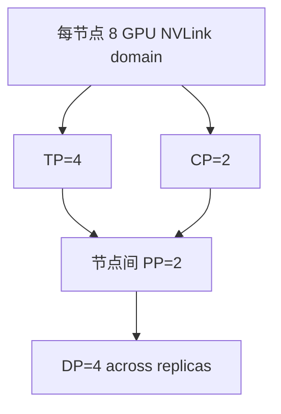

# 第 16 章　并行组合与训练方案

将各类切分组合到具体拓扑，先排除容量与期限不可行的方案，再考虑资源放置和作业调度。

本章内容：

- [1. 多维并行与 DeviceMesh](#s1)
- [2. 训练并行方案设计：从约束推出配置](#s2)
- [3. 集群调度与资源管理：从空闲 GPU 到可运行的作业](#s3)
- [4. 训练和生成为什么可以采用不同布局](#s4)

<a id="s1"></a>

<a id="s1-多维并行与-devicemesh"></a>

## 1. 多维并行与 DeviceMesh


<a id="s1-入门例子先画-22再画大集群"></a>

### 入门例子：先画 2×2，再画大集群

令 tp 为低位坐标，dp 为高位，rank=tp_rank+2*dp_rank。四个 rank 的 TP 组为 [0,1]、[2,3]，DP 组为 [0,2]、[1,3]。这是明确指定 order 后的算例，其他 order 得到不同编号。

随后把 rank 放到实际机器：同一 TP 组是否位于预期高速互联域？若物理设备映射被容器重新排序，连续 rank 不保证物理相邻。逻辑 mesh 与硬件拓扑要画两张图再连线。

验收：列出每个 rank 的坐标、设备、参数 shape 和通信组。模型参数 owner、梯度 owner、checkpoint shard owner 也可能不同，不用一个 rank0 概括全部。

<a id="s1-不是把缩写相乘就结束了"></a>

### 不是把缩写相乘就结束了

假设 `TP=8, PP=4, CP=2, EP=8, DP=16`，直接相乘需要 8,192 GPU。但 EP 与 TP/DP 可能只作用于特定 layer，DP 还可能拆为 shard/replicate 维；现代系统需要表达**不同 operator 使用不同 mesh view**。

DeviceMesh（设备网格）把物理 ranks 组织成命名坐标：

```text
mesh dimensions: pp × dp_replicate × dp_shard × cp × tp
MoE submesh:     pp × ep × etp
```

其中 Expert Tensor Parallelism（ETP，专家张量并行）可与 dense Tensor Parallelism（TP，张量并行）不同。

<a id="s1-一个-64-gpu-的例子"></a>

### 一个 64 GPU 的例子

8 节点×8 GPU，可选：`TP=4, CP=2, PP=2, DP=4`，乘积 64。一个初始 topology mapping：

- 节点内 8 GPU：TP×CP = 4×2，承载每层高频 collective/P2P；
- 跨节点：PP=2 与 DP=4；
- 同一个 DP group 的相同 stage/tp/cp 坐标跨 4 个 replica。



这只是启发式：如果跨节点 NVLink domain、多个 NIC rail 或 model layer 极不均衡，最佳映射会不同。

<a id="s1-process-group-必须按坐标构造"></a>

### Process group 必须按坐标构造

一个 rank 同时属于多个 communicator：TP group、CP group、DP group、PP 邻接关系、EP group。任何 group 的成员或顺序错误，都可能：

- 直接 hang；
- tensor shape mismatch；
- 更危险地，collective 能完成但对错误成员做 reduction，训练悄悄错误。

因此建议用命名 mesh slice，而不是手写 `range()` 公式散落在代码中。

<a id="s1-layout-transition-是组合的真实成本"></a>

### Layout transition 是组合的真实成本

attention output 可能是 `[sequence shard, hidden replicated]`，MoE 输入需要 `[tokens partitioned by expert destination]`，FSDP 又要求 parameter shard。组合代价来自这些边界的 redistribute，而不仅是各方案独立通信量相加。

应为每个主要边界记录：

| 边界 | 源 layout | 目标 layout | collective | bytes | 是否可融合/重叠 |
|---|---|---|---|---:|---|
| Norm→QKV | sequence shard | TP input layout | AllGather | … | 可与上游 RS 配对 |
| Attention→MoE | CP token layout | EP owner layout | All-to-All | … | 可融合 permute |
| FSDP→TP Linear | DP param shard | TP-local full shard | AllGather | … | layer prefetch |

<a id="s1-rank-order-与物理拓扑"></a>

### Rank order 与物理拓扑

逻辑连续 rank 不保证物理相邻。必须映射到 PCI bus ID、NVLink domain、NIC affinity 与 rack。一般把最频繁、同步最敏感的 TP 放最快域；CP/EP 的选择取决于消息模式；DP 可用分层 collective 跨较慢域；PP 主要是邻居 P2P，但 stage boundary activation 也可能很大。

<a id="s1-重新配置与-checkpoint"></a>

### 重新配置与 Checkpoint

并行配置变化需要 checkpoint 表达 global tensor shape 与 shard metadata，而非只保存“rank 7 文件”。Megatron distributed checkpoint 和 PyTorch Distributed Checkpoint（DCP，分布式检查点）都支持一定程度 load-time reshard；自定义 expert/vocab/tied weight 仍需验证。

<a id="s1-2026-年的演进"></a>

### 2026 年的演进

- TorchTitan 用 PyTorch-native FSDP2、TP、PP、CP 展示 composable multidimensional parallelism；
- Megatron Core 增强 Generalized Tensor Parallelism（GTP，广义张量并行）、parallel folding 与 heterogeneous mappings；
- vLLM/Dynamo 在推理中允许 attention DP 与 MoE EP，说明 mesh 已从训练扩展到 serving runtime；
- fine-grained TP 允许不同 module 使用不同 TP degree，但会增加 layout transition。

<a id="s1-完整推演"></a>

### 完整推演

[8-rank通信组推演](<15_模型并行与执行日程.md#s5-数值展开-ep-与多维通信组token-去哪里梯度由谁更新>)：逐个列出TP、DP、PP组及参数归约范围。


---


<a id="s1-资料"></a>

### 资料

- [PyTorch DeviceMesh](https://docs.pytorch.org/tutorials/recipes/distributed_device_mesh.html)
- [TorchTitan](https://github.com/pytorch/torchtitan)
- [Megatron Core Parallelism Guide](https://docs.nvidia.com/megatron-core/developer-guide/latest/user-guide/parallelism-guide.html)
- [Megatron Distributed Checkpoint](https://docs.nvidia.com/megatron-core/developer-guide/latest/api-guide/dist_checkpointing.html)

<a id="s2"></a>

<a id="s2-训练并行方案设计从约束推出配置"></a>

## 2. 训练并行方案设计：从约束推出配置


<a id="s2-入门例子从约束推配置而不是先挑最大并行度"></a>

### 入门例子：从约束推配置，而不是先挑最大并行度

先固定模型、dtype、有效 global batch 和序列长度。若单 replica 放不下，列出主要是参数/优化器还是 activation 超限；前者可能考虑分片，后者可能考虑 microbatch、重算或序列切分，再评估通信代价。

例如可用 8 卡，并不要求 TP=8。若模型在 TP=2 下已放下，可以比较 TP=2 的多个数据副本与 TP=4 的较少副本，但必须明确全局 batch 和卡预算相同，或注明强/弱扩展口径。

每次只改变一项，记录 step、有效 tokens/s、峰值显存与通信暴露时间。验收：给出被淘汰配置的原因，解释“能运行”和“在本负载下更合适”的区别。

<a id="s2-机制与实现"></a>

### 机制与实现

并行配置不是“8 卡 TP8、64 卡 TP8×DP8”这种模板题。应先定义容量、计算、通信、global batch 与 topology 约束，再逐层选择 degree。

<a id="s2-第一步单卡可行性账本"></a>

### 第一步：单卡可行性账本

记录每 rank 峰值：

$$
M_{peak}=M_{param}+M_{grad}+M_{optim}+M_{act}+M_{comm}+M_{workspace}+M_{fragment}
$$

如果单层权重或 activation 无法放下，必须先用 TP/CP；如果模型状态总量放不下但单层可放，优先 FSDP/ZeRO/PP；如果都能放，DP 通常是吞吐最简单的起点。

<a id="s2-第二步按问题维度选并行"></a>

### 第二步：按问题维度选并行

| 约束 | 首要候选 | 原因 |
|---|---|---|
| 单层矩阵太大 | TP | 切 operator 参数与 compute |
| 模型层数/总状态太大 | FSDP/PP | 分片状态或 layer |
| sequence activation 太大 | CP/SP/checkpoint | 沿 token 维分摊或重算 |
| MoE experts 太大 | EP | 按 expert 分布 |
| 模型已放下、要吞吐 | DP | independent batch replicas |

<a id="s2-第三步决定-topology-mapping"></a>

### 第三步：决定 topology mapping

先测实际 NVLink/NVSwitch、PCIe、NIC 和跨 rack 性能，再将高频通信放高速域。典型但非绝对的优先级：TP 节点内；CP 视 sequence/head 与 P2P；EP 尽量利用多 rail；DP 分层跨节点；PP 选择相邻高带宽路径。

<a id="s2-第四步保证-batch-语义"></a>

### 第四步：保证 batch 语义

Megatron 类训练常用关系：

$$
\text{global batch}=\text{micro batch}\times\text{data parallel size}\times\text{gradient accumulation steps}
$$

PP micro-batch 数还要足以降低 bubble。改变 TP/PP/CP/EP 不应错误地进入 data-parallel batch 乘积；EP rank 通常共同处理同一批 token，不增加 independent samples。

扩卡后若保持 global batch，主要比较每步能否缩短；若让 batch 随 DP 副本数增长，还需估计达到同一质量所需的步数如何变化。两种扩展的收益边界与设备时间关系见[临界 batch 与扩卡收益](<17_训练效率收敛与预算.md#s1-从临界-batch-到扩卡收益>)。后文固定更新次数的教学案例不据此自动获得跨 batch 的质量保证。

<a id="s2-完整算例8b-模型怎样在-8-卡5-小时内完成同一轮训练"></a>

### 完整算例：8B 模型怎样在 8 卡、5 小时内完成同一轮训练

这里与[推理方案算例](<../05_Inference/22_推理并行量化与执行优化.md#s1-完整算例同一组8卡上的请求交付>)共用一个教学 Dense 模型。参数是资源账本的输入，不对应某个真实模型或 GPU。**激活大小、执行时间、有效带宽和重叠比例都是显式假设，以下结果是复算，不是 benchmark。** 设计过程的上层入口见[系统设计主线](<../appendices/design/README.md>)。

<a id="s2-固定任务质量门槛与数据语义"></a>

#### 固定任务、质量门槛与数据语义

| 项目 | 所有候选共同的输入 |
|---|---|
| 模型 | $P=8\times10^9$ 参数，32 层，8 个 KV heads，head dimension 128，BF16 权重 |
| 资源 | 8 张 GPU，每张 64 GiB；不使用 CPU/NVMe offload |
| 训练 | 序列长 4096，microbatch=2，有效 global batch=128，4000 次 optimizer update |
| 有效工作 | 每步 524,288 个有效 token；总计 2,097,152,000 token，假设全部参与 loss、无 padding |
| 质量契约 | 同一初始权重、样本顺序、mask、优化器和 LR schedule；最终验证 loss 与给定参考运行的绝对差不超过 0.01 |
| 期限 | 含启动、验证、保存和一次故障恢复的预算不超过 5 小时 |
| 单卡额外预算 | workspace、通信临时区与碎片余量合计 6 GiB；FSDP 另留 2 GiB 活跃参数展开缓冲 |

4000 步只是给定训练配方的工作量，不能从 token 数推断质量已达标。表中的可行性先检查资源和时间，交付还必须通过质量契约；不同归约顺序和重算不能自动保证逐 bit 一致。

本例每参数持有 BF16 权重 2 B、梯度及累积缓冲 2 B、FP32 master weight 4 B、Adam 两个 moment 各 4 B，总计 16 B。梯度累积精度是特意固定的教学口径；如果生产配方使用 FP32 梯度累积，需要重新增加显存与相应通信字节，不能原样使用结果。

<a id="s2-先用容量淘汰再比较时间"></a>

#### 先用容量淘汰，再比较时间

令 $W=2P/2^{30}=14.901$ GiB，$t$ 为 TP degree，$d$ 为 DP degree。假设参数均匀分片；ZeRO-2 在 TP shard 上进一步分片梯度和 optimizer：

$$
M_{state,DP}=8W/t,\quad
M_{state,ZeRO2}=W/t+7W/(td),\quad
M_{state,FSDP}=8W/(td).
$$

激活峰值另行给定，不用“TP 几倍，所有 activation 就除几倍”的假设。下表的 microbatch 计算时间包括 forward、backward 和适用的重算，不含暴露通信、optimizer update 和数据等待。

| 候选 | 累积次数 $G=128/(2d)$ | 激活 / GiB | microbatch 计算 / s | 峰值 / GiB | 容量结论 |
|---|---:|---:|---:|---:|---|
| DP8，无重算 | 8 | 42 | 0.280 | 167.21 | 淘汰 |
| ZeRO-2 DP8，无重算 | 8 | 42 | 0.280 | 75.94 | 淘汰 |
| ZeRO-2 DP8，重算 | 8 | 14 | 0.360 | 47.94 | 可行 |
| FSDP8，无重算 | 8 | 42 | 0.280 | 64.90 | 淘汰，尚未进入时间比较 |
| FSDP8，重算 | 8 | 14 | 0.360 | 36.90 | 可行 |
| TP2 × ZeRO-2 DP4，重算 | 16 | 8 | 0.210 | 34.49 | 可行 |
| TP4 × ZeRO-2 DP2，无重算 | 32 | 12 | 0.085 | 34.76 | 可行 |

例如 ZeRO-2 DP8 重算的峰值是 $14.901+7\times14.901/8+14+6=47.94$ GiB。FSDP 降低静态状态，却还要容纳预取与层参数展开。以上布局只是本例的候选集合，尚未枚举改变 microbatch、选择性重算、PP 或 CP 的方案；“最佳”仅指这组候选。

<a id="s2-通信次数必须和累积策略一起算"></a>

#### 通信次数必须和累积策略一起算

固定一种可复算的通信日程：ZeRO-2 每个 microbatch 做一次梯度 ReduceScatter，每次 update 后做一次参数 AllGather；FSDP 每个 microbatch 各做两次参数 AllGather、一次梯度 ReduceScatter，重算复用 backward 已展开的参数，不额外触发 gather。没有使用 `no_sync` 延迟全部梯度同步，也没有假设 FSDP 跨 microbatch 保留完整参数。真实框架若采用不同 reshard/重算策略，需要替换这张通信账本。[DeepSpeed 的 ZeRO 分片定义](https://www.deepspeed.ai/tutorials/zero/)可用于核对状态归属。

按理想 ring 的每 rank 发送量口径，一次 AllGather 或 ReduceScatter 为 $(d-1)W/(dt)$。这里**不把同一传输的发送与接收字节重复加总**，有效带宽也须用相同口径：

$$
V_{ZeRO2}=(G+1)\frac{d-1}{d}\frac{W}{t},\qquad
V_{FSDP}=3G\frac{d-1}{d}\frac{W}{t}.
$$

得到四个容量可行候选每步分别为 117.35、312.92、94.99、61.47 GiB/rank。教学 DP 有效带宽设为 80 GiB/s；ZeRO-2 通信时间的 75% 被计算覆盖，FSDP 为 65%。这些是**整步关键路径的输入假设**，不是仅由字节量就能推出的重叠效率。

TP2 / TP4 另给每步 TP 通信量 48 / 96 GiB，TP 有效带宽 80 GiB/s，累计启动延迟 0.04 / 0.08 s，重叠比例均为 50%，因此暴露 TP 时间为 0.32 / 0.64 s。TP/DP 暴露段在本日程中不相互覆盖。再固定数据供给暴露等待 0.06 s、optimizer update 0.04 s：

$$
T_{step}=G T_{micro}+\frac{V_{DP}}{B_{DP}}(1-r_{DP})+T_{TP,exposed}+0.10.
$$

训练数据链必须供给每步 524,288 个有效 token，并且只在关键路径暴露 60 ms。读取、解压、tokenize、packing 和 H2D 的时间应通过实际 trace 验证，不能因为 token ID 文件很小就忽略 CPU 预处理。如果这项等待变为 0.50 s，本例所有方案的整轮预算都将再增加约 0.50 小时。

<a id="s2-把保存重做与恢复放回期限"></a>

#### 把保存、重做与恢复放回期限

每 200 步保存一次，包括最后一步，共 20 次。在 optimizer step 完成、梯度已清空的边界保存：BF16 参数、FP32 master 和两个 moment 共 $14P=104.31$ GiB，不保存梯度。数据游标、RNG 和 scheduler 状态同样需要保存，本例将其小额开销计入每次 2 s 的固定成本。

假设 checkpoint 的**整作业聚合**写入有效吞吐为 8 GiB/s，并且本例同步保存：每次耗时 $104.31/8+2=15.04$ s。恢复读取吞吐也设为 8 GiB/s，重建进程与数据管线另需 45 s，共 58.04 s。启动 60 s、最终验证 120 s。

预算恰好考虑一次故障，故障位置在两个已提交 checkpoint 之间均匀分布，期望重做 100 步。失败的一次保存不另计，重放区间不重复已提交的保存点：

$$
T_{job}=4100T_{step}+20\times15.04+60+120+58.04
\approx4100T_{step}+538.81\ \mathrm{s}.
$$

这是一次故障情景下的期望预算，严格截止时间还应检查最多丢失约 200 步、多次故障和恢复长尾。checkpoint 原子提交与数据游标恢复见[分布式 Checkpoint 与恢复](<18_Checkpoint与故障恢复.md#s2>)。

| 容量可行候选 | step / s | 含一次故障的预算 / h | 5 小时门槛 |
|---|---:|---:|---|
| ZeRO-2 DP8，重算 | 3.347 | 3.961 | 通过，当前候选中最短 |
| FSDP8，重算 | 4.349 | 5.103 | 淘汰，通信使期限超限 |
| TP2 × ZeRO-2 DP4，重算 | 4.077 | 4.793 | 通过 |
| TP4 × ZeRO-2 DP2，无重算 | 3.652 | 4.309 | 通过 |

在这些条件下先选择 ZeRO-2 DP8 重算进入真实验证。若从启动到验证结束一直占用 8 张卡，资源成本为 $8\times3.961\approx31.69$ GPU-hours，包含保存和恢复期间的占用。FSDP 最省静态状态，但原方案已经能放下，省下的显存在这个固定 microbatch 下未转化为更多有效工作。

<a id="s2-条件变化时选择为何翻转"></a>

#### 条件变化时，选择为何翻转

保持模型、global batch、样本和 5 小时预算不变，只把 DP 通信有效带宽从 80 降到 20 GiB/s，TP 高频通信仍留在 80 GiB/s 的高速域。暂时保持同一重叠比例，重新计算四个方案得到 **5.214、9.780、5.807、4.965 小时**。此时 TP4 × ZeRO-2 DP2 是候选中唯一满足期望预算的方案：它减少了通过较慢 DP 域同步的字节。

4.965 小时只有约 2.1 分钟余量，若在保存前才故障，额外重做接近 200 步就会超时。因此这只是值得测试的候选，无法保证严格的 5 小时交付；需要增加预算余量、缩短保存间隔或进一步优化。真实链路变慢还可能破坏通信重叠，最终应用新的 trace 替换重叠比例。

复算以上容量、通信、恢复与条件变化：

```bash
python docs/ai_infra/examples/design_cases.py
```

[脚本](<../examples/design_cases.py>)仅用标准库，也支持 `--json` 输出未舍入结果。把候选收敛为部署配置之前，应补齐峰值显存、collective trace、有效 token 计数、故障恢复和质量对照这五类证据。

<a id="s2-一个示例70b-dense64-gpu88-节点"></a>

### 一个示例：70B Dense、64 GPU、8×8 节点

假设 80 GB GPU、序列 8K：

1. 用 TP=8 放节点内，保证每个 attention/MLP layer 计算可行；
2. 剩余 8 倍可作为 DP/FSDP；若 TP shard 的模型状态仍高，选择 FSDP=8；
3. 若 activation 仍高，先 activation checkpoint + Megatron SP；必要时把节点内拆 TP=4, CP=2；
4. PP 是否加入取决于 layer state、FSDP cross-node communication 与 micro-batch/bubble；不能仅因 GPU 多就加 PP。

需要用真实参数、optimizer dtype、layer shape 和 network 带宽代入，示例不是推荐配置。

<a id="s2-moe-示例的不同之处"></a>

### MoE 示例的不同之处

对 671B total/37B active 的 MoE，total parameter capacity 推动 EP/PP/FSDP，active compute 则由 routed tokens 决定。可能选择 TP=1 或较小 TP，以保留大 expert GEMM；用 EP=64 分布 experts；attention 用 DP；PP schedule 与 EP communication overlap。这正是 DeepSeek-V3 路线与 dense 70B 不同的原因。

<a id="s2-配置搜索顺序"></a>

### 配置搜索顺序

1. 枚举满足 divisibility 与 memory 的候选；
2. 排除跨慢链路的高频 TP/CP；
3. 用算子 benchmark 估 local compute；
4. 用 collective benchmark 估 communication；
5. 模拟 PP schedule 与 memory lifetime；
6. 小规模端到端验证 correctness；
7. 扩到多节点，观察 scaling efficiency 与长尾；
8. 固化版本、配置与回归阈值。

<a id="s2-不完整但有用的指标"></a>

### 不完整但有用的指标

- Model FLOPs Utilization（MFU，模型浮点运算利用率）；
- tokens/s/GPU 与 tokens/s/$；
- exposed communication ratio；
- max allocated/reserved HBM；
- pipeline bubble 与 stage imbalance；
- per-expert max/mean tokens；
- strong/weak scaling efficiency；
- step p50/p99 和 restart cost。

最终目标是 time-to-train 与收敛质量，而不是某一个 MFU 峰值。

<a id="s2-资料"></a>

### 资料

- [Megatron Core Parallelism Guide](https://docs.nvidia.com/megatron-core/developer-guide/latest/user-guide/parallelism-guide.html)
- [TorchTitan Paper](https://arxiv.org/abs/2410.06511)
- [Megatron-LM Scaling Paper](https://arxiv.org/abs/2104.04473)

---

<a id="s3"></a>

<a id="s3-集群调度与资源管理从空闲-gpu-到可运行的作业"></a>

## 3. 集群调度与资源管理：从空闲 GPU 到可运行的作业


<a id="s3-三层调度各自承诺什么"></a>

### 三层调度各自承诺什么

| 层次 | 决策对象 | 主要约束 |
|---|---|---|
| 作业准入与队列 | 一个训练任务或一组服务副本 | 配额、优先级、公平、期限和资源需求 |
| 节点／设备放置 | worker、进程与物理设备 | GPU 类型、显存、CPU/RAM、网络、亲和与故障域 |
| 作业内运行时 | batch、microbatch、rollout、kernel | 数值依赖、KV、并行组、队列和版本 |

Kueue 的队列准入与 Kubernetes 的 Pod 放置是不同职责，见 [Kueue 概览](https://kueue.sigs.k8s.io/docs/overview/)。Ray 的逻辑 GPU 声明也不自动完成强隔离或集群配额管理。监控里“已经分配”“已经 ready”“正在执行有效工作”应分别统计。

<a id="s3-总数够了拓扑可能仍然不够"></a>

### 总数够了，拓扑可能仍然不够

两台八卡节点当前各空闲四张卡。全局空闲八张，但要求八个 TP rank 全在同一节点的作业无法立即满足；要求两个四卡 TP 组、组间做 DP 的作业，在型号、显存和网络等其他条件满足时可以放置。

这里不能在调度时静默把 TP8 改成 TP4×DP2。后者改变 global batch、通信和模型状态布局，必须由支持该配置的训练程序显式恢复或重启。逻辑 GPU 数是约束之一，rank 到 GPU/NIC/节点的映射也是配置的一部分。

拓扑感知可表达同节点、同机架等需求和偏好。硬需求不满足就等待或拒绝，软偏好可退化但应记录代价。[Kueue TAS](https://kueue.sigs.k8s.io/docs/concepts/topology_aware_scheduling/)提供具体机制；本节不假定任意版本默认启用。

<a id="s3-gang-scheduling-解决半个作业占住资源的问题"></a>

### Gang scheduling 解决半个作业占住资源的问题

假设训练需要四个 worker 才能初始化 collective，只启动两个并让它们无限等待，会占住资源却不产生有效更新。成组准入试图避免这种局面，但需要区分三个条件：配额预留成功、全部 worker 被放置、全部进程通过健康检查。

一个可审核的流程是等待→预留→启动→全组就绪→运行；启动超时后回收本次预留并按退避重试。提交 ID 与 attempt ID 分开，避免旧 worker 加入新一次 rendezvous。Kueue 的 [all-or-nothing with ready Pods](https://kueue.sigs.k8s.io/docs/tasks/manage/setup_wait_for_pods_ready/)采用超时与 readiness 机制，不能把这种近似成组行为写成跨节点原子启动。

回填小作业可以使用暂时的空闲资源，但不能无限推迟已预留的大作业。需要可靠运行时估计、可抢占性或明确的最长占用期限；“GPU 利用率更高”本身不能说明公平性或作业完成时间更好。

<a id="s3-配额公平与隔离"></a>

### 配额、公平与隔离

配额是资源使用权，优先级是调度次序，抢占是回收资源的动作。应同时定义租户保底、允许借用的空闲份额、借用上限与回收条件。按 GPU 张数公平也可能忽略型号差异、显存容量或网络负载；计费／统计单位必须与所比较的工作量相符。

服务副本需要尾延迟保障，离线训练关心持续进展，RL 还同时依赖 CPU 环境与 GPU learner。一个合理的资源请求应包含 CPU、主存、临时盘、网络需求和 GPU，而非只填 GPU 数。独占分配、设备切分和时间复用具有不同隔离边界，必须在实际平台上验证。

<a id="s3-抢占要算失去的进展"></a>

### 抢占要算失去的进展

设 checkpoint 间隔为 10 分钟、快照成本 20 秒，恢复需 40 秒。若非预告抢占均匀落在间隔中，平均丢失约 5 分钟计算，恢复额外 40 秒；此前的周期性保存成本应另计。若提前通知且能在 20 秒内保存相容状态，则可减少重复计算，但仍有保存、重启、缓存重建与排队。

抢占粒度应匹配作业故障边界。删除一个 TP rank 通常会使其通信组失效，不能按“只损失一张卡”估算。Kubernetes 的 [Pod 优先级与抢占](https://kubernetes.io/docs/concepts/scheduling-eviction/pod-priority-preemption/)负责平台层动作，应用仍需实现 checkpoint 和恢复。通知期限不足时，应回到最近已提交版本，不能把部分写入发布为完整快照。

<a id="s3-弹性扩容不是改一个-world-size"></a>

### 弹性扩容不是改一个 world size

worker 数改变后，可能需要重新建立通信组、重分片参数和优化器、重建采样器，以及重新计算 global batch 和 LR 时钟。rank 是一次运行的执行身份，不是永恒的 shard owner；稳定状态身份应来自逻辑张量和数据游标。[torchrun Elastic](https://docs.pytorch.org/docs/2.14/elastic/run.html)说明了成员变化与重启边界，不能据此推断所有训练脚本都支持任意并行维度变化。

教学例 global batch=512，DP=8、每 rank microbatch=8、累积=8。若 DP 改为 4，要保持相同 global batch，可在其他条件满足时将累积改为 16；继续使用累积 8 则 global batch 变为 256。样本顺序、token 分母与随机状态仍需要恢复协议，见[训练效率](<17_训练效率收敛与预算.md#s1>)。

<a id="s3-怎样评价一个集群调度方案"></a>

### 怎样评价一个集群调度方案

记录提交、准入、启动、ready、首次有效更新、抢占、恢复和完成时刻。把队列等待、启动耗时、有效计算、重复计算和故障停机拆开；同时报告租户份额、饥饿时间、可用但无法放置的碎片，以及固定质量目标下的完成时间。

[资源算例](<../examples/resource_statistics.py>)检查拓扑碎片、global batch 与抢占成本，不启动 Kubernetes、Ray 或 Slurm。本轮没有真实集群实验。滚动平台文档于 2026-10-12 查阅，具体 API 和功能开关应随部署版本核对。


<a id="s4"></a>

## 4. 训练和生成为什么可以采用不同布局

训练要容纳优化器与激活，生成要容纳 KV 并高效执行小批次 decode，因此两端最合适的并行配置可能不同。例如训练使用参数分片，生成使用两个 TP rank；同名的 rank 0 在两端并不拥有相同的参数区间。

连接它们的对象应是逻辑参数，而不是训练 rank 的文件。对每份参数保留全局名称、形状、切分轴与区间，再按推理端需要的布局重组。QKV 的打包顺序、门控 FFN 两个分支、专家编号、共享 embedding 和量化尺度都可能使“拼起来再均分”出错。

选择布局时，应把更新周期内的转换、传输、临时显存和暂停生成成本加入比较。一个训练 step 缩短 0.2 秒，却每轮多出 3 秒布局转换；若每轮只有 10 个 step，周期反而变长。这里是教学算术，实际能否重叠仍要按依赖测量。

验证先在小模型上将各 shard 还原成逻辑张量，核对参数身份，再对固定 token 比较两端 logits 与 logprob。全部检查通过后才扩大模型和设备规模。第 27 章讨论何时允许推理端消费这些新权重；本节先保证传过去的是同一个逻辑模型。

## 本章回顾

可执行方案同时满足设备数量、布局、总 batch、峰值容量和物理拓扑。资源平台还必须保证完整作业的放置、抢占与恢复条件，配置乘积相等只是起点。

**检查理解：** 并行度乘积满足设备数量后，还需要检查哪些布局、batch、通信与资源约束？

下一章讨论训练效率收敛与预算。把每步速度连接到有效数据、达标步数与总设备时间，理解扩卡和扩大 batch 的收益边界。

<!-- book-nav -->

[上一章：模型并行与执行日程](<15_模型并行与执行日程.md>) · [全书目录](<../README.md>) · [下一章：训练效率收敛与预算](<17_训练效率收敛与预算.md>)

<!-- /book-nav -->
