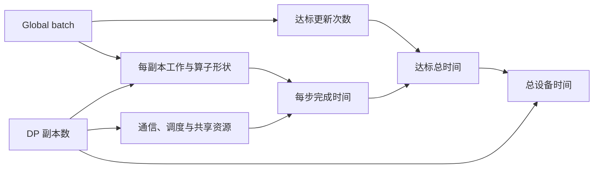

# 第 17 章　训练效率收敛与预算

把每步速度连接到有效数据、达标步数与总设备时间，理解扩卡和扩大 batch 的收益边界。

本章内容：

- [1. 训练效率与收敛：更快处理数据之后还需要多少更新](#s1)
- [2. 在线 RL 为什么更难外推达标时间](#s2)

## 1. 训练效率与收敛：更快处理数据之后还需要多少更新

一次更新怎样执行见[训练 step](<12_数据管线与训练循环.md#s1>)。这里继续追问：改变 batch、精度和调度后，到达相同质量需要多少数据、时间与资源？

### 把三个横坐标分开

训练曲线至少可以按成功更新次数、有效训练 token 数、墙钟时间绘制。三者的换算受变长数据、跳步、评估、保存和等待影响。处理过的输入 token 也不等于进入目标的有效 token。

固定模型与目标，定义达到质量门槛 q 的时间为 T(q)，消耗有效 token 为 N(q)，GPU-hours 为各设备占用时长之和。若某个方案吞吐增加 20%，但达到 q 需要多 40% token，忽略其他开销时达标时间比例为 1.4/1.2≈1.167。真实实验应把启动、评估与故障时间按既定口径计入，未达标的运行标为未达标，不能删掉。

### Batch 改了什么，累积又改了什么

设每个 DP rank 一次 microbatch 有 b 个样本，累积 a 次、DP 度为 d，则固定长度且无动态过滤时，global batch 为 bad。若样本长度和 mask 不同，还需单独求有效 token 总数。TP/PP 不应再次乘到独立样本数中。

把同一个 global batch 拆成 microbatch，在参数不提前更新、目标权重相同、随机行为相容的条件下，可以恢复同一全局梯度；累积本身不会给优化器增加 a 次历史更新。改变 global batch 则改变一次更新聚合的数据以及同样数据预算下的更新次数。

考虑标量模型预测 θ，样本标签依次为 [0,2,0,2]，每样本 loss 为 (θ−y)²/2，θ₀=0，学习率 0.1：

| 方案 | 参数变化 | 看完四个样本后的 θ |
|---|---|---:|
| B=2，每两个样本更新 | 0→0.1→0.19 | 0.19 |
| B=4，一次更新 | 0→0.1 | 0.1 |
| B=4，拆成两个 microbatch 累积 | 每片 loss 按 1/2 加权，再一次更新 | 0.1 |
| B=4，学习率直接乘二 | 0→0.2 | 0.2 |

最后一行没有精确复现 B=2，因为第二次小 batch 更新在 θ=0.1 处计算梯度。线性缩放学习率是一种需要条件和验证的配方，不是代数恒等式。[大 batch SGD 论文](https://arxiv.org/abs/1706.02677)给出特定训练场景中的缩放与 warmup 方法，不能直接推广为所有 LLM 配方。

### 梯度噪声与并行收益边界

设单样本梯度 gᵢ 独立同分布，均值为 g，协方差为 Σ。batch 均值满足 E[ḡ]=g、Cov(ḡ)=Σ/B。增大 B 降低这个模型下的采样噪声，但每个 token 带来的噪声改善递减。长文本 token 相关、重复样本、同一 prompt 的多条 rollout 都可能破坏独立假设。

粗略噪声尺度 tr(Σ)/‖g‖² 表达噪声与信号的相对大小；它会随训练阶段变化，g 接近零时也会不稳定。[梯度噪声尺度研究](https://arxiv.org/abs/1812.06162)提供经验模型，不给每个任务一个固定通用的最优 batch。系统容量允许的最大 batch，与质量／时间约束下最合适的 batch，应分别搜索。

### 从临界 batch 到扩卡收益

本节固定模型、数据分布、质量门槛 $q$、优化器类型，以及可比较的调参与评估规则。讨论同步数据并行：$d$ 是 DP 副本数，每份副本的模型并行布局固定占用 $k$ 张 GPU，总卡数为 $kd$。这是一种便于分析的布局口径；改变 TP、PP、EP 或状态分片方式时，需要重新建立每步成本，不能只替换卡数。

用 $B$ 表示每次成功更新聚合的有效样本数，$S_q(B)$ 表示达到 $q$ 所需的成功更新次数，$E_q(B)=B S_q(B)$ 为相应样本处理量。固定长度时可以一致地换算为 token；变长、mask 和相关 token 需要单独核对计量与采样假设。处理量包含重复使用的样本，不等于唯一数据量。以下只补机制与符号推导，不添加数值算例。

#### 临界 batch 描述步数与样本量的折中

在一组相容且适当调优的训练运行中，可以用如下经验形式近似达标步数：

$$
S_q(B)\approx S_{\infty,q}+\frac{E_{0,q}}B
=S_{\infty,q}\left(1+\frac{B_{crit,q}}B\right),
\qquad B_{crit,q}=\frac{E_{0,q}}{S_{\infty,q}}.
$$

$S_{\infty,q}>0$ 是拟合中的大 batch 步数渐近值，$E_{0,q}>0$ 是小 batch 样本量渐近值。它们是针对目标与配方拟合的参数，不是所有训练算法共享的理论最优值；也不能用实际的零 batch 或无限卡数取得这些极限。[McCandlish 等的经验研究](https://arxiv.org/abs/1812.06162)讨论了这种步数—样本量折中与梯度噪声尺度的联系。

将步数乘以 $B$，得到

$$
E_q(B)\approx E_{0,q}+B S_{\infty,q}
=E_{0,q}\left(1+\frac B{B_{crit,q}}\right).
$$

由此可见，减少更新次数可能同时增加处理的总样本量。消去 $B$ 后，这组关系还可以写成

$$
\left(\frac{S_q}{S_{\infty,q}}-1\right)
\left(\frac{E_q}{E_{0,q}}-1\right)\approx1.
$$

它描述一条步数与样本量的折中曲线：沿曲线减少一项，会增加另一项。其系统含义如下。

| Batch 区间 | 达标步数的近似行为 | 系统上需要判断什么 |
|---|---|---|
| $B\ll B_{crit,q}$ | $S_q\approx E_{0,q}/B$ | 扩大 batch 能明显减少更新次数，前提是每步耗时没有同步增长 |
| $B$ 与 $B_{crit,q}$ 同量级 | 两项都不可忽略 | 步数收益开始递减，需要同时比较时间与设备占用 |
| $B\gg B_{crit,q}$ | $S_q\approx S_{\infty,q}$ | 更多样本主要增加每步工作，进一步减少步数的空间有限 |

$B_{crit,q}$ 是平滑转折的尺度，不是超过就无法训练的硬上限，也不自动是时间或费用最优的 batch。前文的 $\operatorname{tr}(\Sigma)/\lVert g\rVert^2$ 是简化噪声指标；研究还使用曲率加权的 $\operatorname{tr}(H\Sigma)/(g^THg)$，其中 $H$ 是损失的 Hessian。后者依赖局部近似和有效的正曲率条件，不能在任意位置当作可靠预测。瞬时噪声指标与达到特定 $q$ 的 $B_{crit,q}$ 也不应直接画等号：需要考虑训练过程变化和经验校准。

#### 达标时间由统计效率和每步成本共同决定

在固定 batch 的运行中，以 $\bar t_{step}(B,d)$ 表示成功更新的平均常规耗时，有

$$
T_q(B,d)=S_q(B)\,\bar t_{step}(B,d)+T_{extra}(B,d).
$$

这里每步包含前向、反向、更新及已经计入的输入／同步等待；$T_{extra}$ 只包含尚未计入这些步骤的启动、评估、保存、失败尝试和恢复等时间，避免重复计算。若阶段耗时变化明显，应直接按实际日程求和，而不是把某个早期 step 外推到训练结束。

忽略额外时间时，定义相同计量口径下的吞吐 $R(B,d)=B/\bar t_{step}(B,d)$，便有 $T_q=E_q/R$。比较两个候选得到

$$
\frac{T_{q,2}}{T_{q,1}}
=\frac{E_q(B_2)/E_q(B_1)}{R(B_2,d_2)/R(B_1,d_1)}.
$$

因此，候选 2 更快达标的条件是吞吐提升比例超过达标样本量的增长比例。仅证明 tokens/s 增加，尚未满足这个条件。若某个候选不能达到同一 $q$，也不能继续套用有限达标步数来比较。

#### 强扩展：固定 batch，缩短每一步

强扩展固定 $B$，增加 $d$。在全局目标、梯度聚合和更新配方相容时，可以先将 $S_q(B)$ 视为不变，考察每步时间；不同归约顺序、随机行为和实现引起的质量差异仍需另行核对。

以基线 $d_0$ 为参照，若可分摊部分近似线性缩短，而暴露在关键路径上的其余部分暂时不变，可写成条件化模型

$$
\bar t_{step}(B,d)\approx t_{scalable,0}\frac{d_0}{d}+t_{floor},
$$

其中两项都以秒计，且互不重复；$t_{floor}$ 表示此模型内未随 $d$ 缩短的串行、通信或等待部分，并不代表通信永远是常数。忽略额外时间、且 $t_{floor}>0$ 时，该模型的速度提升渐近上限为

$$
\lim_{d\to\infty}\frac{T_q(B,d_0)}{T_q(B,d)}
\approx\frac{t_{scalable,0}+t_{floor}}{t_{floor}}.
$$

真实扩展通常更早偏离线性区间：每副本工作变小，GEMM 效率可能下降；减少累积可能降低 PP 的在途 microbatch 数、扩大气泡占比；collective 启动、拓扑跨域与掉队者等待也可能增加。固定 $B$ 时，$B/(bd)$ 所对应的累积次数还受整数和最小工作粒度约束，不能无限减少。

这里没有因增大 $B$ 而引入新的统计效率损失，限制主要来自执行和资源约束。固定总训练 token 数但同时改变 $B$，并不等于这里的固定 batch 强扩展。

#### 弱扩展：每副本工作不变，batch 随卡数增长

固定每个 DP 副本的 microbatch 大小 $b$ 和累积次数 $a$，令 $r=d/d_0$，则 $B=rB_0$。先用理想条件隔离统计因素：每步耗时保持 $t_0$ 不变，忽略额外时间，并假定经验步数模型在比较区间有效。于是

$$
T_q(r)\approx t_0S_{\infty,q}
\left(1+\frac{B_{crit,q}}{rB_0}\right).
$$

相对于基线的达标加速比为

$$
A_{weak}(r)=\frac{T_q(1)}{T_q(r)}
\approx\frac{1+B_{crit,q}/B_0}{1+B_{crit,q}/(rB_0)}.
$$

当扩大后的 $rB_0$ 仍远小于临界尺度时，步数近似按 $1/r$ 缩短，扩卡较容易转化为达标加速。随着 batch 进入或越过临界区间，加速比逐渐趋向 $1+B_{crit,q}/B_0$。即使硬件维持了理想弱扩展，达标时间也不再随卡数同比缩短。

这个上限只针对“每步时间不变、单纯放大 batch”的拟合模型，不是所有扩卡方式的物理上限。换硬件、改变模型并行或重新安排计算可能继续缩短每步时间；相反，通信恶化也可能抵消剩余的步数收益。有限拟合区间之外的极限只能用于解释趋势，不能据此外推生产容量。

若用一个局部、平滑的模型表示真实弱扩展路径上的每步增长率

$$
\alpha_{sys}=\frac{d\log\bar t_{step}(B_0d/d_0,d)}{d\log d},
$$

沿 $B\propto d$ 对时间模型求导，仍忽略 $T_{extra}$，得到

$$
\frac{d\log T_q}{d\log d}
\approx\alpha_{sys}-\frac{B_{crit,q}}{B+B_{crit,q}}.
$$

因而增加副本能够降低达标时间，需要每步耗时的相对增长率小于右侧的统计收益项 $B_{crit,q}/(B+B_{crit,q})$。当 $B$ 已很大，允许的每步增长很小，较轻的同步或网络退化也可能让收益反转。实际卡数是离散的，遇到跨机架、形状分桶或并行布局切换时，应直接比较候选总时间，不使用这个局部导数近似。

#### 更快达标与更省 GPU 时间分别优化

若每份副本占用 $k$ 张 GPU，共 $d$ 份副本，且全部 GPU 在整个任务期间持续占用，则设备时间为

$$
H_q(B,d)=\frac{kd\,T_q(B,d)}{3600}
\quad\text{GPU-hours},
$$

其中 $T_q$ 以秒计。相对基线增加 $r$ 倍卡数、获得 $A$ 倍达标加速时，设备时间之比为 $r/A$。因此满足截止时间的更快方案仍可能消耗更多 GPU-hours；价格、CPU、存储与故障开销另计，见[质量约束下的预算](<../appendices/design/质量约束下的成本与预算.md>)。弹性释放资源时则用实际卡数随时间的积分，不能用峰值卡数乘全程时间。

还要区分 microbatch、梯度累积和 global batch。增大 $a$ 会增加每次更新的数据，却不增加执行资源；若每步耗时随 $B$ 近似增长，它无法获得理想弱扩展中的恒定 $t_0$ 收益。增大 $b$ 可能改善算子效率，也可能触发重算或卸载，改变时间模型。因此真正的候选应包含 $(b,a,d)$、模型并行布局及状态策略，而不是只有一个 global batch 数字。

#### 用于选择方案时保留哪些边界

先检查容量与更新语义，再分别建立 $S_q(B)$ 和 $\bar t_{step}(B,d)$ 的可用估计，最后按完成期限和设备时间筛选。单个 batch 的一次达标运行不足以同时识别 $S_{\infty,q}$ 与 $E_{0,q}$；噪声估计可以帮助缩小候选范围，但不能替代不同 batch 的达标对照。估计不确定时，应比较一组参数范围下结论是否稳定，不能只按单点预测宣布最优。

临界尺度可能随训练阶段、目标质量、数据相关性与优化器变化。上述关系描述固定 batch、相容配方下的经验折中；动态 batch 日程需要按阶段的实际状态分析，不能直接代入平均 batch，也不能将不同固定 batch 运行的步数差拼成一条新的轨迹。Adam、相关长文本、在线 RL 的策略版本与样本分布还会改变假设，仍需回到[独立质量评估](<../07_Practice/29_性能测量与因果分析.md#s3>)。

这部分连接[《深入理解 AI Infra》§10.1.1](https://bojieli.github.io/ai-infra-book/manuscripts/10-%E8%AE%AD%E7%BB%83%E7%B3%BB%E7%BB%9F.html)中的 batch 与扩展问题；本文的速度比、局部收益条件和设备时间关系由所列假设推导，没有代入新的训练测量。具体布局候选继续看[训练并行方案设计](<16_并行组合与训练方案.md#s2>)，状态策略继续看[激活保留、重算与卸载](<13_精度激活与训练状态.md#s3-激活保留重算与卸载的联合选择>)。

### 学习率调度的时钟

令 u 为已经成功消费的有效 token，预热预算 U_w，总预算 U。一个明确的示意配方是先按 u/U_w 线性升到 η_max，再按归一化进度做 cosine 衰减。实现必须约定：本步使用更新前还是预计更新后的 u、跳步是否推进时钟、无效 token 是否计入。若按成功更新次数调度，则改变 global batch 后，同一调度步对应的数据量也会变化。

Warmup 可降低初期大步更新的冲击；是否需要、长度与峰值学习率仍由模型、初始化和优化器共同决定。Adam 的 bias correction 计数、数据消费游标、LR scheduler 时钟和 rollout 编号不能用一个整数替代。恢复时同时保存它们，见[Checkpoint](<18_Checkpoint与故障恢复.md#s2>)。

### 一次 loss spike 怎样定位

先保存异常前后的固定样本身份、目标分母、层级输出、非有限值和优化器状态。按下表做最小对照，每次只改变一项：

| 候选原因 | 能区分原因的证据 |
|---|---|
| 数据或 mask 异常 | 同一批次重放；核对长度、标签、有效分母及来源 |
| 归约／累积缩放错误 | 固定参数，比较未切分与切分后的逐参数梯度 |
| 低精度饱和或小量丢失 | 同一输入的高精度参考、amax、饱和率和最早分叉层 |
| 更新或恢复状态错误 | 对照 m/v、主权重、成功步、LR 与恢复前的身份 |
| 梯度本身剧烈变化 | 重放后仍可复现；比较 grad norm、逐层梯度、裁剪前后更新 |

异常后继续跑几步 loss 又下降，并不能排除一次错误更新。反之，分布式执行产生微小舍入差异也不能直接判为训练不稳定。

### 短程对照与长期结论

先固定数据和初始权重验证一次更新，再做多个 seed 的短程曲线，最后用事先确定的独立评估门槛比较达标时间。分别报告固定 token、固定预算和固定质量三个视角；调参预算也要可比。

[系统取舍参考](<../examples/system_tradeoffs.py>)验证上面的 batch 算例；[CPU 实验](<../07_Practice/30_训练综合案例.md#s3>)运行微型 Transformer 的多步 Adam 和恢复对照。它们验证数学／程序边界，不提供大模型收敛配方。

## 2. 在线 RL 为什么更难外推达标时间

预训练常把数据集视为给定输入，在线 RL 的数据却由正在变化的策略产生。策略改善后，回答可能更长、工具调用更多、同组奖励更接近；算子形状、环境耗时和有效训练供给都会随学习过程变化。前一小时的 tokens/s 未必代表后一小时的工作量。

因此 RL 曲线至少要同时保存固定评估集上的质量、生成长度分布、有效组比例、每次更新消费量和样本版本差。奖励上升而独立评估不变时，需要区分更好的任务能力、对奖励规则的适应，以及超时或过滤造成的数据选择变化。设备吞吐指标无法替代这一步。

可以先在相同冻结样本上比较系统执行，确认性能变化没有改变目标；再让两种方案独立运行完整闭环，按多个随机种子比较相同预算下的质量与达标时间。冻结回放隔离的是执行成本，在线对照才包含策略改变数据的反馈效应。二者回答不同问题，都应保留。

如果运行始终未达到门槛，应报告预算内未达标；不能用最后几个点线性外推后当作已测得的达标时间。第 29 章会进一步讨论配对评估与统计不确定性。

## 本章回顾

训练价值最终由达到同一质量的时间与资源衡量。扩大 batch 可能减少更新次数，也可能增加所需数据；扩卡收益因此同时受执行效率与统计效率约束。

**检查理解：** 若吞吐增加 20% 而达到同一质量需要多 40% token，达标时间如何变化？

下一章讨论Checkpoint与故障恢复。区分写入、提交和恢复，连接参数、优化器、随机状态与数据进度，构造可验证的恢复点。

<!-- book-nav -->

[上一章：并行组合与训练方案](<16_并行组合与训练方案.md>) · [全书目录](<../README.md>) · [下一章：Checkpoint与故障恢复](<18_Checkpoint与故障恢复.md>)

<!-- /book-nav -->
