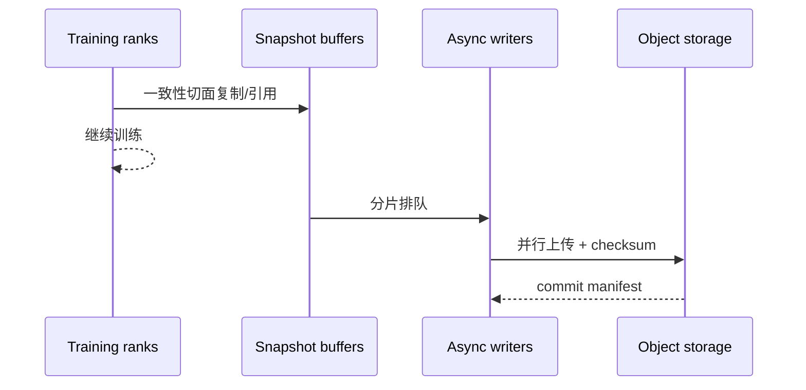

# 第 18 章　Checkpoint与故障恢复

区分写入、提交和恢复，连接参数、优化器、随机状态与数据进度，构造可验证的恢复点。

本章内容：

- [1. 持久化、文件系统与恢复语义](#s1)
- [2. 分布式 Checkpoint 与恢复](#s2)
- [3. 故障模型、可观测性与恢复](#s3)
- [4. 超时重启之后，怎样阻止旧进程再次提交](#s4)

<a id="s1"></a>

<a id="s1-持久化文件系统与恢复语义"></a>

## 1. 持久化、文件系统与恢复语义


<a id="s1-写入返回不等于所有故障下可恢复"></a>

### 写入返回不等于所有故障下可恢复

数据可能依次经过应用缓冲、操作系统 page cache、文件系统、设备队列与设备缓存。每一层的完成意味着不同事情。持久化协议必须定义要抵抗进程崩溃、机器重启、掉电还是整个节点丢失。

`flush`、`fsync`、文件重命名和对象存储提交有不同接口语义，具体保证受文件系统和部署影响。不能将一个本地文件的原子替换直接推广为多个节点文件的原子提交。

<a id="s1-数据与元数据必须相容"></a>

### 数据与元数据必须相容

一个模型 Checkpoint 可能包含参数 shard、优化器 shard、调度器状态和元数据。如果索引已经宣布完成，但某个 shard 尚未可靠写入，读者可能看到不完整版本。

常见设计先写唯一版本下的数据，再校验完整性，最后发布可读取的完成标记或 manifest。恢复端只选择满足协议的版本；清理旧版本也需要考虑仍在读取的消费者。这是设计模式，具体接口须按存储服务保证实现。

<a id="s1-容量吞吐与尾部时间"></a>

### 容量、吞吐与尾部时间

假设 8 个 rank 各写 4 GiB，持久化数据总量为 32 GiB。如果共享后端实际可用吞吐为 2 GiB/s，单次写入的理想数据传输下界为 16 s，不能把每个 rank 的单独峰值乘以 8。

大量小文件可能使元数据操作突出；单个大文件则可能限制并行读写或增加恢复时的无关读取。分片粒度同时影响写入、校验、重分片和恢复。

<a id="s1-错误检测与一致性不同"></a>

### 错误检测与一致性不同

Checksum（校验和）是根据文件内容计算的校验值，读取后重新计算并比较，可以发现许多内容损坏。但假设参数文件来自第 100 步，Adam 历史文件来自第 99 步，两份文件都可以有完全正确的校验和。它们各自完整，组合起来却不是同一次更新的状态。

因此恢复需要两层检查：文件内容是否完整，以及所有文件的逻辑版本是否相容。版本清单应把参数、优化器、随机状态、数据进度和分片布局关联到同一个恢复点。加载成功只证明程序接受了这些数据；接续训练是否正确，还要比较恢复后的下一批样本和下一步更新。

<a id="s1-演进的瓶颈"></a>

### 演进的瓶颈

同步保存简单，但阻塞计算；异步保存把传输移出关键路径，同时增加快照副本和完成追踪；分布式保存降低单节点压力，但引入全局版本与恢复协调。保存频率越高，潜在丢失工作越少，存储开销也越大。

相关：[分布式 Checkpoint](<#s2>)、[故障恢复](<#s3>)。

参考：[OSTEP Files and Directories](https://pages.cs.wisc.edu/~remzi/OSTEP/file-intro.pdf)、[Crash Consistency](https://pages.cs.wisc.edu/~remzi/OSTEP/file-journaling.pdf)。

---

<a id="s2"></a>

<a id="s2-分布式-checkpoint-与恢复"></a>

## 2. 分布式 Checkpoint 与恢复


<a id="s2-入门例子用中断前后两张状态表定义恢复"></a>

### 入门例子：用中断前后两张状态表定义恢复

假设 step 100 已完成 optimizer update，但保存过程只写完部分 rank 文件就中断。存在目录不等于存在可恢复的一致 checkpoint；完成标记和全局 metadata 应在所需状态就绪后才代表提交成功，具体协议以框架实现为准。

RNG（Random Number Generator，随机数生成器）具有随抽样推进的内部状态。仅保存初始 seed 不能恢复已推进的位置，重计算和恢复训练通常还需保留状态及对应的消费顺序。

| 状态 | 为什么要保存 | 只恢复模型可能出现什么 |
|---|---|---|
| 模型、优化器、学习率进度 | 确定下一次更新 | 更新轨迹改变 |
| RNG 与数据迭代位置 | 确定后续随机性与样本 | 重复/遗漏样本 |
| 并行布局 metadata | 解释每个 shard | 改卡数后装错分片 |
| RL 特有 buffer/版本状态 | 确定轨迹是否仍可消费 | 用错旧样本或重复消费 |

bitwise 相同（逐位一致）要求同一浮点格式下每个结果的二进制位完全相同；满足数值容差只要求误差足够小，两种验收标准不同。

实验在独立小任务中进行：连续跑一段作为对照，再保存、重启并比较接续的样本 id、step/LR、参数和指标。需要 bitwise、容差内数值一致还是统计可接受，应在实验前定义。

<a id="s2-机制与实现"></a>

### 机制与实现

Checkpoint（检查点）不是简单的 `torch.save(model)`。大规模任务要同时解决：分片状态一致性、并行写入、存储峰值、拓扑变化后的 reshard、版本兼容与故障恢复时间。

<a id="s2-需要保存什么"></a>

### 需要保存什么

| 状态 | 是否通常需要 | 说明 |
|---|---|---|
| model parameters/buffers | 是 | 可能按 TP/PP/DP/EP 分片 |
| optimizer states | 训练恢复需要 | 通常比参数更大 |
| learning-rate scheduler | 是 | 否则训练轨迹变化 |
| random number generator state | 精确恢复需要 | CPU/CUDA/data pipeline 均可能有 RNG |
| data loader progress | 通常需要 | 避免重复/跳过样本 |
| gradient scaler | mixed precision 需要 | 影响 loss scaling |
| topology/metadata | 是 | 用于解释 shard 与版本 |

<a id="s2-一致性切面"></a>

### 一致性切面

一致性切面是一组能共同描述某个逻辑时刻的状态。例如约定保存“第 100 步优化器更新完成、尚未开始第 101 步”的模型，就不能把某些 rank 的第 100 步参数与其他 rank 的第 99 步参数拼在一起。

最直接的方法是在安全点暂时停止相关写入，等所有参与者到达该边界后保存，这种静止状态常称为 quiesce。若希望异步落盘，则先取得一份不会被后续更新改写的快照，再允许训练继续。可以复制到独立缓冲，也可以由支持写时复制的机制在修改前保留旧值。仅把保存函数放到后台线程，而让它继续读取正在被优化器原地修改的张量，并没有建立一致快照。



最后写 manifest/commit marker 很重要：恢复端只加载已经原子提交的版本，避免把半套 shard 当成有效 checkpoint。

<a id="s2-sharded-checkpoint-与-reshard"></a>

### Sharded checkpoint 与 reshard

Sharded checkpoint 让各 rank 并行保存本地 shard，避免 rank 0 聚合导致 OOM 与单点 I/O。恢复时若 world size 或 mesh 改变，需要 load-time reshard：读取逻辑全局 tensor metadata，把旧 shard 映射成新 shard。

PyTorch Distributed Checkpoint（DCP，分布式检查点）支持多 rank 并行 save/load 和 load-time reshard。兼容性仍取决于 state dict 结构、tensor key、dtype、planner 和应用版本，不能只依赖文件扩展名。

<a id="s2-checkpoint-频率的期望成本"></a>

### Checkpoint 频率的期望成本

若故障平均间隔为 $M$，一次 checkpoint 花费 $C$，经典近似的最优周期与 $\sqrt{2CM}$ 同阶。直觉是：太频繁浪费 I/O，太稀疏则故障后重算多。大集群的系统级 Mean Time Between Failures（MTBF，平均故障间隔）会随组件数量增长而下降，因此 checkpoint 必须进入吞吐模型。

<a id="s2-可靠性验证"></a>

### 可靠性验证

一个“成功写完”的 checkpoint 仍可能不可用。必须定期做：

1. checksum 和 manifest 完整性验证；
2. 在独立 job 中实际 load；
3. 改变 DP size 的 reshard 演练；
4. 至少跑若干 step 比较 loss/optimizer continuity；
5. 注入 rank failure、storage timeout、部分文件缺失；
6. 测量 Recovery Time Objective（RTO，恢复时间目标）与 Recovery Point Objective（RPO，恢复点目标）。

<a id="s2-silent-data-corruption"></a>

### Silent Data Corruption

Silent Data Corruption（SDC，静默数据损坏）不会总以进程 crash 呈现。ECC、checksum、梯度/权重统计、loss anomaly、冗余验证与 checkpoint lineage 共同构成防线。NCCL RAS 能诊断部分 hardware/communicator 状态，但不验证模型 tensor 数值正确性。


<a id="s2-数据游标与checkpoint提交"></a>

### 数据游标与Checkpoint提交

> 范围：一个按完整更新提交数据进度的教学恢复协议，不是某个后端的默认实现。前置：[数据管线](<12_数据管线与训练循环.md#s2>)、[分布式Checkpoint](<#s2>)。

标签、attention 边界与有效分母先按[数据管线的 Packing 推演](<12_数据管线与训练循环.md#s2-packing的目标边界与有效分母>)确定。本节接着追踪已经构造好的 batch 如何与更新和恢复状态共同提交。

<a id="s2-数据管线提前读取不等于训练已经消费"></a>

#### 数据管线提前读取，不等于训练已经消费

考虑一个按成功更新边界提交的教学协议。Checkpoint 12已经提交，包含w12、m12、v12、随机数状态、学习率状态，以及已提交样本游标20。数据worker随后预取21、22，训练正在用它们计算第13次更新。

| 故障发生点 | 可见的已提交Checkpoint | 恢复后动作 |
|---|---|---|
| 21、22已预取，尚未更新 | 12，游标20 | 重建或丢弃预取，重新处理21、22 |
| 第13次反向只完成部分microbatch | 12，游标20 | 丢弃部分梯度，完整重跑13 |
| 某些rank写完Checkpoint 13分片 | 12，游标20 | 13尚不完整，不作为恢复点 |
| 13的所有必需分片持久化并提交manifest | 13，游标22 | 从下一批继续 |

若把预取游标22存成已消费位置，却恢复w12，就会漏掉21、22；若恢复w13但恢复游标20，则会重复优化这批数据。数据提交与模型状态必须来自同一逻辑边界。

<a id="s2-一个可审查的分布式保存协议"></a>

#### 一个可审查的分布式保存协议

先冻结或复制一致的待保存状态，再让各rank写入本次checkpoint的独立临时命名空间。协调者收集必需分片的完成状态与元数据，验证集合完整后发布manifest作为提交标志。恢复器只选具有完整提交标志的版本，不能看到某个大文件存在就采用它。

文件系统rename是否原子、对象存储如何发布manifest、异步上传何时算持久化，需要由实际存储系统保证。本页的“提交”是语义要求，不指定一种跨所有存储的原子操作。

更改DP度后的恢复还涉及样本重新分配。仅恢复一个rank本地迭代器的计数可能造成重叠或遗漏；需要能映射回稳定样本身份/全局采样状态。动态流数据可能无法严格重放，必须明确允许的重复和遗漏语义。

<a id="s2-应保存哪些状态取决于声称能恢复到什么程度"></a>

#### 应保存哪些状态，取决于声称能恢复到什么程度

| 声称 | 必须补充的证据 |
|---|---|
| 能加载模型做推理 | 权重、模型配置、tokenizer等匹配 |
| 能继续优化 | 优化器、step、scheduler、必要精度状态匹配 |
| 样本没有静默遗漏 | 数据身份、已提交游标、预取处理规则 |
| 能复现下一步 | RNG、数据顺序、布局及实现确定性条件 |
| 改变并行度后可恢复 | 全局张量分片元数据和数据重映射验证 |

同一loss曲线大致连续只是信号，不能代替逐项验证。可先用固定小样本比较“连续两步”与“第一步保存后恢复再走一步”的参数、m/v、样本ID；GPU算子非确定性需要设定合理容差。

验证：[Packing与提交模型脚本](<../examples/training_rl_walkthroughs.py>)。实现背景：[Megatron状态与Checkpoint](<../appendices/source/megatron/03_state_and_memory/01_data_parallel_optimizer_checkpoint.md>)。

<a id="s2-贯穿到当前实现"></a>

#### 贯穿到当前实现

[对照模型与数据源分别保存的实现](<../07_Practice/32_RL综合案例.md#s3>)。

<a id="s2-完整推演"></a>

### 完整推演

[数据游标与Checkpoint提交推演](<#s2-数据游标与checkpoint提交>)：预取、部分分片、完整提交和重放边界。


---


<a id="s2-资料"></a>

### 资料

- [PyTorch Distributed Checkpoint](https://docs.pytorch.org/docs/stable/distributed.checkpoint.html)
- [DeepSpeed Universal Checkpointing](https://arxiv.org/abs/2406.18820)
- [NCCL RAS](https://docs.nvidia.com/deeplearning/nccl/user-guide/docs/troubleshooting/ras.html)

<a id="s3"></a>

<a id="s3-故障模型可观测性与恢复"></a>

## 3. 故障模型、可观测性与恢复


前面讨论怎样正确、快速地完成工作；最后还要问，中途停止后怎样继续。持久化是把状态保存到进程退出后仍存在的存储；恢复点是一组彼此相容、可以共同恢复执行的状态。首次阅读可直接跟随下面的训练例子，再按链接深入存储协议。

<a id="s3-先定义失败的范围"></a>

### 先定义失败的范围

单个请求失败、worker 退出、设备错误、网络分区（部分节点彼此无法通信）、存储损坏和静默数值错误（没有报错但结果错误）需要不同处理。超时只说明在期限内未得到预期结果，不能单独说明远端尚未执行。

训练中的一个 rank 失败可能使通信组其他成员无法继续；推理中的一个请求失败可能只需回收其 KV。恢复边界要与共享状态和依赖范围一致。

<a id="s3-重试与幂等"></a>

### 重试与幂等

幂等表示同一逻辑操作执行多次，与成功执行一次具有相同的最终效果。例如“将任务状态设为完成”可以设计成幂等，“把已消费样本计数加一”直接重试却会重复增加。幂等并不等于每次执行都没有成本。

读操作与有副作用的更新具有不同重试风险。使用请求身份、版本和提交记录可以帮助识别重复操作，但需要具体协议。把异常捕获后重新执行整个函数，可能重复计数、重复训练或重复发布。

<a id="s3-从检测到恢复的状态"></a>

### 从检测到恢复的状态

检测异常后需要停止不安全的新工作，确认仍在途的任务，隔离故障资源，选择相容恢复点，重建通信和资源，再验证后续执行。没有清理残留进程、端口或设备引用，可能使第二次启动出现另一类错误。

<a id="s3-一个训练恢复点需要保存什么"></a>

### 一个训练恢复点需要保存什么

假设第 100 次更新后保存了参数 θ100、Adam 的 m/v、成功更新计数 100，以及“已提交消费到哪批数据”的游标。恢复时若只加载 θ100，却把 m/v 清零，下一步更新不再等于不中断的训练；若把数据游标提前到 101，却加载 θ100，第 101 批又可能被跳过。

还可能需要学习率调度器、混合精度缩放状态、随机数状态和采样器状态。它们是否影响精确续训取决于训练设计；只恢复模型权重用于推理则是另一种目标。

| 故障发生点 | 可以信任什么 | 应采取的恢复判断 |
|---|---|---|
| 某些 rank 只写完部分 shard | 上一个已提交的完整快照 | 不把部分文件当完整新快照 |
| 全部分片已写完，但完成标记未提交 | 取决于协议，不能只数文件 | 校验并按既定协议提交或忽略候选 |
| 快照已提交，下一步计算中退出 | 已提交快照中的状态 | 重建通信，从相容数据游标继续 |
| 模型已更新但样本消费确认丢失 | 存在重复执行风险 | 联合恢复训练状态和消费记录 |

完成标记（manifest/提交记录）通常列出版本、分片及校验信息，但一个文件名本身不保证原子性或持久性，仍要依赖具体存储协议。恢复后应与不中断的参考轨迹比较参数、状态、数据身份以及至少下一步结果，并声明数值容差。

<a id="s3-指标日志与-trace"></a>

### 指标、日志与 Trace

指标适合聚合趋势，日志适合离散事件，trace 表达一次请求或 step 的时序。关联时需要统一的 request、sample、step、rank 和 policy version 等身份。高基数指不同取值极多，例如每个请求各有一个唯一标识。高基数标识不宜直接无界地成为每个指标的标签。

对齐不同节点时间时需要考虑时钟偏差；无法保证绝对时间一致时，可以利用事件依赖和通信边界推断因果关系。

<a id="s3-保存频率的权衡"></a>

### 保存频率的权衡

简化假设：每次保存成本 C，平均故障间隔 M，保存间隔 τ，忽略恢复与异步影响时，单位时间损失近似 $C/\tau+\tau/(2M)$。前项是保存成本，后项是故障造成的平均重做工作；对应最优间隔近似 $\sqrt{2CM}$。

例如保存耗时 C=10 秒、平均故障间隔 M=10,000 秒，近似最优间隔为 $\sqrt{200,000}≈447$ 秒，即约 7.45 分钟。此时两项各约 2.24%，总损失约 4.47%。这是简化模型内的算术结果，不是推荐保存周期。

该模型假设故障过程和损失结构足够简单，不能直接套到相关故障、弹性恢复和多层 Checkpoint。它的用途是明确权衡变量，而不是提供通用生产参数。

<a id="s3-验证恢复而非只验证保存"></a>

### 验证恢复而非只验证保存

最小验证应包括：完整加载、缺失 shard 被发现、错误版本被拒绝、恢复后一步计算与基线对照、重复恢复不产生额外副作用。实际故障注入需要独立可控环境。

读完可用[可复现实验](<../07_Practice/30_训练综合案例.md#s3>)中的真实进程退出/恢复路径练习，区分“模型推演验证了规则”和“指定环境实际完成了恢复”。

相关：[分布式 Checkpoint](<#s2>)、[线上可观测性](<../appendices/performance/10_observability.md>)。参考：[OSTEP Distributed Systems](https://pages.cs.wisc.edu/~remzi/OSTEP/dist-intro.pdf)。

---

<a id="s4"></a>

## 4. 超时重启之后，怎样阻止旧进程再次提交

设协调者认为 worker A 超时，于是启动替代者 B。A 可能只是暂时失联，之后恢复连接。如果两者都能向同一个“最新 checkpoint”指针写入，较旧的 A 可能覆盖 B 的新进展。这是恢复协议中的另一个问题：检测到超时，不等于旧执行者已经失去写权限。

一个可设计的防护是为每次作业尝试分配递增的 generation，持久化提交端只接受当前 generation 的请求。这类旧执行者隔离称为 fencing。每个快照还使用独立版本名，并在受协调的提交记录中关联 generation、成功更新计数和数据游标。仅在日志里打印 attempt ID 不够，真正执行写入或发布的一方必须检查它。

```text
旧尝试 A：generation=7 ──迟到提交──→ 提交端拒绝旧 generation
新尝试 B：generation=8 ──完整快照──→ 校验后发布
```

这是一种应用协议设计，不声称当前训练框架或对象存储天然提供该保证。它需要可靠的 generation 分配与条件提交机制；若做不到，应在接管前确认旧尝试已被终止或隔离。租约可以限制控制权持续时间，但网络分区和迟到写入仍需要在消费端处理。例如 [etcd 的事务比较](https://etcd.io/docs/v3.6/learning/api/#transaction)可以保护其中的提交记录免受过期版本更新；它不会自动替外部权重文件或引擎执行同样的检查。

故障演练也应包含“旧 worker 在新作业启动后恢复”这一分支，而不仅是直接杀死进程。相同问题还会出现在 RL 样本确认和权重发布中，第 27 章继续沿用这些身份与提交原则。

## 本章回顾

可恢复快照需要相容的模型、优化器、计数、随机状态与数据进度。保存成功和恢复正确是两项不同的验证，故障测试要覆盖提交前后的状态。

**检查理解：** 文件已经写完为什么不一定能继续同一次训练？应在哪里注入故障验证恢复协议？

下一章讨论生成执行与采样。把固定参数的前向转换成逐步生成，解释 Prefill、Decode、采样以及推测验证的依赖。

<!-- book-nav -->

[上一章：训练效率收敛与预算](<17_训练效率收敛与预算.md>) · [全书目录](<../README.md>) · [下一章：生成执行与采样](<../05_Inference/19_生成执行与采样.md>)

<!-- /book-nav -->
