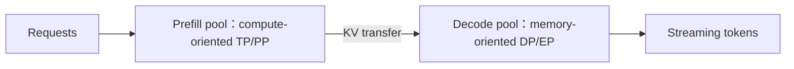

# 第 22 章　推理并行量化与执行优化

在固定质量和时限下比较副本、模型并行、精度与执行方式，检查多项优化组合后的约束。

本章内容：

- [1. 推理并行方案设计：延迟、吞吐与 KV 的三角形](#s1)
- [2. 量化推理：权重、激活与 KV 的不同成本](#s2)
- [3. 推理执行优化：重叠、图复用与功能组合](#s3)
- [4. 量化误差怎样进入策略比率](#s4)

## 1. 推理并行方案设计：延迟、吞吐与 KV 的三角形

### 入门例子：TP 与多个副本优化的是不同目标

假设模型单卡已能容纳。两个单卡副本可以服务不同请求；两卡 TP 则协作完成同一模型执行，同时付出层间 collective。前者主要扩展独立请求容量，后者可能改变单请求延迟与模型容量，不能只比较一个 tokens/s。

按相同总卡数扫描并发和输入/输出长度，分别看 TTFT、ITL、吞吐、队列和 KV。短 prompt/长 decode 与长 prompt/短 decode 可能得到不同选择。

验收：为一个明确 workload 画容量曲线，并解释何时进入排队区。在线服务的延迟目标与离线 RL rollout 的有效样本目标也要分开。

### 机制与实现

训练希望缩短 step/time-to-train；推理必须同时满足 Time to First Token（TTFT，首 token 延迟）、Time Per Output Token（TPOT，每输出 token 时间）、吞吐、并发和成本。相同模型在 prefill 与 decode 也可能需要不同并行方式。

### Data Parallelism：多个独立 replica

Data Parallelism（DP，数据并行）在推理中通常指多个完整 model replica，各自处理独立请求。它几乎不引入模型内 collective，适合模型已能放下时扩吞吐和隔离 tail；但不会帮助单个 replica 容纳模型。

负载均衡器还要考虑 prefix/KV cache locality。把请求送到“最空闲但无 cache”的 replica，可能比稍忙但命中的 replica 更慢。

### Tensor Parallelism：降低单请求计算时间，但每层同步

Tensor Parallelism（TP，张量并行）分摊每层权重/compute/KV heads，使模型能放下并降低单次 forward latency；代价是每层 collective。节点内 NVLink/NVSwitch TP 通常可行，跨节点 TP 对 decode 小 batch 尤其敏感。

用简化时间账本看这个取舍：单卡某段计算需要 8 ms，两卡分摊后若本地计算降到 4 ms，却新增 1 ms 无法隐藏的通信，总共是 5 ms，仍有收益。继续切成四卡，若本地计算只能降到 3 ms，而通信增为 3 ms，总共反而是 6 ms。这些是教学假设，目的是说明计算节省必须大于新增通信。

本地矩阵变小后，设备可能不能维持原来的计算效率；decode 每层还要反复支付通信启动成本。增大并发又会改变矩阵形状和权重复用。因此低并发时最短单请求延迟的 TP 度，不一定是高并发时吞吐最大的 TP 度。

### Pipeline Parallelism：容量与吞吐工具

Pipeline Parallelism（PP，流水线并行）沿 layer 切模型，通信频率低于 TP，但单请求必须依次通过所有 stage，端到端 latency 叠加。多请求/micro-batch 可 pipeline 化获得吞吐；低延迟在线场景一般谨慎使用。

### MoE：Attention DP + Expert Parallel

Mixture of Experts（MoE，混合专家模型）推理中，可以让 attention 各 rank 独立处理不同 requests/tokens，而 experts 在更大 Expert Parallelism（EP，专家并行）group 上分布。这种 Attention DP + EP 避免 dense attention 每层 TP collective，同时用跨 rank token dispatch 扩大 expert batch。

vLLM 当前文档明确支持 DP attention 与 EP/TP MoE 组合，并提供 expert load-balancing 路径。NVIDIA Dynamo 使用 Wide Expert Parallelism（WideEP，宽专家并行）描述把 experts 展开到大量 GPU 的部署。

### Prefill 与 Decode 为什么可能拆开

Prefill–Decode disaggregation（预填充—解码分离）允许两个 pool 独立选择 parallelism 和规模，但 KV transfer、routing 与 queue 成为新成本，详见[第 31 章的综合案例](<../07_Practice/31_推理综合案例.md#s1>)。

### 一个实用选择树

1. 单卡是否能容纳 weights + KV + workspace？能：先单卡 replica + DP；
2. 不能：节点内 TP 增到刚好可放，保留 KV headroom；
3. TP 已过大/跨节点：比较 PP 或 quantization；
4. MoE：比较 TP-MoE 与 attention-DP + EP，测真实 token distribution；
5. 长 prompt 与长 generation 比例差异大：评估 P/D 分离；
6. 最后用目标 traffic distribution 和 SLO，不用离线固定 batch，决定配置。

### 容量近似与陷阱

$$
M_{replica}\approx\frac{M_{weights}}{TP\times PP}+M_{KV\ shard}+M_{workspace}
$$

这个式子忽略 layer 不均匀、embedding/head、replicated norm、CUDA graph pool 和 allocator fragmentation。PP 只把 layer KV 分到 stage；TP 是否切 KV 取决于 head layout。必须用引擎的 memory profile 验证。

### 完整算例：同一组8卡上的请求交付

与[训练设计算例](<../04_Training/16_并行组合与训练方案.md#s2-完整算例8b-模型怎样在-8-卡5-小时内完成同一轮训练>)共用教学 Dense 模型：$8\times10^9$ 参数、32 层、8 个 KV heads、head dimension 128，BF16 权重与 KV。资源固定为 8 张 64 GiB GPU；每卡为 workspace、执行图、通信临时区和余量保留 6 GiB。**以下服务时间是人为指定的教学输入，不能作为某个真实模型、GPU 或推理引擎的性能结论。** 先算出哪些候选值得实测，设计入口见[系统设计主线](<../appendices/design/README.md>)。

#### 负载必须同时给出长度、到达和交付门槛

| 项目 | 固定输入 |
|---|---|
| 短请求 | 输入 1024 token，输出恰好 256 token |
| 长请求 | 输入 8192 token，输出恰好 512 token |
| 到达 | 每 5 s 同时到达一批 16 个短请求、8 个长请求，持续周期重复，平均 4.8 请求/s |
| 交付 | 每个请求 TTFT ≤ 1 s、每次 ITL ≤ 15 ms、完成时间 ≤ 6.5 s；不允许靠丢请求维持延迟 |
| 质量 | BF16 为参考，固定 tokenizer、采样和评测集；量化后的任务成功率下降不得超过 1 个百分点，需用配对评测检验 |

使用一个有意简化、可精确复算的调度日程：同一批请求均匀分给各 replica；每个 replica 先串行完成其请求的 prefill，再统一释放各请求的首 token，随后进行同步 decode。短请求生成完后退出，长请求继续。下一批到达时，聚合部署必须等前一批全部完成才开始。这是本例的调度约束，不代表真实 continuous batching 的最优能力。

prefill 已生成首 token，所以先执行 255 次混合 decode，短请求达到 256 个输出；再执行 256 次仅长请求的 decode，长请求达到 512 个输出。若使用别的首 token 计时口径，必须同时修改 TTFT 和 decode 次数。

#### 显存账本：先排除错误的容量直觉

$$
W=\frac{2\times8\times10^9}{2^{30}}=14.901\ \mathrm{GiB},\qquad
m_{KV}=2\times32\times8\times128\times2=128\ \mathrm{KiB/token}.
$$

短请求保留输入加最大输出的 KV 上界为 $1280\times128$ KiB = 0.15625 GiB，长请求为 $8704\times128$ KiB = 1.0625 GiB。这是保守的输出容量预留；实际最后一个输出 token 可能尚未写入 KV，已完成的短请求也可提前释放。

TP1 的每个 replica 接收 2 短 + 1 长，KV 预留 1.375 GiB，总预算 $14.901+6+1.375=22.276$ GiB，单卡能容纳。TP2 每个 replica 收 4 短 + 2 长，假设 KV heads 均匀分到两卡，每卡 KV 仍为 1.375 GiB、权重减半，总预算 14.826 GiB。TP4 / TP8 每卡分别为 11.100 / 9.238 GiB。

本例 TP degree 都能整除 8 个 KV heads，且没有复制 KV。真实布局若有复制或不均匀分片，应替换这项假设。所有候选都能放下这一批请求，继续扩大 TP 的理由只能来自时间和交付要求。仅看“还有 40 多 GiB 空闲”也无法判断服务是否能跟上到达。

#### 固定阶段服务时间，比较同一批请求

下表每个 prefill 时间对应单个完整请求；decode 时间对应该 replica 当前整个活跃 batch 的一次迭代，包含其模型内通信。它们是独立输入，**没有假设 TP 线性加速，也没有用峰值 FLOPs 除法代替执行时间**。

| 聚合部署 | 每 replica 短 / 长请求数 | 短 prefill / ms | 长 prefill / ms | 混合 decode / ms | 仅长 decode / ms |
|---|---:|---:|---:|---:|---:|
| 8 × TP1 | 2 / 1 | 50 | 500 | 12 | 10 |
| 4 × TP2 | 4 / 2 | 32 | 280 | 9 | 7 |
| 2 × TP4 | 8 / 4 | 22 | 170 | 10 | 8 |
| 1 × TP8 | 16 / 8 | 18 | 120 | 11 | 9 |
| 8 × TP1，热前缀 | 2 / 1 | 50 | 180 | 12 | 10 |
| 8 × TP1，W8 权重 | 2 / 1 | 50 | 500 | 9 | 7 |

对每个 replica，令 $n_s,n_l$ 为短、长请求数，$p_s,p_l$ 为 prefill 时间，$d_m,d_l$ 为两阶段 decode 时间：

$$
T_{TTFT}=n_s p_s+n_l p_l,\qquad
T_{batch}=T_{TTFT}+255d_m+256d_l.
$$

例如 4 × TP2：$T_{TTFT}=4\times0.032+2\times0.280=0.688$ s，$T_{batch}=0.688+255\times0.009+256\times0.007=4.775$ s，小于 5 s 到达周期，没有跨批积压。

| 聚合部署 | 空队列 TTFT / s | 最大 ITL / ms | 批完成 / s | 原负载结论 |
|---|---:|---:|---:|---|
| 8 × TP1 | 0.600 | 12 | 6.220 | 每 5 s 来一批，持续积压 |
| 4 × TP2 | 0.688 | 9 | 4.775 | 三项交付门槛均通过 |
| 2 × TP4 | 0.856 | 10 | 5.454 | 持续积压 |
| 1 × TP8 | 1.248 | 11 | 6.357 | 首批 TTFT 就超限，且积压 |
| 8 × TP1，热前缀 | 0.280 | 12 | 5.900 | prefill 更快，但仍积压 |
| 8 × TP1，W8 权重 | 0.600 | 9 | 4.687 | 时间通过，质量尚待验证 |

对聚合部署，到达周期为 $A$ 时，队列等待满足 $Q_{k+1}=\max(0,Q_k+T_{batch}-A)$。当 $T_{batch}>A$，表中的 TTFT 只是空队列首批结果；不能拿它声称稳态 SLO 达标。原始 BF16 候选中，4 × TP2 进入下一轮验证。它每批产生 8192 个输出 token，原负载相当于 1638.4 输出 token/s；这是指定到达量被及时处理的结果，不是引擎最大吞吐。

#### 缓存与量化分别改动了哪笔账

热前缀候选假定所有长请求共享同一 6144-token 前缀，路由保证对应 replica 命中，且模型版本、token 序列等缓存身份相符。每 replica 保留前缀需要 0.75 GiB；TP1 的当前批只有一个长请求，前缀与该请求本来就需要的 KV 重合，所以当前批峰值没有下降。跨批保留这些页换来了下一批命中；这不是免费、无状态的加速。

命中后仍需处理 2048-token 后缀，并在 decode 访问完整上下文。本例把长请求 prefill **另行假定为 180 ms**，没有按剩余 token 比例线性缩放。decode 两列保持不变，因此省下 prefill 还不足以解决 5 s 周期积压。冷启动、前缀变化和缓存被逐出时回到 500 ms；高命中率平均值不能掩盖这些请求。[vLLM 的前缀缓存说明](https://docs.vllm.ai/en/stable/features/automatic_prefix_caching/)也区分了 prefill 复用与 decode 工作。

W8 候选仅量化权重，KV 保持 BF16；权重占 $W/2+0.2=7.651$ GiB，其中 0.2 GiB 是人为指定的 scale/metadata 预算。每卡总预算降为 15.026 GiB。decode 的 9 / 7 ms 同样是待实测替换的输入，不由“一字节权重”自动保证。当前任务尚未证明量化满足质量门槛，因此只能列为条件候选；若通过，4.687 s 的批时间可与 BF16 TP2 的 4.775 s 比较。若始终保留 8 卡服务同样的 4.8 请求/s，二者都占 $8/4.8=1.667$ GPU·s/请求；更短的执行时间只有转化为减少预留卡数或增加有效完成量，才会降低这项资源成本。

#### 4P + 4D：吞吐周期缩短，也可能错过首 token

再固定四个 TP1 prefill worker 和四个 TP1 decode worker。每个 worker 分配 4 短 + 2 长；P 端每批服务时间为 $4\times0.05+2\times0.5=1.2$ s，prefill 完成后交接整批 KV。

输入 KV 总量为 $(16\times1024+8\times8192)\times128$ KiB = **10 GiB**。假设四条均衡路径分别提供 25 GiB/s 应用有效吞吐，聚合 100 GiB/s，传输耗时 0.10 s，安装与确认另需 0.01 s，合计 0.11 s。不能用 10 GiB 除以单条链路的带宽后再随意取四分之一；这里并行路径的聚合能力是明确条件。

P 端保留源 KV，直到 D 端安装并确认，随后 D 才对用户释放首 token。因此 TTFT 为 1.31 s，源、目的两份 KV 会短暂同时存在。每个 P worker 输入 KV 为 2.5 GiB，D worker 预留输入和最大输出共 2.75 GiB，其每卡预算上界为 $14.901+6+2.75=23.651$ GiB。请求身份、模型版本和重复交接语义见[PD 交接案例](<../07_Practice/31_推理综合案例.md#s1>)。

为了展示独立调优后的候选，假设专用 D worker 的 6 请求混合迭代为 8 ms、2 个长请求的迭代为 6 ms。这组数字需要独立基准支持，不能从“拆成两个池”推导出来。于是：

$$
T_D=255\times0.008+256\times0.006=3.576\ \mathrm{s},
$$

$$
T_{completion}=1.31+3.576=4.886\ \mathrm{s},\quad
A_{min}=\max(1.31,3.576)=3.576\ \mathrm{s}.
$$

两个池可流水执行相邻批次，所以长期接纳周期由较慢阶段决定，单请求完成时间仍需经过两阶段。原负载下该方案能跟上到达，但 **TTFT 1.31 s 超过 1 s，仍被淘汰**。若 P 提前释放首 token，就必须把交接等待记入后续 ITL，不能用计时点变化消除成本。

上面的最小周期是假设交接与前一批 decode 完美重叠的阶段能力下界。接近该周期时，D 端还需同时容纳旧批与传入的新批 KV，并验证传输不拖慢计算；本例实际比较的 4 s／5 s 周期中，下一批传入发生在旧批 decode 结束之后，因此采用单批容量账本。不能把这个下界直接当作已验证的最大接纳率。

#### 改变条件，再检查选择是否成立

保留相同长短请求和 8 卡预算，把到达周期缩短为 4 s、TTFT 放宽至 1.5 s，其余交付要求不变。此时聚合候选的最小批时间 4.687 s 仍大于到达周期；PD 的阶段周期 3.576 s、TTFT 1.31 s、完成 4.886 s 则通过，因此成为这组候选里可行的选择。

这个结论对专用 D worker 的假设敏感。若其混合迭代实测为 12 ms，保留仅长阶段 6 ms，则 $T_D=4.596$ s，又无法跟上 4 s 到达周期。若 KV 聚合有效带宽降为 25 GiB/s，TTFT 变成 $1.2+10/25+0.01=1.61$ s，也不再满足放宽后的门槛。**应同时验证阶段服务时间和交接路径，不能只验证其中一项。**

此外，TP2 原方案每批只余 225 ms，周期流量没有覆盖突发、长尾输出、取消和失败。这里没有计算故障后的成功请求成本；正式验收需要将 worker 重建、丢失 KV 后的重算和重试计入 goodput。任一候选都应在真实开环流量中验证 TTFT/ITL 分布、KV 峰值、质量和恢复，才能从“教学模型可行”升级为部署决策。[DistServe](https://arxiv.org/abs/2401.09670)提供了以满足延迟约束的 goodput 评价 PD 的一手研究。

复算：[设计案例脚本](<../examples/design_cases.py>)，运行 `python docs/ai_infra/examples/design_cases.py`。它输出原条件与改变条件后的容量、时间和可行性，支持 `--json`；它不会执行模型或测量 GPU。

### 基准矩阵

至少覆盖：短/长 prompt × 短/长 output、低/高并发、cold/warm prefix、均匀/突发 arrival；报告 TTFT p50/p99、TPOT/Inter-Token Latency（ITL，token 间延迟）、goodput、GPU cost per million tokens、KV occupancy 和 collective time。

### 资料

- [vLLM Parallelism and Scaling](https://docs.vllm.ai/en/stable/serving/parallelism_scaling/)
- [vLLM Data Parallel Deployment](https://docs.vllm.ai/en/latest/serving/data_parallel_deployment/)
- [vLLM Expert Parallel Deployment](https://docs.vllm.ai/en/latest/serving/expert_parallel_deployment/)
- [NVIDIA Dynamo Deployment Guide](https://docs.nvidia.com/dynamo/kubernetes/model-deployment/deploy-with-dgd)
- [Dense LLM Deployment Parallelization Study 2026](https://arxiv.org/abs/2603.05692)

---

### 与长上下文和精度组合

CP 切分 prefill 上下文时，须同时考虑 KV 放置、后续 decode 访问和 PD 交接；单 token decode 的负载不能直接沿用训练 CP 的收益判断，见[执行优化与功能组合](<#s3>)。量化格式也可能约束 TP 分片维度、group 对齐与 kernel，见[量化推理](<#s2>)。

## 2. 量化推理：权重、激活与 KV 的不同成本

> 前置：[低精度表示](<../02_Model_Computation/03_张量形状与数值表示.md#s2>)、[KV 生命周期](<20_KV容量分页与复用.md#s1>)。本节给出成本和正确性边界，不维护滚动格式支持矩阵。

> 官方滚动文档于 2026-10-12 核对；实现版本、硬件与组合支持需按部署环境另行确认。

### 三类对象分别量化

| 对象 | 主要收益来源 | 主要新增成本 |
|---|---|---|
| 权重 W | 模型容量、读取带宽或低精度 GEMM | packing、scale、解量化与格式适配 |
| 激活 A | 计算吞吐、中间值和部分传输 | 动态统计、异常值、转换与精度 |
| KV cache | 长上下文容量、读取和传输字节 | 写入量化、读取转换、尺度布局与累积误差 |

W4A16 表示权重与激活采用不同表示，并不描述 KV 精度、累加精度或所有算子。FP8、INT4、NF4 与带块尺度的格式也不能仅按 bit 数互换。实际执行还取决于 kernel 和硬件。

### 容量算例：节省在哪里

教学例：7B 参数全按 BF16 存储，纯权重约 14 GB；若全按四位打包，纯数值负载约 3.5 GB。设每 128 个参数增加一个两字节 scale，再加约 109.375 MB，合计约 3.609 GB。这里用十进制 GB，忽略 zero point、对齐、未量化层和副本，不对应某个引擎的完整内存。

32 层、8 个 KV heads、head dim 128 的标准 K/V，每 token BF16 为 128 KiB，16,384 个未分片 token 为 2 GiB；一字节 KV 的纯负载为 1 GiB。Scale、页表、预留与 workspace 另算。权重量化不会自动把这 2 GiB KV 减半，KV 量化也不减少权重文件。

能容纳更多 KV 后，调度器可能接纳更多请求。吞吐收益因此可能来自更大有效 batch，而非单请求 kernel 更快；应同时固定并发比较，再扫描容量曲线。

### 校准与动态量化

校准是先用一批代表性输入运行模型，观察待量化张量的数值范围，再决定尺度等表示参数。例如校准输入中某层激活的绝对值大多不超过 2，而部署时长上下文频繁产生幅值 8，原范围可能让这些值饱和。因此校准样本需要覆盖真实长度、模板和模态，不能只确认权重文件成功转换。

静态方案预先固定部分尺度，减少在线统计；动态方案根据当前输入计算统计量再转换，可以适应部分范围变化，但统计和转换本身要花时间。同一方案还可按张量、通道或块使用尺度，这决定局部分布能否得到单独表示，以及需要多少元数据。

PTQ（Post-Training Quantization，训练后量化）对已有模型选择尺度与低比特编码，常用校准数据观察激活范围或评估量化误差；校准不等于重新训练整个模型。QAT（Quantization-Aware Training，量化感知训练）在训练中加入量化相关行为，例如先模拟舍入与截断，让参数适应部署误差。模拟量化的训练算术可能仍使用较高精度，不能从 QAT 名称推出每一步都以部署比特宽度计算。二者的训练成本不同，部署仍需使用对应格式和算子。校准版本、敏感层保留精度与转换工具都应进入 artifact 身份。

### Kernel 决定表示能否转化为收益

低位权重如果每次都先展开成完整高精度张量，再调用普通 GEMM，会付出额外读写和临时容量。融合解量化的 kernel 可以改变这笔账，但受 shape、分组、布局和平台支持限制。

Prefill 的大矩阵与 decode 的小矩阵具有不同成本；同一格式可能在大 batch 有效，在小 batch 被量化或 launch 开销抵消。TP 还可能缩小本地矩阵，让通信占比上升。比较应包括量化、GEMM、attention、通信和调度整条路径。

官方路径：[vLLM 量化文档](https://docs.vllm.ai/en/stable/features/quantization/)、[TensorRT-LLM 量化文档](https://nvidia.github.io/TensorRT-LLM/latest/features/quantization.html)。格式和硬件支持以选定版本为准。

### KV 精度与跨请求复用

KV 量化不是权重量化的附属开关：K/V 分布、尺度粒度、写入时机、attention 读取和 PD 传输格式需要共同设计。下游需要拿到数值负载以及解释它的尺度、层/head 布局和有效长度。

Prefix cache 的身份应包含影响执行语义的权重/量化 revision、adapter 和 KV 表示。改变表示后沿用旧的 KV，必须有明确转换和语义依据。把旧缓存清空与把缓存传到另一个 worker，是不同操作。

分层缓存还应比较“量化后搬运”与“搬运后量化”的关键路径，尺度数据与正文不能错配。管理原则见[推理内存](<20_KV容量分页与复用.md#s1>)，实现见[SGLang KV](<../appendices/source/sglang/02_runtime_core/02_kv_cache_and_radix_attention.md>)。

### 一个线性层从参考值走到 INT4

固定行向量 X=[2,−1]，权重按“输入维×输出维”排列：

$$W=\begin{bmatrix}1&0.25\\-0.5&2\end{bmatrix},\quad Y=XW=[2.5,-1.5].$$

这些输入可由 BF16 精确表示。这里用高精度算术计算参考，不宣称模拟某个 BF16 GEMM backend。对称 INT4 使用码本 −7…7，留出 −8，舍入采用最近偶数；全矩阵 scale=2/7。得到：

$$Q=\begin{bmatrix}4&1\\-2&7\end{bmatrix},\quad \hat W=(2/7)Q,\quad \hat Y=[20/7,-10/7].$$

输出约为 [2.857143,−1.428571]，绝对误差为 [0.357143,0.071429]。若改为每个输出通道一个尺度，两列尺度分别为 1/7、2/7，第一列码值为 [7,−4]，得到输出 [18/7,−10/7]，误差降为 [0.071429,0.071429]。粒度更细在本例改善结果，但须多保存尺度，也可能改变 kernel 可用布局。

四个权重的 BF16 纯负载是 8 字节；INT4 纯负载为 2 字节。若尺度用 BF16，一个全局尺度使总量为 4 字节，两列尺度使总量为 6 字节。实际还有对齐和 packing；这样的小矩阵不适合用来宣称速度提升。若先完整展开为 BF16，还会再次写入、读取 8 字节中间权重；融合解量化则试图在消费者内部使用转换结果。

非对称量化为 q=clip(round(x/s)+z)。对 [0,1,2,3] 使用 unsigned 0…15、s=0.2、z=0，可以恰好编码为 [0,5,10,15]。对包含正负数的范围，还需选择合法 zero point，并说明端点能否精确覆盖。signed／unsigned、对称／非对称和尺度粒度是不同选择。

异常值例子 [0.1,0.2,0.3,7]：用 s=1 的对称码本时，前三项全变为 0，平方误差和为 0.14。若把范围裁到 ±0.3，小值更准确，但最后一项误差变为 6.7，整体平方误差急剧增加。裁剪是否有利取决于激活分布和输出目标，不能只统计多数元素的误差。

### 校准为什么需要激活

令校准输入矩阵为 X，原权重为 W，量化权重为 Q。逐元素最小化 ‖W−Q‖² 与最小化层输出误差 ‖X(W−Q)‖² 是不同目标。对某个输出列的误差向量 e，后者为：

$$e^T X^T X e.$$

若 XᵀX=diag(100,1)，同样是权重误差 0.1，出现在第一个输入通道的代价为 1，第二个只有 0.01。非对角项还表示输入通道相关，不能仅逐坐标选最近值。

一个受约束二次问题说明“补偿”的含义：取 H⁻¹=[[2,−1],[−1,2]]，第一坐标被固定向下移动 0.2。最小化 δᵀHδ 的解会同时让第二坐标移动 +0.1；保持第二坐标不动的代价更大。这是二阶补偿的局部示意，尚未实现分组尺度、阻尼、排序和分块更新。

| 方法 | 它利用什么信息 | 核心操作与边界 |
|---|---|---|
| 最近舍入 RTN | 权重范围、码本 | 独立舍入，作为简单基线；不会主动补偿相关通道的输出误差 |
| GPTQ | 校准激活产生的二阶信息 | 逐步量化并补偿尚未量化的权重，以分块和矩阵分解降低成本；校准矩阵、阻尼与实现顺序影响结果 |
| AWQ | 校准激活的通道重要性 | 搜索通道缩放以保护重要权重的量化精度；不能概括为把重要权重全部留成高精度 |
| SmoothQuant | 激活异常值与权重范围 | 等价缩放把激活的量化难度部分转移给权重，主要针对权重与激活共同量化 |

上述算法解释依据 [GPTQ](https://arxiv.org/abs/2210.17323v2)、[AWQ](https://arxiv.org/abs/2306.00978)、[SmoothQuant](https://arxiv.org/abs/2211.10438v7)。这里不移用论文速度数字，也不认为它们采用相同格式或部署 kernel。

对可逆对角矩阵 D，有 XW=(XD⁻¹)(DW)。这是 AWQ 和 SmoothQuant 一类通道缩放的代数基础之一；量化后等价性不再自动成立。D 怎样选择、缩放能否吸收到相邻层、共享输入的多个分支怎样处理，需要各自推导。仅验证缩放前后浮点输出相同，不等于复现其中任何算法。

### 用固定动作连接数值与质量

把上面的两维输出当作 logits，参考动作 1 的 logprob 与全局 INT4 的 logprob 相差约 −0.281234，虽然第二个 logit 的绝对误差只有约 0.071429。原因是 softmax 同时依赖两个 logits 的相对差值。该例 KL(p_reference‖p_quantized) 约 0.000659，也不能单独保证特定任务质量。

验证顺序是固定输入的层输出、全模型 logits／动作 logprob、固定评估集指标，最后才是自由生成和在线服务。校准集与评估集分离，并覆盖上下文长度、模板、模态和稀有激活。保留未量化层、尺度、转换版本和实际 kernel 身份；否则两份“INT4 模型”未必是同一实验。

[数值程序](<../examples/numerics_quantization.py>)核对本节矩阵、裁剪、通道缩放和二次补偿算例，未实现 GPTQ/AWQ/SmoothQuant 全算法，也不产生模型质量或 GPU 性能结论。

### 质量与 RL 接口

先固定 token 输入、模板和权重来源，对比 logits 与选中动作 logprob，再评估真实生成任务。自由生成会分叉，字符串相同率不能独立解释质量。长上下文、异常值、低温和多模态应有各自输入。

若量化引擎生成的轨迹用于 RL，必须说明返回的是原始模型概率还是采样后概率；同参数不同引擎也可能形成概率差异。版本一致不保证分布一致，校正见[行为概率](<../06_Post_Training/27_权重发布异步与资源调度.md#s2>)。

实现连接：[SGLang backend](<../appendices/source/sglang/02_runtime_core/03_model_runner_attention_cuda_graph.md>)、[TensorRT-LLM 历史与执行边界](<../appendices/runtime/TensorRT-LLM.md>)。测量连接：[推理性能](<../appendices/performance/05_inference.md>)。

## 3. 推理执行优化：重叠、图复用与功能组合

> 前置：[批处理与调度](<21_批处理调度与排队.md#s1>)、[CUDA 依赖](<../03_Execution/08_GPU执行与异步依赖.md#s3>)。这里比较机制，不承诺任意引擎支持全部组合。

> 官方滚动文档于 2026-10-12 核对；实现版本、硬件与组合支持需按部署环境另行确认。

### CPU 与 GPU 重叠

CPU 处理请求、选 batch、构造 metadata 和发送结果；GPU 执行模型与采样。若每轮等结果全部回到 CPU 才准备下一批，host 工作可能暴露在 token 间隔内。

教学流水：每批 host 准备 2 ms、设备执行 8 ms。串行完成三批耗时 30 ms；在独立 buffer、依赖允许、忽略结果处理且资源无争用的条件下，流水为 2+3×8=26 ms，稳态间隔 8 ms。对同一自回归请求，下一 token 依赖上一批结果，实际引擎需用设备侧结果、占位映射或其他机制维持依赖，不能凭此模型绕过采样。

Future token 的槽位、request identity、采样状态和在途 KV 引用要一同推进。下一批修改上一批仍读取的输入会产生 WAR hazard；CPU 已返回不意味着设备已停止访问。具体路径见[SGLang overlap scheduler](<../appendices/source/sglang/02_runtime_core/01_scheduler_and_batch.md>)。

### CUDA Graph、编译和融合分别减少什么

| 方法 | 针对的成本 | 动态状态的约束 |
|---|---|---|
| CUDA Graph replay | host launch 与重复提交 | 捕获形状、地址、合法输入及完成依赖 |
| 编译与算子融合 | 中间读写、算子调用与实现选择 | shape specialization、重编译与 fallback |
| CPU–GPU overlap | host 工作暴露在设备轮次之间 | buffer 所有权、结果依赖与请求代次 |
| 计算通信重叠 | TP/EP 等通信的暴露部分 | 数据 ready、collective 顺序与资源争用 |

Graph bucket 的物理行数可能大于有效请求数；dummy 行不能写坏 KV 或输出给真实请求。Piecewise graph 可保留动态图边界，但会留下部分提交成本。编译减少 kernel 数不代表 scheduler 的队列等待消失，graph 命中也不代表最优 kernel 已被选中。

### 并行后的新瓶颈

TP 降低本地计算量，却增加层内 collective；EP 带来 token dispatch、专家不均衡与 combine。双 batch 重叠或 microbatch 可提供并发机会，也增加在途 buffer，并可能降低 GEMM 规模或争用链路。

长上下文还可切分上下文工作或 KV 状态。Prefill context parallel 与 decode context parallel 的输入和通信频率不同：前者处理长 prompt 的 attention，后者要在生成轮次中组合不同 KV shard 的局部 attention 结果。推理没有训练的完整反向，但仍需全局 softmax 归一化与正确位置；布局和实现以 backend 为准。

相关基础：[Context Parallel](<../04_Training/15_模型并行与执行日程.md#s4>)、[MoE 推理](<../appendices/models/moe/推理部署与模型案例.md>)。推理并行选择见[并行方案](<#s1>)。

### 一项功能会改变其他功能的输入

| 组合 | 新增交互 | 判断所需证据 |
|---|---|---|
| Prefix cache + chunked prefill | 预算按未命中 token 计算，缓存锁跨块持有 | 复用 token、首 token 排队、页引用 |
| Speculative + graph | 验证长度、候选树与接受数改变形状 | graph 命中、平均提交长度、回滚后 KV |
| LoRA + prefix cache | 相同 token 不代表相同模型上下文 | adapter revision 与缓存命名空间 |
| Quantization + TP/EP | 本地矩阵、尺度分片与通信路径变化 | 转换、collective 和 GEMM 整体耗时 |
| PD + 分层 KV | 两次排队、读取与传输可能串联 | 缓存层命中、预取、目标可读与交接确认 |
| Structured output + speculative | 候选验证也需遵守 grammar 状态 | 接受前缀、grammar/KV 同步回滚 |
| 多模态 + batching/graph | encoder 与 LLM 的 batch 维度不一样 | 媒体预处理、encoder shape、LLM TTFT |

开启两项功能分别成功，不证明组合路径正确。[TensorRT-LLM 官方组合矩阵](https://nvidia.github.io/TensorRT-LLM/latest/features/feature-combination-matrix.html)会区分支持、未测试和已知问题；应记录具体 release/commit，而不是把空白当作支持。

### 固定负载下怎样比较

固定模型、输入 token、采样目标、硬件和请求到达序列，先验证普通执行路径；每次增加一项功能，保留变化的状态、峰值内存和关键路径。最后再检查组合。

| 服务条件 | 主要观测 | 容易误判的情况 |
|---|---|---|
| 低并发短 decode | launch、host 间隙、ITL | 大 batch 吞吐掩盖低延迟代价 |
| 长 prompt + 活跃 decode | chunk 工作量、TTFT 与 ITL | 只看平均 prefill 吞吐 |
| 长 KV 与缓存复用 | KV 读取、命中 token、驱逐 | 请求命中率相同但复用长度不同 |
| MoE 高并发 | 专家 token 分布、dispatch/combine | 只用平均专家工作量 |

复用现有[请求贯穿案例](<../07_Practice/31_推理综合案例.md#s2>)记录可核对的槽位和事件；[推理性能](<../appendices/performance/05_inference.md>)负责实际压测。上面的时间模型没有声称任何实际加速。

## 4. 量化误差怎样进入策略比率

将低精度引擎用于 RL rollout 时，平均输出误差很小仍可能不足以说明可替换。设固定动作在两条执行路径上的 logprob 分别为 $\ell$ 和 $\ell+\delta$，其概率之比为 $e^\delta$。当 $\delta=0.1$ 时，比率约为 1.105；概率尺度上的差异已经超过 10%。

若比较同一条已固定的动作序列，序列 logprob 差是各位置差值之和。教学例中，100 个位置都偏移 0.01，序列概率比就是 $e^1\approx2.718$。真实误差未必同号，不能据此预测实际偏离；但它说明局部误差可能累积。Token 级与序列级的策略目标也不能混用同一阈值。

实际验收先保存固定 token，分别计算训练与生成路径的逐位置 logprob 差，按长度、概率大小及任务类型看分布，再检查这些差异对所用比率、裁剪和质量的影响。自由生成评价用于判断最终任务能力，固定动作评价用于定位概率偏差，两者共同决定是否采用该精度。

如果同时改变温度、top-p 或约束集合，应先把采样分布变化与数值误差分开，否则 logprob 差不能解释为量化误差。第 27 章会进一步区分行为策略、训练侧旧策略与当前策略。

## 本章回顾

推理并行、量化和执行优化分别改变工作划分、数值表示与提交方式。候选必须在相同任务和时限下比较，组合优化还需重新核对缓存身份、形状与资源竞争。

**检查理解：** 量化节省容量为什么不一定降低延迟？缓存、并行和执行图的收益为什么不能直接相加？

下一章讨论服务部署与容量设计。把实例扩展为服务，连接资源承诺、路由、弹性、发布以及不同模型和输出约束的状态身份。

<!-- book-nav -->

[上一章：批处理调度与排队](<21_批处理调度与排队.md>) · [全书目录](<../README.md>) · [下一章：服务部署与容量设计](<23_服务部署与容量设计.md>)

<!-- /book-nav -->
