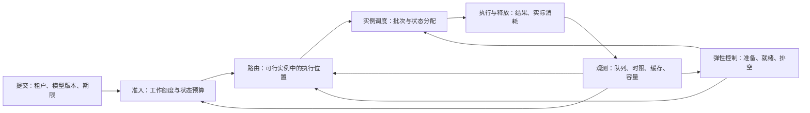
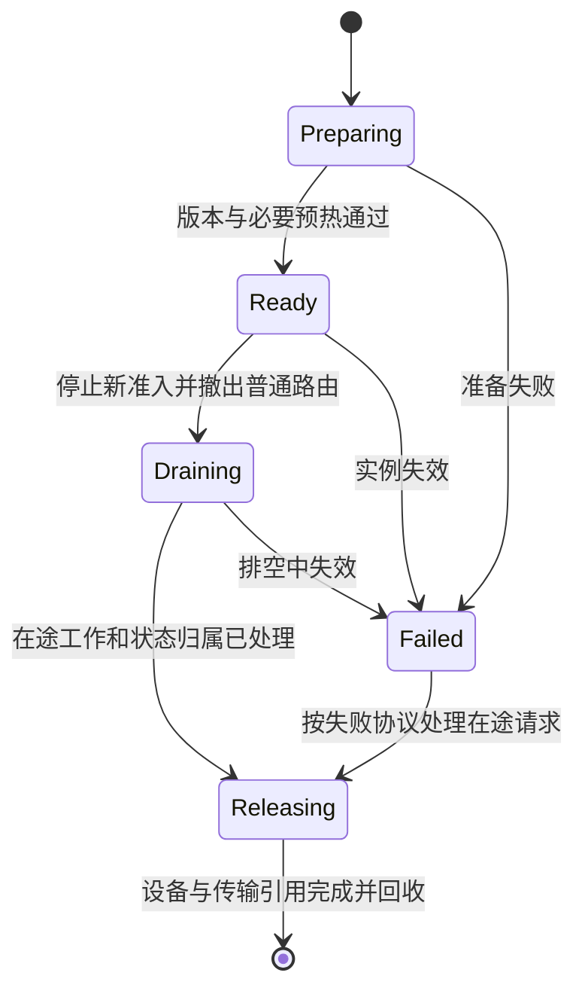

# 第 23 章　服务部署与容量设计

把实例扩展为服务，连接资源承诺、路由、弹性、发布以及不同模型和输出约束的状态身份。

本章内容：

- [1. 服务准入、路由与弹性控制：让资源承诺形成闭环](#s1)
- [2. 结构化生成、Multi-LoRA 与多模态服务](#s2)
- [3. 生成服务怎样向训练端承诺结果身份](#s3)

<a id="s1"></a>

<a id="s1-服务准入路由与弹性控制让资源承诺形成闭环"></a>

## 1. 服务准入、路由与弹性控制：让资源承诺形成闭环

> 前置：[系统设计的共同语言](<../01_Introduction/02_系统设计的共同语言.md>)、[排队长尾与容量规划](<21_批处理调度与排队.md#s2>)、[推理内存系统](<20_KV容量分页与复用.md#s1>)。本文解释跨实例服务的通用控制模型；实例内批处理、具体网关实现和版本操作分别由既有机制与源码章节维护。

模型能在一组 GPU 上运行，还没有回答服务应接收谁、送到哪里、何时增加资源、何时能够回收。多租户平台需要把这些决策连接起来：准入限制新增承诺，路由选择承诺的执行位置，实例调度落实工作，弹性控制改变未来可用能力。它们观察到的状态和动作生效时间不同。

<a id="s1-不同控制层改变什么"></a>

### 不同控制层改变什么



| 层次 | 决策对象 | 动作生效前必须知道什么 |
|---|---|---|
| 租户准入 | 新请求是否进入、在哪等待 | 额度、预计工作、状态上限、剩余期限 |
| 跨实例路由 | 请求交给哪个副本或阶段组合 | 版本、健康、队列、缓存、放置与数据范围 |
| 实例调度 | 下一批实际执行什么 | KV 所有权、token budget、前后依赖 |
| 资源控制 | 创建、迁移、排空与删除实例 | 准备延迟、在途容量、共享瓶颈、回收条件 |

网关可以拒绝请求，却未必知道某张卡的临时空间峰值；实例最了解自己的状态，却不能单独决定一个租户在整个服务中的份额。因此需要传递明确的预留、接纳与结束事件，而不是让所有层各自根据“当前请求数”做出独立承诺。

<a id="s1-多租户合同要区分工作状态和交付"></a>

### 多租户合同要区分工作、状态和交付

租户合同至少包含模型与版本范围、允许的输入及输出上限、服务类别、工作份额、瞬时状态限制和超限处理。保底、上限与优先级分别回答不同问题：保底规定竞争时仍可获得的资源，上限防止无限占用，优先级决定某次竞争先服务谁。高优先级本身不构成资源保底，也不自动保证期限。

| 合同维度 | 适合计量的对象 | 为什么不能由另一维替代 |
|---|---|---|
| 长期工作与突发 | 按阶段估算的计算／传输工作，允许的短期突发 | 相同请求数可能有完全不同的 Prefill 和 Decode 工作 |
| 同时存活的状态 | 在途请求、唯一 KV、预留增长、环境和缓存预算 | 暂时不计算的会话仍可占住容量 |
| 交付条件 | TTFT、ITL、完成期限与质量要求 | 分得同样资源的不同负载，完成时间也可能不同 |
| 超限与恢复 | 排队、拒绝、降级、取消或可恢复抢占 | 各动作改变结果语义与已经消耗的工作 |

工作限流可以用按工作单位补充的令牌桶表示，桶容量约束突发；这里的“令牌”是额度单位，不必等于语言模型 token。输入 token 已知，输出长度通常只能估计。可按声明上限或保守估计预扣，并用实际执行量结算；若允许估计不足后继续增长，就必须另设增长的硬边界与处理规则。退款只返还尚未使用的额度，已执行后被取消的计算仍应计入成本。

公平性也要写明分母。按请求数公平、按 GPU 时间公平、按有效任务完成量公平，会选择不同的调度。多资源场景可以比较各租户在 CPU、内存或其他可分配资源上的归一化份额，再观察其最大份额；这是 [Dominant Resource Fairness](https://www.usenix.org/conference/nsdi11/dominant-resource-fairness-fair-allocation-multiple-resource-types) 的基本出发点。但该方法的资源分配模型不直接解决 LLM 动态批处理、截止时间或缓存收益，不能据此宣称一个 token 调度器已经实现端到端公平。

资源空闲时允许借用，可以提高有效产出；借用约定还需说明原租户恢复需求后如何归还。停止接纳借用者的新请求，通常比强行打断已经对用户流式输出的请求更容易保持语义。若确实允许抢占，应计入重算、状态迁移和客户端恢复代价，见[故障与恢复](<../04_Training/18_Checkpoint与故障恢复.md#s3>)。

<a id="s1-准入同时检查工作能力与状态容量"></a>

### 准入同时检查工作能力与状态容量

先筛选可行集合：模型、adapter、精度和版本相容，数据允许到达该位置，实例健康且允许接收新工作。再检查租户额度、预计期限与实例容量。版本不相容或状态放不下的实例，不应靠较短队列在后续评分中“胜出”。

对候选实例 $j$，可以写出一个保守的内存条件：

$$M_{\mathrm{committed},j}+\Delta M_{\mathrm{request},j}
+M_{\mathrm{transient},j}+M_{\mathrm{guard},j}\le M_{\mathrm{usable},j}.$$

各量都按字节计。$M_{\mathrm{usable}}$ 已扣除固定权重与长期运行时占用；$M_{\mathrm{committed}}$ 包含现有物理状态及已经承诺的增长，按唯一对象计数；$\Delta M$ 是新请求新增的承诺；$M_{\mathrm{transient}}$ 是这些承诺之外可能同时出现的临时峰值；$M_{\mathrm{guard}}$ 留给未建模波动。已计入固定扣除或承诺的缓冲不能重复累加。

前缀共享可以降低 $\Delta M$，前提是共享对象身份相容且已经取得有效引用。路由器刚看到一次命中提示，不等于状态已经预留；选择实例与实际接纳之间，前缀可能被驱逐、空间可能被其他请求占用。实例应重新验证并原子更新自身预算，失败后释放外部预留或重新排队。多个网关同时选中一个实例时，也不能分别拿同一份空闲空间承诺给请求。

工作检查则针对可持续供给。Prefill 工作、Decode 迭代和 KV 传输要分别估计；请求长度相同，缓存、batch 形状和并行配置不同，实际耗时也会不同。最大输出长度用于容量上界，平均输出估计可用于工作排序，两者承担不同职责。硬性完成期限还需要保守服务界和明确到达包络；平均时间预测只能支持软目标。

状态不足时可以等候，工作超载时也可以限流，但排队本身有存储与期限成本。网关队列、实例等待队列和在途执行应有可关联的身份与有界容量，避免把等待从一层挪到另一层后误报延迟改善。已经不可能按合同完成的请求，应执行合同约定的拒绝或降级，而非无限留在队列。

<a id="s1-路由比较缓存收益与新增等待"></a>

### 路由比较缓存收益与新增等待

对已经通过约束检查的候选，可按某个明确目标估计完成代价，例如：

$$\widehat T_j=\widehat W_j+\widehat P_j+\widehat D_j+\widehat X_j.$$

这里分别表示预估等待、剩余 Prefill、Decode 与必要传输时间，各项都使用同一时间单位。对于 TTFT 目标，Decode 只计到首个输出所需的部分；对于完整任务则计到结束。式子描述串行依赖；允许重叠时应改用执行图的关键路径，而非机械相加。

例如副本 A 命中前缀，预计还需 20 ms 处理，但队列要等 100 ms；副本 B 没有命中，处理要 70 ms，却只需排队 10 ms。暂时固定其他阶段且忽略重叠，A 到这段处理结束需要 120 ms，B 需要 80 ms，应选择 B。若 A 的等待降到 10 ms，选择才反过来。这里比较的是同一请求的完整候选路径，数字只用于说明决策。

前缀命中节省的处理时间，需要与新增等待和传输一起比较。队列中一条长 prefill 可能比几条短请求更慢，因此仅用请求数替代剩余工作也不可靠。PD 部署还必须检查接收方能否容纳并及时安装传来的 KV。

预测来自滞后的观测。多个路由器若总选择同一个“最空闲”实例，会把它同时填满，再在下一轮一起转向别处。可通过限额预留、分散候选选择、逐步调整路由权重和对陈旧观测保守处理，减少这种同步摆动。它们都需要反馈验证，没有一个静态评分式能保证所有负载稳定。

缓存还涉及租户边界。授权隔离、模型身份和位置规则决定哪些前缀可以共享；共享的物理字节只能计算一次，但应约定它们如何分摊租户配额和驱逐成本。为命中率让一个租户长期占住全部可驱逐空间，会侵占其他租户的容量合同。路由、缓存管理和准入应使用相容的归属规则。

<a id="s1-扩容是在延迟之后改变供给"></a>

### 扩容是在延迟之后改变供给

令 $Q_k$ 为观测区间开始时，已接纳但尚未执行完的剩余工作量；$A_k$ 为区间内新接纳的工作，$S_k$ 为实际执行掉的工作。在固定工作计量方式下，有：

$$Q_{k+1}=\max(0,Q_k+A_k-S_k).$$

这里统计工作而非请求完成数，执行中的剩余工作也属于 $Q$。动态批处理会改变单位时间可执行的工作，因此 $S_k$ 需要随负载与状态校准。这个守恒关系说明：扩容决策发出后，只有新增实例实际提供服务，才能增加 $S$；资源对象已经创建或进程已经启动都不够。

扩容经过观测、决策、放置、镜像与权重准备、通信组初始化、必要预热和路由发布。各阶段有先后依赖，也可能竞争已有服务的网络、CPU 和存储。冷实例还没有稳定的前缀命中率，不能直接把暖实例能力赋给它。将“期望副本”“正在准备”“已经就绪”和“可承接该负载的有效容量”分别观测，才能知道缺口出在哪里。

反馈稳定性需要同时处理以下问题：

- **延迟与重复动作。** 指标还未反映上次扩容时，要把正在准备的容量纳入决策，避免每轮都补一遍同样缺口；准备失败又不能永远当作即将到达的容量。
- **噪声与迟滞。** 平滑与稳定窗口减少短时摆动，但也增加响应滞后；扩缩阈值、步长和最短驻留时间应与实际准备／排空时间及流量变化相匹配。
- **瓶颈与动作相符。** GPU 负载高可能来自有效工作，也可能伴随通信等待。若瓶颈是环境、KV 传输或共享存储，增加模型副本可能扩大竞争。
- **各控制层相互影响。** 拒绝率上升会压低已接纳流量；只看已接纳负载会误判需求下降。保留提交、接纳、拒绝及剩余工作，区分需求减少与保护机制生效。

[Kubernetes HPA](https://kubernetes.io/docs/concepts/workloads/autoscaling/horizontal-pod-autoscale/)提供了处理未就绪实例、缺失指标、扩缩速率和稳定窗口的具体机制。它们说明控制器必须面对观测不完整与动作滞后；使用这些机制仍需给模型服务定义合适的指标与容量模型，不能把某个通用利用率目标直接视作 SLO 保证。

准入通常较快地限制新增工作，实例调度持续落实已接工作，弹性控制较慢地改变资源。快速保护不应等待慢速扩容完成；慢速控制也应看到被拒绝的需求，避免保护状态被误当成正常低负载。

<a id="s1-缩容先结束承诺再释放资源"></a>

### 缩容先结束承诺，再释放资源



撤出路由存在传播延迟，因此实例自身也应检查准入状态；旧路由发来的新请求不能延长一个已承诺排空的实例生命周期。已接纳请求继续执行、受控取消还是迁移，由合同决定。长期会话还需要最长保留或明确交接点，否则没有新请求也可能一直无法释放。

排空关注逻辑完成和物理引用两条边界。HTTP 连接结束时，GPU、PD 传输或输出消费者仍可能使用缓冲；最后一次引用完成后才能回收。无引用的可驱逐前缀可直接舍弃，不必要求缓存先自然清零。若迁移会话，则要先让接收方确认状态和所有权，才能删除原副本；按超时强制结束时，需要明确失败结果及重试身份。

[Kubernetes Pod 生命周期](https://kubernetes.io/docs/concepts/workloads/pods/pod-lifecycle/#pod-termination-flow)区分终止端点的 readiness、继续服务与优雅终止。平台信号为排空提供入口，但应用仍需处理流式请求、KV、版本和设备事件。故障退出也不是成功排空：它可能留下需要恢复或明确失败的工作。

<a id="s1-与源码和观测连接"></a>

### 与源码和观测连接

本文各关系用于组织控制模型，不声明某个框架已经完整实现。具体核对入口如下：

| 要核对的责任 | 已有内容 |
|---|---|
| 网关、实例、缓存亲和与 readiness | [SGLang 部署与路由](<../appendices/source/sglang/03_scaling_and_deployment/02_deployment_topology_and_routing.md>) |
| 调度器的接纳与批次推进 | [SGLang Scheduler 与 Batch](<../appendices/source/sglang/02_runtime_core/01_scheduler_and_batch.md>) |
| 换权、adapter 与版本发布 | [SGLang 控制面](<../appendices/source/sglang/04_interfaces_and_models/03_control_plane_and_post_training.md>) |
| 取消、资源引用与发布故障 | [SGLang 生产运维](<../appendices/source/sglang/05_production_engineering/03_reliability_capacity_operations.md>) |
| 资源池配额、拓扑与作业放置 | [集群调度](<../04_Training/16_并行组合与训练方案.md#s3>) |

按租户和版本关联请求、预留、路由、就绪、排空及结束记录，才能解释是工作份额不足、状态不足、路由失衡还是供给尚未就绪。正确的控制目标是合同内的有效交付；空闲率、命中率或副本数都只是解释它的中间变量。

本文借鉴[《深入理解 AI Infra》第 11 章](https://bojieli.github.io/ai-infra-book/manuscripts/11-%E8%B5%84%E6%BA%90%E8%B0%83%E5%BA%A6%E4%B8%8E%E8%BF%90%E8%A1%8C%E7%8E%AF%E5%A2%83.html)共享资源池与路由的组织问题，通用控制推导不依赖某个产品的默认策略。跨地域位置与传输预算继续看[端边云部署](<../appendices/serving/端边云部署与交互预算.md>)。本文没有新增性能数据或测量结论；滚动一手文档于 2026-10-13 查阅。


<a id="s2"></a>

<a id="s2-结构化生成multi-lora-与多模态服务"></a>

## 2. 结构化生成、Multi-LoRA 与多模态服务

> 前置：[采样](<19_生成执行与采样.md#s2>)、[KV](<20_KV容量分页与复用.md#s1>)。这三类能力共同扩展请求身份和执行状态，但各自的机制不同。

> 官方滚动文档于 2026-10-12 核对；实现版本、硬件与组合支持需按部署环境另行确认。

<a id="s2-structured-output-改变每一步可选动作"></a>

### Structured output 改变每一步可选动作

Grammar 或 JSON schema 可在当前状态下产生合法 token 集合 $G_t$。示意 logits mask 为合法位置保留值、非法位置置负无穷，再按规定采样。采样后推进 grammar 状态，直至接受或明确失败。

例如当前前缀为 `{"n":`，语法状态要区分值、字符串和闭合符号的位置。Tokenizer 的一个 token 可能包含多个字符，因此字符级合法不等于整 token 合法。Schema 编译、状态推进和 mask 生成也可能形成 CPU 开销。

这保证的是所支持约束内的形式；合法 JSON 不证明数值正确或业务字段可信。最大长度截断、stop token、约束不支持或无合法继续路径，都需要明确返回状态。[vLLM Structured Outputs](https://docs.vllm.ai/en/stable/features/structured_outputs/)。

<a id="s2-parser-与约束解码的分工"></a>

### Parser 与约束解码的分工

Tool parser 将生成内容解释为工具名、参数和调用 ID；reasoning parser 将约定格式拆成 reasoning 与回答。它们可能处理完整文本，也可能需要跨 streaming chunk 保存状态。

例如模型要生成一次 `search` 调用。约束解码在每步限制可选 token，帮助输出符合规定结构；parser 将最终结构读成工具名 `search` 和参数对象；执行器再检查参数并真正调用搜索服务。这是三个不同的步骤：形式正确的 JSON 可能缺少业务必需字段，成功解析出的调用也可能尚未执行。

流式返回时，参数还可能只是 `{"query":"半段` 这样的未完成片段。客户端需要累计解析状态，等动作达到约定的完整边界并通过检查后再执行，否则可能用半份参数触发操作。

这些状态在 speculative 路径也要推进或回滚。当前实现入口：[SGLang 采样与结构化状态](<../appendices/source/sglang/02_runtime_core/04_speculative_structured_sampling.md>)、[API 规范化](<../appendices/source/sglang/04_interfaces_and_models/01_api_request_and_sampling.md>)。

<a id="s2-multi-lora-的模型身份"></a>

### Multi-LoRA 的模型身份

共享基座 W、按请求选择 adapter，可避免为每个微调任务常驻一份完整基座。请求至少绑定 base revision、adapter ID/revision、目标层与尺度、模板和 tokenizer。

Multi-LoRA batch 的各行可能消费不同低秩参数，backend 需要按 adapter 分组或用相应算子执行。Adapter slot、加载容量、rank 和 graph 支持影响 batch 准入；adapter 命中不意味着公共前缀 KV 可以跨不同 adapter 复用。

动态卸载需要先阻止新请求引用，再等待在途请求与设备使用完成，最后释放 slot。复用同一 slot 给新 adapter 时，要防止旧 batch 按旧 slot 编号访问新参数。[vLLM LoRA 文档](https://docs.vllm.ai/en/stable/features/lora/)说明了 serving 接入；版本内的动态行为仍须核对。

训练到部署的 artifact 关系见[LoRA 与 QLoRA](<../06_Post_Training/24_微调与偏好优化.md#s1>)。加载和引用实现见[SGLang 控制面](<../appendices/source/sglang/04_interfaces_and_models/03_control_plane_and_post_training.md>)。

<a id="s2-多模态不只增加几个-token"></a>

### 多模态不只增加几个 token

图片、音频或视频请求通常增加读取、解码/采样、processor、encoder 和 feature 注入阶段，再进入语言模型 prefill/decode。不同架构可能有 cross-attention 或其他状态，不能统一套文本模型 KV 账本。

```text
请求媒体 → 解码与预处理 → encoder features
                          → 与文本/位置 metadata 组合 → LLM → streaming
```

同样的文本 token 数，图片分辨率、patch 数、视频帧数和音频长度仍可能改变工作量。Encoder 的 shape/batch 与 LLM token budget 应分别核算。文本 prefill 快，不保证包含 encoder 的 TTFT 短。

| 缓存 | 身份依据 | 不能混淆的状态 |
|---|---|---|
| 预处理缓存 | 原始媒体及 processor 配置 | resize、crop、帧采样变化 |
| Encoder 输出缓存 | 媒体、encoder revision、位置/处理规则 | 同 URL 的内容可能变化 |
| LLM prefix KV | token/features、模型、adapter、位置、表示 | 相同 placeholder token 不代表相同媒体 |

EPD 分离进一步把 encode、prefill、decode 分到不同资源，增加 feature 和 KV 两类传输，不能只传 token IDs 就恢复请求。单机也应分别测 CPU、encoder、LLM 与队列；实现见[SGLang 多模态](<../appendices/source/sglang/04_interfaces_and_models/02_model_support_and_multimodal.md>)。

<a id="s2-多副本服务与控制面"></a>

### 多副本服务与控制面

部署多个 engine 后，模型执行之外还要决定请求路由、准入、扩缩容、健康状态和排空。KV-aware routing 可以利用已有前缀，但还要比较该副本的等待和容量；只按命中选择最忙副本可能恶化 TTFT。PD/EPD 的路由还需要绑定阶段目标与交接身份。

副本 ready 应包含模型和 adapter 加载、必要 warmup 与依赖健康；新增实例不等于立刻拥有旧缓存。缩容先停止新请求进入，再排空在途生成、KV/feature 传输和环境绑定，最后释放资源。扩缩容信号分别观察队列等待、活跃 token、KV 压力和目标延迟，单看 GPU 利用率可能漏掉 CPU、encoder 或下游背压。

这部分属于服务编排层，其 worker 调用的底层 engine 可不同。[Dynamo 官方文档](https://docs.nvidia.com/dynamo/latest/)提供跨引擎编排的查证入口；具体路由和弹性配置要绑定部署版本。这里的协议是通用设计要求，不宣称三个 engine 自身均实现全部控制面职责。

<a id="s2-从请求到完整会话"></a>

### 从请求到完整会话

结构化状态、adapter 引用与媒体 feature 都有各自释放边界。取消可能发生在预处理、encoder、prefill 或 decode，清理要沿实际在途阶段完成。

多轮工具调用还需要 session/attempt 身份、观察 token 和训练 mask。Serving 只负责某次生成，RL 编排负责形成完整轨迹，见[多轮轨迹与环境执行](<../06_Post_Training/28_Agent环境与多轮训练.md#s2>)。

每项功能先用普通路径对照，再加入取消、加载失败、长输入与组合状态。性能指标包括 grammar 准备、adapter 加载、encoder 与 LLM 分段时间，测量方法见[推理性能](<../appendices/performance/05_inference.md>)。


<a id="s2-从多模态输入到-omni-服务"></a>

### 从多模态输入到 Omni 服务

媒体输入处理之外，[Omni 流式会话](<../appendices/serving/Omni流式生成与会话状态.md>)补充生成、发送与播放的区别；[Omni 多阶段运行时](<../appendices/serving/Omni多阶段运行时.md>)补充语音/媒体生成阶段、独立调度及跨阶段取消。表示与计算图的前置入口见 [完整路线](<../appendices/models/README.md>)。

<a id="s3"></a>

## 3. 生成服务怎样向训练端承诺结果身份

一个通用生成 API 只返回文字，也许足以供用户阅读；要支撑 RL，还需要让训练端知道模型究竟执行了什么。入口配置被服务端默认值覆盖、请求重试落到另一版本，或者服务端自动缩短输出上限，都可能改变样本分布。

因此请求需要携带逻辑 sample ID、attempt ID、要求的策略版本、采样配置和输出预算；返回结果则需要回报实际生效的版本与配置、token 序列、概率语义和结束原因。逻辑 sample ID 表示想要的一条样本，attempt ID 表示某次实际尝试。超时后重试可能产生另一个随机回答，不能把两次尝试各自的一半拼成同一条轨迹。

Readiness 也应覆盖任务所需能力。例如端点能完成普通文本生成，不证明它能返回训练需要的逐 token 概率，更不证明这些概率对应采样后的分布。上线前可用短固定请求验证 token 对齐、长度、EOS 和版本回报，再将实例纳入训练流量。

响应丢失时应按逻辑身份查询、去重或明确重新生成，不能把“同一个请求已发出”当作“样本已经可靠写入”。如果协议允许多次尝试，还要定义保留哪个结果；总挑最高奖励的一次会引入额外选择过程。第 26 章讨论样本接纳，第 27 章讨论它与版本、消费提交的关系。

## 本章回顾

多实例服务需要把准入、路由、缓存、扩容与排空接成一致控制过程。模型、adapter、生成约束和版本共同决定状态能否复用以及请求何时完成。

**检查理解：** 路由怎样同时考虑队列与缓存？扩容、排空和版本发布各需要等待哪些状态结束？

下一章讨论微调与偏好优化。在已有训练循环上改变目标、数据与可训练参数，比较预训练、SFT、LoRA、QLoRA 和偏好优化。

<!-- book-nav -->

[上一章：推理并行量化与执行优化](<22_推理并行量化与执行优化.md>) · [全书目录](<../README.md>) · [下一章：微调与偏好优化](<../06_Post_Training/24_微调与偏好优化.md>)

<!-- /book-nav -->
