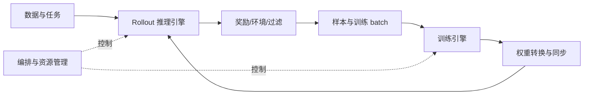

# 第 25 章　RL目标与系统角色

从反馈定义学习目标，将策略生成、奖励、概率与更新连接成完整闭环。

本章内容：

- [1. RL 系统全景：角色、状态与执行阶段](#s1)
- [2. RL 算法需要系统保存什么](#s2)
- [3. 奖励不可微，梯度从哪里来](#s3)

## 1. RL 系统全景：角色、状态与执行阶段

> 前置：[生成与采样](<../05_Inference/19_生成执行与采样.md#s2>)、[训练更新](<../04_Training/12_数据管线与训练循环.md#s1>)。本节定义 rollout、reward 与 policy update，再把它们对应到进程、状态和等待。

### 从“模仿答案”到“根据反馈改进”

RL（Reinforcement Learning，强化学习）用行动产生的反馈改进决策。对语言模型，可以先把当前 prompt 与已生成前缀看成 **state（状态）**，把下一个 token 看成 **action（动作）**；**policy（策略）**是模型在该上下文下选择各 token 的概率分布。这里的“策略”首先指一个分布，不是另一套独立算法或进程。

与用给定答案做交叉熵训练相比，RL 可以先让模型生成回答，再用 **reward（奖励）**评价结果。例如同一道可核验的数学题，模型生成三个回答，验证器给出分数 `[0,1,1]`。训练算法尝试提高表现较好动作的概率、降低表现较差动作的概率；具体要相对什么基准、改动多大，由本章第 2 节的优势与目标函数决定。奖励高也不必然等于真实任务质量高，奖励本身需要验证。

**Rollout（采样执行）**是用策略行动并收集结果的过程；**trajectory（轨迹）**记录上下文、动作、反馈与终止信息；**policy update（策略更新）**使用这些数据修改参数。即使一次回答只在末尾得到一个分数，也仍需把反馈对应到生成它的动作序列。

先区分三个容易混用的数。即时奖励 $r_t$ 是执行第 $t$ 步动作后收到的分数；回报 $G_t=\sum_{k=t}^{T-1}\gamma^{k-t}r_k$ 是从该步起的折扣奖励和；价值 $V^\pi(s_t)=\mathbb E_\pi[G_t\mid s_t]$ 是按策略 $\pi$ 继续行动时的预期回报。$T$ 为步数，$\gamma\in[0,1]$ 是无量纲折扣，每往后一步多乘一次。奖励和价值沿用任务分数的尺度，不是概率，数值可以超过 1。优势的理想形式 $A^\pi(s,a)=Q^\pi(s,a)-V^\pi(s)$ 中，$Q$ 先固定动作 $a$ 再求后续回报；实际通常只能用采样估计。

教学例中两步奖励为 `[0,1]`、$\gamma=0.9$，回报为 `[0.9,1]`。若价值预测为 `[0.5,0.6]`，简单的“采样回报减基线”为 `[0.4,0.4]`。第一步虽没有即时奖励，仍可能得到正学习信号。这不是证明第一步独立贡献了 0.4 分；它是本次采样相对预测值的偏差。后面会比较组相对优势与使用 critic 的 GAE，两者是不同的估计方式。

本文单轮语言模型先按 token 定义一步；第 28 章的工具 agent 也会按整次工具决策定义一步。步长一变，折扣、奖励位置和终止边界都要一起声明，不能把每轮 0.9 与每 token 0.9 当成同一配方。

### 同一份策略，两套执行环境

训练侧计算 loss、backward 和 optimizer update；推理侧持续生成 token、管理请求与 KV。两侧可能使用不同模型布局和并行度，因此参数需要转换并发布到生成引擎。

这张图表达依赖，不表示所有部署都严格串行。共置表示生成和训练共享设备，分离表示使用不同资源；partial rollout 表示未完成整条轨迹就暂停或交接。同步与持续异步执行会改变资源与时序，需要在基础完成后分别分析。

### 每次读代码回答四个问题

| 问题 | 在 RL 中看什么 |
|---|---|
| 谁执行 | driver、Ray actor、HTTP server、GPU worker、rank |
| 状态在哪里 | 权重、优化器、activation、KV、sample buffer |
| 谁等谁 | 生成长尾、reward、通信、换权、CPU 数据准备 |
| 什么不能改变 | mask、logprob、样本版本、梯度归一化、释放顺序 |

Driver 是协调主循环的进程，Ray actor 是分布式框架 Ray 管理的有状态工作进程，HTTP server 是接收网络请求的服务。它们与算法里的 actor/policy 不是同一个分类层次。算法知识帮助你判断最后一行，前三行需要新的系统知识。基础没补齐时先识别边界，不要求第一次就读懂所有源码。

### 局部加速的上限

假设一轮 rollout/reward/训练/换权依次为 60/10/20/5 秒，总计 95 秒。若训练快一倍，一轮变为 85 秒，收益约 10.5%。当阶段可并发时，又不能简单相加。先画真实时间线和关键路径，资源分离还要比较 GPU 成本与样本版本。

### 原理与实现的边界

百科的物理、数值与系统条目解释通用机制；Megatron/SGLang 走读解释具体执行引擎；slime 走读解释 RL 协同。论文详解与模型专题保留特定设计的推导和证据。

实现参见 [slime 编排中的角色与主循环](<../appendices/source/slime/01_architecture_and_ray_orchestration.md>)，画一轮同步 RL 图，给箭头标上控制请求、样本、权重或统计量。需要底层解释时，可按[物理基础目录](<../appendices/foundations/README.md>)补齐。

相关条目：[运行环境](<../appendices/hardware/Linux与运行环境.md>)。连续阅读见[系统路线](<../README.md>)，所有专题见[总目录](<../README.md>)。

### 角色怎样变成执行阶段

Learner 是执行学习更新的角色；有些文献称生成端为 actor，另一些框架称待优化的策略模型为 actor。阅读时要先判断它指算法模型还是执行进程。角色是逻辑职责，不要求各自拥有独立进程或 GPU。

PPO（Proximal Policy Optimization，近端策略优化）通过限制一次策略改动的目标提高更新稳定性；GRPO（Group Relative Policy Optimization，组相对策略优化）用同题多回答的相对奖励构造优势。优势表示一个动作或回答相对基准好多少，critic/value 估计从当前状态继续行动的预期累计奖励。这里先识别职责，第 2 节再算数值。

| 角色 | 输入与输出 | 状态与执行成本 |
|---|---|---|
| Actor / policy | 上下文 → 动作；训练 batch → 梯度 | 生成侧权重与 KV、训练侧激活和优化器 |
| Reference | 同一上下文和动作 → 参考 logprob | 常冻结；可前向计算或在适用条件下预计算 |
| Critic / value | 状态 → value，训练 value 目标 | PPO 等配方可能需要；组相对方法不必配置独立 critic |
| Reward / verifier | 回答或轨迹 → 分数与判定 | 规则、模型或环境服务，可能以 CPU/网络为关键路径 |
| Environment | 动作 → 观察、终止与任务状态 | 多轮会话、工具、沙盒和外部状态 |

Reference 是比较分布，reward 是训练信号，critic 是价值估计，三者不应因为都能由模型实现就合并为同一个角色。具体配方还可能加入 teacher 或去掉其中某些角色。

一轮同步 GRPO 可先固定生成权重，按 prompt 生成完整回答组，完成奖励与过滤，构造 mask/优势，计算所需旧策略和 reference 概率，再做训练更新和换权。PPO 加入 critic 与价值目标；异步执行允许不同阶段并发，但每条数据仍须记录对应身份与版本。

把一组数学题回答沿这条链追踪，可以看到哪些状态必须同时存在。下面是分离生成与训练进程的一种教学部署，非框架固定配置；KV 指注意力的 key/value 缓存，activation 指反向传播需要的中间激活。

| 阶段与执行者 | 输入在哪里，产生什么 | 完成条件与释放边界 |
|---|---|---|
| 调度进程提交同题三次采样 | CPU 保存题目和 group ID；推理 GPU 保存行为权重 | 三条请求分别记录 token 和概率；一条结束不代表组完整 |
| 推理 worker 逐 token 生成 | GPU 维护各请求 KV；输出通常转入 CPU 样本缓冲 | 最后设备访问结束且无共享引用后，才能回收请求 KV；无需等训练结束 |
| 验证器判分 | CPU/服务读取不可变答案，返回三份 raw reward | 每条有确定评分状态后才能形成完整组统计；失败不是自动的零分 |
| Learner 准备 batch | token、mask、固定优势、旧/参考分数搬到训练设备 | 固定分数可跨同批多次优化复用；当前分数每次随参数重新计算 |
| Learner 前向、反向与更新 | GPU 保存当前激活、梯度和优化器状态 | 反向后释放本次激活；更新结束仍保留权重和优化器状态供下一步 |
| 发布器转换并发送权重 | 从一致训练快照重分片到推理设备 | 接收者完成装载和缓存处理后才能服务新版本；发送缓冲须等通信读取结束 |

可见推理 KV 和训练激活不是同一份“缓存”。前者帮助继续生成，后者支持对已知动作求导；通常训练端会按记录 token 重新前向，不能直接拿生成期间的 KV 当成完整反向图。

### 四条跨系统边界

| 边界 | 必须一致的对象 | 继续阅读 |
|---|---|---|
| 生成 → 训练 | token、动作 mask、概率语义 | [行为概率与异步校正](<27_权重发布异步与资源调度.md#s2>) |
| 动作 → 环境 | session、attempt、工具副作用、终止 | [多轮轨迹与环境执行](<28_Agent环境与多轮训练.md#s2>) |
| 评价 → 更新 | reward revision、组身份、过滤规则 | [奖励评估与质量闭环](<26_Rollout奖励与训练数据.md#s2>) |
| 更新 → 生成 | 参数布局、发布完成、KV 失效 | [权重与异步一致性](<27_权重发布异步与资源调度.md#s1>) |

通用的 GPU、编译与通信定位方法见[性能基础](<../07_Practice/29_性能测量与因果分析.md#s1-9-跨层定位八个系统问题>)；本节继续沿 RL 的角色与数据流展开。

### 完整推演与演进资料

- [RL系统演进史：从同步算法循环到分布式角色与版本管理](<../appendices/rl/RL系统演进史.md>)：同步循环、actor/learner、RLHF多角色、混合引擎与异步。

---

## 2. RL 算法需要系统保存什么

本节从第 1 节的“按反馈改进”走到训练需要保存的数字。先用一句直觉连接它们：**reward 告诉我们结果如何，advantage（优势）说明相对基准好多少，logprob 让训练知道是哪种决策产生了结果。** 正优势通常推动相应动作概率上升，负优势推动下降；这不意味着把奖励值直接当成梯度。

例如在不考虑裁剪等项的简化策略损失 $L=-A\log\pi_\theta(a|s)$ 中，s 是上下文，a 是动作，θ 是当前参数，A 是训练时视为固定的优势。对所选动作的 logprob 求导为 −A；A=1 时梯度下降倾向增大该 logprob，A=−1 时倾向减小。真实模型的 softmax 将各动作概率关联起来，更新仍需经过自动微分。

### 一条轨迹有哪些身份

在语言模型 RL 中，prompt 和已生成前缀构成决策上下文，生成 token 是动作，环境或奖励过程提供反馈。一条训练样本至少应能关联 prompt、response、终止原因、mask、行为策略版本和相应概率信息。

Actor 产生并更新策略；reward 给出评价；reference 常用于约束偏离；critic/value 是否存在取决于算法。角色名称相同也不保证每个框架采用相同执行顺序和数据格式。

### 重要性比率为什么要求行为信息

μ 表示实际产生样本的行为策略，πθ 表示当前训练策略，下标 t 表示动作位置，exp 是自然对数的逆运算。一个常见 token 级比率为 $r_t=\exp(\log\pi_\theta(a_t|s_t)-\log\mu(a_t|s_t))$。分母对应实际产生数据的行为分布。若分母混用了不同权重、模板或采样处理，比率就不再表示原来想要的关系。

例如 μ(a|s)=0.2、πθ(a|s)=0.3，比率为 1.5，表示当前策略给这个已观察动作的概率是行为策略的 1.5 倍。直觉上，行为策略较少采到、目标策略却更重视的动作，需要在估计中获得更大的权重；反过来则减小权重。

这种调整有一个前提：目标策略可能选择的动作，行为策略也必须有机会采到。这称为支持集合覆盖。例如目标策略有 10% 的概率选择 C，但生成时 top-k 已把 C 的概率截成零，数据里就永远没有 C 的结果。给 A、B 调整权重无法补出 C 的奖励，更不能对不存在的 C 样本计算一个有限比率。第 27 章会进一步区分实际行为分布、旧策略评分与当前策略评分。

PPO 裁剪目标通常比较当前策略与本批冻结的 old 策略；同步采样时 old 可与 μ 一致，异步或跨引擎重算时未必一致，届时行为校正与 PPO 比率须分别定义。PPO 风格的裁剪目标还需要优势估计和有效位置。GRPO 等组相对方法依赖样本分组与奖励统计；把组拆散后任意重组，可能改变归一化语义。系统调度必须保留算法要求的关联。

### Token 对齐是一种数据契约

logits 的位置、预测 token、response mask、padding 和 packed offsets 必须一致。一个 off-by-one 可以让程序正常运行却优化错误目标。截断、工具调用、失败重试和 partial rollout 需要定义哪些 token 属于可训练动作。

### 吞吐之外的有效工作

完成的 token 不一定都进入训练，进入训练的样本也不一定具有所需有效性。应记录生成、通过过滤、训练消费和因版本或失败丢弃的数量，才能判断优化是否增加有效数据供给。

### 演进中的交换

同步批次易于界定策略版本，但会等待长尾；流水化减少空闲，增加版本差；异步系统提高资源解耦程度，却需要明确样本陈旧度、行为信息和校正策略。系统层能记录版本，无法仅靠版本号证明算法质量不受影响。

实现：[slime RL 算法](<../appendices/source/slime/05_rl_algorithms.md>)、[样本与异步 buffer](<../appendices/source/slime/03_data_buffer_partial_rollout_async.md>)。

参考：[PPO](https://arxiv.org/abs/1707.06347)、[DeepSeekMath / GRPO](https://arxiv.org/abs/2402.03300)。

### 从轨迹到目标：Token对齐、GRPO组统计与PPO裁剪

> 以下给出可逐项核算的教学配置，不代表 slime 所有配置的默认目标。先用三条同 prompt 回答构造组相对优势，再计算常见 PPO 式 token 裁剪项，最后比较不同均值与另一种优势估计。正文旁的源码链接用于复核实现，首次阅读不必先打开源码。

为隔离基础目标，本例关闭额外项：KL（Kullback–Leibler divergence）衡量分布偏离；熵衡量分布的不确定性；dual clip 是额外的裁剪变体；TIS 是截断重要性采样校正；优势白化是进一步做中心化和尺度归一化。它们不是读懂本例的前提。

#### 第一步：一条轨迹的输入与预测对齐

EOS（End Of Sequence）是结束标记，以下位置从 0 编号。prompt=[p0,p1]，某回答=[a0,EOS]。拼接输入[p0,p1,a0,EOS]后，logits位置1预测a0，位置2预测EOS。取logits位置2来评价a0是错位，不是数值容差。

response维上的token数组=[a0,EOS]，对应logprob、advantage、loss mask也都长2。若EOS计入本例训练目标，则mask=[1,1]；padding在真实response外，不能参与分母。工具返回内容若不属于策略动作，应按数据契约屏蔽，不能只凭它处在response字符串内就纳入训练。

继续把三条回答组成一个右侧补齐的 batch：prompt 长度均为 2，response 长度为 `[2,1,2]`，最大输入长度为 4。输入 IDs 为 `[3,4]`，若教学词表有 5 项，logits 为 `[3,4,5]`。沿词表维做 log-softmax 后，根据真实 token 取相应项，再抽取 response 预测位置，得到 `[3,2]` 的 logprob。Mask 为 `[[1,1],[1,0],[1,1]]`，优势广播后也为 `[3,2]`；每个 mask=1 的元素必须能回到唯一的“样本、输入前缀、目标 token”。

例如某位置的 logits 是 $[\log1,\log2,\log3,\log4,\log10]$，指数和为 20；若选中的 token 是第三项，其 logprob 为 $\log3-\log20=\log0.15$。训练需要的是这一个动作的 logprob，而不是把词表五项的 logprob 相加。组奖励开始时只有 `[3]`，与 `[3,2]` 对齐靠显式广播；多出维度不会自动补上正确语义。

Rollout还要保留prompt/group身份、行为策略版本、终止原因、原始奖励与概率语义。实际由temperature/top-p等处理后的分布采样时，“模型原始概率”和“行为概率”可能不同。本页令它们相同。

#### 第二步：三条回答形成一组

同一个prompt的回答R0、R1、R2的奖励为[0,1,2]，有效response长度分别[2,1,2]。选样本标准差口径：均值1，方差=((−1)²+0²+1²)/(3−1)=1，标准差1。

为了手算省略epsilon，组归一化结果为[−1,0,1]。本例将每条回答的标量优势广播给其有效动作，所以token优势分别[−1,−1]、[0]、[1,1]。

如果改用总体标准差sqrt(2/3)，优势会变成[−sqrt(3/2),0,sqrt(3/2)]。这不是浮点误差，而是另一种缩放。单样本组使用样本标准差还有自由度问题；全相同奖励的组则要定义零方差处理和是否过滤。

这一步的目的，是在同题内部建立相对基准，减少不同题目原始分数偏移的影响。一般写为 $\bar R=K^{-1}\sum_iR_i$、$s=\sqrt{\sum_i(R_i-\bar R)^2/(K-1)}$、$\widehat A_i=(R_i-\bar R)/(s+\varepsilon_s)$，其中 $K$ 是组大小，$\varepsilon_s$ 与奖励标准差采用相同尺度。归一化优势无量纲；只中心化时优势仍沿用奖励尺度。尺度归一化也会改变不同题目组的相对权重，不只是数值整理。

全组相同奖励且 $K>1$ 时，中心化后全零，正的 $\varepsilon_s$ 可以避免除零；$K=1$ 时样本标准差本身无定义，后加 epsilon 不能修复 NaN（非数值）。PyTorch 的 `torch.std` 默认 `correction=1`，对应 $K-1$ 分母，需与总体口径 `correction=0` 区分。[PyTorch 标准差接口](https://docs.pytorch.org/docs/stable/generated/torch.std.html)

在当前工作区，[rollout奖励处理](<../../../slime/ray/rollout.py>)的`_post_process_rewards`在相关开关开启时先中心化，再用`rewards.std(dim=-1, keepdim=True)`和`1e-6`做标准差归一化。因此实际数值会与本页省略epsilon的整数优势略有不同；自定义reward后处理可以替换该路径。变长或缺失组的fallback也须检查，不能推断任意打乱后的组都能被还原。

#### 第三步：区分四份概率

| 名称 | 用途 | 在异步或不同引擎下的风险 |
|---|---|---|
| rollout行为概率μ | 解释数据如何生成，可能用于校正 | 权重和采样后处理必须匹配 |
| 冻结的old策略概率πold | PPO这一批优化的比较基准 | 可能由训练端重算，未必等于μ |
| 当前可求导概率πθ | 得到本次优化梯度 | 不能detach后仍期待策略梯度 |
| reference概率πref | 约束相对参考策略的偏移 | 不应误当PPO分母 |

本例设μ=πold，各token的选中动作old概率均为0.2；不同位置属于不同条件分布，表内概率无需跨位置相加为1。当前概率与比率如下。

#### 第四步：逐token计算裁剪损失

clip(r,0.8,1.2) 表示将 r 限制在该区间；此处 epsilon 是裁剪宽度，与优化器防止除零的 epsilon 不是同一个量。取epsilon=0.2，r=exp(logπθ−logπold)，最小化的策略损失为max(−rA,−clip(r,0.8,1.2)A)。使用max是因为常见最大化目标取负号后变成最小化。

| 回答/token | A | old概率 | 当前概率 | r | −rA | −clip(r)A | 最终loss |
|---|---:|---:|---:|---:|---:|---:|---:|
| R0/t0 | −1 | 0.2 | 0.4 | 2 | 2 | 1.2 | 2 |
| R0/t1 | −1 | 0.2 | 0.1 | 0.5 | 0.5 | 0.8 | 0.8 |
| R1/t0 | 0 | 0.2 | 0.2 | 1 | 0 | 0 | 0 |
| R2/t0 | 1 | 0.2 | 0.3 | 1.5 | −1.5 | −1.2 | −1.2 |
| R2/t1 | 1 | 0.2 | 0.1 | 0.5 | −0.5 | −0.8 | −0.5 |

负优势且r过大时，损失2仍保留抑制该动作的梯度；负优势且r已经低于下界时，裁剪项0.8成为常数。正优势的方向相反。因此“r超出区间就没有梯度”不是正确描述。

对当前logprob求导，五个位置的未归一化导数为[2,0,0,0,−0.5]。本例没有恰好落在拐点的情况，可用有限差分核对。

导数从 $\ell=\log\pi_\theta$ 开始算：$r=e^{\ell-\ell_{old}}$，故 $\partial r/\partial\ell=r$；当选中未裁剪分支时，$\partial(-rA)/\partial\ell=-rA$。例如 R0/t0 得 $-2(-1)=2$，R2/t1 得 $-0.5(1)=-0.5$。当选中区间外的常数裁剪分支时，这一策略项的导数为零。裁剪的目的，是不再奖励某些已经足够大的有利移动，减少反复复用同批数据时的过度更新；其他 token 的梯度、共享参数和附加损失仍能改变该位置概率，所以它不是参数更新的硬约束。

源码对应：[compute_policy_loss](<../../../slime/utils/ppo_utils.py>)按该基本结构计算，并支持可选dual clip；[policy_loss_function](<../../../slime/backends/megatron_utils/loss.py>)还根据配置选择old logprob来源、序列级变体和校正，不能把该基础函数视为全部loss。

#### 第五步：相同token loss，两种不同训练目标

按所有有效token平均：总和2+0.8+0−1.2−0.5=1.1，除以5，loss=0.22。

先每序列平均，再三序列平均：(1.4+0−0.85)/3≈0.183333。两者给长序列的相对权重不同；新增padding不应改变任一正确实现的结果。

如果一个rollout又拆成多个训练片段，片段数不能悄悄成为新的权重。当前slime通过`rollout_id`关联此类样本，调用处与归约器还维护相应normalizer；请结合[RL数据与数值正确性](<26_Rollout奖励与训练数据.md#s1>)和[loss归约实现](<../../../slime/backends/megatron_utils/loss.py>)查阅。这不等于本页任一种简单均值覆盖所有拆分场景。

#### 第六步：PPO使用critic时，优势如何从尾部算回来

GAE（Generalized Advantage Estimation，广义优势估计）把多步预测误差结合起来估计优势；TD（Temporal Difference，时序差分）残差比较“即时奖励加下一状态估值”与当前估值。γ 控制未来奖励的折扣，λ 控制递推时保留多少后续误差信号。这里的 r_t 表示即时奖励，不是前文的概率比率；V 是 critic 的价值预测。

另取一条两步终止轨迹，token奖励[0,1]，当前状态value=[0.2,0.4]，真正终止后的value=0，gamma=1，lambda=0.5。TD残差δt=rt+gamma V(t+1)−V(t)：δ0=0.2，δ1=0.6。

从尾部递推：A1=0.6；A0=0.2+0.5×0.6=0.5。用于value目标的A+V为[0.7,1.0]。若使用lambda=1，本例会得到不同优势；若只是时间上限截断，是否 bootstrap（用未终止状态的价值预测补上未观察到的未来回报）也必须由任务的终止语义定义，不能一律把末值置0。

把递推展开就能看到 GAE 混合了什么：对终止长度 $T$，$A_t=\delta_t+\gamma\lambda\delta_{t+1}+(\gamma\lambda)^2\delta_{t+2}+\cdots$。$\lambda=0$ 只保留一步 TD 误差，更依赖价值预测；$\lambda=1$ 时，将 $\delta_t=r_t+\gamma V_{t+1}-V_t$ 逐项代入，中间的 $+\gamma V_{t+1}$ 与下一项的 $-\gamma V_{t+1}$ 抵消，得到 $A_t=G_t-V_t$（真正终止的尾值为零）。本例此时优势为 `[0.8,0.6]`，价值目标为 `[1,1]`。$\lambda=0.5$ 时的 0.7 是混合估计目标，不是实际终局奖励被改成了 0.7。

训练 critic 的一种简单目标是 $L_V=\frac1{2N}\sum_t(V_\phi(s_t)-\operatorname{stopgrad}(A_t+V_{old}(s_t)))^2$。$\phi$ 是 critic 参数，$N$ 为有效位置数，平方误差的尺度是奖励单位的平方。旧 value 和优势生成固定目标，当前 value 保留梯度。实际 PPO 还可用价值裁剪等变体；这里仅解释“预测值怎样得到监督目标”，不规定框架配方。

本段是另一种优势来源，不把GAE再次叠加到上面的组优势上。算法原理见[PPO](https://arxiv.org/abs/1707.06347)、[GAE](https://arxiv.org/abs/1506.02438)、[DeepSeekMath / GRPO](https://arxiv.org/abs/2402.03300)。

#### 接入分布式训练前的边界

CP（Context Parallelism，上下文并行）切分不能让某些动作缺失或重复计数；DP（Data Parallelism，数据并行）不等token数时需要正确分母；TIS/拒绝过滤后要明确是否保留原分母；KL惩罚加在reward、advantage或loss中是不同设计。先复现本页关闭额外项的结果，再逐项打开复杂机制，能更容易定位语义变化。

验证：[数值与梯度脚本](<../examples/training_rl_walkthroughs.py>)。跨批次的版本和队列见[异步RL推演](<27_权重发布异步与资源调度.md#s1-异步rl推演队列样本身份与权重发布边界>)。

#### 贯穿到当前实现

[对照真实字段、归约器与debug dump](<../07_Practice/32_RL综合案例.md#s1>)。

---

### 多轮与分布偏差的扩展入口

本节维护目标与梯度的完整推演。μ、old、current、reference 的事件定义、支持集合和 TIS 边界见[行为概率](<27_权重发布异步与资源调度.md#s2>)；工具返回、终止和重试见[多轮轨迹](<28_Agent环境与多轮训练.md#s2>)；过滤与评估分母见[奖励评估](<26_Rollout奖励与训练数据.md#s2>)。

## 3. 奖励不可微，梯度从哪里来

前面把优势放进了策略损失，还剩一个关键问题：测试程序只返回通过或失败，既不能对离散 token 求导，也不能对进程退出码反向传播，模型为什么仍然能学习？梯度来自“选择这条轨迹的概率怎样变化”。

先设固定任务、有限轨迹集合，环境转移和奖励规则不依赖参数 $\theta$，采样来自当前策略。记轨迹为 $\tau$、总奖励为 $R(\tau)$，则

$$J(\theta)=\sum_\tau P_\theta(\tau)R(\tau),\qquad
\nabla J=\mathbb E_{\tau\sim P_\theta}\left[R(\tau)\nabla\log P_\theta(\tau)\right].$$

先看只有两个动作的例子：A 总能通过测试，奖励为 1；B 总失败，奖励为 0。若模型选择 A 的概率为 p，期望奖励就是 $p\times1+(1-p)\times0=p$。当模型把 p 从 0.2 提高到 0.3，期望奖励随之提高 0.1；测试规则完全没有改变。要优化的是模型分配给动作的概率，而不是对“通过”这两个字求导。

上式将同一个想法写成可采样的形式。对 $J=\sum_\tau P_\theta(\tau)R(\tau)$ 求导时，奖励视为固定数，只对概率求导；再使用 $\nabla P=P\nabla\log P$，就能把和式写成按当前概率采样的期望。实践中用采到的轨迹近似这个期望：高奖励轨迹的 logprob 梯度获得更大的权重。

在两动作例中进一步令 $p=\sigma(\theta)$，这里 $\theta$ 只是一个标量参数。$dp/d\theta=p(1-p)$；在 $p=0.2$ 时，真实梯度为 0.16。采到 A 的概率是 0.2，它的 score 梯度 $d\log p/d\theta=1-p=0.8$，乘奖励 1；采到 B 时奖励为零。因此估计量的期望是 $0.2\times0.8+0.8\times0=0.16$，恰好等于直接求导。一次抽到 B 得到零梯度，并不否定这个期望结论；它说明有限采样有噪声。用于梯度下降的 loss 要加负号，因为期望奖励是要最大化的。

轨迹概率又是各步策略概率与环境转移概率的乘积，取 log 后变成求和。在本节环境不依赖参数的假设下，环境项的导数为零，留下 $\sum_t\nabla\log\pi_\theta(a_t\mid s_t)$。因此需要保存每步真实上下文和动作，用可微模型重新评分；工具执行器本身不必可微。若数据来自旧策略，采样的期望已经变了，这正是第 27 章要另行处理的情况。

在固定状态下，减去不依赖当前动作的基线 $b(s)$ 不改变该项期望，因为 $\sum_a\pi(a\mid s)\nabla\log\pi(a\mid s)=\nabla1=0$。它可以改变方差。由同一组动作算出的组均值则含当前动作自己的奖励，不能未经分析就套用这个“不改变期望”的结论；组归一化、有限组大小与裁剪共同定义实际使用的估计量。

继续取基线 $b=0.2$：A 的带权梯度为 $(1-0.2)\times0.8=0.64$，B 为 $(0-0.2)\times(-0.2)=0.04$，期望仍是 $0.2\times0.64+0.8\times0.04=0.16$。独立同分布地采 $K$ 个动作且只减去包含自身的组均值时，平均估计的期望会变成原梯度的 $(K-1)/K$：展开均值后，自身那项扣掉 $1/K$ 的梯度，其他奖励与当前 score 独立且 score 均值为零。这个推演解释了 $K=1$ 为什么全无信号；加入组标准差或裁剪后，不能再只用该常数概括变化。

第 5 章的 stopgrad 在此有了用途：作为固定学习信号使用的 reward、advantage 与 old logprob，应按配方切断梯度；当前策略 logprob 保留梯度。若额外设计了可微奖励或 KL 项，求导路径要另行声明。

### 一个叫 KL 的指标也需要说明采样分布

对固定状态，令当前与参考分布为 $p,q$，都在讨论的动作上为正。若 $a\sim p$，则

$$D_{KL}(p\|q)=\mathbb E_p\left[\log\frac{p(a)}{q(a)}\right].$$

单个样本的 $k_1=\log(p/q)$ 可以为负；非负的是总体期望。另设 $r=q/p$，$k_3=r-1-\log r\ge0$，因为 $\log r\le r-1$。在共同支持且归一化的条件下，$\mathbb E_p[r]=1$，所以它与 $k_1$ 有相同的 KL 期望。这是代数事实，不保证二者在任意数据和求导方式下具有相同梯度。

例如 $p=[0.8,0.2]$、$q=[0.5,0.5]$，两个动作的 $k_1$ 分别约为 0.470004、−0.916291，加权期望约为 0.192745。若实际样本来自另一个行为分布 $\mu$，直接平均这些数就未必估计 $D_{KL}(p\|q)$；还需分析采样与校正。截断采样缺失支持的问题见第 27 章的[概率契约](<27_权重发布异步与资源调度.md#s2>)。

因此日志至少注明 KL 的方向、分布版本、采样来源、估计式和归约单位。PPO clip 只截断目标中的部分收益，不是把所有动作的概率比率硬限制在 $[1-\epsilon,1+\epsilon]$，也不直接保证 KL 上界；应结合比率、clip 比例、奖励和独立质量观测判断更新。

例如同一批每条有效动作长度分别为 2 和 8，报告“平均 KL=0.1”之前要说清是每 token 还是每回答：若每 token 都为 0.1 nat，则两条回答的求和是 0.2 和 0.8 nat，回答均值为 0.5 nat。样本 log-ratio 的求和只有在相应采样和状态条件下才能解释为轨迹 KL 的估计；没有这些条件，日志应称具体估计量而非精确散度。

本章源码语义于 2026-10-15 对照本地 slime 提交 `b38426e91bc823aed2b31f86b0eb044218677094` 核对；上面的张量形状、梯度与时间数字都是教学配置，不是该提交的默认参数或实测性能。

策略梯度、基线与两种 KL 估计可用[标准库复算程序](<../examples/rl_infra_contracts.py>)检查，验证范围限于上述教学模型。

## 本章回顾

RL 的目标消费的是带身份、行为信息和有效位置的轨迹。生成、奖励、参考概率、优势和参数更新各有职责，只有这些接口一致，闭环才有明确数学含义。

**检查理解：** 一条轨迹交给训练器时必须包含哪些身份、概率和 mask，才能解释它对目标的贡献？

下一章讨论Rollout奖励与训练数据。把生成结果变成有明确分母和质量边界的训练样本，区分训练奖励、有效供给与独立评估。

<!-- book-nav -->

[上一章：微调与偏好优化](<24_微调与偏好优化.md>) · [全书目录](<../README.md>) · [下一章：Rollout奖励与训练数据](<26_Rollout奖励与训练数据.md>)

<!-- /book-nav -->
