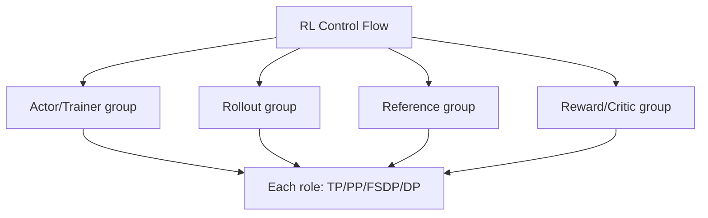

# 第 27 章　权重发布异步与资源调度

连接生成版本、行为概率与训练版本，在正确性约束下比较角色放置、异步和背压。

本章内容：

- [1. 权重、样本与异步系统的一致性](#s1)
- [2. 行为概率、旧策略与异步校正](#s2)
- [3. RL 角色级并行：模型内部之外还有数据流](#s3)
- [4. Ray、队列与背压：从远程调用走到 RL 调度](#s4)
- [5. 队列满了，也可能缺少有效统计信息](#s5)

<a id="s1"></a>

<a id="s1-权重样本与异步系统的一致性"></a>

## 1. 权重、样本与异步系统的一致性


本节把前面几种“完成”放在同一张时间线上：优化器更新完成、权重传输完成、生成引擎可服务、样本可训练，分别是不同事件。State machine（状态机）用有限个状态和允许的转换描述它们；原子发布表示对消费者只出现完整旧版本或完整新版本，不出现半新半旧。

<a id="s1-三种版本不能混用"></a>

### 三种版本不能混用

训练参数版本标识更新后的模型；推理可服务版本标识已准备好供生成使用的状态；样本行为版本标识实际生成数据的策略。权重传输完成，不一定意味着所有推理 rank 已切换，也不一定意味着旧请求已经结束。

Tokenizer、adapter、模板、位置配置和缓存精度也可能参与生成语义。缓存是否可复用必须跟随它依赖的状态，而不能只比较某个文件名。

为什么不能“token 没变就沿用旧 KV”？对某层的输入隐藏状态 $h$，缓存由 $K=W_Kh$、$V=W_Vh$ 计算。教学上取标量 $h=2$，旧 $W_K=1$ 得 $K=2$，新 $W_K=1.5$ 得 $K=3$。若后续 query 为 1，未缩放点积分数会从 2 变为 3；继续用旧缓存是在混合不同模型的计算。即便该层 $W_K$ 未变，更早层的更新也可能改变 $h$。只有证明缓存的全部依赖仍相容，才能保留；否则要失效并用原 token 重新做 prefill，承担重算成本。

<a id="s1-同一时刻为何会有三个版本"></a>

#### 同一时刻为何会有三个版本

假设训练已更新到 v13，推理还在用 v12 服务，队列中的某条样本是在 v11 下生成的。此时三者分别为训练版本 13、可服务版本 12、行为版本 11。将 v13 传完并确认引擎切换后，只能把后续实际用它生成的样本标为 13；队列里 v11 的行为概率不会随之改变。

Policy lag（策略版本差）可记为训练版本减行为版本，本例为 2；样本年龄则是从产生到消费经过的时间，两者单位不同。两秒内更新十次与十分钟只更新一次，会给出完全不同的关系。

<a id="s1-一次发布的状态机"></a>

### 一次发布的状态机

```text
准备候选版本 → 传输或重分片 → 校验与就绪 → 发布 → 回收旧版本
                    ↘ 失败：按实现协议恢复或终止
```

这是分析模型，不宣称每个框架都有原子发布或回滚。检查实际实现时，要分别寻找参与者集合、完成条件、失败路径与旧版本资源的引用关系。

可以把一次发布拆成三份交接记录。Learner 先固定“要发的参数及布局”，防止优化器在拷贝途中改写源数据；发送端再记录“各桶传输完成”，只有通信不再读取源缓冲后才能复用它；服务端最后记录“必需 rank 全部装载并准备接客”，包含本地设备上的写入、后处理与缓存协议。Bucket（桶）是把多块参数合并传输的工作单位；某桶完成仅能释放对应临时空间，不代表整个模型可服务。

Barrier 是参与进程到达同一点的集合同步，不能不加区分地当成所有 GPU 流、HTTP 请求和缓存操作都已完成的证据。必须看此前调用等待了哪些事件，以及 barrier 的参与集合是否覆盖所有服务 rank。旧模型副本、KV、发送缓冲是三种资源，分别按请求引用、设备访问和传输完成条件回收。

<a id="s1-同步与异步改变等待位置"></a>

### 同步与异步改变等待位置

同步执行可以在一轮边界集中等待。流水化把等待拆散到队列、权重发布和消费者依赖。异步结构中，一个队列稳定并不保证另一个队列稳定；长尾生成也可能使样本年龄分布远大于平均值。

示意：生成每秒 12 个样本，训练每秒消费 10 个，持续一分钟增加约 120 个积压。若不限制输入或处理过期样本，内存占用和陈旧度会同时增长。提高生成吞吐反而可能扩大无效工作。

<a id="s1-背压应控制什么"></a>

### 背压应控制什么

根据实际资源限制在途请求、token、KV 字节或样本年龄。仅限制 worker 数不能控制每个任务的大小；仅限制平均队列长度不能保证最长样本等待时间。

策略可以包括暂停生产、调整资源比例、拒绝新任务或按明确规则丢弃。丢弃规则会改变数据分布，需要与算法共同评估。

<a id="s1-取消与重试"></a>

### 取消与重试

客户端取消等待不代表服务端停止执行；服务端 abort 也可能需要等待设备任务完成后才能安全回收。重试需要识别重复样本，避免同一结果被重复训练或计数。

<a id="s1-验证一项异步优化"></a>

### 验证一项异步优化

同时比较有效训练吞吐、样本年龄分布、版本差、队列字节、发布时间和算法质量。先验证小规模状态机与故障路径，再讨论规模化性能。

实现：[slime 权重与内存](<../appendices/source/slime/04_weight_sync_and_memory.md>)、[SGLang 控制面](<../appendices/source/sglang/04_interfaces_and_models/03_control_plane_and_post_training.md>)。


<a id="s1-异步rl推演队列样本身份与权重发布边界"></a>

### 异步RL推演：队列、样本身份与权重发布边界

> 本页先推演一个明确指定的设计，再对照当前slime工作区。教学协议中的提交、去重与版本阈值不是对仓库现有容错能力的承诺。前置为本节前半部分；角色资源组合可选读 [RL 角色并行](<#s3>)。

<a id="s1-一秒一个时槽队列怎样变旧"></a>

#### 一秒一个时槽，队列怎样变旧

假设rollout每秒最多产出4个完整奖励组，learner每秒消费2组；每组3条回答。教学模型在每个时槽先准入新完成组，再消费2组，不计其他开销。

没有背压时，四个时槽末队列分别为2、4、6、8组。即使生产者速度恒定，队列等待与样本陈旧度仍在增长。增加rollout GPU会更快积压，未必更快训练。

现在限制完成组队列峰值为6，超过容量的工作通过生产侧节流留待以后启动：

| 时槽 | 开始排队组数 | 本槽允许完成入队 | 消费组数 | 槽末排队 | 入队后峰值 |
|---|---:|---:|---:|---:|---:|
| 0 | 0 | 4 | 2 | 2 | 4 |
| 1 | 2 | 4 | 2 | 4 | 6 |
| 2 | 4 | 2 | 2 | 4 | 6 |
| 3 | 4 | 2 | 2 | 4 | 6 |

这是理想节流模型。真实系统中的任务已在途，停止新增任务后仍会有完成回调，因此上限必须把在途工作一起考虑，不能照表把队列对象设maxsize=6就宣称同样行为。

事件循环里的同步阻塞put还可能阻止其他任务完成。更合适的控制点通常是减少新任务启动、使用可等待的异步通道，或明确缓冲溢出策略；选择取决于执行模型。

更接近真实实现的准入法是预留“将来完成后的空间”：若完成队列已有 $Q$ 组、在途已承诺 $I$ 组、总预算为 $C$ 组，则只有在 $Q+I<C$ 时才再启动一组。完成时将一个在途预留转成排队占用；消费或确定丢弃后归还；失败重试若仍可能返回结果，不能先归还再让晚到回调重复占用。这是一种保守设计，并非当前 slime 的精确实现。变长样本还应使用最大输出预算或分段配额预留字节，组数有界并不等于内存有界。

<a id="s1-样本版本阈值如何工作又不能证明什么"></a>

#### 样本版本阈值如何工作，又不能证明什么

假设learner当前版本12，教学准入规则仅接受版本差0到2的完整组：

| 组 | 行为版本 | 状态 | 决策 |
|---|---:|---|---|
| G0 | 10 | 完整且未消费 | 接受，lag=2 |
| G1 | 9 | 完整 | 按本协议过期丢弃 |
| G2 | 11 | 部分回答中断 | 不作为完整组训练，进入恢复路径 |
| G0重试 | 10 | 与已提交消费的组身份相同 | 拒绝重复提交 |
| G3 | 13 | 声称来自未来版本 | 检查身份/时序错误 |

数值阈值2只是示例，不是算法推荐值。版本差无法衡量精确策略偏移；行为logprob、训练重算logprob及其差异才能帮助分析概率语义。重要性权重截断或过滤也会引入各自的偏差与方差，不能仅凭有校正开关就宣称恢复为 on-policy（数据由当前要优化的策略产生）。使用其他或较旧行为策略产生的数据则涉及 off-policy 问题。

“同prompt”不构成去重身份：同一prompt可以有许多合法随机采样。可用稳定的rollout/group/sample/attempt标识区分逻辑样本和执行尝试；重试是否重用随机数也是协议的一部分。

<a id="s1-从训练权重12发布到生成权重13"></a>

#### 从训练权重12发布到生成权重13

考虑一个暂停生成后原地装载的协议。没有双份权重，因此装载过程中旧版本也未必完整可用：

1. learner完成第13次更新，形成一致的待发布参数快照。
2. rollout停止接纳需要旧版本的新工作，按引擎协议暂停、完成或中断在途生成。
3. 清理不再语义有效的KV和其他模型相关缓存，等待必要的设备访问边界。
4. 按参数元数据传输所有分片，装载到对应目标；桶完成不代表整模型完成。
5. 全部必需参数、后处理和检查完成后，标记版本13可服务，恢复生成。
6. 新样本记录实际使用的版本13。旧样本保留旧身份，不能因发布完成统一改标13。

若第4步失败，不能把已写入一半的模型对外标为版本12或13。需要保持暂停并重装一个完整快照，或按部署设计重建引擎；只有预先保证旧副本完好时，才可以无损回退到旧版本。

双缓冲可以把装载与旧模型服务部分重叠，但要付出第二份权重容量及切换协议。选择哪条路线首先取决于可用内存与换权频率。

一个重分片手算例：训练端按行切分 $W\in\mathbb R^{4\times4}$，两个 rank 分别持有前/后两行，形状都是 `[2,4]`；推理端按列切分，两个目标 rank 需要前/后两列，形状为 `[4,2]`。每个源要把自己的左半块 `[2,2]` 发给目标 0、右半块发给目标 1，目标沿行拼接。只按 rank 编号一一复制，元素数量相同却不是所需权重。以 BF16 计，矩阵本体共 $16\times2=32$ 字节，四块各 8 字节；这是逻辑有效载荷，实际 collective 的复制和中转可能传更多。

把大模型的有效载荷记为 $S$ 字节、瓶颈链路有效带宽为 $B$ 字节/秒，则仅传输的时间下界为 $S/B$。教学上 $S=8$ GiB、$B=4$ GiB/s 时至少 2 秒；若还依次需要 0.5 秒转换、0.5 秒校验，则串行至少 3 秒。分桶流水可重叠部分转换与传输，但受临时缓冲容量、参数依赖和链路争用限制。应使用有效带宽和实际传输字节，而非用网卡标称速率替代。

<a id="s1-与当前slime代码的对应与差异"></a>

#### 与当前slime代码的对应与差异

[分布式权重更新器](<../../../slime/backends/megatron_utils/update_weight/update_weight_from_distributed.py>)的`update_weights`可见顺序是：增加本地`weight_version`，rank 0调用`pause_generation`与`flush_cache`，barrier后发送权重，按配置做后处理，再调用`continue_generation`并barrier。`_send_weights`分非expert与expert两轮发送，并包含同步。

这里的计数增加发生在发送前，所以不能仅从该整数增加推断远端已成功发布。上述函数本身也不构成本页所述完整故障回滚或原子提交协议；失败恢复需要继续核对引擎、调用者与部署层。

[fully_async_rollout](<../../../slime/rollout/fully_async_rollout.py>)让后台worker跨rollout调用保持在途任务与完成队列；队列对象有意使用无界Queue，背压通过worker补充任务的条件实现。ABORTED组返回data_buffer；动态过滤未通过的组不计入所需的完成batch。这与“无界队列意味着完全没有背压”不同，也与本页严格6组上限的教学模型不同。

因此源码走读要分开看：任务并发、完成队列、过滤、重新入队、训练取数、换权。这些环节任何一个增加并发，都可能让另一个环节先达到瓶颈。上述顺序和队列条件于 2026-10-15 对照 slime 提交 `b38426e91bc823aed2b31f86b0eb044218677094` 核对；代码链接指向工作区文件，切换提交后应重新检查，不能将本节教学协议当成接口保证。

<a id="s1-训练消费也需要定义提交点"></a>

#### 训练消费也需要定义提交点

教学协议可把组分成 pending（等待）、leased/in-progress（已租用、处理中）、committed（消费已提交）三类。learner取走组只是租用；更新和恢复状态持久化后才能把消费提交。崩溃后重放未提交工作，并以稳定身份避免已提交组再次影响参数。

这个目标需要训练状态与样本消费记录的一致恢复，不能仅靠队列的 ack（处理确认）实现。若实际系统只保证 at-least-once（至少一次，可能重复）或允许丢弃，需要把语义写清，不把“能重启”说成“严格不重复”。[训练Checkpoint推演](<../04_Training/18_Checkpoint与故障恢复.md#s2-数据游标与checkpoint提交>)解释相关边界。

<a id="s1-什么指标能解释吞吐是否有效"></a>

#### 什么指标能解释吞吐是否有效

同时记录生成完成组、过滤组、中断组、过期组、重复组、实际提交训练组；队列记录组数、token数、年龄分位数与版本差；换权记录暂停、传输、后处理和恢复各段时间。

例如原始完成4组/秒，但最终只能稳定训练2组/秒，即使每组3条也不是12条有效训练样本/秒。若过滤使有效供给低于消费能力，learner又会饥饿；判断资源该加在哪里，必须使用过滤后的流量。

验证：[队列与准入模型脚本](<../examples/training_rl_walkthroughs.py>)。历史背景：[RL系统演进史](<../appendices/rl/RL系统演进史.md>)。

<a id="s1-贯穿到当前实现"></a>

#### 贯穿到当前实现

[对照默认pause、权重计数与失败边界](<../07_Practice/32_RL综合案例.md#s3>)。


---

<a id="s2"></a>

<a id="s2-行为概率旧策略与异步校正"></a>

## 2. 行为概率、旧策略与异步校正

> 前置：[采样](<../05_Inference/19_生成执行与采样.md#s2>)、[RL 目标](<25_RL目标与系统角色.md#s2>)。本节统一概率命名，不把某个校正配方当成所有异步算法的必要形式。

<a id="s2-四份概率各有用途"></a>

### 四份概率各有用途

在同一上下文 $s$、同一动作 token $a$ 上，记录：

| 符号 | 本节定义 | 主要用途 |
|---|---|---|
| $\mu(a\mid s)$ | 实际生成动作的分布，含采样处理与实际引擎 | 解释数据来源及行为校正 |
| $\pi_{old}(a\mid s)$ | 本次训练批次冻结的旧策略评分分布 | PPO 风格更新的比较基准 |
| $\pi_\theta(a\mid s)$ | 当前可求导的训练策略 | 更新与梯度 |
| $\pi_{ref}(a\mid s)$ | 配方指定的参考策略 | KL 等相对偏移约束 |

每个概率都带上下文和表示语义。除了权重 revision，还应记录 tokenizer/template、温度、截断、grammar、精度和引擎配置。Reference 不因“冻结”就成为 PPO 的 old，也不一定是生成策略。

<a id="s2-同权重为什么不保证行为相同"></a>

### 同权重为什么不保证行为相同

首先区分两类变化：数值差异来自量化、kernel、归约或 MoE 路由；采样处理来自 temperature、top-k/top-p、penalty、grammar 等。原始 logits 概率经过处理后才成为实际动作分布。

例如原始分布 $[0.5,0.3,0.2]$，按保留前两项且重新归一化的截断规则采样，行为分布为 $[0.625,0.375,0]$。如果输出 a，原始概率 0.5 与实际行为概率 0.625 都是可记录量，但字段名 `logprob` 不能替代这个区别。

被截去的第三项在实际数据中永不出现。若目标分布对它赋正概率，单靠观测动作的比率无法恢复缺失支持。Greedy 生成也不能被当成从原始 softmax 完整分布随机采样。算法可以有意使用原始模型评分作为代理，但须声明目标和偏差。

<a id="s2-更新比率与行为校正"></a>

### 更新比率与行为校正

以一种分离两层比率的配方为例：

$$r_\theta=\frac{\pi_\theta(a\mid s)}{\pi_{old}(a\mid s)},\qquad w=\frac{\pi_{old}(a\mid s)}{\mu(a\mid s)}.$$

TIS（Truncated Importance Sampling，截断重要性采样）对目标策略与行为策略的概率比进行截断或限制，以控制大权重。它可降低权重波动，但截断可能引入偏差，不能自动修复动作或上下文错位。

第一项度量本轮更新相对 old 的变化，第二项度量 old 与行为的差别。若同一事件概率语义相容、分母非零，则未裁剪时 $r_\theta w=\pi_\theta/\mu$。应用 PPO clip、TIS clip、拒采或不同归约后，不能再把整个损失简单化成这个乘积。

对固定状态下的动作函数 f，若行为支持覆盖目标支持，则

$$\mathbb E_{a\sim\mu}\left[\frac{\pi_{old}(a\mid s)}{\mu(a\mid s)}f(a)\right]=\mathbb E_{a\sim\pi_{old}}[f(a)].$$

这个等式的意思是：固定同一个状态 s，改变动作被采到的频率，再用概率比率补偿，仍能估计目标分布下的平均值。这种改变取期望所用分布的操作称为换测度。

推导只需把期望展开：$\sum_a\mu(a|s)[\pi_{old}(a|s)/\mu(a|s)]f(a)=\sum_a\pi_{old}(a|s)f(a)$。约掉分母的前提是这些目标动作的 $\mu$ 非零。教学上 $\mu=[0.5,0.5]$、$\pi_{old}=[0.8,0.2]$、$f=[1,0]$，权重为 `[1.6,0.4]`，带权期望为 $0.5\times1.6=0.8$；若将权重截到 1.2，结果成为 0.6。归一化到权重和为 1 又会给出另一估计量，不能通过重新除分母自动消除截断偏差。

实现通常在 log 空间先相减再取指数：$\log w=\ell_{old}-\ell_\mu$，避免先把很小的序列概率相乘而下溢。两步轨迹比率为 2 和 3 时，序列比率为 $2\times3=6$，log 比率为 $\log2+\log3$；把 log 比率取均值再指数化得到 $\sqrt6$，是几何平均，已不是序列重要性比率。token 数增加时连乘的波动可能很大，这正是控制陈旧度与权重尾部的动机之一。

但多轮任务还涉及“为什么会到达这个状态”。例如旧策略首轮经常选择读取文件 A，新策略更常读取文件 B；只给第二轮的动作加权，不能让已经读到 A 的上下文变成读到 B 的上下文。整条轨迹的概率还包含此前动作。把沿途所有比率连乘可以进入完整轨迹校正的推导，却可能放大少数轨迹的权重，造成高方差。因此单个 token 的等式不自动证明状态分布、优势估计或整条多轮轨迹都已得到校正。

<a id="s2-一个能核对的数值例子"></a>

### 一个能核对的数值例子

给定选中动作概率 $\mu=0.1$、$\pi_{old}=0.2$、$\pi_\theta=0.24$，则 $w=2$、$r_\theta=1.2$，未裁剪乘积为 2.4。Reference 若为 0.15，只进入配方规定的参考约束，不替换这些分母。

若将 w 截到上界 1.5，则乘积为 1.8；这限制大权重，却改变未截断的估计。若采用超界直接置零，动作被拒绝，也不同于截到 1.5。还需声明被拒绝位置是否进入原归约分母。

例如两位置的加权损失原为 `[2,4]`，第二项因超界被拒绝。保留原分母得到 $(2+0)/2=1$，只按保留位置平均得到 $2/1=2$；两者不是同一更新强度。校正权重通常作为本次样本的固定系数；若误让 $w$ 依赖当前参数并传播梯度，会多出 $L\nabla w$ 项。使用 detached 当前评分可以切断该项，但它仍不能证明权重来自真正冻结的 old 策略。

这个例子只解释一个 token，未指定完整 PPO/GRPO 损失。目标推演见[RL 算法接口](<25_RL目标与系统角色.md#s2-从轨迹到目标token对齐grpo组统计与ppo裁剪>)。

<a id="s2-把数值差异与策略陈旧度分开观测"></a>

### 把数值差异与策略陈旧度分开观测

可以用三组固定 token 的评分对照定位来源：

| 对照 | 固定条件 | 主要解释 |
|---|---|---|
| 同权重、同概率处理，跨引擎 | token 上下文与 revision | 数值/模型执行差异 |
| 同权重与引擎，处理前后 | logits 和采样配置 | temperature、截断、grammar 的差异 |
| 同训练评分路径，跨权重版本 | token 上下文与处理规则 | 参数更新造成的策略差异 |

版本差 lag 是时间线信号，不是精确概率距离。同样 lag=1，两次更新的分布变化可以不同；同版本也可能有明显训推差异。监控 logprob 差、权重分位数、clip/拒绝比例、队列年龄和有效样本率；最终用独立质量评估判断可接受性。

<a id="s2-对照实际框架"></a>

### 对照实际框架

[slime 算法走读](<../appendices/source/slime/05_rl_algorithms.md#5-tis训推数值不一致的修正>)中的 `vanilla_tis_function` 计算训练评分与 rollout 评分之差的指数。[当前工作区](<../../../slime/backends/megatron_utils/loss.py>)的 `policy_loss_function` 优先取缓存 `batch["log_probs"]` 作为 TIS 分子来源，缺失时回退到当前评分的 detached 值；PPO 分母另由 `use_rollout_logprobs` 和缓存可用性决定。只有缓存确实来自冻结的 old、rollout 字段确实表示 μ，且事件语义一致时，才对应上面的 w。Detached 只表示不传播梯度，并不证明评分来自冻结旧权重。字段是否表示实际处理后的行为分布，需要沿生成与 logprob 路径核对；不能仅凭 `rollout_log_probs` 名称证明。

[NeMo RL Async GRPO 指南](https://docs.nvidia.com/nemo/rl/latest/guides/async-grpo.html)也区分 generator 策略与训练侧 old 策略，并说明相应配方的校正配置。PPO 更新项的来源见[原论文](https://arxiv.org/abs/1707.06347)。这些实现采用的 clipping、mask 与版本准入规则须各自保留，不能互抄配置来宣称算法等价。

概率校正不修复部分换权、错误 token 对齐或错标版本；先满足发布和数据不变量，再讨论分布偏差。[权重与异步一致性](<#s1>)负责这部分状态协议。


<a id="s3"></a>

<a id="s3-rl-角色级并行模型内部之外还有数据流"></a>

## 3. RL 角色级并行：模型内部之外还有数据流


<a id="s3-入门例子一轮-rl-的三条时间线"></a>

### 入门例子：一轮 RL 的三条时间线

同步示例：rollout 60 s、reward 10 s、训练 20 s、换权 5 s，未重叠时一轮至少 95 s。单独把训练缩短到 10 s，总时长只降为 85 s；这就是必须先量角色关键路径的原因。数字仅为教学算例。

若教学上假定四阶段各有独立资源，依赖允许不同批次重叠、没有额外同步阻塞，则首批延迟仍为 95 秒，流水填满后每 60 秒最多完成一批；$n$ 批的理想时间为 $95+(n-1)60$ 秒，而不是每批 60 秒都能从提交到完成。在线 RL 还要等新参数影响后续生成，因此达到这个流水上界通常意味着接受较旧策略的数据；严格每轮生成都等本轮发布，便不能套用该流水公式。

墙钟收益还需同资源成本对照。假设共置用 4 卡串行 95 秒，预留成本为 380 GPU·秒；分离后生成池 4 卡、训练池 4 卡持续预留，若稳态确实达到 60 秒/批，则为 480 GPU·秒/批。时间减少而卡时增加，完全可能同时成立。这里不计 CPU 奖励和其他资源，只演示账本；真实比较要按相同质量和有效数据口径计算。

分离资源后，有些阶段可并发，但样本版本和换权依赖不会自动消失。理想吞吐受最慢阶段约束；缓冲大小决定可吸收多大波动，不能消除长期生产消费差。

同步模式中生成与更新在版本边界相接；一次流水让相邻轮部分重叠；持续异步允许更多在途样本，因此生成版本与消费时版本可能相差更多。有效样本率、queue depth 和 lag 描述这种代价，原始生成 token 数不能单独代表训练进展。

<a id="s3-机制与实现"></a>

### 机制与实现

Reinforcement Learning（RL，强化学习）的大模型训练通常包含 actor/trainer、rollout engine、reference policy、critic 和 reward model。每个角色内部可有 DP（数据并行）、TP（张量并行）、PP（流水并行）、FSDP（Fully Sharded Data Parallel，完全分片数据并行）；专家模型还可能用 EP（专家并行）。角色之间还要传 sample、log probability、reward 与 weights。

<a id="s3-两层并行"></a>

### 两层并行



第一层并行安排角色之间的数据流，第二层并行安排某个角色内部的一次模型计算。例如有 8 张 GPU，可以让 4 张负责生成、4 张负责训练，两组同时处理不同批次；生成组内部还可以用 TP=2，组成两个生成副本，训练组则选择自己的 DP/TP 配置。这里的卡数只是布局示例。

即使训练组的矩阵计算和通信都很高效，只要生成、评分或换权来不及供给，它仍然会等待。反过来，增加生成副本也可能只扩大样本队列。因而分析角色内部的 TP×PP 之后，还要把角色间供给和依赖放回同一条时间线。

<a id="s3-colocate-与-separated"></a>

### Colocate 与 Separated

<a id="s3-colocate--hybrid-engine"></a>

#### Colocate / Hybrid Engine

同一组 GPU 分时承担 rollout 与 training：rollout 时使用 vLLM/SGLang 等 inference layout，训练时切换 FSDP/Megatron layout。优点是少量 GPU 也能容纳多个角色、减少长期闲置；代价是权重格式转换、显存释放/重建、CUDA graph/cache 管理和阶段串行。

<a id="s3-separated"></a>

#### Separated

rollout 与 trainer 使用独立 GPU pool，可并发和独立扩缩，也能选择不同 parallelism；代价是更多资源和跨 pool weight synchronization。若 rollout 生成长尾明显，分离后可让 trainer 消费已就绪且符合算法条件的其他批次；仍要求有效队列有数据，不能保证永不空等。

<a id="s3-on-policyone-step-off-policy-与-async"></a>

### On-policy、One-step-off-policy 与 Async

- synchronous on-policy：使用当前 policy 生成全部 rollout，再统一训练；语义清晰但 stage bubble 大；
- one-step-off-policy：rollout 与下一轮 training 部分流水，样本落后约一个 policy version；
- fully asynchronous：producer/consumer 持续运行，可能减少等待，但 policy staleness、importance correction 和 buffer freshness 成为算法问题；吞吐收益取决于实际瓶颈。

verl 0.7 文档将同步 colocate、one-step-off-policy 与 fully async 明确区分；其标注 2026-05-25 更新的 fully async recipe 讨论了分离 rollout/train 与生成长尾。本文于 2026-10-15 核对下方官方文档，引用的是职责划分，不把页面中的实验提速当成通用保证。并行优化在这里会改变数据分布与算法假设，不能只看硬件利用率。

<a id="s3-权重同步本身是一个并行重分片问题"></a>

### 权重同步本身是一个并行重分片问题

trainer 可能使用 FSDP/TP/PP，rollout engine 可能使用不同 TP/PP/EP。同步不能简单把 rank 0 checkpoint 发给所有人：

1. 从 training sharded layout 收集或流式导出权重；
2. 转换命名、dtype、quantization 与 tensor layout；
3. 按 rollout layout 分发；
4. 在一致 policy version 边界恢复服务；若要求原子切换，需额外的发布协议；
5. 处理 prefix/KV cache 是否失效。

训练 backend 不同，导出和加载路径也可能不同。下方 HybridFlow 资料用于理解角色与执行引擎的组织；具体 weight loader、参数命名和配置接口须在所选 commit 上核对，不能仅凭“HybridEngine”名称推断加载方式。

<a id="s3-rollout-的并行不是普通-dp"></a>

### Rollout 的并行不是普通 DP

请求长度、工具调用与 reward 环境会产生长尾；固定每 rank 相同 prompt 数不代表负载相等。需要 dynamic batching、sequence balancing、work stealing 或 partial rollout。Agentic RL 还可能等待外部 environment，GPU 与 CPU/network pipeline 应分离观测。

<a id="s3-资源配比"></a>

### 资源配比

令过滤后的准入速率为 $\lambda_r$ samples/s，trainer 持续消费能力为 $\lambda_t$ samples/s。两者必须采用同一种样本单位，组/秒不能直接除以 token/秒。若队列无限、无丢弃且有随机波动，通常需要服务余量：

$$
\rho=\frac{\lambda_r}{\lambda_t}<1
$$

这里的 $\rho$ 是无量纲负载比；在常见平稳排队模型中，小于 1 是稳定的必要条件之一，不能脱离到达和服务假设当成充分保证。精确相等只在无波动等理想条件下可能不积压，随机系统靠近 1 时等待通常明显增加。稳定时实际消费率等于准入率，消费能力则可以更高；背压和丢弃也可把原始供给调到可承受范围。目标不是每个角色都 100% 利用，而是端到端 sample-to-update latency、policy freshness 与训练吞吐的平衡。

<a id="s3-资料"></a>

### 资料

- [verl HybridFlow Programming Guide](https://verl.readthedocs.io/en/latest/hybrid_flow.html)
- [HybridFlow Paper](https://arxiv.org/abs/2409.19256)
- [verl Fully Async Recipe](https://verl.readthedocs.io/en/latest/advance/fully_async.html)
- [verl 0.7 Release](https://verl.readthedocs.io/en/latest/blog/v0.7.html)
- [OpenRLHF Paper](https://arxiv.org/abs/2405.11143)

---

<a id="s4"></a>

<a id="s4-ray队列与背压从远程调用走到-rl-调度"></a>

## 4. Ray、队列与背压：从远程调用走到 RL 调度

> 前置：[四种异步](<../03_Execution/08_GPU执行与异步依赖.md#s2>)、进程与设备映射。先在 CPU 上观察调度，不需要加载大模型。


<a id="s4-taskactor-与-objectref"></a>

### Task、Actor 与 ObjectRef

Task 是一次远程函数执行；Actor 是持有状态、能被远程调用的对象，通常由专用 worker 进程承载。ObjectRef 表示远程结果的引用；调用 `.remote()` 提交工作，返回引用并不代表工作完成。

在 RL 中，trainer 要长期保存模型、优化器和通信组，因此适合用 Actor 表达；某个无状态的评分函数可以表达为 Task。具体框架可能有不同封装，应沿本仓库调用链确认。

```python
import ray

ray.init(address="local", num_cpus=2)

@ray.remote(num_cpus=1)
class Counter:
    def __init__(self):
        self.value = 0

    def add(self, n):
        self.value += n
        return self.value

c = Counter.remote()
refs = [c.add.remote(1) for _ in range(3)]
print(ray.get(refs))  # 默认同步 actor：这里得到 [1, 2, 3]
ray.shutdown()
```

这个例子演示有状态调用，不演示并行 GPU 训练。Actor 的方法并发与排序还会受 async/threaded actor、调用方及配置影响，不应从此例推广成所有 Ray 调用都严格串行。[Ray Actors](https://docs.ray.io/en/latest/ray-core/actors.html)

这里 `c` 是 actor handle（远程对象句柄），实际计数器在 worker 进程内；三个 `refs` 是结果引用，并不是三个计数值。Driver 提交后可以做其他工作，`ray.get(refs)` 才等待并取得这些结果。若把 `ray.get` 写进每次提交的循环，就会让调用者逐项等待，失去原本可与其他任务重叠的机会。将 trainer 放进 actor 也只是确定状态所有者；模型内部的 GPU 操作是否完成，仍由方法如何同步决定。


<a id="s4-逻辑资源声明不等于硬件隔离"></a>

### 逻辑资源声明不等于硬件隔离

`num_gpus=1` 表达调度资源需求；它不是对显存、SM 占用或带宽的硬隔离。两个角色共享一张 GPU 时，需要框架自己安排内存和执行阶段。

Placement group 把若干资源需求作为一组进行预留，具体 bundle 到节点的放置仍受策略和可用资源约束。读 slime 的 placement 时要分别记录：资源声明、实际节点/设备、rank group，不能把三者当成同一张表。

例如两个节点各空闲 1 张 GPU，总数为 2；一个要求“单节点 2 GPU”的 bundle 仍不能放置，而两个各需 1 GPU、允许分布在不同节点的 bundle 才可能满足。逻辑容量不足会排队，物理显存不足则可能在启动模型后才失败，是两种不同故障。资源声明和实际隔离的区别已对照 [Ray Resources](https://docs.ray.io/en/latest/ray-core/scheduling/resources.html) 核实。


<a id="s4-队列里积压的究竟是什么"></a>

### 队列里积压的究竟是什么

| 队列内容 | 主要成本 | RL 风险 |
|---|---|---|
| 待生成 prompt | 请求元数据、等待时间 | 长尾、取消、超时 |
| 未就绪 ObjectRef | 调度状态和未来结果 | 无限制提交、依赖堆积 |
| 已生成 trajectory | token、logprob、reward、存储 | 显存/内存增长、policy lag |
| 等待换权的任务 | 版本依赖与资源占用 | 混合版本或错误地提前放行 |

同样是 100 个样本，短回答和多轮工具轨迹的字节数、生成时间并不相同。容量控制可以同时设置数量、token、字节或时间预算。


<a id="s4-用-raywait-控制在途工作"></a>

### 用 ray.wait 控制在途工作

完整脚本：[ray_backpressure.py](<../examples/ray_backpressure.py>)。需要已安装 Ray 的环境；它不连接既有集群，也不申请 GPU。

```bash
python docs/ai_infra/examples/ray_backpressure.py --max-pending 4
```

`python` 是解释器，`docs/ai_infra/examples/ray_backpressure.py` 是要执行的脚本，`--max-pending 4` 是传给脚本的参数，表示最多保留 4 个已提交但尚未被消费的 ObjectRef。可用 `python docs/ai_infra/examples/ray_backpressure.py --help` 只查看参数帮助，不运行实验。

正常输出有两部分：`completion order` 是 12 个任务的完成顺序，`elapsed seconds` 是本次运行的总耗时。完成顺序不一定是 0、1、2……，每次耗时也会波动；这正是脚本要展示的并发现象，不是结果错了。`--max-pending` 小于 1 时，脚本会打印参数错误并以非 0 状态退出。

脚本最多保留指定数量的未消费引用；达到上限时等一个结果就绪，消费后再提交。`ray.wait` 给出 ready 与 remaining 两组引用，`ray.get` 读取已就绪结果。这既限制积压，也避免一定按提交顺序等待最慢的第一项。[Ray wait](https://docs.ray.io/en/latest/ray-core/api/doc/ray.wait.html)

这个例子限制的是提交窗口；它没有解决所有问题，例如结果落盘速度、字节预算和跨系统取消。对于真实流水线，还需要为生产、存储、消费分别设边界。

`ready` 表示满足 `ray.wait` 指定就绪条件的引用，读取结果还可能暴露远程异常；它不等于“样本已判分且可训练”。默认 `fetch_local=True` 还涉及对象到本地的可用性。即使任务已结束，只要缓冲列表或其他对象继续持有结果引用，相应对象仍可能需要保留；对象存储溢写到磁盘也只是换了存储位置，不消除样本陈旧度。以上接口按 2026-10-15 查阅的 Ray 文档（页面标为 2.59.0）描述，未在本次文档修改中启动 Ray 集群。[Ray wait](https://docs.ray.io/en/latest/ray-core/api/doc/ray.wait.html)、[对象溢写](https://docs.ray.io/en/latest/ray-core/objects/object-spilling.html)


<a id="s4-吞吐队列与陈旧度的一个算例"></a>

### 吞吐、队列与陈旧度的一个算例

假设 rollout 每秒生产 12 个有效样本，trainer 每秒消费 10 个。缓冲未满时，60 秒后约新增 120 个样本。增加 buffer 只能延后溢出，并未消除速率差。

反过来，rollout 每秒 8 个、trainer 可消费 10 个，则 trainer 会等待。目标是结合 GPU 成本、长度分布和 policy freshness 调整资源，不能只让队列始终很长。

稳定系统中可用 Little 定律的直觉：平均在途数量约等于平均到达率乘平均驻留时间。它要求长期稳定且口径一致，不能直接用到不断积压、丢弃未计数或启动阶段的流水线。

写成 $\bar N=\lambda\bar W$：$\bar N$ 的单位为样本，$\lambda$ 为样本/秒，$\bar W$ 为秒。若稳定准入为 8 条/秒，从准入到提交训练的平均时间为 3 秒，则该范围内平均有 24 条样本；若只统计等待队列，便要改用排队时间，不能仍代入包含服务的 3 秒。要把平均等待压到 1 秒，通常需降低积压或提高服务能力，单纯扩容缓冲无助于此。


<a id="s4-对照-slime-时维护三份账"></a>

### 对照 slime 时维护三份账

1. **资源账**：哪个 Actor 在哪台机器、用哪些 GPU，何时 onload/offload。
2. **样本账**：sample id、状态、token 数、生成版本、排队时间、消费次数。
3. **依赖账**：谁在等待生成、reward、训练或换权完成，哪个阶段可以安全重叠。

依次读 [slime 编排](<../appendices/source/slime/01_architecture_and_ray_orchestration.md>)、[rollout](<../appendices/source/slime/02_rollout_sglang_server_mode.md>)、[数据与异步](<../appendices/source/slime/03_data_buffer_partial_rollout_async.md>)。独立数据平面的比较放在 [TransferQueue](<../appendices/source/slime/10_transferqueue.md>)，不作为起步要求。


<a id="s4-窗口长尾与重复消费"></a>

### 窗口、长尾与重复消费

窗口为 1 时，生产者等当前任务结束才继续；窗口为 4 时，最多四项在途工作可以互相覆盖等待。资源不足或存在串行依赖时，这不产生四倍加速。按提交顺序等待还会让一个慢任务挡住已经完成的后续结果，按完成顺序消费改变的是这种队头阻塞。

生成、排队、消费和换权分别可能成为限制。增加 worker 只能缓解可并行且资源充足的阶段；若消费者或发布边界更慢，新增生产能力只会增加队列与样本年龄。失败后的重试还必须区分未完成工作和已经计入训练的样本，否则吞吐增加可能来自重复消费。

<a id="s4-完整推演"></a>

### 完整推演

[异步队列与权重发布推演](<#s1-异步rl推演队列样本身份与权重发布边界>)：在途任务、完成队列与实际源码背压。


---

<a id="s5"></a>

## 5. 队列满了，也可能缺少有效统计信息

设两批数据各有四条样本。一批的重要性权重为 `[1,1,1,1]`，另一批为 `[1,1,1,7]`。数量与存储大小相同，后一批的加权结果却主要由最后一条决定。仅看“learner 每秒消费多少条”，会漏掉这种差别。

对非负且总和非零的权重，常用一个集中度诊断量：

$$N_{eff}=\frac{(\sum_iw_i)^2}{\sum_iw_i^2}=\frac1{\sum_i\bar w_i^2},\qquad
\bar w_i=\frac{w_i}{\sum_jw_j}.$$

两批分别得到 4 与 $100/52\approx1.923$。将后一批权重上界截为 2，诊断量变为 $25/7\approx3.571$；数字变好却不能证明估计更准确，因为截断同时改变了目标估计。ESS 的这种近似及其局限见[重要性采样的有效样本量研究](https://arxiv.org/abs/1602.03572)。

ESS 是 Effective Sample Size（有效样本量）。这个式子的直觉来自一个受限模型：若各观察值独立、同方差 $\sigma^2$，并把归一化权重 $\bar w_i$ 当作固定常数，则加权平均的方差为 $\sigma^2\sum_i\bar w_i^2$；$n$ 个独立等权观察的均值方差是 $\sigma^2/n$。令两者相等，就得到上式。重要性权重与观察通常相关，因此这只是解释该诊断量的参照模型。

反例可直接计算：四个观察值为 `[0,0,0,1]` 时，原权重 `[1,1,1,7]` 的自归一化均值为 0.7，截为 `[1,1,1,2]` 后变为 0.4。ESS 增加了，统计值却明显改变；缺少真实目标值时，无法只凭 ESS 判断哪一个更准确。

这里用 $N_{eff}$ 观察权重是否集中，不把它当作真实独立样本数：同一 prompt 的回答、同一轨迹的 token 以及重复消费本来就有关联；它也不考虑奖励函数与权重的相关关系。全零权重时公式无定义，应报告无有效权重，而不是用一个小常数把它伪装成正常批次。

实践中同时看权重分位数、最大归一化权重、截断／拒绝比例和按明确单位计算的 $N_{eff}$，再关联样本年龄与版本差。一次扩容若提高原始供给，却让队列更老、权重更集中，可能没有增加同等质量的学习信息。先减少无用在途工作、缩短发布和消费滞后，再评估是否需要调整校正配方。

### 让调度反馈慢于一次资源动作

生成变慢时立即加 worker，随后队列变满立即减 worker，会形成反复伸缩。控制器应区分观测窗口、冷启动／换权延迟与实际执行速率，在扩容生效前保留在途资源账；可以用上下两个阈值和最小观察窗口减少反复触发。阈值是待测的设计参数，不是算法保证。

调度决定还需要记录原因：是有效队列偏低、奖励服务恢复，还是版本年龄超限？否则训练质量变化后，无法分辨来自模型更新还是调度器改变了数据来源。第 29 章会把这些事件连接到跨服务的证据。

权重集中度与截断反例可用[标准库复算程序](<../examples/rl_infra_contracts.py>)检查，验证范围限于上述教学模型。

## 本章回顾

异步 RL 将等待转化为在途状态与版本差。权重发布、行为概率、角色放置和队列背压必须共同设计，传输完成也不能直接替代整模型版本提交。

**检查理解：** 发布、生成和训练版本为何可能不同？应该限制队列中的任务数、字节数还是策略陈旧度？

下一章讨论Agent环境与多轮训练。把单次生成扩展为多轮工具任务，连接实际上下文、训练片段、环境状态和任务级评估。

<!-- book-nav -->

[上一章：Rollout奖励与训练数据](<26_Rollout奖励与训练数据.md>) · [全书目录](<../README.md>) · [下一章：Agent环境与多轮训练](<28_Agent环境与多轮训练.md>)

<!-- /book-nav -->
