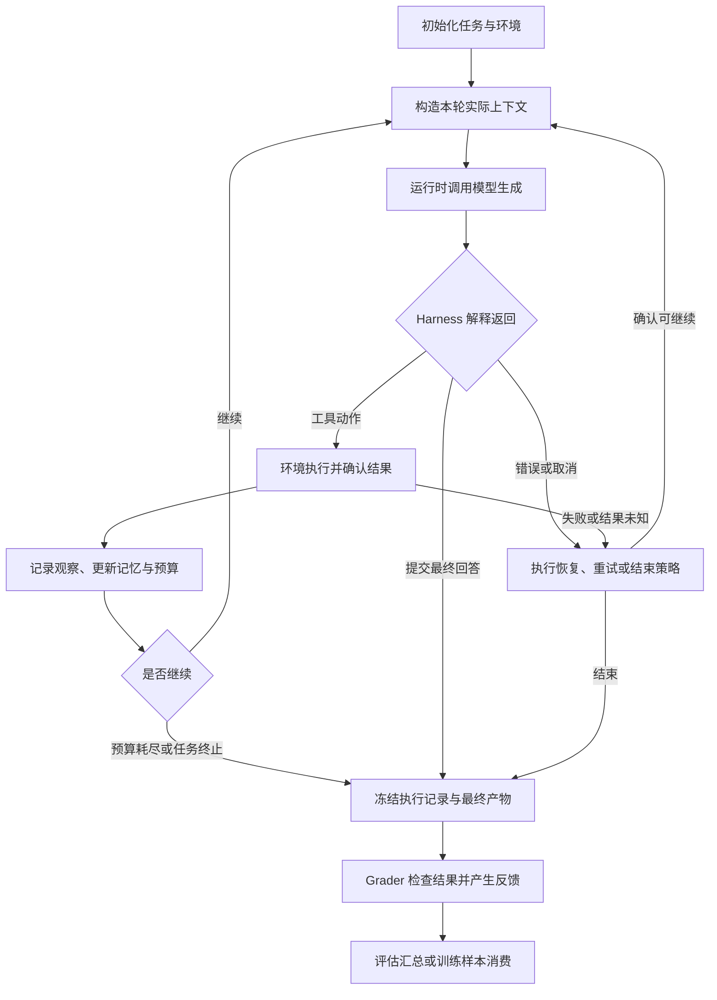
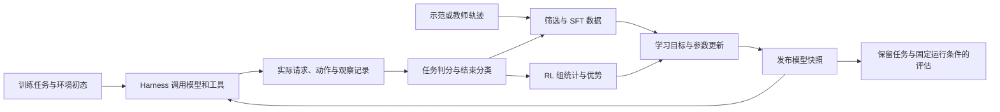
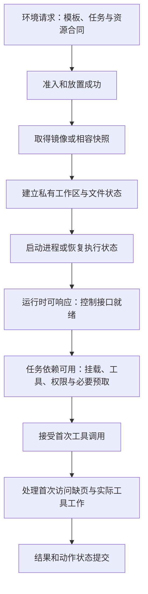

# 第 28 章　Agent环境与多轮训练

把单次生成扩展为多轮工具任务，连接实际上下文、训练片段、环境状态和任务级评估。

本章内容：

- [1. Agent 系统与 Harness 边界：谁决定模型看到什么、何时继续与停止](#s1)
- [2. 多轮轨迹：模型动作、环境观察与执行生命周期](#s2)
- [3. Agent 训练的数据与反馈闭环：任务如何成为学习信号](#s3)
- [4. Agent 环境容量与生命周期：等待模型时保留什么](#s4)
- [5. 同一次结束，需要两种训练边界](#s5)

<a id="s1"></a>

<a id="s1-agent-系统与-harness-边界谁决定模型看到什么何时继续与停止"></a>

## 1. Agent 系统与 Harness 边界：谁决定模型看到什么、何时继续与停止

> 前置：[RL 系统全景](<25_RL目标与系统角色.md#s1>)。本文以单 agent 的工具交互为对象，先定义执行系统，再说明它如何约束训练；token mask、环境资源和奖励计算分别接到已有专题。

一个模型可以提出“读取文件”，但模型权重本身不负责打开文件、保存工作目录、裁剪输出或决定下一轮是否继续。Agent harness 是组织这些行为的执行程序：它把任务、历史与环境观察组装成模型输入，解释生成结果，调用工具，并维护任务状态。这里的 agent 指模型与这套执行程序共同形成的任务执行系统。

因此，同一个 checkpoint 换上另一套上下文压缩、工具说明或重试规则，得到的任务行为就可能改变。讨论“agent 训练”之前，必须先说明训练的是哪一个模型、它处于什么执行循环、最终用什么条件衡量成功。Anthropic 的评估说明也明确区分 agent harness 与 evaluation harness，并将被评估的 agent 视为模型和 harness 的组合。[来源：Demystifying evals for AI agents](https://www.anthropic.com/engineering/demystifying-evals-for-ai-agents)

<a id="s1-六个边界角色分开进程可以合并"></a>

### 六个边界：角色分开，进程可以合并

下面是职责划分，不要求部署成六个服务。一个进程可以同时承载 harness、工具和记录器；边界仍然决定谁对输入、状态和失败负责。

| 组件 | 输入与输出 | 拥有的决定 | 不能由它单独证明的事 |
|---|---|---|---|
| 模型（model） | 给定上下文，产生下一 token 的分布 | 已学习的生成偏好 | 工具是否执行、任务是否成功 |
| Agent harness | 任务、历史、环境观察 → 模型请求与工具动作 | 上下文构造、控制流、工具解析、记忆和任务预算 | 文件或远端系统的最终状态 |
| 推理运行时（inference runtime） | 模型请求 → 生成 token、停止原因与可用的概率记录 | batching、KV、采样实现、单次请求的执行与取消 | 整个 episode 是否应结束 |
| 工具与环境（tool/environment） | 工具动作 → 状态变化和观察 | 文件、进程、数据库等实际状态，以及动作执行语义 | 一段“完成了”的模型文字是否可信 |
| 评估执行框架（evaluation harness） | 任务集、agent 配置 → 多次执行、判分与汇总 | 初始化与隔离任务、安排 trial、调用 grader、保存结果与分母 | 分数变化究竟来自权重还是 harness，除非做了对照 |
| 训练器（trainer） | 可训练记录、反馈、算法配置 → 新模型参数 | 损失、优化、样本消费与参数版本 | 只凭最终日志恢复每次生成的真实输入 |

Episode 是一次带状态的任务执行；trial 是评估中对任务的一次尝试，本文的单 agent 例子中一个 trial 对应一个 episode。一次 episode 可以发出多个生成请求，不能把一次 HTTP 返回或一个 EOS 当成整个任务。

推理运行时执行的 temperature、top-p、长度限制等参数也会改变采样分布。Harness 负责选择请求配置，运行时负责按配置执行；将运行时替换为另一实现时，还需核对模板、token 与概率语义。相关数值边界见[行为概率与异步校正](<27_权重发布异步与资源调度.md#s2>)。

训练器也可以直接拥有交互循环，例如在 rollout 函数里反复执行“生成—工具—观察”。另一种接法保留部署时的 harness，让训练系统从模型接口捕获请求与响应，再关联任务反馈。Agent Lightning v1.0 将后一种形式称为 harnessed agentic RL，并指出重新分词、样本合并、优势计算、损失归一化和调度由此成为训练问题。[来源：Agent Lightning v1.0 摘要](https://arxiv.org/abs/2608.17528v1)

后一种形式复用了交互程序，却不会自动补全训练契约。模型接口代理能看到请求和响应，但未必知道工具动作是否重试、环境究竟改了什么、任务为何结束。记录器仍需关联 episode、动作结果、结束原因和反馈来源。

<a id="s1-一次任务怎样从状态变化走到可判分结果"></a>

### 一次任务怎样从状态变化走到可判分结果

Harness 至少维护任务状态、已观察到的历史、记忆、剩余预算和在途动作。下面的图只描述控制流；状态可以存在内存、数据库或事件记录中。



Grader 是评分逻辑，可以读取产物、环境终态或轨迹。图中的“冻结”表示确定这次尝试的记录与待评分产物；若判分发生在环境内，还需保留环境到判分结束。评估执行框架负责组织这条外围流程，agent harness 负责其中的交互循环。

以修复代码为例，下列事件表达不同事实：

| 事件 | 能说明什么 | 还缺什么 |
|---|---|---|
| 模型输出 EOS | 本次生成满足一个停止条件 | Harness 是否还有后续步骤 |
| 工具调用返回退出码 0 | 该工具进程按自己的规则正常返回 | 测试是否覆盖任务要求、修改是否正确 |
| Harness 收到最终回答并结束 | Agent 已提交本次结果 | 产物是否满足成功条件 |
| Grader 对提交产物判为成功 | 在指定任务与判分版本下通过检查 | 对其他任务、环境与预算的泛化表现 |

任务也可能由环境发出终止信号，或因总时限、轮数上限、取消而结束。记录中应同时保留生成的 finish reason、episode 的 end reason 和任务的 outcome，避免把这些事实压成一个 `done=true`。终止、截断如何影响训练末值，以及重试身份如何定义，见[多轮轨迹与环境执行](<#s2>)。

<a id="s1-上下文是-harness-构造的观察不是完整世界状态"></a>

### 上下文是 Harness 构造的观察，不是完整世界状态

环境里存在一个文件，不代表模型看过它；记录器保存了一段工具输出，也不代表该输出全部进入了模型。模型能利用的是本轮实际收到的上下文，包括模板渲染后的 system/user/tool 内容、工具定义以及其他模型输入。

对纯文本的自回归模型，可以将一次调用写成：

\[
c_t=\operatorname{Build}_{h}(q,H_{<t},m_t,b_t),
\qquad
a_t\sim\mu_{\theta_t,d_t}(\cdot\mid c_t).
\]

这里 $t$ 是模型调用轮次；$q$ 是任务；$H_{<t}$ 是此前执行事件，不包含未来结果；$m_t$ 是本轮使用的记忆；$b_t$ 是剩余预算；$h$ 是 harness 配置与代码版本；$c_t$ 是实际输入 token 序列；$a_t$ 是本轮生成序列；$\theta_t$ 是本轮模型参数版本；$d_t$ 是采样与停止配置；$\mu$ 是这些条件下的实际行为分布。记忆中若检索了外部资料，其内容与来源版本也属于本轮输入的生成条件。这个表示不假定 $c_t$ 包含完整环境状态，也不假定它满足马尔可夫性。

`Build` 可能执行以下操作，每项都会影响模型下一步可用的信息：

| 操作 | 模型输入发生什么变化 | 训练记录需要保留什么 |
|---|---|---|
| 工具输出截断 | 长输出只有开头、结尾或选中的行进入上下文 | 原始输出、实际暴露片段、截断规则及其对应关系 |
| 历史裁剪 | 旧消息退出窗口，保留消息仍须满足工具调用协议 | 本轮实际消息与 token，不能仅保存最终消息数组 |
| 历史摘要 | 若干旧消息被短文本替换 | 实际摘要及来源范围；若另调模型生成摘要，还需记录该调用的角色与版本 |
| 记忆检索 | 从工作笔记或持久存储补充内容 | 本轮命中的内容、来源和记忆可见范围 |
| 工具 schema 或权限变化 | 可选动作、参数约束与错误反馈改变 | 本轮工具定义、允许执行的动作和解析规则 |
| 重新模板化 | 角色标记、分隔符及 token 边界可能改变 | 模板与 tokenizer 身份，以及原始输入、输出 IDs |

摘要模型不必是被训练的策略模型，harness 写入的工作笔记也不天然是策略动作。只有明确属于训练目标的生成片段才能得到相应的 loss mask 和行为概率；作为上下文出现不等于作为训练目标出现。工具 schema 限制了模型如何表达动作，环境的权限检查则决定动作能否执行，两者不能互相替代。

<a id="s1-三轮推演同一份日志怎样对应不同输入"></a>

#### 三轮推演：同一份日志怎样对应不同输入

假设一个 coding agent 要修复解析函数，模型总窗口为 2,100 token，每次最多输出 300 token，因而 harness 将输入控制在 1,800 token 内。以下所有长度均为教学设定，已把相应块的角色标记和分隔符计入，不对应某个实际 tokenizer 的测量。固定块 $P$ 含系统说明、任务和工具 schema，共 600 token。

| 调用 | 本轮实际输入 | 模型与环境随后发生的事 |
|---|---|---|
| 第 1 轮 | $C_1=P$，600 token | 模型生成 50 token 的搜索动作 $A_1$；工具原始结果 $O_1$ 有 2,400 token |
| 第 2 轮 | $C_2=P+A_1+O'_1$，$600+50+500=1,150$ token | Harness 只暴露 500 token 的搜索片段 $O'_1$，包含相关文件路径；模型生成 80 token 的定点读取动作 $A_2$，读回 900 token 的函数内容 $O_2$ |
| 第 3 轮 | $C_3=P+M+A_2+O_2$，$600+100+80+900=1,680$ token | Harness 用 100 token 摘要 $M$ 替换旧的 $A_1+O'_1$；模型在这个上下文下生成补丁 $A_3$ |

这里的加号表示序列拼接。第三轮若直接保留上一轮全部输入及新增内容，需要 $1,150+80+900=2,130$ token，超过输入预算；摘要后，1,680 token 的输入加最多 300 token 输出仍在总窗口内。$M$ 只概括已经暴露的旧搜索过程，最新的工具调用 $A_2$ 与结果 $O_2$ 保持配对。

现在考虑两种错误的训练重建：

1. 为 $A_2$ 配上原始搜索输出 $O_1$，而不是实际的 $O'_1$。训练时模型会看到执行时被裁掉的内容；即使改用更长窗口容纳它，条件输入也已改变。
2. 从最终日志抽出补丁，再将所有早先动作统一放在最终上下文下评分。这样不仅丢失摘要前后的差别，还可能让早先动作看到后来才读出的 $O_2$，造成未来信息泄漏。

正确记录至少保存三对实际输入与输出：$(C_1,A_1)$、$(C_2,A_2)$、$(C_3,A_3)$，以及它们属于同一 episode 的关系。环境原始日志仍有诊断价值，但不替代这三份输入快照。

如果训练损失对某轮输出 token 计算模型概率，该概率必须以该轮实际 $C_t$ 和该 token 之前的输出前缀为条件。给工具 token 设置零 loss mask，只能阻止直接学习这些位置，不能阻止模型通过 attention 读取它们。因此，mask 无法修复“把未见过的工具内容塞进输入”的错误。跨轮输入是否能合并、何时应拆成片段，要先验证真实前缀和 token 对齐；详见[多轮轨迹与环境执行](<#s2>)与[训练的数据与反馈闭环](<#s3>)。

<a id="s1-预算停止与重试必须有明确所有者"></a>

### 预算、停止与重试必须有明确所有者

预算决定 agent 有多少机会获得信息和修正错误，也决定一次任务的系统成本。只写 `max_tokens` 不足以描述一个 agent 的执行条件。

| 控制项 | 应由谁声明或协调 | 需要怎样反馈给上层 |
|---|---|---|
| 单次生成长度与停止串 | Harness 提交，推理运行时执行 | 精确的停止原因与已生成 token |
| Episode 总轮数、总生成量和墙钟时限 | Harness 统一协调；评估或训练任务可施加外部上限 | 剩余预算、最终触发的边界和在途取消结果 |
| 工具执行超时、资源与权限 | 环境执行；harness 决定后续控制流 | 已执行、未执行或结果未知，以及可恢复信息 |
| 单次请求或工具重试 | 对应适配层执行已声明策略，harness 关联逻辑动作 | Attempt 与逻辑动作的映射、累计预算和观察 |
| 整个 trial 重跑或多候选尝试 | 评估执行框架或训练采样调度器 | 新尝试身份、总尝试次数和最终汇总规则 |
| 环境保留、回收与快照 | 环境管理器执行，任务生命周期发出需求 | 最终产物可读取、评分结束和资源释放状态 |

自动重试可能发生在多层。例如工具适配层重试三次，harness 再重复调用三次，底层最多可能执行九次。若上层只记录一次“工具失败”，既低估预算，也看不见潜在重复副作用。层间应约定哪层重试、哪些错误可重试、何时将未知结果交给上层处理。

还要区分两类重试。相同逻辑动作的传输恢复需要幂等或状态确认；模型根据失败观察重新生成工具参数，则是新的策略动作。前者不能伪装成一次全新成功尝试，后者也不能覆盖原来的动作记录。具体幂等、取消和训练失败语义沿用[轨迹执行契约](<#s2>)。

环境生命周期与这些控制共同决定成本。即使模型没有生成新 token，等待工具、排队重试和保留沙盒也可能持续占用资源；CPU、内存驻留与创建率的核算见[Agent 环境容量与生命周期](<#s4>)。

<a id="s1-训练部署与评估需要对齐的是执行条件"></a>

### 训练、部署与评估需要对齐的是执行条件

使用同一个 harness 程序入口，可以减少交互逻辑重复，但“同一程序”仍可能加载不同配置。训练时保留完整历史，部署时按窗口摘要；训练时允许十次失败重试，评估时只允许一次；训练时工具结果无限长，部署时只暴露首尾片段，这些都会改变策略面对的输入和任务分布。

因此一次实验需要记录可解析到具体内容的 harness revision，而不只是一个名字。最低限度包括：

- Harness 代码版本、实际配置、系统说明、工具 schema 与动作解析规则。
- 上下文裁剪与摘要规则、记忆来源和可见范围；若使用辅助模型，保存其身份。
- Episode 与请求预算、停止条件、工具错误处理和重试策略。
- 环境镜像与任务初态，以及模型、tokenizer、模板和采样配置的身份。

这些身份与[奖励评估与质量闭环](<26_Rollout奖励与训练数据.md#s2>)中的任务、reward 和评估 manifest 关联。随机种子、外部服务变化和非确定性执行仍可能妨碍逐位复现；版本记录的作用是解释和控制条件，不是宣称任何任务都能确定性重放。

训练时可以有意增加探索、随机化环境或使用更广的任务分布。要求不是把所有配置强行设成相同值，而是说明差别，并在目标部署配置下独立评估。持久记忆尤其需要声明范围：同一 episode 的工作记忆可以服务后续轮次；跨 trial 记忆会影响初始条件，若要评估任务间学习，就应作为实验变量显式纳入。

要区分模型收益与 harness 收益，可以在同一保留任务集和预算口径下安排以下对照：

| 组合 | 旧 harness $h_0$ | 新 harness $h_1$ |
|---|---|---|
| 旧模型 $\theta_0$ | 基线 | 固定旧模型观察 harness 变化 |
| 新模型 $\theta_1$ | 固定旧 harness 观察训练变化 | 最终候选系统 |

每个单元格都是完整 agent 的评估结果，需要相同的任务成功定义、独立初始化和明确的重复尝试规则。固定一列比较模型，固定一行比较 harness；两种改动可能相互依赖，不能把各自收益简单相加。若 $h_1$ 增加了工具次数或重试机会，还要报告成功率对应的成本，不能只保留一个最终分数。分母、奖励漏洞和统计口径继续沿用[奖励评估与质量闭环](<26_Rollout奖励与训练数据.md#s2>)。

<a id="s1-来源证据与下一步"></a>

### 来源、证据与下一步

本文在 2026-10-13 核对了 Anthropic 的 [Demystifying evals for AI agents](https://www.anthropic.com/engineering/demystifying-evals-for-ai-agents) 中关于 agent harness、evaluation harness、transcript 与 outcome 的定义，以及 [Agent Lightning v1.0](https://arxiv.org/abs/2608.17528v1) 摘要关于 harness 主导交互循环的描述。职责表、状态图和 token 推演是本文用于解释边界的通用设计与教学设定；不声称某个框架已经逐项实现，也不包含真实模型质量或吞吐测量。

确定 harness 边界后，下一问题是这些执行记录怎样成为训练数据：示范轨迹如何进入 SFT、在线轨迹如何接收反馈、长程动作如何分配权重，见[Agent 训练的数据与反馈闭环](<#s3>)。需要把任务、沙盒、轨迹、判分与参数更新连在一起时，继续读[从 Agent 任务到策略更新](<../07_Practice/32_RL综合案例.md#s2>)。


<a id="s2"></a>

<a id="s2-多轮轨迹模型动作环境观察与执行生命周期"></a>

## 2. 多轮轨迹：模型动作、环境观察与执行生命周期

> 前置：[RL 全景](<25_RL目标与系统角色.md#s1>)、[token 对齐](<25_RL目标与系统角色.md#s2>)。本文用工具交互解释通用契约，具体 reward 和 bootstrap 规则由任务定义。

上下文、工具与执行循环由谁组织，先见[Agent 系统与 Harness 边界](<#s1>)；本节进一步解释交互记录的 token、身份与生命周期。

<a id="s2-一次生成与一条轨迹"></a>

### 一次生成与一条轨迹

生成请求通常只负责一段模型输出；轨迹可以包含多次生成、工具动作和环境观察。例如任务 E7 要修复一个文件，第 1 轮请求 Q1 生成读取动作，第 2 轮请求 Q2 根据读取结果生成修改动作。若 Q2 因网络超时发起第二次尝试，它仍属于 E7 的第 2 轮，却有新的 attempt 身份；是否保留原请求身份取决于接口协议。

Episode/session 用于关联整个任务，turn 表示交互轮次，request 关联一次生成工作，attempt 区分这项工作的具体执行尝试。分别记录这些身份，才能判断两条结果是同一请求重试返回的重复数据，还是任务中两次合法的模型动作。一个整数无法同时表达这些关系。

```text
任务和初始观察
  → 模型生成工具调用 → 解析动作 → 环境执行 → 新观察
  → 模型继续生成 → 任务终止/截断 → 评价与样本构造
```

采样工具参数属于模型动作，工具返回由环境产生。二者可能都出现在 response 字符串中，却具有不同训练身份。

<a id="s2-用-token-原始记录确定训练-mask"></a>

### 用 token 原始记录确定训练 mask

教学轨迹只列 token ID，忽略协议分隔符：

| 全局输入位置 | 内容 | 来源 | 本例是否为训练目标 |
|---|---|---|---|
| 0–1 | prompt p0,p1 | 任务 | 否 |
| 2–3 | call c0,c1 | 模型第 1 轮 | 是 |
| 4–5 | observation o0,o1 | 工具 | 否 |
| 6–7 | answer a0,EOS | 模型第 2 轮 | 是 |

完整输入为 `[p0,p1,c0,c1,o0,o1,a0,EOS]`。对因果模型，logits 位置 1、2、5、6 分别评分 c0、c1、a0、EOS。若 response 数组从位置 2 开始，其 action mask 为 `[1,1,0,0,1,1]`，有效动作数为 4。

第二轮回答仍需要看到观察 o0/o1；将观察的 loss 屏蔽不意味着屏蔽其 attention。行为 logprob 只对相应生成动作有来源，不能把工具文字假装成策略采样并补造概率。

应保留每轮实际输入 IDs、输出 IDs、概率语义、finish reason 与策略版本。重新拼接文本再 tokenize，可能改变分词边界；需要按原记录对齐或显式处理漂移，不能在数组长度不同后默默截短。实现见[slime TrajectoryManager](<../appendices/source/slime/07_customization_and_agentic.md>)。

<a id="s2-终止截断与失败"></a>

### 终止、截断与失败

| 状态 | 含义 | 训练与恢复要决定什么 |
|---|---|---|
| 正常任务终止 | 环境定义任务结束 | terminal reward、EOS 与 value 末值 |
| 生成长度上限 | 一次生成没再继续 | 丢弃、续写、长度惩罚或任务截断 |
| Episode 时间/轮数上限 | 任务被外部边界停止 | 若算法使用 value，是否 bootstrap |
| 工具/网络暂时失败 | 环境动作未完成或完成未知 | 重试身份、重复副作用、失败样本 |
| 用户/调度取消 | 终止在途执行 | 资源释放与样本是否可消费 |

EOS 只表示生成的停止条件之一，不自动证明环境任务成功。真正终止后的 value 与被时间限制截断时的 value 是不同语义；GAE 示例见[算法接口](<25_RL目标与系统角色.md#s2-第六步ppo使用critic时优势如何从尾部算回来>)，边界原理见[Time Limits in Reinforcement Learning](https://arxiv.org/abs/1712.00378)。GRPO 没有独立 critic 时，仍须定义未完成回答是否进入组统计。

<a id="s2-重试不能只重发工具调用"></a>

### 重试不能只重发工具调用

若动作创建文件、提交任务或修改环境，RPC 超时只说明调用方没收到确认，不证明动作没执行。Attempt 与逻辑动作 ID 分开记录；可用幂等键或查询环境结果恢复。环境不支持幂等或回滚时，应明确重复执行风险和失败策略。

生成重试还需要决定是否复用随机性、prefix、policy revision。重新采样的回答是新执行尝试，不应被错误当作原样本已成功完成。轨迹失败时要清理 request、KV、grammar、adapter 引用、环境进程与结果 future；GPU 在途引用的释放边界见[KV 推演](<../05_Inference/20_KV容量分页与复用.md#s1-数值展开-kv分页前缀共享分叉与取消>)。

<a id="s2-gpu-与环境是两条供给链"></a>

### GPU 与环境是两条供给链

教学假设：每条轨迹有两次工具调用，每次环境执行 2 秒；忽略其他成本，16 个可并发执行的环境 slot 最多完成 8 次调用/秒，约为 4 条轨迹/秒。若生成引擎能完成 8 条轨迹/秒，继续增加生成 GPU 不会越过这个环境上界。

增加 session 并发可以填补等待，但会增加会话状态、KV 保留与样本年龄。应分别记录生成 token、环境等待、reward 时间、完整轨迹率和训练消费率；不能把 HTTP 生成的请求吞吐当成任务完成吞吐。

即使工具只运行片刻，环境也可能在几轮模型生成期间持续占用主存。[Agent 环境容量与生命周期](<#s4>)进一步比较常驻、按需创建和快照恢复，核算 CPU·秒、GiB·秒、创建率与回收边界。

<a id="s2-多轮权重版本与上下文变化"></a>

### 多轮权重版本与上下文变化

换权后续写旧 prefix，需要核对旧 KV 是否仍合法；必要时从保留的 token 重新 prefill。多轮轨迹若跨版本，行为分布随动作历史改变，不能统一标成最后一轮版本。可以选择整个 episode 固定版本，也可以按片段记录并使用明确的消费规则。

上下文窗口不足时，删旧观察、摘要和重新模板化都会改变下一动作的状态。应保留实际模型上下文与原任务轨迹的映射。Partial rollout 的 mask、片段权重和组身份另见[数值正确性](<26_Rollout奖励与训练数据.md#s1>)。

[三轮上下文推演](<#s1-三轮推演同一份日志怎样对应不同输入>)展示原始工具日志与模型实际输入的区别；[Agent 训练闭环](<#s3>)继续解释轨迹拆成多行后，奖励组统计与 loss 归约怎样保持逻辑尝试的含义。

<a id="s2-原理实现与证据"></a>

### 原理、实现与证据

实现入口：[slime 自定义与 Agentic RL](<../appendices/source/slime/07_customization_and_agentic.md>)、[tau-bench 贯穿实现](<../appendices/source/slime/tau-bench_qwen3_4B.md>)。验证从固定 token 与工具结果的记录回放开始，检查 mask 和身份，再加入重试、截断与跨版本路径；环境性能须真实运行后测量。


<a id="s3"></a>

<a id="s3-agent-训练的数据与反馈闭环任务如何成为学习信号"></a>

## 3. Agent 训练的数据与反馈闭环：任务如何成为学习信号

> 前置：[Harness 边界](<#s1>)、[多轮轨迹](<#s2>)、[RL 算法与系统接口](<25_RL目标与系统角色.md#s2>)。本文讨论单 agent 的数据、反馈和权重；PPO/GRPO 的完整推导、环境资源和失败恢复仍由对应正文维护。

一次 agent 任务可以产生十次模型调用、几十条工具事件和多个训练片段，但它仍可能只交付一个最终补丁、获得一个任务分数。把这些数量都称为“样本数”，就容易在过滤、组统计和损失归约时改变目标。先确定希望模型在哪些任务上改善，再决定如何把执行记录转换成学习信号。

<a id="s3-从任务分布到三种数据路径"></a>

### 从任务分布到三种数据路径

任务由题目、环境初态、可用工具和成功条件共同定义。对 coding agent，题目相同但仓库 revision、依赖环境或测试规则不同，已经不是同一个执行条件。训练任务还需要明确来源比例、难度、去重规则，以及与评估任务的隔离方式；按轨迹随机切分，可能让同一个问题的不同解法同时进入训练和评估。

| 数据路径 | 数据与目标 | 系统必须保留什么 | 不能由此推断什么 |
|---|---|---|---|
| 示范轨迹用于 SFT | 学习专家或教师在给定上下文下的动作 | 每轮真实输入、示范输出、角色与目标 mask；教师和 harness 身份 | 教师动作概率不是学生的行为概率，不能直接当作学生 on-policy RL |
| 成功轨迹筛选后用于 SFT | 从多次执行中选取通过 verifier 的轨迹，学习其动作 | 原始尝试数、成功条件、接受率、去重与任务配比 | 只见到成功轨迹不代表掌握失败恢复；容易成功的任务可能被过采样 |
| 在线 RL | 当前或明确标记的行为策略执行任务，根据反馈更新策略 | 实际 token、行为概率及其语义、模型版本、任务组、结束原因和 reward | 奖励升高不自动证明保留任务上的成功率提高 |

三条路径可以组合，例如先学工具协议再做在线 RL，也可以直接在已有能力的模型上做 RL；这不是强制阶段。教师生成的数据需要独立筛选，失败示范也可以用于教授恢复，只要目标动作和数据用途明确定义。SFT、偏好优化和在线 RL 的参数与目标边界见[后训练系统边界](<24_微调与偏好优化.md#s1>)。



图中的评估数据不回流本次训练。若长期根据同一开发集挑选配置，还需要另留最终测试集；否则即使未直接反向传播，也会通过选择配置适应评估集。

<a id="s3-任务执行与训练行必须分开计数"></a>

### 任务、执行与训练行必须分开计数

本文将一次逻辑任务执行称为 rollout；它对应一个 episode。一个任务可以采样多个 rollout；一个 rollout 又可以导出多个 segment，segment 是保存一段真实上下文与可训练动作的训练行。算法实现中的 rollout 批次编号可能另有含义，应通过字段说明区分。

| 身份 | 用途 | 必须维持的关系 |
|---|---|---|
| Task / group | 同一任务在声明条件下的候选组 | 不能把不同题目的分数混在同一个 GRPO 组中 |
| Episode / logical rollout | 一次尝试与一个任务级结果 | 压缩或切片不会创造新的独立尝试 |
| Turn / request | 一次实际模型调用 | 输入、输出和概率必须来自这次调用 |
| Action / attempt | 工具逻辑动作与传输重试 | 传输恢复和重新采样动作不能混为同一事件 |
| Segment / training row | 训练使用的记录单位 | 能追溯所属 rollout 和原始动作；共享内容的计数规则明确 |

如果一个成功 rollout 被拆成三行，三行都可以携带原来的 reward=1，用于追溯结果；但计算任务组均值时，它不应仅因拆成三行而成为三次独立成功。反过来，两次独立尝试恰好生成了相同文字，也不能仅按文本相同就去掉一次尝试。重复存储同一个动作和独立采样到相同动作是两种情况。

<a id="s3-稀疏终局奖励怎样分配到长程动作"></a>

### 稀疏终局奖励怎样分配到长程动作

信用分配（credit assignment）是把延迟反馈转成各动作学习信号的问题。一个补丁最终通过测试，并不意味着每一步搜索、重试和编辑都同等有效；某一步错误甚至可能被后续步骤修复。

固定一个仅有终局奖励的教学设定：任务共有 $T$ 个模型动作，最后取得标量奖励 $R$，中间环境奖励为零。第 $t$ 个动作的 Monte Carlo 回报是

\[
G_t=\gamma^{T-t}R,\qquad 0<\gamma\leq1.
\]

这里 $t=1,\ldots,T$，$\gamma$ 是每个模型动作一步的折扣因子；它不是默认的每 token 折扣。例如轨迹有 3 个动作，最终奖励 R=1，取 γ=0.9，则最后一步回报为 1，倒数第二步为 0.9，第一步为 0.81。越早的动作距离最终反馈越远，回报多乘一次折扣。若取 γ=1，三步都得到回报 1。

三步获得相同回报，并不是已经证明它们同样有用。它只表示这次采样把共同的终局结果用作各步学习信号；要判断某次搜索是否多余，仍需要不同轨迹之间的比较或额外反馈。因此终局回报可以训练长程行为，但单次成功没有提供每一步因果贡献的独立标签，估计也可能有较大方差。

| 反馈方法 | 信号怎样得到 | 需要新增的假设或系统字段 |
|---|---|---|
| 终局回报或组相对信号 | 将结果或同任务组内比较得到的信号用于动作 | 清楚的 rollout/group 身份；每轮实际输入和有效动作位置 |
| 价值基线 / critic | 用回报减去对当前状态价值的预测，或用时序差分构造优势 | Critic 输入、版本、value、终止和截断的 bootstrap 规则 |
| 过程奖励 | 检查中间产物、测试进展或子目标完成情况 | 判分器与调用时点、是否计入成本、避免后验信息流入策略输入 |
| 额外继续执行来估计动作效果 | 从可恢复状态采多种后续轨迹并比较结果 | 可恢复的环境与记忆、额外采样预算、对照条件；一般不能仅回放文本 |

过程奖励会改变被优化的信号。例如按“测试通过数增加”给分，可能鼓励修改测试或反复制造可奖励变化；不能未经验证就声称保持原任务最优策略。算法、奖励塑形与 verifier 的选择必须通过独立任务质量检查。Actor/critic 的 GAE 与真正终止、时间截断的区别见[算法接口](<25_RL目标与系统角色.md#s2>)；奖励漏洞与评估隔离见[质量闭环](<26_Rollout奖励与训练数据.md#s2>)。

在简化的任务级 GRPO 中，可以先对同一任务的 $K$ 次独立 rollout 计算均值和尺度，再把该 rollout 的优势映射到它的动作 token。是否采用标准差归一化、使用何种标准差、是否做 token/序列级比率，以及如何归约，都需要单独声明。将一个数广播到所有动作，只规定了信号共享方式，没有自动确定 loss 的最终权重。

<a id="s3-数值推演相同轨迹怎样因归约方式得到不同权重"></a>

### 数值推演：相同轨迹怎样因归约方式得到不同权重

假设两个 rollout A、B 各只有模型输出位置参与训练。A 有 2 个有效 token，各位置的标量损失项为 1；B 有 6 个有效 token，各位置的损失项为 3。工具文字和 prompt 的 mask 为零。这里的损失值是便于复算的教学输入，不代表真实模型或某次 PPO 运行；损失项可以已经包含各自的优势和裁剪规则。

设 $m_{ij}\in\{0,1\}$ 是第 $i$ 条 rollout 第 $j$ 个位置的有效 mask，$N_i=\sum_jm_{ij}>0$，$\ell_{ij}$ 是该位置的损失项，$M$ 是参与归约的 rollout 数。比较两种目标：

\[
L_{\mathrm{token}}=
\frac{\sum_i\sum_jm_{ij}\ell_{ij}}{\sum_iN_i},
\qquad
L_{\mathrm{rollout}}=
\frac1M\sum_i\frac{\sum_jm_{ij}\ell_{ij}}{N_i}.
\]

| 归约 | 本例结果 | A、B 的系数份额 |
|---|---|---|
| 全部有效 token 等权 | $(2\times1+6\times3)/8=2.5$ | $1/4$、$3/4$ |
| 每个 rollout 内求均值，再对 rollout 等权 | $(1+3)/2=2$ | $1/2$、$1/2$ |

系数份额指目标函数中的权重，不意味着真实梯度的范数比例相同。两种归约定义了不同目标：前者按有效 token 加权，后者使每条 rollout 的 token 均值获得相同权重；不能仅凭名称判断哪一种对所有任务更好。

现在把 B 因上下文变化拆为 B1、B2，两段各含 3 个有效 token。若直接对三个训练行的均值取平均，结果变成 $(1+3+3)/3=7/3$；B 因表示方式变化获得 $2/3$ 的行权重。要维持本例的 rollout 目标，两段都应知道 B 的完整有效数 $N_B=6$，并以 $M=2$ 做最终缩放：

\[
L=\frac12\left(\frac{2}{2}+\frac9{6}+\frac9{6}\right)=2.
\]

即使 B1、B2 被放入不同 microbatch，也需要完整 rollout 的分母，并正确处理跨 microbatch 与数据并行的缩放。全零 mask 的 rollout 如何计入 $M$ 需要另定规则；本例已明确排除它，不能把这个选择推断为框架默认行为。

组统计也有相同陷阱。设同一任务的两个独立 rollout 成绩分别为 A=0、B=1，则逻辑尝试均值为 $1/2$；若 B 拆成两行后直接平均 `[0,1,1]`，均值变成 $2/3$。在**只做均值中心化**的本例中，正确信号为 A=$-1/2$、B=$1/2$，错误的逐行统计得到 A=$-2/3$、B=$1/3$。先按逻辑尝试统计，再向其片段广播，才能保留原来的候选组含义。是否再除标准差是下一步，与修复身份混淆分开处理。

共享前缀还有另一种重复：同一个已生成动作可能为多个后续训练片段提供上下文。如果本例的目标是每个实际采样动作计一次，重复副本的训练 mask 应关闭，attention 上下文仍保留。若算法有意按多次后续回报重新加权共同动作，也必须显式定义估计量，不能由切片偶然决定。

<a id="s3-原始记录到训练输入的契约"></a>

### 原始记录到训练输入的契约

模型输出概率总是依赖实际输入。若某轮使用了压缩后的历史，就应在那份实际历史下评分该轮输出；事后把压缩前全文重新插入，不是无损恢复。完整例子见[三轮上下文推演](<#s1-三轮推演同一份日志怎样对应不同输入>)。

| 字段 | 训练消费前必须能回答的问题 |
|---|---|
| 实际 prompt/output IDs | 是当时真正提交和采样的 token，还是事后重新分词的文本？ |
| 输出 logprob | 对应哪组 token、哪个模型版本、哪种 temperature/top-p 等语义？缺失时能否从精确行为版本重算？ |
| Loss mask | 哪些是被训练策略的动作，哪些是工具、摘要、教师或共享前缀的上下文？ |
| 结束原因与片段映射 | 是任务完成、生成长度上限、任务预算截断还是基础设施失败？哪些原始动作被删除或重对齐？ |
| Reward / advantage | 判分来源是什么，在哪个逻辑任务组内统计，如何广播到片段？ |
| 版本与分母 | 模型、harness、环境、判分器对应什么身份，归约用的是 token、行还是 rollout？ |

缺失的行为概率不能用零填充值冒充真实 logprob。对于 mask=0 的位置，占位零可以是存储约定；对于参与策略损失的位置，缺失意味着需要有依据地补齐或拒绝消费。训练端重算的 current/old logprob 也不自动等于实际行为分布，继续见[四份概率与异步校正](<27_权重发布异步与资源调度.md#s2>)。

只有实际 token 前缀以及相关模型输入条件保持相容时，跨轮合并才可能保持原有评分条件。重新分词、重写 assistant 内容、摘要或历史裁剪后，需要保留独立记录，或明确接受某些片段不再参与训练。代码中的重对齐是带取舍的样本处理规则，不是证明原始轨迹信号全部保留。

<a id="s3-失败样本如何进入数据分布"></a>

### 失败样本如何进入数据分布

| 情况 | 可作何种训练判断 | 必须另记什么 |
|---|---|---|
| Agent 产出有效补丁，但未通过可信测试 | 通常可按任务定义给予低奖励 | 失败测试和产物身份 |
| Agent 看到了工具错误并继续恢复 | 错误观察和后续动作是轨迹的一部分 | 实际暴露的错误信息、动作重试身份 |
| 时间或轮数预算耗尽 | 可按声明的预算内完成目标计失败，或采用截断处理 | 触发边界、未完成结果、critic 的末值处理 |
| 环境创建失败，模型未执行 | 没有可学习的策略动作；供给与评估仍需计数 | 基础设施失败分类，不能伪装成一次正常低分轨迹 |
| 判分器不可用或结果未知 | 暂存、重试或剔除需声明；不能默认真实 reward=0 | 未评分原因与重试成本 |

过滤改变被学习的数据。长任务更容易超时，如果只消费成功完成的短任务，即使保留题目采样配比，最终训练分布仍会改变。需要同时记录任务抽样量、执行完成量、可评分量、训练接受量，并按任务类别与长度检查接受率。完整的供给率和分母算例沿用[奖励评估与质量闭环](<26_Rollout奖励与训练数据.md#s2>)。

<a id="s3-在目标运行条件下检查进展"></a>

### 在目标运行条件下检查进展

固定一份独立任务集，记录模型、harness、环境、reward/grader 和预算的版本。先保持 harness 不变比较更新前后的模型；再保持模型不变比较 harness。四组组合及其交互关系见[执行条件的对照表](<#s1-训练部署与评估需要对齐的是执行条件>)。同一代码入口不足以固定实际运行条件：prompt、摘要配置、重试次数和持久记忆也要纳入版本。

比较时报告预算内成功率、失败原因、总 token/工具调用/墙钟消耗，以及成功任务的成本。训练效率则比较达到同一质量阈值的累计资源与时间，包括采轨迹、环境、判分、训练和换权。采样次数增加后至少一次成功率变高，与单次尝试能力提高是不同指标；统计不确定性见[实验统计与质量评估](<../07_Practice/29_性能测量与因果分析.md#s3>)。

<a id="s3-来源证据与实现入口"></a>

### 来源、证据与实现入口

[Agent Lightning v1.0](https://arxiv.org/abs/2608.17528v1)讨论 harness 主导交互时的轨迹合并、优势与归约问题；[原始 Agent Lightning 论文](https://arxiv.org/abs/2508.03680)提供执行与训练解耦的研究背景。本文采用这些问题作为接口讨论的依据，不将论文当时的跨框架比较当作当前代码的支持矩阵。Monte Carlo、critic 和 GRPO 的基础推导与一手来源由[算法接口](<25_RL目标与系统角色.md#s2>)维护。

本文的损失值、长度和分数都是教学输入，数值可直接按表复算，没有真实训练或模型质量测量。要检查这些契约在当前仓库是否成立，继续读[从 Agent 任务到策略更新](<../07_Practice/32_RL综合案例.md#s2>)：该案例特别区分片段的 rollout 归约、任务组奖励统计和失败占位的实际处理。


<a id="s4"></a>

<a id="s4-agent-环境容量与生命周期等待模型时保留什么"></a>

## 4. Agent 环境容量与生命周期：等待模型时保留什么

> 前置：[多轮轨迹与环境执行](<#s2>)、[集群调度与资源管理](<../04_Training/16_并行组合与训练方案.md#s3>)。本文从完整任务核算 CPU、内存、创建与恢复需求；动作身份和训练 mask 沿用既有契约。

一条轨迹可能大部分时间等待模型，执行工具时才使用 CPU，但工作目录、进程和内存仍需跨轮保存。环境平台因此至少有四种独立容量：能执行多少 CPU 工作、能保留多少状态、每秒能创建多少环境、每秒能搬动多少恢复数据。增加生成 GPU 后，其中任何一项都可能先耗尽。

<a id="s4-先区分执行驻留和恢复"></a>

### 先区分执行、驻留和恢复

| 指标 | 单任务的计量 | 到达率为 $\lambda$ 时的平均需求 |
|---|---|---|
| 实际 CPU 工作 | $W_C=\int n_{\mathrm{busy}}(t)\,dt$，CPU·秒 | $\lambda E[W_C]$ 个忙核 |
| 内存驻留 | $A_M=\int M(t)\,dt$，GiB·秒 | $\lambda E[A_M]$ GiB |
| 活跃环境 | 各环境驻留时间之和，环境·秒 | $\lambda E[T_{\mathrm{resident}}]$ 个环境 |
| 创建／恢复 | 每任务新建数、恢复数 | $\lambda E[N_{\mathrm{create}}]$、$\lambda E[N_{\mathrm{restore}}]$ 次／秒 |
| 快照读写 | 各次保存与读取字节数之和 | $\lambda E[V_{\mathrm{snapshot}}]$ GiB/s |

这些是稳定流量下的长期平均资源守恒关系。CPU 申请 2 核、保留 20 秒，不等于消耗 40 CPU·秒；但平台若按独占核预留，这 40 核·秒仍然占用了可分配容量。反过来，内存被保留时即使 CPU 空闲，也不能按 CPU 利用率折减内存需求。

瞬时并发、尾部等待、配额和故障余量还需要另外检查。将均值代入表格只能排除不可能的方案，不能直接宣称满足 p95 或 p99 延迟。

<a id="s4-环境边界决定哪些资源与故障仍然共享"></a>

### 环境边界决定哪些资源与故障仍然共享

工具环境提供程序所需的系统调用、文件、网络和设备访问。选择执行载体时，需要同时回答：任务之间隔离哪些状态，谁仍共享内核或设备，能够恢复哪些状态，以及为此保留多少资源。“沙箱”描述一组执行约束，并不指定某一种实现。

| 执行载体 | 主要边界 | 仍需由平台处理的共享与归属 |
|---|---|---|
| 进程 | 地址空间、用户身份与文件权限；可再施加资源限制 | 同一内核、宿主资源竞争、子进程树与打开的句柄 |
| Linux 容器 | 用命名空间组织进程、挂载和网络视图，用资源控制约束消耗 | 通常共享宿主内核；挂载、设备和控制面接口由配置决定 |
| 虚拟机／microVM | 客体内核运行在虚拟硬件边界内；microVM 缩减虚拟设备与管理范围 | 宿主调度、虚拟化实现、存储网络路径及宿主代理仍有资源与故障边界 |

命名空间定义进程看到的资源视图，cgroup 负责资源分组与控制，权限、capability 和系统调用限制决定可执行的操作。它们承担不同职责；获得独立进程编号不代表拥有独占 CPU，设置 CPU 上限也不建立独立内核。具体配置边界见 [OCI Linux Runtime Specification](https://github.com/opencontainers/runtime-spec/blob/main/config-linux.md)。microVM 的机制与设计动机见 [Firecracker 论文](https://www.usenix.org/conference/nsdi20/presentation/agache)；不能仅凭载体名称断言启动开销或隔离效果。

隔离至少涉及任务与任务、工具与平台代理、工具与外部系统。平台代理保存的结果身份、凭据和评价状态不应因工具拥有工作区写权限而同时可写。设备直通、共享目录或共享代理连接会改变边界，需与任务要求一起记录。这里讨论环境的执行能力与资源归属；动作重试、训练 mask 和轨迹版本仍由[多轮轨迹](<#s2>)维护。

资源隔离也有不同语义。CPU 配额约束可消耗的运行时间，独占核或亲和性约束执行位置；内存上限约束驻留与增长，内存带宽竞争仍可能存在。超卖依赖不同任务不同时达到峰值，而 RL 的阶段性工具调用可能高度同步，因此平均 CPU 空闲不能证明超卖后的尾延迟仍可接受。

<a id="s4-镜像运行快照与任务状态不能互换"></a>

### 镜像、运行快照与任务状态不能互换

镜像定义初始文件及依赖，工作区保存任务修改，运行快照还可能保存进程内存、设备或执行状态。它们对应不同时间点，恢复前必须确认目的：建立一份干净试验，还是继续一条已经执行过动作的轨迹。

[OCI 镜像层规范](https://github.com/opencontainers/image-spec/blob/main/layer.md)定义文件系统变更的表示；具体运行时如何共享只读层、建立可写层及缓存数据，是另一层实现选择。镜像存在于节点存储，不代表相关文件已进入内存；运行态可恢复，也不代表外部连接和已提交动作一起回滚。

准备工作可以依赖只读共享、写时复制和按需加载，但三者节省的对象不同：

- **只读共享**减少同一内容的重复物理存储；任务私有修改仍需要单独保留，容量按唯一共享对象与各自私有状态分别统计。
- **写时复制**推迟私有副本的创建；修改发生后会增加脏页、复制工作和回收压力，不能始终按初始共享量估算。
- **按需加载**推迟未访问内容的传输；首次工具访问缺失文件或页面时，准备工作重新进入执行关键路径。

宿主文件缓存、客体文件缓存和进程映射还可能保留不同层次的副本。不能把相同文件内容自动视为只占一次物理内存，也不能将每个虚拟地址空间的大小直接相加当作实际驻留。需要识别共享机制、缓存层次及统计口径。快照派生的多个实例还可能依赖同一份只读后备文件，最后一个引用释放之前，该文件仍是可用性依赖。

<a id="s4-从创建请求到首次工具可用"></a>

### 从创建请求到首次工具可用



图中的状态是通用职责，不是某个运行时的固定 API。镜像可提前分发，网络、依赖和运行时初始化也可能重叠，实际实现应画出相应依赖。所谓“创建耗时”必须指定结束点：控制接口可响应、任务依赖可用、首次工具返回结果，分别包含不同工作。

按需恢复可以提前到达“运行时可响应”，却把读取成本推迟到第一次执行。Linux 的 [userfaultfd](https://docs.kernel.org/admin-guide/mm/userfaultfd.html)允许用户态处理注册内存区域的缺页，是实现按需内存加载的一类机制；它并不保证页面来源随时可用或读取没有等待。因此 readiness 可以声明关键依赖已验证、关键工作集已预取，却不宜暗示所有未来路径都已变热。

准备延迟来自资源需求和依赖。对某一阶段，CPU 工作量、网络传输字节及磁盘读写字节分别除以其有效服务能力，得到各自时间下界；允许重叠时先取受限资源的下界，再沿依赖核算整体关键路径。必须串行的下载、解压、校验或安装不能因同属“创建”而取一个最大值替代全部成本。压缩镜像大小、解压后大小、首次访问工作集和实际脏页也应分别记录。

并发创建会共享镜像源、网络出口、解压 CPU、磁盘和元数据服务。单个环境启动很快不推出整批创建吞吐很高。预取只是改变准备发生的时刻；预测未命中时，已经传输的数据和已占用的热池状态仍付出了成本。热池要绑定环境版本和任务类别，并定义补充、回收与过期条件，否则控制器可能持续保留不再被使用的模板。

每次准备都有独立 attempt 与资源所有者。准备失败、取消或超时后，需撤销未发布环境，释放挂载、进程和资源预留；晚到的完成事件不能把已取消环境重新发布为可接工作。准备阶段获得的版本与任务身份一直传到工具结果，才能区分旧环境返回和当前轮次完成。

<a id="s4-放置需要同时满足计算状态与数据路径"></a>

### 放置需要同时满足计算、状态与数据路径

CPU 核、主存、可写盘、镜像缓存、网络以及可选的 GPU 必须在允许的位置同时可用。总量核算后，还要检查这些资源能否由同一节点或相容节点组提供；CPU 空闲在一台机器、设备和工作区在另一台机器，不一定构成一个可运行环境。

放置先排除硬约束不满足的节点，如架构／内核相容性、设备访问要求、工作区挂载范围、数据允许处理的区域和故障域规则。再比较软代价：排队时间、模板命中、环境恢复量、访问模型或工具数据的路径，以及对现有任务的争用。镜像命中可以减少准备，但把所有任务集中到同一缓存热点可能耗尽它的 CPU 或 I/O。

CPU、内存和 GPU/NIC 的局部性也会改变搬运路径。NUMA 亲和性减少跨域访问的机会，但约束越多，可放置的组合也越少；应同时记录执行收益与等待成本。分配检查应覆盖峰值增长，镜像准备与快照恢复也需获得有界并发，避免执行资源足够而准备链路先失去服务能力。

环境控制器可以把需求分成创建、工具执行、驻留和恢复等阶段，向资源平台表达不同的资源形状。阶段变化必须更新实际预留，不能只把日志状态改为“暂停”便假定内存已经归还。作业级配额与 gang 放置见[集群调度](<../04_Training/16_并行组合与训练方案.md#s3>)；多租户准入、路由和弹性反馈见[服务准入路由与弹性控制](<../05_Inference/23_服务部署与容量设计.md#s1>)。

<a id="s4-一道完整的环境设计题"></a>

### 一道完整的环境设计题

以下全部是原创教学假设，不对应任何沙箱、模型或硬件的实测：

| 输入或约束 | 假设值与边界 |
|---|---|
| 任务流量 | 持续 3 项／秒；每项固定 4 轮 |
| 单轮依赖 | 模型 5 秒 → 工具 0.5 秒；下一轮依赖本轮结果 |
| 工具 CPU 与状态 | 执行时使用 2 核；环境驻留占 1.5 GiB |
| 冷创建 | 0.8 秒墙钟、0.4 CPU·秒；创建阶段也预留完整内存 |
| 释放或热池重置 | 0.1 秒墙钟、0.1 CPU·秒；完成后才可复用资源 |
| 保存／恢复 | 0.15／0.2 秒，各 0.1 CPU·秒；每次写／读完整 1.5 GiB 状态 |
| 平台可用预算 | 24 核、96 GiB 内存、冷创建 5 次／秒、恢复 10 次／秒；快照暂存 128 GiB，读写合计 32 GiB/s |
| 目标 | 在无排队、无失败的固定输入下，任务完成并清理不超过 25 秒 |

平台预算已扣除控制面、宿主与公共镜像开销；文件读写和结果持久化包含在工具的 0.5 秒中，快照 I/O 是额外流量。模型服务假设能提供 12 次调用／秒、平均 60 个在途调用，并维持上述 5 秒时长。环境优化不能代替这一供给条件。

4 轮模型与工具的基础时长为 $4(5+0.5)=22$ 秒，工具 CPU 工作为 $4\times0.5\times2=4$ CPU·秒。只读镜像可共享，每个任务的可写工作区独立。比较四种策略：

| 策略 | 具体生命周期 | 可用前提 |
|---|---|---|
| A：从开始分配热环境 | 第一次模型调用前分配，4 轮全程驻留；结束重置；另留 6 个空闲热环境 | 0.1 秒重置确实恢复到干净初态 |
| B：每轮按需新建 | 完整工具参数到达后创建，执行并释放，之后才开始下一轮模型调用 | 所有必要任务状态已在可重新挂载的工作区中，无必须保留的进程状态 |
| C：轮间保存后释放内存 | 首次工具前冷创建；前 3 轮工具结束后依次保存、释放，再开始下一轮模型调用；模型结束后恢复；末轮完成后释放 | 可获得一致且相容的恢复状态，保存、释放与恢复的附加工作均计入成本 |
| D：首次工具时创建并保留 | 第一轮模型结束才创建；后续轮次驻留；最后释放 | 状态跨轮可保留，首次冷启动满足期限 |

没有假定创建能与模型重叠。若能提前知道环境模板，可另外验证预建策略；它改变时间线和驻留面积，应作为新候选重算。

<a id="s4-用同一份账本比较四种策略"></a>

### 用同一份账本比较四种策略

对于 D，第一轮模型的 5 秒没有环境。环境从第一次冷创建开始，驻留 $22-5+0.8+0.1=17.9$ 秒，每任务消耗 $17.9\times1.5=26.85$ GiB·秒；平台平均需要 $3\times26.85=80.55$ GiB。

对于 C，3 次等待模型期间释放了环境内存，但保存、释放尚未完成和恢复期间仍占用它。每任务驻留时间为 $0.8+4\times0.5+3(0.15+0.1+0.2)+0.1=4.25$ 秒，任务总时长则为 $22+0.8+3(0.15+0.1+0.2)+0.1=24.25$ 秒。CPU 工作为 $4+0.4+3(0.1+0.1+0.1)+0.1=5.4$ CPU·秒；中间 3 次释放与最后一次释放都付费。

| 核算项 | A：热池全程驻留 | B：每轮新建 | C：轮间保存释放 | D：首次工具才创建 |
|---|---:|---:|---:|---:|
| 单任务时长，秒 | 22.10 | 25.60 | 24.25 | 22.90 |
| 每任务 CPU·秒 | 4.10 | 6.00 | 5.40 | 4.50 |
| 每任务环境驻留秒 | 22.10 | 5.60 | 4.25 | 17.90 |
| 每任务内存 GiB·秒，不含空闲池 | 33.15 | 8.40 | 6.375 | 26.85 |
| 平均忙核 | 12.30 | 18.00 | 16.20 | 13.50 |
| 平均驻留环境数，含空闲池 | 72.30 | 16.80 | 12.75 | 53.70 |
| 平均内存，GiB | 108.45 | 25.20 | 19.125 | 80.55 |
| 冷创建次数／秒 | 0，热池建立另计 | 12 | 3 | 3 |
| 恢复次数／秒 | 0 | 0 | 9 | 0 |
| 额外快照读写，GiB/s | 0 | 0 | 27 | 0 |

A 的空闲池占 $6\times1.5=9$ GiB，计入平均内存；任务结束的重置率为 3 次／秒，冷创建成本仅在初次建池或补充损坏环境时发生。稳态表假设无损坏，这部分容量在生产设计中仍需预留。

**当前预算下，D 是更合适的首个候选。** A 超过内存容量，B 超过冷创建能力并超时；C 和 D 的均值核算都通过，但 D 时长更短、CPU 工作更少，也不引入每秒 27 GiB 的额外状态搬运。C 距 25 秒期限还有 0.75 秒，仍不能据此承诺真实服务期限。

选择也有明确翻转点：

- 可用内存降到 64 GiB、其他条件不变时，D 的平均需求已不可能满足，C 成为四个候选中唯一通过均值筛选的方案。
- 若同时把期限收紧到 24 秒，C 的 24.25 秒也超限；64 GiB 下这四个候选全部不可行，需要修改资源预算或执行方案。
- 如果快照路径只能提供 10 GiB/s，C 的额外 I/O 上界是 $10/(3\times2\times1.5)=1.11$ 项／秒，无法承接 3 项／秒。内存充裕程度不能抵消这个缺口。
- D 的内存均值上界为 $96/26.85\approx3.58$ 项／秒；这不是可直接配置的安全准入率，突发和长任务会先消耗余量。

这里故意把快照带宽列为独立约束。单次保存 1.5 GiB 只用 0.15 秒，已经要求该次传输达到 10 GiB/s；多项保存同时发生时还会竞争。32 GiB/s 是题设假设，不能从单次恢复很快推断平台具备这一吞吐。

<a id="s4-暂停究竟释放了什么"></a>

### “暂停”究竟释放了什么

停止执行、保存状态、释放内存是不同动作。[Linux cgroup v2 的冻结接口](https://docs.kernel.org/admin-guide/cgroup-v2.html)停止组内进程，冻结完成通过事件报告；这个动作本身不承诺回收其内存。把环境仅冻结在原位置，仍应按驻留状态计费。

要实现 C，至少需要走完：工具结果提交 → 阻止新的写入 → 保存相容状态 → 确认快照可恢复 → 释放原实例内存 → 恢复 → 验证工作区和动作游标 → 接受下一轮工作。保存未提交前销毁原实例，会把性能优化变成进度丢失。

镜像、工作目录与运行态的生命周期也不同：

| 对象 | 复用或保存方式 | 不能省略的核算 |
|---|---|---|
| 只读镜像、依赖 | 节点缓存、共享底层层 | 首次拉取、缓存容量、版本身份 |
| 可写工作区 | 持久卷、内容快照或补丁 | 写入量、提交一致性、恢复后的文件版本 |
| 进程与内存 | 运行时快照或重建 | 保存／恢复时间、驻留页、相容性与额外读写 |
| 动作与工具结果 | 持久操作记录 | 逻辑动作 ID、attempt、提交状态与去重 |

平均内存减少也会增加存储驻留。本例每项最多跨 3 个等待间隔保存快照；若一个快照从开始保存到恢复完成都独占 1.5 GiB，单次保留 $0.15+0.1+5+0.2=5.45$ 秒，稳态平均暂存需求为 $3\times3\times5.45\times1.5=73.575$ GiB。此值包含原环境释放时间，并假定恢复完全读入后即可释放文件；保留历史恢复点、写入副本或依赖旧文件的惰性加载都需要另加容量。

[Firecracker 的快照文档](https://github.com/firecracker-microvm/firecracker/blob/main/docs/snapshotting/snapshot-support.md)说明内存与虚拟设备状态会被保存，磁盘文件仍需调用方管理；基于文件的恢复可按需加载内存页，因此内存文件要在恢复实例存活期间保留。文档也明确指出网络连接不保证保留。这里的完整读入教学模型不能直接当作 Firecracker 的实现或性能承诺。

<a id="s4-恢复点必须覆盖副作用边界"></a>

### 恢复点必须覆盖副作用边界

假设工具提交了一个外部任务，环境在收到确认前被保存。恢复后看不到结果，不代表提交没有发生。完整快照也不能回滚环境外的数据库、网络服务或真实设备。

为每个逻辑动作持久保存输入版本、幂等键和外部操作 ID；恢复时先查询已提交结果，再决定重试。快照标识应关联环境镜像、工作区版本、任务／轮次、最后已提交动作，以及模型上下文引用。没有可查询或可去重的外部协议时，需要任务明确规定失败、补偿或人工接管语义。[HTTP 幂等语义](https://www.rfc-editor.org/rfc/rfc9110.html#section-9.2.2)讨论了自动重试的前提；仅给一次执行换一个 attempt ID 并不能使它幂等。

热池也需要执行状态重置、工作区隔离和结果身份检查。不同任务共用模板，并不意味着能够复用上一任务的可写状态。上述 0.1 秒重置只有通过相应验证后才有意义。

<a id="s4-从算例走到可部署的证据"></a>

### 从算例走到可部署的证据

先记录任务／轮次时间线，再按环境分别测 CPU 时间、驻留内存、创建与恢复排队、实际快照字节及端到端任务完成时间。制造冷缓存、环境创建突发、长工具、恢复失败和旧结果晚到，检查均值预算之外的排队与正确性。环境失败与模型任务失败分别计数，最终比较全部尝试的资源除以成功任务数，分母沿用[奖励评估与质量闭环](<26_Rollout奖励与训练数据.md#s2>)。

[复算脚本](<../examples/environment_placement.py>)仅验证本文确定性账本、部署边界和附录中的端边云预算，使用 Python 标准库；没有启动容器、microVM、GPU 或真实网络。设计题的组织参考[《深入理解 AI Infra》第 11 章](https://bojieli.github.io/ai-infra-book/manuscripts/11-%E8%B5%84%E6%BA%90%E8%B0%83%E5%BA%A6%E4%B8%8E%E8%BF%90%E8%A1%8C%E7%8E%AF%E5%A2%83.html)，本节参数、策略组合与结果为独立教学设定。滚动文档于 2026-10-12 查阅。

环境载体、准备链路与放置一节在 2026-10-13 补充，依据上文链接的 OCI、Linux 内核文档与 Firecracker 论文；这些机制解释创建／恢复参数从何而来，没有为既有算例增加实现或性能保证。


<a id="s5"></a>

## 5. 同一次结束，需要两种训练边界

设某步 reward=0、当前 value 为 0.4，折扣 $\gamma=0.99$。若任务真正结束，下一状态的价值按终止语义取零，TD 残差为 −0.4；若只是采集器停止记录，任务本可继续，且末状态 value 为 0.6，则残差为 $0+0.99\times0.6-0.4=0.194$。把两者压成同一个 `done`，学习方向都会改变。

一个便于检查的表示使用两种边界：$b_t$ 表示该转移是否允许 bootstrap，$c_t$ 表示 GAE 是否继续递推到存储中的下一条转移：

$$\delta_t=r_t+\gamma b_t V(s_{t+1})-V(s_t),\qquad
A_t=\delta_t+\gamma\lambda c_t A_{t+1}.$$

| 记录位置 | $b_t$ | $c_t$ | 原因 |
|---|---:|---:|---|
| 同一任务连续的普通转移 | 1 | 1 | 状态和优势链都继续 |
| 真正终止 | 0 | 0 | 不再有任务内未来回报 |
| 外部截断且此记录段结束 | 1 | 0 | 可用末状态估值，但不接入下一任务的优势 |

这是明确任务假设下的教学表示。有限时域本身若就是任务定义，剩余时间属于状态、到期即终止，不能把它一律当成外部截断。若两个片段确实是同一任务的连续记录，也可以按完整映射接回优势链；表中第三行假设片段之后没有可相接的转移。终止与截断的 bootstrap 区别见 [Gymnasium 时间限制说明](https://gymnasium.farama.org/tutorials/gymnasium_basics/handling_time_limits/)。

使用自动 reset 的环境接口时，还必须保存结束前的 final observation；新任务的初始 observation 不能拿来估计旧任务末值。对于本书的工具 agent，末状态还包括当时实际可见的历史、记忆与预算，不能用事后完整日志替代。

没有 critic 的组相对算法不使用这份 value 公式，但仍需要同样清楚的结束分类。预算内未完成是否得零分、是否保留部分动作、是否等待同组其他尝试，都由任务与算法契约决定。基础设施断连导致的未知结果不能仅因它也是“结束”就沿用任务失败规则。

终止、截断与错误跨任务递推可用[标准库复算程序](<../examples/rl_infra_contracts.py>)检查，验证范围限于上述教学模型。

## 本章回顾

Agent 的上下文、工具观察和环境状态共同影响轨迹。训练必须记录实际模型输入，区分动作与观察的损失权重，并将环境驻留和失败纳入任务评估。

**检查理解：** 上下文被裁剪后应保存什么训练输入？任务、工具动作和模型请求的完成条件有何不同？

下一章讨论性能测量与因果分析。统一计时、关键路径、统计和因果证据，判断局部优化是否改善相同质量要求下的端到端结果。

<!-- book-nav -->

[上一章：权重发布异步与资源调度](<27_权重发布异步与资源调度.md>) · [全书目录](<../README.md>) · [下一章：性能测量与因果分析](<../07_Practice/29_性能测量与因果分析.md>)

<!-- /book-nav -->
