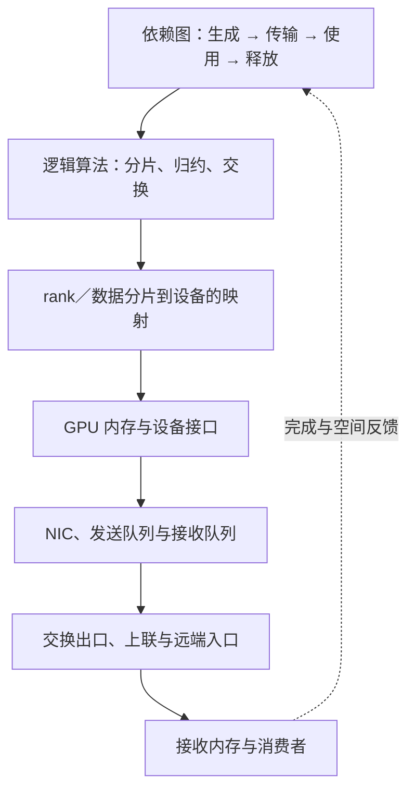
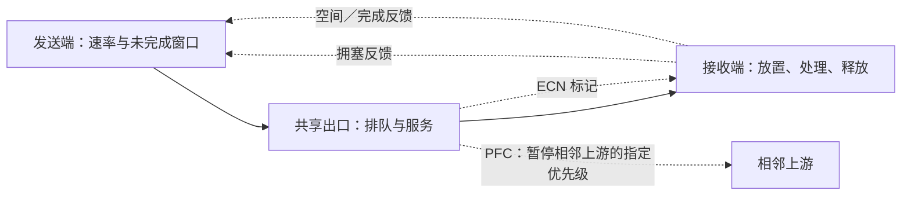

# 拓扑、拥塞与通信进度：从逻辑操作到有界资源

> 前置：[通信原语](通信原语与Collective.md)、[通信性能模型](通信性能模型.md)、[跨节点网络](跨节点网络.md)、[完成语义](DMA与RDMA完成语义.md)。本篇讨论通用模型与协议边界；产品名称仅用于指向具体实现，不代表所有设备具备相同能力。

Collective 规定参与者最终得到哪些数据。算法把它变成有依赖的传输和归约，运行时再把这些工作映射到 GPU、NIC、交换链路与缓冲区。性能由共享资源的占用决定，正确性和进度则取决于顺序、完成与释放条件。逻辑上的“可以并发”，必须同时满足物理路径有容量、接收方有空间、推动完成的执行单元能运行。

## 1. 用三张图表达一次通信

**依赖图**记录数据何时就绪、哪些操作可以重叠、消费者何时能够继续。**逻辑通信图**记录哪些 rank 交换多少数据，以及分片、归约、复制和去重发生在哪里。**物理资源图**记录这些数据经过哪些接口、队列、链路和存储资源。

同一个 AllReduce 可以选择不同算法，同一个算法可以采用不同 rank 顺序，同一个 rank 顺序也可以走不同物理路径。这三种改变影响不同的成本。All-to-All 中每个接收者需要不同数据；AllReduce 中可以先合并多份贡献。因此计算跨域字节之前，要先确定是否进行了本地归约、去重或复制。

设算法阶段为 $r$，逻辑边 $i\to j$ 要发送 $M_{r,ij}$ bytes；其中沿路径 $p$ 传输的比例为 $x_{r,ij,p}$，满足非负且对路径求和为一。令 $a_{p,e}$ 表示该路径对资源 $e$ 的字节占用系数，则：

$$
V_{r,e}=\sum_{i,j,p}M_{r,ij}\,x_{r,ij,p}\,a_{p,e}.
$$

对一条单向链路，$a_{p,e}$ 通常表示是否经过它；对本地内存接口，需要按实际读写次数计数。格式转换、重传与额外副本如果改变了字节量，也需要进入对应项。反方向链路若可独立并行，应单独建模；共用接口或缓冲则另列共享约束。

这个模型把“每 rank 发了多少”和“最忙的物理出口经过多少”分开。前者由算法生成，后者还受 rank 放置、路由和背景流量影响。增加逻辑 channel 只改变映射与并发机会，不会自动扩大共享 PCIe 接口、NIC 或上联的容量。

## 2. 切面给出下界，调度决定能否接近它

对持续可工作的资源 $e$，若服务带宽为 $B_e$，占用字节为 $V_e$，则任务通信时间至少满足：

$$
T\geq\max_e\frac{V_e}{B_e}.
$$

把网络划成两部分，跨越边界的有向链路组成切面 $\mathcal C$。若指定算法必须沿该方向传过 $V_{\mathcal C}$ bytes，而该方向可用总容量为 $B_{\mathcal C}$，则另有 $T\geq V_{\mathcal C}/B_{\mathcal C}$。跨切面的多条物理链路可能共用更深层的出口，不能在多个层次重复相加同一份容量。

这些是资源下界。消息必须先产生才能传输；下一轮需要前一轮归约结果时，空闲链路也不能提前发送尚不存在的数据。对于各轮之间等待完成、轮内传输可以充分流水的简化算法，可近似为：

$$
T_{comm}\approx\sum_r\left(\alpha_r+\max_e\frac{V_{r,e}}{B_e}\right).
$$

$\alpha_r$ 应包含该轮无法用持续传输隐藏的启动和路径延迟。此式没有自动包含包级竞争、短消息的多跳串行化、接收端停顿或跨轮流水；发生这些情况时，需要回到依赖图计算各操作的最早开始与完成时刻。不能把网络所有边的耗时简单相加，也不能对整张依赖图只取一个最大值。

带宽参数也要固定口径：接口服务能力与应用在拥塞下测得的吞吐不是同一个量。如果已经用后者吸收排队和重传，再把完整排队时间加一次，就会重复计费。建模时应说明哪些开销显式表达，哪些已包含在参数里。

对长期到达的作业或请求，设类别 $k$ 的到达率为 $\lambda_k$、每项在资源 $e$ 上占用 $V_{k,e}$ bytes，必要的负载条件是 $\sum_k\lambda_kV_{k,e}<B_e$。它只说明平均需求未超出服务能力，不保证突发、同步波峰与尾延迟满足期限。容量账本和时序账本需要同时成立。

## 3. 拓扑、超售与多 rail 怎样改变可用容量

Leaf–spine 将端点接到叶交换机，再通过脊交换层连接其他叶交换机。端口数、每端口速率与上下联分配共同决定接入规模和跨叶容量。对一个叶交换机，定义下联带宽总和为 $B_{down}$、上联为 $B_{up}$，常用超售比为：

$$
\rho=\frac{B_{down}}{B_{up}}.
$$

$\rho>1$ 表示所有下联同时向外满速发送时，上联无法完全承接。它不是每项操作必然减速的倍率：留在同叶的流量不使用上联，单个接收者又可能先受自身入口限制。应将实际跨叶比例和方向代入切面流量，检查哪一处先饱和。

更大的高速域可以让归约或专家交换留在域内，降低跨域流量；也可能增加算法参与者、同步轮次、共享交换层压力和故障影响范围。因此“域更大”与“单个 TP／EP 组更大”是两个决定。域内可以容纳多个独立组，也可以承接跨组状态迁移。

Multi-rail 是让通信使用多条网络通路的组织方式，必须同时满足三个条件才能接近带宽相加：数据确实被分到不同 rail，各 rail 的端到端路径有足够独立容量，发送和接收端能够并发推进。两张 NIC 共用受限 PCIe 上联、所有 rail 最终汇入同一个超售出口，或通信只使用一个连接时，都不能用网卡线速总和预测吞吐。

rank 到 GPU、GPU 到 NIC、NIC 到 rail 的映射还影响域内中转量。先把数据送到“更空闲的 NIC”可能多占一次 GPU 互联或内存接口；选择最近的 NIC 也可能造成跨节点流量偏斜。局部亲和性与全局均衡要放进同一份路径账本。

## 4. 作业、流与包是不同的调度单位

应用可以错开 collective，通信库可以切块与分 channel，网络可以选择路径并调度出口队列。上层减少同时产生的需求，下层安排已到达的数据；一层的均衡不保证其他层也均衡。

| 路径选择粒度 | 主要作用 | 顺序与资源代价 |
|---|---|---|
| 流级 ECMP | 用报文头哈希，把流分到等价路径 | 同一流通常稳定走一条路径；少量大流可能哈希碰撞，拓扑变化仍可能造成乱序 |
| Flowlet | 依据流中的发送间隔划分片段，在片段边界重新选路 | 需要识别间隔与维护状态；用间隔避免重排时，需要覆盖路径时延差及其变化 |
| 包级分散 | 更细地分摊大流，减少单条路径长期独占 | 路径时延差会产生乱序，接收和传输协议需要相应能力 |

ECMP 的典型按流哈希行为可对照 [Cumulus ECMP 文档](https://docs.nvidia.com/networking-ethernet-software/cumulus-linux-54/Layer-3/Routing/Equal-Cost-Multipath-Load-Sharing-Hardware-ECMP/)；flowlet 的设计空间见 [LetFlow 原文](https://www.usenix.org/conference/nsdi17/technical-sessions/presentation/vanini)。这些是机制选择，不能从“支持多路径”推导出某个平台一定支持包级分散和乱序接收。

路径选择之后，每个出口仍要决定先发送哪个队列。严格优先级可以缩短高优先级等待，却可能让其他队列长期得不到服务；轮转或加权调度能分配服务机会，但必须结合包长、突发和端点速率限制。通信库的请求顺序、NIC 的工作队列顺序与交换机的队列优先级是不同层次，不能用一个“优先级”概念合并。

同步训练和 MoE 归并常等待最慢的参与者。只优化网络平均吞吐，可能留下某个 rank、专家或短控制消息的长尾。应该追踪关键通信的完成时间、共享资源的占用分布，以及谁长期拿不到发送或接收机会。

## 5. 有限缓冲把反馈时间变成容量需求

设某个队列占用为 $q(t)$ bytes，到达速率为 $A(t)$、服务速率为 $B(t)$。在队列非空且尚未溢出的区间内：

$$
\frac{dq}{dt}=A(t)-B(t).
$$

队列为空时，占用不能继续下降；达到容量上限后，新增流量必须被上游挡住或被丢弃。平均到达率低于平均服务率，仍可能因短时多对一汇聚（incast）填满队列。接收设备处理过慢，也能让端点缓冲耗尽，随后将等待传回网络。

当瓶颈发现队列增长时，之前发出的数据仍在路上，反馈也需要时间返回并让发送端采取动作。设反馈生效需 $\tau$，在此期间到达与服务速率近似固定且 $A>B$，新增积压约为：

$$
\Delta q\approx(A-B)\tau.
$$

相应的剩余缓冲至少要能承接这段积压；突发包、处理时延变化、多个入口共享缓冲和速率调整过程还会扩大需求。这个关系解释为什么阈值、反馈路径、headroom（预留余量）需要一起设计。扩大缓冲可以吸收更长突发，同时也允许更长排队；它不会提高出口的持续能力。

流控和拥塞控制解决不同问题：

| 机制 | 直接回答的问题 | 反馈范围 |
|---|---|---|
| Credit／接收窗口 | 接收者还能承诺多少空间或未完成工作 | 由协议定义的邻接或端到端资源范围 |
| PFC | 某个优先级的链路接收资源紧张时，是否暂停相邻发送方 | 链路逐跳；按优先级控制，并非按每条流精确控制 |
| ECN 与发送端拥塞控制 | 共享路径是否正在形成拥塞，源头应如何降速 | 交换节点报告信号，端点调整发送行为 |

ECN 是拥塞标记机制，本身没有规定完整的速率更新算法。RoCE 中的 DCQCN 将交换机标记、接收端拥塞通知与发送端速率控制连接起来；PFC 则可在反馈生效前限制局部入口。二者需要协调，但不能互相替代。[DCQCN 论文](https://www.microsoft.com/en-us/research/wp-content/uploads/2016/02/lossless.pdf)具体讨论了这类分工与缓冲阈值。

PFC 可以把局部暂停沿上游传播，同优先级中本来不经过拥塞目标的流也可能被阻塞，形成队头阻塞和拥塞扩散。它提供的无丢包目标有配置与运行条件，并不保证没有物理错误、设备故障或协议问题。具体网络也可能采用可丢包传输与其他拥塞机制；不能把一种 RoCE 部署模式写成所有 RDMA 的必要属性。[微软 RoCE 部署研究](https://www.microsoft.com/en-us/research/publication/rdma-commodity-ethernet-scale/)记录了暂停、死锁和活锁等问题。

## 6. 乱序、重传和完成是三项不同的约定

多个包可以沿不同路径到达，网络包的到达顺序因此可能与发送顺序不同。接收端可以丢弃超出期望序号的包，也可以先接收并记录缺口，或按位置直接放入目标区域，再等待完整性条件满足。支持哪种方式，取决于 NIC、传输协议与连接协商。

丢包检测和恢复也有不同策略：按序确认、显式缺口通知、超时、从缺口后重新发送，以及只重发缺失部分，具有不同的状态和额外流量需求。选择性恢复可以减少某些重复字节，但要维护接收状态、处理重复与乱序，并确定何时允许完成。不能把“RDMA 可靠传输”解释为所有实现都采用相同重传算法。

乱序接收能力并不等于应用可以乱序消费。至少要分清：

- **包放置顺序**：报文数据先写入目标内存的哪一部分。
- **操作顺序**：读、写、原子操作之间承诺哪些依赖。
- **完成通知顺序**：调用方何时知道操作达到哪种完成条件。
- **消费者可见性**：指定 CPU 或 GPU 能否按接口保证读到完整结果。

接收了最后一个包，并不能证明前面的缺口已补齐；网络端点完成放置，也不能替代 GPU 消费者需要的可见性同步。[GPUDirect RDMA 顺序说明](https://docs.nvidia.com/cuda/gpudirect-rdma/index.html)专门讨论了设备访问与 CUDA 同步的边界。

这里必须区分通用语义与产品能力。例如 [DOCA 的连接能力协商文档](https://networking-docs.nvidia.com/doca/archive/3-5-0/enhanced-connection-establishment)讨论具体设备上的 Selective Repeat 协商；[Ultra Ethernet 的传输设计说明](https://ultraethernet.org/uec-progresses-towards-v1-0-set-of-specifications/)将多路径包分散与灵活顺序列为设计方向。这些资料展示了传输设计的差异，不能当成任意 RoCE、UET 或上层框架默认具备的统一承诺；完成与可见性的精确保证仍要检查所用版本的规范和接口。

## 7. 有足够带宽，仍可能无法推进

传输不仅消耗链路，还占用工作请求、连接状态、重排记录、接收 buffer 和完成队列。资源的释放可能依赖远端响应，也可能依赖本地软件轮询或 GPU 上的进度逻辑。消费者长期不运行时，硬件不会自动替应用回收仍被引用的状态。

如果未完成请求有 $W$ 个槽位，每项平均占用 $\tau_{release}$ 时间，在稳定且持续有工作时，完成率受 $W/\tau_{release}$ 限制。这里的 $\tau_{release}$ 包括直到槽位真正可复用的全生命周期；它未必等于网络往返延迟。增加窗口可以提高并发，也会增加远端空间、状态管理和故障清理压力。对应字节在途模型见[远端内存池](../04_Memory_Storage/超节点与远端内存池.md#3-有带宽还需要足够多的在途请求)。

死锁的核心是循环等待。下图中的箭头表示“释放前者必须先取得或推进后者”：

当环上的资源都被持有，单纯提高链路带宽无法解除等待。PFC 的暂停依赖、传输层 buffer 与应用任务依赖也可能跨层形成环。资源等待图中出现环是危险信号；能否构成实际死锁还取决于资源实例数、容量和协议的释放规则。

进度设计需要让完成路径能够逃离请求占用的资源：按一致顺序申请资源，为完成响应保留容量与服务机会，限制未完成请求数，并保证推进通信的 CPU／GPU／NIC 执行上下文能得到运行机会。保留一条逻辑响应队列还不够；若它下方与数据流共用被暂停的优先级或耗尽的 buffer，依赖环仍可能存在。

死锁、活锁和饥饿也要分开：死锁是参与者互相等待而不能推进；活锁可能一直重试或交换控制消息却没有有效完成；饥饿是整体仍有产出，但某些工作长期得不到服务。超时用于发现超过期限的工作，不能证明远端未执行；重置和重试还要与请求身份、取消和 buffer 生命周期协调。

## 8. 可编程互联改变了职责位置，也改变状态成本

CPU 代理、GPU 发起、NIC 内可编程处理器与交换机归约是不同的执行位置。它们可能缩短控制路径、减少通用计算单元占用或改变跨域字节量，但优化对象并不相同：

| 改变 | 可能减少的成本 | 仍需保留的约束 |
|---|---|---|
| GPU 在数据就绪后发起通信 | 主机轮询与提交往返 | 发起逻辑本身的设备资源、内存顺序和进度 |
| NIC 侧处理描述符、事件或协议 | CPU／GPU 的控制工作和部分接口往返 | NIC 执行能力、局部存储、队列容量与错误传播 |
| 交换结构中执行归约 | 某些阶段的重复转发与端点归约工作 | 支持的数据类型、运算、参与者和并发状态数量 |
| 统一远端访问接口 | 部分地址与传输选择复杂度 | 数据归属、可见性、一致性、权限和故障边界 |

[NCCL 设备通信接口](NCCL软件栈.md#228-以后的-device-side-路线)介绍 GPU 发起与复制引擎路径；[DOCA DPA 文档](https://docs.nvidia.com/doca/archive/2-10-0/DOCA%2BDPA/index.html)则给出了在特定 BlueField 平台上执行通信相关代码的能力。API 名称相似不代表发起端、执行端或完成范围相同。交换机执行归约也不能消除 All-to-All 必须交付给不同目的地的个性化数据。

把逻辑访问端点与底层传输状态解耦，可以为多目标通信复用部分资源；但可靠性、重排、权限与完成关联的状态仍然要存放在某处。状态共享有机会降低连接数量增长的开销，也可能扩大竞争与故障影响范围。这里的通用问题是“每个参与者、每个目标、每个未完成操作分别保留多少状态”，而非把某个厂商的队列对象名称当作所有互联的统一抽象。

“能直接访问远端地址”同样不能推出缓存一致、按程序顺序可见或网络分区时仍能完成。模型状态的发布仍需要上层协议；具体边界继续参见[完成语义](DMA与RDMA完成语义.md)与[远端内存池](../04_Memory_Storage/超节点与远端内存池.md)。

## 9. 将这些机制放回模型执行

判断一项通信改进时，先写出它改变了什么：跨域字节、使用的路径、固定启动、有效服务能力、反馈时间、状态数量，还是关键依赖。随后检查同一改动是否把压力转给另一个接口、队列或执行单元。通信库调用时间还可能包含等待晚到 rank 的时间，因此观察起点应包含数据就绪，而不只包含网络提交。

完整解释应能够连接四个问题：哪些数据必须交付，哪些共享资源承接这些数据，拥塞时谁减速或释放空间，以及什么条件保证消费者最终继续。这样才能把通信优化连到训练步完成与请求时限，而不是只连到某个端口的利用率。

本篇的组织思路参考《深入理解 AI Infra》的[第 6 章 §6.4—6.5](https://bojieli.github.io/ai-infra-book/manuscripts/06-%E8%B6%85%E8%8A%82%E7%82%B9.html)与[第 7 章 §7.1—7.6](https://bojieli.github.io/ai-infra-book/manuscripts/07-%E6%95%B0%E6%8D%AE%E4%B8%AD%E5%BF%83%E7%BD%91%E7%BB%9C.html)。通用推导与产品接口边界分开表述；具体协议事实以上文的一手论文、规范和官方文档为依据。
