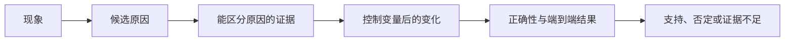

# 第 29 章　性能测量与因果分析

统一计时、关键路径、统计和因果证据，判断局部优化是否改善相同质量要求下的端到端结果。

本章内容：

- [1. 性能语言、关键路径与成本模型](#s1)
- [2. 从观测到因果：什么样的性能结论可以成立](#s2)
- [3. 实验统计与质量评估：一个更快的数字能支持什么结论](#s3)
- [4. 六种性能现象背后的因果关系](#s4)
- [5. 把一条样本的证据串过多个服务](#s5)

<a id="s1"></a>

<a id="s1-性能语言关键路径与成本模型"></a>

## 1. 性能语言、关键路径与成本模型

<details>
<summary>文章导航</summary>

- [1. 性能分析不是找最大的数字](<#s1-1-性能分析不是找最大的数字>)
- [2. 六个基础概念](<#s1-2-六个基础概念>)
- [3. 从 Python 到 GPU 的层次](<#s1-3-从-python-到-gpu-的层次>)
- [4. GPU 为什么会慢：四个大类](<#s1-4-gpu-为什么会慢四个大类>)
- [5. 训练、推理、RL 分别测什么](<#s1-5-训练推理rl-分别测什么>)
- [6. 成本模型的适用范围](<#s1-6-成本模型的适用范围>)
- [7. 症状到工具的第一棵决策树](<#s1-7-症状到工具的第一棵决策树>)
- [8. 性能目标决定证据的粒度](<#s1-8-性能目标决定证据的粒度>)
- [9. 跨层定位：八个系统问题](<#s1-9-跨层定位八个系统问题>)
- [参考资料](<#s1-参考资料>)

</details>

相关基础：[必要基础](<../appendices/foundations/README.md>)。


Profiler 是记录程序执行时间或资源行为的性能分析工具；trace 是包含事件、时间与依赖的执行记录。本章先不操作这些工具。目标是先建立一套不会混淆的语言。你需要知道“测什么”“为什么慢”和“下一步该看哪里”。


<a id="s1-1-性能分析不是找最大的数字"></a>

### 1. 性能分析不是找最大的数字

假设 trace 中：

- GEMM kernel 累计 60 ms；
- NCCL 通信累计 30 ms；
- CPU 等待累计 20 ms；
- 整个 step 实际是 70 ms。

不能把三项相加得到 110 ms，因为计算、通信和 CPU 工作可能重叠。真正决定总时长的是**关键路径**：任何优化如果没有缩短关键路径，就不会缩短 step。

以后看到一个“很大的累计耗时”，先问：

1. 它在关键路径上吗？
2. 它是否与别的工作重叠？
3. 缩短它会让后续工作更早开始吗？


<a id="s1-手算一条关键路径"></a>

#### 手算一条关键路径

假设 A 耗时 4 ms，随后 B（6 ms）和 C（3 ms）可并行，D（2 ms）必须等 B、C 都结束。忽略资源争用，总时间为 $4+\max(6,3)+2=12$ ms，关键路径是 A→B→D。

将 C 减半为 1.5 ms，总时间仍是 12 ms；将 B 减半为 3 ms，总时间变成 9 ms；把 B 继续减至 1 ms，则 C 成为限制，总时间仍需 9 ms。瓶颈会转移，这就是局部加速无法无限叠加的原因。

<a id="s1-2-六个基础概念"></a>

### 2. 六个基础概念

<a id="s1-21-延迟-latency"></a>

#### 2.1 延迟 latency

完成一次操作花多长时间。

- 训练：一次 iteration/step 的秒数。
- 推理：一次请求的端到端时间。
- kernel：设备实际执行该 kernel 的微秒数；主机 launch 调用耗时是另一种计时口径。

延迟要报告分布，而不只是平均值：`p50` 是中位数，`p95` 表示 95% 样本不超过该值，`p99` 用来观察长尾。

<a id="s1-22-吞吐-throughput"></a>

#### 2.2 吞吐 throughput

单位时间完成多少工作。

- 训练：samples/s、tokens/s、tokens/s/GPU。
- 推理：requests/s、input tokens/s、output tokens/s。
- 算子：TFLOP/s、GB/s。

提高并发常常能提高吞吐，但会增加排队和延迟。吞吐更高不代表用户体验更好。

<a id="s1-23-利用率-utilization"></a>

#### 2.3 利用率 utilization

某资源在采样窗口内有多忙。`nvidia-smi` 的 GPU 利用率只说明一段时间内 GPU 上是否有 kernel 活跃，不能证明 kernel 已接近硬件峰值。

下面几种情况都可能显示“GPU 利用率 100%”：

- 高效 Tensor Core GEMM；
- 很慢的低效率 kernel；
- 大量小 kernel 连续运行；
- 内存带宽已满但计算单元很闲。

所以利用率是报警器，不是诊断结论。

<a id="s1-24-饱和-saturation"></a>

#### 2.4 饱和 saturation

继续增加负载后，吞吐不再明显上升，但延迟和排队快速上升，此时系统达到容量拐点。推理服务一定要通过并发或 RPS（Requests Per Second，每秒到达请求数）逐档扫描测试找到该点。

<a id="s1-25-瓶颈-bottleneck"></a>

#### 2.5 瓶颈 bottleneck

当前限制端到端性能的资源或阶段。瓶颈会随 workload 改变：小 batch 可能受 CPU launch 限制，大 batch 可能变成算力或显存带宽限制。


<a id="s1-26-开销-overhead"></a>

#### 2.6 开销 overhead

为管理真正计算而付出的成本，例如 Python 调度、kernel launch、图编译、日志、checkpoint、序列化、HTTP 和 Ray object store。


<a id="s1-3-从-python-到-gpu-的层次"></a>

### 3. 从 Python 到 GPU 的层次

先把图中的名字按职责分组：ATen 是 PyTorch 的基础张量算子层；cuBLAS/cuDNN 是计算库；Triton 是编写与编译 GPU 计算的工具，Inductor 是 PyTorch 的编译后端；PTX 是虚拟指令表示，SASS 是设备机器指令表示。Nsight 是 NVIDIA 的分析工具系列。初读只需知道它们分别属于哪一层，不必掌握各工具用法。

以后看到“算子”一词，需要先问它指哪一层：

```text
业务/框架阶段
  例如 rollout、forward、backward、optimizer
        ↓
Python Module / Function
  例如 TransformerLayer、torch.matmul
        ↓
PyTorch ATen operator
  例如 aten::mm、aten::scaled_dot_product_attention
        ↓
后端库或生成代码
  例如 cuBLAS、cuDNN、FlashAttention、Triton、Inductor
        ↓
CUDA kernel
  Nsight/PyTorch trace 中看到的具体 kernel 名
        ↓
PTX / SASS 指令与 GPU 硬件
```

一个 Python 操作可能触发多个 ATen 算子；一个 ATen 算子也可能触发多个 CUDA kernel。`torch.compile` 还可能把多个 ATen 算子融合成一个 Triton kernel。因此不能只靠函数名猜测底层执行。


<a id="s1-4-gpu-为什么会慢四个大类"></a>

### 4. GPU 为什么会慢：四个大类

<a id="s1-41-没有足够工作latencylaunch-bound"></a>

#### 4.1 没有足够工作：latency/launch bound

特征：

- kernel 很短且数量很多；
- GPU 时间线有大量小间隙；
- CPU 线程持续发射 kernel；
- 增大 batch 后效率明显变好。

常见原因：micro-batch 太小、shape 太碎、Python/调度慢、没有融合、CUDA Graph 未命中。

<a id="s1-42-计算受限compute-bound"></a>

#### 4.2 计算受限：compute bound

特征：

- 大 GEMM/attention 占主导；
- Tensor Core/SM 吞吐接近硬件上限；
- 显存带宽没有满；
- 减少 FLOPs 或降低精度可能改善性能。

<a id="s1-43-内存受限memory-bound"></a>

#### 4.3 内存受限：memory bound

特征：

- DRAM/L2 吞吐高，计算吞吐相对低；
- elementwise、normalization、embedding、KV Cache 访问占比高；
- kernel fusion、减少读写、提高数据复用更可能有效。

<a id="s1-44-等待受限communication--synchronization--io-bound"></a>

#### 4.4 等待受限：communication / synchronization / I/O bound

特征：

- GPU 时间线出现空洞或长 NCCL kernel；
- 某些 rank 先到 collective，等待最慢 rank；
- 数据加载、网络、存储或 checkpoint 与计算没有重叠；
- 单卡快，多卡扩展差。

NVIDIA 的 GPU 性能背景指南用算术强度和并行度来区分延迟、计算和内存限制；Nsight Compute 的 Roofline 是把这种判断数据化的工具。参见 [GPU Performance Background](https://docs.nvidia.com/deeplearning/performance/dl-performance-gpu-background/index.html) 与 [Nsight Compute Profiling Guide](https://docs.nvidia.com/nsight-compute/ProfilingGuide/index.html)。


<a id="s1-5-训练推理rl-分别测什么"></a>

### 5. 训练、推理、RL 分别测什么


<a id="s1-51-训练"></a>

#### 5.1 训练

最低指标集：

- step time 的 p50/p95；
- tokens/s 和 tokens/s/GPU；
- data、forward、backward、optimizer、通信、checkpoint 分段；
- 每个 rank 的时间，至少保留 min/max 和最慢 rank；
- allocated/reserved/峰值显存；
- 正确性护栏：loss、grad norm、样本/token 数。

MFU（Model FLOPs Utilization，模型浮点运算利用率）用模型有效计算速率与选定精度的硬件峰值比较，只有在 FLOPs 公式、精度峰值和统计范围一致时才可比较。不同文章中的 MFU 不能直接横比。

<a id="s1-52-推理"></a>

#### 5.2 推理

最低指标集：

- TTFT：Time To First Token，首 token 等待时间；
- TPOT：首 token 之后平均每个输出 token 的处理时间；
- ITL：相邻 token 的间隔，用于观察抖动；
- E2E latency；
- request/input/output/total token throughput；
- p50/p95/p99；
- 并发、到达率、输入/输出长度分布、cache 命中率；
- 错误、超时、abort/retract。

同一框架在 `input=128/output=128` 和 `input=8192/output=128` 上不是同一个 workload，吞吐不能直接比较。

<a id="s1-53-强化学习"></a>

#### 5.3 强化学习

RL 是训练和在线推理组成的流水线，还要测：

- rollout 生成时间；
- reward/tool/environment 的非生成时间；
- 训练等待 rollout 的时间；
- logprob/ref/teacher forward；
- actor train；
- 权重同步；
- 模型 offload/onload；
- 每轮有效 token 数与样本长度分布。

局部最快不等于端到端最快。给训练侧更多 GPU 可能让它更早结束，却更久地等待 rollout。


<a id="s1-6-成本模型的适用范围"></a>

### 6. 成本模型的适用范围

Amdahl 定律描述局部加速的整体上限：原耗时占比 f 的部分加速 s 倍，整体加速比为 1/((1−f)+f/s)。它假设工作量与其余阶段耗时不变，解释了非关键部分提速收益有限。

| 模型 | 回答的问题 | 容易遗漏的因素 |
|---|---|---|
| Roofline | 计算与某层数据流量决定怎样的吞吐上界？ | 小任务、依赖与并行度 |
| $\alpha+n\beta$，其中 $\beta=1/BW$ | 启动延迟与消息大小怎样影响传输时间？ | 拥塞、拓扑与到达偏斜 |
| Amdahl | 局部加速能缩短多少端到端时间？ | 工作量变化与新瓶颈 |

若可优化部分占 30%，局部加速 2 倍，工作量不变时理想整体加速为 $1/(0.7+0.3/2)\approx1.176$。同样，计算 8 ms、通信 5 ms 只有在依赖允许、资源能够充分重叠时，才可能接近 8 ms；通信若消费计算结果，或二者争用带宽，就不能直接取最大值。

模型给出假设下的约束，观测判断执行是否满足这些假设。环境、工作量、计时与预热、控制变量和正确性如何限定结论，在[证据与因果](<#s2>)中集中解释。

<a id="s1-7-症状到工具的第一棵决策树"></a>

### 7. 症状到工具的第一棵决策树

此图供遇到问题时查阅，不是安装清单。py-spy 看 Python 执行，pidstat/iostat 看进程与存储活动；PyTorch Profiler 连接框架算子和设备，Nsight Systems 看系统时间线，Nsight Compute 看单个 Kernel；Memory Snapshot 与 Memray 分别帮助分析设备分配器和主机内存。

```text
端到端变慢
├─ GPU 利用率低或有周期性空洞
│  ├─ CPU 忙：py-spy / PyTorch Profiler / Nsight Systems
│  ├─ data/IO 忙：pidstat / iostat / dataloader timer
│  └─ 多 rank 互等：rank timer / NCCL / Nsight Systems
├─ GPU 持续忙
│  ├─ 已锁定热点 op：PyTorch Profiler
│  └─ 已锁定热点 kernel：Nsight Compute / Roofline
├─ OOM 或显存逐步上涨
│  ├─ PyTorch allocator：Memory Snapshot
│  └─ Python/native host memory：Memray
├─ 推理延迟随并发爆炸
│  └─ benchmark sweep + scheduler/KV/queue metrics
└─ Slime 一轮很慢
   ├─ wait_time_ratio 高：分析 rollout
   └─ wait_time_ratio 低且 actor_train 慢：分析训练
```


<a id="s1-8-性能目标决定证据的粒度"></a>

### 8. 性能目标决定证据的粒度

如果目标是用户首 token 延迟，端到端请求、排队和 Prefill 才是直接对象；如果目标是训练 tokens/s/GPU，工作量、整步关键路径和资源预算需要固定。局部算子的 TFLOP/s 是中间解释，不能替代前两种目标。

明确 workload、当前基线和候选层次之后，才知道最小证据是长期指标、系统 trace 还是单 kernel 计数器。没有目标指标，“变快”就缺少可判断的对象。

<a id="s1-9-跨层定位八个系统问题"></a>

### 9. 跨层定位：八个系统问题

本节供深入 Kernel 或编译器时回看。DSL 是领域专用语言，codegen 是生成代码，ISA 是指令集架构，cubin 是 GPU 二进制文件；这里新增的工具名表示实现选项，不是完成这条主线前必须另学的课程。

<a id="s1-从-workload-到通信路径"></a>

#### 从 workload 到通信路径

1. 这是 **workload / 算子抽象** 问题，还是具体 Kernel 实现问题？例如 GEMM / Grouped GEMM 是“要算什么”，cuBLASLt / CUTLASS / Triton 是“怎么实现”。

2. 这是 **代码/编译** 问题，还是 **运行时/调度** 问题？例如 nvcc / Triton compiler / TileLang codegen 与 CUDA Runtime / Driver 不属于同一层。

3. 当前看到的是哪种编译产物？CUDA C++ / Triton DSL 最终可能经历 PTX → cubin/SASS；不要把 CUDA Runtime 当成 GPU ISA。

4. 当前工作粒度是什么？Operation / Kernel / Grid / Block(CTA) / Warp / Thread / Tile 中的哪一层？

5. “谁在调度谁”？Stream 管 operation 的顺序与并发机会；GPU CTA scheduler 管 Block→SM；Warp Scheduler 管 SM 内 Warp→instruction issue。

6. 资源属于谁？Register 属于线程执行状态但物理驻留于 SM；Shared Memory 属于 Block 协作；L2 属于整 GPU；HBM 是设备全局显存；Hopper/Blackwell 还引入 TMA/TMEM 等新数据通路与存储层级。

7. 当前瓶颈是 Tensor Core compute、HBM/片上数据搬运、launch/scheduling、expert load imbalance，还是 GPU 间通信？Grouped GEMM 要特别看每个 Expert 的 `M_i` 分布，而不是只看总 FLOPs。

8. 如果已经跨 GPU / 节点：数据沿 PCIe / NVLink / NVSwitch / HCA / InfiniBand 中的哪条路径走？Collective 的 latency 与 bandwidth 成本分别是什么，能否与 GEMM/Attention overlap？

先看“模型产生了什么 workload”，再看“由哪个 library / DSL / compiler 实现”，然后看“Kernel 如何进入 Stream、Block 如何进入 SM、Warp 如何被 issue”，最后沿着 Register/Shared Memory/HBM/NVLink/IB 追踪数据流。绝大多数 CUDA、FlashAttention、MoE、Megatron、NCCL 与推理 Runtime 问题，都可以挂到 **Workload → Compilation → Scheduling → Resource → Data Movement → Communication** 这六个维度上。

<a id="s1-参考资料"></a>

### 参考资料

- [Roofline 原始报告](https://www2.eecs.berkeley.edu/Pubs/TechRpts/2008/EECS-2008-134.html)
- [CUDA Best Practices](https://docs.nvidia.com/cuda/cuda-c-best-practices-guide/index.html)

- [NVIDIA GPU Performance Background](https://docs.nvidia.com/deeplearning/performance/dl-performance-gpu-background/index.html)
- [NVIDIA Deep Learning Performance](https://docs.nvidia.com/deeplearning/performance/index.html)
- [Nsight Compute Profiling Guide](https://docs.nvidia.com/nsight-compute/ProfilingGuide/index.html)
- [PyTorch Benchmark Recipe](https://docs.pytorch.org/tutorials/recipes/recipes/benchmark.html)
- [vLLM Benchmark CLI](https://docs.vllm.ai/en/latest/benchmarking/cli/)
- [SGLang Bench Serving Guide](https://docs.sglang.ai/developer_guide/bench_serving)

<a id="s2"></a>

<a id="s2-从观测到因果什么样的性能结论可以成立"></a>

## 2. 从观测到因果：什么样的性能结论可以成立

第 1 节的成本模型解释了哪里可能受限，但一个长时间区间还不能告诉我们为什么慢。可信结论需要连接三件事：两组结果是否可比、观测能否区分候选原因、性能变化是否保持了有效产出。

本文的**基线**是改动前可复现的参照配置；**控制变量**是比较时保持其他相关条件不变；**相关**表示两个现象同时变化，**因果**要求能够说明改动为何通过某条机制改变结果。先从一项小改动提出可推翻的预测，再收集能区分解释的证据。

环境表和工具名是复现实验时的核对项，首次阅读重点理解“同一任务、同一资源、同一计时边界”。Commit 是代码版本标识，digest 是镜像内容摘要；TE 指 Transformer Engine 计算库。没有实际使用的组件可以记为不适用。

<a id="s2-环境与工作量两组数字为什么能比较"></a>

### 环境与工作量：两组数字为什么能比较

比较对象由目标 SLO、影响范围、现象首次出现的时间或提交，以及基线窗口限定。日期和时区、主机或集群身份有助于把日志与曲线对齐；完整配置和改动 diff 则说明到底改变了什么。

| 条件 | 它限制的解释 |
|---|---|
| 模型、tokenizer、数据版本，seed，采样参数 | 是否在处理相同语义的任务；固定 seed 仍不能保证不同分布式归约顺序逐位一致 |
| GPU 型号/数量/HBM、MIG、CPU/NUMA/RAM、NVLink/PCIe/NIC/fabric | 可用容量、带宽与访问局部性是否相同 |
| OS/kernel、容器及资源限额、Python/PyTorch、代码 commit、镜像 digest | 主机供给和执行路径是否相同 |
| driver/CUDA/NCCL/TE/Triton、框架版本、功耗/频率/温度状态 | 后端实现与资源供给是否相同 |
| 形状、精度、并行布局、cache/Graph/compile、测量窗口 | 实际计算、数据移动和计时范围是否相同 |

MIG（Multi-Instance GPU）划分 GPU 资源；NUMA（Non-Uniform Memory Access）改变 CPU 侧访问局部性。因此“同型号机器”仍不足以说明条件相同。

工作量也不是一个 batch 数字。训练需要 global/micro batch、梯度累积、有效 token 数与序列 p50/p95/max；推理需要输入/输出长度、到达过程、并发或请求速率。相同平均长度不能替代长度分布。MoE 还需要 experts、top-k 和 tokens/expert 分布；RL 需要角色资源、policy lag、reward/tool/environment 的非生成时间和 rollout 长度。DP/TP/PP/SP/CP/EP/FSDP 与参数、激活、KV 的 dtype 决定不同对象的状态和流量。

<a id="s2-计时边界与稳态"></a>

### 计时边界与稳态

异步调用的 host 返回通常只表示提交完成。设备事件覆盖特定设备工作区间，端到端墙钟必须等待目标工作完成；同步位置又可能改变重叠，因此局部计时和系统计时不能互相替代。

预热指先运行一段不计入稳态比较的工作，让一次性准备完成；冷启动延迟则应另行保留。JIT 是运行时编译，autotuning 是试选实现参数，lazy module 是用到时才加载的模块。预热也不能简单定义成丢弃固定几步。首轮可能包含 CUDA context、lazy module、memory pool、JIT、`torch.compile` tracing/compilation、autotuning、CUDA Graph capture、通信器和文件缓存初始化。动态 shape 会再次触发编译，只有逐步时间进入稳定区间后，才适合讨论稳态性能。

Counter 是硬件事件计数器，例如记录某类访存或指令活动。设备未必能在一次执行中同时采集所有指标，分析工具可能重复运行目标工作，每次收集一部分，这称为 replay。DCGM 是 NVIDIA 的设备管理与监控组件；当它和其他工具都请求 profiling metrics 时，还可能竞争同一组计数器。

采集本身也会改变程序：记录调用栈、shape、内存分配和事件会消耗 CPU 与缓冲；额外设备内存可能触发 OOM，多 rank 同时写 trace 也会增加共享文件系统压力。例如加上 profiler 后某步从 100 ms 变成 130 ms，不能把多出的 30 ms 都算成原程序瓶颈，也不能直接拿它与未采集的候选配置比较。常驻指标适合找异常窗口，短 trace 适合分析依赖，选定 kernel 的计数器适合解释内部资源行为；最终收益还需在关闭额外采集的相同条件下测量。

<a id="s2-从信号到候选解释"></a>

### 从信号到候选解释

| 信号 | 能支持的解释 | 单独不能证明的事 |
|---|---|---|
| throughput、step/TTFT 的分布 | 产出与尾部行为变化 | 根因在某个 kernel |
| GPU/SM/DRAM activity、power/clock/temp/throttle | 活跃、资源利用和供给限制 | 利用率高就意味着有效计算多 |
| HBM allocated/reserved/device | 张量、分配器和设备占用的差异 | 额外占用都是泄漏 |
| Xid、ECC、链路错误、CPU/主机内存/I/O | 硬件和供给异常的候选线索 | 没有错误计数就没有性能问题 |
| queue、KV、preemption、rank/stage/expert skew | 拥塞、容量压力和工作不均 | 原因必然在网络或 scheduler |

Xid 是 NVIDIA 驱动报告的错误标识，ECC 是纠错码相关状态；NVTX 是给执行区间添加语义标记的接口，RAS 指可靠性、可用性与可维护性相关能力。下面的工具入口供排查时按需查阅。

日志和长期指标确定窗口，NVTX/PyTorch Profiler 连接阶段与算子，Nsight Systems 追踪 CPU/GPU 依赖，Nsight Compute 解释选定 kernel 的资源行为。Memory Snapshot 对应分配器，Memray 对应主机分配；Flight Recorder、RAS 与 nccl-tests 提供通信序列、健康和隔离基线。具体能力见[工具的观测模型](<../appendices/performance/software_tutorials.md>)。

时间线中的 data/H2D、forward、backward、communication、optimizer、queue、checkpoint/eval 可能重叠。每个 rank 的 p50/p99、rank max/min、累计耗时和暴露在关键路径上的时间是不同量。Kernel 名还需结合 shape、次数和单次耗时；通信需结合 group、消息字节、频率、arrival skew 和拓扑；显存需结合参数、梯度、优化器、激活、KV、buffer、workspace、Graph 与分配器状态的生命周期。

<a id="s2-假设怎样被支持或推翻"></a>

### 假设怎样被支持或推翻



假设教学时间线中 GPU 每 80 ms 出现 12 ms 空洞，至少存在三种解释：

| 假设 | 需要同时出现的证据 | 有区分力的变化 |
|---|---|---|
| DataLoader 供给不足 | data range 延长、队列变空、设备等待输入 | 消除供给等待后，空洞和端到端耗时一起缩短 |
| 每步日志引入同步 | 空洞附近存在 `.item()` 或设备同步及其调用栈 | 去除该同步后，相关等待消失 |
| 梯度 AllReduce 暴露 | 该区间存在通信或跨 rank 到达依赖 | 通信与到达时间变化能解释整步变化；不能只凭完全空闲的截图认定 |

这些数字是示意，不是测量结果。“rank 7 的 backward 晚 180 ms”描述观测，“NCCL 有 bug”则是待证明的解释。类似地，功耗下降与通信变长同时发生，也可能因为 GPU 在等待。隔离通信、固定供给或改变重叠后的结果，必须能够区分替代解释；一次只改变候选因素、保持统计口径并重复观察，才有较清楚的归因。

<a id="s2-正确性与变化率更快是否仍在做同一件事"></a>

### 正确性与变化率：更快是否仍在做同一件事

loss、reward、KL/logprob、grad norm、有效 token/样本数、输出长度、truncated 比例、错误/超时/重试及任务质量分别检查不同语义。容差取决于精度和应用。缩短回答可以提高 samples/s，但可能没有完成原任务。

设 A 为基线、B 为改动后结果，吞吐提升为 `(B-A)/A`，延迟下降为 `(A-B)/A`。教学例中耗时从 100 降到 80，延迟下降 20%；工作量不变且没有其他限制时，吞吐变为原来的 1.25 倍。

median、p90/p95/p99、min/max、变异系数与样本数回答不同稳定性问题。分布式 step 受慢 rank 影响，在线服务受尾延迟约束；平均 20 ms 的 collective 若偶尔出现 300 ms 长尾，平均值可能掩盖问题。按输入/输出长度、batch 或 concurrency 分组，才能避免把不同工作量混成一个平均数。

最终需要一起判断主指标、p95/p99、GPU-hours/有效产出、峰值显存、功耗、质量和错误率。局部 kernel 更快而整步不变，说明关键路径判断仍需修正；平均值改善但越过尾延迟 SLO，也不能直接称为服务容量提高。

<a id="s2-最小对照一次更快是否足够"></a>

#### 最小对照：一次更快是否足够

假设固定任务下，基线五次耗时为 `[100,102,98,101,99]` ms，改动后为 `[90,92,91,89,93]` ms。中位数从 100 降到 91 ms，下降 9%；这组教学数字描述了五次结果，并不能证明所有负载都改善 9%。仍需记录冷/热状态、测试顺序与质量，并确认变化超过该环境的自然波动。

若总是先测基线再测候选，缓存或温度随时间变化就可能混入差异。可交错运行并按相同输入配对比较；重复次数与置信区间方法见[实验统计与质量评估](<#s3>)。置信区间描述估计的不确定性，不能补救不公平的工作量或计时边界。

<a id="s2-结论的适用范围与原始证据"></a>

### 结论的适用范围与原始证据

benchmark JSON/JSONL、PyTorch trace、`.nsys-rep`、`.ncu-rep`、Memory Snapshot/Memray、TensorBoard/W&B 与系统监控各自保存不同信息。rank、采集窗口、工具版本、文件大小和配置 diff 把证据连接起来。对外共享时还需按实际数据处理 prompt、路径、主机名、环境变量等敏感内容。

可信结论说明支持、否定或尚不能判断的部分。收益需要在代表性形状下稳定存在，满足正确性与资源约束，并能由依赖和成本变化解释；线上还需要回归指标、告警关联与回退条件。另一种 workload、backend 或规模改变了前提，旧加速比不会自动成立。

这里建立了论证方式，接下来沿[六种性能现象](<#s4>)看计时、通信与队列如何形成具体结论。

<a id="s3"></a>

<a id="s3-实验统计与质量评估一个更快的数字能支持什么结论"></a>

## 3. 实验统计与质量评估：一个更快的数字能支持什么结论


<a id="s3-实验单位与重复次数"></a>

### 实验单位与重复次数

同一请求的多个 token 延迟彼此相关，同一次进程中的相邻 step 也可能受温度、缓存和后台负载共同影响。把一万 token 当作一万次独立实验，会低估不确定性。应区分请求、session、独立进程运行、训练 seed 和设备／节点等层级。

比较配置 A/B 时，尽量在相同输入或负载 trace 上配对，并交替或随机安排执行顺序。独立重启用于覆盖启动与运行间变化；长运行中的稳定窗口用于观察过程内波动。记录预热、缓存状态、频率、外部干扰、失败和所有原始测量，不只保存最快的一次。

<a id="s3-五对耗时的完整计算"></a>

### 五对耗时的完整计算

下面是教学数据，单位 ms，不是 GPU 实测：A=[10,12,11,13,14]，B=[9,10,10,11,12]。每一对使用同一负载，差值 A−B=[1,2,1,2,2]。平均节省 1.6 ms，差值样本标准差约 0.547723，均值标准误约 0.244949。

在配对差值独立且可用正态模型描述等条件下，双侧 95% t 区间为：

$$\bar d\pm t_{0.975,n-1}\frac{s_d}{\sqrt n}.$$

使用 n=5、自由度 4 的临界值约 2.776445，得到约 [0.919913,2.280087] ms。这个小数据集只展示计算方法，不足以确认分布假设；区间不能当作所有未来负载必然加速的保证。区间的重复抽样含义和公式见 [NIST 均值置信区间](https://www.itl.nist.gov/div898/handbook/eda/section3/eda352.htm)。

两组平均耗时分别为 12 和 10.4，延迟下降为 1.6/12≈13.33%，速度比为 12/10.4≈1.153846。说“速度提高 15.38%”与“延迟下降 13.33%”采用不同分母。应先写定义，再报百分比。平均每对速度比也不一定等于平均时间之比。

<a id="s3-配对-bootstrap-保留了什么"></a>

### 配对 bootstrap 保留了什么

Bootstrap 用已有样本近似反复抽样时统计量的波动。对上面五对耗时，把配对编号记为 1～5，每次随机抽取五个编号，允许同一编号被抽到多次。例如抽到 `[1,1,3,4,5]`，就从 A、B 中同时取出这些编号，得到差值 `[1,1,1,2,2]`，这次重采样的均值差是 1.4 ms。重复这个过程会得到一组均值差，再从这组结果中确定区间。

关键是把每一对当成抽样单位：A、B 必须使用同一组编号，否则原来相同输入下的对应关系会被打散。若多次请求属于同一 session，可能还需把整个 session 作为单位；有明显时间相关性的 trace 则需按合适的连续块重采样，不能把每个 token 当作独立证据。

对上面五个差值，长度为 5 的索引序列共有 5⁵=3125 种。全部枚举并用最近秩定义 2.5%／97.5% 分位数，均值差的 percentile 区间为 [1.2,2.0] ms。这与 t 区间不同，因为方法和假设不同；样本极少时 bootstrap 也无法创造尚未观察到的尾部。

实际使用可参考 [SciPy bootstrap](https://docs.scipy.org/doc/scipy/reference/generated/scipy.stats.bootstrap.html)中的配对与区间方法。必须记录统计量、采样单位、方法、随机种子和重采样次数；不能试完多种区间，只保留最有利的一种。

<a id="s3-p99失败与超时"></a>

### P99、失败与超时

对 n 个排序值，最近秩定义的 P99 取第 ceil(0.99n) 个。当 n=100 时，它是第 99 个，几乎由末端两个样本决定；其他插值规则可能不同。应报告样本数和分位数算法，并观察更长窗口／重复运行的稳定性。不能对多个分片的 P99 直接求平均当作总体 P99。

如果只统计成功请求，慢到超时的请求会消失，成功请求 P99 甚至可能变好。应同时报告失败率和所有请求的终态；超时只说明真实完成时间至少超过阈值，是删失信息，不能把超时阈值当作实际完成耗时。

即使 100 个独立同分布请求中没有任何失败，也不能宣称真实失败率为零。在二项模型下，零失败对应的单侧 95% 上界由 (1−p)¹⁰⁰=0.05 得到，p≈2.9513%。请求相关或非平稳时，这个保证也不再直接适用。

<a id="s3-质量比较需要同一任务与同一判定规则"></a>

### 质量比较需要同一任务与同一判定规则

固定评估任务 ID、输入／媒体版本、模板、采样、最大输出长度、工具与环境版本、评分器和失败规则。训练奖励、任务成功率、形式合法率和模型偏好分别回答不同问题。用校准集同时挑选量化配方并报告最终质量，会把调参收益混入评估。

教学例同一批 100 个任务，A 成功 70、B 成功 74。进一步发现：双方成功 64，A 独有成功 6，B 独有成功 10，双方失败 20。净提升为四个百分点，但真正提供差异证据的是 16 个结果不同的配对任务。

若在“两个系统对不一致任务等可能获胜”的零假设下做条件二项检验，双侧概率为：

$$2\sum_{k=0}^{6}\binom{16}{k}2^{-16}\approx0.4545.$$

该示例不足以在通常 5% 门槛下拒绝此零假设，也不证明两系统等价。实际还需要预先指定最小有意义差异、增加样本，并检查任务类别、失败类型和多个 seed。LLM judge 的模型与提示版本也要冻结，必要时保留人工复核与分歧记录。

<a id="s3-多次尝试回归判断与达标时间"></a>

### 多次尝试、回归判断与达标时间

若独立进行 20 次真正无效的比较，每次都按 5% 假阳性率宣布成功，则至少一次误报的概率为 1−0.95²⁰≈64.15%。真实 sweep 未必独立，但挑选最好结果仍需要留出的确认实验或多重比较处理。

事先规定主要指标、允许的质量下降和最小性能收益。先通过数值／功能门槛，再看误差区间和实际收益是否值得；“统计显著”不代表工程价值大。训练的 time-to-quality 应包含未达标的 seed，不能仅平均成功运行的达标时间。

对于[已归档 CPU 实验](<30_训练综合案例.md#s3>)，七对耗时来自同一进程，OS 缓存未受控制。它支持这段程序的应用缓存对照，不支持跨机器的置信声明或长期服务 P99。扩大结论前，需要按新的实验单位采样。

[资源与统计参考程序](<../examples/resource_statistics.py>)精确枚举本节 bootstrap、二项概率与容量算例，仅依赖 Python 标准库。


<a id="s4"></a>

<a id="s4-六种性能现象背后的因果关系"></a>

## 4. 六种性能现象背后的因果关系

从一个矩阵乘到一轮 RL，分析尺度会变，推理方法却相通：明确实际工作与时间边界，找出决定完成时间的依赖，再判断某种改变是否作用于这条依赖。下面沿六个层次展开，不将某次测试的数字当成普遍结果。

本节包含两种材料：机制推理可以直接阅读；CUDA/PyTorch 代码需要配置相应软件和 NVIDIA GPU 才能运行。没有 GPU 时，可在读完后运行[可复现实验中的 CPU 路线](<30_训练综合案例.md#s3>)，练习计时、对照和恢复；它不替代 GPU 或多卡实测。

<a id="s4-一矩阵乘的-cpu-时间为何可能很短"></a>

### 一、矩阵乘的 CPU 时间为何可能很短

`torch.mm(x,y)` 返回时，GPU 工作可能只是入队。CPU 的 `time.perf_counter()` 差值因此可能主要是提交开销。若在开始前排空旧工作、结束后等待目标完成，计时窗口才包括本次 GPU 执行，但也包括主机相关开销。CUDA Event 则在设备时间线上定义另一种边界。

```python
# 示意同一调用的两种时间边界；并非一组实测结果。
# 假设已 import time、torch，且 x、y 为预热后的 CUDA 张量。
t0 = time.perf_counter()
torch.mm(x, y)
enqueue_time = time.perf_counter() - t0

torch.cuda.synchronize()
t0 = time.perf_counter()
torch.mm(x, y)
torch.cuda.synchronize()
completion_time = time.perf_counter() - t0
```

预热排除初始化、编译与缓存建立，重复统计区分稳定成本与波动。例如对 2048、4096、8192 的方阵，绝对耗时与有效 FLOP/s 回答不同问题：更大的矩阵耗时更长，同时可能更充分利用计算资源。30 次记录的 median/p95 是一种示例统计口径，不能保证所有工作负载都已稳态。

<a id="s4-二一行-python-为什么对应多个名字"></a>

### 二、一行 Python 为什么对应多个名字

对 `(relu(x @ w).sum()).backward()`，Python 表达式、ATen 的 `matmul/mm`、ReLU、reduction、反向算子和 GPU kernel 分别属于不同层。`record_function` 提供业务语义，`record_shapes`、`profile_memory`、`with_stack` 提供形状、分配和调用来源；self CUDA time 是归到该项自身的时间，total time 还包括其子调用；两者不能重复相加。


下面的代码把这个表达式放到一个明确的语义区间中。五轮预热用于隔离初始化；每轮清空 `x.grad/w.grad`，避免把梯度累积状态混进参考。CPU/CUDA activity、shape、memory 与 stack 各自增加一种观测维度，也各自增加采集开销。

```python
import torch
from torch.profiler import ProfilerActivity, profile, record_function

x = torch.randn(4096, 4096, device="cuda", requires_grad=True)
w = torch.randn(4096, 4096, device="cuda", requires_grad=True)

for _ in range(5):
    (torch.relu(x @ w).sum()).backward()
    x.grad = None
    w.grad = None

torch.cuda.synchronize()
with profile(
    activities=[ProfilerActivity.CPU, ProfilerActivity.CUDA],
    record_shapes=True,
    profile_memory=True,
    with_stack=True,
) as prof:
    with record_function("forward_backward"):
        (torch.relu(x @ w).sum()).backward()
    torch.cuda.synchronize()

print(prof.key_averages().table(sort_by="self_cuda_time_total", row_limit=20))
prof.export_chrome_trace("/tmp/forward_backward_trace.json")
```

表格将 self CUDA time 排序，trace 则保留算子、launch 和设备执行的关系。`row_limit=20` 只是展示上限，不代表只有二十个事件。这个片段说明证据如何产生，本文没有据此写入 GPU 实测数据。

进阶选读：dispatcher 根据设备、自动微分、自动混合精度等分派条件选择实现；Autocast 指自动选择运算精度的机制。CPU、CUDA、Autograd、Autocast 的 dispatcher key 不必指向同一实现。内部接口 `torch._C._dispatch_dump_table("aten::mm")` 可以展示注册关系，但语法和输出依 PyTorch 版本变化。[执行与内存篇](<../appendices/performance/02_pytorch.md>)进一步解释这种映射。

同样，`memory_allocated()`、`memory_reserved()` 和 `max_memory_allocated()` 分别是当前张量占用、缓存分配器保留与窗口峰值。矩阵尺寸增大后，这三个数字不同并不自动意味着泄漏。Profiler 能找到哪个算子占时间，单凭算子表却不能解释 kernel 内部的 stall。

<a id="s4-三系统时间线与-kernel-报告为什么要连起来"></a>

### 三、系统时间线与 Kernel 报告为什么要连起来

如果 GPU 在两个 kernel 之间长期空闲，根因可能在 CPU、数据供给或依赖；如果 kernel 连续执行，才进一步讨论计算、内存和指令限制。累计耗时最高的 kernel 可能调用很多次，单次最慢的 kernel 则可能不在关键路径，两者都需要上下文。

Warp stall 指 Warp 因依赖或资源问题不能发射；轨道是在同一时间轴上展示一类事件的行。Nsight Systems 的 `cuda,nvtx,osrt`（CUDA、语义标记、操作系统运行时）轨道连接主机、设备与语义区间。Nsight Compute 的 kernel-name 过滤和 launch-count 限定分析对象，basic/full 等采集集合影响成本。完整训练的所有 kernel 都做 replay，会改变被分析系统并产生大量数据。

DRAM 与 SM/compute throughput、occupancy、warp stall、算术强度一起限定解释。低 occupancy 可能仍足以饱和带宽，不能单独判错。shape 或 dtype 改变后，系统总时长与对应资源信号是否按假设变化，决定该解释是否成立。详见[时间线与底层算子](<../appendices/performance/03_cuda_kernels.md>)。

<a id="s4-四训练的通信占比为何不能直接相加"></a>

### 四、训练的通信占比为何不能直接相加

一次 step 包括前向、反向、梯度与参数通信、PP send/recv、优化器、数据等待和气泡。它们可能重叠。timer 的 min/max 与多 rank trace 可以区分最慢参与者、阶段不均衡和到达偏斜，rank 0 的平均值没有这个能力。

固定 rollout dump 或训练数据、序列、global batch 和精度，才能解释配置差异。TP 增大可能让 GEMM 变小并增加高频通信；PP 改变会引入不同气泡；CP 和 EP 的开销还分别受到上下文与路由分布影响。固定总卡数时 TP/PP 改动可能连带改变 DP，不能把全部变化归给一个局部参数。

microbatch、activation recomputation 和 overlap 分别改变调度粒度、计算与保存的交换、通信暴露。稳态 iteration 的 median/p95、samples/s、tokens/s、框架 TFLOPS 口径、每 rank 峰值、loss 与 grad norm 一起限定判断。短 trace 负责解释依赖，无 profiler 的分布负责衡量性能。见[训练性能](<../appendices/performance/04_megatron.md>)。

<a id="s4-五吞吐趋平时延迟为什么仍会上升"></a>

### 五、吞吐趋平时，延迟为什么仍会上升

考虑一个明确的教学 workload：输入长度 512 或 1024，输出目标 128 或 256，200 个请求，固定长度范围、EOS 策略、sampling 与 prefix cache。并发从 1、2、4、8、16、32 到 64 是不同负载点，不是系统必然支持的容量。

并发增加可能提高 decode batch 和设备效率；接近资源上限后，增加的请求主要转成排队，于是 output tokens/s 趋平而 p95 TTFT/TPOT 上升。request/s、input/output tokens/s、p50/p95/p99 TTFT、TPOT、ITL、E2E、错误率、KV 和利用率共同描述这条曲线。

拐点两侧可能变化的机制包括 prefill 对 decode 的阻塞、scheduler/GPU gap、Graph 命中、KV retract/eviction、collective 和专家不均衡。SGLang 的 profile 接口与 vLLM 的 profiler 配置只是观测入口，具体参数依版本。生产容量还需要质量、延迟 SLO 和余量，错误或超时请求不能算有效产出。见[推理容量](<../appendices/performance/05_inference.md>)。

<a id="s4-六生成与训练各自很快rl-为什么仍然慢"></a>

### 六、生成与训练各自很快，RL 为什么仍然慢

RL 还有奖励、工具、环境、过滤、优势计算、权重转换、传输、加载和角色等待。`--debug-rollout-only` 的数据保存与 `--debug-train-only` 的回放可以定义角色独立路径，但全链路的资源争用和同步边界仍然存在。

等待比例必须先定义分子分母；假设本例以一轮总时间为分母、训练端等待样本的时间为分子。一组教学观测为：`wait_time_ratio` 中位数 0.42，最长样本的非生成阶段占 rollout 的 35%，对应窗口 GPU 空闲。这支持远程 reward/tool 长尾的候选解释，尚不能证明 decode kernel 有问题；这些数字不是本仓库实测。sample 时间线和角色依赖决定下一轮训练到底在等谁。

增加 rollout GPU、并发、reward concurrency、microbatch 或改变并行配置，作用于不同限制。max response length、update frequency 还可能改变任务语义、样本年龄和质量，因此不能只比较吞吐。有效 tokens/s、samples/hour、step p50/p95、wait ratio、GPU-hours、reward、KL、长度和错误率需要一起解释。

生成正常文本、算法预期的 actor/reference 概率与 KL、loss/grad norm、第二轮换权后的状态、truncated 和重试情况，定义了正确闭环。若两侧独立性能正常而全链路慢，候选原因应转向 orchestration、同步、内存切换和共置争用。见 [RL 性能](<../appendices/performance/06_slime.md>)。

<a id="s4-六种现象共享的推理边界"></a>

### 六种现象共享的推理边界

原始日志、配置和 trace 使论证可复核；单变量对照或明确说明的组合变化使因果关系可讨论。没有实际运行证据时，文章能给出机制、模型和预测，不能凭教学代码补出加速比。最终评价落在固定资源、正确性和质量下的有效工作。

[性能系列](<../appendices/performance/README.md>) · [证据与假设](<#s2>)

<a id="s5"></a>

## 5. 把一条样本的证据串过多个服务

设 learner 等待 8 秒，生成端却报告只用了 2 秒。少掉的 6 秒可能在准入、工具、奖励、组内其他回答或传输中。每个服务只报告自己的平均延迟，无法解释这一次等待；需要让事件拥有可以关联的身份。

先从第 27 章的样本账选出一条完整组，沿其生成、评分、接纳、训练租用与提交记录事件。每条事件至少含运行身份、逻辑 group/sample、执行 attempt、阶段、结果、策略版本，以及产生该事件的进程与时间域。一个教学事件可以表达“G7 的样本 S2、attempt 1 完成评分”，而不把它命名为含糊的“任务完成”。

| 证据载体 | 适合回答的问题 | 需要控制的成本 |
|---|---|---|
| 聚合指标 | 有效组率是否下降，哪个阶段错误增加？ | 标签组合数量、分桶和聚合口径 |
| 结构化日志 | 哪次重试用了什么版本，返回什么结果？ | 输出量、保存期限、敏感内容 |
| 关联时间线 | 一次训练等待依赖了哪些事件？ | 采样开销、缺失事件和跨机时钟误差 |

不要把每个 sample ID 都做成常驻指标的标签，否则唯一身份不断增加，会产生不断增长的时间序列。指标用有限类别汇总，具体身份放在日志和时间线中，再通过运行或异常窗口关联；标签基数的机制与约束见 [Prometheus 指标命名约定](https://prometheus.io/docs/practices/naming/#labels)。对稀有失败保留详细事件，同时对正常请求做明确采样；仅保存失败 trace 无法估计整体延迟分布。

跨机器的墙钟可以辅助关联，却未必足以判断毫秒级先后。设两台机器各自的时钟误差上界为 5 ms，两个事件墙钟只差 3 ms，就不能仅据此断言哪个先发生。进程内耗时用本地单调时钟，跨机依赖优先用发送／接收和请求身份建立因果关系；跨设备事件还要由采集工具关联，不能直接相减不同设备的时间戳。

回到 8 秒等待：先确定 learner 等的是哪个完整组，找到最晚满足的必要条件，再沿该条件追踪。若三条回答各自早已评分、第四条在奖励队列等了 6 秒，那么 decode 优化即使节省 1 秒，也可能没有缩短这轮等待。这份证据还应保留当时的队列、接受率和版本年龄，避免把受阻位置误当成根因。

## 本章回顾

性能结论需要相同工作、明确计时边界、可比较基线和支持因果解释的干预。统计波动、未完成任务与质量变化都属于结论的一部分。

**检查理解：** 两组性能数字要满足哪些条件才能比较？什么干预能区分通信本身慢与其他 rank 晚到？

下一章讨论训练综合案例。沿分布式更新和 GPU 等待的具体案例，将数据供给、通信、重叠与恢复判断连接到证据。

<!-- book-nav -->

[上一章：Agent环境与多轮训练](<../06_Post_Training/28_Agent环境与多轮训练.md>) · [全书目录](<../README.md>) · [下一章：训练综合案例](<30_训练综合案例.md>)

<!-- /book-nav -->
