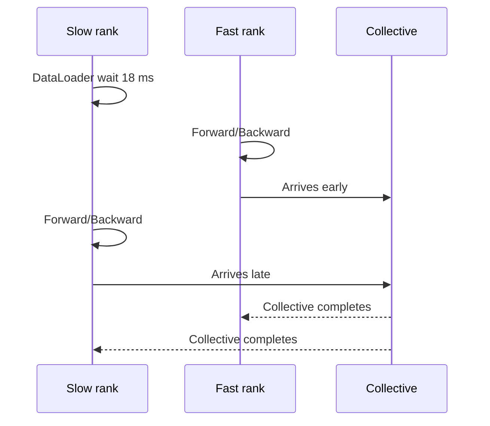

# 第 30 章　训练综合案例

沿分布式更新和 GPU 等待的具体案例，将数据供给、通信、重叠与恢复判断连接到证据。

本章内容：

- [1. 贯穿案例三：一次分布式训练究竟在等待什么](#s1)
- [2. 案例：GPU 利用率低](#s2)
- [3. 可复现实验：数值对照、CPU 时间线与进程中断恢复](#s3)
- [4. OOM 后减小 microbatch，为什么不能直接继续](#s4)

<a id="s1"></a>

<a id="s1-贯穿案例三一次分布式训练究竟在等待什么"></a>

## 1. 贯穿案例三：一次分布式训练究竟在等待什么

> 证据：当前slime与Megatron源码已核对，DDP/PP数学时间模型已有CPU验证；本轮未运行GPU通信。本例先分析dense模型的Megatron DDP，TP=PP=CP=1、DP=2，随后再增加distributed optimizer或PP。Megatron DDP不等于直接使用PyTorch DDP默认配置。

<a id="s1-先把待解释的现象变成问题"></a>

### 先把待解释的现象变成问题

假设观察到NCCL区间很长。至少可能有四类原因：某rank迟到、消息本身传得慢、执行流依赖延后、通信争用计算资源。另有PP等待可能来自远端激活/梯度，而不是DP梯度归约。

目标是对同一step说明：哪些梯度何时ready、collective何时提交与完成、优化器最早何时能开始。不能把各rank的所有通信区间相加，直接称为step通信开销。

<a id="s1-源码如何实现这些边界"></a>

### 源码如何实现这些边界

| 原理对象 | 当前源码 | 行为与观察点 |
|---|---|---|
| 清空与前后向调度 | [model.py](<../../../slime/backends/megatron_utils/model.py>)，`train_one_step` | 清buffer，调用选定forward_backward函数 |
| overlap配置接入 | 同文件`train` | no_sync_func、grad_sync_func、param_sync_func及finalize函数 |
| 梯度就绪 | [param_and_grad_buffer.py](<../../../Megatron-LM/megatron/core/distributed/param_and_grad_buffer.py>)，`register_grad_ready` | 最后microbatch的参数ready计数 |
| 开始归约 | 同文件`start_grad_sync` | scaling、SUM/AVG、AllReduce/ReduceScatter、stream/handle |
| 等待归约 | 同文件`finish_grad_sync` | 无overlap时同步启动；有overlap时等待已提交工作 |
| 完成其他梯度处理 | [finalize_model_grads.py](<../../../Megatron-LM/megatron/core/distributed/finalize_model_grads.py>) | finish_grad_sync，其他复制参数归约及可选token缩放 |
| 更新 | `model.py::train_one_step`及实际optimizer类 | finite/norm路径、step与scheduler |

某些分支提前等待前一个bucket，某些多optimizer-instance分支使用单独stream。观测应记录实际类和配置，不能看到函数名就套通用时间线。

<a id="s1-首步是一个值得单独观察的真实分支"></a>

### 首步是一个值得单独观察的真实分支

当前buffer实现通过首个batch收集`golden_per_param_grad_ready_counts`，用于后续判断一个bucket是否就绪。`finish_grad_sync`对`is_first_batch`会启动该批的归约；后续`register_grad_ready`根据已知计数触发。

因此首步可能没有稳定态中预期的通信重叠。若只profile第一个batch就判断overlap失效，可能得出错误结论。另有模型加载、JIT和allocator暖机需要分开考虑，但不能把所有慢首步都归于这一分支。

<a id="s1-allreduce与reducescatter在这里为何不同"></a>

### AllReduce与ReduceScatter在这里为何不同

`start_grad_sync`先应用bucket的`gradient_scaling_factor`，再根据`average_in_collective`选择SUM或AVG；若启用distributed optimizer且未强制AllReduce，则进入ReduceScatter路径，否则使用AllReduce。

这些开关共同决定梯度最终乘了什么系数。例如两个 rank 的局部梯度分别为 2、4，目标是 rank 平均 3。一条路径先用 SUM 得到 6，再除以 2；另一条路径直接用 AVG 得到 3。若第二条路径又习惯性地“除一次 DP 度”，就得到 1.5，梯度缩小了一半。实际代码还可能在归约前缩放 bucket，或在之后按有效 token 缩放，所以应沿 loss 入口、bucket、collective 和最终处理逐项核算，不能仅靠某个开关判断。

AllReduce 把完整归约结果交给每个参与者；ReduceScatter 则只把各自负责的一片结果留在本地。分片优化器据此只更新自己拥有的参数和状态，后续再按需要收集参数。因此切换这两个通信路径会改变状态所有权和后续依赖，不能只比较两个通信 kernel 的耗时。

先用[DDP完整推演](<../04_Training/14_数据并行与状态分片.md#s2-数值展开-ddp不等长数据梯度累积与-bucket-时间线>)建立参考，再按这里的真实配置替换每个因子。验证梯度与参数一致后，才进行性能对比。

<a id="s1-一个时间模型怎样映射到trace"></a>

### 一个时间模型怎样映射到trace

下表仍为教学数字，不是采集结果：

| bucket | rank 0 ready | rank 1 ready | 假定传输服务区间 |
|---|---:|---:|---|
| B0 | 2 ms | 3 ms | 3–5 ms |
| B1 | 6 ms | 7 ms | 7–9 ms |

如果最晚反向结束于7 ms，最后归约结束于9 ms，则简化模型的尾部为2 ms。rank 0在2 ms提交、5 ms完成所观察到的3 ms区间中，可能包含等rank 1到达的1 ms。

真实collective可能分块推进，并不一定有一个显式“所有rank就绪”事件。实际应获取rank、进程组、collective序号、bucket身份、字节数以及CPU/GPU关联，使用依赖关系解释延迟；上表只能提供假设，不能把NCCL区间自动切出精确的网络服务时间。

同时记录optimizer开始。如果归约9 ms完成、optimizer到12 ms才开始，还有3 ms需要从norm、其他归约、CPU或stream依赖解释，不能继续归咎同一个AllReduce。

<a id="s1-利用现有训练profiler"></a>

### 利用现有训练profiler

[TrainProfiler](<../../../slime/observability/profile_utils.py>)可生成包含rank名称的PyTorch trace，并请求record_shapes、stack、memory和FLOPs信息。对应配置来自Megatron参数体系；在已跑通的完整启动命令上追加：

```text
--use-pytorch-profiler
--profile-step-start 2
--profile-step-end 4
--tensorboard-dir /tmp/slime-case3/profile
```

这只是一个短采集窗口示例。当前actor在`train_actor`结束附近调用`self.prof.step(rollout_id=...)`，所以profiler步进跟rollout调用相关，不能直接将窗口数字等同于内部optimizer步。要保留至少覆盖warmup和采集窗口的足够rollout，并从实际trace确认选中的区间。

每rank记录train step与rollout编号、microbatch数、有效token数、bucket配置、并行组成员、optimizer类型与网络拓扑。默认trace未必包含稳定bucket ID或parameter-ready事件；需要在隔离调试运行的上述入口补充标记，或用调用栈、消息形状和collective顺序保守关联。无法关联的区间标为未知，不强行命名。

<a id="s1-重叠到达偏斜与采集扰动"></a>

### 重叠、到达偏斜与采集扰动

不重叠与重叠路径如果使用相同 checkpoint、输入、batch、精度和 DP 布局，区别应落在调度而非目标语义。重叠是否有效，需要看稳定态尾部及 step 时间，而不是两个色块是否同时出现。

一个 rank 在 bucket 就绪前迟到，会让其他 rank 的通信区间变长，即使网络服务能力未变。这说明人为延迟可以解释诊断逻辑，却不能作为网络带宽基准。若某 rank 缺少一次 collective，协议本身不再匹配，那是挂起而非普通长尾。

Profiler 也会扰动执行；用于归因的短 trace 与无采集的稳态分布承担不同证据职责。到达顺序、token 长度和动态 batch 不一致时，单步截图不能隔离 overlap 的收益。

<a id="s1-扩展到pp或分片优化器时加哪些记录"></a>

### 扩展到PP或分片优化器时加哪些记录

PP增加stage和microbatch身份、P2P依赖、warmup/drain，以及stage上的激活存活量。rank的空闲区间可能是等上游activation或下游gradient，不能统称梯度AllReduce等待。[PP手工表](<../04_Training/15_模型并行与执行日程.md#s2-数值展开-ppgpipe-与同步-1f1b-的逐时隙调度>)可以作为依赖参考。

Distributed optimizer增加梯度shard、optimizer owner、参数gather与预取。开启预取后既要看关键路径，也要看瞬时内存；更短的step可能伴随更高的峰值。不要把本例dense DDP的bucket测量直接当作FSDP全参数生命周期证据。

<a id="s1-功能组合算例重算预取与低精度状态"></a>

### 功能组合算例：重算、预取与低精度状态

设独立的教学账本，单 rank 容量为 24 GiB：参数/优化器/常驻通信状态 10 GiB，普通激活峰值 8 GiB，在途通信 buffer 2 GiB。额外预取 buffer 为 6 GiB，且假定这些峰值同时存活。基础 compute 100 ms、随后通信 20 ms；预取需要 30 ms，有独立复制资源时可全部隐藏在计算内。重算将激活降为 4 GiB、计算增至 125 ms。

| 方案 | 同时存活的峰值 | 假定 step 时间 |
|---|---:|---:|
| 普通激活、串行取数 | 10+8+2=20 GiB | 30+100+20=150 ms |
| 普通激活、额外 buffer 预取 | 10+8+2+6=26 GiB | 容量不足，120 ms 时间模型不可实现 |
| 重算、额外 buffer 预取 | 10+4+2+6=22 GiB | 125+20=145 ms |

这里重算多做计算，却使假定的预取方案可放入容量。若复制与计算竞争 HBM、buffer 生命周期不重叠或通信可覆盖，必须重画时间线与峰值，不能照搬本表。低精度 GEMM 也不能直接把 10 GiB 常驻状态减半：master、优化器、累积与 scale 需要分别核算。见[训练低精度状态](<../04_Training/13_精度激活与训练状态.md#s2>)。

真实对照同时固定有效 batch、目标分母、更新次数和质量门槛，采集 live allocation 与依赖时间线；本表只验证给定假设下的算术，没有 GPU 性能结论。

<a id="s1-时间模型能解释到哪里"></a>

### 时间模型能解释到哪里

关键路径的最后一段必要依赖决定更新最早何时开始。只有端到端耗时，能够说明快慢，但不能区分传输、迟到和 stream 等待。源码提供可能的执行路径，真实 trace 才能说明一次运行选择了什么时序。

本文没有给出实测尾部、带宽或加速倍数；[参考程序](<../examples/parallel_runtime_walkthroughs.py>)只核对数学依赖。

[跨层案例](<../appendices/performance/贯穿案例索引.md>) · [并行原理](<../appendices/parallelism/README.md>)

<a id="s2"></a>

<a id="s2-案例gpu-利用率低"></a>

## 2. 案例：GPU 利用率低

相关基础：[性能语言与测量](<29_性能测量与因果分析.md#s1>)。


> 教学构造案例：以下节点、耗时和吞吐数字用于演示推理过程，不是本仓库或 H20 的实测报告。

<a id="s2-现象"></a>

### 现象

一个 64 GPU 训练任务从 190k tokens/s 降到 145k；`nvidia-smi` 显示 GPU utilization 在 55%–95% 波动。最近没有模型代码变更，但换了一批数据 shard。目标不是“把利用率改成 100%”，而是找出吞吐回退的因果链。

<a id="s2-第-0-步保护现场"></a>

### 第 0 步：保护现场

记录并冻结：commit/image、driver/CUDA/NCCL、parallel config、global/micro batch、sequence distribution、节点/GPU/rank mapping、数据版本。确认 loss 与有效 token 口径未变。

如果吞吐按 padded token 统计，新数据有效长度变化本身就可能造成错觉。

<a id="s2-第-1-步确定问题范围"></a>

### 第 1 步：确定问题范围

从常驻指标看到：

- 只有 node 5 上 8 个 rank 的 GPU utilization 周期下降；
- 其 power/clock/temperature 正常，无 Xid/ECC；
- 全局 step p99 上升，每次慢 step 都与 node 5 对齐；
- network error counter 无明显变化。

暂时降低全局 kernel 回退和热降频的优先级，把假设缩到 node 5 的 host/data/topology 或局部 hardware path。

<a id="s2-第-2-步系统时间线"></a>

### 第 2 步：系统时间线

在 node 5 的慢 rank 与另一节点快 rank 同时采 10 个稳态 step 的 Nsight Systems：



在这份教学时间线里，快 rank 已完成本地反向并进入 collective，慢 rank 却还没提供本轮所需梯度。快 rank 因此无法独自结束归约，这段等待会体现在它的 NCCL 区间里。把多 rank 时间线对齐后，才发现慢 rank 前面多用了 18 ms 等 DataLoader，GPU 在 step 开头没有工作。

这使数据供给成为优先检查的原因：等待发生在 collective 内，触发等待的事件却发生在更早的数据阶段。不过时间上对齐仍需后面的控制实验确认，不能仅凭一个较长的 NCCL 区间排除其他通信成本。

<a id="s2-第-3-步切断数据变量"></a>

### 第 3 步：切断数据变量

控制实验：

| 实验 | 结果 | 推断 |
|---|---|---|
| GPU 上 synthetic batch | 恢复 193k tokens/s | GPU/kernel/communication 基本正常 |
| 数据预读到 host memory | 仍慢 | 不只是 storage throughput |
| 关闭 tokenizer | 恢复 | CPU preprocessing 是候选 |
| 原数据 shard | 恢复 | 新 shard 特征触发慢路径 |

进一步按样本统计，发现新 shard 含大量超长文档；tokenizer + packing 在一个 worker 上出现长尾，而 DataLoader 顺序等待该 batch。

<a id="s2-第-4-步为什么只慢一个节点"></a>

### 第 4 步：为什么只慢一个节点

straggler（慢参与者）是明显晚于其他参与者到达同步点或完成工作的进程／设备。同步操作受最晚到达者影响，原因可能是数据、计算、资源配额或网络。

比较 CPU/NUMA：node 5 的 worker 被容器限制到与 NIC/其他 daemon 争用的一组 CPU；其他节点 cpuset 更宽。超长文档放大 CPU 长尾，错误 cpuset 使其只在 node 5 成为 straggler。

用相同 shard 在修正 CPU affinity 后复测，DataLoader p99 从 22 ms 降到 6 ms，全局吞吐恢复 188k tokens/s。

<a id="s2-第-5-步验证不是偶然变快"></a>

### 第 5 步：验证不是“偶然变快”

RSS（Resident Set Size，常驻集大小）表示进程当前驻留在物理内存中的页所占空间。它与虚拟地址空间大小不同，共享页和多个进程的加总口径也要注明。

- 连续 5 次 500-step window；
- 新旧 shard、短/长序列分桶；
- step p50/p99 与 tokens/s/GPU；
- loss/effective tokens；
- node/rank skew；
- CPU utilization、RSS 与 GPU peak memory。

最终吞吐 188–192k，step p99 接近基线，无 correctness 回退。

<a id="s2-修复组合"></a>

### 修复组合

head-of-line blocking（队首阻塞）指前面一个未就绪或很慢的任务，使后面本可执行的任务也不得不等待。按成本分桶或重排能缓解等待，但要同时保持样本与目标语义。

1. 修正 pod CPU request/cpuset 与 NUMA affinity；
2. tokenizer/packing worker 数从经验值改为 sweep 后的配置；
3. 超长文档预处理或按成本分桶，避免单 batch head-of-line blocking；
4. 监控每 rank `data_wait_seconds` 与 sequence/packing cost；
5. 添加“rank arrival skew 高且某 rank data wait 高”的诊断告警。

<a id="s2-如果第-2-步看到的是另一种图形"></a>

### 如果第 2 步看到的是另一种图形

| 证据 | 下一分支 |
|---|---|
| 所有 rank GPU 都空，CPU 在 `.item()` | 降低同步 logging 频率 |
| GPU 满是 2–5 µs kernel | fusion、compile、CUDA Graph |
| 到达一致但跨节点 NCCL 变长 | `nccl-tests`、GPU–NIC mapping、fabric counter |
| kernel 连续但 SM/DRAM 都低 | Nsight Compute 查 occupancy/dependency |
| KV 使用率高且 preemption 上升 | 降并发/调 KV/调度，不适用本训练案例 |
| 某 PP stage 始终最长 | stage repartition 或 interleaved schedule |

<a id="s2-本案例的通用教训"></a>

### 本案例的通用教训

- GPU utilization 是线索，不是目标；
- collective 长可能是 arrival skew；
- 新数据能改变 CPU 成本、shape、编译、padding 和 MoE routing；
- synthetic data 是定位数据路径的强控制实验；
- 修复应落到回归 metric，而不止保存一次 trace 截图。

<a id="s2-延伸阅读"></a>

### 延伸阅读

- [CPU 与数据加载](<../appendices/performance/02_pytorch.md#concept-07>)
- [分布式通信 Profiling](<../appendices/performance/04_megatron.md#concept-09>)
- [线上可观测性](<../appendices/performance/10_observability.md>)

<a id="s3"></a>

<a id="s3-可复现实验数值对照cpu-时间线与进程中断恢复"></a>

## 3. 可复现实验：数值对照、CPU 时间线与进程中断恢复

本节提供实际运行过的标准库实验，与[四个真实框架贯穿案例](<../appendices/performance/贯穿案例索引.md>)互补。2026-10-12 的执行环境为 macOS arm64、Python 3.9.6，无 PyTorch、无 NVIDIA GPU；本节没有新增 GPU、NCCL、多机或真实大模型训练结论。

<a id="s3-一条命令产生哪些证据"></a>

### 一条命令产生哪些证据

在仓库根目录运行，输出目录必须不存在，以免覆盖前一次实验：

```bash
python3 docs/ai_infra/examples/numerics_quantization.py
python3 docs/ai_infra/examples/mini_transformer.py
python3 docs/ai_infra/examples/system_tradeoffs.py
python3 docs/ai_infra/examples/cpu_evidence.py --output /tmp/ai-infra-cpu-run-001
```

最后一个程序生成合成输入、配置与源码 hash、原始测量、Chrome Trace Event 格式时间线、连续训练状态、两个崩溃恢复目录以及一个错误恢复对照。程序不会读取用户训练数据。目录已存在时换一个新名字；不要删除旧证据再使用同一运行身份。

本次归档见[报告](<../reference/cpu_evidence_20261012/report.json>)、[完整 CPU 时间线](<../reference/cpu_evidence_20261012/trace.json>)和[合成输入](<../reference/cpu_evidence_20261012/fixture.jsonl>)。报告列出两个核心源文件的 SHA-256；源码变化后应新建实验，不能把历史记录当作新版本已通过。

<a id="s3-正确性两个不等长样本如何合并梯度"></a>

### 正确性：两个不等长样本如何合并梯度

使用[微型 Transformer](<../appendices/models/微型Transformer完整推演.md>)。样本 A 有两个有效位置、样本 B 有一个。全局目标为 (2L_A+L_B)/3。程序分别计算两份梯度，以 2/3、1/3 加权，然后独立用全局目标做全部参数有限差分。

本次加权梯度最大绝对误差约 6.35×10⁻¹¹；故意将两个样本的 mean 梯度各乘 1/2 后，最大误差约为 0.162313。这个反例证明分母会改变梯度。它检查的是 CPU 算术，不执行真实 DDP、NCCL 或分片优化器。

迁移到两卡 DDP 时，还应考虑 DDP 的平均因子：若 rank r 的本地 token loss 总和为 S_r，全局有效数为 N、world size 为 d，则在 DDP 对梯度取 rank 平均的约定下，本地反向目标可设为 dS_r/N，最终得到 ∑∇S_r/N。必须核对实际框架是否已经做了这个补偿，避免再次乘 d。

<a id="s3-性能应用缓存省掉了哪段工作"></a>

### 性能：应用缓存省掉了哪段工作

合成 JSONL 包含 512 行、每行 32 个整数 token，共 76059 字节。对照 A 每轮打开并解析文件，再求 token 校验和；对照 B 复用预先解析的对象，再求同一校验和。每轮结果都必须等于 769584。应用缓存建立耗时单独记录，基准交替运行两种顺序，剔除第一对测量后保留七对原始耗时。

本次结果如下，时间只适用于归档中的本机进程与小型合成负载：

| 路径 | 中位耗时 |
|---|---:|
| 每轮读取并解析 | 1.022083 ms |
| 复用已解析对象 | 0.075000 ms |
| 缓存建立，一次性 | 1.041125 ms |

这里同时移除了文件读取调用与 JSON 解析，不能仅凭这组对照把收益全部归因给其中之一。OS page cache 未受控制，也没有清缓存，因此不是冷盘带宽测试。两条路径都在同一 Python 进程内运行，不包含 IPC、H2D 或 GPU 等待。缓存的内存占用、构建和失效是额外成本；单次消费时未必值得构建。

时间线含真实 `perf_counter_ns` 时间和进程 ID，覆盖 39 个 CPU span。输入读取／解析与缓存复用分别标注，训练子进程标注前向、反向和 Adam 的整体区间。span 之间包含解释器启动、文件写入等未细分工作，空白不能标成“GPU idle”。源文件中没有人为 sleep 来制造性能现象。

<a id="s3-恢复让真实子进程在提交边界退出"></a>

### 恢复：让真实子进程在提交边界退出

微型模型按固定顺序循环消费 A/B，使用 Adam，lr=0.01、β₁=0.9、β₂=0.99、ε=10⁻⁸，共六次更新。每步保存参数、m/v、成功步、消费游标、数据 hash、优化器配置和 loss 历史。本例没有 dropout 或随机采样；真实随机训练必须额外保存 RNG 与采样器状态。

每步先把完整 JSON 写入同目录 staged 文件，flush 和 fsync 后，再用 `os.replace` 替换已提交 checkpoint。注入点位于第三次更新：

| 注入位置 | 进程行为 | 重启实际读取 | 最终结果 |
|---|---|---|---|
| replace 之前 | `os._exit(23)`，已写出的 staged 文件未提交 | 第 2 步 checkpoint | 与连续六步完整状态相同 |
| replace 之后 | `os._exit(23)` | 第 3 步 checkpoint | 与连续六步完整状态相同 |
| 恢复时故意清空 m/v | 正常重启 | 权重／游标相同，优化器状态错误 | 最终参数不同，负对照被检测 |

程序比较全部参数、m/v、计数、游标和 loss 历史，而不是仅比较最后一个 loss。连续运行的 loss 序列约为 [1.573422,1.951336,1.505746,1.899229,1.447698,1.847297]。相邻项来自不同样本，不能用它的锯齿直接判断训练不稳定。

这是进程退出实验；没有模拟掉电、文件系统崩溃或节点丢失。即使文件 fsync 成功，目录持久化、设备缓存和分布式存储仍有独立语义。本例不能证明其他系统的原子提交或多 rank 一致恢复。Python 的接口语义见 [os.fsync 与 os.replace](https://docs.python.org/3/library/os.html)。

<a id="s3-将同一证据链迁移到真实-gpu"></a>

### 将同一证据链迁移到真实 GPU

迁移时保留以下三个独立实验，不把 profiler 开销混进正式吞吐：

1. 固定模型、输入、模板、精度和目标，先单卡，再改变一个并行维度；保存逐 token loss、全局身份对应的梯度和更新前后参数。分片状态按 owner 还原，另存容差和误差分布。
2. 先测无 profiler 的重复稳态窗口，再采集少量代表 step 的 CPU/GPU trace；标明 H2D、kernel、collective 和数据等待，用同一批输入验证优化前后目标一致。
3. 分别在训练更新、checkpoint 提交、权重发布的指定边界注入失败，核对重启实际选择的版本、样本序列、优化器和后续更新。选择现有隔离实验环境，不在生产训练中试错。

具体框架入口沿用[训练等待案例](<#s1>)、[Rollout 到更新](<32_RL综合案例.md#s1>)和[换权与恢复](<32_RL综合案例.md#s3>)。这些 GPU／多机实验本轮仍未执行；已有 CPU 报告不改变它们的证据状态。


<a id="s4"></a>

## 4. OOM 后减小 microbatch，为什么不能直接继续

考虑一次逻辑更新包含四个 microbatch。前两个已经把梯度累积进 buffer，第三个发生 OOM。一个直觉修复是把第三个再拆小后重跑；如果失败的反向已经写入部分梯度，继续累积就会让某些参数重复计入这段贡献。异常退出不会自动撤销之前的写入。

先确定故障发生在哪个边界：

| 故障位置 | 可能已经改变的状态 | 恢复要证明什么 |
|---|---|---|
| 尚未开始本次前向 | 输入预取、采样游标、分配器 | 重试仍取得同一逻辑输入 |
| 前向／反向中途 | 激活、部分梯度、已提交通信 | 旧工作已终止，累积状态可以一致重建 |
| Optimizer 中途 | 部分参数、m/v、步计数 | 从相容快照恢复，不能假定只有梯度脏了 |
| 更新成功、确认丢失 | 整次更新可能已生效 | 查明提交身份，不能直接重复应用 |

一个较容易验证的起步协议，是在所有参与者确认可恢复后，放弃本次尚未提交的逻辑更新，清除其梯度和临时状态，从一致起点重放整批。若通信器或某个 rank 已失效，通常需要按框架恢复协议重建进程组，不能让其余 rank 自行继续。这个协议是设计建议，具体后端是否支持必须实验确认。

重放时减少 microbatch 只改变执行切分，应保持原始样本集合、有效 token 分母、逻辑 batch 和成功更新次数。原来四份本地均值不能简单变成八份均值再平均；应使用第 14 章的全局分母。存在 dropout 或其他随机操作时，还要记录重放的随机状态；切分变化可能改变随机数消费顺序，因此不总能要求逐位一致，但必须保住声明的目标与容差。

释放 Python 引用或清空 allocator 缓存也不会撤销梯度、参数写入或其他 rank 的通信。内存优化的验证对象因此包括两部分：下一次确实能放入显存，以及成功更新等价于没有失败的参考路径。先在小型独立作业里分别注入反向中断与更新中断，再扩大到真实训练规模。

## 本章回顾

训练等待需要沿数据、设备和各 rank 的时间线定位。小规模数值与恢复实验能验证局部语义，但真实并行效率仍须在目标设备和实现上测量。

**检查理解：** 如何从一次 GPU 空闲现象提出可证伪的解释，并验证修复仍保持数值与恢复语义？

下一章讨论推理综合案例。用阶段分离与请求生命周期案例检验容量、KV 交接、缓存身份、取消和服务时限。

<!-- book-nav -->

[上一章：性能测量与因果分析](<29_性能测量与因果分析.md>) · [全书目录](<../README.md>) · [下一章：推理综合案例](<31_推理综合案例.md>)

<!-- /book-nav -->
