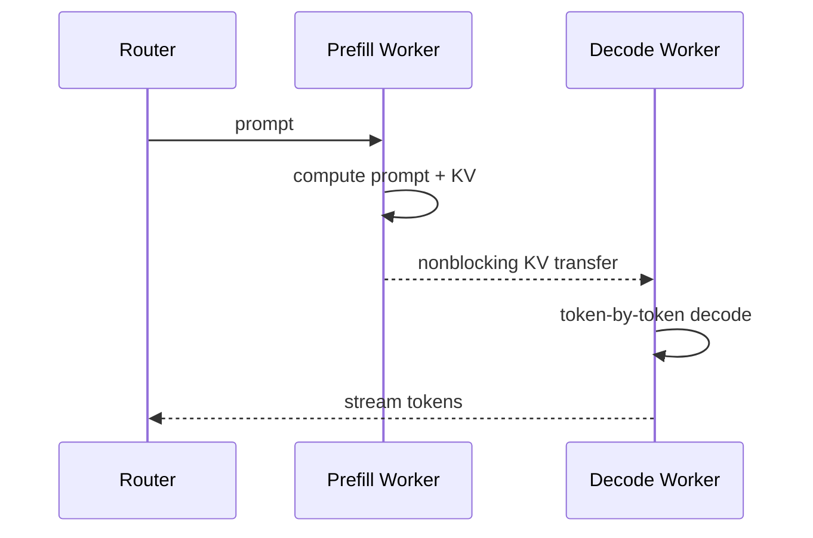

# 第 31 章　推理综合案例

用阶段分离与请求生命周期案例检验容量、KV 交接、缓存身份、取消和服务时限。

本章内容：

- [1. 案例：Prefill–Decode 分离与 KV Cache 传输](#s1)
- [2. 贯穿案例二：一个生成请求如何穿过队列、GPU与KV生命周期](#s2)
- [3. 从“能跑满”到“过载后能恢复”](#s3)

<a id="s1"></a>

<a id="s1-案例prefilldecode-分离与-kv-cache-传输"></a>

## 1. 案例：Prefill–Decode 分离与 KV Cache 传输


<a id="s1-入门例子一次-pd-交接要转移什么"></a>

### 入门例子：一次 PD 交接要转移什么

Prefill 节点算出请求前缀的 KV 后，decode 节点不仅要拿到字节，还要知道请求身份、序列长度、KV 布局、采样配置和交接状态。源端发送结束、目标端可安全读取、路由层可以继续转发，是不同的完成条件。

若 KV 为 512 MiB，有效传输带宽假设为 32 GiB/s，单纯搬运下界约 15.6 ms；实际还包括排队、注册、打包和调度。若同机执行只需节省 5 ms，分离可能得不偿失。这个数字是算例，不是 H20 基准。

交接前源端持有 KV，传输中目标端可能已经分配但尚不能消费，确认后才能按协议转移责任。目标端失败时，源端是否释放取决于提交边界；重试若缺少请求或 generation 身份，可能重复分配。PD 吞吐收益必须建立在这组所有权关系正确的前提上。

<a id="s1-为什么要分离"></a>

### 为什么要分离

Prefill（预填充）一次处理整段 prompt，通常是大矩阵、compute-bound；Decode（解码）逐 token 执行，通常更受 HBM bandwidth、KV Cache 和调度影响。把两者 colocate 在同一 GPU pool 会互相干扰，也让资源比例和并行策略绑死。

Prefill–Decode disaggregation（预填充—解码分离）让两种 worker 独立扩缩，但产生一个新依赖：prefill 生成的 KV 必须传给 decode。

本节展开交接协议与局部算例；同一 8 卡预算下是否应选择 PD，见[完整推理方案比较](<../05_Inference/22_推理并行量化与执行优化.md#s1>)。另一种切分是将每层 Attention 与 FFN 放到不同资源池，其逐层激活往返由[Attention–FFN 分离](<../appendices/serving/Attention与FFN分离的边界.md>)维护。



<a id="s1-何时值得分离"></a>

### 何时值得分离

DistServe 论文把目标定义为在 TTFT（Time to First Token，首 token 延迟）和 TPOT（Time Per Output Token，每输出 token 时间）约束内的 goodput。分离可消除 phase interference，并分别选择 prefill/decode parallelism；代价是 KV transfer、额外 queue、routing 和故障域。

一个粗略判据：

$$
T_{KV\ transfer}+T_{extra\ queue}<T_{interference\ saved}+T_{placement\ gain}
$$

若 prompt 短、网络慢、同机资源已足够，聚合部署可能更简单更快。分离不是无条件先进。

<a id="s1-kv-传输量"></a>

### KV 传输量

如果 prompt 有 $S$ token，每 token KV 为 $m$ bytes，则一次请求要搬约 $Sm$。以每 token 320 KiB、32K prompt 为例，KV 接近 10 GiB；即使 400 Gb/s 链路的应用有效吞吐达到 40 GB/s，纯传输下限也约 250 ms，还未算排队和竞争。这说明长上下文 P/D 分离必须依赖高带宽路径、分块/流水化、缓存命中或减少 KV 字节。

<a id="s1-nvidia-dynamo-的当前实现视角"></a>

### NVIDIA Dynamo 的当前实现视角

NVIDIA Dynamo 当前文档使用 NIXL（NVIDIA Inference Xfer Library，NVIDIA 推理传输库）把 KV 从 prefill GPU VRAM 非阻塞传到 decode GPU VRAM，并结合 KV-aware routing。跨节点生产部署建议 RDMA/等价高速 fabric；若回退 TCP，KV transfer 可能成为 TTFT 与 throughput 的主瓶颈。

Topology-aware KV transfer 会优先让 P/D worker 落在同一 zone/rack 等 domain，减少慢速跨域搬运。这说明 router 的目标不能只有“最空闲 GPU”，还要联合 cache locality、queue 和 network locality。

<a id="s1-流水化机会"></a>

### 流水化机会

- layer-wise transfer：前几层 KV 生成后即开始传，而非等待全模型 prefill 完成；
- chunked prefill：每个 prompt chunk 计算/传输流水化；
- push 与 pull：由 prefill push，或 decode 按需 pull；
- prefix locality：若 decode/prefill 一侧已有共享 prefix，避免重复传输；
- remote KV tier：把复用价值高的 KV 放入共享 cache，但要控制一致性与尾延迟。

<a id="s1-关键风险"></a>

### 关键风险

1. KV 已传完但 request metadata/ownership 未原子提交；
2. decode worker 失败后留下 orphan KV blocks；
3. model/adaptor/version 不一致导致 cache 语义错误；
4. 多个大 KV transfer 发生 routing collision，压垮同一 uplink；
5. 传输与 decode 竞争 HBM bandwidth，所谓 nonblocking 仍拖慢 token loop。

<a id="s1-该怎么-benchmark"></a>

### 该怎么 benchmark

至少分为：

- aggregated baseline；
- 同节点 P/D；
- 同 rack RDMA；
- 跨 rack/zone；
- cold cache 与 warm prefix cache；
- 短/中/长 prompt × 短/长 output。

同时报告 TTFT、TPOT/Inter-Token Latency（ITL，token 间延迟）、goodput、KV transfer bytes/time、queue time、cache hit rate 与 network p99。只报平均吞吐会掩盖分离对 tail SLO 的影响。


<a id="s1-服务容量与prefilldecode交接算清页时间和完成边界"></a>

### 服务容量与Prefill–Decode交接：算清页、时间和完成边界

> 这是容量账本与事件模型，不是实测benchmark。前置：[KV页表推演](<../05_Inference/20_KV容量分页与复用.md#s1-数值展开-kv分页前缀共享分叉与取消>)、[调度推演](<../05_Inference/21_批处理调度与排队.md#s1-数值展开运行时请求队列token-budgetcuda-graph-与结果返回>)、[PD分离](<#s1>)。

<a id="s1-从gpu总容量到可调度kv容量"></a>

#### 从GPU总容量到可调度KV容量

先从可用设备内存中扣除权重、计算工作区、执行图池、通信buffer及预留余量，剩余部分才可用于KV池。本例假定已经扣完，KV预算为12 MiB，每token KV为128 KiB，每页4 token，页大小512 KiB，因此有24个物理页。

这里的128 KiB是人为指定的每token总KV字节数。实际要从层数、K/V head数、head维、精度和本地并行布局计算；GQA、MLA、量化等会改变公式，不能统一套一个dense MHA值。

三个请求没有共享，当前已经计算KV的长度A=20、B=9、C=15：

| 请求 | 当前页数ceil(length/4) | 下一次decode后的长度 | 需要新增页 |
|---|---:|---:|---:|
| A | 5 | 21 | 1 |
| B | 3 | 10 | 0 |
| C | 4 | 16 | 0 |

当前占12页、空闲12页；三条都推进一次后占13页、空闲11页。新增3个逻辑token只触发1个新页，但那一个token需要完整页的分配能力。调度器不能仅检查“新增3×128 KiB是否够”。

<a id="s1-未来长度未知准入不能只靠当前足够"></a>

#### 未来长度未知，准入不能只靠当前足够

请求下一步能执行，不代表它能一直执行到最大输出长度。运行时需要选择一种或组合多种策略：预留未来容量、逐步分配并抢占、拒收新增请求、限制最大长度。每种方案把成本放到不同位置。

抢占也有不同语义：换出KV需要CPU容量与传输；丢弃KV后重算需要保留token并重新prefill；取消请求则改变完成率。不能把三者统称为“释放显存”，再只比较释放了多少字节。

公平性还会影响吞吐：只挑短请求可能提高完成数，却让长请求饥饿。容量、等待时间和优先级应同时进入准入与抢占决策。

<a id="s1-pd交接时传的是什么"></a>

#### PD交接时传的是什么

P端完成prefill，D端继续decode。交接需要的语义不只有KV字节，还包括请求身份、模型版本、序列长度、位置、分片布局、已采样但尚未写入KV的token，以及目的端页表。

源物理页号不能当作目的端地址直接使用。若两端TP布局不同，还需要重分布；本例假设布局一致、所有KV可直接传输，不包含这项额外开销。

<a id="s1-一条有明确计时口径的时间线"></a>

#### 一条有明确计时口径的时间线

输入长1024，使用上面的KV口径，共128 MiB。假设有效链路吞吐8 GiB/s，传输服务时间下界为128/8192秒=15.625 ms。另假设入队5 ms、prefill 30 ms、传输后交接确认2 ms，无排队冲突且不重叠。

本协议由P端采样首个生成token，但直到D端准备完成才向用户释放首token；它尚未计入1024个KV token中。

| 事件 | 相对请求到达时间 | 状态 |
|---|---:|---|
| P开始prefill | 5 ms | 已在目的端取得准入承诺 |
| P完成prefill并采样首token | 35 ms | 1024-token KV可传输 |
| D收到全部KV，传输完成 | 50.625 ms | 尚待安装/确认 |
| D安装元数据并确认 | 52.625 ms | 请求可继续，向用户释放首token |
| D第一次decode完成，假设耗时5 ms | 57.625 ms | 把首token写入KV并采样第二个token |

在这些假设下，TTFT为52.625 ms，首、次token间隔5 ms。如果P端35 ms就返回首token，TTFT会更小，但第一次token间隔会包含交接等待。只报告TTFT可能掩盖这个等待的转移。

15.625 ms只是指定有效吞吐下的除法结果。网络竞争、源读和目的写、协议、同步、布局转换都可能改变实测；分块重叠又可能缩短关键路径，不能直接用各耗时之和预测所有实现。

<a id="s1-交接失败时如何避免两个端点都丢失状态"></a>

#### 交接失败时如何避免两个端点都丢失状态

本例协议要求：D先取得容量，P在D确认可继续之前保留恢复所需的状态；重复交接用同一请求身份和交接代号识别；旧交接的迟到确认不能释放新一轮正在使用的页。

若D在确认前失败，可以重建D或重试交接；P是否仍持有可用KV由协议保证。若P提前释放、D又没有完成安装，重试就只能重算甚至失败。收到网络传输完成事件也不必然代表整个请求已经可调度。

这些是教学协议的约束，不表示任一具体引擎具备exactly-once交接。本仓库相关实现入口见[SGLang运行时导读](<../appendices/source/sglang/README.md>)，具体容错仍需对照所用部署验证。

<a id="s1-从吞吐转向满足约束的有效完成量"></a>

#### 从吞吐转向满足约束的有效完成量

假设一个1秒观测窗口完成4个请求，其中3个同时满足规定的TTFT与token间隔约束，则原始完成率为4请求/秒，满足约束的完成率为3请求/秒。请求、token和GPU时间是不同分母；输入输出长度变化时尤其不能相互替代。

报告至少固定到达过程、长度分布、并发/排队方式和失败处理，并同时记录完成率、延迟分布、抢占/重算和资源成本。PD分离的动机与边界见[推理演进史](<../appendices/serving/推理运行时演进史.md>)及[DistServe原文](https://arxiv.org/abs/2401.09670)。

验证：[容量与时间算例脚本](<../examples/training_rl_walkthroughs.py>)。


---


<a id="s1-资料"></a>

### 资料

- [DistServe Paper](https://arxiv.org/abs/2401.09670)
- [NVIDIA Dynamo Disaggregated Serving](https://docs.nvidia.com/dynamo/dev/kubernetes/disaggregated-serving/overview)
- [Dynamo：Topology-Aware KV Transfer](https://docs.nvidia.com/dynamo/knowledge-base/kubernetes/multinode/topology-aware-kv-transfer)

<a id="s2"></a>

<a id="s2-贯穿案例二一个生成请求如何穿过队列gpu与kv生命周期"></a>

## 2. 贯穿案例二：一个生成请求如何穿过队列、GPU与KV生命周期

> 证据：SGLang本地快照源码已核对，未启动生成服务或采集GPU trace。基线为普通文本、单个TP组、PP=1、无PD/推测/LoRA/Mamba；先关闭overlap观察，再只打开overlap比较。高级路径不能直接套用基线。

<a id="s2-请求身份比batch行号更稳定"></a>

### 请求身份比batch行号更稳定

一条请求会经历HTTP/TokenizerManager、进程间传递、Scheduler、设备执行和输出返回。batch成员可以每轮变化，因此“第0行”不是请求身份。用rid关联生命周期，再记录每轮batch的request-to-row映射。

| 源码入口 | 原理对应 | 建议观察 |
|---|---|---|
| [TokenizerManager](<../../../sglang/python/sglang/srt/managers/tokenizer_manager.py>)，`generate_request` | 接收、规范化、分发、等待响应 | rid、tokenized输入、采样参数、接收/返回事件 |
| [Scheduler](<../../../sglang/python/sglang/srt/managers/scheduler.py>)，`handle_generate_request` | 请求进入可调度状态 | 队列及请求状态 |
| 同文件`get_next_batch_to_run` | 动态组批和状态选择 | batch序号、forward mode、成员及长度 |
| 同文件`run_batch` | 下发当前设备工作 | CPU提交时刻、设备关联ID |
| [结果处理器](<../../../sglang/python/sglang/srt/managers/scheduler_components/batch_result_processor.py>) | 消费结果、追加输出、判断结束 | copy_done、output_ids、finished/retracted |
| [KV释放入口](<../../../sglang/python/sglang/srt/mem_cache/common.py>)，`release_kv_cache` | 完成请求的缓存归属与回收 | committed/allocated长度、请求slot和树缓存 |
| [RadixCache](<../../../sglang/python/sglang/srt/mem_cache/radix_cache.py>)，`cache_finished_req` | 请求结束后前缀可能仍缓存 | 缓存插入、引用/锁、可淘汰容量 |

字段的实际所在对象以此快照为准，例如KV状态通过`req.kv`管理；本页表格不是承诺已有同名日志列。

<a id="s2-从一个5-token-prompt推到两个输出"></a>

### 从一个5-token prompt推到两个输出

用真实tokenizer选定一个输入，保存其实际token IDs；只有长度确实为5时才使用下面数字。设普通非chunked prefill、没有缓存命中：

| 逻辑事件 | 已计算KV覆盖的token数 | 已采样输出数 | 下一次需要什么 |
|---|---:|---:|---|
| 接收请求 | 0 | 0 | 入队并准入 |
| prefill模型执行完成 | 5 | 0 | 用末位置logits采样 |
| 采出g0 | 5 | 1 | 把g0作为下一次forward输入 |
| decode处理g0并采出g1 | 6 | 2 | 若未结束，再处理g1 |
| 此时结束 | 6 | 2 | 完成输出与资源清理 |

这张表描述逻辑覆盖长度。真实实现可以预分配slot、推测性增加批次长度或稍后提交元数据，因此某个内部计数在CPU提交时就可能改变。应同时观察“分配”“计划执行”“已完成并提交”，不能用单个字段在任意时刻强行匹配表格。

若新生成的g1触发停止条件，不代表g1已经写入KV。类似地，cache命中会减少本次实际计算量；输入总长仍是5，不必与本次extend token数相同。

<a id="s2-normal和overlap的差别落在哪里"></a>

### normal和overlap的差别落在哪里

`event_loop_normal`明确按接收请求、选batch、`run_batch`、`process_batch_result`和更新last_batch推进。`event_loop_overlap`维护`result_queue`，让CPU处理与设备计算在受控依赖下重叠。

在当前decode结果处理里，若`result.copy_done`存在，会先调用`synchronize()`，再规范化输出并追加到`req.output_ids`。overlap路径还跳过已经finished或retracted的请求。这个检查意味着回传结果不必对应“此刻仍活跃的请求”。

因此应分开记录：host调用返回、GPU计算完成、结果复制完成、请求状态提交、用户收到字节。这五个时刻不必相等。采集profile时，也不能用一个Python函数的持续时间代替设备Kernel的持续时间。

<a id="s2-哪些证据现成可用哪些需要补点"></a>

### 哪些证据现成可用，哪些需要补点

slime已有sample trace，可记录`sglang_generate`和奖励过程，并附带SGLang返回的元信息。它通常覆盖客户端视角的请求区间，不能还原所有GPU内部状态。现有说明见[Trace指南](<../../zh/developer_guide/trace.md>)。

若保存了自己的rollout dump，可以生成离线页面：

```bash
python tools/trace_timeline_viewer.py /tmp/slime-case2/rollout_0.pt --no-serve
```

已有[profile_rollout.py](<../../../tools/profile_rollout.py>)可以向运行中的引擎请求profile。地址必须替换为本次实验的router，下面不负责启动服务：

```bash
python tools/profile_rollout.py --router-url http://127.0.0.1:3000 --action start --num-steps 3
```

在开始采集后发送预定请求，再保留工具报告的实际trace路径。使用方法见[Profiling指南](<../../zh/developer_guide/profiling.md>)。为复原KV账本，还需在隔离调试运行中用调试器或临时日志观察上述Scheduler/KV入口。当前sample trace没有完整页表，所以不能仅运行viewer就宣称页表已经验证。

<a id="s2-事件记录如何组织"></a>

### 事件记录如何组织

每条记录保留run_id、rid、进程/rank、batch序号、forward mode、clock_domain，以及相关长度和状态。记录可人工整理，不能把示意事件伪装为现有trace导出格式。

| 事件 | 可用于哪个结论 | 不能单独证明 |
|---|---|---|
| tokenizer接受rid | 请求开始进入服务端 | 已获得GPU执行资格 |
| scheduler选中rid | 本轮计划执行 | Kernel已经完成 |
| GPU区间结束 | 该次设备计算结束 | 输出已发给用户 |
| result copy完成 | CPU结果可消费 | 整条请求已结束 |
| finish处理与cache释放入口 | 请求清理已进入实现路径 | 所有物理KV已归零 |
| 客户端收到首token/结束 | 用户延迟 | 服务器内部是哪一段造成等待 |

跨进程clock需要校准或显式关联；跨机器不能直接相减未同步的单调时钟。没有足够事件时，应把原因标为未定位。

<a id="s2-完成请求为什么不等于物理池占用归零"></a>

### 完成请求为什么不等于物理池占用归零

`release_kv_cache`先依据effective committed长度调用`cache_finished_req`，随后处理多分配尾部、请求slot及相关状态。缓存插入可能保留可复用前缀，所以请求数下降而缓存仍占用并不自动是泄漏。

核对时分别记录：请求slot占用、活跃KV、缓存保留/可淘汰量、allocator余量。对照[六页手工推演](<../05_Inference/20_KV容量分页与复用.md#s1-数值展开-kv分页前缀共享分叉与取消>)理解守恒关系，但不要把教学页号p0到p5映射成引擎的真实物理地址。

<a id="s2-等待中的取消与执行中的取消"></a>

### 等待中的取消与执行中的取消

当前实现对 waiting queue 中的请求可以删除匹配项；已经进入运行的请求则设置 `to_finish=FINISH_ABORT()`，沿结果处理路径清理。区别来自在途 batch：CPU 接口返回时，GPU 可能仍持有对应地址。

因此“abort 已返回”不能证明资源已释放。rid、batch 身份、finish 状态与最后消费者一起定义释放边界。当前匹配包含 rid 前缀或 abort_all 语义，前缀重叠会扩大匹配范围。若把一轮 batch 的行号误绑定到下一轮复用同一行的新 rid，即使行号合法，请求身份也已经错了。

<a id="s2-功能组合算例前缀复用与-adapter-身份"></a>

### 功能组合算例：前缀复用与 adapter 身份

另设一个独立教学负载：每页 16 token，4 个请求各有 64-token 公共文本前缀、16-token 私有 prompt 和 32-token 输出；每次完整执行的 KV 共 7 页。假定前缀页对齐且可命中，不计元数据、碎片、图池和在途空间。

| 条件 | 公共前缀页 | 私有 prompt + 输出页 | 总页数 |
|---|---:|---:|---:|
| 相同 adapter，未共享 | 4×4=16 | 4×3=12 | 28 |
| 相同 adapter，共享一个前缀 | 4 | 12 | 16 |
| 两个 adapter，各有两个请求，各共享一份前缀 | 2×4=8 | 12 | 20 |

最后一行不能按文本相同直接算成 16 页：adapter 改变计算，KV 身份必须包含其版本。多模态内容也不能只凭文本 placeholder 判定相同。命中节省的是可复用前缀的执行和缓存，不自动改变 decode 步数；chunk 与 graph 影响调度和执行形状，不再重复计算同一份容量收益。

核对实现时记录 adapter identity、cache key、hit token 数、物理页与引用数，以及 Graph bucket 的 padding 和额外常驻内存。支持组合需另核对，页数表不能证明特定引擎已支持 Multi-LoRA + prefix + graph。通用身份规则见[高级服务功能](<../05_Inference/23_服务部署与容量设计.md#s2>)，组合约束见[执行优化](<../05_Inference/22_推理并行量化与执行优化.md#s3>)。

<a id="s2-生命周期与实际时间的区别"></a>

### 生命周期与实际时间的区别

同一 rid 的接收、准入、执行、输出与结束形成因果链。KV 逻辑长度和分配长度不同，结束后状态也可能转为可复用缓存，而不是立即归零。只有活跃引用失去消费者之后，回收才安全。

normal 与 overlap 的源码顺序不能直接当成实测时间线。本文解释控制流与状态，没有提供 GPU trace 或服务延迟测量；固定请求与采样下的数值对齐，也不能单独证明时延改善。

[跨层案例](<../appendices/performance/贯穿案例索引.md>) · [推理原理](<../appendices/serving/README.md>)

<a id="s3"></a>

## 3. 从“能跑满”到“过载后能恢复”

固定 32 个客户端、每个收到结果后才发下一次请求，是一种闭环负载。服务变慢时，客户端也自动减少请求率；这适合研究固定并发，却不能证明服务能够承受外部持续到达的流量。另一种开放到达测试按预定时间发送请求，服务变慢仍有新工作到来，更容易暴露队列增长。两者应按各自目标使用，不能只用同一列 request/s 比较；[k6 的开放与闭环负载说明](https://grafana.com/docs/k6/latest/using-k6/scenarios/concepts/open-vs-closed/)给出了对应的压测模型。

假设一个教学服务稳定处理 10 条/秒，突发流量为 14 条/秒、持续 5 秒，无丢弃且服务率不变。队列新增约 $(14-10)\times5=20$ 条。突发后恢复为 8 条/秒，净排空速率为 2 条/秒，至少还需 10 秒恢复原队列水平。如果后续一直是 10 条/秒，这个理想模型中的积压不会自行消失。

真实生成的长度、KV 压力和抢占会改变服务率，因此本例只提供流量守恒基线。测试不应在突发结束时立即停止，否则看不到取消后资源是否回收、重算是否持续、长请求是否饥饿，以及旧队列是否仍阻塞新版本发布。

客户端超时还可能放大负载。若每项逻辑请求最多三次尝试，第一、第二次尝试各以概率 $p$ 触发后续重试，简化独立模型的期望尝试数是 $1+p+p^2$。当 $p=0.5$ 时为 1.75；但过载中的失败常相关，真实放大可能更严重。重试策略需要总截止时间、有界次数和分散重试时刻；同时验证取消确实到达服务端，避免三个 attempt 一起占用 KV。

对 RL rollout，重试还会改变行为版本与随机性。恢复后的生成是新 attempt，应按第 23 章的身份规则处理；不能把它拼接到旧回答之后，只因为两次请求的 prompt 相同。记录逻辑请求数、实际尝试数、完成组数和资源释放事件，再比较满载、突发和恢复三个窗口，才知道容量设计是否覆盖了真实生命周期。

积压恢复与重试次数可用[标准库复算程序](<../examples/rl_infra_contracts.py>)检查，验证范围限于上述教学模型。

## 本章回顾

PD 分离需要同时满足阶段配比、KV 传输与交接约束。请求身份、缓存共享和取消事件将容量模型连接到实现中的实际生命周期。

**检查理解：** KV 传输完成、目标实例可用和请求完成为何是三个边界？PD 的收益在什么条件下翻转？

下一章讨论RL综合案例。沿回答、工具任务、训练样本、参数更新与失败恢复，核对全书涉及的数据、状态和完成条件。

<!-- book-nav -->

[上一章：训练综合案例](<30_训练综合案例.md>) · [全书目录](<../README.md>) · [下一章：RL综合案例](<32_RL综合案例.md>)

<!-- /book-nav -->
