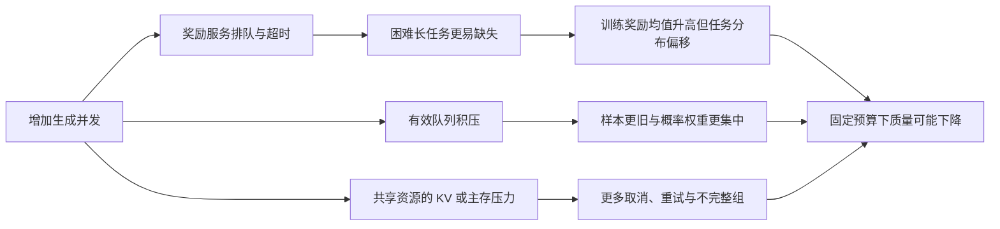

# 第 32 章　RL综合案例

沿回答、工具任务、训练样本、参数更新与失败恢复，核对全书涉及的数据、状态和完成条件。

本章内容：

- [1. 贯穿案例一：一组Rollout如何变成一次参数更新](#s1)
- [2. 从 Agent 任务到策略更新：代码、轨迹、判分与训练之间的边界](#s2)
- [3. 贯穿案例四：换权或恢复之后，系统处于哪个一致状态](#s3)
- [4. 综合诊断：更高吞吐为什么没有带来更好模型](#s4)

<a id="s1"></a>

<a id="s1-贯穿案例一一组rollout如何变成一次参数更新"></a>

## 1. 贯穿案例一：一组Rollout如何变成一次参数更新

> 证据：当前工作区源码已核对，基础数值参考可在CPU运行；本轮没有运行模型训练。源码版本、文件哈希和函数位置见[证据快照](<../reference/贯穿案例源码证据.json>)。本文采用Megatron后端的普通文本GRPO路径，其他后端、GSPO/CISPO、OPD、TIS、工具轨迹及动态过滤需要另加分支。

<a id="s1-要证明的事情"></a>

### 要证明的事情

同一条回答的动作、概率、优势和mask在数据转换及并行切分后仍然对应；整次更新使用预期归一化；最终参数变化来自这组样本。三个结论分别需要数据、loss/梯度、更新状态证据，单看训练日志里的一个loss不够。

先固定小模型、tokenizer/template、seed、无dropout、一个prompt的三条回答，关闭额外KL、熵损失、dual clip、推测解码与动态过滤。最初用TP=PP=CP=DP=1、单次优化，再保持输入不变改变一个并行维度。模型和权重沿用已经能成功运行的配置，不在本例猜测可用GPU或模型路径。

三条回答可以来自真实采样；若要得到前篇精确数字[0,1,2]和五个token loss，则使用显式教学fixture。真实模型的概率不必等于fixture中的0.2，不能把教学数值标作该模型实测。

<a id="s1-源码链路与每一站的契约"></a>

### 源码链路与每一站的契约

| 环节 | 当前源码入口 | 需要跟踪的输入输出 |
|---|---|---|
| 生成与评分 | [sglang_rollout.py](<../../../slime/rollout/sglang_rollout.py>)，`generate_and_rm_group` | group、各Sample的tokens/response_length/reward/rollout_log_probs |
| reward后处理 | [rollout.py](<../../../slime/ray/rollout.py>)，`_post_process_rewards` | raw reward与中心化、标准差归一化后的reward |
| 样本转训练列 | 同文件`_convert_samples_to_train_data` | tokens、response_lengths、loss_masks、rollout_ids、rollout_mask_sums |
| 数据布局 | [data.py](<../../../slime/backends/megatron_utils/data.py>)，`get_batch` | packed输入、样本长度、对应microbatch和mask |
| 计算old/ref与优势 | [actor.py](<../../../slime/backends/megatron_utils/actor.py>)，`train_actor` | 实际走过的模型切换、概率重算/复用分支 |
| 可求导概率与目标 | [loss.py](<../../../slime/backends/megatron_utils/loss.py>)，`get_log_probs_and_entropy`、`policy_loss_function` | 当前logprob、old来源、优势、逐token损失 |
| 归约与缩放 | [cp_utils.py](<../../../slime/backends/megatron_utils/cp_utils.py>)，`get_sum_of_sample_mean`；`loss.py::loss_function` | 每个片段的分母、CP贡献、microbatch/DP补偿 |
| 调度与更新 | [model.py](<../../../slime/backends/megatron_utils/model.py>)，`train_one_step` | backward结束、有效步判断、optimizer.step和scheduler推进 |
| 导出证据 | [train_data_utils.py](<../../../slime/observability/train_data_utils.py>)，`save_debug_train_data` | CP还原、DP汇总、样本与布局分开保存 |

这里的“调用链”含嵌套回调，不能把表格读作八个独立进程。`train_one_step`启动前后向调度，loss函数在该调度中被调用。

<a id="s1-用一条回答核对预测位置"></a>

### 用一条回答核对预测位置

prompt=[p0,p1]，response=[a0,EOS]，完整tokens=[p0,p1,a0,EOS]。预测a0需要位置1的logits，预测EOS需要位置2；response logprob应长2。训练端还需按当前布局还原这些位置，不能直接把本rank的flatten后索引当原序。

逐站记录以下账本；这些是**观察字段建议**，并非每个都已存在于日志：

| 身份/量 | 示例或定义 | 必须保持的条件 |
|---|---|---|
| 顶层rollout编号 | 本轮dump的`rollout_id` | 对齐同一次数据生成与训练 |
| 回答身份 | Sample.index、group_index | group内多条回答不能互相覆盖 |
| dump位置 | train样本的`rollout_position` | 对应本次rollout dump的samples下标 |
| 归约身份 | Sample.rollout_id → `rollout_ids` | 拆成多个训练片段时关联同一逻辑rollout |
| 总长/回答长 | 4 / 2 | prompt_length=total−response |
| 有效mask和 | 2 | padding、工具返回、过滤后的语义明确 |
| 归约分母 | `rollout_mask_sums[i]` | 同一逻辑rollout的片段共享整组分母 |

尤其不能把顶层rollout迭代编号、奖励group身份和样本的归约身份当成同一个ID。它们解决不同问题。

<a id="s1-同样的公式配置可能选择不同概率"></a>

### 同样的公式，配置可能选择不同概率

`train_actor`在满足`can_reuse_log_probs_in_loss`条件时，可以省掉actor单独重算。`policy_loss_function`也可能在没有old结果时采用当前forward的detach快照。开启`use_rollout_logprobs`又会改变分母来源。

因此必须记录“old来自生成、训练重算，还是本次forward快照”。在首次更新且old取当前detach时，ratio应在数值意义上接近1；不能要求它复现教学表里2或0.5的比率。reference概率则服务于另一种约束，不能替换old。

当前dump中的`log_probs`有时来自单独重算，有时来自训练forward捕获；dump在训练调用之后写出，不表示其中每个概率都是更新后权重再次计算的结果。

<a id="s1-把局部loss接到全局更新"></a>

### 把局部loss接到全局更新

[手工目标](<../06_Post_Training/25_RL目标与系统角色.md#s2-从轨迹到目标token对齐grpo组统计与ppo裁剪>)的逐token损失为[2,0.8,0,−1.2,−0.5]，有效长度[2,1,2]。若三条回答是三个独立归约单位，序列均值再平均约0.183333；按五个token平均则为0.22。

当前转换器会预先累计同一`rollout_id`的mask总数。若一条长度4的逻辑回答被拆成两段、每段2个有效token，两个片段的分母都应为4；不能各除以2再把片段当两条独立回答。

`loss_function`在非per-token路径还有`num_microbatches / step_global_batch_size × DP-with-CP-size`补偿，后续Megatron调度和梯度归约继续作用。看见局部loss比参考值大，不能立即删掉该因子；应记录各层的乘除关系，直到最终参数梯度。

`calculate_per_token_loss`路径返回token normalizer，并由对应训练逻辑完成缩放。全mask样本、多个逻辑rollout和动态batch需要按实际代码处理，不能只把所有response_lengths相加充当分母。

<a id="s1-利用现有dump取得真实数据"></a>

### 利用现有dump取得真实数据

在已验证的完整训练启动配置上追加以下参数；这段是参数片段，不是完整启动命令。目录是运行机器上的新实验目录：

```text
--save-debug-rollout-data /tmp/slime-case1/rollout_{rollout_id}.pt
--save-debug-train-data /tmp/slime-case1/train_{rollout_id}.pt
```

需要固定训练输入时，使用`--load-debug-rollout-data`重放保存的数据。它会启用训练侧debug路径，不能再把此次重放耗时当真实生成耗时。完整用法见[Debug指南](<../../zh/developer_guide/debug.md>)。

下面的片段在具有PyTorch的环境中，核对自己生成的两个dump；本轮没有真实dump，未执行此段。基线限定为没有过滤或新增训练片段的普通路径：

```python
import torch

rollout = torch.load('/tmp/slime-case1/rollout_0.pt', map_location='cpu', weights_only=False)
train = torch.load('/tmp/slime-case1/train_0.pt', map_location='cpu', weights_only=True)
assert train['format_version'] == 2
assert train['rollout_id'] == rollout['rollout_id']
seen = set()
for sample in train['samples']:
    pos = sample['rollout_position']
    assert pos not in seen
    seen.add(pos)
    source = rollout['samples'][pos]
    assert sample['response_lengths'] == source['response_length']
    assert torch.equal(torch.as_tensor(sample['tokens']), torch.as_tensor(source['tokens']))
    actual = torch.as_tensor(sample['rollout_log_probs'])
    expected = torch.as_tensor(source['rollout_log_probs'], dtype=actual.dtype)
    assert actual.numel() == sample['response_lengths']
    assert actual.shape == expected.shape
    torch.testing.assert_close(actual, expected, rtol=1e-3, atol=1e-3)
assert seen == set(range(len(rollout['samples'])))
print('PASS carried rollout probabilities and sample alignment; no optimizer claim')
```

如果dump缺失行为概率，应直接报告缺失，不能跳过所有样本仍宣布通过。`1e-3`沿用已有[8卡dump核对案例](<../../../tests/test_qwen2.5_0.5B_debug_train_dump_e2e.py>)的容差，正式实验应记录误差分布并按精度要求选择容差；不意味着任意概率错误都能容忍此值。

<a id="s1-参数更新需要增加哪一份证据"></a>

### 参数更新需要增加哪一份证据

现有dump不自动保存每个microbatch的可求导loss、完整梯度和Adam状态。要证明一步更新，需在隔离的小模型实验中，于`optimizer.step()`前后额外采集选定参数的全局身份、主权重、归约后梯度、m/v、step以及真实超参数；分片状态按owner还原。GPU梯度采集会影响性能，因此与正式测速分开。

先以完整batch参考更新对比，再使用同一数据做microbatch或DP切分；比较token目标、梯度和新权重三层。不要仅比较grad_norm，它无法发现参数梯度被错配但范数相同的问题。纯数学预检可运行[training_rl_walkthroughs.py](<../examples/training_rl_walkthroughs.py>)，其通过不等于真实Adam融合实现已验证。

<a id="s1-功能组合算例角色资源与有效样本供给"></a>

### 功能组合算例：角色资源与有效样本供给

设固定总预算 8 GPU、固定组大小和生成长度，不改变算法。下面的阶段速度是独立教学假设：全部 8 GPU 分时执行时，生成原始 8 组/秒、训练 4 组/秒；分离成 4 GPU generator + 4 GPU learner 时，生成原始 4 组/秒、训练 2 组/秒。环境/reward 在这两个方案中均有足够容量。组级完整性过滤保留 75%，随后质量/组条件过滤在存活组内保留 50%，有效保留率为 0.375。

同步方案每生成原始 8 组耗 1 秒，留下 3 组；训练耗 3/4=0.75 秒。忽略换权时，吞吐为 3/1.75≈1.714 有效组/秒。分离方案稳态有效供给为 4×0.375=1.5 组/秒，小于 learner 的 2 组/秒，所以供给限制吞吐为 1.5，learner 利用率上界为 75%。这组假设下，异步并没有提高有效吞吐。

如果同步方案每轮另需换权时间 u 秒，其吞吐为 3/(1.75+u)；在分离方案无其他损耗的假设下，u>0.25 秒才使它低于 1.5。实际异步还需计入发布成本、陈旧度准入和概率校正，不能把分离方案损耗设为零作为实测结论。

观察字段应包含原始/完整/过滤后组数、等待、版本年龄、校正拒绝率与独立评估结果。完整组按组计数，不能把“留下一半 token”换算成一半完整组。通用分母见[奖励评估](<../06_Post_Training/26_Rollout奖励与训练数据.md#s2>)，校正条件见[行为概率](<../06_Post_Training/27_权重发布异步与资源调度.md#s2>)。

<a id="s1-三种反例揭示三种不变量"></a>

### 三种反例揭示三种不变量

若行为 logprob 增加 0.1，token 身份虽未变化，重要性比率的输入已经变化；若交换回答中的 token 顺序，问题首先出在身份对齐。教学例子中的两片数据共享分母 4，若各自改为分母 2，再累积就会放大目标。这些错误分别属于概率、序列和归一化，不能由同一种宽松数值容差解释。

同一固定数据改用 packing 或不同并行布局，允许舍入顺序不同，但有效样本、mask 总数与逻辑目标应保持一致。参数更新是否一致还需要实际 backend 证据；本文的源码映射与 CPU 参考不能替代 GPU 测量。

[跨层案例](<../appendices/performance/贯穿案例索引.md>) · [RL 原理](<../appendices/rl/README.md>)

<a id="s2"></a>

<a id="s2-从-agent-任务到策略更新代码轨迹判分与训练之间的边界"></a>

## 2. 从 Agent 任务到策略更新：代码、轨迹、判分与训练之间的边界

> 前置：[Harness 边界](<../06_Post_Training/28_Agent环境与多轮训练.md#s1>)、[训练的数据与反馈闭环](<../06_Post_Training/28_Agent环境与多轮训练.md#s3>)。本节核对当前仓库的 coding-agent 接入路径；已有的 [Rollout 到参数更新](<#s1>)继续维护训练端完整推演。

本文在 2026-10-13 对照 slime HEAD `ed63d2c0fa4fea96a18ef7d4115e3e0205462cb8` 的工作区源码。独立的[源码清单](<../reference/agent_source_manifest.json>)保存文件 SHA-256、是否与该 HEAD 相同以及函数位置，不覆盖旧的[贯穿案例快照](<../reference/贯穿案例源码证据.json>)。教学轨迹和建议记录协议不等于运行结果；本次没有启动 CLI、E2B 沙盒、模型服务或 GPU 训练。

<a id="s2-固定一个任务和三种计数"></a>

### 固定一个任务和三种计数

假设任务是修复一个解析函数：仓库与依赖固定，题目要求处理一种边界输入，独立测试决定是否通过。整个例子只考虑一个 agent；不同 harness 的调用协议可以不同，训练接口必须明确记录其真实输入输出。

教学任务组包含两次独立尝试 A、B：A 未修好，reward=0；B 先遇到文件路径错误，随后修复，并在历史压缩后提交，reward=1。B 导出两个训练片段。于是这里有 **1 个任务组、2 次逻辑 rollout、3 个训练行**。环境错误、上下文摘要和测试成功均是假设，用来核对数据流，不是对当前模型的测量。

实际任务入口是 [generate.py](<../../../examples/coding_agent_rl/generate.py>) 的 `generate`，通过 `--custom-generate-function-path examples.coding_agent_rl.generate.generate` 接入。它根据 `evaluation` 选择训练或评估协议，读取数据行的镜像、工作目录和判分 metadata。具体 schema 见 [coding-agent 示例说明](<../../../examples/coding_agent_rl/README.md>)，不能只给一道题目就假定环境可执行。

这里的 `Sample.rollout_id` 标识同一逻辑尝试导出的兄弟片段；顶层 `train.py` 循环里的 `rollout_id` 则是采集批次编号，不能仅因同名就视为同一层身份。建议实验记录另保留明确的 `task_id`、episode/session、request 与 segment 映射。

<a id="s2-从题目到模型请求的真实调用链"></a>

### 从题目到模型请求的真实调用链

```text
sglang_rollout.generate_and_rm
  → coding_agent_rl.generate.generate
    → swe.get_metadata / evaluability_check
    → adapter.open_session
    → boot_agent_sandbox → swe.prepare_workspace
    → harness.run → CLI 自己执行模型/工具循环
      → API adapter._run_turn
        → 模板渲染 prompt_ids → SGLang /generate
        → output_ids / logprob / finish_reason
        → 协议响应 → TrajectoryManager.record_turn
    → swe.git_diff → 退出 agent 沙盒
    → swe.run_evaluation：新沙盒应用 diff 并判分
    → adapter.finish_session → list[Sample]
  → sample hooks / 必要时 RM
  → rollout manager → 训练与更新
```

源码入口与职责如下；符号定位优先于容易漂移的行号。

| 阶段 | 文件与符号 | 输出或检查点 |
|---|---|---|
| 任务与生成编排 | [generate.py](<../../../examples/coding_agent_rl/generate.py>)：`generate`、`boot_agent_sandbox` | Session、任务 metadata、运行结束码、评分、训练行 |
| 环境初态与判分 | [swe.py](<../../../examples/coding_agent_rl/swe.py>)：`prepare_workspace`、`git_diff`、`run_evaluation` | 题面、补丁、判分结果与补丁是否成功应用 |
| Harness 生命周期 | [harness/common.py](<../../../slime/agent/harness/common.py>)：`BaseHarness.run`、`run_agent` | 安装后的 CLI、配置、执行与结束码 |
| 模型接口与原始 token | [adapters/common.py](<../../../slime/agent/adapters/common.py>)：`BaseAdapter._run_turn`、`call_sglang_generate` | 真实 prompt/output IDs、输出概率、停止原因 |
| 轨迹到训练行 | [trajectory.py](<../../../slime/agent/trajectory.py>)：`TrajectoryManager.get_trajectory`、`_SampleBuilder.to_sample` | `tokens`、response 范围、mask、reward 和片段身份 |
| 样本消费与调度 | [ray/rollout.py](<../../../slime/ray/rollout.py>)：`_post_process_rewards`、`_convert_samples_to_train_data`、`_split_train_data_by_dp` | 奖励统计、rollout 分母与训练分片 |

`_AGENTS` 当前选择 harness 与协议 adapter 的配对。它表达本仓库的接入关系，不是外部 CLI 任意版本均兼容的保证。真正运行的 CLI 包版本、模板、工具解析器和环境镜像需要作为实验输入保存。

`BaseHarness.run` 负责用户准备、写配置和启动 CLI；它不解释任务判分。任务初始化和最终补丁评价由示例层负责。因此“更换 harness”不应被解释为更换 optimizer 或模型 kernel，但它可能改变每轮输入、工具动作和数据分布。

<a id="s2-记录的是实际服务-token仍须区分概率语义"></a>

### 记录的是实际服务 token，仍须区分概率语义

`BaseAdapter._run_turn` 将协议请求翻译为消息与工具定义，用 tokenizer 模板得到 `prompt_ids`。`call_sglang_generate` 以 `input_ids` 调用 `/generate`，请求 `return_logprob=True`，再从 `meta_info.output_token_logprobs` 取得输出 IDs 和数值，构造 `TurnRecord`。

这避免了从最终文本日志重新猜测训练 token，但不单凭字段名证明这些数值等于经过所有采样变换后的行为分布。Temperature、top-p、服务端概率口径和训练端重算条件仍需按[行为概率与异步校正](<../06_Post_Training/27_权重发布异步与资源调度.md#s2>)核对。该 `TurnRecord` 的字段也不包含每轮策略版本；本例以同步采集期间模型固定为前提。若改成跨版本异步采集，需要另补版本来源和关联，不能从最后一次换权编号倒推。

Adapter 在协议响应写出后才调用 `record_turn`；发送时发生断连或取消的路径不会照常记录这一轮。这是源码中的记录边界，不能升级为客户端已经消费结果的持久确认。模型接口记录也不完整代表工具副作用：动作是否落盘、是否重试、最终产物是什么，仍需环境证据。

<a id="s2-三轮教学轨迹一次工具失败和一次历史压缩"></a>

### 三轮教学轨迹：一次工具失败和一次历史压缩

为显示对齐，使用虚构 token ID，忽略协议分隔符。每个数组都是本例声明的实际输入或输出；短数组不对应真实命令的 tokenization。

| 轮次 | 实际输入 IDs | 输出 IDs | 之后的环境事件 |
|---|---|---|---|
| 1 | `[10,11]` | `[20,21]` | 动作引用错误路径，工具返回错误观察 `[30,31]` |
| 2 | `[10,11,20,21,30,31]` | `[40,41]` | Agent 根据错误改用正确路径；本轮教学动作完成检查与修复，环境返回结果 |
| 3 | `[10,11,50,51]` | `[70,71]` | Harness 已用摘要 `[50,51]` 替换旧交互；模型在此上下文下提交结果 |

摘要由教学 harness 提供，不是这次被训练策略的新动作。第 2 轮代表单次模型输出驱动的一段工具执行；真实任务通常需要更多读取、编辑和测试轮次，处理原则相同。第 1 轮工具错误已明确返回，模型第 2 轮重新选择动作，所以这是新的策略动作，不能当作同一动作的传输重试抹掉。

前两轮的 token 前缀完全延伸，可得到一行：

```text
B1.tokens            = [10,11,20,21,30,31,40,41]
B1.response_length   = 6
B1.loss_mask         = [1,1,0,0,1,1]
B1.rollout_log_probs = [l20,l21,0,0,l40,l41]
```

第三轮输入的公共前缀只有 `[10,11]`，无法继续拼在 B1 后面，同时保持第三轮实际条件。单独一行是：

```text
B2.tokens            = [10,11,50,51,70,71]
B2.response_length   = 2
B2.loss_mask         = [1,1]
B2.rollout_log_probs = [l70,l71]
```

`l20` 等符号指对应实际采样 token 的已记录概率值；观察位置的零只是 mask=0 的占位。两行的 `rollout_id` 相同，reward 都可以保存 B 的任务结果 1；有效动作数分别为 4、2，总数为 6。摘要作为 B2 的输入保留，不能通过把 B1 塞回 B2 来“修复历史”。

这组数组用于推演表示，并不承诺任意消息树一定导出恰好两行。当前 `TrajectoryManager` 先按消息组织树，再按生成节点构建片段：

- `CLEAN`：已持有的 token 是下一 prompt 的完整前缀，追加观察和新输出。
- `REALIGN`：差异落在最近响应范围内，且新输出长度小于阈值；覆盖旧响应区域并将被替换部分置为上下文，舍弃该部分原训练信号。
- `FORK`：其他不能吸收的 token 差异，关闭当前 builder，开启新片段。

消息层的 `_try_merge_assistant_rewrite` 还可能把短的、被重写的 assistant 节点降为仅路由节点。共享生成节点通过 `response_trained` 避免在多个叶子路径中重复训练。因此要核对原始 `TurnRecord` 到导出行的映射，不能只检查文本相似度。这里没有运行真实 harness 的压缩逻辑；源码具备处理变化后输入的路径，不等于本层主动生成摘要。

<a id="s2-补丁评分与结束状态是不同的字段"></a>

### 补丁评分与结束状态是不同的字段

CLI 返回后，`generate` 提取 `git_diff`，离开 agent 沙盒，再调用 `swe.run_evaluation`。例如 scaleswe 路径会创建新评估沙盒，准备环境、应用补丁，并按 `swepro`、`eval_cmd`、`f2p_script` 的优先级选择判分入口。具体 reward 解释仍由所选协议决定。

新沙盒有助于排除 agent 运行过程中的未提交环境状态，但不自动保证判分不可操纵。当前 `git_diff` 仅显式排除题面文件和 `.harness/`；它没有统一排除所有测试文件。若任务要求测试不可修改，还需在可信判分流程中保护测试或限制补丁范围，不能把 fresh sandbox 本身当作该保证。

| 分支 | 当前实现行为 | 消费者还需注意什么 |
|---|---|---|
| CLI 非零或返回负的预算超限码 | 仍提取补丁、评分并尝试导出轨迹；将 `agent_exit_code` 放入 metadata | 结束码本身既不决定 reward，也不自动剔除轨迹 |
| 异常、外围墙钟超时或会话无可导出样本 | `_abort_result` 返回 ABORTED、reward=0、`remove_sample=True` 的零 mask 占位 | 占位不是有效策略动作；是否进组统计要核对下游 |
| 正常轨迹导出 | `_SampleBuilder.to_sample` 将状态设为 COMPLETED | `truncated`、`ill_formed` 另在 metadata，COMPLETED 不等于测试成功 |
| `evaluation=True` | 评分后返回 `_eval_result` 的零 mask 占位，不走完整训练轨迹导出 | 此分支结果不能用于声称已验证训练 token 或 loss 对齐 |

默认训练转换器的 `truncated` 列从 `Sample.Status.TRUNCATED` 生成，不从上述 metadata 推导。因此不能假定 metadata 中的长度结束已经自动进入所有截断处理。是否需要桥接该字段应按采用的算法定义；本节记录这个实现边界，不修改训练行为。

时间预算也需要分层解释。[sandbox.py](<../../../slime/agent/sandbox.py>) 的 `exec_and_wait` 启动 detached 命令后轮询退出标记；等待预算耗尽时返回 `-1`，该函数本身没有显式终止 detached 进程。随后提取 diff、沙盒退出、外围超时和 session 清理另有执行边界，不能把一个预算参数当作精确停机时刻。若要严格冻结补丁，应验证停止与产物读取的顺序，这是需要额外实验或实现的协议。

<a id="s2-训练前必须分别核对奖励分组和-loss-分母"></a>

### 训练前必须分别核对奖励分组和 loss 分母

`generate_and_rm` 接收 `list[Sample]` 后执行 sample hooks；非 group-RM 路径只为缺失 reward 的行调用 RM。这里 `finish_session` 已将任务 reward 赋给导出的每行，不会因为采用自定义 generate 就自动再调用一次正确的任务级判分器。

`RolloutManager._get_rollout_data` 检查嵌套片段的 `rollout_id` 后展平。后面有两套不同逻辑：

**第一套是 loss 与训练调度。** `_convert_samples_to_train_data` 根据同一 `rollout_id` 汇总所有片段的有效 mask 数，生成 `rollout_mask_sums`。`_split_train_data_by_dp` 将身份交给 [build_dp_schedule](<../../../slime/utils/dp_schedule.py>)，把同一 rollout 的行放在同一个训练 step，再分配 microbatch 与 DP rank。默认非 per-token loss 路径中，[get_sum_of_sample_mean](<../../../slime/backends/megatron_utils/cp_utils.py>)使用完整 rollout 分母，[loss_function](<../../../slime/backends/megatron_utils/loss.py>)再用该 step 的 rollout 数与并行因子缩放。启用 per-token loss 或自定义 reducer 时需重新核对目标。

对教学 B，B1、B2 都得到分母 6；若它们的有效 token 损失和分别为 $u$、$v$，合计贡献是 $(u+v)/6$。按各行自己的长度平均再平均，会变成另一个目标。完整数值反例见[训练归约推演](<../06_Post_Training/28_Agent环境与多轮训练.md#s3-数值推演相同轨迹怎样因归约方式得到不同权重>)。

**第二套是 reward 的组统计。** 当前默认 `_post_process_rewards` 在相应算法且开启奖励归一化时，先收集展平后的每行 reward；若总行数等于 `n_samples_per_prompt * rollout_batch_size`，按固定候选数 reshape，否则把所有行作为一组。该分支不根据 `group_index` 或 `rollout_id` 还原逻辑任务组。

在本例假定 `rollout_batch_size=1`、`n_samples_per_prompt=2`，展平后是 A、B1、B2 三行，reward 为 `[0,1,1]`。默认回退组的均值为 $2/3$，而两次逻辑尝试 `[0,1]` 的均值应为 $1/2$。若再启用标准差归一化，尺度也会随行重复变化。多个任务混入回退组时，还会跨任务混合统计。**Loss 端识别同一 rollout，不代表 reward 端已经按逻辑 rollout 统计。**

希望维持任务级组目标时，需要在明确的后处理或转换接口中，按任务组对逻辑尝试去重统计，再向对应片段广播。当前存在 `custom_reward_post_process_func` 和自定义训练数据转换入口，但本节没有安装这套处理，也不宣称示例默认已完成它。只是碰巧片段数相等，也不能代替逐组身份核对。

失败占位还有顺序问题：默认转换器先 `_post_process_rewards`，再将 `remove_sample` 的 mask 清零，不直接删除该行。因此零 mask 行若到达这一分支，仍可能影响奖励均值或训练 step 的计数。上游过滤、组统计和最终分母需要联合验证；“置零梯度”与“从统计总体移除”不是一件事。

<a id="s2-接到参数更新再回到独立评估"></a>

### 接到参数更新，再回到独立评估

[train.py](<../../../train.py>) 的同步路径先调用 rollout manager 采集，然后等待 actor 训练；需要 critic 的分支另有 value 数据依赖。保存与清理后，`actor_model.update_weights()` 将更新后的模型交给生成端，再按周期评估。训练端由 [MegatronTrainRayActor.train_actor](<../../../slime/backends/megatron_utils/actor.py>)进入概率、优势和训练路径，继续沿用[样本到更新案例](<#s1>)解释梯度、归约和优化器。

这一步的输入不应只剩一个 reward 标量：实际 tokens、mask、行为概率、逻辑身份和目标归约必须仍然相容。损失能够计算并不证明任务组统计正确，也不证明更新后 coding 能力改善。

独立评估固定保留任务、初始环境、harness revision、工具与上下文配置、判分版本，以及 token/工具/墙钟预算，比较更新前后模型。更换 harness 时，另做固定模型的对照，见[四组对照设计](<../06_Post_Training/28_Agent环境与多轮训练.md#s1-训练部署与评估需要对齐的是执行条件>)。记录所有计划尝试的结果，区分未启动、执行失败、判分失败和真实任务失败，再报告成功率及资源成本。

<a id="s2-本节能核对的证据与下一次运行要采什么"></a>

### 本节能核对的证据与下一次运行要采什么

| 层次 | 本次证据 | 尚不能证明的事 |
|---|---|---|
| 源码与分支 | 本节符号与独立文件 hash | 实际 CLI/模型/服务的依赖兼容性 |
| 教学记录与算术 | 三轮输入、两个片段、mask=4+2、均值 $1/2$ 与 $2/3$ | 真实 tokenizer、概率与 GPU 梯度一致性 |
| 外部执行 | 未运行沙盒或模型请求 | 超时停止、工具重试、清理和测试隔离的实际效果 |
| 训练与质量 | 未进行参数更新或评估测量 | 收敛、任务成功率、吞吐或成本改善 |

实际运行至少保存以下相互关联的产物：任务/环境/harness manifest；每次模型请求的 token 与概率记录；工具动作、attempt、结果与结束原因；提交的补丁与 grader 原始输出；导出训练行到原始动作的映射；分组、分母和更新前后的独立评估结果。当前示例中的 metadata 和日志只覆盖其中一部分，不能将这份采集清单当作已存在的统一接口。

在仓库根目录可以用标准库检查本次源码是否漂移；这只比对文件身份，不导入框架或运行模型：

```bash
python3 - <<'PY'
import hashlib
import json
from pathlib import Path

manifest = json.loads(Path("docs/ai_infra/reference/agent_source_manifest.json").read_text())
for item in manifest["files"]:
    path = Path(item["path"])
    assert hashlib.sha256(path.read_bytes()).hexdigest() == item["sha256"], path
print(f"checked {len(manifest['files'])} source files")
PY
```

下一步若要验证系统行为，先采集一条固定任务的完整证据，检查实际 prompt、片段映射与组统计，再扩大并发和训练规模。吞吐与故障实验的方法分别见 [RL 性能](<../appendices/performance/06_slime.md>)与[故障模型与恢复](<../04_Training/18_Checkpoint与故障恢复.md#s3>)。


<a id="s3"></a>

<a id="s3-贯穿案例四换权或恢复之后系统处于哪个一致状态"></a>

## 3. 贯穿案例四：换权或恢复之后，系统处于哪个一致状态

> 证据：本轮核对同步`train.py`、Megatron后端、分布式权重更新器与SGLang默认暂停路径；没有对运行中的作业注入故障。磁盘、tensor、增量权重更新器及其他训练后端需分别分析。版本与函数位置见[源码证据](<../reference/贯穿案例源码证据.json>)。

<a id="s3-三种完成不能合并成一个成功"></a>

### 三种完成不能合并成一个“成功”

训练更新完成，表示这一更新的参数/优化器状态已产生；推理换权完成，表示生成端已装载对应状态并能服务；checkpoint完成，表示恢复所需状态按对应持久化协议可读取。它们之间有依赖，却不共享一个天然的原子提交点。

同步主循环可以提供较清楚的顺序，但“按顺序调用”不能证明多个进程与存储系统一起提交。尤其要区分顶层rollout编号、优化器成功更新数、updater计数和生成引擎报告的weight version。

<a id="s3-源码链路"></a>

### 源码链路

| 操作 | 当前入口 | 能直接确认的事实 |
|---|---|---|
| 训练、保存与换权顺序 | [train.py](<../../../train.py>)，`train` | 等待训练返回，按条件保存、清理，再调用权重更新 |
| backend换权准备 | [actor.py](<../../../slime/backends/megatron_utils/actor.py>)，`update_weights` | 获取可更新引擎、按配置恢复/重连，再调用updater |
| 分布式传输 | [update_weight_from_distributed.py](<../../../slime/backends/megatron_utils/update_weight/update_weight_from_distributed.py>) | 计数增加、pause、flush、发送、后处理、continue及同步 |
| 引擎HTTP操作 | [sglang_engine.py](<../../../slime/backends/sglang_utils/sglang_engine.py>) | pause提交空JSON；flush失败重试并可能超时 |
| 默认pause语义 | [io_struct.py](<../../../sglang/python/sglang/srt/managers/io_struct.py>)，`PauseGenerationReqInput` | 默认mode为abort |
| pause执行 | [TokenizerManager](<../../../sglang/python/sglang/srt/managers/tokenizer_manager.py>)，`pause_generation` | abort模式反复中断请求，等待模型更新锁空闲 |
| 模型checkpoint | `actor.py::save_model` → [model.py::save](<../../../slime/backends/megatron_utils/model.py>) | 调用Megatron保存，异步路径有finalize等待条件 |
| checkpoint可发现标记 | [checkpointing.py](<../../../Megatron-LM/megatron/training/checkpointing.py>)，`save_checkpoint` | 非local类型在finalize回调中更新tracker |
| 数据源状态 | [data_source.py](<../../../slime/rollout/data_source.py>)，`save/load` | 单独保存/加载数据游标等状态 |

<a id="s3-当前默认换权路径逐步发生什么"></a>

### 当前默认换权路径逐步发生什么

假设要把一份已经完成训练的模型发给生成端：

1. updater先增加本地`weight_version`。
2. rank 0等待各engine的`pause_generation`返回。slime wrapper发送空JSON，所以此快照默认选择abort；它不是Scheduler的in_place暂停。
3. rank 0等待`flush_cache`。wrapper最多重试60次，失败可以抛TimeoutError；Scheduler只在满足idle条件时清理缓存池。
4. barrier后执行`_send_weights`，依次处理非expert和expert chunk，各轮含同步。每个bucket只覆盖部分模型。
5. 按量化配置完成必要后处理，rank 0调用continue，然后执行对应同步。

暂停与清缓存的实际行为是由“wrapper请求内容→请求类型默认值→TokenizerManager/Scheduler分支”共同决定的。只阅读updater中的方法名，会漏掉默认abort这一层。

另外，`in_place`保留请求与旧KV；`retract`还有重新排队和PD相关分支，不能无条件替代默认模式。当前PD-prefill分支甚至有保留mid-chunk状态的明确注释，因此本文不把默认普通文本路径推广到所有PD发布。

<a id="s3-版本号不是整模型成功提交证明"></a>

### 版本号不是整模型成功提交证明

本地计数在发送前已增加。若传到第二个bucket时失败，计数仍然可能前进，而远端模型只更新了部分参数。不能通过“整数变大”判定发布成功，也不能直接恢复生成假装它仍是完整旧版本。

为了证明发布完整，至少要关联本次发布身份、必需参数集合、各引擎的结果、后处理完成和恢复服务事件。引擎权重版本查询可作为佐证，还需核对其设置位置和粒度。实际权重校验可结合已有`check_weight_update_equal`相关路径；抽查少量参数只能证明被抽查部分。

本例建议失败后保持不可服务并重装完整已知快照，或者重建引擎再加载。它是一项恢复要求，不是宣称当前函数提供自动回滚。双缓冲方案则需要额外证明旧副本一直完整可用。

<a id="s3-把失败点写成可验证的状态表"></a>

### 把失败点写成可验证的状态表

| 故障点 | 最后已知状态 | 需要采集 | 不应推断 |
|---|---|---|---|
| pause之后、flush失败 | 新生成受阻，旧请求处理取决于pause分支 | pause结果、请求/锁状态、flush返回 | KV已全部清空 |
| 某bucket传输后失败 | 远端可能混合新旧参数 | 已发参数范围、各rank/引擎结果 | 回退计数就等于回滚权重 |
| 所有权重发送后，continue失败 | 部分引擎可能仍暂停 | 每引擎装载及服务状态 | 集群已经统一可服务 |
| checkpoint部分分片写完 | 目录已有文件，未必可恢复 | 保存类型、分片完整性、finalize/tracker | 文件存在就是完整提交 |
| 模型保存后、数据状态保存前失败 | 两类状态可能来自不同边界 | 模型编号、数据状态文件及游标 | 主循环顺序就是跨文件事务 |

故障注入在小型独立作业的可控调用边界进行，例如让测试替身在第二次发送时返回失败，或终止独立的保存实验进程。替身验证异常控制流；真实通信中断还需专门验证。不要在共享训练作业里随意kill rank来获取教学截图。

<a id="s3-checkpoint恢复有两个独立入口"></a>

### Checkpoint恢复有两个独立入口

slime的`save_model`在异步保存时先等待已有异步任务；保存本次状态后，只有要求force_sync等条件才继续阻塞等待当前任务完成。不能把RPC返回直接解释成任意配置下的全部落盘完成。

Megatron非local checkpoint的tracker更新被加入finalize回调；同步保存与异步保存走法不同。tracker是加载选择的重要线索，但底层写入和文件系统持久化语义仍需按实际策略判断，它本身不构成包含外部数据源的事务。

另一路数据源保存写入`rollout/global_dataset_state_dict_<rollout_id>.pt`，包含sample_offset、epoch_id、sample_group_index、sample_index和metadata。同步主循环在相应条件下单独调用它。此处不是把数据迭代器直接交给Megatron统一保存；`model.py::save`传入的train_data_iterator为None。

数据状态文件缺失时，当前数据源`load`会记录日志并返回，不能把程序继续启动当成数据游标成功恢复。HF加载分支也应与完整训练checkpoint区分：[checkpoint.py](<../../../slime/backends/megatron_utils/checkpoint.py>)的HF路径加载模型权重，并不等于恢复完整Adam训练历史。

<a id="s3-连续执行与恢复执行为何需要相同边界"></a>

### 连续执行与恢复执行为何需要相同边界

考虑同步保存、单模型、固定 rollout 数据的教学场景。连续路径从相同初态执行更新 0 和 1；恢复路径在更新 0 的模型 checkpoint 与数据源状态都完成后重启，再执行更新 1。两条路径的比较对象包括下一批样本、loss、归约梯度、权重、Adam 的 m/v 和 scheduler，最终 loss 接近并不足以证明状态一致。

顶层 rollout 编号可能包含多个 optimizer step，因此保存编号与更新编号需要明确对应。随机生成若缺少可重放输入和随机状态，也不能声称严格数值复现。

“较新模型 checkpoint 配较旧数据游标”是一个直接反例：模型可以正常加载，但某些样本会被重复消费。完整恢复点必须是一组相容状态；重分片和异步队列又在这个基本问题上增加布局与在途工作的约束。

<a id="s3-怎样记录本案例的结论"></a>

### 怎样记录本案例的结论

| 验证层级 | 当前状态 |
|---|---|
| 默认pause、传输顺序、计数时机 | 已按此工作区源码核对 |
| 模型保存与数据保存的分离 | 已按调用链核对 |
| 教学队列/提交模型 | 见已有CPU推演；不是生产容错证明 |
| 真实换权中断后的引擎状态 | 未实测 |
| 连续执行与保存恢复的参数等价 | 未实测 |
| 多机、PD、异步队列联合恢复 | 不在本案例基线内 |

只有真正取得逐引擎事件与连续/恢复两分支结果后，才将相应行升级为实测。原理背景见[异步发布推演](<../06_Post_Training/27_权重发布异步与资源调度.md#s1-异步rl推演队列样本身份与权重发布边界>)与[数据游标与 Checkpoint 推演](<../04_Training/18_Checkpoint与故障恢复.md#s2-数据游标与checkpoint提交>)。

---

[四个贯穿案例](<../appendices/performance/贯穿案例索引.md>) · [故障与恢复概念](<../04_Training/18_Checkpoint与故障恢复.md#s3>)

<a id="s4"></a>

## 4. 综合诊断：更高吞吐为什么没有带来更好模型

用一个教学事故结束全书。某团队增加 rollout 并发后，生成 tokens/s 上升 40%，训练 reward 也提高了，但固定预算下的独立任务成功率下降。所有数字与现象都为设定，不是当前仓库的实测。工程师此时要把前三十一章连接起来，提出能够被证据推翻的解释。

先保留改动前后的模型、完整配置和数据身份，确认独立评估沿用相同任务、harness、判分器与预算。否则“模型退化”本身还没有成立。再分别检查下面三条候选因果链：



图中的箭头是待检验假设，不能因为同时发生就全部当作事实。用第 29 章的身份记录，从退化窗口抽出完整组，核对实际 token、行为概率和结束原因。若身份或 mask 已错，应先修复数据正确性；概率校正不能弥补错位。

随后按任务类别检查第 26 章的五层数量。如果困难任务抽样未减少，但评分成功和训练接纳骤降，就支持选择偏移的解释。对同一份已保存答案恢复评分容量、保持生成与训练条件不变，可以进一步检验奖励阶段的影响；重新生成答案会混入策略和随机性的变化。

如果接受比例稳定，却出现样本年龄与大权重尾部一起上升，则转向第 27 章：限制新工作准入、缩短队列，在同一训练评分路径上比较比率分布。固定旧 rollout 回放能排查损失和训练速度，却不能单独证明新异步策略改善长期学习；还需要完整闭环的多个独立运行与相同评估预算。

若主要变化在重试与资源峰值，就沿第 13、20、28、31 章逐项还原同时存活的权重、KV、环境和在途请求。最终修复可能是限制并发、扩充奖励供给或调整角色资源，而不是继续优化 decode kernel。每项改动都应有一个预先写明的预测，例如“困难任务的评分成功率恢复，且组年龄不再持续增长”，再用实际结果接受或推翻它。

### 把阅读变成可以交付的工程证据

完成这本书之后，可以用一个小模型做同样的毕业练习，不要求一开始就拥有多机集群。交付物应是一条可复核的证据链：

1. **数值参考**：一组真实 token 与反馈，逐位置说明条件、概率、mask、优势和全局分母；固定输入对照切分前后的梯度与更新。
2. **容量与关键路径**：根据实际模型、长度和并行布局核算训练状态与 KV；采集一次完整“生成—评分—更新—发布”时间线，解释限制有效组率的阶段。
3. **恢复实验**：在隔离环境的一处提交边界制造失败，比较连续执行与恢复执行的样本消费和训练状态；明确哪些保证尚未实现。
4. **质量与成本结论**：在保留任务与固定预算下比较改动前后结果，保存失败运行、原始测量与配置，不用局部吞吐代替训练收益。

没有 GPU 时，先运行[数值与契约复算](<../examples/rl_infra_contracts.py>)和本篇已有 CPU 实验，能够完成算术与协议模型层的检查；设备时间线、真实恢复和模型质量仍保留为待测项。能明确指出证据到哪里为止，也是负责系统的一部分。

## 本章回顾

完整 RL 案例把实际生成概率、反馈、目标分母、参数更新与发布连接起来。失败点需要用相容状态和消费身份解释，局部成功不能自动推出整个闭环完成。

**检查理解：** 如何证明一次任务的反馈进入了正确的更新，又如何证明发布失败没有产生混合版本？

至此，训练、推理与反馈闭环都已经连接到可核对的执行过程。实际设计时，使用同一任务目标比较工作量、状态、关键路径与有效产出，并把估算、源码行为和实测结果分开记录。

<!-- book-nav -->

[上一章：推理综合案例](<31_推理综合案例.md>) · [全书目录](<../README.md>) · [附录与索引](<../appendices/README.md>)

<!-- /book-nav -->
