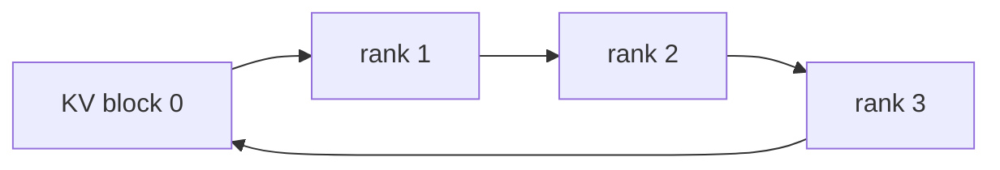

# Context Parallelism：长上下文 Attention 如何跨 GPU

原理读完后，沿 [CP 执行走读](../13_Source_Analysis/megatron/02_parallelism/04_context_parallel_execution.md) 核对 batch 切分、全局 token 坐标、TE adapter 与梯度归属；收益与代价的横向比较见[八类阅读主线](八类并行阅读主线.md)。

## 入门例子：切分序列后，attention 还需要远端历史

序列有 8 枚 token，CP=2，两卡各保存 4 枚 query。对于 causal attention，后半段 query 仍需要前半段的 key/value；不能简单让每卡独立做长度 4 的 attention，否则模型变了。

环式交换、AllGather 或布局转置是不同的通信组织方式。causal mask 使早期 query 与后期 query 的可见 pair 数不同，等 token 数不必然等计算量。实现还可能采用交错或分块分配来均衡。

对 0–7 的八个 causal query，可见 key 数依次为 1–8；连续两半的工作量为 1+2+3+4=10 与 5+6+7+8=26。重新分配 query 可以改善这种不均衡，交换 KV 解决可见历史的获取，修改 mask 则改变模型语义，三者不能混同。

## 机制与实现

Context Parallelism（CP，上下文并行）沿 sequence/context 维切 activation，让每个 rank 只常驻部分 token。困难在于 self-attention：每个 query 必须看到允许范围内的全部 Key/Value（KV，键值）。

## Ring Attention

设 CP degree 为 $p$。每 rank 保留本地 query block，KV block 在 ring 上轮转；每轮计算本地 Q 对当前 KV 的局部 attention，再通过 online softmax 合并局部最大值、归一化和 output。

计算与下一块 KV P2P 可以流水重叠。每 rank 最终处理完整 context 的交互，因此总 attention FLOPs 没消失，只被分摊；通信量随 KV block 和轮数增长。

## Causal mask 的负载不均

若按连续 token 块分配，序列前部 query 只能看较少 KV，后部 query 看更多，rank 工作量不同。Megatron 常用双端/zig-zag 重排：把前段与后段 token 配到同一 rank，使 causal triangle 面积更均衡。

## Ulysses：Sequence shard ↔ Head shard

DeepSpeed-Ulysses 在 attention 前执行 All-to-All：

优势是可直接运行完整 sequence 的高效 attention kernel；限制是并行度受 attention head/KV head 数与 All-to-All topology 影响。Grouped-Query Attention（GQA，分组查询注意力）的 KV heads 少时，Ulysses degree 可能受限。

## Megatron CP 的通信类型

Megatron Core 支持多种 CP communication style，包括 P2P、AllGather、All-to-All 以及 hierarchical 组合。它们在 latency、memory、拓扑利用和 kernel integration 上不同。不要把 `context_parallel_size` 当成唯一决策；应结合 `cp_comm_type` 与 attention backend。

## Dynamic Context Parallelism

固定 CP degree 按最大 sequence 配置时，短样本也承担多 rank 通信，变长 batch 还会不均衡。Dynamic Context Parallelism（Dynamic CP，动态上下文并行）按 micro-batch 的实际长度选择 CP degree/分组。

Megatron 团队在 2026 年公开的结果显示，针对真实变长数据可获得最高约 1.48× speedup；这是特定 workload 报告，不是普遍保证。它揭示了重要方向：并行配置可以成为 runtime schedule，而非 job 启动时的常数。

## CP 与 TP/EP 的冲突

- TP 和 Ulysses 都可能切 attention heads，组合时 degree 受 head 数乘积约束；
- CP 的 sequence layout 进入 MoE 前，token All-to-All 需要保留 global token metadata；
- Ring P2P 与 EP All-to-All 若共享 NIC，会产生 traffic contention；
- packed sequence 的 causal boundary、position 与 loss mask 必须在重排后保持正确。

## 数值展开 SP 与 CP：布局转换、在线 Softmax 与远端梯度

> 两rank。先演示Megatron式SP，再演示切分上下文的Attention；两者切分的算子范围不同。概念：[SP](SequenceParallelism.md)、[CP](ContextParallelism.md)。

### SP：每个token的hidden仍然完整

X形状[S=4,H=2]，四行分别[1,3]、[2,4]、[3,5]、[4,6]。rank 0持前两行，rank 1持后两行。沿hidden做LayerNorm，教学设epsilon=0、gamma=1、beta=0，各行均值为2/3/4/5，方差均为1，输出均为[-1,1]。

每rank可以局部归一化，因为每个token的两个hidden分量都在本地。若切hidden而不是切sequence，这个结论不成立。

### 穿过TP子图

设中间宽度4，TP=2：

| 边界 | rank 0 / rank 1 的局部shape | 数据语义 |
|---|---|---|
| LN输入和输出 | [2,2] | sequence shard |
| AllGather后 | [4,2] | 完整token集合 |
| ColumnLinear输出 | [4,2] | 中间hidden shard |
| RowLinear局部输出 | [4,2] | 全序列上的partial |
| SUM ReduceScatter后 | [2,2] | token分片的完整结果 |

最后一步同时做两件事：把两rank对同一输出的贡献相加，再把结果按token分发。只scatter而不reduce会丢失模型贡献。

反向沿这些逻辑变换的伴随传播：输出的sequence shard梯度先被聚合到TP子图需要的布局，最终对LN输出的各TP局部贡献做求和并回到原token owner。此处的求和与DP平均不同。

LN的gamma/beta在这两个TP rank上复制，但各rank只处理部分token，因此参数梯度还需合并。假设LN输出上游梯度全1，则每rank的dGamma=[-2,2]、dBeta=[2,2]，跨sequence分片求和后为[-4,4]和[4,4]。只说“LN可局部做”而漏掉参数梯度同步，会得到错误训练。

### CP：查询留在本地，历史跨rank流动

另设单head、d=1、四个token，Q均为1，K=[0,ln2,ln3,ln4]，V=[1,2,4,8]，使用causal mask。rank 0持token0/1，rank 1持token2/3。

因为exp(K)=[1,2,3,4]，单卡参考输出为：

| query | 可见key | 权重分母 | 加权分子 | 输出 |
|---|---|---:|---:|---:|
| 0 | 0 | 1 | 1 | 1 |
| 1 | 0,1 | 3 | 5 | 5/3 |
| 2 | 0,1,2 | 6 | 17 | 17/6 |
| 3 | 0,1,2,3 | 10 | 49 | 4.9 |

rank 1若只处理本地KV，则query3输出=(3×4+4×8)/7=44/7，错误。它需要远端token0/1的贡献。

### 怎样合并块而不平均两个Softmax

对一个查询，维护最大值m、归一化和l、未归一化输出向量n。合并块a/b时：

$$m=\max(m_a,m_b),\quad l=e^{m_a-m}l_a+e^{m_b-m}l_b,$$
$$n=e^{m_a-m}n_a+e^{m_b-m}n_b,\quad O=n/l.$$

对query3，本地块2/3有 $m_b=\ln4,l_b=7/4,n_b=11$；远端块0/1有 $m_a=\ln2,l_a=3/2,n_a=5/2$。换到公共最大值ln4后，l=0.5×1.5+1.75=2.5，n=0.5×2.5+11=12.25，O=4.9。

两个块的各自输出均值不能直接平均。完全被mask的块应作为零贡献跳过；初始空状态也需避免对负无穷作未定义减法。

### 反向：远端K/V也有梯度

取loss=O3，其余查询上游梯度为0。p=[0.1,0.2,0.3,0.4]，因此dV=p，$dscore_j=p_j(V_j-O_3)$，得到[-0.39,-0.58,-0.27,1.24]。因Q3=1、d=1，dK相同；$dQ_3=\sum_j dscore_jK_j\approx1.020354$，其他query的dQ为0。

这些贡献由query3所在的rank 1产生，但K0/V0与K1/V1属于rank 0。必须将相应梯度贡献送回owner，并累加来自其他query分片的贡献。只把forward的KV传来而不处理backward归属，训练就不完整。

### 长度相同不等于工作相同

S=8时，连续切分[0..3]与[4..7]的causal pair数分别为10和26；配成[0,1,6,7]与[2,3,4,5]则各18。改变的是分配与索引，不能改变原始位置和mask。对于packed样本，样本边界也必须随重排保留。

验证：[SP归一化、CP输出与有限差分梯度](../examples/parallel_runtime_walkthroughs.py)。依据：[Ring Attention](https://arxiv.org/abs/2310.01889)、[Ulysses](https://arxiv.org/abs/2309.14509)。

## 何时选择哪类方法

| 条件 | 初始倾向 |
|---|---|
| head 数充足、All-to-All fabric 强 | Ulysses |
| head 数少/GQA、可良好 overlap P2P | Ring-style CP |
| 跨节点与节点内带宽差异大 | hierarchical CP / USP |
| sequence 长度高度变化 | Dynamic CP / fine-grained block assignment |
| attention 本身稀疏或线性 | 需要架构专用 sharding rule，不能默认 dense CP |

## 从本地序列到远端上下文：保存量与访问量分开算

把序列分给多个设备减少每卡保存的某些 token 状态，但查询仍可能需要其他设备上的历史信息。Ring 路线逐步交换状态并累积结果，All-to-All 路线改变序列与 head 的布局；两者对 head 数、拓扑和中间缓冲有不同要求。

Causal attention 中不同位置的可见历史长度不同，等长切分不保证等工作量。负载平衡映射又会改变索引和通信复杂度。比较时应固定可见性、位置编码、数值容差与序列边界，不能只检查输出 shape。

基础参见[Attention 计算](../02_Model_Architecture/Transformer与Attention基础.md)，整体关系见[并行设计空间](并行设计空间与演进.md)。

## 完整推演

[SP与CP完整推演](<ContextParallelism.md#数值展开-sp-与-cp布局转换在线-softmax-与远端梯度>)：在线softmax、远端梯度与因果负载。

---

## 资料

- [Ring Attention](https://arxiv.org/abs/2310.01889)
- [DeepSpeed-Ulysses](https://arxiv.org/abs/2309.14509)
- [USP](https://arxiv.org/abs/2405.07719)
- [PyTorch Context Parallel Tutorial](https://docs.pytorch.org/tutorials/unstable/context_parallel.html)
- [Megatron Dynamic CP](https://forums.developer.nvidia.com/t/speeding-up-variable-length-training-with-dynamic-context-parallelism-and-nvidia-megatron-core/358971)

<!-- series-nav -->

[上一篇：Sequence Parallelism：两个同名概念必须分开](<SequenceParallelism.md>) · [专题目录](<README.md>) · [下一篇：Pipeline Parallelism：切 Layer、排 Micro-batch](<PipelineParallelism.md>)

<!-- /series-nav -->
