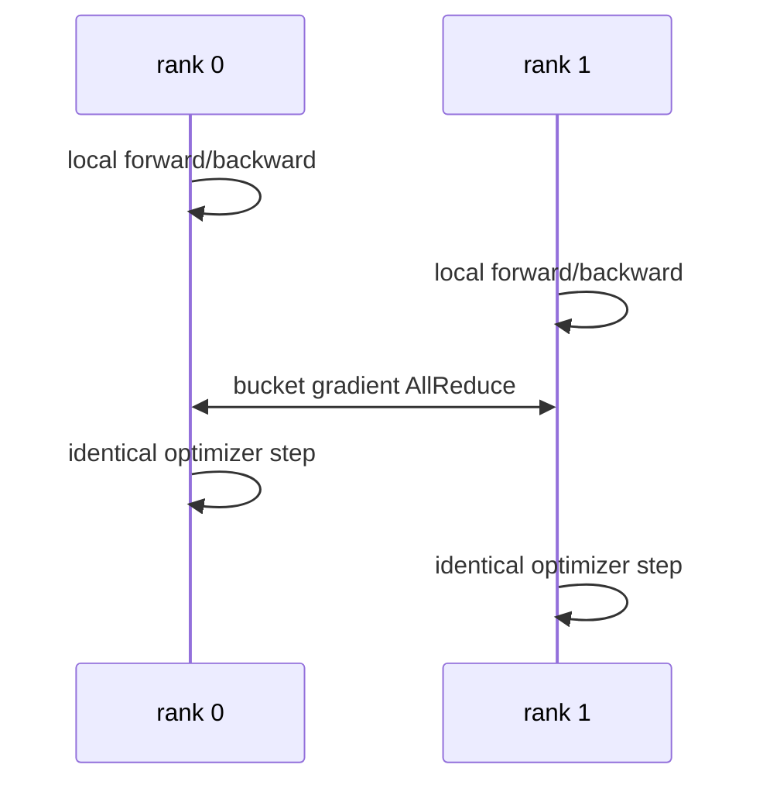

# Data Parallelism 与 DistributedDataParallel

读完本篇的数学与 bucket 原理，再看 [Megatron DDP 执行链](../13_Source_Analysis/megatron/03_state_and_memory/01_data_parallel_optimizer_checkpoint.md)中的 hook → ready → start/finish → optimizer。各类并行的出发点、收益和代价见[八类阅读主线](八类并行阅读主线.md)。


## 入门例子：两卡梯度平均的成立条件

单个参数 w=1，样本目标 a=[0,2,8]，每 token loss 为 (w−a)^2/2。全局 token mean 的梯度是 ((1−0)+(1−2)+(1−8))/3=−7/3。若前两枚给 rank 0、后一枚给 rank 1，平均两个 local mean 梯度会得到 (0−7)/2=−3.5，目标已经改变。

这不是 DDP 通信错误，而是 local loss 的缩放与目标不一致。日志的全局 sum/count 和 backward 的梯度缩放要分别处理。完整推导和 CPU 算例见[RL 数据正确性](../11_RL_Systems/RL数据与数值正确性.md)。

验收：分别用等长和不等长 local batch 手算；再加入两个 microbatch，指出累积前后除以了哪个量。下面的 no_sync 片段是执行结构示意，使用时需导入 contextlib.nullcontext 并定义实际 model/loss。

## 机制与实现

Data Parallelism（DP，数据并行）复制模型，把 global batch 切给不同 rank。DistributedDataParallel（DDP，分布式数据并行）是 PyTorch 的多进程实现：每个 rank 独立 forward/backward，再同步 gradient。

## 为什么梯度平均等价

设 global batch $B$ 被均匀切给 $D$ 个 rank，每 rank local batch $B/D$。若 loss 使用 local mean，第 $r$ 个 rank 得到：

$$
g_r=\frac{D}{B}\sum_{x\in\mathcal{B}_r}\nabla\ell(x)
$$

对 rank 梯度再取平均：

$$
\frac{1}{D}\sum_{r=1}^{D}g_r
=\frac{1}{B}\sum_{x\in\mathcal{B}}\nabla\ell(x)
$$

与单卡 global-batch mean 等价。若 local batch 不等长、loss 用 sum、存在 token mask 或 gradient accumulation，缩放必须重新推导；不能盲目除以 world size。

## DDP 一步发生什么



参数初始一致、梯度同步一致、optimizer deterministic 时，各 replica 保持一致。通常没有必要每 step 广播参数。

## Bucket 为什么能重叠

Autograd（自动微分）按反向依赖逐步产生 gradient。DDP 将 parameter gradient 放入 bucket；一个 bucket 全部 ready 后立即发起 AllReduce，与更前层的 backward compute 重叠。

- bucket 太大：启动晚，exposed communication tail 增大；
- bucket 太小：collective latency 与 kernel launch 过多；
- 参数注册顺序若与 backward ready 顺序相反，可能长期等最后一个 gradient。

`gradient_as_bucket_view` 可减少 gradient 与 bucket 间复制，但会改变 gradient storage 语义。

## Gradient accumulation 与 `no_sync`

若累积 $A$ 个 micro-batch，只在最后一次同步：

```python
for i, batch in enumerate(micro_batches):
    ctx = model.no_sync() if i < A - 1 else nullcontext()
    with ctx:
        loss(batch).backward()
optimizer.step()
```

这样把 $A$ 次 AllReduce 降为 1 次，但 gradient 在本地累积。loss scaling 要与 global batch 定义一致；automatic mixed precision 的 overflow 也需要跨 rank 一致处理。

## Uneven input 与数据语义

某些 rank 提前耗尽数据会导致其他 rank 等待 collective。PyTorch Join context 能处理部分 uneven-input 场景，但语言模型训练更常通过 DistributedSampler、drop_last、packing 或 dummy batch 保持 step 对齐。

Token-level loss 下，即使每 rank sequence 数相同，有效 token 数也可能不同。正确 global token mean 可先求 local loss sum 与 token count，再分别 AllReduce，最后相除；不能平均“每 rank 的平均 loss”。


## 数值展开 DDP：不等长数据、梯度累积与 Bucket 时间线

> 模型：两张卡、普通梯度平均语义、同步更新。数字是教学构造；自定义通信 hook、Join 和其他 reduction 规则需要重新推导。

### 输入、目标与参考答案

模型 $y=w_1x_1+w_2x_2$，初值 $w=[1,2]$，每个样本 $\ell=(y-a)^2/2$。全局目标是本次更新所有有效样本的 mean，N=4；不包含被 mask 的占位样本。

| rank | microbatch | x | a | y | loss | 未缩放梯度 |
|---|---|---|---|---|---|---|
| 0 | 0 | [1,0] | 0 | 1 | 0.5 | [1,0] |
| 0 | 1 | [0,1] | 0 | 2 | 2 | [0,2] |
| 0 | 1 | [1,1] | 0 | 3 | 4.5 | [3,3] |
| 1 | 0 | [2,0] | 0 | 2 | 2 | [4,0] |
| 1 | 1 | 占位输入，mask=0 | — | — | 0 | [0,0] |

单卡参考：loss sum=9，mean=2.25，gradient sum=[8,5]，mean gradient=[2,1.25]。SGD 学习率 0.1 后，参数应为 [0.8,1.875]。

### 把归一化放到正确位置

若默认 DDP 将 D 个 rank 的梯度平均，每个 rank 应反传 $\widetilde L_r=(D/N)\sum_{i\in r}\ell_i$。这里 D=2，N=4，缩放因子为 0.5。

| 时刻 | rank 0 累积梯度 | rank 1 累积梯度 | 是否规约 |
|---|---|---|---|
| 清空梯度 | [0,0] | [0,0] | 否 |
| microbatch 0 后 | [0.5,0] | [2,0] | 否，使用 no_sync |
| microbatch 1 的本地贡献加入后 | [2,2.5] | [2,0] | 最后一次反向触发同步 |
| SUM AllReduce 后 | [4,2.5] | [4,2.5] | 数学中间结果 |
| 除以 D 后 | [2,1.25] | [2,1.25] | 可以执行相同更新 |

具体实现可能把除法放在规约前后，本表拆开只是为了核算。由于已经按整次更新的 N 缩放，不应再除以 microbatch 数 2。

错误做法是先算各 rank 的 local mean，再平均：rank 0 为 [4/3,5/3]，rank 1 为 [4,0]，得到 [8/3,5/6]，已经偏离全局目标。日志可以把 detached loss sum/count 汇总，但这不自动修正 backward 的梯度。

### 空 microbatch 为什么还需要参与执行协议

表中的占位步表示执行相容的 forward/backward、产生零贡献，并保持各 rank 的 collective 顺序。实际模型若含数据相关分支或其他跨 rank 操作，仅构造一个无关的零 loss 未必能触发相同通信。不能让 rank 1 直接跳过最后一次反向，而 rank 0 继续等待同步。

`no_sync` 应覆盖对应 forward 和 backward。全局有效数量 N 需要在这次更新的缩放前已知，或采用等价的、经过推导的后缩放；把 count 的额外 collective 混进不同顺序也会导致等待。

### Bucket 的独立时间算例

为解释重叠，下面换成包含两组参数的抽象网络；时间不由上面两个标量参数的计算量推导。假设通信通道串行，bucket 通信均为 2 ms：

| bucket | rank 0 ready | rank 1 ready | 全部就绪 | 通信区间 |
|---|---|---|---|---|
| B0：后层梯度 | 2 ms | 3 ms | 3 ms | [3,5] ms |
| B1：前层梯度 | 6 ms | 7 ms | 7 ms | [7,9] ms |

两卡计算最迟在 7 ms 结束，更新要等到 9 ms。通信总服务时间为 4 ms，暴露在计算之后的尾部为 2 ms。rank 0 若从 2 ms 提交 B0 到 5 ms 完成，中间包含等 rank 1 的时间，不能把 3 ms 全当作传输时间。

若合成一个 bucket，仍假设总服务时间为 4 ms，则要从 7 ms 执行到 11 ms。真实大 bucket 的服务时间还可能因带宽利用率更好而变化，本例只隔离 ready time 的影响。

### 从推演定位真实实现

检查参数注册/就绪顺序、bucket 大小、梯度是否为 bucket view、no_sync 范围、loss/count 缩放和优化器执行时刻。先与单卡全局 batch 比较一步梯度，再看 trace 中的 ready、提交和完成。

数值复核：[纯 Python 推演脚本](../examples/parallel_runtime_walkthroughs.py)。依据：[PyTorch DDP 设计](https://docs.pytorch.org/docs/stable/notes/ddp.html)；具体行为以实际框架版本和 hook 为准。

### 贯穿到当前实现

[对照Megatron bucket和采集窗口](../12_Performance_Reliability/贯穿案例_分布式训练等待与通信重叠.md)。

## DP 的扩展边界

DP degree 增加时：

- 每卡模型状态不下降，模型必须先能放入单个 replica；
- global batch 若增长，可能改变优化和收敛；
- global batch 固定时 local batch 变小，GEMM 利用率下降；
- gradient bytes 基本不因 local batch 减少，通信/计算比恶化。

因此 DP 主要解决吞吐，ZeRO/FSDP 才解决 replica 状态冗余。

## 排查

- loss 随 world size 改变：检查 reduction 与 token count normalization；
- rank 间 parameter drift：检查漏同步、自定义 parameter、conditional branch；
- backward 尾部长：检查 bucket ready order、大小和网络；
- 某 rank hang：检查 uneven data、collective 顺序与 rank failure；
- scaling 差：分别测 local batch kernel efficiency 与 AllReduce exposed time。

## 梯度同步为何从整步等待走向分桶

等全部反向结束再同步，容易在计算后留下完整通信尾部。按梯度就绪顺序构造 bucket，可以让较早完成的梯度先通信。新问题是 bucket 大小：太小使固定开销突出，太大则要等待更多参数就绪。

bucket 时间线还受不同 rank 到达顺序影响。一个 rank 的长通信区间可能主要在等另一个 rank，而不是链路传输慢。优化前对齐 backward、bucket ready 和 collective 完成事件。

梯度累积减少某些同步次数，但最后一次同步仍需覆盖正确的全局梯度；不等长输入与 token mask 需要保留目标归一化。详见[计算图与自动微分](../01_Math_Numerics/计算图与自动微分.md)。


---


## 资料

- [PyTorch DDP Tutorial](https://docs.pytorch.org/tutorials/intermediate/ddp_tutorial.html)
- [PyTorch DDP Notes](https://docs.pytorch.org/docs/stable/notes/ddp.html)
- [DDP Join Context](https://docs.pytorch.org/tutorials/advanced/generic_join.html)

<!-- main-route -->

DDP 增加样本吞吐，却保留完整参数副本。如果单层本身太大，下一篇沿矩阵维度拆分计算。

[上一篇：八类并行的设计空间](<八类并行阅读主线.md>) · [主线 12/26](<../guides/系统阅读路线.md>) · [下一篇：Tensor Parallelism](<TensorParallelism.md>)

<!-- /main-route -->
