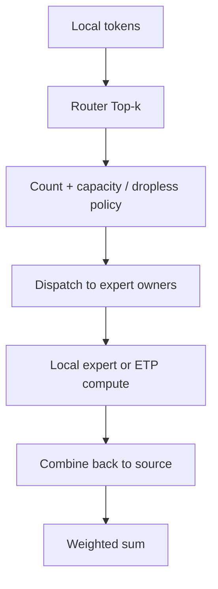

# Expert Parallelism：模型稀疏，系统不一定轻松

## 入门例子：EP 的卡数不能脱离其他并行维度理解

EP 决定 expert 如何分布，expert data parallel 则表示哪些 rank 复制同一个 expert。Attention 与 expert 层可能在同一批物理 rank 上采用不同布局，所以不能简单把 TP×PP×DP 再乘一个 EP 当作总卡数。

先画普通层的 group，再画 expert 层的 group；检查每个专家的权重副本、输入 token 与梯度规约范围。实际 Megatron 的布局约束由 parallel_state 构建，见[源码问题](../13_Source_Analysis/megatron/06_reference/03_source_questions.md)。

若四枚 token 都路由到同一专家，持有它的 rank 计算，其他专家 rank 可能等待；输入 DP 均分也无法阻止这种偏斜。通信正确性与负载分布是两个独立问题。

## 机制与实现

Expert Parallelism（EP，专家并行）把 Mixture of Experts（MoE，混合专家模型）的不同 expert 放到不同 rank。每个 token 只激活 top-k expert，但 token 必须被动态路由到 expert owner，再把结果送回。

通信 kernel 与 DeepEP 细节见上一专题的[MoE All-to-All 案例](../07_Communication/案例_MoE-AllToAll.md)。本章关注并行布局。

## 三种常见布局

设 64 个 routed experts、EP=8：每个 EP rank 持有 8 个 experts。

- EP-only：attention/共享层在 EP ranks 上复制，MoE layer 按 experts 切；
- EP + ETP：每个 expert 的矩阵还沿 Expert Tensor Parallelism（ETP，专家张量并行）切分；attention TP 可独立配置，不能只看到 TP+EP 就认定 ETP>1；
- DP Attention + EP MoE：attention 走 Data Parallelism（DP，数据并行），MoE token 在更大的 EP group 中交换，适合 MLA 等 attention 参数较小但 experts 巨大的模型。

## Token 流程

输出布局通常回到原 token owner，便于 residual connection；因此一次 MoE block 至少有 dispatch 和 combine 两个方向。

## Load balance 是并行正确性之外的第二目标

设 rank $r$ 收到 token 数为 $T_r$，MoE compute time 近似由 $\max_r T_r$ 决定，而网络拥塞也与热点相关。可用：

$$
\text{imbalance}=\frac{\max_r T_r}{\frac{1}{P}\sum_r T_r}
$$

辅助负载均衡 loss、capacity factor、token drop、expert bias、expert replication 和 Expert Parallelism Load Balancer（EPLB，专家并行负载均衡器）都在处理这个问题，但可能改变模型质量或增加状态迁移。

## Token drop 与 dropless

- capacity-based：每个 expert 设容量，超出 token drop/route elsewhere；吞吐可预测，但可能损伤学习；
- dropless：保留所有 token，语义更直接，但最热 expert 决定 step tail；
- padded：填到统一 capacity，collective/GEMM 规则，却浪费 bandwidth/compute；
- variable-size：AllToAllV + ragged grouped GEMM，系统复杂但减少 padding。

## EP 与 ETP 不要混淆

EP 切 expert 集合；ETP=1 时，一个 owner 持有完整 expert 矩阵；ETP>1 时，同一 owner 的各 ETP ranks 分别持有矩阵 shard。ETP 切单个 expert 的 intermediate tensor。若 expert 较小，ETP 会让 Grouped GEMM 更碎且增加通信；应结合单 expert 容量、token 数和硬件比较 EP/ETP，而不是固定认为更多切分更快。矩阵、梯度和八卡映射见[ETP 独立章节](ExpertTensorParallelism.md)。

## Parallel Folding

不能把 `DP × TP × PP × CP × EP` 当成通用 world-size 公式。当前 Megatron 分别建立 `W=TP×CP×DP×PP` 的 dense 网格和 `W=ETP×EP×EDP×PP` 的 expert 网格；EDP 复制同一 expert shard。Parallel folding/heterogeneous mapping 允许两部分独立选择逻辑布局，并在边界处理 token 分布。例如同一批 64 张卡上，attention 可用 DP=64，experts 可用 EP=64（其他相关 degree 为 1），不是两者相乘需要 4,096 张卡。

收益是避免浪费 world size；代价是跨布局通信、group 管理和 checkpoint metadata 更复杂。Megatron Core 近年的 MoE 路线已把 full parallelism combo 与 parallel folding 纳入重点。

## 推理中的 WideEP

Wide Expert Parallelism（WideEP，宽专家并行）让一个 replica 的 experts 跨很多 GPU，而 attention 可采用 DP。它能扩大 token batch、提升 expert GEMM，但请求级 tail、KV locality 与 expert hot spot 共同决定效果。vLLM 当前支持 DP attention 与 EP/TP MoE 组合，并提供 EPLB 与 redundant expert 相关能力；具体支持随版本变化。

## 数值展开 EP 与多维通信组：token 去哪里，梯度由谁更新

> 分为独立的EP数据流与DP×TP网格两个例子。二者不暗示所有框架都能把EP作为额外维度直接相乘。概念：[EP](ExpertParallelism.md)、[DeviceMesh](多维并行与DeviceMesh.md)。

### 四个token、两个专家

token输入为标量[1,2,3,4]，rank 0拥有t0/t1和专家E0，rank 1拥有t2/t3和专家E1。专家函数E0(x)=2x，E1(x)=3x。每个token选择两个专家，权重如下；路由权重固定，不计算router梯度。

| token | 来源rank | E0权重 | E1权重 | 完整参考输出 |
|---|---|---:|---:|---:|
| t0=1 | 0 | 0.75 | 0.25 | 2.25 |
| t1=2 | 0 | 0.25 | 0.75 | 5.5 |
| t2=3 | 1 | 0.5 | 0.5 | 7.5 |
| t3=4 | 1 | 0.25 | 0.75 | 11 |

### Dispatch、计算与Combine

每个来源rank按目标专家把token打包，保留(token_id,source_rank,expert_id,weight)映射。rank 0向rank 1发送t0/t1供E1计算；rank 1向rank 0发送t2/t3供E0计算。发往本地专家的记录也参与排列，但不必经过网络。

E0在rank 0处理全部四个token，产生[2,4,6,8]；E1在rank 1产生[3,6,9,12]。返回输出到token来源，按原token位置加权求和，得到表中结果。不能按专家输出的当前数组顺序直接相加，必须恢复映射。

本例top-2使四个token产生八份expert assignment。若真实hidden=H、元素b字节，跨rank每方向每次发送2Hb字节的激活；combine若形状精度相同，再发送同量。不含索引、权重、对齐与协议，不能把八份assignment全算为远端流量。

### 反向与专家参数梯度

取loss为四个输出之和，则每token上游梯度为1。传给每个专家输出的梯度就是其路由权重；专家反向再乘专家系数，来源rank累加两份dX，得到[2.25,2.75,2.5,2.75]。

设专家系数是可训练标量a0=2、a1=3，则dA0=0.75×1+0.25×2+0.5×3+0.25×4=3.75；dA1=6.25。SGD lr=0.1后a0=1.625、a1=2.375。若专家还跨数据副本复制，需在相同专家身份的复制组同步梯度，不能把不同专家梯度当成同一参数规约。

真实router训练还需处理权重的梯度、选择机制及辅助目标；固定路由算例只验证dispatch/combine的线性关系。

### 另一个例子：八卡 DP×TP×PP 网格

令DP=2、TP=2、PP=2，rank编号为 $r=4p+2d+t$，三个坐标均为0或1：

| group类型 | 成员 | 共享什么 |
|---|---|---|
| TP | [0,1]、[2,3]、[4,5]、[6,7] | 同一stage、同一数据分片的算子计算 |
| DP | [0,2]、[1,3]、[4,6]、[5,7] | 同一stage、同一TP参数切片 |
| PP链 | [0,4]、[1,5]、[2,6]、[3,7] | 同一数据/TP坐标的前后stage |

rank1=(p0,d0,t1)：与rank0做TP，与rank3做DP，与rank5交换流水边界数据。不同组可能重叠成员，但它们的参数身份与操作语义不同。

例如逻辑权重的t1切片在rank1得到梯度[1,3]、在rank3得到[5,7]，DP平均为[3,5]；和rank0的t0切片求平均没有这个意义。应先确认参数身份，再构造通信组。

### 从表到真实配置

依次检查每个参数的TP/EP布局、复制组、PP所属stage、batch归属和物理位置。专家可能有自己的rank生成和并行映射，不能由上述dense网格自动推出。接口依据：[Megatron并行策略](https://docs.nvidia.com/megatron-core/developer-guide/latest/user-guide/parallelism-guide.html)。验证：[EP与网格脚本](../examples/parallel_runtime_walkthroughs.py)。

## 从稀疏计算到动态通信

条件计算降低每 token 激活的专家工作，但全部专家参数仍需要存放。分布专家后，token 的选择转为设备间数据交换。总 token 数相同，路由不同就可能产生完全不同的热 rank 与临时 buffer 峰值。

容量限制或 token drop 控制最坏负载，但可能改变训练行为；dropless 保留 token，则需要更灵活的算子和缓冲；专家复制降低热点压力，又增加权重容量与一致性责任。每个方案都要同时比较质量、负载和数据移动。

相关：[路由与均衡](../02_Model_Architecture/moe/路由与负载均衡.md)、[专家算子](../02_Model_Architecture/moe/专家算子与调度.md)。

- [EP/ETP 完整执行链](../13_Source_Analysis/megatron/02_parallelism/05_ep_etp_execution.md)：六阶段 dispatcher、变长 splits、ETP AG/RS 与 EDP 梯度。
- [八类并行阅读主线](八类并行阅读主线.md)：用统一问题比较收益、代价与验证结果。

---

## 资料

- [Megatron Core MoE Guide](https://github.com/NVIDIA/Megatron-LM/blob/main/megatron/core/transformer/moe/README.md)
- [Megatron Core MoE Roadmap 2026 Q3](https://github.com/NVIDIA/Megatron-LM/issues/6757)
- [vLLM Expert Parallel Deployment](https://docs.vllm.ai/en/latest/serving/expert_parallel_deployment/)
- [DeepEP](https://github.com/deepseek-ai/DeepEP)

<!-- series-nav -->

[上一篇：Pipeline Parallelism：切 Layer、排 Micro-batch](<PipelineParallelism.md>) · [专题目录](<README.md>) · [下一篇：ETP：把一个专家的矩阵切到多张卡](<ExpertTensorParallelism.md>)

<!-- /series-nav -->
