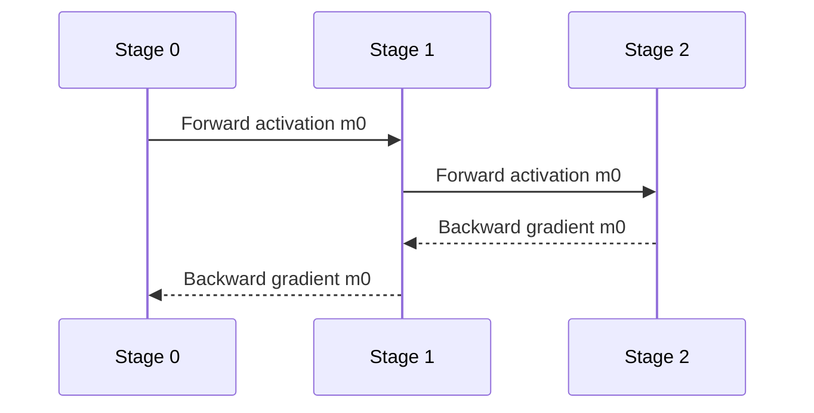

# Pipeline Parallelism：切 Layer、排 Micro-batch

本篇讲切层与调度原理；具体的 warmup、VPP lookup table、激活队列与 P2P 见 [Megatron PP 走读](../13_Source_Analysis/megatron/02_parallelism/02_pipeline_parallel.md)。运行与预期结果见[并行验收](../13_Source_Analysis/megatron/05_design_and_failures/03_parallelism_validation.md)。

## 入门例子：两个 stage、四个 microbatch 的生命周期

PP 将不同层放到不同 stage。microbatch m 在 stage 0 forward 后，activation 发给 stage 1；stage 1 backward 后，把对输入 activation 的梯度发回 stage 0。参数更新需要本次更新包含的梯度都满足同步条件。

先画每个 microbatch 的 F0→F1→B1→B0 依赖，再安排不同 microbatch 的工作穿插。1F1B 的 F 和 B 通常不是同一个 microbatch，不能理解成每个 stage 永远立即反向刚完成的那个前向。

在 stage 等时、忽略额外通信的简化流水模型中，bubble 常随 (P−1)/M 增大，其中 P 为 stage 数、M 为 microbatch 数；实际占比和时序取决于 schedule。验收：画出 warmup、稳态、drain，数出仍需保留的 activation；不要只背 bubble 公式。

## 机制与实现

Pipeline Parallelism（PP，流水线并行）把模型的 layer/graph 切成 stage，各 stage 处理不同 micro-batch。它减少每卡常驻 layer 参数，但引入 activation/gradient P2P、pipeline bubble 和 stage imbalance。

## 基本数据流

P2P payload 主要与 boundary activation shape 相关，而不是整个模型参数量。切分位置若产生大 activation 或跨越 residual/branch，会增加通信和实现复杂度。

## GPipe：All Forward Then All Backward

GPipe 把 mini-batch 分成 $m$ 个 micro-batch，先完成所有 forward，再完成所有 backward。若有 $p$ 个均衡 stage，忽略通信，bubble fraction 近似：

$$
\text{bubble}_{GPipe}\approx\frac{p-1}{m+p-1}
$$

增大 $m$ 可摊薄 bubble，但要同时保存更多未 backward 的 activation，显存上升。

## 1F1B

One Forward One Backward（1F1B，一前向一反向）经过 warmup 后交替执行 forward/backward，更早释放 activation，峰值通常低于 GPipe。同步 flush 版本保持同一 mini-batch 的一致 weight version；异步 PipeDream 类 schedule 可能引入 weight staleness，需要额外语义。

### Interleaved 1F1B

每个物理 rank 持有多个 Virtual Pipeline（VP，虚拟流水段）chunk，例如 rank 0 持 layer 0–3 与 16–19。细粒度 interleave 可减少 bubble、改善 stage balance，但增加 P2P 次数、调度与 activation 管理复杂度。

## Zero Bubble 的关键：拆 backward

Backward 可分成：

- B：计算对输入 activation 的 gradient，必须尽快发给前一 stage；
- W：计算 parameter gradient，只影响本 stage optimizer，可在关键路径空隙执行。

Zero Bubble schedule 将 B 与 W 解耦，把 W 填入 bubble。PyTorch 2.14 `torch.distributed.pipelining` 已公开 ScheduleInterleavedZeroBubble 等 schedule；支持条件与数值语义需按文档核对。

## Stage partition 不能只按 layer 数

MoE、embedding、output head、Multi-Token Prediction（MTP，多 token 预测）和异构 layer 的成本不同。应按实测 forward/backward time、activation bytes 和 memory peak 做 partition。

Megatron Core 支持 custom pipeline layout，可表达不均匀 layer 分配和空 stage；这反映现代模型已不再是每层同成本的整齐链。

## Bubble 的四种来源

1. fill/drain：流水线固有 warmup/cooldown；
2. stage imbalance：最慢 stage 决定节拍；
3. communication exposed：P2P 未被 compute 遮挡；
4. dynamic workload：MoE token imbalance、变长 sequence 或 conditional branch。

只增加 micro-batch 数主要改善第一种，对后三种可能无效。

## 数值展开 PP：GPipe 与同步 1F1B 的逐时隙调度

> 两个stage、四个microbatch，所有F/B各耗一个时隙，传输延迟记为0且边界数据在下一时隙可用。每stage同一时隙只执行一个任务。时间表是依赖验证模型，不是性能预测。

### 依赖先于调度

对microbatch i：$F_{0,i}\to F_{1,i}\to B_{1,i}\to B_{0,i}$。每次F保存一份简化激活，每次同stage的B结束后释放。整个更新使用相同参数版本，累计四份梯度后再更新。

### GPipe：先前向，后反向

| 时隙 | stage 0 | stage 1 | 结束时活跃激活份数 S0/S1 |
|---|---|---|---|
| 0 | F0 | — | 1/0 |
| 1 | F1 | F0 | 2/1 |
| 2 | F2 | F1 | 3/2 |
| 3 | F3 | F2 | 4/3 |
| 4 | — | F3 | 4/4 |
| 5 | — | B3 | 4/3 |
| 6 | B3 | B2 | 3/2 |
| 7 | B2 | B1 | 2/1 |
| 8 | B1 | B0 | 1/0 |
| 9 | B0 | — | 0/0 |

每stage做8个任务，整个调度占10时隙；总可用槽位20，实际计算16，空槽比例20%。与 $(P-1)/(M+P-1)=1/5$ 相符。每stage激活峰值4份。

### 同步 flush 1F1B

| 时隙 | stage 0 | stage 1 | 结束时活跃激活份数 S0/S1 |
|---|---|---|---|
| 0 | F0 | — | 1/0 |
| 1 | F1 | F0 | 2/1 |
| 2 | — | B0 | 2/0 |
| 3 | B0 | F1 | 1/1 |
| 4 | F2 | B1 | 2/0 |
| 5 | B1 | F2 | 1/1 |
| 6 | F3 | B2 | 2/0 |
| 7 | B2 | F3 | 1/1 |
| 8 | — | B3 | 1/0 |
| 9 | B3 | — | 0/0 |

时间仍为10时隙，空槽仍为20%；激活峰值变成stage 0两份、stage 1一份。这一例子中，1F1B的直接收益是生命周期，而不是更短总时间。若每份激活16 MiB，峰值分别由64/64 MiB降到32/16 MiB，未包含其他状态。

stage 0在F1后执行B0，说明“一前一后”通常属于不同microbatch。表中的空槽来自远端梯度尚未可用，不能无条件填入需要该梯度的工作。

### 加回通信与不均衡

设边界激活shape=[2,4]、BF16，每次前向payload16 B；若反向边界梯度也BF16，每次返回16 B，四个microbatch总共128 B跨边界传输。参数量没有进入这个payload公式。

如果F1耗时变为2个单位，或P2P与计算竞争资源，就不能继续使用上面的等时槽表。应把任务展开为实际区间，加入“发送完成后才能消费”的依赖。更多microbatch主要摊薄fill/drain，不会消除最慢stage的持续瓶颈。

### 更新语义与后续方法

同步flush要求这一批microbatch使用相容的参数版本。若某stage在其他microbatch仍需旧参数反向时更新，会产生版本问题；异步流水需要额外设计，而不只是删除等待。

拆分输入梯度与权重梯度可以提供更多可调度任务，但只有权重梯度的依赖和最终更新条件满足时才能挪动它。激活保留也可能延长。理解Zero Bubble应先在此表上补入这些独立依赖。

验证：[调度依赖与激活计数脚本](../examples/parallel_runtime_walkthroughs.py)。历史依据：[GPipe](https://arxiv.org/abs/1811.06965)、[PipeDream](https://arxiv.org/abs/1806.03377)；本表仅演示同步版本。

## 选择建议

- 模型深、单层能在一张/一个 TP group 高效运行：PP 很自然；
- micro-batch 必须极小且 global batch 也小：bubble 难以摊薄；
- 推理低延迟：PP 增加 stage 串行 latency，通常不如 TP；吞吐批处理可用 pipeline；
- 长上下文：activation 生命周期可能让 1F1B 也过高，需要 recompute、Seq1F1B 或 sequence slicing。

## 调度演进：减少一种气泡会引入另一种状态

将层分到不同设备解决深度方向的容量分布，但单个 microbatch 会逐 stage 经过，其他设备可能空闲。GPipe 以多个 microbatch 填充流水；集中前向会增加等待反向的激活。

1F1B 将前向与反向交错，缩短部分激活生命周期，但没有自动消除启动和排空。Interleaving 增加调度颗粒度，也增加切换与通信。拆分 backward 的后续设计利用输入梯度和权重梯度的不同依赖填空隙，同时必须维护更新前的所有梯度条件。

分析时分别画计算依赖、链路占用和激活峰值。“零气泡”是在特定假设下的调度目标，不意味着真实系统没有负载不均、同步或通信等待。历史入口：[GPipe](https://arxiv.org/abs/1811.06965)。

---

## 资料

- [GPipe](https://arxiv.org/abs/1811.06965)
- [PipeDream](https://arxiv.org/abs/1806.03377)
- [PyTorch Pipeline Parallelism 2.14](https://docs.pytorch.org/docs/stable/distributed.pipelining.html)
- [Megatron Core Custom Pipeline Layout](https://docs.nvidia.com/megatron-core/developer-guide/latest/user-guide/pipeline_model_parallel_layout.html)

<!-- main-route -->

训练阶段需要前反向与参数更新；推理则要逐步产出 token。下一篇从这个差异解释 Prefill、Decode 与 KV。

[上一篇：ZeRO 与 FSDP](<ZeRO与FSDP.md>) · [主线 15/26](<../guides/系统阅读路线.md>) · [下一篇：Transformer 执行与 KV](<../10_Inference_Serving/Transformer执行与KV基础.md>)

<!-- /main-route -->
