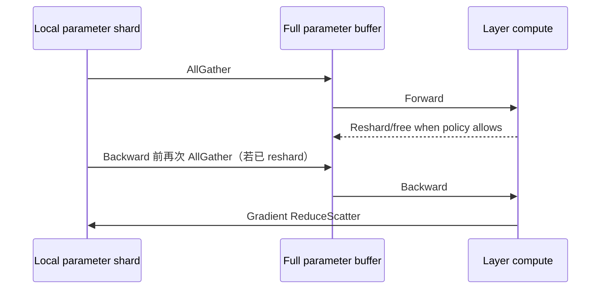

# ZeRO 与 FSDP：分片数据并行的执行语义

本篇建立通用状态分片语义；具体实现沿 [Megatron-FSDP 的 hook 与峰值推演](../13_Source_Analysis/megatron/03_state_and_memory/02_megatron_fsdp.md)阅读，避免把不同框架的生命周期直接互换。对照实验见[并行验收](../13_Source_Analysis/megatron/05_design_and_failures/03_parallelism_validation.md)。

> 相关基础：[基础概念](../09_Training_Systems/训练步与优化器.md)。关联：[机制与演进](并行设计空间与演进.md)。


先与上一章 TP 对照：TP 中每张卡只算一个矩阵乘的一部分；本篇的全分片数据并行在计算某层时可以临时拿到完整参数，仍处理自己的数据批次。**分开保存**不等于**拆开这个算子的计算**。

Materialize/unshard 表示收集分片、形成当前计算可用的完整参数；reshard 表示恢复只持有分片的状态；prefetch 是在真正需要前提前取来参数；offload 是把状态迁到 CPU 等其他存储层。Owner 是负责某片状态更新的 rank。

## 入门例子：用八个参数画出全分片生命周期

两个 rank 各持有四个参数 shard。某层 forward 前，按需 AllGather 得到该层完整参数；算完后可释放临时完整副本。backward 可能再次需要完整参数，梯度规约后仅由 owner 消费对应 shard。

| 方案 | 主要分片对象 | 新引入的责任 |
|---|---|---|
| ZeRO-1 思路 | 优化器状态 | 本地更新与参数一致性 |
| ZeRO-2 思路 | 再分片梯度 | 梯度规约/owner 与存储 |
| ZeRO-3/FSDP 思路 | 再分片参数 | 按层 materialize、释放与预取 |

这些是概念层分法，不能直接推出某框架的完整 grad buffer 已按 DP 缩小。查看真实 buffer 分配与峰值时间。验收：标注“逻辑归属”和“物理 allocation”两列，解释为何节省常驻状态后仍可能在 all-gather 峰值 OOM。

## 机制与实现

Zero Redundancy Optimizer（ZeRO，零冗余优化器）和 Fully Sharded Data Parallel（FSDP，全分片数据并行）仍属于数据并行：不同 rank 处理不同 batch shard；变化在于参数、gradient 和 optimizer state 不再永久复制。

显存核算与 offload 见上一专题的[训练显存优化](../09_Training_Systems/训练显存优化.md)。本章只解释并行执行。

## 三个状态维度

| 方案 | 参数 | Gradient | Optimizer state |
|---|---|---|---|
| DDP | replicated | replicated | replicated |
| ZeRO-1 | replicated | replicated | sharded |
| ZeRO-2 | replicated | sharded | sharded |
| ZeRO-3 / full FSDP | sharded | sharded | sharded |

这里是稳态语义；计算某层时 ZeRO-3/FSDP 会临时 materialize full parameter。

## 一层的 forward/backward



若 forward 后不 reshard，可避免 backward 前第二次 AllGather，却延长 full parameter 生命周期；这是通信—显存交换。Prefetch 下一层能隐藏 AllGather，但同时展开太多层会抬高峰值。

## 为什么 ReduceScatter 比 AllReduce 更自然

每个 rank 最终只拥有 gradient shard 和对应 optimizer state shard，因此无需让完整 gradient 出现在每张卡：直接 ReduceScatter 将全局规约结果切给 owner。owner 更新自己的 parameter shard；下一次计算前再 AllGather。

## FSDP wrapping unit 很关键

Wrapping unit（封装单元）是一组一起展开、释放和管理参数的模块。它决定一次临时出现多大参数，而不只是代码怎样分文件。

若整个模型只包一个 FSDP unit，可能在 forward 前一次性 gather 全模型，失去 layer-wise 峰值优势；若每个很小 module 都独立 unit，collective 过碎。Transformer 通常按 block wrap，再对 root embedding/head 做专门处理。

FSDP2 不再依赖 FSDP1 的 `FlatParameter` 中心设计，而让 sharded parameter 以 DTensor（分布式张量）表达，更容易与 Tensor Parallelism 和 DeviceMesh 组合。FSDP1/FSDP2 API、state dict 与 hook 行为不同，升级必须按框架版本验证。

## Hybrid Sharding

以下组合布局是进阶选读；初读可先完成后面的八参数数值例子，再回看二维分组。

Hybrid Sharded Data Parallel（HSDP，混合分片数据并行）只在节点内或一个高速 subgroup 分片，再跨 subgroup 复制并同步。它在以下矛盾间折中：

- 全局 FSDP：最省状态显存，但每层 AllGather/ReduceScatter 走跨节点网络；
- DDP：通信相对规则，但完整状态复制；
- HSDP：高速域内分片，慢速域间 replica。

例如 8 节点×8 GPU，可建 shard group=8（节点内），replicate group=8（同 local rank 跨节点）。具体 collective 与 overlap 取决于实现。

## TP + FSDP 的二维布局

设权重 $W$ 先沿输出维做 TP shard，再沿 DP/FSDP mesh 对“该 TP shard”分片。每张卡持有约 $1/(TP\times FSDP)$ 的参数，但 forward 时 FSDP 只在同一 TP 坐标的 DP group 内 gather，不应跨错 group。

```text
world_size = tp_size × dp_shard_size × dp_replicate_size × pp_size × ...
```

group 构造错误可能程序仍能运行，却得到重复/缺失 reduction。


## 数值展开 FSDP：参数展开、梯度归属与峰值内存

> 两张卡、一个参数向量、forward 后 reshard、backward 前再次 gather。此处选择一种明确的执行策略，不代表所有 FSDP 配置。参见[ZeRO 与 FSDP](ZeRO与FSDP.md)。

### 初始状态与所有权

全局参数 W=[1,2,3,4,5,6,7,8]。rank 0 拥有位置 0–3，rank 1 拥有位置 4–7。两张卡处理不同数据，模型算子需要完整 W。

| 阶段 | rank 0 | rank 1 | 完成后允许什么 |
|---|---|---|---|
| 常驻状态 | [1,2,3,4] | [5,6,7,8] | 不能直接各自当成完整模型 |
| 参数 AllGather | 完整 W | 完整 W | 当前层前向 |
| 前向结束并 reshard | 保留自己的 shard | 保留自己的 shard | 释放临时完整参数；保留必要激活 |
| backward 前 AllGather | 完整 W | 完整 W | 计算局部梯度 |
| 本地完整梯度 | [1,2,3,4,5,6,7,8] | [8,7,6,5,4,3,2,1] | 需要规约而非直接更新 |
| 平均 ReduceScatter | [4.5,4.5,4.5,4.5]，对应0–3 | 同数值，对应4–7 | owner 更新自己的参数 |
| SGD，lr=0.1 | [0.55,1.55,2.55,3.55] | [4.55,5.55,6.55,7.55] | 下一次按需 gather |

两份局部梯度是构造输入，用于演示规约，不宣称来自未定义的 forward loss。目标平均梯度是两份完整梯度相加除以 2。ReduceScatter 的输出值相同不意味着位置归属相同。

### 为什么不用让所有卡保存完整更新结果

每片优化器状态只由 owner 使用。更新完成后，全局参数由所有 shard 共同表示；下一次计算需要完整层时再聚合。把更新后的 shard 拼接，可得到单卡使用平均梯度更新的同一向量。

如果改为 forward 后不释放完整参数，可以减少一次 backward 前 gather，但完整状态活得更久。梯度累积期间是否 reshard、何时规约，也要按实现配置重新画表。

### 一个可审计的内存模型

假设每参数有 BF16 参数2 B、FP32 梯度4 B、FP32主权重4 B、两个FP32矩8 B。每 rank 拥有4个参数，常驻账本为 $4\times18=72$ B。为演示峰值，假定 shard、完整参数缓冲和完整本地梯度缓冲互不别名，并预留梯度 shard：

| 时刻 | 常驻 | 完整参数额外缓冲 | 完整梯度额外缓冲 | 合计 |
|---|---:|---:|---:|---:|
| gather 前 | 72 B | 0 | 0 | 72 B |
| forward | 72 B | 16 B | 0 | 88 B |
| forward reshard 后 | 72 B | 0 | 0 | 72 B |
| backward 某时刻 | 72 B | 16 B | 32 B | 120 B |
| 规约和释放完成 | 72 B | 0 | 0 | 72 B |

真实实现可能复用存储、改变梯度生命周期或精度，也包含激活、allocator 与通信开销。这个表的意义是揭示“分片常驻量”和“瞬时展开量”，不是预测 allocator 字节。

两层同样大小、两层常驻均保留时，基线为144 B。当前层完整参数16 B和梯度32 B共192 B；若同时预取下一层完整参数，再加16 B，为208 B。预取把等待前移，也把内存峰值抬高。

### 稳态公式与适用范围

在上述18 B/参数口径下，参数总数 P、DP degree D：DDP 为18P；仅分片主权重和矩状态为6P+12P/D；再分片梯度为2P+16P/D；全部状态分片为18P/D。它们不包含临时展开、激活或通信缓冲，不能直接用于判断是否 OOM。

### 一步正确性与性能检查

先拼接更新后的 shards，与单卡参考参数比较；再检查每个 shard 的主权重和优化器状态是否对应同一参数位置。随后记录 gather 完成、算子消费、grad ready、ReduceScatter 和释放事件，判断预取收益是否抵偿峰值。

脚本：[规约与拼接复核](../examples/parallel_runtime_walkthroughs.py)。依据：[FSDP2 官方教程](https://docs.pytorch.org/tutorials/intermediate/FSDP_tutorial.html)、[ZeRO](https://arxiv.org/abs/1910.02054)。

## 什么时候不值得 full shard

- 模型轻松放下，网络慢，DDP 吞吐更好；
- module 太小，AllGather latency 无法隐藏；
- gradient accumulation 很大，DDP 可摊薄同步，而 FSDP parameter gather 仍每 micro-batch 发生；
- 频繁动态 control flow 破坏 prefetch；
- CPU offload 把 PCIe 变成主瓶颈。

## 从复制状态到按需展开：问题与新瓶颈

完整数据并行的每个 rank 都保存参数、梯度和优化器状态。增加设备可以增加数据吞吐，却没有按比例降低每卡状态。状态分片利用“更新某一片参数只需要该片梯度和优化器状态”的结构，减少冗余。

分片越深入，计算时需要的完整状态与常驻状态差异越大。参数按层 gather 后才能被本地算子消费；提前 gather 降低等待，却拉长完整参数的生命周期。性能与显存因此由一条时间线共同决定。

假设某层完整参数为 800 MiB，8 路分片后常驻 shard 为 100 MiB。执行时若需要完整层参数，还会存在实现相关的展开缓冲；不能把该层峰值简单写成 100 MiB。若同时预取下一层，峰值可能进一步增大。

Hybrid sharding 限制高频分片通信的范围，换取更多副本。它不是全局分片的无条件升级，而是拓扑与容量间的折中。复核配置时应画出参数、梯度和优化器状态各自的 owner、展开时刻与释放时刻。

历史来源：[ZeRO 原始论文](https://arxiv.org/abs/1910.02054)。比较方法见[并行演进](并行设计空间与演进.md)。


---


## 资料

- [PyTorch FSDP2 Tutorial](https://docs.pytorch.org/tutorials/intermediate/FSDP_tutorial.html)
- [TorchTitan FSDP2 Design](https://github.com/pytorch/torchtitan/blob/main/docs/fsdp.md)
- [DeepSpeed ZeRO](https://www.deepspeed.ai/tutorials/zero/)
- [PyTorch `fully_shard`](https://docs.pytorch.org/docs/stable/distributed.fsdp.fully_shard.html)

<!-- main-route -->

状态分片围绕层的生命周期组织通信。下一篇改为把不同层放在不同设备，观察流水气泡与激活峰值。

[上一篇：Tensor Parallelism](<TensorParallelism.md>) · [主线 14/26](<../guides/系统阅读路线.md>) · [下一篇：Pipeline Parallelism](<PipelineParallelism.md>)

<!-- /main-route -->
