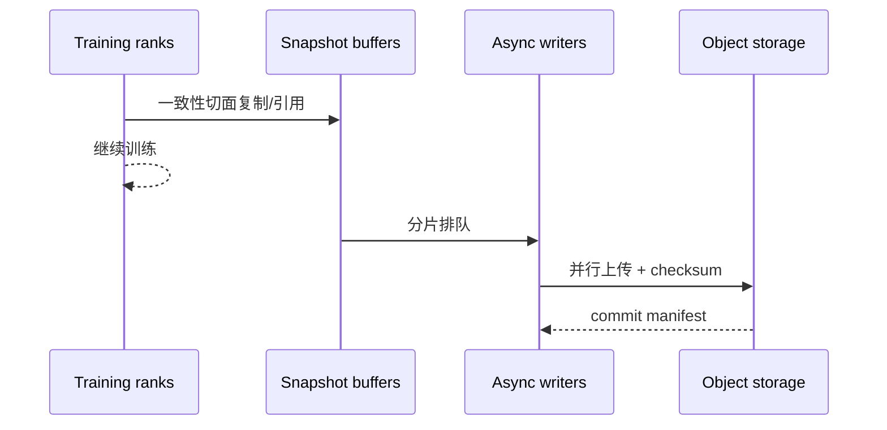

# 分布式 Checkpoint 与恢复

## 入门例子：用中断前后两张状态表定义恢复

假设 step 100 已完成 optimizer update，但保存过程只写完部分 rank 文件就中断。存在目录不等于存在可恢复的一致 checkpoint；完成标记和全局 metadata 应在所需状态就绪后才代表提交成功，具体协议以框架实现为准。

| 状态 | 为什么要保存 | 只恢复模型可能出现什么 |
|---|---|---|
| 模型、优化器、学习率进度 | 确定下一次更新 | 更新轨迹改变 |
| RNG 与数据迭代位置 | 确定后续随机性与样本 | 重复/遗漏样本 |
| 并行布局 metadata | 解释每个 shard | 改卡数后装错分片 |
| RL 特有 buffer/版本状态 | 确定轨迹是否仍可消费 | 用错旧样本或重复消费 |

实验在独立小任务中进行：连续跑一段作为对照，再保存、重启并比较接续的样本 id、step/LR、参数和指标。需要 bitwise、容差内数值一致还是统计可接受，应在实验前定义。

## 机制与实现

Checkpoint（检查点）不是简单的 `torch.save(model)`。大规模任务要同时解决：分片状态一致性、并行写入、存储峰值、拓扑变化后的 reshard、版本兼容与故障恢复时间。

## 需要保存什么

| 状态 | 是否通常需要 | 说明 |
|---|---|---|
| model parameters/buffers | 是 | 可能按 TP/PP/DP/EP 分片 |
| optimizer states | 训练恢复需要 | 通常比参数更大 |
| learning-rate scheduler | 是 | 否则训练轨迹变化 |
| random number generator state | 精确恢复需要 | CPU/CUDA/data pipeline 均可能有 RNG |
| data loader progress | 通常需要 | 避免重复/跳过样本 |
| gradient scaler | mixed precision 需要 | 影响 loss scaling |
| topology/metadata | 是 | 用于解释 shard 与版本 |

## 一致性切面

所有 rank 必须对“保存的是哪一个 step”达成一致。若某些 rank 已 optimizer step、另一些尚未，文件即使完整也不可恢复。常用办法是在安全点 quiesce，或构建 copy-on-write snapshot 后让训练继续、异步落盘。

最后写 manifest/commit marker 很重要：恢复端只加载已经原子提交的版本，避免把半套 shard 当成有效 checkpoint。

## Sharded checkpoint 与 reshard

Sharded checkpoint 让各 rank 并行保存本地 shard，避免 rank 0 聚合导致 OOM 与单点 I/O。恢复时若 world size 或 mesh 改变，需要 load-time reshard：读取逻辑全局 tensor metadata，把旧 shard 映射成新 shard。

PyTorch Distributed Checkpoint（DCP，分布式检查点）支持多 rank 并行 save/load 和 load-time reshard。兼容性仍取决于 state dict 结构、tensor key、dtype、planner 和应用版本，不能只依赖文件扩展名。

## Checkpoint 频率的期望成本

若故障平均间隔为 $M$，一次 checkpoint 花费 $C$，经典近似的最优周期与 $\sqrt{2CM}$ 同阶。直觉是：太频繁浪费 I/O，太稀疏则故障后重算多。大集群的系统级 Mean Time Between Failures（MTBF，平均故障间隔）会随组件数量增长而下降，因此 checkpoint 必须进入吞吐模型。

## 可靠性验证

一个“成功写完”的 checkpoint 仍可能不可用。必须定期做：

1. checksum 和 manifest 完整性验证；
2. 在独立 job 中实际 load；
3. 改变 DP size 的 reshard 演练；
4. 至少跑若干 step 比较 loss/optimizer continuity；
5. 注入 rank failure、storage timeout、部分文件缺失；
6. 测量 Recovery Time Objective（RTO，恢复时间目标）与 Recovery Point Objective（RPO，恢复点目标）。

## Silent Data Corruption

Silent Data Corruption（SDC，静默数据损坏）不会总以进程 crash 呈现。ECC、checksum、梯度/权重统计、loss anomaly、冗余验证与 checkpoint lineage 共同构成防线。NCCL RAS 能诊断部分 hardware/communicator 状态，但不验证模型 tensor 数值正确性。

## 数据游标与Checkpoint提交

> 范围：一个按完整更新提交数据进度的教学恢复协议，不是某个后端的默认实现。前置：[数据管线](数据管线与训练演进.md)、[分布式Checkpoint](分布式Checkpoint与恢复.md)。

标签、attention 边界与有效分母先按[数据管线的 Packing 推演](<数据管线与训练演进.md#packing的目标边界与有效分母>)确定。本节接着追踪已经构造好的 batch 如何与更新和恢复状态共同提交。

### 数据管线提前读取，不等于训练已经消费

考虑一个按成功更新边界提交的教学协议。Checkpoint 12已经提交，包含w12、m12、v12、随机数状态、学习率状态，以及已提交样本游标20。数据worker随后预取21、22，训练正在用它们计算第13次更新。

| 故障发生点 | 可见的已提交Checkpoint | 恢复后动作 |
|---|---|---|
| 21、22已预取，尚未更新 | 12，游标20 | 重建或丢弃预取，重新处理21、22 |
| 第13次反向只完成部分microbatch | 12，游标20 | 丢弃部分梯度，完整重跑13 |
| 某些rank写完Checkpoint 13分片 | 12，游标20 | 13尚不完整，不作为恢复点 |
| 13的所有必需分片持久化并提交manifest | 13，游标22 | 从下一批继续 |

若把预取游标22存成已消费位置，却恢复w12，就会漏掉21、22；若恢复w13但恢复游标20，则会重复优化这批数据。数据提交与模型状态必须来自同一逻辑边界。

### 一个可审查的分布式保存协议

先冻结或复制一致的待保存状态，再让各rank写入本次checkpoint的独立临时命名空间。协调者收集必需分片的完成状态与元数据，验证集合完整后发布manifest作为提交标志。恢复器只选具有完整提交标志的版本，不能看到某个大文件存在就采用它。

文件系统rename是否原子、对象存储如何发布manifest、异步上传何时算持久化，需要由实际存储系统保证。本页的“提交”是语义要求，不指定一种跨所有存储的原子操作。

更改DP度后的恢复还涉及样本重新分配。仅恢复一个rank本地迭代器的计数可能造成重叠或遗漏；需要能映射回稳定样本身份/全局采样状态。动态流数据可能无法严格重放，必须明确允许的重复和遗漏语义。

### 应保存哪些状态，取决于声称能恢复到什么程度

| 声称 | 必须补充的证据 |
|---|---|
| 能加载模型做推理 | 权重、模型配置、tokenizer等匹配 |
| 能继续优化 | 优化器、step、scheduler、必要精度状态匹配 |
| 样本没有静默遗漏 | 数据身份、已提交游标、预取处理规则 |
| 能复现下一步 | RNG、数据顺序、布局及实现确定性条件 |
| 改变并行度后可恢复 | 全局张量分片元数据和数据重映射验证 |

同一loss曲线大致连续只是信号，不能代替逐项验证。可先用固定小样本比较“连续两步”与“第一步保存后恢复再走一步”的参数、m/v、样本ID；GPU算子非确定性需要设定合理容差。

验证：[Packing与提交模型脚本](../examples/training_rl_walkthroughs.py)。实现背景：[Megatron状态与Checkpoint](../13_Source_Analysis/megatron/03_state_and_memory/01_data_parallel_optimizer_checkpoint.md)。

### 贯穿到当前实现

[对照模型与数据源分别保存的实现](../12_Performance_Reliability/贯穿案例_换权失败与训练恢复.md)。

## 完整推演

[数据游标与Checkpoint提交推演](<分布式Checkpoint与恢复.md#数据游标与checkpoint提交>)：预取、部分分片、完整提交和重放边界。

---

## 资料

- [PyTorch Distributed Checkpoint](https://docs.pytorch.org/docs/stable/distributed.checkpoint.html)
- [DeepSpeed Universal Checkpointing](https://arxiv.org/abs/2406.18820)
- [NCCL RAS](https://docs.nvidia.com/deeplearning/nccl/user-guide/docs/troubleshooting/ras.html)

<!-- series-nav -->

[上一篇：训练并行方案设计：从约束推出配置](<训练并行方案设计.md>) · [专题目录](<README.md>)

<!-- /series-nav -->
