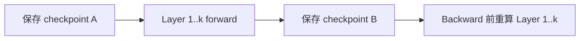

# 训练显存优化：重算、分片与 Offload

显存优化不是一张“省多少 GB”的功能表，而是三个旋钮：**缩短状态生命周期、减少每 rank 的副本、把状态移到更慢层级**。每一种优化都会引入计算、通信、I/O 或工程复杂度。

## Activation Checkpointing：用重算换保存

Activation Checkpointing（激活检查点，也称 activation recomputation）只保存选定边界的 activation，backward 时重新执行被丢弃的 forward 区间。

它减少 saved tensor，但增加 forward FLOPs（Floating-Point Operations，浮点运算次数）。边界太粗显存省得多却重算多；选择性 checkpoint 可只重算 attention/MLP 的高收益部分。随机数状态、dropout 与副作用必须保证重算一致。

## ZeRO 的三个 stage

Zero Redundancy Optimizer（ZeRO，零冗余优化器）沿 Data Parallel（DP，数据并行）group 分片模型状态：

| Stage | 分片内容 | 主要新增通信/峰值 |
|---|---|---|
| ZeRO-1 | optimizer states | update 前后参数同步/分片管理 |
| ZeRO-2 | + gradients | ReduceScatter/梯度 owner 语义 |
| ZeRO-3 | + parameters | layer 级参数 AllGather 与峰值展开 |

“理论每卡除以 DP size”只适用于被分片的静态状态。ZeRO-3 运行某层时仍需 materialize 所需参数；若 prefetch 多层、persistent small parameters 或通信 buffer 大，峰值可能明显高于理想值。

## FSDP 与 ZeRO-3 的关系

Fully Sharded Data Parallel（FSDP，全分片数据并行）与 ZeRO-3 核心思想相近：参数、梯度和 optimizer state 分片，计算前 AllGather，之后 reshard，梯度用 ReduceScatter。区别在 API、module wrapping、state dict、prefetch、mixed precision 与 runtime 细节，不能把配置名一一机械映射。

PyTorch FSDP2 的 `fully_shard` 以 DTensor（分布式张量）表达分片参数，便于 optimizer、gradient clipping 与 checkpoint 组合；实际项目仍要测试 mesh、reshard policy 和编译器兼容性。

## CPU / NVMe Offload

Offload 把参数、optimizer states 或 activation 移到 CPU DRAM，甚至 Non-Volatile Memory Express（NVMe，非易失性高速存储）设备。

$$
T_{offload}\approx\max(T_{compute},T_{transfer})+T_{unhidden}
$$

只有搬运被计算遮住且 host/NVMe 带宽足够，offload 才“便宜”。Pinned host memory 能支持异步 DMA，但过量 pin 会挤压操作系统可分页内存。NUMA placement、PCIe contention、prefetch distance 与 queue depth 都会决定结果。

上式仅适合把某个阶段划分为可重叠计算、可重叠搬移与其余串行工作；$T_{unhidden}$ 不应再次包含前两项已经计入的时间。整个训练步仍需按依赖与资源竞争求时间，不能把所有计算和所有搬移分别求和后直接取最大值。

## 激活保留、重算与卸载的联合选择

先固定模型、训练目标、有效 global batch、精度和并行布局，比较完成同一次正确更新的不同状态安排。本节用符号推导，不加入新的数值案例。选择对象是**张量两次使用之间的保存方式，以及恢复它的执行安排**；同一张量可以在不同区间采用不同策略，也可以卸载一份重算所需的边界输入，再由它重建后续激活。

### 从消费者反推需要保存什么

对前向图中的激活 $x$，记录实际 shape、dtype、所在 rank、物理存储大小及共享关系，再列出所有消费者。反向不一定需要每个前向输出；保存集合取决于导数和具体实现。只用于前向且已经完成最后一次使用的对象，可以正常释放，不需要在三种策略之间选择。

对确实需要跨越一段空闲区间的 $x$，使用下面的时间标记：

| 标记 | 含义 |
|---|---|
| $t_x^{prod}$ | 原始值已经产生、允许被复制或消费的时刻 |
| $t_x^{last}$ | 本次空闲区间之前，最后一个必要设备访问完成的时刻 |
| $t_x^{need}$ | 下一消费者按当前候选日程原本准备开始的时刻，通常是某个反向算子 |
| $t_x^{done}$ | 本次恢复后需要保留该副本的所有消费者均完成的时刻 |

这些时间由候选日程决定；增加重算、传输或等待之后，需要重新传播依赖并更新它们。多消费者、分支、流水 microbatch 或保留计算图时，可能存在多个使用区间，不能假定每份 saved tensor 只被取回一次。

逻辑 tensor 与物理分配也要分开。View、alias 或其他活跃引用可能共同持有同一存储；放弃一个保存引用，不一定释放任何物理字节。卸载协议、分配器与 CUDA Graph 的地址约束也可能延长存储寿命。这里的“释放”指空间已经可以按当前运行时约束复用，而不是只删除一个 Python 对象。

### 重算成本取决于仍然可用的边界

写出 $x=f_x(\mathcal P_x)$，其中 $\mathcal P_x$ 是其输入集合。若输入、相容权重及其他执行状态都可用，重建可以从这些输入开始；若某个父节点也被丢弃，就必须继续向上追溯，直到遇到已保留、可取回或可重新生成的边界。

记 $\mathcal R_x(S)$ 为候选计划 $S$ 下需要为 $x$ 重新执行的子图。它随保存集合变化，因而“重算 $x$ 的成本”不是张量自身的固定属性。选择性重算必须同时满足：

- 子图每个操作启动前，其全部输入已经可读；不能只保留一条分支而忽略其他依赖。
- 参数版本、随机数、dropout mask、路由选择、精度状态和副作用满足原更新的正确性要求；重复前向不能意外推进外部状态。
- 重算期间的输入、输出、临时工作区以及必要参数展开能够同时驻留。
- 必要的参数 AllGather、布局转换和通信也纳入重建路径，不能只计本地 FLOPs。

多个激活的重建子图可能共享操作。将每个张量的独立重算成本相加，会重复计算共享部分；强行只重算一次并长期保留共享结果，又可能制造新的峰值。真正要选的是保存边界和完整重建日程。[Checkmate](https://arxiv.org/abs/1910.02653)将这种张量重建问题形式化为受内存与依赖约束的优化；其最优性针对所建模型，不能直接推广为包含任意卸载、动态路由与集群争用的全局最优。

[PyTorch 的选择性激活检查点介绍](https://pytorch.org/blog/activation-checkpointing-techniques/)说明了按操作选择保存或重算的方向。昂贵矩阵运算的结果常值得保留、便宜操作常适合重算，是候选生成的启发；父节点可用性、存储共享与实际峰值仍可能改变选择。

### 卸载能否省显存，取决于两端的占用区间

先考虑未压缩、同一份完整激活的 GPU→CPU→GPU 路径。设迁出开始与完成为 $s_x^{out},c_x^{out}$，取回开始与完成为 $s_x^{in},c_x^{in}$。数据依赖至少要求：

$$
s_x^{out}\ge t_x^{prod},\qquad s_x^{in}\ge c_x^{out}.
$$

若前向消费者与复制都只读相同存储，迁出可以与这些读取重叠；源值在传输期间不能被修改或复用。设原 GPU 分配实际可释放时刻为 $f_x^G$，则

$$
f_x^G\ge\max\left(t_x^{last},c_x^{out}\right).
$$

这个下界还没有包含其他 alias、在途访问或运行时保留。CPU 目标缓冲必须在迁出开始前可用；GPU 取回缓冲必须在取回开始前分配。以 $a_x^H,a_x^{G,in}$ 表示两次目标分配时刻，有

$$
a_x^H\le s_x^{out},\qquad a_x^{G,in}\le s_x^{in}.
$$

因此 CPU 副本至少从 $a_x^H$ 保留到取回不再读取它，GPU 返回副本至少从 $a_x^{G,in}$ 占用到相关消费者完成的 $t_x^{done}$。原 GPU 副本仍在被复制时，CPU 目标已经占空间；取回尚未完成时，GPU 目标也已经占空间。带 NVMe、转换或额外暂存的路径，应增加相应对象和依赖；分块传输则逐块建立同样的生命周期。

在整块模型中，只有 $f_x^G<a_x^{G,in}$ 时，这份激活才有一段完全离开 GPU 的时间。若两份 GPU 分配短时重叠，还可能增加瞬时用量。是否降低了训练峰值，要看这段空闲与原峰值是否重合，以及此时其他对象怎样变化，不能直接把 $\operatorname{bytes}(x)$ 从总峰值中扣掉。

CPU 中存有完整副本也不意味着反向已经可以读取。令 $c_x^{ready}$ 为取回、必要转换和设备可见性全部满足的时刻，若要按当前日程无等待地消费它，需要

$$
c_x^{ready}\le t_x^{need}.
$$

在其他条件固定、消费者只差这项输入时，本地等待为 $\max(0,c_x^{ready}-t_x^{need})$；多个恢复同时晚到或日程随之改变时，不能把这些等待直接相加作为整步增量。若允许延长训练步，晚到并不必然使卸载不合法，但需要将新的等待和驻留重新计入计划。

[PyTorch saved tensor hooks 教程](https://docs.pytorch.org/tutorials/intermediate/autograd_saved_tensors_hooks_tutorial.html)展示了保存到 CPU、反向时恢复的接口，也说明恢复可能发生多次。接口负责表达保存与取回，不自动保证上述预取期限、内存峰值或所有异步生命周期条件。

### 共享链路和缓冲把多个张量耦合起来

对每个物理资源 $r$，令 $\mathcal O_r(t;S)$ 为计划 $S$ 在时刻 $t$ 占用的唯一物理分配集合，$M_r^{budget}$ 为扣除未列入集合的系统占用与必要余量后，可供这些对象使用的容量。需要逐时、逐资源满足

$$
M_r(t;S)=\sum_{o\in\mathcal O_r(t;S)}\operatorname{bytes}(o)
\le M_r^{budget}.
$$

GPU 集合包含参数、梯度、激活、重建中间值、工作区及通信暂存；CPU 集合包含卸载副本、数据准备与恢复缓冲。预分配池的空闲空间仍按实际物理分配计数，池内已分给对象的部分不重复相加；固定池内部还需单独检查同时分配量、碎片与地址限制。Pinned memory 还可设置独立配额；NVMe 容量、队列与暂存也应分别检查。

传输时间不能给每个张量各自独占同一条峰值带宽。令 $u_{j,e}(t)$ 为传输任务 $j$ 在资源 $e$ 上使用的字节率，$B_e(t)$ 为该资源在当前条件下的可用服务能力，必要的资源约束为

$$
\sum_j u_{j,e}(t)\le B_e(t),
\qquad
\int_{s_j}^{c_j}u_{j,e}(t)\,dt\ge V_{j,e}.
$$

$V_{j,e}$ 是任务 $j$ 在该接口上需要完成的字节量，$s_j,c_j$ 是其开始与完成时刻。这些约束还要与数据依赖、连接及执行能力一起成立。H2D 与 D2H 是否可以独立服务，要按实际接口判断；即使有独立复制引擎，也可能共用 PCIe 上联、主存带宽或 GPU 内存接口。参数预取、梯度通信和数据输入使用同一资源时也需要纳入需求，或从可用能力中扣除，不能重复计账。

提前取回可以减少消费者等待，却延长目标显存驻留；推迟取回节省显存，却缩短可用传输窗口。推迟迁出则使源端更晚释放。由此，“预取越早越好”和“有空闲带宽就全部卸载”都无法独立构成正确策略。

### 以完整日程比较三种选择

令 $S$ 同时包含保留集合、重建边界、迁出与取回顺序、缓冲分配及操作日程。固定上述训练合同后，一个明确目标是

$$
\min_{S\in\mathcal F}T_{step}(S),
$$

其中 $\mathcal F$ 只包含满足更新语义、生产者—消费者依赖、存储容量与资源服务约束的计划。$T_{step}$ 是该计划在这些约束下的完成时间，不是各张量额外成本的独立求和。用数据流关键路径和资源占用共同估计它，方法见[模型结构到执行成本](../design/从模型结构到执行成本.md)。

| 选择 | 成为可行候选的前提 | 需要比较的增量 |
|---|---|---|
| 保留 | 整个需要区间都能容纳它，并满足存储相容性 | 峰值附近的驻留与对其他对象的容量挤占 |
| 重算 | 可从相容且可用的边界重建，重建峰值也可容纳 | 新增计算、参数取回、通信、工作区和依赖等待 |
| 卸载 | 两端容量与传输路径可用，源端释放和取回顺序合法 | 迁出／取回、两端缓冲、路径争用和消费者等待 |

“节省字节／额外 FLOPs”最多是局部筛选指标。它既不说明释放发生在什么时刻，也不反映重建父节点、跨设备搬移和共享缓冲。类似地，降低 byte·s 驻留积分不等于降低峰值；原峰值被削低后，新的峰值可能出现在反向重建或参数展开阶段。

候选之间还存在互相改变成本的情况：保留一个边界输入，可能使多份下游激活都能低成本重建；卸载该边界，又会把它的取回加入所有相关重建的前置条件。因此应对修改后的完整集合重新计算峰值和时间，再淘汰不可行或同时更慢、更占资源的方案。不能依据第一次计算的逐张量排名一直删到显存够用。

### 如何接入并行训练与实际实现

1. 从反向公式与执行图列出真正需要跨区间保存的值，标明共享存储、参数版本和随机状态，确定不能丢失的重建边界。
2. 沿当前 PP／microbatch 日程标记使用、分配和释放，找到限制容量的时段；先处理该时段内可实际回收的存储。
3. 为候选加入重建子图或迁出／取回路径，重新安排源端释放、目标缓冲与预取；跨 rank 的必要通信也加入依赖。
4. 逐 GPU、host、共享链路和缓冲池检查容量及服务约束，计算新的整步完成时间。重算放进流水气泡也要检查它是否延迟通信或其他 microbatch，不能将气泡视作无条件免费的资源。
5. 若要用释放的显存增加 microbatch 或改变并行布局，将其视为外层新候选，重新计算使用区间、通信和梯度累积；不能保留旧日程的重叠收益。

该流程用于解释和筛选方案，不声称手工启发式总能找到全局最优。固定实现的挂接点见[Megatron 显存与 offload 走读](../13_Source_Analysis/megatron/03_state_and_memory/03_memory_determinism_cuda_graph.md)；布局和日程联合搜索见[自动并行代价模型](../08_Parallelism/自动并行与代价模型.md)。理论上的候选还需核对当前版本是否允许对应组合，以及数值、完成事件和生命周期是否符合契约。

这部分承接[《深入理解 AI Infra》§10.2.2–10.2.3](https://bojieli.github.io/ai-infra-book/manuscripts/10-%E8%AE%AD%E7%BB%83%E7%B3%BB%E7%BB%9F.html)从反向消费者和缓冲使用时间分析状态的思路，进一步将三类选择放入同一个依赖与资源模型。上述关系是理论约束；没有新增设备实测或改变原有算例。引用的一手接口资料于 2026-10-13 核对。

## 组合策略的优先顺序

1. 先确认是否是泄漏/碎片/异常峰值，而不是模型本体太大；
2. 开 mixed precision、memory-efficient attention 与算子 fusion；
3. 用 checkpoint 控制 activation；
4. 用 ZeRO/FSDP 分片模型状态；
5. 再考虑 CPU/NVMe offload；
6. 最后根据端到端吞吐调 bucket、prefetch 与 persistence。

这不是绝对规则：长序列可能 activation 第一，超大模型可能参数分片第一。

## 一个选择例子

70B 模型在 8×80GB 上 OOM：

- 如果静态 model states 已超过总显存，checkpoint 无法解决，必须 TP/PP/ZeRO-3/FSDP 或 offload；
- 如果短序列可跑、长序列 OOM，优先查 activation 与 attention implementation；
- 如果只在 optimizer step OOM，查 master weights、foreach optimizer temporary 与 state 初始化；
- 如果第一个完整 step 后 OOM，查 gradient/optimizer lazy materialization；
- 如果运行数百 step 后缓慢增长，查 tensor reference/graph retention，而不是立刻调 allocator。

## 评价维度

同时报告 peak HBM、tokens/s、Model FLOPs Utilization（MFU，模型浮点运算利用率）、network/PCIe traffic、CPU usage、checkpoint time 与恢复时间。只报告“可训练”会掩盖 3 倍吞吐损失。

## 概念辨析

### 分布式训练：单卡也保存激活值，TP / PP 到底额外多了什么？

**问题：**单机单卡训练本来就需要保存 activation。那多卡 Tensor Parallel（TP）和 Pipeline Parallel（PP）相比单卡，究竟额外保存了哪些 activation？

#### 核心结论

- “训练显存远大于参数量”并不是分布式训练才有的现象。单卡训练本身就要保存参数、梯度、优化器状态、反向传播需要的激活值，以及临时 buffer。

- TP 的额外代价主要来自：部分 activation 在多个 TP rank 上复制（replication），以及 collective communication 需要的通信 buffer。

- PP 的额外代价主要来自：pipeline boundary tensor、通信 buffer，以及为了让流水线保持并行而同时保留多个尚未 backward 的 microbatch activation（activation stashing）。

#### 为什么单卡也必须保存 activation？

以线性层 Y = XW 为例，反向传播计算 dL/dW 时需要 forward 阶段的输入 X。 因此 forward 结束后不能把所有中间结果立即释放；autograd 会保留 backward 所需的 tensor。

#### TP：参数被切开，但某些 activation 仍然复制

以 Column Parallel Linear 为例：W 按列切到多个 GPU，但输入 X 往往需要在 TP group 的每个 rank 上都可见。

| **项目**          | **单卡**         | **TP=2（示意）**                                        |
|-------------------|------------------|---------------------------------------------------------|
| 参数 W            | 1 × W            | W/2 + W/2（全局仍约等于 W）                             |
| 输入 activation X | 1 × X            | GPU0: X；GPU1: X（全局可能是 2 × X）                    |
| 跨卡通信 buffer   | 无 TP collective | AllReduce / AllGather / ReduceScatter 等需要额外 buffer |

因此，TP 并不是“多出一种 activation”，而是原本单卡的一些 activation 在多 rank 上被复制，或者为 collective communication 产生额外的中间 buffer。Sequence Parallel（SP）的一个重要目的，就是减少这类在 TP rank 间重复保存的 activation。

#### PP：关键是多个 in-flight microbatch 的 activation stashing

如果只有一个 microbatch，PP 只是把不同层放到不同 GPU，上游 stage 的输出跨设备发送给下游 stage；从全局 activation 总量看并不一定显著增加。

但真正高效的 pipeline 会同时让多个 microbatch 处于流水线中。某个较早的 stage 可能已经完成 MB1、MB2、MB3、MB4 的 forward，却还没等到对应 backward，于是必须同时保留这些 microbatch 的激活值。

> **记忆公式（概念级）**
>
> PP 某个 stage 的 activation 峰值 ≈ 每个 microbatch 的 activation × 同时尚未完成 backward 的 microbatch 数量。

#### 术语：Pipeline Bubble（流水线气泡）

Bubble 指 pipeline 中因为数据依赖、流水线填充（fill）和排空（drain）等原因，某些 stage 暂时没有可执行工作而处于空闲的时间片。Bubble 越大，设备越多时间在等，pipeline 利用率越差。

- GPipe、1F1B、Interleaved 1F1B、Zero-Bubble 等 schedule，本质上都在不同程度地优化“什么时候做 forward / backward”，以减少 bubble。

- 优化 schedule 不只影响吞吐，也会影响 activation stashing：越多 microbatch 同时悬而未决，显存压力通常越大。

#### 一句话记忆

> **TP vs PP**
>
> TP：重点记“activation replication + collective buffer”。
>
> PP：重点记“pipeline boundary + 多 microbatch activation stashing + bubble”。

## 用状态生命周期组织优化，而不按开关堆叠

先区分常驻参数状态、跨 microbatch 的梯度、等待反向的激活和临时展开缓冲。分片针对副本，重计算针对可重建激活，Offload 针对可迁移状态；它们处理的对象不同。

组合后峰值未必等于各项独立收益相加：预取增加同时驻留量，重计算延长 step，卸载需要主存和传输缓冲。用一条时间线标出分配、消费与释放，才能识别新的重叠峰值。

完整选择条件见前文[联合选择](#激活保留重算与卸载的联合选择)：先检查重建依赖和迁移生命周期，再用整步日程比较容量与时间。

相关：[存储物理基础](../00_Physical_Foundations/存储器件与层次.md)、[自动微分](../01_Math_Numerics/计算图与自动微分.md)、[状态分片](../08_Parallelism/ZeRO与FSDP.md)。

---

## 资料

- [DeepSpeed ZeRO](https://www.deepspeed.ai/tutorials/zero/)
- [PyTorch FSDP2 Tutorial](https://docs.pytorch.org/tutorials/intermediate/FSDP_tutorial.html)
- [PyTorch `fully_shard`](https://docs.pytorch.org/docs/stable/distributed.fsdp.fully_shard.html)
- [torchtune Memory Optimizations](https://docs.pytorch.org/torchtune/stable/tutorials/memory_optimizations.html)

<!-- series-nav -->

[上一篇：训练数据管线：从样本到持续供给的 microbatch](<数据管线与训练演进.md>) · [专题目录](<README.md>) · [下一篇：训练并行方案设计：从约束推出配置](<训练并行方案设计.md>)

<!-- /series-nav -->
