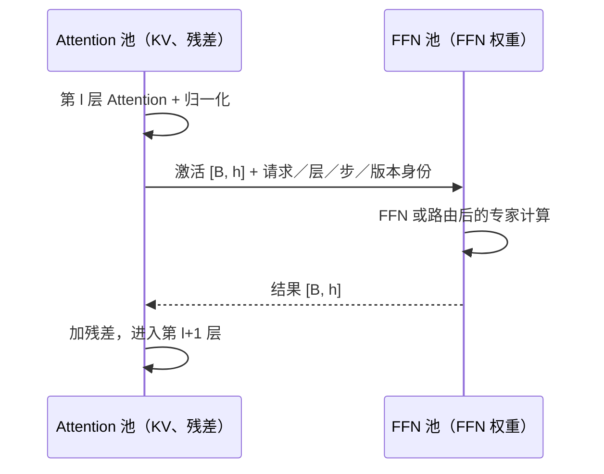

# Attention 与 FFN 分离的边界：每层都要付的通信能否换来收益

> 类型：系统设计扩展。前置：[Transformer 执行与 KV](Transformer执行与KV基础.md)、[推理并行方案设计](推理并行方案设计.md)、[PD 分离案例](案例_Prefill-Decode分离.md)。设计入口：[从需求到部署](../design/README.md)。

Attention 需要会话的历史状态，FFN 可以对当前 token 的隐藏向量做计算。两者在批量、存储容量和算术强度上的需求可能不同，因而可以由不同的设备池执行。不过，每一层的 FFN 输出都处于后续计算的依赖链上。拆分的收益要支付逐层激活传输、启动、同步和排队成本。

本篇所有时间、带宽与规模均为**解析教学参数，不是引擎或硬件基准**。先以简单的稠密模型把边界算清，再讨论 MoE 与流水。

## 1. PD、AF 和 EP 改变的是不同边界

| 方式 | 计算如何分工 | 主要交接数据 | 交接频率 |
|---|---|---|---|
| PD：Prefill–Decode 分离 | 按输入处理和后续生成阶段分工 | 前缀 KV 与请求状态 | 简化情况下每次阶段切换一次；多轮或迁移可能多次 |
| AF：Attention–FFN 分离 | 每层 Attention 与 FFN 在不同池执行 | 当前隐藏状态与 FFN 结果 | 每层、每次模型调用都发生 |
| EP：Expert Parallelism | 专家分布在多个设备上，按路由派发 token | 专家输入、输出及路由元数据 | 每个 MoE 层发生，量与路由、top-k、局部性相关 |

EP 可以在共置的模型实例内部实现，也可以放在独立 FFN 池中，因此不等同于 AF。PD 也可以和 AF 组合，组合后每种交接都要单独记账。

[MegaScale-Infer](https://arxiv.org/abs/2504.02263)是将 Attention 与 FFN 分工用于 MoE 服务的一项具体研究，并用 micro-batch 流水组织工作。它说明这种设计存在实际实现路径；其收益依赖论文的模型、负载与系统，不能直接替代本部署的测量。

## 2. 拆分后谁拥有状态

考虑一种明确的实现边界：Attention 池保存 KV、Attention 权重和残差，执行 Attention 后的归一化，再把 FFN 输入送出；FFN 池保存 FFN 权重，返回与隐藏维度相同的结果。Attention 池加回残差，然后进入下一层。

这里 FFN “无状态”仅指它不保存每条会话的历史 KV。权重版本、在途激活、临时工作区、路由结果仍是状态，仍需要容量与正确性管理。返回结果必须匹配请求、层号、生成步和模型版本；取消请求后，迟到结果不能写入已复用的槽位。

若归一化、残差或最终输出头放在别处，传输边界会改变。若两池内部采用不同 TP 布局，还可能需要 gather、reduce 或重排；下面的两次传输模型没有包含这些操作。

## 3. 先算单次 decode 的传输账本

设有 $L$ 层，decode 批量为 $B$，隐藏维度为 $h$，传输精度每元素 $b$ bytes。每层发送一次 $[B,h]$ 激活并返回同样大小结果，则一次 decode 调用的数据量为：

$$
D_{AF}=2LBhb.
$$

设每个方向的一次交接具有固定启动与同步开销 $\alpha$，有效 payload 带宽为 $\beta$，并假设同一批次的所有层按依赖串行推进、两次传输也串行，则：

$$
T_{comm}=2L\alpha+\frac{D_{AF}}{\beta}.
$$

这里 $\alpha$ 覆盖规定边界内的发起、就绪与交接成本，必须由同样的 API 和计时边界测得；不能拿裸链路 ping 的一半直接代入。有效带宽也应使用并发运行、实际消息大小下的值。

设 $L=32$、$B=32$、$h=4096$、$b=2$：每方向每层发送 256 KiB，64 次交接共 16 MiB。若 $\alpha=8$ μs、$\beta=25$ GB/s，则：

$$
T_{comm}=64\times8\ \mu s+\frac{16\times2^{20}}{25\times10^9}
=1.1831\ \mathrm{ms}.
$$

即使每条消息只有 256 KiB，启动项仍占 0.512 ms。双向链路可以让不同批次的相反方向流量重叠，但同一批次的返回依赖 FFN 计算，不能直接把它的来回数据时间除以二。

## 4. 计算节省多少，才足以支付交接

在此固定 batch 下，假设优化后的共置实现每层 Attention 耗时 90 μs、FFN 耗时 150 μs，共 7.68 ms。分离后，适合各自负载的设备或布局让它们变成 75 μs 和 90 μs，共 5.28 ms。因此分离的纯计算节省为 $\Delta=2.40$ ms。

先不考虑额外排队，净收益条件为：

$$
2L\alpha+\frac{D_{AF}}{\beta}<\Delta.
$$

| 条件 | 通信时间 | 分离后总时间 | 相对共置 7.68 ms |
|---|---:|---:|---|
| 25 GB/s，8 μs | 1.1831 ms | 6.4631 ms | 节省 1.2169 ms，约 15.85% |
| 5 GB/s，8 μs | 3.8674 ms | 9.1474 ms | 更慢 |
| 25 GB/s，40 μs | 3.2311 ms | 8.5111 ms | 更慢 |

固定 $\alpha=8$ μs 时，带宽阈值为：

$$
\beta>\frac{16\times2^{20}}{0.00240-64\times8\times10^{-6}}
\approx8.886\ \mathrm{GB/s}.
$$

固定 25 GB/s 时，启动开销需要小于 27.014 μs。若单次启动达到 37.5 μs，64 次启动已吃掉全部 2.4 ms 计算收益，此时再提高带宽也无法获胜。

这组阈值只对指定形状、计算时间和执行边界成立。batch 增大时，激活流量线性增加，FFN 的权重复用也可能改善；batch 变小时，启动项不随字节一起缩小。不能保持计算时间不变，仅修改 $B$，就宣称找到所有负载下的最优 batch。

## 5. 延迟缩短，仍不等于相同卡数下吞吐增加

上述单批次比较中，共置用一张卡，分离用一张 Attention 卡加一张 FFN 卡。假设两种角色都属于相同价格的资源单位，固定预算为 8 张卡：

- 8 个共置副本的理想吞吐为 $8\times32/0.00768\approx33,333$ token/s。
- 4 个分离配对，如果每对一次仅处理一个 batch、完全不交错，其理想吞吐为 $4\times32/0.0064631\approx19,805$ token/s。

这是同一批量、无排队、全体请求持续活跃的教学口径。单批延迟更低，但成对占用使未流水化方案的单位资源吞吐下降。实际异构设备价格与容量不同，应按各自资源价格和配置核算，不能拿“张数”当作天然公平的成本单位。

利用多个独立 micro-batch，可以让一个批次的 Attention 与另一个批次的 FFN 重叠。此时需要先为各资源计算每批次的占用需求：

$$
d_A=32\times75\ \mu s=2.40\ \mathrm{ms},\qquad
d_F=32\times90\ \mu s=2.88\ \mathrm{ms}.
$$

以 batch/s 为吞吐单位，容量上界满足：

$$
\lambda_{batch}\leq\min\left(\frac{n_A}{d_A},\frac{n_F}{d_F},\frac{\beta_{aggregate}}{D_{AF}}\right).
$$

如果 4 张 Attention、4 张 FFN 共用 25 GB/s 的数据通道，三个上界换算为 token/s 分别约为 53,333、44,444 和 47,684，所以 FFN 给出 44,444 token/s 的乐观上界。这不是预测结果：它没有计入启动调度能力、流水填充、重复进入各层的依赖、负载不均、额外工作区和长尾。实际是否能超过 33,333 token/s，需要用完整排程与测量验证。

micro-batch 也不是越小越好：更多分块创造重叠机会，却增加启动次数，并可能降低 FFN GEMM 效率。把原来 $B=32$ 的计算时间直接套给 $B=4$，会高估流水收益。

## 6. MoE 的收益来自专家复用，风险来自路由偏斜

独立 FFN 池可以让来自多个 Attention 实例的 token 汇聚到相同专家，增加权重复用，并让专家容量与 KV 容量分别扩展。但每个专家收到多少 token 由路由决定，不能用全池平均 batch 代替最忙专家的排队与最冷专家的小矩阵效率。

若每 token 选 $k$ 个专家，并且为每个远端专家分别发送完整隐藏向量、分别返回完整结果，再在 Attention 侧合并，那么某一 MoE 层的粗略 EP 数据量为：

$$
D_{EP}\approx2kBhb(1-p_{local}),
$$

其中 $p_{local}$ 是专家分派中不经过所考察网络边界的比例。这是明确实现下的流量模型：若同一目标设备先合并结果、复用相同输入或采用其他传输格式，流量会不同；路由元数据和 padding 也需要另算。

因此，“AF 每层两次 $[B,h]$ 传输”只描述 Attention 池与 FFN 池的外层边界。若 FFN 池内部另有 EP 分发，就需要追加内部流量；若直接把 Attention 端接到每个专家，边界本身会变成 fan-out/fan-in，不能把两种流量模型叠加或抵消得含糊不清。相关机制见 [Expert Parallelism](../08_Parallelism/ExpertParallelism.md)。

## 7. 用一张完整对照表做决定

先对共置方案完成合理的批处理、算子和并行调优，再记录同一请求分布下的质量、TTFT、token 间隔和满足约束的完成量。分离方案应同时记录两池队列、实际消息大小、通信与计算占用、每卡内存峰值、模型版本以及失败重试。

长上下文让 Attention 的状态读取增加，专家规模让 FFN 容量压力增加，都可能提高独立放置的价值；小批量、低到达率、较慢路径和很紧的单请求期限，则可能让启动、等待与资源空转主导。设备数、计算位置、工作区、通信、质量和成本都通过约束后，才有足够依据选择 AF。

复算：[`hardware_pooling.py`](../examples/hardware_pooling.py)，从仓库根目录运行 `python3 docs/ai_infra/examples/hardware_pooling.py`。问题组织参考《深入理解 AI Infra》的[第 9 章：分布式推理](https://bojieli.github.io/ai-infra-book/manuscripts/09-%E5%88%86%E5%B8%83%E5%BC%8F%E6%8E%A8%E7%90%86.html)；本篇的参数、净收益阈值和相同资源对照为独立教学设定。
