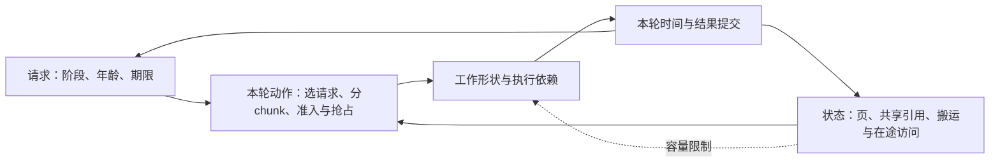

# 批处理、排队与推理调度的演进

> 相关基础：[Transformer](../02_Model_Architecture/Transformer与Attention基础.md)、[KV 内存系统](推理内存系统.md)。

## 服务优化的目标

TTFT（Time to First Token，首 token 延迟）包含首 token 前的等待和执行；ITL（Inter-Token Latency，token 间隔）描述相邻输出 token 的间隔；TPOT（Time Per Output Token，每输出 token 时间）通常是按特定口径计算的平均每输出 token 时间。指标需声明是否包含网络、tokenization 和首 token。

吞吐是单位时间完成的工作量，goodput 进一步限制满足延迟和成功条件的有效工作。提高 batch 可能增加吞吐，也可能增加等待或单步时间。

### 一条请求的三种延迟

假设请求在 0 ms 到达，首 token 在 100 ms 返回，后续两个分别在 120、170 ms 返回。TTFT=100 ms，两个 ITL 为 20、50 ms，平均为 35 ms。若 TPOT 采用“首 token 之后的时长除以后续 token 数”的口径，则为 $(170-100)/(3-1)=35$ ms；端到端耗时是 170 ms。仅输出一个 token 时，这个 TPOT 分母为零，应记为不适用。

服务目标 SLO（Service Level Objective）为延迟或成功率设定可检验的门槛。P99 是第 99 百分位，例如大约 99% 请求不超过该延迟；它不能由平均值替代。Goodput 应明确是满足哪些 SLO 的请求数/秒或 token 数/秒。

## 从固定 batch 到迭代调度

固定 batch 把一组请求绑定执行，不同输出长度会导致完成时间差异。迭代级调度允许在生成步骤之间替换已完成请求，使执行集合随请求生命周期变化。

新的责任是维护每条请求的状态、KV 所有权、采样参数和取消行为。一个请求结束后，其资源可能部分释放、部分进入可复用缓存，不能简单按请求数推断显存。

## Prefill 与 Decode 的竞争

长 prefill 与 decode 的工作形态不同。将 prefill 分块可以在调度点安排其他工作，减少长段占用对交互延迟的影响；但分块大小影响效率、调度开销和缓存压力。

PD（Prefill–Decode）分离允许两阶段分别配置资源，却需要传递状态并处理路由、带宽和阶段配比。它与 chunked prefill 是不同设计轴，可以按具体架构组合，不能写成单向替代关系。

## 用一个共同模型理解每轮调度

连续批处理的决策对象是**本轮执行哪些尚未完成的工作**，不是给请求一次分好 batch 就结束。[Orca](https://www.usenix.org/conference/osdi22/presentation/yu)的迭代级调度提供了这个抽象；请求状态与设备执行之间还必须满足下面的约束。

在调度时刻 $t$，对请求 $i$ 记录：未处理输入 $p_i$、已提交 KV 长度 $h_i$、已采样但尚未写入 KV 的 token、共享页引用、等待年龄、首 token／后续 token 的期限，以及取消或恢复状态。未来输出长度通常未知；估计输出长度可以影响排序，不能当作已知终止位置。全局状态还包含空闲页、缓存页、设备在途访问和已经开始的搬运。

一次动作 $a_t$ 选择 decode 集合 $D_t$、每条 prefill 的 chunk 长度 $c_i$，并决定接纳、抢占、取回或淘汰哪些状态。同一请求在本轮只属于一种执行阶段。下面只讨论普通逐 token decode；推测解码还需增加验证位置、未提交分支和回滚空间。



### Token budget、显存和时间是三类约束

一个常见的逻辑 token 约束为

$$
\sum_i c_i+|D_t|\leq N_{budget},\qquad 0\leq c_i\leq p_i.
$$

它约束送入本轮 forward 的有效位置数。Graph bucket 的补齐行、推测验证位置和后端的其他限制另行计数。相同 token 总数下，历史长度不同，Attention 读取不同；prefill 把较多查询一起执行，能摊薄权重读取，decode 则由少量新查询反复访问历史。新输入数不能单独决定本轮时间。

例如在完整因果 Attention 中，若新 chunk 接在已有 $h_i$ 个 KV 位置之后，每层、每个查询头本轮需要的有效 query–key 对数为

$$
A_t=\sum_{i:c_i>0}\left(c_i h_i+\frac{c_i(c_i+1)}2\right)
+\sum_{i\in D_t}(h_i+1).
$$

第一项来自 chunk 内各查询看到逐步变长的上下文，第二项来自单个 decode 查询。投影的有效位置数仍是 $\sum_i c_i+|D_t|$。这把两种工作形态放进同一个模型：即使位置预算相同，Attention 工作也会不同。查询头数、head dimension 再决定对应的矩阵工作；GQA 的 KV 共享、缓存与 tiling 则决定实际读取，不能把逻辑对数直接乘成 HBM 字节。滑动窗口或其他 mask 应改用各查询实际可见的键集合。

显存约束应对实际同时存活的物理对象求峰值：

$$
\max_{\tau\in\mathrm{iteration}}\left[
M_{weights}+M_{KV,physical}(\tau)+M_{workspace}(a_t,\tau)
+M_{inflight}(a_t,\tau)\right]\leq M_{device}.
$$

这里 $M_{device}$ 指扣除其他长期运行时占用和必要余量后，可供所列对象使用的容量。各项应互不重复：KV 按唯一物理页计，$M_{inflight}$ 只计尚未归入 KV 池的额外搬运或双缓冲；allocator 已保留而暂未使用的块也不能当作可随意重分配的空间。多卡实例需逐卡检查，不能用总空闲容量掩盖某卡超限。最后一个引用释放且设备结束访问后，页才可重新分配。一个新 token 是否增加物理页，取决于尾页、写时复制和预留策略；所以 token budget 通过不代表可以执行。

时间则由选定工作形成的计算与传输依赖决定，记为 $T_{iter}(a_t,s_t)$，其中 $s_t$ 是当前状态。混合迭代通常既不等于各请求独跑时间之和，也不能直接取 prefill 与 decode 独跑时间的最大值。批内复用、kernel 形状、资源争用和同步会一起改变它。

若已接纳的请求 $i$ 距上次输出已过去 $e_i$，下一次输出必须在间隔上限 $\delta_i$ 前返回，那么本轮推进它至少需要检查

$$
e_i+T_{iter}(a_t,s_t)+T_{return,i}\leq\delta_i.
$$

没有被选入本轮的 decode 请求还要等待后续轮次，因此“本轮执行很快”不保证所有在途请求的 ITL。对尚未完成 prefill 的请求，TTFT 还包含后续 chunk 的等待与执行；只限制当前 chunk 的时间同样不够。

### Chunk 改变可调度边界，也改变有效效率

缩短 chunk 会更早回到调度器，让紧急 decode 有机会前进；代价是更多提交、同步以及可能降低的矩阵效率。增大 chunk 则可能提高本轮吞吐，却让等待首 token 或下一个 token 的请求更久得不到服务。因此 chunk 应在剩余时间预算、活跃 decode 的历史读取、KV 可分配量和后端执行形状之间选择，不能只由输入长度决定。

一种策略是先为需要及时推进的 decode 预留位置，再把可承受的 prefill 工作装进剩余预算；它仍需防止新请求的 prefill 长期饥饿。[Sarathi-Serve](https://arxiv.org/abs/2403.02310)研究了分块 prefill 与持续推进 decode 的调度组合。此类策略的收益来自实际混合步的效率，不能把未用矩阵算力视为 prefill 可以无代价使用的容量：两阶段还可能竞争 HBM、执行单元和临时空间。

## 排队怎样反馈到 KV 与抢占成本

排队发生的位置决定状态成本。未接纳请求可能只占前端内存；已部分 prefill、暂停 decode 或等待工具的请求可能仍占 GPU KV。故等待时间增加不只影响延迟，还会延长状态驻留，减少新请求可用容量，进一步增加等待。若这触发抢占，重做和搬运又成为新的服务工作：

```text
等待变长 → 状态驻留变长 → 可接纳容量减少
    ↑                           ↓
更多待完成工作 ← 重算／取回 ← 抢占或换出
```

不能仅凭队列里还有多少请求，推导还剩多少计算或显存。稳态资源积分见[负载、状态与资源需求](../design/负载状态与资源需求.md)；过载时应直接追踪进入、完成、取消和恢复的工作量。

| 动作 | 立即改变什么 | 继续执行前必须支付什么 |
|---|---|---|
| 只暂停计算 | 降低当前执行负载，KV 仍驻留 | 后续排队，通常没有状态重建 |
| 丢弃可重建 KV | 在合法回收点释放相应页 | 从可用缓存边界重放已确定的输入与输出 |
| 换出 KV | 将状态迁移到较慢存储层 | 写出、保留、取回、安装，以及这些路径的排队 |
| 取消／拒绝 | 停止该请求的后续工作 | 已提交操作排空与清理；减少完成量，改变服务结果 |

重放要恢复的是**已经确定的上下文**，不能重新采样已交付 token 后声称同一请求已恢复。共享页未必随某个请求被抢占而释放，仍有引用的页不能算作回收收益。[PagedAttention 论文](https://arxiv.org/abs/2309.06180)将重算、交换与共享状态放入服务内存管理的讨论；某个引擎版本具体支持哪些路径，需要以实现为准。

在同一存储边界、同一已提交状态下，可把串行的 swap 恢复代价写成

$$
C_{swap}=T_{write}+T_{read}+T_{install}+T_{queue},
$$

并与丢弃后的 $C_{recompute}=T_{replay}+T_{queue,replay}$ 比较。若写出能藏在等待窗口中，应只把暴露段放进请求关键路径，但写出字节和设备占用仍计入资源需求。对未来可能取消、永不恢复的请求，还要计入恢复概率和保留成本。两条路径的选择同时受当前能释放多少物理空间、未来期限和共享路径能力约束，不能仅按每 GiB 的复制时间选。

## 不同层级优化什么，怎样形成在线决策

| 决策层 | 直接可控制的对象 | 需要带回来的反馈 |
|---|---|---|
| 路由／准入 | 请求去哪个实例，何时接纳或拒绝 | 缓存实际可用性、剩余工作、状态容量与完成时间估计 |
| 实例调度 | decode 集合、prefill chunk、抢占与恢复 | 每轮耗时、物理页变化、请求等待年龄与期限余量 |
| 资源池配置 | 副本数、并行度、P/D 配比 | 各阶段需求、链路争用、启动时间和未完成任务 |

优化一个目标请求的响应时间、优化全部请求的联合达标量、优化单位达标任务成本，会产生不同决策。缓存亲和路由可能减少总工作却延迟一个紧急请求；短请求优先可能提高完成数却让长请求长期等待。应明确 tenant 权重、最低服务份额或等待上限，并同时报告 offered、admitted 和合格完成量，避免通过只接纳容易请求美化结果。

在线决策面对未知输出、未来到达和缓存失效，通常只能滚动估计。每轮更新状态与代价，先排除容量及已承诺期限明显不可行的动作，再按既定目标选择；为时间估计误差留余量，并在流量改变后重新调整。局部贪心不能保证长期最优，尤其不能反复抢占同一批请求而把重算需求越推越高。

比较 PD 与共置时，两边都应采用相容的调度能力和任务合同。共置的连续合批／分块 prefill 可能利用批内复用并减少状态传输；PD 可以分别选阶段配置、隔开部分排队，却增加交接与配比约束。应把这些收益和代价代回同一个 $T_{iter}$、状态与达标目标，不能先让共置等待整批排空，再将全部差额归因于分离机制。现有[推理方案设计](推理并行方案设计.md)中的固定日程适合说明约束，推广到其他调度器时必须重新检查结论。

这一共同模型承接[《深入理解 AI Infra》第 3 章](https://bojieli.github.io/ai-infra-book/manuscripts/03-%E6%8E%A8%E7%90%86%E4%B8%8E%E8%AE%AD%E7%BB%83%E8%B4%9F%E8%BD%BD.html)的任务需求与状态寿命、[第 8 章](https://bojieli.github.io/ai-infra-book/manuscripts/08-%E6%8E%A8%E7%90%86%E4%BC%98%E5%8C%96.html)的迭代调度，以及[第 9 章](https://bojieli.github.io/ai-infra-book/manuscripts/09-%E5%88%86%E5%B8%83%E5%BC%8F%E6%8E%A8%E7%90%86.html)的实例与资源池分工；上述符号用于组织约束，不指定某个引擎的策略。

## 队列不是免费的缓冲

稳定条件下，Little 定律 $L=\lambda W$ 将平均在系统请求数 L、有效到达率 λ（请求/秒）与平均停留时间 W（秒）联系起来。它不是任意过载系统的容量预测公式，也不直接给出 P99。

示意：稳定完成 20 req/s、平均停留 0.5 s，则系统平均约有 10 条请求。若持续到达率超过可完成率，又不拒绝或限流，队列将增长，原来的稳定平均不再适用。

## 缓存命中与负载均衡

将请求路由到持有前缀的 worker 可以减少重算，但可能集中负载。KV-aware routing 要同时考虑可复用状态、队列、容量和迁移成本。请求级命中率相同，也可能因命中前缀长度不同产生完全不同的收益。

## 演进对照

| 方法 | 针对的问题 | 新约束 |
|---|---|---|
| 动态/连续批处理 | 不等长请求造成执行空位 | 每请求状态管理 |
| KV 分页 | 动态容量浪费 | 块表与内核访问 |
| Prefix reuse | 重复前缀计算 | cache key、引用、淘汰 |
| Chunked prefill | 长 prefill 干扰 | 粒度与效率 |
| PD 分离 | 阶段资源耦合 | KV 传输、配比与故障 |

论文入口：[Orca](../papers/06_Orca与Continuous-Batching论文详解.md)、[SGLang](../papers/03_SGLang-RadixAttention论文详解.md)、[DistServe](../papers/07_DistServe与Prefill-Decode分离论文详解.md)。实现入口：[SGLang Scheduler](../13_Source_Analysis/sglang/02_runtime_core/01_scheduler_and_batch.md)。


## 数值展开运行时：请求队列、Token Budget、CUDA Graph 与结果返回

> 本页构造一个支持混合prefill/decode的调度器，不对应某个引擎的精确源码。token budget、页容量与延迟分别核算。相关：[调度原理](批处理排队与调度演进.md)。

### 初始请求

A有5个prompt token待prefill；B处于decode，已有4个token的KV和1个已采样但尚未写KV的token；C有2个prompt token待prefill。每轮最多处理6个输入token，假设这两轮KV分配均可满足，A的prefill chunk上限3。

“处理6个输入token”不是承诺同样耗时。长历史decode与短prompt prefill的访存和attention工作量不同，budget只是这个调度策略的一项约束。

### 两轮批次如何形成

| 轮次 | 请求 | 输入到forward的token数 | forward后的KV变化 | 可采样情况 |
|---|---|---:|---|---|
| 0 | B decode | 1 | 4→5 | 采出下一个token，暂不计入KV |
| 0 | A prefill chunk | 3 | 0→3 | prompt未处理完，不对用户提交生成token |
| 0 | C prefill | 2 | 0→2 | 可由最后位置logits采出首token |
| 1 | B decode | 1 | 5→6 | 再采一个 |
| 1 | C decode | 1 | 2→3 | 消费上轮首token，再采一个 |
| 1 | A剩余prefill | 2 | 3→5 | 完成prompt并采出首token |

轮0总token数6，轮1总数4。每请求的KV长度、输入token数、输出token数是三种计数。把采样出的token立即加到已计算KV长度，会令下一轮位置和slot偏移错误。

### 批次元数据与设备依赖

调度器需要构造request到batch行的映射、位置、序列长度、KV slot、mask以及采样参数。设备侧准备输入后，模型执行消费这些buffer；采样消费logits；结果回传后再更新请求状态。

```text
选择请求 → 预留KV → 建立batch映射 → 写输入buffer
 → 模型执行 → 采样 → 结果就绪 → 更新请求/发送结果 → 下一轮
```

实现可以重叠不同批次的host准备与设备执行，但不能让下一批输入写入仍被上一批读取的同一buffer。双缓冲或事件依赖必须与buffer所有权匹配。

### 为什么有token预算仍可能无法接纳

KV按页分配时，处理一个新token可能需要整页。已有长度4、页大小4的B，下一步就需要一页；长度3的请求还能使用当前尾页。相同新增token数不代表相同新增物理容量。

调度器还可能为lookahead（为后续步骤提前准备）或推测解码预留额外空间。不能先把请求选入batch，再让设备执行途中发现没有足够slot；不足时应执行明确的排队、抢占、重算或拒绝策略。

### CUDA Graph 的逻辑批量与物理批量

CUDA Graph 把一组 GPU 操作及依赖预先记录（capture，捕获），随后 replay（重放），以减少重复提交的开销。这里不是自动微分图，也不意味着模型计算结果被缓存。Batch bucket 指为某个批量大小准备的执行档位，与 DDP 的梯度通信桶不是同一种对象；dummy 是不对应真实请求的占位行。

再考虑独立的纯decode轮次：3条有效请求，缓存的graph只提供batch bucket=4。可以用4行静态buffer，其中3行有效，1行为合法dummy，并确保其位置、KV地址和输出处理满足实现要求。

batch padding改变了物理执行工作量，但有效输出仍为3。不能把第4行采样结果绑定到真实请求，也不能让dummy写坏共享KV。图复用需要满足其地址、形状和捕获条件；混合prefill/decode是否走图，应按实际backend确定。

### 取消与乱序完成

如果C在模型执行后、结果回传前被取消，设备工作可能仍产生结果。运行时必须根据请求身份与代次决定丢弃、完成或回收，不能只凭batch行号重新绑定到后续复用该槽位的请求。

对于同一请求，输出顺序与KV提交顺序必须一致。不同请求可以独立返回，但全局batch结束不代表每条请求都已完成。源码入口：[SGLang Scheduler](../13_Source_Analysis/sglang/02_runtime_core/01_scheduler_and_batch.md)、[ModelRunner](../13_Source_Analysis/sglang/02_runtime_core/03_model_runner_attention_cuda_graph.md)。

复核：[预算与KV长度脚本](../examples/parallel_runtime_walkthroughs.py)。CUDA Graph依据：[官方文档](https://docs.nvidia.com/cuda/cuda-programming-guide/04-special-topics/cuda-graphs.html)。

### 贯穿到当前实现

[对照SGLang请求、结果与KV清理](../12_Performance_Reliability/贯穿案例_生成请求与KV生命周期.md)。

- [推理运行时演进史：从执行一个batch到管理不断变化的状态](推理运行时演进史.md)：连续批次、分页、前缀复用、分块、PD分离与执行图。


---

## 从逐轮调度继续到容量曲线

[排队、长尾与容量规划](排队长尾与容量规划.md)增加服务时间方差、完整调度时间线、开环／闭环压测以及冷启动积压算例。

<!-- main-route -->

调度决定何时计算，采样决定生成什么。下一篇解释采样分布和推测解码的提议、验证关系。

[上一篇：推理内存系统](<推理内存系统.md>) · [主线 18/26](<../guides/系统阅读路线.md>) · [下一篇：采样与推测解码](<采样与推测解码.md>)

<!-- /main-route -->
