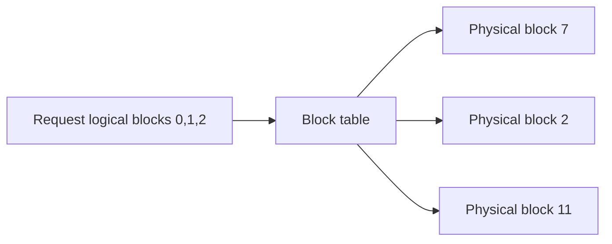

# 推理内存系统：KV Cache、Paging 与复用

上一章说明 KV 为什么存在，本篇跟踪其分配和释放。**Slot** 是一个 token 的 KV 存储位置，page/block 是若干 slot 组成的分配单位；引用表示某个请求仍需要这份数据，引用计数记录有几个使用者。Eviction（驱逐/淘汰）表示移除可以丢弃的缓存，不能等同于释放仍在执行的请求数据。

## 入门例子：为四条请求计算 KV，再观察释放

假设 32 层、8 个 KV heads、head_dim=128、BF16，未分片的标准 K/V 每 token 占 32×2×8×128×2=131072 字节，即 128 KiB。四条请求各驻留 1024 token，理论 KV 为 512 MiB。这里不含页表、对齐、预留池与工作区，也未考虑 prefix 共享或特殊 attention 布局。

请求完成后，其私有 KV 可以回收，但可复用前缀可能被缓存继续持有。因而“请求结束后设备 used 没降”不能单独证明泄漏。应分别观察 active request 引用、缓存可驱逐量、allocator 和池总容量。

无共享前缀、共享前缀与取消请求会产生不同物理状态。逻辑 token 数不等于物理 KV slot 数，共享块可能仍被其他请求锁定，结束后的块也可能转为可驱逐缓存。因此释放请求与减少全部缓存占用不是同一事件。

## 为什么 decode 常是 memory-bound

Large Language Model（LLM，大语言模型）自回归生成每次只产生少量新 token，但每层 attention 要读取此前 token 的 Key–Value Cache（KV Cache，键值缓存）以及大量权重。矩阵维度小、复用低，使 decode 常由 HBM bandwidth 与 KV 容量限制；prefill 对整个 prompt 做大矩阵运算，更容易利用计算吞吐。

KV 每 token 公式见 [显存核算](../04_Memory_Storage/GPU内存组成与显存核算.md)。这里关注其动态生命周期：请求长度未知、持续增长、完成后骤然释放，并发请求长度不一。

## PagedAttention 的核心不是“把 KV 放到磁盘”

PagedAttention 借鉴操作系统 paging：逻辑连续的 token block 可映射到不连续的物理 KV block。它解决为请求预留最大连续空间造成的外部碎片和过量 reservation。

block 太大会增加尾部内部碎片；太小会增加 block table、调度与 kernel 索引开销。PagedAttention 不压缩真实 K/V，也不保证跨请求复用。

## Prefix cache 与 prompt cache

若多个请求共享完全相同的 token prefix，可以让逻辑 block 指向同一只读 physical block，并用 copy-on-write 处理分叉。收益取决于命中率、prefix 长度和调度器能否把命中请求送到持有 cache 的 worker。

Worker 指执行模型的服务进程；cache key 是判断缓存是否可复用的身份标识，adapter 是按任务附加的小组参数，model revision 是模型版本。关键限制：文本看起来相同不等于 token/模型上下文相同；model revision、adapter、RoPE 配置、prompt template 和 cache dtype 都应进入 cache key。

## KV 的四种优化方向

| 方向 | 示例 | 代价 |
|---|---|---|
| 减少头数 | MQA/GQA | 需模型结构支持，可能影响质量 |
| 降低精度 | FP8/INT8 KV | 量化开销与精度验证 |
| 稀疏/淘汰 | sliding window、token eviction | 可能丢失长程信息 |
| 分层/远端存储 | CPU、NVMe、remote KV | 传输延迟、cache miss 与一致性 |

不要只报告容量节省；KV 压缩若导致输出 token 变长或 kernel 不支持高效读取，端到端 latency 可能更差。

## Chunked prefill 与 continuous batching

- Continuous batching（连续批处理）在请求完成/到达时动态重组 batch，提高 decode 利用率；
- Chunked prefill（分块预填充）把长 prompt 切块，避免一次 prefill 阻塞所有 decode；
- Scheduler 需要在 Time to First Token（TTFT，首 token 延迟）、Time Per Output Token（TPOT，每输出 token 时间）、throughput 与 cache pressure 间权衡。

显存水位接近上限时，调度器可减少新 prefill、preempt request（抢占并暂停请求）、swap KV（迁移 KV）或 recompute（以后重新计算被丢弃的 KV）。所谓“引擎吞吐”很大一部分来自这个 memory-aware scheduler，而不仅是 attention kernel。

## KV Cache 的观测指标

- usable blocks、used blocks、内部碎片与 eviction rate；
- prefix hit rate，最好同时报告复用 token 数而非仅请求命中数；
- preemption/recompute/swap 数量；
- per-request KV bytes 与生命周期分布；
- HBM/CPU/remote tier 的 hit latency；
- 因 cache pressure 拒绝或排队的请求。

## 分层 KV：容量扩展后的关键路径

把可复用 KV 放到 CPU、NVMe（常见固态存储接口）设备或远端存储，既需要选择保留哪些前缀，也需要决定何时取回。GPU 活跃页、GPU 可驱逐缓存、host 缓存和远端对象分别计账；一个对象在下层存在，不代表本次请求已能在 GPU attention 中读取。

| 边界 | 需要保证什么 | 主要观测 |
|---|---|---|
| 写回/迁出 | 数值、scale、页布局与版本成套完成 | 写回字节、完成事件、重复副本 |
| 查找与预取 | 命中身份包含模型、adapter、位置与表示 | 命中 token 数、读取排队、预取浪费 |
| 取回与晋升 | 目标页有效、映射安装且设备可读后才执行 | 目标页分配、传输、ready 时间 |
| 淘汰与取消 | 不释放活跃或在途引用；处理晚到结果 | 锁定量、可驱逐量、取消后滞留 |

教学假设：16 MiB 的 KV 通过有效吞吐 8 GiB/s 的链路取回，纯传输约 1.953 ms；若读取排队另有 4 ms，总计约 5.953 ms。假定重算该前缀耗 5 ms，则本次命中也可能比重算更慢。这里忽略定位、分配和转换，实际策略应比较完整关键路径，而非命中率或介质峰值带宽。

多租户、大量短前缀与不同 adapter 会改变可复用集合。准入策略可考虑复用长度、对象大小和未来请求收益；预取过多会占据活跃请求容量并制造背压（下游处理不足时限制上游继续提交工作）。PD（Prefill–Decode 分离）把输入处理与逐步生成放在不同执行资源上，又增加另一段交接，需区分“远端对象可取回”和“decode worker 已可读取”。实现见[SGLang KV 走读](../13_Source_Analysis/sglang/02_runtime_core/02_kv_cache_and_radix_attention.md)，组合与传输见[执行优化](执行优化与功能组合.md)、[PD 案例](案例_Prefill-Decode分离.md)。

## 数值展开 KV：分页、前缀共享、分叉与取消

> 六个物理页p0..p5，每页4个token。只缓存一个完整公共前缀页p0，其他页在没有活跃引用且设备不再使用时释放。页号分配顺序人为指定。

### 先约定长度和引用

本页长度表示已经计算并写入KV的token数量。刚采样出的token若尚未进入下一次forward，不计入KV长度。`active_refs`只数活跃请求引用；可淘汰缓存的保留身份另记，不混进这个数。

共享前缀必须具有相同token和模型上下文。A有6个token，B有7个token，两者只共享前4个。C稍后从B的完整当前状态分叉，允许共享其尚未满的尾页，但写入前需要COW。

### 逐事件状态表

| 事件后 | A页表 | B页表 | C页表 | 空闲页数 |
|---|---|---|---|---:|
| A完成6-token prefill | [p0,p1] | — | — | 4 |
| B完成7-token prefill | [p0,p1] | [p0,p2] | — | 3 |
| A继续写到9 token | [p0,p1,p3] | [p0,p2] | — | 2 |
| C从B分叉，长度7 | 同上 | [p0,p2] | [p0,p2] | 2 |
| C写第8个token，COW | 同上 | [p0,p2] | [p0,p4] | 1 |
| A结束且设备使用完成 | — | [p0,p2] | [p0,p4] | 3 |
| B收到取消，设备仍在使用 | — | [p0,p2] | [p0,p4] | 3 |
| B设备完成，释放私有页 | — | — | [p0,p4] | 4 |
| C结束，保留p0为缓存 | — | — | — | 5 |
| 淘汰p0 | — | — | — | 6 |

### COW那一步具体复制什么

C分叉后p2被B和C共同引用，其中3个位置有有效KV。C要写新的第8个token时，分配p4，把p2中3个有效位置复制过去，再写p4的第4个位置；C页表改指p4，p2继续属于B。

这一步前p0 active_refs=3、p2=2；之后p0仍为3，p2=1，p4=1。它增加一个物理页，却没有重新计算全部公共前缀。若原实现不支持共享部分页，可以在分叉时提前复制，生命周期和成本会不同。

### 容量与有效字节

在COW之后、A结束之前，A/B/C逻辑长度分别9、7、8，总计24 token；物理分配5页共20个slot。各页有效位置为p0:4、p1:4、p2:3、p3:1、p4:4，总计16，空尾槽4个。逻辑长度大于物理slot来自共享，不是账本错误。

若每token KV为128 KiB，则页为512 KiB，分配容量2.5 MiB，物理有效KV为2 MiB。该示例不计页表、元数据和allocator；总设备used也可能包含预留池。

### 为什么取消不能立即释放

收到取消可以先禁止调度新工作、完成或终止外部响应，但已经提交的设备Kernel仍可能访问页表和KV。只有相关操作完成或框架保证不再访问时，才能将页交给另一个请求。否则旧Kernel可能读写新请求的数据。

因此要区分请求状态、设备在途状态、活跃引用与缓存保留。`active_refs=0`也是必要条件之一，不单独构成安全复用证明。

### 缓存淘汰与权重变化

p0在全部请求结束后仍可保留，解释了“请求数归零而池占用不归零”。下一请求能否复用要检查模型版本、adapter、token、位置等语义。换权时不能只复用相同token前缀而忽略生成它的模型状态。

验证：[页表、引用和容量脚本](../examples/parallel_runtime_walkthroughs.py)。设计依据：[PagedAttention](https://arxiv.org/abs/2309.06180)；具体引擎可能使用token粒度、radix结构或其他分配单位，不能逐字段照搬本模型。

## 分页之后：容量管理并没有结束

分页减少连续分配约束，但物理 KV 总量仍随有效历史增长。共享前缀减少重复状态，却引入引用计数、淘汰和 cache key；分层缓存扩大容量，却增加 miss 时的传输和预取；压缩减少每 token 字节，又需要评估质量和读取内核。

示意：页容量 16 token，一条私有请求使用 18 token，需要 2 页共 32 个 slot，尾页空余 14 个。这个内部碎片与分配器无法拼出连续块的外部碎片不同。共享页和预留池存在时，请求的逻辑 token 数也不等于独占物理容量。

从 OS 分页到运行时 block table 的概念联系见[地址转换与分配](../04_Memory_Storage/地址转换与内存分配.md)。调度如何改变活跃集合见[批处理与排队](批处理排队与调度演进.md)。

---

## 资料

- [PagedAttention 论文](https://arxiv.org/abs/2309.06180)
- [vLLM Paged Attention Design](https://docs.vllm.ai/en/stable/design/paged_attention/)
- [NVIDIA Dynamo Glossary：Block 与 KV Cache](https://docs.nvidia.com/dynamo/reference/glossary)

<!-- main-route -->

知道一个请求占多少空间后，还需要决定哪些请求能进入 GPU。下一篇解释准入、批处理和排队。

[上一篇：Transformer 执行与 KV](<Transformer执行与KV基础.md>) · [主线 17/26](<../guides/系统阅读路线.md>) · [下一篇：批处理、排队与调度](<批处理排队与调度演进.md>)

<!-- /main-route -->
