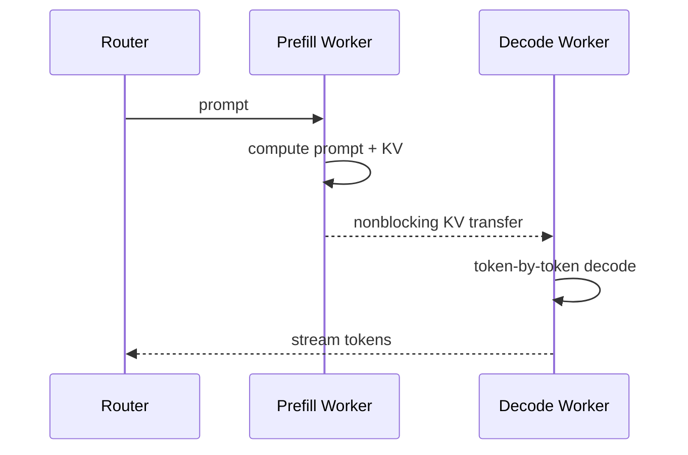

# 案例：Prefill–Decode 分离与 KV Cache 传输

## 入门例子：一次 PD 交接要转移什么

Prefill 节点算出请求前缀的 KV 后，decode 节点不仅要拿到字节，还要知道请求身份、序列长度、KV 布局、采样配置和交接状态。源端发送结束、目标端可安全读取、路由层可以继续转发，是不同的完成条件。

若 KV 为 512 MiB，有效传输带宽假设为 32 GiB/s，单纯搬运下界约 15.6 ms；实际还包括排队、注册、打包和调度。若同机执行只需节省 5 ms，分离可能得不偿失。这个数字是算例，不是 H20 基准。

交接前源端持有 KV，传输中目标端可能已经分配但尚不能消费，确认后才能按协议转移责任。目标端失败时，源端是否释放取决于提交边界；重试若缺少请求或 generation 身份，可能重复分配。PD 吞吐收益必须建立在这组所有权关系正确的前提上。

## 为什么要分离

Prefill（预填充）一次处理整段 prompt，通常是大矩阵、compute-bound；Decode（解码）逐 token 执行，通常更受 HBM bandwidth、KV Cache 和调度影响。把两者 colocate 在同一 GPU pool 会互相干扰，也让资源比例和并行策略绑死。

Prefill–Decode disaggregation（预填充—解码分离）让两种 worker 独立扩缩，但产生一个新依赖：prefill 生成的 KV 必须传给 decode。

## 何时值得分离

DistServe 论文把目标定义为在 TTFT（Time to First Token，首 token 延迟）和 TPOT（Time Per Output Token，每输出 token 时间）约束内的 goodput。分离可消除 phase interference，并分别选择 prefill/decode parallelism；代价是 KV transfer、额外 queue、routing 和故障域。

一个粗略判据：

$$
T_{KV\ transfer}+T_{extra\ queue}<T_{interference\ saved}+T_{placement\ gain}
$$

若 prompt 短、网络慢、同机资源已足够，聚合部署可能更简单更快。分离不是无条件先进。

## KV 传输量

如果 prompt 有 $S$ token，每 token KV 为 $m$ bytes，则一次请求要搬约 $Sm$。以每 token 320 KiB、32K prompt 为例，KV 接近 10 GiB；即使 400 Gb/s 链路的应用有效吞吐达到 40 GB/s，纯传输下限也约 250 ms，还未算排队和竞争。这说明长上下文 P/D 分离必须依赖高带宽路径、分块/流水化、缓存命中或减少 KV 字节。

## NVIDIA Dynamo 的当前实现视角

NVIDIA Dynamo 当前文档使用 NIXL（NVIDIA Inference Xfer Library，NVIDIA 推理传输库）把 KV 从 prefill GPU VRAM 非阻塞传到 decode GPU VRAM，并结合 KV-aware routing。跨节点生产部署建议 RDMA/等价高速 fabric；若回退 TCP，KV transfer 可能成为 TTFT 与 throughput 的主瓶颈。

Topology-aware KV transfer 会优先让 P/D worker 落在同一 zone/rack 等 domain，减少慢速跨域搬运。这说明 router 的目标不能只有“最空闲 GPU”，还要联合 cache locality、queue 和 network locality。

## 流水化机会

- layer-wise transfer：前几层 KV 生成后即开始传，而非等待全模型 prefill 完成；
- chunked prefill：每个 prompt chunk 计算/传输流水化；
- push 与 pull：由 prefill push，或 decode 按需 pull；
- prefix locality：若 decode/prefill 一侧已有共享 prefix，避免重复传输；
- remote KV tier：把复用价值高的 KV 放入共享 cache，但要控制一致性与尾延迟。

## 关键风险

1. KV 已传完但 request metadata/ownership 未原子提交；
2. decode worker 失败后留下 orphan KV blocks；
3. model/adaptor/version 不一致导致 cache 语义错误；
4. 多个大 KV transfer 发生 routing collision，压垮同一 uplink；
5. 传输与 decode 竞争 HBM bandwidth，所谓 nonblocking 仍拖慢 token loop。

## 该怎么 benchmark

至少分为：

- aggregated baseline；
- 同节点 P/D；
- 同 rack RDMA；
- 跨 rack/zone；
- cold cache 与 warm prefix cache；
- 短/中/长 prompt × 短/长 output。

同时报告 TTFT、TPOT/Inter-Token Latency（ITL，token 间延迟）、goodput、KV transfer bytes/time、queue time、cache hit rate 与 network p99。只报平均吞吐会掩盖分离对 tail SLO 的影响。

## 服务容量与Prefill–Decode交接：算清页、时间和完成边界

> 这是容量账本与事件模型，不是实测benchmark。前置：[KV页表推演](<推理内存系统.md#数值展开-kv分页前缀共享分叉与取消>)、[调度推演](<批处理排队与调度演进.md#数值展开运行时请求队列token-budgetcuda-graph-与结果返回>)、[PD分离](案例_Prefill-Decode分离.md)。

### 从GPU总容量到可调度KV容量

先从可用设备内存中扣除权重、计算工作区、执行图池、通信buffer及预留余量，剩余部分才可用于KV池。本例假定已经扣完，KV预算为12 MiB，每token KV为128 KiB，每页4 token，页大小512 KiB，因此有24个物理页。

这里的128 KiB是人为指定的每token总KV字节数。实际要从层数、K/V head数、head维、精度和本地并行布局计算；GQA、MLA、量化等会改变公式，不能统一套一个dense MHA值。

三个请求没有共享，当前已经计算KV的长度A=20、B=9、C=15：

| 请求 | 当前页数ceil(length/4) | 下一次decode后的长度 | 需要新增页 |
|---|---:|---:|---:|
| A | 5 | 21 | 1 |
| B | 3 | 10 | 0 |
| C | 4 | 16 | 0 |

当前占12页、空闲12页；三条都推进一次后占13页、空闲11页。新增3个逻辑token只触发1个新页，但那一个token需要完整页的分配能力。调度器不能仅检查“新增3×128 KiB是否够”。

### 未来长度未知，准入不能只靠当前足够

请求下一步能执行，不代表它能一直执行到最大输出长度。运行时需要选择一种或组合多种策略：预留未来容量、逐步分配并抢占、拒收新增请求、限制最大长度。每种方案把成本放到不同位置。

抢占也有不同语义：换出KV需要CPU容量与传输；丢弃KV后重算需要保留token并重新prefill；取消请求则改变完成率。不能把三者统称为“释放显存”，再只比较释放了多少字节。

公平性还会影响吞吐：只挑短请求可能提高完成数，却让长请求饥饿。容量、等待时间和优先级应同时进入准入与抢占决策。

### PD交接时传的是什么

P端完成prefill，D端继续decode。交接需要的语义不只有KV字节，还包括请求身份、模型版本、序列长度、位置、分片布局、已采样但尚未写入KV的token，以及目的端页表。

源物理页号不能当作目的端地址直接使用。若两端TP布局不同，还需要重分布；本例假设布局一致、所有KV可直接传输，不包含这项额外开销。

### 一条有明确计时口径的时间线

输入长1024，使用上面的KV口径，共128 MiB。假设有效链路吞吐8 GiB/s，传输服务时间下界为128/8192秒=15.625 ms。另假设入队5 ms、prefill 30 ms、传输后交接确认2 ms，无排队冲突且不重叠。

本协议由P端采样首个生成token，但直到D端准备完成才向用户释放首token；它尚未计入1024个KV token中。

| 事件 | 相对请求到达时间 | 状态 |
|---|---:|---|
| P开始prefill | 5 ms | 已在目的端取得准入承诺 |
| P完成prefill并采样首token | 35 ms | 1024-token KV可传输 |
| D收到全部KV，传输完成 | 50.625 ms | 尚待安装/确认 |
| D安装元数据并确认 | 52.625 ms | 请求可继续，向用户释放首token |
| D第一次decode完成，假设耗时5 ms | 57.625 ms | 把首token写入KV并采样第二个token |

在这些假设下，TTFT为52.625 ms，首、次token间隔5 ms。如果P端35 ms就返回首token，TTFT会更小，但第一次token间隔会包含交接等待。只报告TTFT可能掩盖这个等待的转移。

15.625 ms只是指定有效吞吐下的除法结果。网络竞争、源读和目的写、协议、同步、布局转换都可能改变实测；分块重叠又可能缩短关键路径，不能直接用各耗时之和预测所有实现。

### 交接失败时如何避免两个端点都丢失状态

本例协议要求：D先取得容量，P在D确认可继续之前保留恢复所需的状态；重复交接用同一请求身份和交接代号识别；旧交接的迟到确认不能释放新一轮正在使用的页。

若D在确认前失败，可以重建D或重试交接；P是否仍持有可用KV由协议保证。若P提前释放、D又没有完成安装，重试就只能重算甚至失败。收到网络传输完成事件也不必然代表整个请求已经可调度。

这些是教学协议的约束，不表示任一具体引擎具备exactly-once交接。本仓库相关实现入口见[SGLang运行时导读](../13_Source_Analysis/sglang/README.md)，具体容错仍需对照所用部署验证。

### 从吞吐转向满足约束的有效完成量

假设一个1秒观测窗口完成4个请求，其中3个同时满足规定的TTFT与token间隔约束，则原始完成率为4请求/秒，满足约束的完成率为3请求/秒。请求、token和GPU时间是不同分母；输入输出长度变化时尤其不能相互替代。

报告至少固定到达过程、长度分布、并发/排队方式和失败处理，并同时记录完成率、延迟分布、抢占/重算和资源成本。PD分离的动机与边界见[推理演进史](推理运行时演进史.md)及[DistServe原文](https://arxiv.org/abs/2401.09670)。

验证：[容量与时间算例脚本](../examples/training_rl_walkthroughs.py)。

---

## 资料

- [DistServe Paper](https://arxiv.org/abs/2401.09670)
- [NVIDIA Dynamo Disaggregated Serving](https://docs.nvidia.com/dynamo/dev/kubernetes/disaggregated-serving/overview)
- [Dynamo：Topology-Aware KV Transfer](https://docs.nvidia.com/dynamo/knowledge-base/kubernetes/multinode/topology-aware-kv-transfer)

<!-- series-nav -->

[上一篇：推理并行方案设计：延迟、吞吐与 KV 的三角形](<推理并行方案设计.md>) · [专题目录](<README.md>) · [下一篇：推理运行时演进史：从执行一个batch到管理不断变化的状态](<推理运行时演进史.md>)

<!-- /series-nav -->
