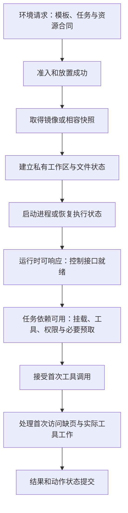

# Agent 环境容量与生命周期：等待模型时保留什么

> 前置：[多轮轨迹与环境执行](多轮轨迹与环境执行.md)、[集群调度与资源管理](../03_Hardware_Systems/集群调度与资源管理.md)。本文从完整任务核算 CPU、内存、创建与恢复需求；动作身份和训练 mask 沿用既有契约。

一条轨迹可能大部分时间等待模型，执行工具时才使用 CPU，但工作目录、进程和内存仍需跨轮保存。环境平台因此至少有四种独立容量：能执行多少 CPU 工作、能保留多少状态、每秒能创建多少环境、每秒能搬动多少恢复数据。增加生成 GPU 后，其中任何一项都可能先耗尽。

## 先区分执行、驻留和恢复

| 指标 | 单任务的计量 | 到达率为 $\lambda$ 时的平均需求 |
|---|---|---|
| 实际 CPU 工作 | $W_C=\int n_{\mathrm{busy}}(t)\,dt$，CPU·秒 | $\lambda E[W_C]$ 个忙核 |
| 内存驻留 | $A_M=\int M(t)\,dt$，GiB·秒 | $\lambda E[A_M]$ GiB |
| 活跃环境 | 各环境驻留时间之和，环境·秒 | $\lambda E[T_{\mathrm{resident}}]$ 个环境 |
| 创建／恢复 | 每任务新建数、恢复数 | $\lambda E[N_{\mathrm{create}}]$、$\lambda E[N_{\mathrm{restore}}]$ 次／秒 |
| 快照读写 | 各次保存与读取字节数之和 | $\lambda E[V_{\mathrm{snapshot}}]$ GiB/s |

这些是稳定流量下的长期平均资源守恒关系。CPU 申请 2 核、保留 20 秒，不等于消耗 40 CPU·秒；但平台若按独占核预留，这 40 核·秒仍然占用了可分配容量。反过来，内存被保留时即使 CPU 空闲，也不能按 CPU 利用率折减内存需求。

瞬时并发、尾部等待、配额和故障余量还需要另外检查。将均值代入表格只能排除不可能的方案，不能直接宣称满足 p95 或 p99 延迟。

## 环境边界决定哪些资源与故障仍然共享

工具环境提供程序所需的系统调用、文件、网络和设备访问。选择执行载体时，需要同时回答：任务之间隔离哪些状态，谁仍共享内核或设备，能够恢复哪些状态，以及为此保留多少资源。“沙箱”描述一组执行约束，并不指定某一种实现。

| 执行载体 | 主要边界 | 仍需由平台处理的共享与归属 |
|---|---|---|
| 进程 | 地址空间、用户身份与文件权限；可再施加资源限制 | 同一内核、宿主资源竞争、子进程树与打开的句柄 |
| Linux 容器 | 用命名空间组织进程、挂载和网络视图，用资源控制约束消耗 | 通常共享宿主内核；挂载、设备和控制面接口由配置决定 |
| 虚拟机／microVM | 客体内核运行在虚拟硬件边界内；microVM 缩减虚拟设备与管理范围 | 宿主调度、虚拟化实现、存储网络路径及宿主代理仍有资源与故障边界 |

命名空间定义进程看到的资源视图，cgroup 负责资源分组与控制，权限、capability 和系统调用限制决定可执行的操作。它们承担不同职责；获得独立进程编号不代表拥有独占 CPU，设置 CPU 上限也不建立独立内核。具体配置边界见 [OCI Linux Runtime Specification](https://github.com/opencontainers/runtime-spec/blob/main/config-linux.md)。microVM 的机制与设计动机见 [Firecracker 论文](https://www.usenix.org/conference/nsdi20/presentation/agache)；不能仅凭载体名称断言启动开销或隔离效果。

隔离至少涉及任务与任务、工具与平台代理、工具与外部系统。平台代理保存的结果身份、凭据和评价状态不应因工具拥有工作区写权限而同时可写。设备直通、共享目录或共享代理连接会改变边界，需与任务要求一起记录。这里讨论环境的执行能力与资源归属；动作重试、训练 mask 和轨迹版本仍由[多轮轨迹](多轮轨迹与环境执行.md)维护。

资源隔离也有不同语义。CPU 配额约束可消耗的运行时间，独占核或亲和性约束执行位置；内存上限约束驻留与增长，内存带宽竞争仍可能存在。超卖依赖不同任务不同时达到峰值，而 RL 的阶段性工具调用可能高度同步，因此平均 CPU 空闲不能证明超卖后的尾延迟仍可接受。

## 镜像、运行快照与任务状态不能互换

镜像定义初始文件及依赖，工作区保存任务修改，运行快照还可能保存进程内存、设备或执行状态。它们对应不同时间点，恢复前必须确认目的：建立一份干净试验，还是继续一条已经执行过动作的轨迹。

[OCI 镜像层规范](https://github.com/opencontainers/image-spec/blob/main/layer.md)定义文件系统变更的表示；具体运行时如何共享只读层、建立可写层及缓存数据，是另一层实现选择。镜像存在于节点存储，不代表相关文件已进入内存；运行态可恢复，也不代表外部连接和已提交动作一起回滚。

准备工作可以依赖只读共享、写时复制和按需加载，但三者节省的对象不同：

- **只读共享**减少同一内容的重复物理存储；任务私有修改仍需要单独保留，容量按唯一共享对象与各自私有状态分别统计。
- **写时复制**推迟私有副本的创建；修改发生后会增加脏页、复制工作和回收压力，不能始终按初始共享量估算。
- **按需加载**推迟未访问内容的传输；首次工具访问缺失文件或页面时，准备工作重新进入执行关键路径。

宿主文件缓存、客体文件缓存和进程映射还可能保留不同层次的副本。不能把相同文件内容自动视为只占一次物理内存，也不能将每个虚拟地址空间的大小直接相加当作实际驻留。需要识别共享机制、缓存层次及统计口径。快照派生的多个实例还可能依赖同一份只读后备文件，最后一个引用释放之前，该文件仍是可用性依赖。

## 从创建请求到首次工具可用

图中的状态是通用职责，不是某个运行时的固定 API。镜像可提前分发，网络、依赖和运行时初始化也可能重叠，实际实现应画出相应依赖。所谓“创建耗时”必须指定结束点：控制接口可响应、任务依赖可用、首次工具返回结果，分别包含不同工作。

按需恢复可以提前到达“运行时可响应”，却把读取成本推迟到第一次执行。Linux 的 [userfaultfd](https://docs.kernel.org/admin-guide/mm/userfaultfd.html)允许用户态处理注册内存区域的缺页，是实现按需内存加载的一类机制；它并不保证页面来源随时可用或读取没有等待。因此 readiness 可以声明关键依赖已验证、关键工作集已预取，却不宜暗示所有未来路径都已变热。

准备延迟来自资源需求和依赖。对某一阶段，CPU 工作量、网络传输字节及磁盘读写字节分别除以其有效服务能力，得到各自时间下界；允许重叠时先取受限资源的下界，再沿依赖核算整体关键路径。必须串行的下载、解压、校验或安装不能因同属“创建”而取一个最大值替代全部成本。压缩镜像大小、解压后大小、首次访问工作集和实际脏页也应分别记录。

并发创建会共享镜像源、网络出口、解压 CPU、磁盘和元数据服务。单个环境启动很快不推出整批创建吞吐很高。预取只是改变准备发生的时刻；预测未命中时，已经传输的数据和已占用的热池状态仍付出了成本。热池要绑定环境版本和任务类别，并定义补充、回收与过期条件，否则控制器可能持续保留不再被使用的模板。

每次准备都有独立 attempt 与资源所有者。准备失败、取消或超时后，需撤销未发布环境，释放挂载、进程和资源预留；晚到的完成事件不能把已取消环境重新发布为可接工作。准备阶段获得的版本与任务身份一直传到工具结果，才能区分旧环境返回和当前轮次完成。

## 放置需要同时满足计算、状态与数据路径

CPU 核、主存、可写盘、镜像缓存、网络以及可选的 GPU 必须在允许的位置同时可用。总量核算后，还要检查这些资源能否由同一节点或相容节点组提供；CPU 空闲在一台机器、设备和工作区在另一台机器，不一定构成一个可运行环境。

放置先排除硬约束不满足的节点，如架构／内核相容性、设备访问要求、工作区挂载范围、数据允许处理的区域和故障域规则。再比较软代价：排队时间、模板命中、环境恢复量、访问模型或工具数据的路径，以及对现有任务的争用。镜像命中可以减少准备，但把所有任务集中到同一缓存热点可能耗尽它的 CPU 或 I/O。

CPU、内存和 GPU/NIC 的局部性也会改变搬运路径。NUMA 亲和性减少跨域访问的机会，但约束越多，可放置的组合也越少；应同时记录执行收益与等待成本。分配检查应覆盖峰值增长，镜像准备与快照恢复也需获得有界并发，避免执行资源足够而准备链路先失去服务能力。

环境控制器可以把需求分成创建、工具执行、驻留和恢复等阶段，向资源平台表达不同的资源形状。阶段变化必须更新实际预留，不能只把日志状态改为“暂停”便假定内存已经归还。作业级配额与 gang 放置见[集群调度](../03_Hardware_Systems/集群调度与资源管理.md)；多租户准入、路由和弹性反馈见[服务准入路由与弹性控制](../10_Inference_Serving/服务准入路由与弹性控制.md)。

## 一道完整的环境设计题

以下全部是原创教学假设，不对应任何沙箱、模型或硬件的实测：

| 输入或约束 | 假设值与边界 |
|---|---|
| 任务流量 | 持续 3 项／秒；每项固定 4 轮 |
| 单轮依赖 | 模型 5 秒 → 工具 0.5 秒；下一轮依赖本轮结果 |
| 工具 CPU 与状态 | 执行时使用 2 核；环境驻留占 1.5 GiB |
| 冷创建 | 0.8 秒墙钟、0.4 CPU·秒；创建阶段也预留完整内存 |
| 释放或热池重置 | 0.1 秒墙钟、0.1 CPU·秒；完成后才可复用资源 |
| 保存／恢复 | 0.15／0.2 秒，各 0.1 CPU·秒；每次写／读完整 1.5 GiB 状态 |
| 平台可用预算 | 24 核、96 GiB 内存、冷创建 5 次／秒、恢复 10 次／秒；快照暂存 128 GiB，读写合计 32 GiB/s |
| 目标 | 在无排队、无失败的固定输入下，任务完成并清理不超过 25 秒 |

平台预算已扣除控制面、宿主与公共镜像开销；文件读写和结果持久化包含在工具的 0.5 秒中，快照 I/O 是额外流量。模型服务假设能提供 12 次调用／秒、平均 60 个在途调用，并维持上述 5 秒时长。环境优化不能代替这一供给条件。

4 轮模型与工具的基础时长为 $4(5+0.5)=22$ 秒，工具 CPU 工作为 $4\times0.5\times2=4$ CPU·秒。只读镜像可共享，每个任务的可写工作区独立。比较四种策略：

| 策略 | 具体生命周期 | 可用前提 |
|---|---|---|
| A：从开始分配热环境 | 第一次模型调用前分配，4 轮全程驻留；结束重置；另留 6 个空闲热环境 | 0.1 秒重置确实恢复到干净初态 |
| B：每轮按需新建 | 完整工具参数到达后创建，执行并释放，之后才开始下一轮模型调用 | 所有必要任务状态已在可重新挂载的工作区中，无必须保留的进程状态 |
| C：轮间保存后释放内存 | 首次工具前冷创建；前 3 轮工具结束后依次保存、释放，再开始下一轮模型调用；模型结束后恢复；末轮完成后释放 | 可获得一致且相容的恢复状态，保存、释放与恢复的附加工作均计入成本 |
| D：首次工具时创建并保留 | 第一轮模型结束才创建；后续轮次驻留；最后释放 | 状态跨轮可保留，首次冷启动满足期限 |

没有假定创建能与模型重叠。若能提前知道环境模板，可另外验证预建策略；它改变时间线和驻留面积，应作为新候选重算。

## 用同一份账本比较四种策略

对于 D，第一轮模型的 5 秒没有环境。环境从第一次冷创建开始，驻留 $22-5+0.8+0.1=17.9$ 秒，每任务消耗 $17.9\times1.5=26.85$ GiB·秒；平台平均需要 $3\times26.85=80.55$ GiB。

对于 C，3 次等待模型期间释放了环境内存，但保存、释放尚未完成和恢复期间仍占用它。每任务驻留时间为 $0.8+4\times0.5+3(0.15+0.1+0.2)+0.1=4.25$ 秒，任务总时长则为 $22+0.8+3(0.15+0.1+0.2)+0.1=24.25$ 秒。CPU 工作为 $4+0.4+3(0.1+0.1+0.1)+0.1=5.4$ CPU·秒；中间 3 次释放与最后一次释放都付费。

| 核算项 | A：热池全程驻留 | B：每轮新建 | C：轮间保存释放 | D：首次工具才创建 |
|---|---:|---:|---:|---:|
| 单任务时长，秒 | 22.10 | 25.60 | 24.25 | 22.90 |
| 每任务 CPU·秒 | 4.10 | 6.00 | 5.40 | 4.50 |
| 每任务环境驻留秒 | 22.10 | 5.60 | 4.25 | 17.90 |
| 每任务内存 GiB·秒，不含空闲池 | 33.15 | 8.40 | 6.375 | 26.85 |
| 平均忙核 | 12.30 | 18.00 | 16.20 | 13.50 |
| 平均驻留环境数，含空闲池 | 72.30 | 16.80 | 12.75 | 53.70 |
| 平均内存，GiB | 108.45 | 25.20 | 19.125 | 80.55 |
| 冷创建次数／秒 | 0，热池建立另计 | 12 | 3 | 3 |
| 恢复次数／秒 | 0 | 0 | 9 | 0 |
| 额外快照读写，GiB/s | 0 | 0 | 27 | 0 |

A 的空闲池占 $6\times1.5=9$ GiB，计入平均内存；任务结束的重置率为 3 次／秒，冷创建成本仅在初次建池或补充损坏环境时发生。稳态表假设无损坏，这部分容量在生产设计中仍需预留。

**当前预算下，D 是更合适的首个候选。** A 超过内存容量，B 超过冷创建能力并超时；C 和 D 的均值核算都通过，但 D 时长更短、CPU 工作更少，也不引入每秒 27 GiB 的额外状态搬运。C 距 25 秒期限还有 0.75 秒，仍不能据此承诺真实服务期限。

选择也有明确翻转点：

- 可用内存降到 64 GiB、其他条件不变时，D 的平均需求已不可能满足，C 成为四个候选中唯一通过均值筛选的方案。
- 若同时把期限收紧到 24 秒，C 的 24.25 秒也超限；64 GiB 下这四个候选全部不可行，需要修改资源预算或执行方案。
- 如果快照路径只能提供 10 GiB/s，C 的额外 I/O 上界是 $10/(3\times2\times1.5)=1.11$ 项／秒，无法承接 3 项／秒。内存充裕程度不能抵消这个缺口。
- D 的内存均值上界为 $96/26.85\approx3.58$ 项／秒；这不是可直接配置的安全准入率，突发和长任务会先消耗余量。

这里故意把快照带宽列为独立约束。单次保存 1.5 GiB 只用 0.15 秒，已经要求该次传输达到 10 GiB/s；多项保存同时发生时还会竞争。32 GiB/s 是题设假设，不能从单次恢复很快推断平台具备这一吞吐。

## “暂停”究竟释放了什么

停止执行、保存状态、释放内存是不同动作。[Linux cgroup v2 的冻结接口](https://docs.kernel.org/admin-guide/cgroup-v2.html)停止组内进程，冻结完成通过事件报告；这个动作本身不承诺回收其内存。把环境仅冻结在原位置，仍应按驻留状态计费。

要实现 C，至少需要走完：工具结果提交 → 阻止新的写入 → 保存相容状态 → 确认快照可恢复 → 释放原实例内存 → 恢复 → 验证工作区和动作游标 → 接受下一轮工作。保存未提交前销毁原实例，会把性能优化变成进度丢失。

镜像、工作目录与运行态的生命周期也不同：

| 对象 | 复用或保存方式 | 不能省略的核算 |
|---|---|---|
| 只读镜像、依赖 | 节点缓存、共享底层层 | 首次拉取、缓存容量、版本身份 |
| 可写工作区 | 持久卷、内容快照或补丁 | 写入量、提交一致性、恢复后的文件版本 |
| 进程与内存 | 运行时快照或重建 | 保存／恢复时间、驻留页、相容性与额外读写 |
| 动作与工具结果 | 持久操作记录 | 逻辑动作 ID、attempt、提交状态与去重 |

平均内存减少也会增加存储驻留。本例每项最多跨 3 个等待间隔保存快照；若一个快照从开始保存到恢复完成都独占 1.5 GiB，单次保留 $0.15+0.1+5+0.2=5.45$ 秒，稳态平均暂存需求为 $3\times3\times5.45\times1.5=73.575$ GiB。此值包含原环境释放时间，并假定恢复完全读入后即可释放文件；保留历史恢复点、写入副本或依赖旧文件的惰性加载都需要另加容量。

[Firecracker 的快照文档](https://github.com/firecracker-microvm/firecracker/blob/main/docs/snapshotting/snapshot-support.md)说明内存与虚拟设备状态会被保存，磁盘文件仍需调用方管理；基于文件的恢复可按需加载内存页，因此内存文件要在恢复实例存活期间保留。文档也明确指出网络连接不保证保留。这里的完整读入教学模型不能直接当作 Firecracker 的实现或性能承诺。

## 恢复点必须覆盖副作用边界

假设工具提交了一个外部任务，环境在收到确认前被保存。恢复后看不到结果，不代表提交没有发生。完整快照也不能回滚环境外的数据库、网络服务或真实设备。

为每个逻辑动作持久保存输入版本、幂等键和外部操作 ID；恢复时先查询已提交结果，再决定重试。快照标识应关联环境镜像、工作区版本、任务／轮次、最后已提交动作，以及模型上下文引用。没有可查询或可去重的外部协议时，需要任务明确规定失败、补偿或人工接管语义。[HTTP 幂等语义](https://www.rfc-editor.org/rfc/rfc9110.html#section-9.2.2)讨论了自动重试的前提；仅给一次执行换一个 attempt ID 并不能使它幂等。

热池也需要执行状态重置、工作区隔离和结果身份检查。不同任务共用模板，并不意味着能够复用上一任务的可写状态。上述 0.1 秒重置只有通过相应验证后才有意义。

## 从算例走到可部署的证据

先记录任务／轮次时间线，再按环境分别测 CPU 时间、驻留内存、创建与恢复排队、实际快照字节及端到端任务完成时间。制造冷缓存、环境创建突发、长工具、恢复失败和旧结果晚到，检查均值预算之外的排队与正确性。环境失败与模型任务失败分别计数，最终比较全部尝试的资源除以成功任务数，分母沿用[奖励评估与质量闭环](奖励评估与质量闭环.md)。

[复算脚本](../examples/environment_placement.py)仅验证本文确定性账本、部署边界和下一篇端边云预算，使用 Python 标准库；没有启动容器、microVM、GPU 或真实网络。设计题的组织参考[《深入理解 AI Infra》第 11 章](https://bojieli.github.io/ai-infra-book/manuscripts/11-%E8%B5%84%E6%BA%90%E8%B0%83%E5%BA%A6%E4%B8%8E%E8%BF%90%E8%A1%8C%E7%8E%AF%E5%A2%83.html)，本篇参数、策略组合与结果为独立教学设定。滚动文档于 2026-10-12 查阅。

环境载体、准备链路与放置一节在 2026-10-13 补充，依据上文链接的 OCI、Linux 内核文档与 Firecracker 论文；这些机制解释创建／恢复参数从何而来，没有为既有算例增加实现或性能保证。

[系统设计路线](../design/README.md) · [RL 目录](README.md) · [端边云部署与交互预算](../10_Inference_Serving/端边云部署与交互预算.md)
