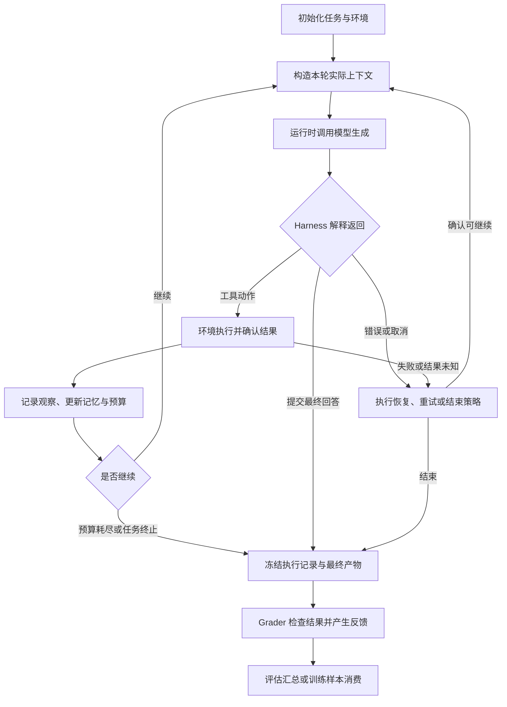

# Agent 系统与 Harness 边界：谁决定模型看到什么、何时继续与停止

> 前置：[RL 系统全景](RL系统全景.md)。本文以单 agent 的工具交互为对象，先定义执行系统，再说明它如何约束训练；token mask、环境资源和奖励计算分别接到已有专题。

一个模型可以提出“读取文件”，但模型权重本身不负责打开文件、保存工作目录、裁剪输出或决定下一轮是否继续。Agent harness 是组织这些行为的执行程序：它把任务、历史与环境观察组装成模型输入，解释生成结果，调用工具，并维护任务状态。这里的 agent 指模型与这套执行程序共同形成的任务执行系统。

因此，同一个 checkpoint 换上另一套上下文压缩、工具说明或重试规则，得到的任务行为就可能改变。讨论“agent 训练”之前，必须先说明训练的是哪一个模型、它处于什么执行循环、最终用什么条件衡量成功。Anthropic 的评估说明也明确区分 agent harness 与 evaluation harness，并将被评估的 agent 视为模型和 harness 的组合。[来源：Demystifying evals for AI agents](https://www.anthropic.com/engineering/demystifying-evals-for-ai-agents)

## 六个边界：角色分开，进程可以合并

下面是职责划分，不要求部署成六个服务。一个进程可以同时承载 harness、工具和记录器；边界仍然决定谁对输入、状态和失败负责。

| 组件 | 输入与输出 | 拥有的决定 | 不能由它单独证明的事 |
|---|---|---|---|
| 模型（model） | 给定上下文，产生下一 token 的分布 | 已学习的生成偏好 | 工具是否执行、任务是否成功 |
| Agent harness | 任务、历史、环境观察 → 模型请求与工具动作 | 上下文构造、控制流、工具解析、记忆和任务预算 | 文件或远端系统的最终状态 |
| 推理运行时（inference runtime） | 模型请求 → 生成 token、停止原因与可用的概率记录 | batching、KV、采样实现、单次请求的执行与取消 | 整个 episode 是否应结束 |
| 工具与环境（tool/environment） | 工具动作 → 状态变化和观察 | 文件、进程、数据库等实际状态，以及动作执行语义 | 一段“完成了”的模型文字是否可信 |
| 评估执行框架（evaluation harness） | 任务集、agent 配置 → 多次执行、判分与汇总 | 初始化与隔离任务、安排 trial、调用 grader、保存结果与分母 | 分数变化究竟来自权重还是 harness，除非做了对照 |
| 训练器（trainer） | 可训练记录、反馈、算法配置 → 新模型参数 | 损失、优化、样本消费与参数版本 | 只凭最终日志恢复每次生成的真实输入 |

Episode 是一次带状态的任务执行；trial 是评估中对任务的一次尝试，本文的单 agent 例子中一个 trial 对应一个 episode。一次 episode 可以发出多个生成请求，不能把一次 HTTP 返回或一个 EOS 当成整个任务。

推理运行时执行的 temperature、top-p、长度限制等参数也会改变采样分布。Harness 负责选择请求配置，运行时负责按配置执行；将运行时替换为另一实现时，还需核对模板、token 与概率语义。相关数值边界见[行为概率与异步校正](行为概率与异步校正.md)。

训练器也可以直接拥有交互循环，例如在 rollout 函数里反复执行“生成—工具—观察”。另一种接法保留部署时的 harness，让训练系统从模型接口捕获请求与响应，再关联任务反馈。Agent Lightning v1.0 将后一种形式称为 harnessed agentic RL，并指出重新分词、样本合并、优势计算、损失归一化和调度由此成为训练问题。[来源：Agent Lightning v1.0 摘要](https://arxiv.org/abs/2608.17528v1)

后一种形式复用了交互程序，却不会自动补全训练契约。模型接口代理能看到请求和响应，但未必知道工具动作是否重试、环境究竟改了什么、任务为何结束。记录器仍需关联 episode、动作结果、结束原因和反馈来源。

## 一次任务怎样从状态变化走到可判分结果

Harness 至少维护任务状态、已观察到的历史、记忆、剩余预算和在途动作。下面的图只描述控制流；状态可以存在内存、数据库或事件记录中。

Grader 是评分逻辑，可以读取产物、环境终态或轨迹。图中的“冻结”表示确定这次尝试的记录与待评分产物；若判分发生在环境内，还需保留环境到判分结束。评估执行框架负责组织这条外围流程，agent harness 负责其中的交互循环。

以修复代码为例，下列事件表达不同事实：

| 事件 | 能说明什么 | 还缺什么 |
|---|---|---|
| 模型输出 EOS | 本次生成满足一个停止条件 | Harness 是否还有后续步骤 |
| 工具调用返回退出码 0 | 该工具进程按自己的规则正常返回 | 测试是否覆盖任务要求、修改是否正确 |
| Harness 收到最终回答并结束 | Agent 已提交本次结果 | 产物是否满足成功条件 |
| Grader 对提交产物判为成功 | 在指定任务与判分版本下通过检查 | 对其他任务、环境与预算的泛化表现 |

任务也可能由环境发出终止信号，或因总时限、轮数上限、取消而结束。记录中应同时保留生成的 finish reason、episode 的 end reason 和任务的 outcome，避免把这些事实压成一个 `done=true`。终止、截断如何影响训练末值，以及重试身份如何定义，见[多轮轨迹与环境执行](多轮轨迹与环境执行.md)。

## 上下文是 Harness 构造的观察，不是完整世界状态

环境里存在一个文件，不代表模型看过它；记录器保存了一段工具输出，也不代表该输出全部进入了模型。模型能利用的是本轮实际收到的上下文，包括模板渲染后的 system/user/tool 内容、工具定义以及其他模型输入。

对纯文本的自回归模型，可以将一次调用写成：

\[
c_t=\operatorname{Build}_{h}(q,H_{<t},m_t,b_t),
\qquad
a_t\sim\mu_{\theta_t,d_t}(\cdot\mid c_t).
\]

这里 $t$ 是模型调用轮次；$q$ 是任务；$H_{<t}$ 是此前执行事件，不包含未来结果；$m_t$ 是本轮使用的记忆；$b_t$ 是剩余预算；$h$ 是 harness 配置与代码版本；$c_t$ 是实际输入 token 序列；$a_t$ 是本轮生成序列；$\theta_t$ 是本轮模型参数版本；$d_t$ 是采样与停止配置；$\mu$ 是这些条件下的实际行为分布。记忆中若检索了外部资料，其内容与来源版本也属于本轮输入的生成条件。这个表示不假定 $c_t$ 包含完整环境状态，也不假定它满足马尔可夫性。

`Build` 可能执行以下操作，每项都会影响模型下一步可用的信息：

| 操作 | 模型输入发生什么变化 | 训练记录需要保留什么 |
|---|---|---|
| 工具输出截断 | 长输出只有开头、结尾或选中的行进入上下文 | 原始输出、实际暴露片段、截断规则及其对应关系 |
| 历史裁剪 | 旧消息退出窗口，保留消息仍须满足工具调用协议 | 本轮实际消息与 token，不能仅保存最终消息数组 |
| 历史摘要 | 若干旧消息被短文本替换 | 实际摘要及来源范围；若另调模型生成摘要，还需记录该调用的角色与版本 |
| 记忆检索 | 从工作笔记或持久存储补充内容 | 本轮命中的内容、来源和记忆可见范围 |
| 工具 schema 或权限变化 | 可选动作、参数约束与错误反馈改变 | 本轮工具定义、允许执行的动作和解析规则 |
| 重新模板化 | 角色标记、分隔符及 token 边界可能改变 | 模板与 tokenizer 身份，以及原始输入、输出 IDs |

摘要模型不必是被训练的策略模型，harness 写入的工作笔记也不天然是策略动作。只有明确属于训练目标的生成片段才能得到相应的 loss mask 和行为概率；作为上下文出现不等于作为训练目标出现。工具 schema 限制了模型如何表达动作，环境的权限检查则决定动作能否执行，两者不能互相替代。

### 三轮推演：同一份日志怎样对应不同输入

假设一个 coding agent 要修复解析函数，模型总窗口为 2,100 token，每次最多输出 300 token，因而 harness 将输入控制在 1,800 token 内。以下所有长度均为教学设定，已把相应块的角色标记和分隔符计入，不对应某个实际 tokenizer 的测量。固定块 $P$ 含系统说明、任务和工具 schema，共 600 token。

| 调用 | 本轮实际输入 | 模型与环境随后发生的事 |
|---|---|---|
| 第 1 轮 | $C_1=P$，600 token | 模型生成 50 token 的搜索动作 $A_1$；工具原始结果 $O_1$ 有 2,400 token |
| 第 2 轮 | $C_2=P+A_1+O'_1$，$600+50+500=1,150$ token | Harness 只暴露 500 token 的搜索片段 $O'_1$，包含相关文件路径；模型生成 80 token 的定点读取动作 $A_2$，读回 900 token 的函数内容 $O_2$ |
| 第 3 轮 | $C_3=P+M+A_2+O_2$，$600+100+80+900=1,680$ token | Harness 用 100 token 摘要 $M$ 替换旧的 $A_1+O'_1$；模型在这个上下文下生成补丁 $A_3$ |

这里的加号表示序列拼接。第三轮若直接保留上一轮全部输入及新增内容，需要 $1,150+80+900=2,130$ token，超过输入预算；摘要后，1,680 token 的输入加最多 300 token 输出仍在总窗口内。$M$ 只概括已经暴露的旧搜索过程，最新的工具调用 $A_2$ 与结果 $O_2$ 保持配对。

现在考虑两种错误的训练重建：

1. 为 $A_2$ 配上原始搜索输出 $O_1$，而不是实际的 $O'_1$。训练时模型会看到执行时被裁掉的内容；即使改用更长窗口容纳它，条件输入也已改变。
2. 从最终日志抽出补丁，再将所有早先动作统一放在最终上下文下评分。这样不仅丢失摘要前后的差别，还可能让早先动作看到后来才读出的 $O_2$，造成未来信息泄漏。

正确记录至少保存三对实际输入与输出：$(C_1,A_1)$、$(C_2,A_2)$、$(C_3,A_3)$，以及它们属于同一 episode 的关系。环境原始日志仍有诊断价值，但不替代这三份输入快照。

如果训练损失对某轮输出 token 计算模型概率，该概率必须以该轮实际 $C_t$ 和该 token 之前的输出前缀为条件。给工具 token 设置零 loss mask，只能阻止直接学习这些位置，不能阻止模型通过 attention 读取它们。因此，mask 无法修复“把未见过的工具内容塞进输入”的错误。跨轮输入是否能合并、何时应拆成片段，要先验证真实前缀和 token 对齐；详见[多轮轨迹与环境执行](多轮轨迹与环境执行.md)与[训练的数据与反馈闭环](Agent训练的数据与反馈闭环.md)。

## 预算、停止与重试必须有明确所有者

预算决定 agent 有多少机会获得信息和修正错误，也决定一次任务的系统成本。只写 `max_tokens` 不足以描述一个 agent 的执行条件。

| 控制项 | 应由谁声明或协调 | 需要怎样反馈给上层 |
|---|---|---|
| 单次生成长度与停止串 | Harness 提交，推理运行时执行 | 精确的停止原因与已生成 token |
| Episode 总轮数、总生成量和墙钟时限 | Harness 统一协调；评估或训练任务可施加外部上限 | 剩余预算、最终触发的边界和在途取消结果 |
| 工具执行超时、资源与权限 | 环境执行；harness 决定后续控制流 | 已执行、未执行或结果未知，以及可恢复信息 |
| 单次请求或工具重试 | 对应适配层执行已声明策略，harness 关联逻辑动作 | Attempt 与逻辑动作的映射、累计预算和观察 |
| 整个 trial 重跑或多候选尝试 | 评估执行框架或训练采样调度器 | 新尝试身份、总尝试次数和最终汇总规则 |
| 环境保留、回收与快照 | 环境管理器执行，任务生命周期发出需求 | 最终产物可读取、评分结束和资源释放状态 |

自动重试可能发生在多层。例如工具适配层重试三次，harness 再重复调用三次，底层最多可能执行九次。若上层只记录一次“工具失败”，既低估预算，也看不见潜在重复副作用。层间应约定哪层重试、哪些错误可重试、何时将未知结果交给上层处理。

还要区分两类重试。相同逻辑动作的传输恢复需要幂等或状态确认；模型根据失败观察重新生成工具参数，则是新的策略动作。前者不能伪装成一次全新成功尝试，后者也不能覆盖原来的动作记录。具体幂等、取消和训练失败语义沿用[轨迹执行契约](多轮轨迹与环境执行.md)。

环境生命周期与这些控制共同决定成本。即使模型没有生成新 token，等待工具、排队重试和保留沙盒也可能持续占用资源；CPU、内存驻留与创建率的核算见[Agent 环境容量与生命周期](Agent环境容量与生命周期.md)。

## 训练、部署与评估需要对齐的是执行条件

使用同一个 harness 程序入口，可以减少交互逻辑重复，但“同一程序”仍可能加载不同配置。训练时保留完整历史，部署时按窗口摘要；训练时允许十次失败重试，评估时只允许一次；训练时工具结果无限长，部署时只暴露首尾片段，这些都会改变策略面对的输入和任务分布。

因此一次实验需要记录可解析到具体内容的 harness revision，而不只是一个名字。最低限度包括：

- Harness 代码版本、实际配置、系统说明、工具 schema 与动作解析规则。
- 上下文裁剪与摘要规则、记忆来源和可见范围；若使用辅助模型，保存其身份。
- Episode 与请求预算、停止条件、工具错误处理和重试策略。
- 环境镜像与任务初态，以及模型、tokenizer、模板和采样配置的身份。

这些身份与[奖励评估与质量闭环](奖励评估与质量闭环.md)中的任务、reward 和评估 manifest 关联。随机种子、外部服务变化和非确定性执行仍可能妨碍逐位复现；版本记录的作用是解释和控制条件，不是宣称任何任务都能确定性重放。

训练时可以有意增加探索、随机化环境或使用更广的任务分布。要求不是把所有配置强行设成相同值，而是说明差别，并在目标部署配置下独立评估。持久记忆尤其需要声明范围：同一 episode 的工作记忆可以服务后续轮次；跨 trial 记忆会影响初始条件，若要评估任务间学习，就应作为实验变量显式纳入。

要区分模型收益与 harness 收益，可以在同一保留任务集和预算口径下安排以下对照：

| 组合 | 旧 harness $h_0$ | 新 harness $h_1$ |
|---|---|---|
| 旧模型 $\theta_0$ | 基线 | 固定旧模型观察 harness 变化 |
| 新模型 $\theta_1$ | 固定旧 harness 观察训练变化 | 最终候选系统 |

每个单元格都是完整 agent 的评估结果，需要相同的任务成功定义、独立初始化和明确的重复尝试规则。固定一列比较模型，固定一行比较 harness；两种改动可能相互依赖，不能把各自收益简单相加。若 $h_1$ 增加了工具次数或重试机会，还要报告成功率对应的成本，不能只保留一个最终分数。分母、奖励漏洞和统计口径继续沿用[奖励评估与质量闭环](奖励评估与质量闭环.md)。

## 来源、证据与下一步

本文在 2026-10-13 核对了 Anthropic 的 [Demystifying evals for AI agents](https://www.anthropic.com/engineering/demystifying-evals-for-ai-agents) 中关于 agent harness、evaluation harness、transcript 与 outcome 的定义，以及 [Agent Lightning v1.0](https://arxiv.org/abs/2608.17528v1) 摘要关于 harness 主导交互循环的描述。职责表、状态图和 token 推演是本文用于解释边界的通用设计与教学设定；不声称某个框架已经逐项实现，也不包含真实模型质量或吞吐测量。

确定 harness 边界后，下一问题是这些执行记录怎样成为训练数据：示范轨迹如何进入 SFT、在线轨迹如何接收反馈、长程动作如何分配权重，见[Agent 训练的数据与反馈闭环](Agent训练的数据与反馈闭环.md)。需要把任务、沙盒、轨迹、判分与参数更新连在一起时，继续读[从 Agent 任务到策略更新](../12_Performance_Reliability/贯穿案例_从Agent任务到策略更新.md)。

[RL 目录](README.md) · [slime Agentic 接口走读](../13_Source_Analysis/slime/07_customization_and_agentic.md)
