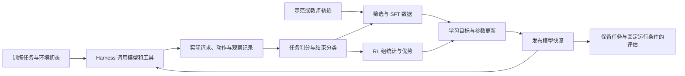

# Agent 训练的数据与反馈闭环：任务如何成为学习信号

> 前置：[Harness 边界](Agent系统与Harness边界.md)、[多轮轨迹](多轮轨迹与环境执行.md)、[RL 算法与系统接口](RL算法与系统接口.md)。本文讨论单 agent 的数据、反馈和权重；PPO/GRPO 的完整推导、环境资源和失败恢复仍由对应正文维护。

一次 agent 任务可以产生十次模型调用、几十条工具事件和多个训练片段，但它仍可能只交付一个最终补丁、获得一个任务分数。把这些数量都称为“样本数”，就容易在过滤、组统计和损失归约时改变目标。先确定希望模型在哪些任务上改善，再决定如何把执行记录转换成学习信号。

## 从任务分布到三种数据路径

任务由题目、环境初态、可用工具和成功条件共同定义。对 coding agent，题目相同但仓库 revision、依赖环境或测试规则不同，已经不是同一个执行条件。训练任务还需要明确来源比例、难度、去重规则，以及与评估任务的隔离方式；按轨迹随机切分，可能让同一个问题的不同解法同时进入训练和评估。

| 数据路径 | 数据与目标 | 系统必须保留什么 | 不能由此推断什么 |
|---|---|---|---|
| 示范轨迹用于 SFT | 学习专家或教师在给定上下文下的动作 | 每轮真实输入、示范输出、角色与目标 mask；教师和 harness 身份 | 教师动作概率不是学生的行为概率，不能直接当作学生 on-policy RL |
| 成功轨迹筛选后用于 SFT | 从多次执行中选取通过 verifier 的轨迹，学习其动作 | 原始尝试数、成功条件、接受率、去重与任务配比 | 只见到成功轨迹不代表掌握失败恢复；容易成功的任务可能被过采样 |
| 在线 RL | 当前或明确标记的行为策略执行任务，根据反馈更新策略 | 实际 token、行为概率及其语义、模型版本、任务组、结束原因和 reward | 奖励升高不自动证明保留任务上的成功率提高 |

三条路径可以组合，例如先学工具协议再做在线 RL，也可以直接在已有能力的模型上做 RL；这不是强制阶段。教师生成的数据需要独立筛选，失败示范也可以用于教授恢复，只要目标动作和数据用途明确定义。SFT、偏好优化和在线 RL 的参数与目标边界见[后训练系统边界](../09_Training_Systems/预训练微调与后训练的系统边界.md)。

图中的评估数据不回流本次训练。若长期根据同一开发集挑选配置，还需要另留最终测试集；否则即使未直接反向传播，也会通过选择配置适应评估集。

## 任务、执行与训练行必须分开计数

本文将一次逻辑任务执行称为 rollout；它对应一个 episode。一个任务可以采样多个 rollout；一个 rollout 又可以导出多个 segment，segment 是保存一段真实上下文与可训练动作的训练行。算法实现中的 rollout 批次编号可能另有含义，应通过字段说明区分。

| 身份 | 用途 | 必须维持的关系 |
|---|---|---|
| Task / group | 同一任务在声明条件下的候选组 | 不能把不同题目的分数混在同一个 GRPO 组中 |
| Episode / logical rollout | 一次尝试与一个任务级结果 | 压缩或切片不会创造新的独立尝试 |
| Turn / request | 一次实际模型调用 | 输入、输出和概率必须来自这次调用 |
| Action / attempt | 工具逻辑动作与传输重试 | 传输恢复和重新采样动作不能混为同一事件 |
| Segment / training row | 训练使用的记录单位 | 能追溯所属 rollout 和原始动作；共享内容的计数规则明确 |

如果一个成功 rollout 被拆成三行，三行都可以携带原来的 reward=1，用于追溯结果；但计算任务组均值时，它不应仅因拆成三行而成为三次独立成功。反过来，两次独立尝试恰好生成了相同文字，也不能仅按文本相同就去掉一次尝试。重复存储同一个动作和独立采样到相同动作是两种情况。

## 稀疏终局奖励怎样分配到长程动作

信用分配（credit assignment）是把延迟反馈转成各动作学习信号的问题。一个补丁最终通过测试，并不意味着每一步搜索、重试和编辑都同等有效；某一步错误甚至可能被后续步骤修复。

固定一个仅有终局奖励的教学设定：任务共有 $T$ 个模型动作，最后取得标量奖励 $R$，中间环境奖励为零。第 $t$ 个动作的 Monte Carlo 回报是

\[
G_t=\gamma^{T-t}R,\qquad 0<\gamma\leq1.
\]

这里 $t=1,\ldots,T$，$\gamma$ 是每个模型动作一步的折扣因子；它不是默认的每 token 折扣。如果取 $\gamma=1$，所有动作的回报都等于 $R$。这是一种有效的终局反馈用法，但没有提供每步因果贡献的独立标签，估计也可能有较大方差。

| 反馈方法 | 信号怎样得到 | 需要新增的假设或系统字段 |
|---|---|---|
| 终局回报或组相对信号 | 将结果或同任务组内比较得到的信号用于动作 | 清楚的 rollout/group 身份；每轮实际输入和有效动作位置 |
| 价值基线 / critic | 用回报减去对当前状态价值的预测，或用时序差分构造优势 | Critic 输入、版本、value、终止和截断的 bootstrap 规则 |
| 过程奖励 | 检查中间产物、测试进展或子目标完成情况 | 判分器与调用时点、是否计入成本、避免后验信息流入策略输入 |
| 额外继续执行来估计动作效果 | 从可恢复状态采多种后续轨迹并比较结果 | 可恢复的环境与记忆、额外采样预算、对照条件；一般不能仅回放文本 |

过程奖励会改变被优化的信号。例如按“测试通过数增加”给分，可能鼓励修改测试或反复制造可奖励变化；不能未经验证就声称保持原任务最优策略。算法、奖励塑形与 verifier 的选择必须通过独立任务质量检查。Actor/critic 的 GAE 与真正终止、时间截断的区别见[算法接口](RL算法与系统接口.md)；奖励漏洞与评估隔离见[质量闭环](奖励评估与质量闭环.md)。

在简化的任务级 GRPO 中，可以先对同一任务的 $K$ 次独立 rollout 计算均值和尺度，再把该 rollout 的优势映射到它的动作 token。是否采用标准差归一化、使用何种标准差、是否做 token/序列级比率，以及如何归约，都需要单独声明。将一个数广播到所有动作，只规定了信号共享方式，没有自动确定 loss 的最终权重。

## 数值推演：相同轨迹怎样因归约方式得到不同权重

假设两个 rollout A、B 各只有模型输出位置参与训练。A 有 2 个有效 token，各位置的标量损失项为 1；B 有 6 个有效 token，各位置的损失项为 3。工具文字和 prompt 的 mask 为零。这里的损失值是便于复算的教学输入，不代表真实模型或某次 PPO 运行；损失项可以已经包含各自的优势和裁剪规则。

设 $m_{ij}\in\{0,1\}$ 是第 $i$ 条 rollout 第 $j$ 个位置的有效 mask，$N_i=\sum_jm_{ij}>0$，$\ell_{ij}$ 是该位置的损失项，$M$ 是参与归约的 rollout 数。比较两种目标：

\[
L_{\mathrm{token}}=
\frac{\sum_i\sum_jm_{ij}\ell_{ij}}{\sum_iN_i},
\qquad
L_{\mathrm{rollout}}=
\frac1M\sum_i\frac{\sum_jm_{ij}\ell_{ij}}{N_i}.
\]

| 归约 | 本例结果 | A、B 的系数份额 |
|---|---|---|
| 全部有效 token 等权 | $(2\times1+6\times3)/8=2.5$ | $1/4$、$3/4$ |
| 每个 rollout 内求均值，再对 rollout 等权 | $(1+3)/2=2$ | $1/2$、$1/2$ |

系数份额指目标函数中的权重，不意味着真实梯度的范数比例相同。两种归约定义了不同目标：前者按有效 token 加权，后者使每条 rollout 的 token 均值获得相同权重；不能仅凭名称判断哪一种对所有任务更好。

现在把 B 因上下文变化拆为 B1、B2，两段各含 3 个有效 token。若直接对三个训练行的均值取平均，结果变成 $(1+3+3)/3=7/3$；B 因表示方式变化获得 $2/3$ 的行权重。要维持本例的 rollout 目标，两段都应知道 B 的完整有效数 $N_B=6$，并以 $M=2$ 做最终缩放：

\[
L=\frac12\left(\frac{2}{2}+\frac9{6}+\frac9{6}\right)=2.
\]

即使 B1、B2 被放入不同 microbatch，也需要完整 rollout 的分母，并正确处理跨 microbatch 与数据并行的缩放。全零 mask 的 rollout 如何计入 $M$ 需要另定规则；本例已明确排除它，不能把这个选择推断为框架默认行为。

组统计也有相同陷阱。设同一任务的两个独立 rollout 成绩分别为 A=0、B=1，则逻辑尝试均值为 $1/2$；若 B 拆成两行后直接平均 `[0,1,1]`，均值变成 $2/3$。在**只做均值中心化**的本例中，正确信号为 A=$-1/2$、B=$1/2$，错误的逐行统计得到 A=$-2/3$、B=$1/3$。先按逻辑尝试统计，再向其片段广播，才能保留原来的候选组含义。是否再除标准差是下一步，与修复身份混淆分开处理。

共享前缀还有另一种重复：同一个已生成动作可能为多个后续训练片段提供上下文。如果本例的目标是每个实际采样动作计一次，重复副本的训练 mask 应关闭，attention 上下文仍保留。若算法有意按多次后续回报重新加权共同动作，也必须显式定义估计量，不能由切片偶然决定。

## 原始记录到训练输入的契约

模型输出概率总是依赖实际输入。若某轮使用了压缩后的历史，就应在那份实际历史下评分该轮输出；事后把压缩前全文重新插入，不是无损恢复。完整例子见[三轮上下文推演](Agent系统与Harness边界.md#三轮推演同一份日志怎样对应不同输入)。

| 字段 | 训练消费前必须能回答的问题 |
|---|---|
| 实际 prompt/output IDs | 是当时真正提交和采样的 token，还是事后重新分词的文本？ |
| 输出 logprob | 对应哪组 token、哪个模型版本、哪种 temperature/top-p 等语义？缺失时能否从精确行为版本重算？ |
| Loss mask | 哪些是被训练策略的动作，哪些是工具、摘要、教师或共享前缀的上下文？ |
| 结束原因与片段映射 | 是任务完成、生成长度上限、任务预算截断还是基础设施失败？哪些原始动作被删除或重对齐？ |
| Reward / advantage | 判分来源是什么，在哪个逻辑任务组内统计，如何广播到片段？ |
| 版本与分母 | 模型、harness、环境、判分器对应什么身份，归约用的是 token、行还是 rollout？ |

缺失的行为概率不能用零填充值冒充真实 logprob。对于 mask=0 的位置，占位零可以是存储约定；对于参与策略损失的位置，缺失意味着需要有依据地补齐或拒绝消费。训练端重算的 current/old logprob 也不自动等于实际行为分布，继续见[四份概率与异步校正](行为概率与异步校正.md)。

只有实际 token 前缀以及相关模型输入条件保持相容时，跨轮合并才可能保持原有评分条件。重新分词、重写 assistant 内容、摘要或历史裁剪后，需要保留独立记录，或明确接受某些片段不再参与训练。代码中的重对齐是带取舍的样本处理规则，不是证明原始轨迹信号全部保留。

## 失败样本如何进入数据分布

| 情况 | 可作何种训练判断 | 必须另记什么 |
|---|---|---|
| Agent 产出有效补丁，但未通过可信测试 | 通常可按任务定义给予低奖励 | 失败测试和产物身份 |
| Agent 看到了工具错误并继续恢复 | 错误观察和后续动作是轨迹的一部分 | 实际暴露的错误信息、动作重试身份 |
| 时间或轮数预算耗尽 | 可按声明的预算内完成目标计失败，或采用截断处理 | 触发边界、未完成结果、critic 的末值处理 |
| 环境创建失败，模型未执行 | 没有可学习的策略动作；供给与评估仍需计数 | 基础设施失败分类，不能伪装成一次正常低分轨迹 |
| 判分器不可用或结果未知 | 暂存、重试或剔除需声明；不能默认真实 reward=0 | 未评分原因与重试成本 |

过滤改变被学习的数据。长任务更容易超时，如果只消费成功完成的短任务，即使保留题目采样配比，最终训练分布仍会改变。需要同时记录任务抽样量、执行完成量、可评分量、训练接受量，并按任务类别与长度检查接受率。完整的供给率和分母算例沿用[奖励评估与质量闭环](奖励评估与质量闭环.md)。

## 在目标运行条件下检查进展

固定一份独立任务集，记录模型、harness、环境、reward/grader 和预算的版本。先保持 harness 不变比较更新前后的模型；再保持模型不变比较 harness。四组组合及其交互关系见[执行条件的对照表](Agent系统与Harness边界.md#训练部署与评估需要对齐的是执行条件)。同一代码入口不足以固定实际运行条件：prompt、摘要配置、重试次数和持久记忆也要纳入版本。

比较时报告预算内成功率、失败原因、总 token/工具调用/墙钟消耗，以及成功任务的成本。训练效率则比较达到同一质量阈值的累计资源与时间，包括采轨迹、环境、判分、训练和换权。采样次数增加后至少一次成功率变高，与单次尝试能力提高是不同指标；统计不确定性见[实验统计与质量评估](../12_Performance_Reliability/实验统计与质量评估.md)。

## 来源、证据与实现入口

[Agent Lightning v1.0](https://arxiv.org/abs/2608.17528v1)讨论 harness 主导交互时的轨迹合并、优势与归约问题；[原始 Agent Lightning 论文](https://arxiv.org/abs/2508.03680)提供执行与训练解耦的研究背景。本文采用这些问题作为接口讨论的依据，不将论文当时的跨框架比较当作当前代码的支持矩阵。Monte Carlo、critic 和 GRPO 的基础推导与一手来源由[算法接口](RL算法与系统接口.md)维护。

本文的损失值、长度和分数都是教学输入，数值可直接按表复算，没有真实训练或模型质量测量。要检查这些契约在当前仓库是否成立，继续读[从 Agent 任务到策略更新](../12_Performance_Reliability/贯穿案例_从Agent任务到策略更新.md)：该案例特别区分片段的 rollout 归约、任务组奖励统计和失败占位的实际处理。

[Agent 阅读路线](../guides/Agent训练与Harness阅读路线.md) · [RL 目录](README.md)
