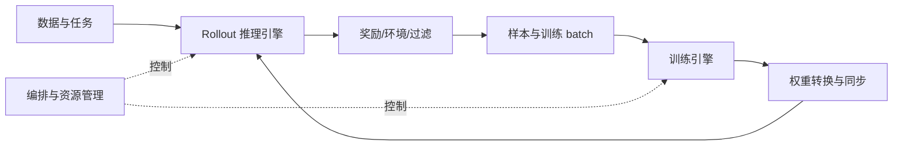

# RL 系统全景：角色、状态与执行阶段

> 前置：[生成与采样](../10_Inference_Serving/采样与推测解码.md)、[训练更新](../09_Training_Systems/训练步与优化器.md)。本篇定义 rollout、reward 与 policy update，再把它们对应到进程、状态和等待。

## 从“模仿答案”到“根据反馈改进”

RL（Reinforcement Learning，强化学习）用行动产生的反馈改进决策。对语言模型，可以先把当前 prompt 与已生成前缀看成 **state（状态）**，把下一个 token 看成 **action（动作）**；**policy（策略）**是模型在该上下文下选择各 token 的概率分布。这里的“策略”首先指一个分布，不是另一套独立算法或进程。

与用给定答案做交叉熵训练相比，RL 可以先让模型生成回答，再用 **reward（奖励）**评价结果。例如同一道可核验的数学题，模型生成三个回答，验证器给出分数 `[0,1,1]`。训练算法尝试提高表现较好动作的概率、降低表现较差动作的概率；具体要相对什么基准、改动多大，由下一篇的优势与目标函数决定。奖励高也不必然等于真实任务质量高，奖励本身需要验证。

**Rollout（采样执行）**是用策略行动并收集结果的过程；**trajectory（轨迹）**记录上下文、动作、反馈与终止信息；**policy update（策略更新）**使用这些数据修改参数。即使一次回答只在末尾得到一个分数，也仍需把反馈对应到生成它的动作序列。

## 同一份策略，两套执行环境

训练侧计算 loss、backward 和 optimizer update；推理侧持续生成 token、管理请求与 KV。两侧可能使用不同模型布局和并行度，因此参数需要转换并发布到生成引擎。

这张图表达依赖，不表示所有部署都严格串行。共置表示生成和训练共享设备，分离表示使用不同资源；partial rollout 表示未完成整条轨迹就暂停或交接。同步与持续异步执行会改变资源与时序，需要在基础完成后分别分析。

## 每次读代码回答四个问题

| 问题 | 在 RL 中看什么 |
|---|---|
| 谁执行 | driver、Ray actor、HTTP server、GPU worker、rank |
| 状态在哪里 | 权重、优化器、activation、KV、sample buffer |
| 谁等谁 | 生成长尾、reward、通信、换权、CPU 数据准备 |
| 什么不能改变 | mask、logprob、样本版本、梯度归一化、释放顺序 |

Driver 是协调主循环的进程，Ray actor 是分布式框架 Ray 管理的有状态工作进程，HTTP server 是接收网络请求的服务。它们与算法里的 actor/policy 不是同一个分类层次。算法知识帮助你判断最后一行，前三行需要新的系统知识。基础没补齐时先识别边界，不要求第一次就读懂所有源码。

## 局部加速的上限

假设一轮 rollout/reward/训练/换权依次为 60/10/20/5 秒，总计 95 秒。若训练快一倍，一轮变为 85 秒，收益约 10.5%。当阶段可并发时，又不能简单相加。先画真实时间线和关键路径，资源分离还要比较 GPU 成本与样本版本。

## 原理与实现的边界

百科的物理、数值与系统条目解释通用机制；Megatron/SGLang 走读解释具体执行引擎；slime 走读解释 RL 协同。论文详解与模型专题保留特定设计的推导和证据。

实现参见 [slime 编排中的角色与主循环](../13_Source_Analysis/slime/01_architecture_and_ray_orchestration.md)，画一轮同步 RL 图，给箭头标上控制请求、样本、权重或统计量。需要底层解释时，可按[物理基础目录](../00_Physical_Foundations/README.md)补齐。

相关条目：[运行环境](../03_Hardware_Systems/Linux与运行环境.md)。连续阅读见[系统路线](../guides/系统阅读路线.md)，所有专题见[总目录](../README.md)。

## 角色怎样变成执行阶段

Learner 是执行学习更新的角色；有些文献称生成端为 actor，另一些框架称待优化的策略模型为 actor。阅读时要先判断它指算法模型还是执行进程。角色是逻辑职责，不要求各自拥有独立进程或 GPU。

PPO（Proximal Policy Optimization，近端策略优化）通过限制一次策略改动的目标提高更新稳定性；GRPO（Group Relative Policy Optimization，组相对策略优化）用同题多回答的相对奖励构造优势。优势表示一个动作或回答相对基准好多少，critic/value 估计从当前状态继续行动的预期累计奖励。这里先识别职责，下一篇再算数值。

| 角色 | 输入与输出 | 状态与执行成本 |
|---|---|---|
| Actor / policy | 上下文 → 动作；训练 batch → 梯度 | 生成侧权重与 KV、训练侧激活和优化器 |
| Reference | 同一上下文和动作 → 参考 logprob | 常冻结；可前向计算或在适用条件下预计算 |
| Critic / value | 状态 → value，训练 value 目标 | PPO 等配方可能需要；组相对方法不必配置独立 critic |
| Reward / verifier | 回答或轨迹 → 分数与判定 | 规则、模型或环境服务，可能以 CPU/网络为关键路径 |
| Environment | 动作 → 观察、终止与任务状态 | 多轮会话、工具、沙盒和外部状态 |

Reference 是比较分布，reward 是训练信号，critic 是价值估计，三者不应因为都能由模型实现就合并为同一个角色。具体配方还可能加入 teacher 或去掉其中某些角色。

一轮同步 GRPO 可先固定生成权重，按 prompt 生成完整回答组，完成奖励与过滤，构造 mask/优势，计算所需旧策略和 reference 概率，再做训练更新和换权。PPO 加入 critic 与价值目标；异步执行允许不同阶段并发，但每条数据仍须记录对应身份与版本。

## 四条跨系统边界

| 边界 | 必须一致的对象 | 继续阅读 |
|---|---|---|
| 生成 → 训练 | token、动作 mask、概率语义 | [行为概率与异步校正](行为概率与异步校正.md) |
| 动作 → 环境 | session、attempt、工具副作用、终止 | [多轮轨迹与环境执行](多轮轨迹与环境执行.md) |
| 评价 → 更新 | reward revision、组身份、过滤规则 | [奖励评估与质量闭环](奖励评估与质量闭环.md) |
| 更新 → 生成 | 参数布局、发布完成、KV 失效 | [权重与异步一致性](权重样本与异步一致性.md) |

通用的 GPU、编译与通信定位方法见[性能基础](<../12_Performance_Reliability/00_concepts.md#9-跨层定位八个系统问题>)；本篇继续沿 RL 的角色与数据流展开。

## 完整推演与演进资料

- [RL系统演进史：从同步算法循环到分布式角色与版本管理](RL系统演进史.md)：同步循环、actor/learner、RLHF多角色、混合引擎与异步。

---

<!-- main-route -->

角色连接起来之后，还需要知道训练端实际消费什么。下一篇从 reward、advantage 与 logprob 解释接口。

[上一篇：采样与推测解码](<../10_Inference_Serving/采样与推测解码.md>) · [主线 20/26](<../guides/系统阅读路线.md>) · [下一篇：RL 算法与系统接口](<RL算法与系统接口.md>)

<!-- /main-route -->
