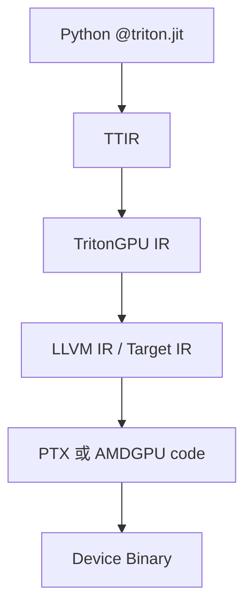
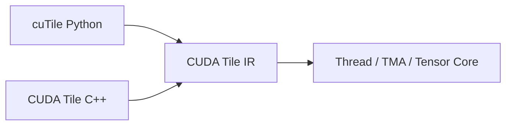

# Triton、TileLang、CUDA Tile、CuTe DSL 与 Helion

<details>
<summary>文章导航</summary>

- [它们不是简单的“谁替代谁”](<#它们不是简单的谁替代谁>)
- [Triton 的核心心智模型](<#triton-的核心心智模型>)
- [Triton 3.8 的信号](<#triton-38-的信号>)
- [AutoWS：Triton 正在补齐显式 Warp Specialization](<#autowstriton-正在补齐显式-warp-specialization>)
- [TileLang 的定位](<#tilelang-的定位>)
- [CuTe DSL：Python 语法，不是高层抽象](<#cute-dslpython-语法不是高层抽象>)
- [CUDA Tile / cuTile：NVIDIA 官方 Tile 模型](<#cuda-tile--cutilenvidia-官方-tile-模型>)
- [Helion：再提高一层](<#helion再提高一层>)
- [社区中常见的三种观点](<#社区中常见的三种观点>)
- [实用选型规则](<#实用选型规则>)
- [Triton 会不会先编译成 CUTLASS？不会，它通常是一条独立 Kernel 编译路线](<#triton-会不会先编译成-cutlass不会它通常是一条独立-kernel-编译路线>)
- [TileLang 又是什么？默认 CUDA backend 与 CuTeDSL backend 要区分](<#tilelang-又是什么默认-cuda-backend-与-cutedsl-backend-要区分>)
- [把 Triton / TileLang 与 Grouped GEMM 再串起来](<#把-triton--tilelang-与-grouped-gemm-再串起来>)
- [资料](<#资料>)

</details>


## 它们不是简单的“谁替代谁”

这些系统都试图降低高性能 Kernel 的开发成本，但它们把多少决定权交给编译器并不相同。

DSL（Domain-Specific Language，领域专用语言）针对特定问题提供表达方式，例如描述张量分块和搬运。简化表达并不自动保证生成代码达到硬件最优性能。

| 工具 | 主要输入抽象 | 编译基础 | 控制粒度 | 典型优势 |
|---|---|---|---|---|
| Triton | Block Tensor / Program Instance | MLIR、LLVM 及目标后端 | 中等 | 简洁、PyTorch 生态强、适合融合 Kernel |
| TileLang | 显式 Tile、Buffer、Pipeline | TVM/TIR 体系，多后端 Dialect | 中到偏低 | Pipeline 表达直接、算子案例丰富、多后端 |
| CuTe DSL | Layout、Tensor、Copy/MMA Atom | CUTLASS Python + CUDA Toolchain | 低层、控制很细 | 紧跟 NVIDIA 新硬件、接近 CUTLASS C++ |
| CUDA Tile / cuTile | Block-local Tile 与 Tile Operation | CUDA Tile IR | 中等 | NVIDIA 官方 Tile 模型，编译器映射 Thread/TMA/Tensor Core |
| Helion | 接近 PyTorch 的 Tile Loop | TorchInductor；可选择 Triton/CuTe DSL/Pallas 等 | 较高 | 更少硬件细节、自动调优与跨硬件方向 |

MLIR = **Multi-Level Intermediate Representation（多层中间表示基础设施）**；LLVM 是通用编译器基础设施；TVM 是面向 Tensor Program 优化和代码生成的编译栈；TIR = **Tensor Intermediate Representation（张量中间表示）**。


## Triton 的核心心智模型

CUDA SIMT 常从每个 Thread 的索引开始：

```cpp
int i = blockIdx.x * blockDim.x + threadIdx.x;
```

Triton 常从一个 Program Instance 负责的一块数据开始：

```python
pid = tl.program_id(0)
offsets = pid * BLOCK + tl.arange(0, BLOCK)
x = tl.load(x_ptr + offsets, mask=offsets < n)
```

开发者表达 Block Tensor 运算，编译器再决定数据如何映射到 Thread、Warp、Register 和目标指令。这提高生产率，但性能依赖编译器的 Layout、Pipeline 与目标后端能力。

### Triton 编译路线



TTIR = **Triton Intermediate Representation**。实际 Pass 和 IR 名称会随版本演进，但核心思想是逐步把 Tile 语义 Lower 到具体 GPU 的 Layout、共享内存、Barrier 和机器指令。


## Triton 3.8 的信号

截至 2026-08-28，Triton 3.8.0 是 GitHub Release 页的最新版本。值得注意的方向不是单个新 API，而是：

- Multi-CTA、Multicast 和 TMA 支持继续扩大；
- 新增 FpSan 等数值检查工具；
- NVIDIA Rubin 初步支持；
- 后端、Layout 和异步内存分析持续成为核心开发区。

Triton 的优势是抽象简洁和生态，但“简洁”依赖编译器足够理解新硬件。如果编译器暂时无法表达 Blackwell 的深异步 Pipeline、TMEM 或特殊调度，手写/专用 Kernel 仍可能明显领先。


## AutoWS：Triton 正在补齐显式 Warp Specialization

AutoWS = **Automatic Warp Specialization（自动 Warp 专职化）**。Meta/PyTorch 公开路线把它拆成：

1. 数据分区；
2. Software Pipeline 调度；
3. Warp Partition；
4. 分区间 Buffer 创建；
5. Memory Planner；
6. Producer–Consumer Channel 和 Barrier Lowering。

截至 2026 年初，官方文章明确说明该能力仍是实验性的、部分上游，支持 Hopper 和 Blackwell。这个事实很重要：看到某个分支上的 `warp_specialize=True`，不能默认任何 Triton/PyTorch 版本都稳定支持。


## TileLang 的定位

TileLang 是 Pythonic DSL，编译基础建立在 TVM 上，重点面向 GEMM、Dequant GEMM、FlashAttention、Linear Attention 等高性能算子。与 Triton 相比，它更显式地表达：

- Shared/Local Buffer；
- Copy、GEMM 与 Pipeline；
- Layout 和目标相关原语；
- Persistent/动态调度模式。

### 2026 年版本变化

TileLang v0.1.13 于 2026-08-03 发布，Release Notes 强调：

- 多后端 Language Dialect 重构；
- CUDA、ROCm 和 Metal 后端语义重新组织；
- Blackwell SM120 的 NVF4 Block-scaled MMA；
- 更灵活的 TMEM Layout；
- Source Location 进入编译诊断；
- 删除部分 Legacy API，升级需要看兼容说明。

NVF4/NVFP4 是 NVIDIA 的 4-bit 浮点与 Block Scaling 相关格式。这里最重要的工程结论是：TileLang 仍在快速演进，适合研究和快速开发，但生产升级要固定版本、跑正确性回归并重新 Benchmark。


## CuTe DSL：Python 语法，不是高层抽象

CuTe DSL 与 CuTe C++ 的编程模型接近，显式暴露 Layout、MMA Atom、Copy Atom、TMA、TMEM、Pipeline 和 Cluster。它的目标不是让开发者完全忘掉硬件，而是去掉 C++ 模板元编程负担，同时保留硬件控制。

因此它更适合：

- NVIDIA 架构专用的极致 Kernel；
- 需要直接使用最新 Tensor Core/TMA/TMEM 的场景；
- 需要与 CUTLASS Kernel 生态组合的场景。

学习成本仍高于普通 Triton，因为真正困难的是 Layout 和异步流水，而不是 Python/C++ 语法本身。


## CUDA Tile / cuTile：NVIDIA 官方 Tile 模型

CUDA Tile 把 Kernel 内部的思考单位从单 Thread 转为一个 Block-local Tile。CUDA 13.3 起提供 CUDA Tile C++，Python 侧通过 cuTile；两者共用 CUDA Tile IR。



编译器负责把 Tile Operation 映射到 Thread。规则 Tile-space Load 可以 Lower 到 TMA；不规则 Gather/Scatter 则可能采用不同路径。

需要注意，2026 年的 CUDA Tile 生态仍在发展。Triton-to-CUDA-Tile-IR 的 Incubator Backend 已公开，但仓库明确列出无序内存语义、部分操作缺失、小 GEMM 性能等限制。因此“可以编译”与“已经适合替换生产后端”是两回事。


## Helion：再提高一层

Helion 允许开发者使用接近 PyTorch 的运算和 Tile Loop 描述 Kernel，编译器与 Autotuner 决定 Block Size、Loop Order、Stage、Warp Specialization 等配置。

autotune（自动调优）实际试运行多个候选分块或执行配置，再为指定形状选择较快的一种。搜索本身有成本，其结果受形状、硬件和测量条件影响。

2026 年 PyTorch Foundation 的更新显示，Helion 正在扩展 CuTe DSL 和 TPU Pallas Backend，并探索 LLM-guided Autotuning。它代表另一种路线：

> 让开发者描述算法与 Tile 搜索空间，由系统选择 Triton、CuTe DSL 或其他后端。

这种路线可以提高可移植性，但代价是更大的搜索空间、编译时间，以及对编译器 Cost Model 的更高依赖。


## 社区中常见的三种观点

以下是根据项目设计文档、Release Notes 和维护者文章归纳的观点，不代表社区投票结果。

### 观点 A：Triton 是大多数 AI Kernel 的最佳起点

理由是代码简洁、与 PyTorch/Inductor 集成好、实验迭代快。反方担忧是最新架构能力进入通用编译器需要时间，极限性能仍可能落后于专用实现。

### 观点 B：复杂新 GPU 必须保留低层控制

CUTLASS/CuTe DSL 路线认为 Layout、TMA/TMEM、Cluster 和 Pipeline 不能完全隐藏，否则难以达到架构上限。反方指出这提高学习和维护成本，并强化厂商绑定。

### 观点 C：最终应由更高层编译器和 Autotuner 选择后端

PyTorch Inductor、Helion 等路线希望用户描述语义，由编译器在 Triton、ATen、CuTe DSL 等候选间选择。挑战是动态 Shape、编译成本、正确性和性能回归。


## 实用选型规则

- 先用 PyTorch 原生/编译器生成实现建立正确性基线。
- 标准 GEMM 优先测试 Vendor Library。
- 自定义融合与快速迭代优先尝试 Triton。
- 明确需要手工 Pipeline、TMA/TMEM 或 NVIDIA 最新特性时考虑 CuTe DSL/CUTLASS。
- 需要多后端或已有 TileLang 算子资产时评估 TileLang。
- 无论选谁，都保留 Eager Reference、误差测试、固定 Shape Benchmark 和端到端 Benchmark。


## Triton 会不会先编译成 CUTLASS？不会，它通常是一条独立 Kernel 编译路线


Triton 是一个用于编写高性能 Deep Learning primitive 的 DSL + Compiler。NVIDIA backend 的主流编译链可以概括为：

```text
Triton Python DSL / AST
        │
        ▼
TTIR
Triton IR
        │
        ▼
TTGIR
Triton GPU IR
        │
        ▼
LLIR
LLVM IR
        │
        ▼
PTX
        │
        ▼
cubin
        │
        ▼
SASS / GPU
```

因此普通 Triton GEMM 并不是：

```text
Triton → CUTLASS → CUDA
```

而是：

```text
Triton → 自己的 compiler lowering → PTX/cubin → GPU
```

所以 Triton 与 CUTLASS 更接近**并列的 Kernel 构建技术路线**，只不过抽象层和编程模型不同。

```text
CUDA C++ ───┐
CUTLASS ────┼──→ PTX/cubin/SASS → GPU
Triton ─────┘
```

Triton 的核心价值之一，就是让开发者主要围绕 **block/tile** 来描述计算，而让 compiler 帮忙完成许多 thread/warp mapping、memory access 和硬件 lowering 工作。

---


## TileLang 又是什么？默认 CUDA backend 与 CuTeDSL backend 要区分


TileLang 是建立在 TVM compiler infrastructure 上的 tile-level Kernel DSL。它不是天然等同于 CUTLASS frontend。

截至 2026-08，其 target 可以包含：

```text
auto
cuda
cutedsl
hip
metal
llvm
...
```

其中两条 NVIDIA 路线尤其要区分：

```text
                         TileLang
                            │
              ┌─────────────┴─────────────┐
              ▼                           ▼
        target="cuda"               target="cutedsl"
              │                           │
       TileLang / TVM IR              CuTe DSL backend
              │                           │
       CUDA-specific codegen         NVIDIA CUTLASS/CuTe DSL
              │                           │
       CUDA C++ / NVCC/NVRTC              │
              └─────────────┬─────────────┘
                            ▼
                      GPU executable
                            ▼
                           GPU
```

因此：

> **TileLang 默认 CUDA backend 并不是“编译成 CUTLASS”；但显式选择 `cutedsl` target 时，会进入 NVIDIA CUTLASS/CuTe DSL backend。**

TileLang 与 Triton都强调 tile 级抽象，但 TileLang 更愿意暴露一些 explicit pipeline / shared-memory / TMA / thread primitive 控制；Triton则长期以 compiler 帮助完成更多映射为主要使用体验。二者都在持续演化，不适合简单贴上“谁一定更高层/更低层”的绝对标签。

---


## 把 Triton / TileLang 与 Grouped GEMM 再串起来


现在可以看到为什么 Triton、TileLang 这类 Kernel DSL 在 AI Infra 中越来越重要：

```text
模型产生新 workload
例如 MoE Grouped GEMM / FlashAttention
             │
             ▼
现成 cuBLAS/cuDNN API 不一定完全匹配
             │
             ▼
需要自定义 tile / scheduler / fusion
             │
       ┌─────┴─────┐
       ▼           ▼
    Triton      TileLang
       │           │
       └─────┬─────┘
             ▼
       生成定制 Kernel
             ▼
          PTX/SASS
             ▼
            GPU
```

这与 GPU 架构从 Thread-centric 向 Tile/Pipeline-centric 演进是同一条主线：现代高性能 Kernel 越来越不是“每个 Thread 算哪个元素”这么简单，而是在考虑：

```text
一个 Expert 如何拆成 tile？
tile 如何分给 CTA？
CTA 如何驻留 SM？
Warp / Warp Group 如何协作？
TMA 如何预取下一 tile？
Tensor Core 如何持续做 MMA？
多个 Expert / Kernel / Stream 如何 overlap？
```

> **从上到下的完整心智模型：模型 workload（MoE）→ Grouped GEMM abstraction → Library/DSL 选择 → Tile/CTA mapping → SM → Warp Scheduler → Tensor Core。**

---


## 资料

- [Triton 3.8 Releases](https://github.com/triton-lang/triton/releases)
- [Triton Warp Specialization Roadmap](https://pytorch.org/blog/warp-specialization-in-triton-design-and-roadmap/)
- [TileLang Documentation](https://tilelang.com/)
- [TileLang Releases](https://github.com/tile-ai/tilelang/releases)
- [CUTLASS CuTe DSL](https://docs.nvidia.com/cutlass/latest/overview.html)
- [CUDA Tile Kernels](https://docs.nvidia.com/cuda/cuda-programming-guide/02-basics/writing-tile-kernels.html)
- [Triton CUDA Tile IR Incubator](https://github.com/triton-lang/Triton-to-tile-IR)
- [PyTorch Foundation: Helion Updates](https://pytorch.org/blog/driving-the-future-of-open-source-ai-an-update-from-pytorch-foundation-projects/)
