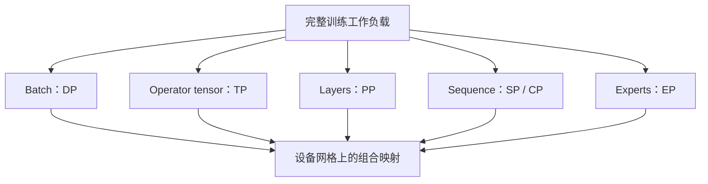

# 并行设计空间：从完整副本到多维布局

> 类型：专题综述。前置：[训练 step](<../../04_Training/12_数据管线与训练循环.md#s1>)、[通信原语](<../../03_Execution/11_互联通信与成本.md#s1>)。

## 三个问题决定切分方式

模型状态是否放得下，单次计算是否足够快，整个系统是否有足够吞吐？它们分别涉及容量、关键路径和可并行工作，并不总能由同一个并行维度解决。

描述切分时，同时列出全局 tensor、局部 shape、副本/分片/部分和语义，以及生产和消费该布局的算子。只写 TP=8 不足以知道执行需要哪些通信。

同一种切分还要同时说明状态所有权、前反向通信、拓扑映射和计算颗粒度。容量足够不代表吞吐足够；通信语义正确也不代表已经映射到合适链路。

## 完整副本的边界

数据并行让各 rank 处理不同数据，再合并梯度。它保留较大的本地计算粒度，却复制参数和优化器状态。模型放不下时，增加完整副本数量不能解决单卡容量问题。

梯度累积减少更新频率和某些同步，但仍需处理全局目标归一化；更大的 global batch 还会影响优化过程。

## 状态分片的方向

ZeRO 思路将优化器、梯度和参数等冗余状态逐步分片。参数只在需要时展开，可以降低常驻内存，但每层计算与通信更紧密。FSDP 是相关的框架实现路线，API、预取和峰值不能仅由概念 stage 推出。

全局分片在慢速跨节点网络中可能昂贵，因此出现利用高速子组的混合分片。分片程度、通信范围和副本数量成为共同决策。

## 算子、层与序列的方向

TP 将单个算子分解，并在必要位置规约或聚合；PP 将层放在不同设备，以 microbatch 提供流水工作；SP/CP 将某些序列维度上的状态或计算分布到设备。

这些方法解决不同问题。TP 可能增加频繁通信并缩小 GEMM；PP 增加气泡和在途状态；长上下文并行需要处理远端信息与 causal 负载差异。详见各自条目。

## 条件计算的方向

EP 将不同专家放在不同设备。每个 token 的路由决定工作分布，因此不仅要核算平均负载，还要核算热专家、最慢 rank、变长通信和临时缓冲。Attention 和专家可能使用不同布局；不能无条件把所有并行度相乘得到总卡数。

## 一个两维布局算例

4 张 GPU 组成 2×2 网格，第一维是两路数据并行，第二维是两路 TP。相同 DP 坐标中的两个 rank 共同处理一份数据；相同 TP 坐标中的两个 rank 持有对应参数切片，并规约各自数据贡献。

若再对 TP 切片进行 FSDP 分片，参数 gather 应发生在正确的 DP 子组内，而不是随意跨全部 rank。逻辑组正确后，还要把高频通信映射到适当物理互联。

## 演进与瓶颈迁移

| 设计 | 首先改善 | 下一步需要处理 |
|---|---|---|
| DP/DDP | 样本吞吐 | 状态复制、规约与到达偏斜 |
| ZeRO/FSDP | 冗余状态容量 | 展开峰值、预取与通信 |
| TP | 单层容量与计算分摊 | 细粒度同步、算子变小 |
| PP | 层级容量分布 | 气泡、stage 划分、在途状态 |
| SP/CP | 序列相关状态或计算 | 远端信息、布局转换 |
| EP | 条件参数与专家工作 | 路由倾斜、All-to-All |
| 自动规划 | 人工搜索成本 | 成本模型误差、动态负载 |

这张表是问题关系图，不是发表年代序列。旧方法在满足容量、网络较慢或模型较小时仍可能是合理选择。

相关：[统一布局](<../../04_Training/14_数据并行与状态分片.md#s1>)、[DeviceMesh](<../../04_Training/16_并行组合与训练方案.md#s1>)、[训练方案](<../../04_Training/16_并行组合与训练方案.md#s2>)、[推理方案](<../../05_Inference/22_推理并行量化与执行优化.md#s1>)。

参考：[ZeRO](https://arxiv.org/abs/1910.02054)、[Megatron-LM](https://arxiv.org/abs/1909.08053)、[GPipe](https://arxiv.org/abs/1811.06965)。

## 从固定布局到动态组合

DeviceMesh/DTensor 将副本与分片表达为显式布局，TorchTitan 展示多维策略的组合。Megatron 的 Dynamic CP 按相应实现条件调整变长 microbatch 的 CP degree，fine-grained TP 与异构映射也关注工作负载差异；这些都需要区分概念可组合与特定后端支持。

MoE 的 Attention 与 experts 可以使用不同布局，层边界因而需要重分布。RL 又增加模型之外的角色与阶段并行，在共置、分离和异步之间权衡容量、吞吐与策略版本差。沿[多维网格](<../../04_Training/16_并行组合与训练方案.md#s1>)和[RL 角色并行](<../../06_Post_Training/27_权重发布异步与资源调度.md#s3>)可以继续追踪这些约束。

参考：[Megatron 并行指南](https://docs.nvidia.com/megatron-core/developer-guide/latest/user-guide/parallelism-guide.html)、[PyTorch Distributed](https://docs.pytorch.org/tutorials/beginner/dist_overview.html)、[TorchTitan](https://github.com/pytorch/torchtitan)、[vLLM 并行](https://docs.vllm.ai/en/stable/serving/parallelism_scaling/)、[verl HybridFlow](https://verl.readthedocs.io/en/latest/hybrid_flow.html)。

## 完整推演与演进资料

- [训练并行演进史：瓶颈如何从副本转移到布局与调度](<训练并行演进史.md>)：副本、流水线、张量切分、分片、长上下文与专家。

---
