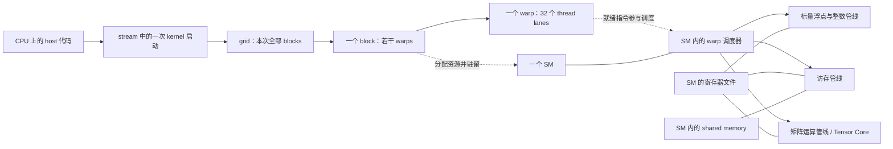

# 1. 把 CUDA 程序放到真实 GPU 上理解

[上一章](<00_setup.md>) · [目录](<README.md>) · [下一章：核心 kernel](<02_core_kernels.md>)

本章沿一次 kernel 的执行，把三件事连起来：**程序怎样分工 → 硬件怎样承接 → 数据与依赖怎样限制执行**。先以常规独立显存的 NVIDIA GPU 和普通 thread-block kernel 为模型；具体容量、执行管线与缓存策略随架构变化。第 7–9 章再将它扩展到 SM80 的矩阵乘与 FA2。

<a id="hardware-map"></a>

## 1.1 两套层次之间是映射，不是一一对应

**执行层次**分为程序组织工作和硬件承接工作两部分。grid 是一次启动的全部工作，block 是可在块内协作的线程组，warp 是其中按 32 个线程组织的执行组，lane 是线程在 warp 内的编号。CTA（Cooperative Thread Array）是 block 的另一名称；SM（Streaming Multiprocessor，流式多处理器）是接收和执行 blocks 的硬件单元。

假设要做一百万次互不依赖的加法，给每个元素分配一个逻辑线程很自然，但机器不可能同时放下一百万份执行状态。因此程序先把线程打包成组，硬件再根据资源分批接收这些组；声明了一百万线程，不表示有一百万个物理执行单元同时工作。

CUDA 的 grid/block/warp/thread 描述一份工作的组织；GPU/SM/调度器/运算管线描述执行它的机器。把二者画在一起：



实线表示提交、组成或硬件联系，虚线表示软件工作映射到硬件。图只保留入门所需部件，不表示每个 SM 只有一个调度器，也不表示所有架构具有相同的内部连接。

图中的 ALU（Arithmetic Logic Unit）指算术逻辑运算资源，LSU（Load/Store Unit）指加载/存储资源；加载是把内存中的值取来供指令使用，存储是把结果写回内存。寄存器文件是一组为驻留线程保存操作数和中间值的硬件资源，不是磁盘上的文件。

| CUDA 中看到什么 | 由硬件怎样承接 | 直接影响怎样写代码 |
|---|---|---|
| grid | blocks 被分配到可用 SM，可能分批执行 | grid 可以比 SM 数多得多，不依赖 block 编号的执行顺序 |
| block / CTA | 普通 block 的线程在同一个 SM 上执行，获得本块所需资源 | 块内能共享 shared、用 block barrier 协作 |
| warp | SM 的调度器从可发射的 warp 中选择指令 | 关注同一 warp 的分支、地址和数据依赖 |
| thread / lane | 保留自己的逻辑状态，指令使用 SM 的相应管线执行 | 一个线程不永久占有一颗 CUDA Core |
| thread 的局部值 | 编译器通常分配到 SM 寄存器文件中的资源 | 寄存器使用量会限制能驻留的线程数 |
| block 的 shared 数组 | SM 上按 block 分配的片上存储 | shared 越大，可能容纳的 block 越少 |

表中的 barrier（屏障）是让指定范围的线程到达共同协作点的同步机制，用于协调数据交接；block barrier 只覆盖同一 block。第 1.6 节再比较各层次的同步范围。

**CUDA Core 和 Tensor Core 是运算资源，不是额外一级线程容器。** 指令类型决定使用哪类管线：普通加法、地址计算、加载以及矩阵乘加不会全由同一种“核心”处理。SM 可以划分为多个处理分区；先掌握资源作用域，之后才需要查某代芯片有几个调度器、多少个执行单元。

GPC（Graphics Processing Cluster，图形处理簇）是比 SM 更高一级的硬件组织；在本教程的普通 kernel 中不用指定它。支持 thread-block cluster 的新架构提供额外协作机制，但那是显式启用的另一层约束，不能推导出任意两个普通 block 都能共享彼此的 shared。模型与适用范围见 [NVIDIA Programming Model](https://docs.nvidia.com/cuda/cuda-programming-guide/01-introduction/programming-model.html)。

## 1.2 从一条加法表达式得到线程分工

**线程分工是把逻辑线程编号映射到数据下标的规则**，由代码决定。下面用一维连续映射，让一个线程负责一个输出元素：`threadIdx.x` 是块内编号，`blockIdx.x` 是块编号，`blockDim.x` 是每块线程数。

CPU 依次算 `c[0]`、`c[1]`……；GPU 版本让许多逻辑线程执行同一个函数，各自计算下标：

```cpp
__global__ void vector_add(const float* a, const float* b, float* c, int n) {
    int i = blockIdx.x * blockDim.x + threadIdx.x;
    if (i < n) c[i] = a[i] + b[i];
}
```

host 端启动：

```cpp
int threads = 256;
int blocks = (n + threads - 1) / threads;
vector_add<<<blocks, threads>>>(d_a, d_b, d_c, n);
```

`<<<blocks,threads>>>` 指定工作组织，不指定 SM 编号。`(n+B-1)/B` 对正整数向上取整，本例只处理不会使表达式溢出的正 int；通用接口另需处理 n=0 和超大数组。

取 n=1000：启动 4 个 block，每块 256 线程、8 个 warp。block 3 的 thread 231 对应 `3*256+231=999`，之后的 24 个线程不读写数据。末尾 warp 仍然存在，只是这条加法语句有些 lane 不活跃。

缩小到 `n=10, B=4` 更容易枚举：block 0 负责下标 0–3，block 1 负责 4–7，block 2 的线程 0/1 负责 8/9，线程 2/3 只做边界判断。需要的块数是 `ceil(n/B)`：先用整数除法得到完整块数，再在余数非零时加一；对正整数，这与 `(n+B-1)/B` 相等。这里 n 的单位是元素，B 的单位是线程/块，且每线程恰好处理一个元素，故商是块数。这个 4 线程的示意启动仍占一个部分活跃的 warp，不会让硬件 warp 宽度变为 4。

线程编号与数据下标由程序决定；线程落在哪个 SM 不应影响它算出的答案。这就是同一份 kernel 可以适配不同 SM 数量 GPU 的基础。

<a id="launch-journey"></a>

## 1.3 跟踪 block 3 的一个 warp

**warp 调度**是 SM 硬件在驻留 warp 中选择就绪指令发射的过程。软件提交 kernel 后，硬件管理执行状态；不是 CPU 每执行一条指令就决定下一条交给哪个 warp。先区分 **resident、eligible、issued** 三个描述硬件执行状态的词：

| 状态 | 描述对象 | 含义 |
|---|---|---|
| resident（已驻留） | block / warp | 已被接纳到 SM，分配了寄存器、warp/block 槽位等驻留资源 |
| eligible（可发射） | 驻留 warp 的当前待发射指令 | 数据依赖、同步和所需执行资源等条件已满足，调度器可以选择它，但本次不一定选中 |
| issued（已发射） | 一次指令发射 | 调度器已选中该 warp，将相应指令发往执行管线；结果仍可能尚未就绪 |

因此，不能把它们理解成 warp 一生只经过一次、彼此互斥的三个阶段。warp 在驻留期间，会随指令推进反复经历“等待条件满足 → eligible → 被选中并 issued”；等待或发射指令时，它仍然是 resident。

例如，读取 `a[i]`、`b[i]` 的 load 指令已经 issued，只表示读取请求已发出，数据可能仍在返回途中。后面的加法依赖这些数据，因此暂时不能成为 eligible；数据返回且其余条件满足后，加法才可被调度器选中发射。这段等待期间，warp 始终驻留在 SM 上。

仍看上面的加法，忽略初始化和传输，跟踪 block 3 的 warp 0：

| 步骤 | 代码中的含义 | 硬件正在处理什么 |
|---|---|---|
| 提交 | CPU 执行 kernel launch | CUDA 提交工作；通常不等 GPU 算完才返回 |
| 驻留 | block 3 获得执行机会 | 某个 SM 为该 block 分配寄存器、warp/block 槽位等资源 |
| 算地址 | lane t 得到 i=768+t | 每条 lane 计算自己的索引与地址 |
| 加载 | 读 a[i]、b[i] | warp 的访存请求由访存管线处理，可能命中缓存或访问显存 |
| 等依赖 | 加法需要输入值 | 若输入还没到，该 warp 的相关指令暂不可发射；调度器可选别的就绪 warp |
| 计算 | `a[i]+b[i]` | 浮点管线使用各 lane 的操作数，结果保存在各自的寄存器值中 |
| 写回与结束 | 写 c[i]，所有线程完成 | 发出 global store；block 完成后释放其驻留资源，供待执行 block 使用 |

这不是逐周期的硬件仿真，也不规定实际指令数；编译器可以重排独立操作。

判断一个 warp 是否仍驻留，要看 SM 是否仍保留它的执行上下文，例如程序计数器、寄存器和线程执行状态；**没有 eligible 指令不等于已经离开 SM**。等待数据或 barrier 时这些状态仍保留。warp 的全部线程执行结束后，它不再有待执行工作；block 完成后释放相应的驻留资源。

每个指令发射机会，调度器从自己负责的驻留 warp 中检查候选：指令是否准备好、所需操作数是否就绪、同步条件是否满足、相关执行资源能否接收。硬件用 scoreboard 等依赖跟踪机制记录未完成的结果，用同步和资源状态判断是否可以推进。多个 warp 都 eligible 时，按硬件仲裁选择；CUDA 不保证按 warp 编号或固定轮询顺序。没有 eligible 候选时，这个发射机会可能空过，但已发出的访存或计算仍可推进。发出 load 后若还有不依赖其结果的指令，该 warp 也可能继续发射。

一个 SM 通常能让多个 warp 驻留，但同一时刻能发射多少、到哪些管线，取决于架构与就绪条件。GPU 用其他 warp 的工作遮住等待时间，这叫隐藏延迟；它没有把一次显存访问本身变成零延迟。切换这些已驻留 warp，不需要每次先把它们的全部寄存器搬回显存。

同一 warp 的 lane 可以走不同分支，硬件通过活跃 mask 等机制执行相应路径。不要因此认为 32 个 lane 永远在每一步自动同步；涉及跨线程数据交换时仍要使用正确的同步原语。执行与调度的细节见 [Advanced Kernel Programming](https://docs.nvidia.com/cuda/cuda-programming-guide/03-advanced/advanced-kernel-programming.html)。

例如偶数 lane 做乘法、奇数 lane 做加法，同一 warp 要处理两条路径的活跃线程集合；它并没有因此变成两个可随意独立同步的 warp。分歧不一定产生错误，但可能减少每条指令真正工作的 lane 数。隐藏延迟也有边界：假设 warp A 等待输入时，B 有独立的加法可执行，调度 B 就有用；若所有驻留 warp 都在等同一轮输入或 barrier，再多“已驻留”状态也没有可发射指令。这里分别对应延迟（单次操作多久完成）和吞吐（单位时间完成多少工作），两者不能混为一谈。

<a id="memory-paths"></a>

## 1.4 数据放在哪里：地址空间与物理存储一起看

**地址空间**规定程序怎样访问数据、哪些线程可以使用它；**物理存储**则是实际承载数据的显存、缓存、寄存器文件等硬件。二者并非一一对应。例如 local memory 描述线程私有存储，其底层仍由设备内存支持。区分这两层，才能判断一次访问可能经过哪些硬件、付出什么成本。

先看数据可能出现的位置：

```text
CPU 内存 ── 显式 H2D/D2H 等传输 ── GPU 的设备内存（HBM 或 GDDR）
                                       ↕
                                  GPU 的 L2 cache
                                       ↕
            SM 内：L1 cache、访存管线、寄存器文件、shared memory、运算管线
```

这是一张位置关系图，**不是所有数据必须逐站经过的串行通道**。例如 global load 可以通过缓存到寄存器，不必先进入 shared；global→shared 异步拷贝又有专门路径。缓存是否使用、是否绕过某级，取决于指令与架构。

| 代码或概念 | 程序中的作用域 | 典型物理落点 | 与上一张执行图的连接 |
|---|---|---|---|
| `cudaMalloc` 得到的 global 数据 | 有有效指针的设备线程可访问 | 设备 DRAM 支持，访问可能命中 L1/L2 | 不同 SM 可访问同一输入，但共享地址不等于完成了同步 |
| `__shared__ float s[...]` | 本教程中是当前 block | 当前 SM 的 shared 存储 | 一个 block 的多个 warp 能交换中间值 |
| `float acc` 等线程局部值 | 当前线程 | 常由 SM 寄存器文件承载 | 参与算术指令，数量影响 block 能否驻留 |
| local memory | 逻辑上当前线程私有 | 设备内存支持，可经过缓存 | spill 或某些数组可能访问这里；“local”不意味着片上高速 |
| L1/L2 cache | 硬件维护的访问缓存 | 片上 cache | 对 global 数据的命中可减少更远处的流量，普通代码不逐项声明它们 |

global/local/shared 是编程可见的存储概念，HBM/GDDR、SRAM、cache、寄存器文件是物理实现概念。global 不能直接等同于“每次都读 HBM”；一个 C++ 局部变量也不保证一定放在寄存器。

**local memory 没有对应一块独立的“本地高速存储”硬件**，它与 global 数据都可以由同一套 GPU 显存承载，访问也可能命中缓存。线程的局部变量是 C++ 作用域概念；编译器可能把它放在寄存器、local memory，或者直接优化掉。spill（寄存器溢出）是编译器把部分本来希望用寄存器保存的线程私有值放到 local memory 的情况；某些数组、大型结构体也可能使用 local memory，不必先发生 spill。

DRAM 是动态随机存取存储器，HBM（高带宽内存）和 GDDR（图形用双倍数据率内存）是 GPU 常见的外部存储类型；SRAM 是常用于片上缓存等结构的静态存储器。cache（缓存）由硬件自动保留部分数据副本，使后续访问有机会从较近的位置取值；L1/L2 是一级/二级缓存的简称。记住这些位置，是为了追踪一次读操作要走多远，而不是把某个变量名固定等同于某块物理器件。

生命周期也由作用域决定：global 分配可以跨多个 kernel 保留，直到最后一个使用者结束后释放；shared 按 block 提供，只在该 block 执行期间有效，下一块不会继承其合法内容；线程私有值只由该线程使用。缓存里的副本何时被替换由硬件决定，程序不能把“上次命中了缓存”当成下一次同步或容量保证。

许多现代架构的 L1 与 shared 使用可配置的片上资源，但它们的**使用语义不同**：cache 由硬件管理命中和替换，shared 的内容、布局与协作时序由程序显式安排。把它们写作“shared/L1”时，不能理解成程序里可互换的同一种数组。具体架构可查 [Ampere Tuning Guide](https://docs.nvidia.com/cuda/ampere-tuning-guide/index.html)。

以普通同步加载的 tiled GEMM 为例，数据路径是：

```text
A/B 的 global 数据 → 加载到线程临时值 → 存入 shared tile
                                            ↓ 块内协作与复用
                            读入各线程操作数 → 运算管线 → acc
                                                               ↓
                                                        C 的 global 输出
```

寄存器文件在物理上属于 SM，但每条线程的寄存器值在逻辑上独立；同在一个 SM 的线程并不能任意按地址读取彼此的寄存器。shuffle 是特定的 warp 内交换机制，shared 则能用于更大的 block 范围。

## 1.5 连续地址为什么要和 warp 一起考虑

**合并访存（coalescing）**是硬件把一次 warp 指令中各 lane 的内存访问组织成较少内存事务的机制。它关注整个 warp 的地址集合：相邻 lane 访问相邻元素，通常比各自访问相距很远的地址更有效。要分析它，先根据张量布局把元素下标换算成字节地址，再统计触及的数据段。

行优先矩阵 A[M,K] 的 `(row,col)` 在 `A[row*K+col]`。K=5 时 `(2,3)` 的元素偏移为 13，FP32 字节偏移为 52。PyTorch 的非连续 view 则使用 `row*stride_row+col*stride_col`，stride 以元素为单位。

如果 warp 的 lane t 读 `a[base+t]`，32 个 FP32 数连续覆盖 128 字节；读 `a[base+128*t]` 则将地址分散开。硬件以 warp 的请求集合组织内存事务，前者通常更容易合并。128 字节是这里的有效数据量，不是在所有对齐条件下固定只发一次事务；实际访问粒度与缓存行为需按架构核对。

下面用现代设备常见的 **32 字节 sector（访存统计中的数据段）模型**手算一次。假设 `a` 是 `float*`，有足够多的元素，warp 的 32 个 lane 都参与同一次 global load，每个 lane 读取一个 4 字节的 float，`t` 是 0–31 的 lane 编号。

**“a 的起点按 32 字节对齐”是什么意思？** 设 `a[0]` 的起始字节地址为 A，条件就是 `A % 32 == 0`，即 A 是 32 的整数倍，恰好落在 sector 边界上。例如，地址 1024 满足条件，而 1028 位于 sector 开头之后的第 4 字节。1028 仍满足 float 的 4 字节对齐要求，但不满足这里分析 warp 访问时使用的 32 字节对齐。

数组下标以元素为单位，地址以字节为单位，因此 `a[i]` 的起始地址是 `A + 4*i`，该元素占据 `A + 4*i` 到 `A + 4*i + 3` 的四个字节。下面的字节编号都指**相对于 A 的偏移**，不是实际访问地址 0。

sector 边界是固定的；因为 A 已对齐，可以从 A 开始编号：

| sector | 相对字节范围 | 包含的 float 元素 |
|---|---|---|
| S0 | 0–31 | `a[0]`–`a[7]` |
| S1 | 32–63 | `a[8]`–`a[15]` |
| S2 | 64–95 | `a[16]`–`a[23]` |
| S3 | 96–127 | `a[24]`–`a[31]` |
| S4 | 128–159 | `a[32]`–`a[39]` |

一个 sector 能容纳 `32/4 = 8` 个 float。程序从字节 4 开始读，不会把 sector 边界改成 4–35、36–67。

**第一种：读 `a[t]`，刚好填满 4 个 sector。** lane 0 读 `a[0]`，对应字节 0–3；lane 31 读 `a[31]`，对应字节 124–127。全部 lane 合起来读取字节 0–127，恰好覆盖 S0–S3，每个 sector 的 32 字节都被本次访问用到。因此有效数据是 `32*4 = 128` 字节，覆盖的 sector 总容量也是 `4*32 = 128` 字节。

**第二种：读 `a[t+1]`，连续访问整体右移一个 float，跨进第 5 个 sector。** lane 0 读 `a[1]`，对应字节 4–7；lane 31 读 `a[32]`，对应字节 128–131。有效数据仍然只有 128 字节，但范围变成 4–131：

| sector | 本次需要的元素 | 有效字节数 |
|---|---|---|
| S0 | `a[1]`–`a[7]` | 28 |
| S1 | `a[8]`–`a[15]` | 32 |
| S2 | `a[16]`–`a[23]` | 32 |
| S3 | `a[24]`–`a[31]` | 32 |
| S4 | `a[32]` | 4 |

S0 开头的 4 字节没有用到，最后一个元素又落进了 S4。于是 `28+32+32+32+4 = 128` 字节的有效数据，涉及 `5*32 = 160` 字节的 sector 总容量。这就是连续但未按 sector 边界对齐时的额外开销。

**第三种：读 `a[128*t]`，每个 lane 落在不同的 sector。** 128 是元素间隔，换成字节是 `128*4 = 512` 字节：

| lane | 元素 | 相对字节范围 | 所属 sector |
|---|---|---|---|
| 0 | `a[0]` | 0–3 | S0 |
| 1 | `a[128]` | 512–515 | S16 |
| 2 | `a[256]` | 1024–1027 | S32 |
| … | … | … | … |
| 31 | `a[3968]` | 15872–15875 | S496 |

32 个 lane 触及 32 个不同的 sector，每个 sector 只使用其中 4 字节。有效数据仍为 `32*4 = 128` 字节，sector 总容量却是 `32*32 = 1024` 字节。**1024 字节是这些被触及的 sector 的容量之和**，并不表示必须读取字节 0–15875 之间的所有内容；中间未访问的 sector 不计入。

| 访问方式 | 有效数据 | sector 数 | sector 总容量 | 本次有效数据 / sector 总容量 |
|---|---|---|---|---|
| `a[t]` | 128 B | 4 | 128 B | 100% |
| `a[t+1]` | 128 B | 5 | 160 B | 80% |
| `a[128*t]` | 128 B | 32 | 1024 B | 12.5% |

这个比例反映本次访问对 sector 的利用程度，**不等于实测 HBM 流量，也不能直接换算成运行时间**。命中缓存的 sector 可能无需再次访问 HBM，本次未使用的数据也可能被邻近 warp 复用；实际指令和架构仍会改变下游请求。第三种访问的每个地址其实都按 32 字节对齐，但地址很分散，因此还要同时考虑**对齐与集中程度**：让一个 warp 的访问尽量落在少量 sector 内。相关模型见 [合并访问说明](https://docs.nvidia.com/cuda/cuda-c-best-practices-guide/index.html#coalesced-access-to-global-memory)。

<a id="thread-warp-lane-mapping"></a>

**二维、三维 block 如何组成 warp？** CUDA 按 **x 最快变化、其次 y、最后 z** 的顺序，把 block 内的线程坐标转换成线性编号，再每 32 个线程组成一个 warp。这个编号规则由 CUDA 定义，与数组写成 `a[y][x]` 还是 `a[x][y]` 无关，也不表示线程按编号先后执行：

```text
linear_tid = threadIdx.x + blockDim.x * (threadIdx.y + blockDim.y * threadIdx.z)
warp = linear_tid // 32
lane = linear_tid % 32
```

这里的 warp 编号是在当前 block 内的编号，lane 是线程在所属 warp 内的编号。第 2 章使用 `dim3(16,16)`，即 `blockDim.x=16, blockDim.y=16, blockDim.z=1`，共有 256 个线程、8 个 warp。令 `tx=threadIdx.x, ty=threadIdx.y`，则 `linear_tid=ty*16+tx`：

| `ty` | `tx` | `linear_tid` | block 内 warp 编号 | lane 编号 |
|---|---|---|---|---|
| 0 | 0–15 | 0–15 | 0 | 0–15 |
| 1 | 0–15 | 16–31 | 0 | 16–31 |
| 2 | 0–15 | 32–47 | 1 | 0–15 |
| 3 | 0–15 | 48–63 | 1 | 16–31 |
| … | … | … | … | … |
| 14 | 0–15 | 224–239 | 7 | 0–15 |
| 15 | 0–15 | 240–255 | 7 | 16–31 |

把每一行中的数字画成 lane 编号，前两个 warp 的逻辑分布是：

```text
                    tx →
             0   1   2  ...  14  15
ty = 0       0   1   2  ...  14  15  ┐ warp 0
ty = 1      16  17  18  ...  30  31  ┘
ty = 2       0   1   2  ...  14  15  ┐ warp 1
ty = 3      16  17  18  ...  30  31  ┘
```

因此，固定 `ty=0`、让 `tx` 从 0 到 15，得到连续的 lane 0–15；接下来是 `ty=1` 的 lane 16–31。反过来，固定 `tx=0`、让 `ty` 从 0 到 3，线性编号是 0、16、32、48，对应 `(warp,lane)` 为 `(0,0)`、`(0,16)`、`(1,0)`、`(1,16)`，并不是连续 lane。lane 编号会在每个 warp 内重新从 0 开始。

这个分布随 block 形状变化：`dim3(32,8)` 中，一个 warp 恰好覆盖同一 y 的 32 个 x；`dim3(1,256)` 中，x 始终为 0，相邻 lane 才对应相邻 y。三维 block 也沿用上面的公式，排完一个 x/y 平面再增加 z。

**二维 block 不等于物理上按二维摆放的运算单元。** 分析合并访存时，先用 block 形状确定一个 warp 的 32 个线程坐标，再代入访存表达式计算地址。第 2 章的矩阵乘会据此展开 A/B 的合作加载。

shared 的访问还要考虑 bank，即内部存储分区；global 合并访存和 shared bank conflict 是不同问题。第 7 章在布局变换时继续解释，初学时先确保索引和同步正确。


## 1.6 同步范围为何与这些层次有关

**同步**用于建立“生产者完成并使数据可见，消费者才能使用”的关系；**同步范围**决定哪些参与者受这个关系约束。barrier（屏障）要求指定范围的线程到达协作点，例如 `__syncthreads()` 协调同一 block 的线程及相应内存访问。它不能直接协调任意两个 block。

跨 kernel 时，**stream** 是软件的有序工作队列，**event** 是记录在队列某个位置的完成标记。它们用于表达任务先后关系；等待可以发生在 GPU 队列中，也可以阻塞调用它的 CPU 线程，二者不能混为一谈。下表按需要协调的对象选择工具：

| 需要协调的对象 | 本教程中的工具 | 为什么在这里用 |
|---|---|---|
| 同一 warp 的寄存器片段 | 合法参与 mask 的 shuffle；需要时用 `__syncwarp` 协调内存 | 不必经由整块 shared 完成所有交换 |
| 同一 block 的 shared 生产者与消费者 | `__syncthreads()` | block 的全部 warp 在一个协作范围内等待，建立所需可见性 |
| 前后两个 kernel | 同 stream 的执行顺序 | 后一个 kernel 可以读取前一个 kernel 的输出 |
| 不同 stream 的依赖 | event + `cudaStreamWaitEvent` | 明确指定生产完成后消费者才开始 |
| CPU 要使用 GPU 结果 | stream/device/event 同步或相应同步拷贝 | host 提交完并不意味着 device 已完成 |

同一 SM 上两个普通 block 的 shared 区域依然相互独立；SM 不是 `__syncthreads()` 的同步作用域。两个 block 能访问同一 global 地址或命中同一个 L2，也不会因此自动满足执行顺序。

**死锁**是解除等待所需的工作也被等待关系挡住，导致参与者无法继续推进。普通 block 自旋等待另一个 block 时，如果等待者占满可用驻留资源，被等待者可能尚未获得执行机会：A 等 B 的结果，B 又等 A 结束后释放资源，便可能死锁。不能依赖硬件自动换出等待者来解除这种依赖。1.3 节等待已经发出的显存读取则不同：访存系统仍可处理请求并返回数据，数据目标所需的寄存器已属于驻留资源，通常只是暂时停顿。入门算法将跨 block 的依赖放到独立 kernel 阶段中；特殊的 cooperative launch 等机制必须单独满足其约束。

有 barrier 的代码，先让块内线程以一致顺序参与；尾部无数据的线程填中性值，不把 barrier 放入只有部分线程进入的分支。异步拷贝还要分别检查“传输完成”和“线程协作完成”，见第 8 章。

stream **不独占一个 SM**；一个 kernel 可使用多个 SM，不同 stream 的工作也可能竞争同一组 SM。`cudaGetLastError()` 检查启动等错误，异步执行错误还需在同步点检查。

可以用两个显式创建的 stream 理解不同等待的作用：s0 启动生产者写 x，随后在 s0 记录 event e；s1 先执行 `cudaStreamWaitEvent(s1,e,0)`，再启动消费者读 x。e 在设备执行到记录位置时完成，因此消费者不会读到尚未产生的结果。这个 wait 给设备队列建立依赖，通常无需让 CPU 停在那里。若 CPU 要读取消费者的结果，则还需等待消费者完成或完成相应 D2H 拷贝。只在 host 端按顺序调用两个不同 stream 的 launch，不能一般地建立上述依赖；入门时也不要依靠默认 stream 的隐式行为来推断任意多 stream 程序。

<a id="residency"></a>

## 1.7 为什么改变 block 大小或 tile 大小会改变并行度

**驻留容量**是给定 kernel 的资源需求下，一个 SM 最多能同时容纳多少个 block/warp；**理论 occupancy** 是按这种容量计算的活跃 warp 数与 SM 的 warp 上限之比。它们描述可容纳的执行状态，不表示所有 warp 都在计算。block 大小决定线程和 warp 数，tile（算法处理的数据块）大小还会影响寄存器、shared 用量，因此两者都可能改变驻留容量。

block 进入 SM 时需要同时获得多种资源。下面是**教学假设，不对应某款实际 GPU 的完整规格**：一个 SM 最多驻留 2048 线程、64 warp、16 blocks，具有 65536 个 32-bit 寄存器以及 64 KiB 可供本例使用的 shared。

**16 blocks 是独立的硬件容量上限，不是由 2048 线程或 64 warp 计算出来的。** 在这组假设里，`2048/32 = 64` 与 warp 上限一致，但 block 的线程数由程序指定，一个 block 可以包含不同数量的 warp，不能据此推出 block 上限。这里的“block 槽位”可以理解为硬件同时管理驻留 block 的名额：每个 block 都有身份、同步状态和资源分配信息，名额数量由架构规格决定。它不是一组固定装有若干线程的物理盒子，也不表示一个 block 固定占 128 个线程。

先暂时忽略寄存器和 shared 限制，只比较线程、warp 和 block 三种容量：

| 每块线程数 T | 每块 warp 数 W | 线程容量允许的 block 数 | warp 容量允许的 block 数 | 再考虑 16-block 上限后最多驻留 |
|---|---:|---:|---:|---:|
| 32 | 1 | 64 | 64 | 16 blocks |
| 128 | 4 | 16 | 16 | 16 blocks |
| 256 | 8 | 8 | 8 | 8 blocks |
| 512 | 16 | 4 | 4 | 4 blocks |

例如，每块只有 32 线程时，16 个 block 总共只有 512 线程、16 个 warp；虽然线程和 warp 容量还没用满，block 槽位已用满，不能继续接纳第 17 个 block。反过来，每块 256 线程时，8 个 block 就用满 2048 线程、64 warp，空余的 block 槽位也不能突破这些限制。**这些上限必须同时满足，不保证能同时全部用满。**

每块 warp 数还必须向上取整：`W = ceil(T/32)`。例如，33 个线程需要 2 个 warp，第二个 warp 只有 1 个有效线程，但仍占一个 warp 名额。因此不能总用“实际线程数除以 32”代替 warp 数。不同架构的容量需要分别查询，相关规格见 [CUDA 执行与资源模型](https://docs.nvidia.com/cuda/cuda-programming-guide/03-advanced/advanced-kernel-programming.html)。

若一个 kernel 每块 T=256 线程、每线程 R=32 个寄存器、每块 S=16 KiB shared，粗略预算为：

```text
线程限制：2048 / 256 = 8 blocks
warp 限制：64 / 8 = 8 blocks
寄存器限制：65536 / (256*32) = 8 blocks
shared 限制：64 KiB / 16 KiB = 4 blocks
block 槽位限制：16 blocks
取最小值：每个 SM 最多 4 blocks，即 32 resident warps
理论 occupancy = 32 / 64 = 50%
```

寄存器单位是 32-bit 个数，不是字节。这里暂时忽略分配粒度、每 block 限制、SM 分区以及架构保留量；真实结果要用编译产物和 occupancy API 核对。

预算的通式是“每类资源的总容量除以每块消耗，向下取整，再取最小值”。令 W=ceil(T/32) 为每块 warp 数，C_T/C_W/C_R/C_S/C_B 分别是 SM 的线程、warp、寄存器、shared 字节和 block 容量。这些容量是从硬件规格得到的输入；每个 block 消耗一个 block 槽位，因此该项直接使用 C_B。在 R、S 均非零的简化模型里：

```text
blocks_per_SM = min(floor(C_T/T), floor(C_W/W),
                    floor(C_R/(T*R)), floor(C_S/S), C_B)
occupancy = blocks_per_SM * W / C_W
```

例如 `65536/(256*96)=2.666…` 只能容纳 2 个完整 block，不能把剩余寄存器拼成三分之二个 block。occupancy 是无量纲比值；乘 100% 后才是百分数。若还受 grid 工作量不足限制，实际驻留量会低于这个资源上限。

| 只修改一个条件 | 粗略 blocks/SM | resident warps/SM | 理论 occupancy |
|---|---:|---:|---:|
| 基线 T=256、R=32、S=16 KiB | 4 | 32 | 50% |
| S 增大到 32 KiB | 2 | 16 | 25% |
| R 增大到 96 | 2 | 16 | 25% |
| T 减小到 128，R/S 不变 | 4 | 16 | 25% |

这解释了为什么“大 tile 复用更多数据”和“更多 block 同时驻留”可能互相制约；也解释了减少线程数不一定增加可驻留 block。优化要比较减少的流量、增加的资源和真实时间，不能只追求最大 occupancy。

再假设 GPU 有 4 个这样的 SM，则这个 kernel 的基线容量为全 GPU 同时驻留 `4*4 = 16` blocks。这里的 16 是多个 SM 的容量之和，与前面假设的“单个 SM 最多 16 个 block 槽位”是不同概念，只是数字恰好相同。grid 有 20 blocks 时，不可能同时全部驻留；某块完成即可让后续块获得资源，并不需要全 GPU 集体等一整波结束。反过来，grid 只有 2 blocks 时，即使 API 算出每 SM 可容纳 4 blocks，也无法让 4 个 SM 都得到一个 block。

**理论 occupancy、实际 achieved occupancy、设备是否繁忙、Tensor Core 利用率是不同指标。** resident warp 不一定就绪，而就绪也不等于已经发射。资源预算只是解释性能的起点。

## 1.8 用本教程自己的 kernel 查询实际机器

**设备属性、编译属性和驻留容量估算是三类不同信息**：设备属性描述硬件上限；编译属性描述某个 kernel 编译后的资源需求；occupancy API 将这些条件组合成容量估算。上一节用假设数字算资源预算，这一节说明如何取得实际输入，避免把源码中的变量个数当成寄存器用量。

第 2 章的完整 [cuda_basics.cu](<examples/cuda_basics.cu>) 会在执行算子前打印设备 SM 数、warp 大小、线程/寄存器/shared 资源，以及编译后的 `matmul_tiled` 寄存器和 shared 用量。它使用：

```cpp
cudaGetDeviceProperties(&prop, device);
cudaFuncGetAttributes(&attr, matmul_tiled);
cudaOccupancyMaxActiveBlocksPerMultiprocessor(&active_blocks, matmul_tiled, TILE*TILE, 0);
```

最后的 0 表示这个 kernel 没有额外的动态 shared；静态 `as/bs` 用量由编译后的函数属性提供，不应再手工加一遍。TILE=16 时，两个 FP32 shared 数组的源码预算为 `2*16*16*4=2048` 字节；编译器报告是实际对照依据。寄存器数不能通过数一数 C++ 变量名得出。

occupancy API 给的是给定 kernel、block 大小、动态 shared 请求与当前设备配置下的驻留容量估算，不是实际调度轨迹。第 2 章的小矩阵正确性用例本身 grid 很小，不能用它的设备利用率评价大矩阵性能。定义见 [CUDA Best Practices：Occupancy](https://docs.nvidia.com/cuda/cuda-c-best-practices-guide/index.html#occupancy)。

本机没有 CUDA 环境，该资源打印逻辑仍待目标机器编译执行。无 GPU 时先运行 `python3 docs/ai_infra/cuda/examples/cpu_walkthrough.py`，核对上一节的教学预算与二维线程编号；它不模拟真实硬件调度。


## 1.9 把后续每个算子都接回这张图

后续阅读都用同一套检查方法：先明确输出的**写者分工**，再追踪数据位置、使用者和完成依赖。本教程说某线程或 block“拥有输出”，指由它负责计算和写回该输出，不表示它独占一颗运算核心，也不等于它负责分配输出内存。下面是后续章节的阅读路线，而非新的硬件层次：

| 后续章节 | 对照硬件时问什么 |
|---|---|
| 向量加法 | 一个 warp 的地址连续吗？等待输入时还有哪些就绪 warp？ |
| tiled GEMM | 一个 block 负责多大 C tile？shared 复用了哪些 A/B？acc 占多少线程状态？ |
| Softmax | 统计量先在线程内合并，再在 warp、block 范围如何交换？ |
| 在线 Attention | 哪些 S/P 不再作为完整 global 中间量保存？片上状态因此增加多少？ |
| Tensor Core/CuTe | 指令需要怎样的协作片段？搬运布局与计算布局如何交接？ |
| 异步流水 | 搬运能否与运算重叠？新增 shared 缓冲会不会减少驻留？ |
| FA2 前向 | 数学更新、线程所有权、物理存储和等待条件是否同时对得上？ |

自查：

1. 256 线程是不是需要独占 256 颗 CUDA Core？不是；这是 8 个逻辑 warp，指令分时使用执行资源。
2. 两个 block 分到同一个 SM，能否直接共享各自的 `__shared__` 数组？普通 block 不能；物理上同属一个 SM 不改变程序作用域。
3. n=1000、B=256 时，最后一个有效元素由谁写？block 3 的 thread 231。
4. `dim3(16,16)` 中 thread `(5,2)` 属于哪个 warp/lane？线性编号 37，即 warp 1、lane 5。
5. 基线资源预算中，shared 从 16 KiB 增到 32 KiB 会怎样？驻留上限从 4 降到 2 blocks/SM；是否变慢仍需测量。
6. 一次 global load 必须经过 shared 吗？不必；shared 是程序选择的协作存储，不是强制途经的缓存层。

更完整的术语与架构背景可以查 [GPU 执行与内存基础](<../03_Execution/07_硬件与存储层次.md#s2>) 和 [CUDA 执行模型与调度](<../appendices/hardware/CUDA执行模型与调度.md>)。本章把这些知识沿一段代码串起来，后续章节持续使用同一组对应关系。
