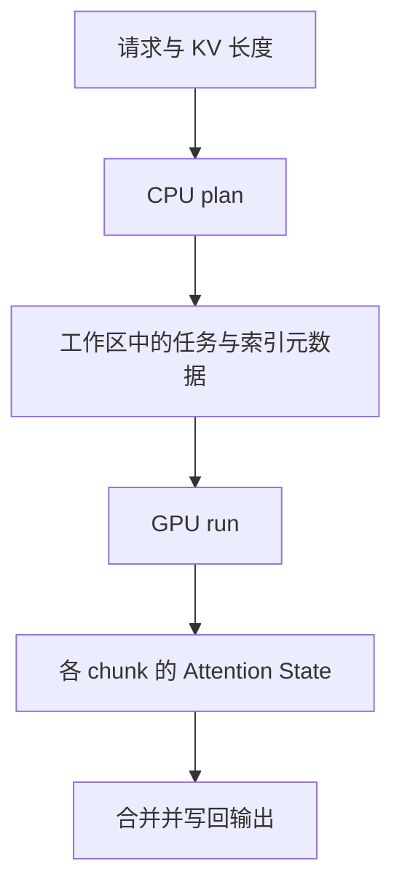

# FlashInfer：动态 Attention 如何统一表示、编译与调度

许多请求可以使用相同的 Attention 公式，却拥有不同长度、KV 布局、共享前缀和 mask。高性能算子因此不仅要计算矩阵乘，还要理解“这个 query 访问哪些 KV、这些数据在哪里、怎样把工作分给 GPU”。FlashInfer 将这些变化组织成表示、编译和调度三个相互配合的层次。

本文讨论 [FlashInfer: Efficient and Customizable Attention Engine for LLM Inference Serving](https://arxiv.org/abs/2501.01005)，发表于 MLSys 2025。以下解释以论文设计为范围；教学算例不代表实际 API 的全部约束，当前接口与支持范围需对照所用版本。

前置是 [Transformer 与 KV](../10_Inference_Serving/Transformer执行与KV基础.md)和 [GPU 执行](../03_Hardware_Systems/GPU执行与内存基础.md)。正文保留理解本篇所需的短回顾，重点展开 FlashInfer 的表示、状态合并与计划执行。

<details>
<summary>文章导航</summary>

- [从连续张量到动态访问关系](#从连续张量到动态访问关系)
- [用块稀疏表示描述 query 与 KV 的连接](#用块稀疏表示描述-query-与-kv-的连接)
- [复用程度怎样改变算术强度](#复用程度怎样改变算术强度)
- [变体怎样进入同一个 Attention 模板](#变体怎样进入同一个-attention-模板)
- [从长尾请求到可以调度的小任务](#从长尾请求到可以调度的小任务)
- [Attention State：局部归一化怎样正确合并](#attention-state局部归一化怎样正确合并)
- [Plan / Run：让动态工作兼容相对固定的执行结构](#plan--run让动态工作兼容相对固定的执行结构)
- [它在推理系统中负责哪一层](#它在推理系统中负责哪一层)
- [怎样理解论文中的收益](#怎样理解论文中的收益)

</details>

## 从连续张量到动态访问关系

标准缩放点积 Attention 为 $O=\operatorname{softmax}(QK^T/\sqrt d)V$。KV cache 保存历史 token 已计算的 K/V，避免在每一步生成时重新投影全部历史；新 query 仍需访问可见历史。Prefill 一次处理多个 query，decode 通常每请求只有一个新 query，因此二者的复用机会和并行度不同。

例如长度为 1000 的 prompt 对应 $Q_{1000\times d}K^T_{d\times1000}$；下一步 decode 则接近 $Q_{1\times d}K^T_{d\times1001}$。后者搬运较长 KV，却只产生一行输出。这里的形状是单 head 示意，batch、head 和精度还会改变实际负载。

在线服务进一步改变数据组织：请求不断进入、结束，长度可能分别为 300、15000 和 2000。分页允许逻辑 KV 块映射到不连续的物理块，如 `[7,31,4,99]`；前缀缓存又让多个请求指向同一段物理 KV。100 个请求共享 3000-token 前缀时，共享存储能够避免保存 100 份，但不自动保证每次计算只从 HBM 读取一次。

| 已有设计 | 改善的成本 | 留给算子的新问题 |
|---|---|---|
| FlashAttention 的分块与在线归一化 | 中间矩阵的 HBM 读写 | 怎样适应不同 query 数、mask 和布局？ |
| PagedAttention 的分页 | KV 预留与碎片 | 怎样按页表找到不连续的 KV？ |
| RadixAttention 的前缀复用 | 重复前缀计算与存储 | 怎样让多个 query 在计算时也复用公共 KV？ |
| Sliding Window、稀疏 mask、树状请求 | 改变可见历史或生成结构 | 怎样描述不同 query 的访问集合？ |

这些机制可以组合。FlashInfer 关注的是它们组合之后的执行问题；完整设计演进见[推理 Runtime 技术演化](11_LLM推理Runtime技术演化总览.md)。

## 用块稀疏表示描述 query 与 KV 的连接

把 query 作为行、KV block 作为列：某个 query 需要访问某块 KV，就存在一条连接。这样，页表、前缀共享、树状访问和稀疏 mask 可以转换为算子可消费的访问关系。

```text
          KV block
          0 1 2 3 4 5
Query A   █ █ █ . . .
Query B   █ █ █ █ . .
Query C   █ █ █ . █ █
```

普通稀疏矩阵可以逐元素记录非零位置，例如：

$$
A=\begin{bmatrix}
1&0&0&3\\
0&0&4&0\\
0&5&0&0
\end{bmatrix}.
$$

块稀疏表示把记录粒度扩大为一块数据，便于 GPU 以 tile 粒度加载与计算。BSR（Block Sparse Row）等格式使用行边界和块索引描述访问；`indptr` 标明每行索引段的边界，`indices` 标明对应块。这些元数据不是 KV 数值本身。

这种表示类似编译器中间表示：上层可以有不同缓存结构，下层通过共同的访问语义选择实现。但抽象统一不意味着物理布局相同，也不意味着所有 mask 都具有相同稀疏率或性能。

### Composable Formats：把共享存储变成共享读取

上例的前三个 KV block 被 A、B、C 共同访问。它们在连接矩阵中形成一个稠密子块，剩余访问则分别属于不同请求。

```text
公共部分：多个 query × 相同 KV blocks → 可共同加载和复用
私有部分：每个 query × 自己的 suffix → 分别计算
两部分的归一化状态 → 正确合并 → 完整输出
```

如果三个 query 独立执行，公共 KV 可能被重复读取；将公共部分按多 query 组织，则有机会把同一份 KV 搬到 shared memory 后复用。Composable Formats 用不同粒度的视图表达公共部分和私有部分，并通过 `indices`、`indptr` 等元数据关联底层存储，不一定需要重排 KV 数值。

这里留下一个数学问题：公共前缀与私有后缀分别计算 Softmax 后，结果不能直接相加。后文的 Attention State 合并负责保持整行归一化。

## 复用程度怎样改变算术强度

运算强度 OI（Operational Intensity）是 FLOPs 与搬运字节数之比。在固定 head dimension、dtype 和相应访存假设下，论文讨论的数量级关系为：

$$
OI=O\left(\frac{1}{1/l_{qo}+1/l_{kv}}\right),
$$

其中 $l_{qo}$ 是 query/output 长度，$l_{kv}$ 是 KV 长度。常见 $l_{qo}\le l_{kv}$ 的情形可近似写成 $O(l_{qo})$：prefill 的多个 query 可以复用 KV；单请求 decode 的 $l_{qo}=1$，这项复用较少。因此长 KV decode 的 Attention 更容易受数据搬运限制，但实际瓶颈还依赖 batch、head、实现和并行度。

GQA 也能增加复用。若有 32 个 query head、8 个 KV head，则分组比为：

$$
g=\frac{H_q}{H_{kv}}=4.
$$

多个 query head 使用同一份 K/V，既减少缓存容量，也给算子提供复用机会。能否把逻辑共享变成更少的 HBM 流量，取决于布局与执行方式。Register/shared memory、L2 和 HBM 的通用层次见[GPU 内存基础](../03_Hardware_Systems/GPU执行与内存基础.md)，这里关注它们如何服务于 query/KV 复用。

## 变体怎样进入同一个 Attention 模板

RoPE、Sliding Window、Custom Mask、Logits Soft Cap、FlashSigmoid、MLA 等改变的位置和状态各不相同。为每个组合重写整个 kernel 会增加维护成本。论文的可定制模板将若干变化表达为计算阶段中的定制点：

```text
QueryTransform / KeyTransform / ValueTransform
                     ↓
                    QKᵀ
                     ↓
           LogitsTransform / LogitsMask
                     ↓
                  Softmax
                     ↓
                    × V
                     ↓
               OutputTransform
```

模板复用计算骨架，但具体变体仍需与布局、数值语义和实现支持相容，不能仅凭名称把所有结构视为可互换插件。

以 RoPE 为例，分离实现会先旋转 Q/K、把结果写入 HBM，再由 Attention 读取。融合实现可以在加载后的寄存器或片上状态中完成变换，减少中间结果的一次写回与读取。省下的是数据往返；是否更快还取决于新增指令、寄存器和目标形状。

### JIT 与 tile：定制在哪里完成

JIT（Just-In-Time，即时编译）在知道配置后生成特化 kernel。例如 `GPU=H100`、`head_dim=128`、`dtype=FP16`、sliding-window mask 和某组 query/KV tile 参数，可以共同决定编译实例。编译期专门化减少部分运行时分支，但有编译、缓存和配置管理成本。一般编译机制见[编译器分层](../06_Compilers/编译器分层与执行图.md)。

Tile 也不能只用一个配置。Query 长度 4096 时，128-row query tile 有较多有效工作；query 长度为 1 时，相同 tile 可能浪费大部分资源。Prefill 和 decode 因此需要不同的复用与并行度权衡，不能从“大 tile 的吞吐高”推出所有请求都应使用大 tile。

## 从长尾请求到可以调度的小任务

假设四个请求的 KV 长度为 `[100,200,10000,80]`。一个 CTA（Cooperative Thread Array，即 CUDA thread block）处理一个请求时，前三个短任务很快结束，最长任务仍在运行。CTA 被安排在 SM 上执行；任务时长差异会让部分执行资源提前空闲。

将长度 10000 的 KV 拆成五个 2000-token chunk，任务集合变成 `[A,B,C1,C2,C3,C4,C5,D]`，便于平衡工作。原文用如下形式的成本估计讨论调度：

$$
\operatorname{cost}(l_q,l_{kv})=\alpha l_q+\beta l_{kv}.
$$

这里 $\alpha,\beta$ 是模型中的成本系数，不是通用硬件常数；形状、内核、设备和合并开销会影响实际收益。分块增加并行任务，也增加部分输出和归并工作，因此不能无限切小。

这一问题在长度 `[1024,1024,1024,1024]` 的规则负载下不明显，在 `[100,200,1000,50000]` 的偏斜负载下却可能突出。平均长度无法描述最长任务对完成时间的影响。

## Attention State：局部归一化怎样正确合并

对于同一个 query，设 $s_i$ 为已经应用相同 scale、位置与 mask 规则的 score，I 和 J 是**不重叠**的可见 KV 集合。定义：

$$
Z_I=\sum_{i\in I}e^{s_i},\qquad
O_I=\frac{\sum_{i\in I}e^{s_i}v_i}{Z_I}.
$$

局部输出 $O_I,O_J$ 已分别归一化，因此 $O_I+O_J$ 通常不等于完整 Attention。正确合并为：

$$
O_{I\cup J}=\frac{Z_IO_I+Z_JO_J}{Z_I+Z_J}.
$$

每个 chunk 因而需要返回输出与归一化信息。使用 $L_I=\log Z_I$，可将状态写成 $(O_I,L_I)$，其中 LSE 是 Log-Sum-Exp。为避免直接求很大的指数，令 $m=\max(L_I,L_J)$：

$$
a=e^{L_I-m},\quad b=e^{L_J-m},\quad
O=\frac{aO_I+bO_J}{a+b},\quad
L=m+\log(a+b).
$$

例如教学分数为 $[0,\ln2,\ln4,\ln8]$，value 为 $[1,2,3,4]$。前半块 $Z_I=3,O_I=5/3$，后半块 $Z_J=12,O_J=11/3$；完整结果为 $(5+44)/15=49/15$，而直接相加得到 $16/3$。这个例子与[在线 Softmax 源码导读](../13_Source_Analysis/flash_attention/01_algorithm_and_online_softmax.md)使用同一组数值。

用 $A\oplus B$ 表示状态合并，对满足条件的集合，实数数学中有：

$$
(A\oplus B)\oplus C=A\oplus(B\oplus C),\qquad A\oplus B=B\oplus A.
$$

这允许先拆 KV、并行计算，再按调度顺序归并。浮点舍入使不同归并顺序未必逐位相同；重叠集合会重复计数，全部被 mask 的空状态也需要专门的接口约定，不能直接计算 $-\infty-(-\infty)$。

共享前缀与私有后缀、长 KV 的多个 chunk 都可以借助这种状态组合。它将数学正确性与任务如何切分联系起来，后续调度无需假装每个 chunk 都是一个独立完整请求。

## Plan / Run：让动态工作兼容相对固定的执行结构

Decode 每步会改变长度，旧请求结束、新请求加入；CPU 若逐次提交大量短 kernel，launch 开销可能明显。CUDA Graph 通过捕获与回放减少重复提交成本，但被捕获执行的结构、地址和资源安排需要满足相应约束。

Plan/Run 分离把“这一步处理哪些任务”表达为元数据变化：



Plan 根据长度等信息安排 chunk 与 CTA 工作；Run 消费工作区中的计划，在允许的容量和配置范围内复用较稳定的 grid、workspace 地址与 kernel 结构。变化进入任务表，而不一定进入每一步的提交拓扑。可以概括为 **Dynamic Plan + Static Run**。

这里的“静态”不是无限容量保证：工作区、捕获形状或实现约束不满足时，仍需选择合适路径。Plan 也有主机成本，所以分析收益时要把计划生成、元数据传输、GPU 计算与状态合并一起计入。

## 它在推理系统中负责哪一层

| 层次 | 主要职责 |
|---|---|
| 应用 | 对话、Agent、搜索等任务语义 |
| vLLM、SGLang、MLC 等服务引擎 | 请求准入、batch、KV 生命周期与前缀缓存 |
| FlashInfer 一类算子执行库 | Attention 布局、变体特化、GPU 任务安排与执行 |
| CUDA 等执行环境与 GPU | 实际提交、同步、指令和设备资源 |

引擎可以选择 FlashInfer 作为相关计算后端，二者不是同一层面的替代品。Triton 是编写 GPU kernel 的 DSL，CUDA 提供编程与执行机制；FlashInfer 则组织特定领域的算子、编译与运行时。库内的 GPU 任务调度也不等于服务引擎的请求准入调度。

## 怎样理解论文中的收益

论文的性能结论需要放回其 GPU、模型、batch、长度分布、引擎、backend 和版本条件。不同设计应对应不同证据：共享前缀的格式组合是否减少 HBM 读取，融合变体是否减少往返，分块调度是否缓解长尾，Plan/Run 是否降低提交成本，以及这些变化是否改善 TTFT（首 token 延迟）或 ITL（相邻 token 间隔）。

本篇没有把论文加速比当成通用收益，也没有把这些示意数字当成实际测量。对照原文时，Figure 2 的布局表示、Figure 3 的 composable formats、状态合并与调度部分分别支撑不同论点。实现入口如 `BatchDecodeWithPagedKVCacheWrapper` 的参数与生命周期应按使用版本理解。

读到这里，可以继续沿 [SGLang 的请求路径](../13_Source_Analysis/sglang/01_foundations/02_process_topology_and_request_path.md)看引擎怎样准备和消费算子状态，或沿[推理性能](../12_Performance_Reliability/05_inference.md)看局部收益何时转化为服务容量。FlashInfer 将布局、计算变体和工作长度分别表达出来，使各层能针对自己的变化做特化；这也是理解其整体设计的连接点。
