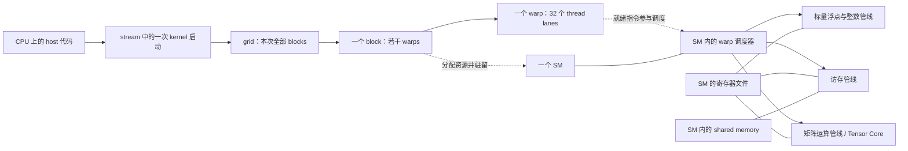

# 1. 把 CUDA 程序放到真实 GPU 上理解

[上一章](00_setup.md) · [目录](README.md) · [下一章：核心 kernel](02_core_kernels.md)

本章沿一次 kernel 的执行，把三件事连起来：**程序怎样分工 → 硬件怎样承接 → 数据与依赖怎样限制执行**。先以常规独立显存的 NVIDIA GPU 和普通 thread-block kernel 为模型；具体容量、执行管线与缓存策略随架构变化。第 7–9 章再将它扩展到 SM80 的矩阵乘与 FA2。

<a id="hardware-map"></a>

## 1.1 两套层次之间是映射，不是一一对应

CUDA 的 grid/block/warp/thread 描述一份工作的组织；GPU/SM/调度器/运算管线描述执行它的机器。把二者画在一起：



实线表示提交、组成或硬件联系，虚线表示软件工作映射到硬件。图只保留入门所需部件，不表示每个 SM 只有一个调度器，也不表示所有架构具有相同的内部连接。

| CUDA 中看到什么 | 由硬件怎样承接 | 直接影响怎样写代码 |
|---|---|---|
| grid | blocks 被分配到可用 SM，可能分批执行 | grid 可以比 SM 数多得多，不依赖 block 编号的执行顺序 |
| block / CTA | 普通 block 的线程在同一个 SM 上执行，获得本块所需资源 | 块内能共享 shared、用 block barrier 协作 |
| warp | SM 的调度器从可发射的 warp 中选择指令 | 关注同一 warp 的分支、地址和数据依赖 |
| thread / lane | 保留自己的逻辑状态，指令使用 SM 的相应管线执行 | 一个线程不永久占有一颗 CUDA Core |
| thread 的局部值 | 编译器通常分配到 SM 寄存器文件中的资源 | 寄存器使用量会限制能驻留的线程数 |
| block 的 shared 数组 | SM 上按 block 分配的片上存储 | shared 越大，可能容纳的 block 越少 |

**CUDA Core 和 Tensor Core 是运算资源，不是额外一级线程容器。** 指令类型决定使用哪类管线：普通加法、地址计算、加载以及矩阵乘加不会全由同一种“核心”处理。SM 可以划分为多个处理分区；先掌握资源作用域，之后才需要查某代芯片有几个调度器、多少个执行单元。

GPC 是比 SM 更高一级的硬件组织；在本教程的普通 kernel 中不用指定它。支持 thread-block cluster 的新架构提供额外协作机制，但那是显式启用的另一层约束，不能推导出任意两个普通 block 都能共享彼此的 shared。模型与适用范围见 [NVIDIA Programming Model](https://docs.nvidia.com/cuda/cuda-programming-guide/01-introduction/programming-model.html)。

## 1.2 从一条加法表达式得到线程分工

CPU 依次算 `c[0]`、`c[1]`……；GPU 版本让许多逻辑线程执行同一个函数，各自计算下标：

```cpp
__global__ void vector_add(const float* a, const float* b, float* c, int n) {
    int i = blockIdx.x * blockDim.x + threadIdx.x;
    if (i < n) c[i] = a[i] + b[i];
}
```

host 端启动：

```cpp
int threads = 256;
int blocks = (n + threads - 1) / threads;
vector_add<<<blocks, threads>>>(d_a, d_b, d_c, n);
```

`threadIdx.x` 是块内编号，`blockIdx.x` 是块编号，`blockDim.x` 是每块线程数。`<<<blocks,threads>>>` 指定工作组织，不指定 SM 编号。`(n+B-1)/B` 对正整数向上取整，本例只处理不会使表达式溢出的正 int；通用接口另需处理 n=0 和超大数组。

取 n=1000：启动 4 个 block，每块 256 线程、8 个 warp。block 3 的 thread 231 对应 `3*256+231=999`，之后的 24 个线程不读写数据。末尾 warp 仍然存在，只是这条加法语句有些 lane 不活跃。

线程编号与数据下标由程序决定；线程落在哪个 SM 不应影响它算出的答案。这就是同一份 kernel 可以适配不同 SM 数量 GPU 的基础。

<a id="launch-journey"></a>

## 1.3 跟踪 block 3 的一个 warp

仍看上面的加法，忽略初始化和传输，跟踪 block 3 的 warp 0：

| 步骤 | 代码中的含义 | 硬件正在处理什么 |
|---|---|---|
| 提交 | CPU 执行 kernel launch | CUDA 提交工作；通常不等 GPU 算完才返回 |
| 驻留 | block 3 获得执行机会 | 某个 SM 为该 block 分配寄存器、warp/block 槽位等资源 |
| 算地址 | lane t 得到 i=768+t | 每条 lane 计算自己的索引与地址 |
| 加载 | 读 a[i]、b[i] | warp 的访存请求由访存管线处理，可能命中缓存或访问显存 |
| 等依赖 | 加法需要输入值 | 若输入还没到，该 warp 的相关指令暂不可发射；调度器可选别的就绪 warp |
| 计算 | `a[i]+b[i]` | 浮点管线使用各 lane 的操作数，结果保存在各自的寄存器值中 |
| 写回与结束 | 写 c[i]，所有线程完成 | 发出 global store；block 完成后释放其驻留资源，供待执行 block 使用 |

这不是逐周期的硬件仿真，也不规定实际指令数；编译器可以重排独立操作。关键是区分三种状态：**resident（资源已驻留）→ eligible（下一条指令可发射）→ issued（本次已发射）**。issued 后还要经过执行延迟，不能等同于结果已就绪。

一个 SM 通常能让多个 warp 驻留，但同一时刻能发射多少、到哪些管线，取决于架构与就绪条件。GPU 用其他 warp 的工作遮住等待时间，这叫隐藏延迟；它没有把一次显存访问本身变成零延迟。切换这些已驻留 warp，不需要每次先把它们的全部寄存器搬回显存。

同一 warp 的 lane 可以走不同分支，硬件通过活跃 mask 等机制执行相应路径。不要因此认为 32 个 lane 永远在每一步自动同步；涉及跨线程数据交换时仍要使用正确的同步原语。执行与调度的细节见 [Advanced Kernel Programming](https://docs.nvidia.com/cuda/cuda-programming-guide/03-advanced/advanced-kernel-programming.html)。

<a id="memory-paths"></a>

## 1.4 数据放在哪里：地址空间与物理存储一起看

执行资源之外，还要知道数据的落点：

```text
CPU 内存 ── 显式 H2D/D2H 等传输 ── GPU 的设备内存（HBM 或 GDDR）
                                       ↕
                                  GPU 的 L2 cache
                                       ↕
            SM 内：L1 cache、访存管线、寄存器文件、shared memory、运算管线
```

这是一张位置关系图，**不是所有数据必须逐站经过的串行通道**。例如 global load 可以通过缓存到寄存器，不必先进入 shared；global→shared 异步拷贝又有专门路径。缓存是否使用、是否绕过某级，取决于指令与架构。

| 代码或概念 | 程序中的作用域 | 典型物理落点 | 与上一张执行图的连接 |
|---|---|---|---|
| `cudaMalloc` 得到的 global 数据 | 有有效指针的设备线程可访问 | 设备 DRAM 支持，访问可能命中 L1/L2 | 不同 SM 可访问同一输入，但共享地址不等于完成了同步 |
| `__shared__ float s[...]` | 本教程中是当前 block | 当前 SM 的 shared 存储 | 一个 block 的多个 warp 能交换中间值 |
| `float acc` 等线程局部值 | 当前线程 | 常由 SM 寄存器文件承载 | 参与算术指令，数量影响 block 能否驻留 |
| local memory | 逻辑上当前线程私有 | 设备内存支持，可经过缓存 | spill 或某些数组可能访问这里；“local”不意味着片上高速 |
| L1/L2 cache | 硬件维护的访问缓存 | 片上 cache | 对 global 数据的命中可减少更远处的流量，普通代码不逐项声明它们 |

global/local/shared 是编程可见的存储概念，HBM/GDDR、SRAM、cache、寄存器文件是物理实现概念。global 不能直接等同于“每次都读 HBM”；一个 C++ 局部变量也不保证一定放在寄存器。

许多现代架构的 L1 与 shared 使用可配置的片上资源，但它们的**使用语义不同**：cache 由硬件管理命中和替换，shared 的内容、布局与协作时序由程序显式安排。把它们写作“shared/L1”时，不能理解成程序里可互换的同一种数组。具体架构可查 [Ampere Tuning Guide](https://docs.nvidia.com/cuda/ampere-tuning-guide/index.html)。

以普通同步加载的 tiled GEMM 为例，数据路径是：

```text
A/B 的 global 数据 → 加载到线程临时值 → 存入 shared tile
                                            ↓ 块内协作与复用
                            读入各线程操作数 → 运算管线 → acc
                                                               ↓
                                                        C 的 global 输出
```

寄存器文件在物理上属于 SM，但每条线程的寄存器值在逻辑上独立；同在一个 SM 的线程并不能任意按地址读取彼此的寄存器。shuffle 是特定的 warp 内交换机制，shared 则能用于更大的 block 范围。

## 1.5 连续地址为什么要和 warp 一起考虑

行优先矩阵 A[M,K] 的 `(row,col)` 在 `A[row*K+col]`。K=5 时 `(2,3)` 的元素偏移为 13，FP32 字节偏移为 52。PyTorch 的非连续 view 则使用 `row*stride_row+col*stride_col`，stride 以元素为单位。

如果 warp 的 lane t 读 `a[base+t]`，32 个 FP32 数连续覆盖 128 字节；读 `a[base+128*t]` 则将地址分散开。硬件以 warp 的请求集合组织内存事务，前者通常更容易合并。128 字节是这里的有效数据量，不是在所有对齐条件下固定只发一次事务；实际访问粒度与缓存行为需按架构核对。

二维 block 的线程编号先让 x 增长：

```text
linear_tid = threadIdx.x + blockDim.x * (threadIdx.y + blockDim.y * threadIdx.z)
warp = linear_tid // 32
lane = linear_tid % 32
```

因此第 2 章的 `dim3(16,16)` 仍有 256 线程、8 个 warp；warp 0 覆盖 y=0 与 y=1 两行，各 16 个 x。**二维 block 不等于物理上按二维摆放的运算单元。** 合并访存时要看这 32 个线程的实际地址，而不是只看矩阵画成了几行几列。

shared 的访问还要考虑 bank，即内部存储分区；global 合并访存和 shared bank conflict 是不同问题。第 7 章在布局变换时继续解释，初学时先确保索引和同步正确。

<a id="synchronization"></a>

## 1.6 同步范围为何与这些层次有关

| 需要协调的对象 | 本教程中的工具 | 为什么在这里用 |
|---|---|---|
| 同一 warp 的寄存器片段 | 合法参与 mask 的 shuffle；需要时用 `__syncwarp` 协调内存 | 不必经由整块 shared 完成所有交换 |
| 同一 block 的 shared 生产者与消费者 | `__syncthreads()` | block 的全部 warp 在一个协作范围内等待，建立所需可见性 |
| 前后两个 kernel | 同 stream 的执行顺序 | 后一个 kernel 可以读取前一个 kernel 的输出 |
| 不同 stream 的依赖 | event + `cudaStreamWaitEvent` | 明确指定生产完成后消费者才开始 |
| CPU 要使用 GPU 结果 | stream/device/event 同步或相应同步拷贝 | host 提交完并不意味着 device 已完成 |

同一 SM 上两个普通 block 的 shared 区域依然相互独立；SM 不是 `__syncthreads()` 的同步作用域。两个 block 能访问同一 global 地址或命中同一个 L2，也不会因此自动满足执行顺序。

为什么不用一个普通 block 自旋等待另一个 block？如果等待者占满可用驻留资源，被等待者可能尚未获得执行机会，造成无法推进。入门算法将跨 block 的依赖放到独立 kernel 阶段中；特殊的 cooperative launch 等机制必须单独满足其约束。

有 barrier 的代码，先让块内线程以一致顺序参与；尾部无数据的线程填中性值，不把 barrier 放入只有部分线程进入的分支。异步拷贝还要分别检查“传输完成”和“线程协作完成”，见第 8 章。

stream 是软件的有序工作队列，**不独占一个 SM**；一个 kernel 可使用多个 SM，不同 stream 的工作也可能竞争同一组 SM。`cudaGetLastError()` 检查启动等错误，异步执行错误还需在同步点检查。

<a id="residency"></a>

## 1.7 为什么改变 block 大小或 tile 大小会改变并行度

block 进入 SM 时需要同时获得多种资源。下面是**教学假设，不对应某款实际 GPU 的完整规格**：一个 SM 最多驻留 2048 线程、64 warp、16 blocks，具有 65536 个 32-bit 寄存器以及 64 KiB 可供本例使用的 shared。

若一个 kernel 每块 T=256 线程、每线程 R=32 个寄存器、每块 S=16 KiB shared，粗略预算为：

```text
线程限制：2048 / 256 = 8 blocks
warp 限制：64 / 8 = 8 blocks
寄存器限制：65536 / (256*32) = 8 blocks
shared 限制：64 KiB / 16 KiB = 4 blocks
block 槽位限制：16 blocks
取最小值：每个 SM 最多 4 blocks，即 32 resident warps
理论 occupancy = 32 / 64 = 50%
```

寄存器单位是 32-bit 个数，不是字节。这里暂时忽略分配粒度、每 block 限制、SM 分区以及架构保留量；真实结果要用编译产物和 occupancy API 核对。

| 只修改一个条件 | 粗略 blocks/SM | resident warps/SM | 理论 occupancy |
|---|---:|---:|---:|
| 基线 T=256、R=32、S=16 KiB | 4 | 32 | 50% |
| S 增大到 32 KiB | 2 | 16 | 25% |
| R 增大到 96 | 2 | 16 | 25% |
| T 减小到 128，R/S 不变 | 4 | 16 | 25% |

这解释了为什么“大 tile 复用更多数据”和“更多 block 同时驻留”可能互相制约；也解释了减少线程数不一定增加可驻留 block。优化要比较减少的流量、增加的资源和真实时间，不能只追求最大 occupancy。

再假设 GPU 有 4 个这样的 SM，则基线容量为 16 blocks。grid 有 20 blocks 时，不可能同时全部驻留；某块完成即可让后续块获得资源，并不需要全 GPU 集体等一整波结束。反过来，grid 只有 2 blocks 时，即使 API 算出每 SM 可容纳 4 blocks，也无法让 4 个 SM 都得到一个 block。

**理论 occupancy、实际 achieved occupancy、设备是否繁忙、Tensor Core 利用率是不同指标。** resident warp 不一定就绪，而就绪也不等于已经发射。资源预算只是解释性能的起点。

## 1.8 用本教程自己的 kernel 查询实际机器

第 2 章的完整 [cuda_basics.cu](examples/cuda_basics.cu) 会在运行实验前打印设备 SM 数、warp 大小、线程/寄存器/shared 资源，以及编译后的 `matmul_tiled` 寄存器和 shared 用量。它使用：

```cpp
cudaGetDeviceProperties(&prop, device);
cudaFuncGetAttributes(&attr, matmul_tiled);
cudaOccupancyMaxActiveBlocksPerMultiprocessor(&active_blocks, matmul_tiled, TILE*TILE, 0);
```

最后的 0 表示这个 kernel 没有额外的动态 shared；静态 `as/bs` 用量由编译后的函数属性提供，不应再手工加一遍。TILE=16 时，两个 FP32 shared 数组的源码预算为 `2*16*16*4=2048` 字节；编译器报告是实际对照依据。寄存器数不能通过数一数 C++ 变量名得出。

occupancy API 给的是给定 kernel、block 大小、动态 shared 请求与当前设备配置下的驻留容量估算，不是实际调度轨迹。第 2 章的小矩阵正确性用例本身 grid 很小，不能用它的设备利用率评价大矩阵性能。定义见 [CUDA Best Practices：Occupancy](https://docs.nvidia.com/cuda/cuda-c-best-practices-guide/index.html#occupancy)。

本机没有 CUDA 环境，该资源打印逻辑仍待目标机器编译执行。无 GPU 时先运行 `python3 docs/cuda_tutorial/examples/cpu_walkthrough.py`，核对上一节的教学预算与二维线程编号；它不模拟真实硬件调度。

<a id="mapping-exercises"></a>

## 1.9 把后续每个算子都接回这张图

| 后续章节 | 对照硬件时问什么 |
|---|---|
| 向量加法 | 一个 warp 的地址连续吗？等待输入时还有哪些就绪 warp？ |
| tiled GEMM | 一个 block 负责多大 C tile？shared 复用了哪些 A/B？acc 占多少线程状态？ |
| Softmax | 统计量先在线程内合并，再在 warp、block 范围如何交换？ |
| 在线 Attention | 哪些 S/P 不再作为完整 global 中间量保存？片上状态因此增加多少？ |
| Tensor Core/CuTe | 指令需要怎样的协作片段？搬运布局与计算布局如何交接？ |
| 异步流水 | 搬运能否与运算重叠？新增 shared 缓冲会不会减少驻留？ |
| FA2 前向 | 数学更新、线程所有权、物理存储和等待条件是否同时对得上？ |

自查：

1. 256 线程是不是需要独占 256 颗 CUDA Core？不是；这是 8 个逻辑 warp，指令分时使用执行资源。
2. 两个 block 分到同一个 SM，能否直接共享各自的 `__shared__` 数组？普通 block 不能；物理上同属一个 SM 不改变程序作用域。
3. n=1000、B=256 时，最后一个有效元素由谁写？block 3 的 thread 231。
4. `dim3(16,16)` 中 thread `(5,2)` 属于哪个 warp/lane？线性编号 37，即 warp 1、lane 5。
5. 基线资源预算中，shared 从 16 KiB 增到 32 KiB 会怎样？驻留上限从 4 降到 2 blocks/SM；是否变慢仍需测量。
6. 一次 global load 必须经过 shared 吗？不必；shared 是程序选择的协作存储，不是强制途经的缓存层。

更完整的术语与架构背景可以查 [GPU 执行与内存基础](../../learn_docs/03_Hardware_Systems/GPU执行与内存基础.md) 和 [CUDA 执行模型与调度](../../learn_docs/03_Hardware_Systems/CUDA执行模型与调度.md)。本章把这些知识沿一段代码串起来，后续实验持续使用同一组对应关系。
